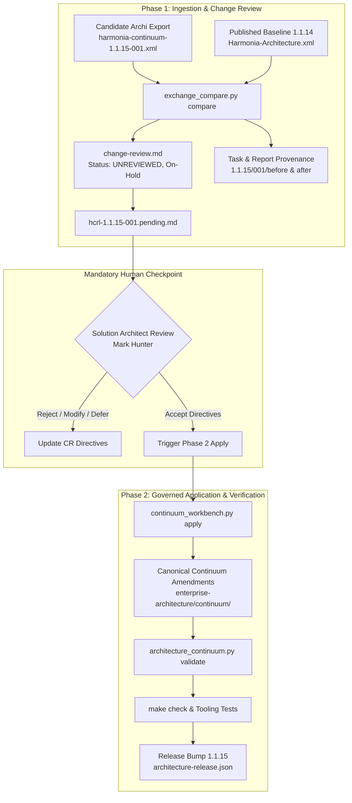

# Requirements

### Overview & Goals
The objective of this task is to execute the governed ArchiMate Round-Trip Engineering process for Harmonia Enterprise Architecture release `1.1.15` iteration `001`. The task evaluates the candidate ArchiMate Open Exchange model export located at `enterprise-architecture/design/evidence/1.1.15/001/before/harmonia-continuum-1.1.15-001.xml` against the established baseline `enterprise-architecture/design/archimate/published/1.1.14/Harmonia-Architecture.xml`.

The candidate model introduces the foundational Information Unit logical model structure under Calliope (`model.core.information.InformationUnit`) along with associated functional and non-functional requirement grouping structures and seven overview views, originating from the offline design proposal `enterprise-architecture/design/offline-design/DRP-Information-Unit-Framework.draft.002.md`. In strict adherence to repository governance rules (`AGENTS.md` and `enterprise-architecture/governance/archimate-round-trip-engineering-praxis.md`), this task executes Phase 1 of the round trip: pinning baseline evidence, validating input integrity, decomposing deltas into discrete Change Requests, emitting formal Task/Report provenance, initializing the pending HCRL iteration, and stopping at the mandatory Change Review Checkpoint for Solution Architect adjudication.

### Scope

#### In Scope
- Input pinning: Verifying and pinning exact SHA-256 digests and file sizes for baseline `1.1.14` and incoming `1.1.15-001` Open Exchange XML models.
- Automated model comparison: Running `exchange_compare.py compare` to establish empirical element, relationship, and view deltas.
- Change Review authoring: Generating `enterprise-architecture/design/review/1.1.15/change-review.md` with structured Change Requests (`CR-001` through `CR-006`) with default `On-Hold` dispositions and `Unresolved` outcomes.
- Evidence and provenance recording: Creating the formal Task under `enterprise-architecture/design/evidence/1.1.15/001/before/ai-agent-tasks/` and formal Report under `enterprise-architecture/design/evidence/1.1.15/001/after/ai-agent-reports/` with ISO 8601 UTC timestamp prefixes.
- HCRL initialization: Creating `enterprise-architecture/design/review/1.1.15/hcrl-1.1.15-001.pending.md` in the Decision Register.
- Checkpoint enforcement: Halting at the Change Review checkpoint awaiting Solution Architect adjudication.
- Governed application readiness: Outlining the subsequent application and verification steps once human directives are provided.

#### Out of Scope
- Unilateral continuum mutation: Authoring or modifying canonical elements in `enterprise-architecture/continuum/` prior to explicit Solution Architect adjudication.
- Implementation-level changes: Editing production Java source code across `calliope`, `hestia`, `mnemosyne`, or other application modules.
- Unilateral release bump: Modifying `architecture-release.json` before Solution Architect confirmation of incorporated release products.
- Git repository mutations: Executing commits, branches, merges, tags, or pushes (working tree preservation only).

### User Stories
- As a Solution Architect (Mark Hunter), I want an automated change review that identifies and classifies every proposed Archi change against the 1.1.14 baseline so that I can adjudicate each proposal individually without risking schema drift or accidental semantic regression.
- As a Solution Architect, I want the agent to strictly stop at the Change Review checkpoint so that no architectural intent is applied or assumed without my explicit review and directives.
- As an AI Agent Co-Executor, I want unambiguous provenance records (Task, Report, and HCRL) following Harmonia Architecture Change Provenance so that every step of the governed lifecycle is fully auditable and reproducible.

### Functional Requirements
- **FR-1 Exact Baseline Pinning**: The agent must pin baseline `Harmonia-Architecture.xml` (`1.1.14`, SHA-256 `ee1d7ef8d5491a4a656d8c2f07c38999b6276a130064d797a08f19501aa47161`) and submitted model `harmonia-continuum-1.1.15-001.xml` (`1.1.15-001`, SHA-256 `a31ed511c07e0a54c503383f6e52dfdad1e5905e642c05e7dc14fb7649af2eb9`).
- **FR-2 Delta Decomposition**: The agent must decompose the 12 new elements, 9 relationships, and 7 views into structured Change Requests categorized by architectural layer and concept.
- **FR-3 Anomaly Reporting**: The agent must identify and highlight any property anomalies, specifically the missing `Specialization` attribute on `[ClassPackage] core` and the empty node population of view `information-availability-management-requirements-overview`.
- **FR-4 Change Review Generation**: The agent must produce `enterprise-architecture/design/review/1.1.15/change-review.md` following the canonical template, initializing all items with Disposition `On-Hold` and Outcome `Unresolved`.
- **FR-5 Provenance Conformance**: Formal Task and Report records must include verifiable `Task-Issued-At` and `Report-Produced-At` UTC timestamps and match file naming prefixes (`YYYYMMDDTHHMMSSZ-<name>.md`), verified by `architecture_review_evidence.py`.
- **FR-6 Fail-Closed Checkpoint**: The agent must stop after producing `change-review.md`, pending HCRL, and formal Report, requiring human directive issuance before Phase 2.

### Non-Functional Requirements
- **NFR-1 Governance Compliance**: Strict compliance with `AGENTS.md`, `archimate-round-trip-engineering-praxis.md`, `architecture-change-provenance.md`, and `architecture-governance.md`.
- **NFR-2 Axiom Consistency**: Adherence to Architectural Axioms AX-04 (Engine Independence), AX-05 (Information Management Authority), AX-14 (Identity / Representation Separation), AX-15 (Explicit Uncertainty), and AX-17 (Fail-Closed Governance / Proposed vs Accepted Distinction).
- **NFR-3 Execution Boundedness**: All script executions must complete within bounded intervals (under 2 minutes for comparisons and validation checks).

# Technical Design

### Current Implementation
The repository is on branch `Data-Governence-Services` with the active canonical baseline established at RAD release `1.1.14` (`architecture-release.json`). The current Archi workbench projection is published at `enterprise-architecture/design/archimate/published/1.1.14/Harmonia-Architecture.xml` containing 1,602 semantic elements, 1,651 relationships, and 1,209 views.

The Solution Architect authored an updated model in Archi (`enterprise-architecture/design/archimate/working/harmona-1.1.15-001.archimate`) and exported the candidate Open Exchange file to `enterprise-architecture/design/evidence/1.1.15/001/before/harmonia-continuum-1.1.15-001.xml`. This update directly realizes the architectural concepts outlined in the offline design draft `enterprise-architecture/design/offline-design/DRP-Information-Unit-Framework.draft.002.md`, introducing the Calliope `InformationUnit` logical model and structured requirement groups.

### Key Decisions
- **Decision 1: Enforce Two-Phase Round-Trip Workflow with Fail-Closed Checkpoint**: In accordance with `archimate-round-trip-engineering-praxis.md` and `AGENTS.md` §1.5, the execution is strictly decoupled into Phase 1 (Discovery, Validation, Change Review generation, Task/Report emission, pending HCRL initialization) and Phase 2 (Application, Verification, Publication). Phase 1 terminates at the Change Review checkpoint; Phase 2 cannot commence without explicit Solution Architect directives.
- **Decision 2: Discrete Change Request Decomposition**: Rather than bundling all additions into a single opaque change request, the candidate elements are decomposed into six cohesive Change Requests (`CR-001` through `CR-006`) covering logical packaging, the core class, NFR requirement groups, functional requirement groups, functional requirements, and views.
- **Decision 3: Defer Canonical Identity Allocation to Phase 2 Application**: Canonical UUID32 identifiers will not be pre-allocated or assigned during Change Review authoring. New elements retain their Archi exchange identifiers in evidence until the Solution Architect renders an `Accept` disposition.
- **Decision 4: Retain Empirical Property Discrepancies as Discovery Evidence**: The missing `Specialization` attribute on `[ClassPackage] core` (id-a8f6eefb1d7a44a09acf06a41b59ffab) and the zero-node view (`information-availability-management-requirements-overview`) are recorded neutrally as discovery findings rather than being silently repaired or omitted.

### Proposed Changes & Delta Inventory

#### 1. Semantic Elements (12 New Elements, 0 Modified, 0 Removed)
- `CR-001 (Class Packages)`:
  - `id-8a0f2c41d3264f988442781309550cc0`: Grouping `[ClassPackage] model` (Specialization: `ClassPackage`)
  - `id-a8f6eefb1d7a44a09acf06a41b59ffab`: Grouping `[ClassPackage] core` (Specialization: None - flagged for review)
  - `id-74614b2b4bdd4897852e3483d597bd01`: Grouping `[ClassPackage] information` (Specialization: `ClassPackage`)
- `CR-002 (Logical Model Class)`:
  - `id-f5c345ab6c47433da11ee12f5d84e557`: DataObject `InformationUnit` (Specialization: `Class`)
- `CR-003 (Non-Functional Requirement Groups)`:
  - `id-812dcde922614fde87adbccc993d0294`: Grouping `[RequirementGroup] Non-Functional-Requirements`
  - `id-7a965baa4e6d46bd92a9b41433920d21`: Grouping `[RequirementGroup] Performance Requirements`
  - `id-9384a733b3b04279ace34e4fdca25409`: Grouping `[RequirementGroup] Disaster Recovery Requirements`
  - `id-a6e03ca37cb54e69b9052cd12d6642eb`: Grouping `[RequirementGroup] Availability`
  - `id-e373852f1b5a4d9bbe4c646b2f6615ed`: Grouping `[RequirementGroup] Information Availability`
- `CR-004 (Functional Requirement Groups)`:
  - `id-2f1bdf2e08464b8084ead4f7ae315e4a`: Grouping `[RequirementGroup] Functional Requirements`
  - `id-458ce11fb42643e48a71bfda600b0d08`: Grouping `[RequirementGroup] Information Management`
- `CR-005 (Functional Requirements)`:
  - `id-1dc1ebeceba74dec8fde94f14eff5ce1`: Requirement `[Requirement] Information Durability During Platform Failure`

#### 2. Relationships (9 New Compositions, 0 Modified, 0 Removed)
- `id-11f188596d0e4bb0a669caa4cfdfd7d5`: Composition `[ClassPackage] model` -> `[ClassPackage] core`
- `id-1bf19e908b514a7db10d38ecb022f938`: Composition `[ClassPackage] core` -> `[ClassPackage] information`
- `id-b63d27292ce9457b886a0b50e0534075`: Composition `[ClassPackage] information` -> `InformationUnit`
- `id-c4e3157f4c5441b2b370eff5a4450e7a`: Composition `[RequirementGroup] Functional Requirements` -> `[RequirementGroup] Information Management`
- `id-a1b10b97b59f46e98cc0a6b0d41a2687`: Composition `[RequirementGroup] Information Management` -> `[Requirement] Information Durability During Platform Failure`
- `id-171c590aa9a9420eb2f4941620fa31cd`: Composition `[RequirementGroup] Non-Functional-Requirements` -> `[RequirementGroup] Performance Requirements`
- `id-17958c7240b44bb8b58956e80b4535ff`: Composition `[RequirementGroup] Non-Functional-Requirements` -> `[RequirementGroup] Disaster Recovery Requirements`
- `id-47586d7d4bf4491ab66594bb8251d3fc`: Composition `[RequirementGroup] Non-Functional-Requirements` -> `[RequirementGroup] Availability`
- `id-3434cff3125743f491c966eb0225490a`: Composition `[RequirementGroup] Availability` -> `[RequirementGroup] Information Availability`

#### 3. Views (7 New Views, 0 Modified, 0 Removed)
- `CR-006 (Overview Diagrams)`:
  - `id-4927667988ca4a52b620d3d8436077b7`: `class-packages-overview` (3 nodes)
  - `id-25cb1748ba154926a59a25e4539c9096`: `information-package-overview` (2 nodes)
  - `id-35ab31e1f4d14980b0d33929462bb7b3`: `functional-requirements-overview` (2 nodes)
  - `id-0abeb9dfc5bc441299712f3ee08e49de`: `information-management-requirements-overview` (2 nodes)
  - `id-8009ccd75bd44bb78dfa7a7b6c6fdd80`: `non-functional-requirements-overview` (4 nodes)
  - `id-a313bbc71a524c139bb1018bb1960186`: `availability-requirements-overview` (2 nodes)
  - `id-e7190de0c6f64b5c99b74fa6be52eb05`: `information-availability-management-requirements-overview` (0 nodes)

### Architecture Diagram

### Risks & Mitigations
- **Premature Continuum Mutation**: Modifying canonical Markdown sources before Solution Architect adjudication violates fail-closed governance. *Mitigation*: Automated preflight strictly restricts Phase 1 to generating `change-review.md`, pending HCRL, and provenance records without touching `enterprise-architecture/continuum/`.
- **Specialization Tag Omission**: In Archi, `[ClassPackage] core` was authored without a `Specialization` attribute, which could lead to typing ambiguity during canonical element authoring. *Mitigation*: Explicitly flagged in `change-review.md` under `CR-001` so the Solution Architect can confirm whether `Specialization: ClassPackage` should be applied upon incorporation.
- **Empty View Definition**: View `information-availability-management-requirements-overview` contains zero visual nodes. *Mitigation*: Recorded as an empirical finding in `CR-006` for Solution Architect determination (retain as placeholder or omit).

# Testing

### Validation Approach
Verification follows the multi-stage governance validation framework established across `enterprise-architecture/tooling/`. All verification tools will run within the Python virtual environment (`/tmp/harmonia-tooling-venv`) with bounded execution times.

### Key Scenarios
- **Scenario 1: Input Integrity and Baseline Delta Verification**:
  - Run `exchange_compare.py compare` with `--baseline enterprise-architecture/design/archimate/published/1.1.14/Harmonia-Architecture.xml` and `--submitted enterprise-architecture/design/evidence/1.1.15/001/before/harmonia-continuum-1.1.15-001.xml`.
  - Expected Outcome: Comparison exits with status `DIFFERENCES`, confirming exactly 12 additional elements, 9 additional relationships, 7 additional views, and 0 missing or modified baseline entities.
- **Scenario 2: Provenance Layout and Timestamp Conformance**:
  - Run `architecture_review_evidence.py --version 1.1.15 --iteration 001`.
  - Expected Outcome: Returns `outcome: PASS`, verifying that the formal Task exists under `before/ai-agent-tasks/`, the formal Report exists under `after/ai-agent-reports/`, both have valid ISO 8601 UTC timestamps, and filenames strictly match the required `%Y%m%dT%H%M%SZ-` prefix format.
- **Scenario 3: Change Review Document Completeness**:
  - Inspect `enterprise-architecture/design/review/1.1.15/change-review.md`.
  - Expected Outcome: Verifies that all 12 elements, 9 relationships, and 7 views are accounted for across `CR-001` through `CR-006` with default `On-Hold` dispositions and `Unresolved` outcomes.
- **Scenario 4: Post-Adjudication Continuum Validation (Phase 2)**:
  - Run `architecture_continuum.py validate`.
  - Expected Outcome: Returns `status: PASS` across all continuum elements, relationships, predicates, bindings, and navigation folders.
- **Scenario 5: Full Tooling and Release Integrity Verification (Phase 2)**:
  - Run `python -m unittest discover -s enterprise-architecture/tooling -p "test_*.py"`.
  - Run `make -C enterprise-architecture check`.
  - Expected Outcome: All unit tests pass and all release integrity checks succeed.

### Edge Cases
- **Missing Specialization on `[ClassPackage] core`**: The validator must detect that `id-a8f6eefb1d7a44a09acf06a41b59ffab` does not declare a `Specialization` property. Handled by documenting the finding in `change-review.md` and awaiting directive adjudication.
- **Zero-Node View**: `id-e7190de0c6f64b5c99b74fa6be52eb05` contains zero visual nodes. Handled by recording the view's empirical node count in `change-review.md` without failing the comparison.
- **Bounded Execution Monitoring**: Any test or verification command taking longer than 2 minutes without observable progress must be terminated and diagnosed in accordance with `AGENTS.md` §5.1.

# Delivery Steps

### ✓ Step 1: Pin baseline evidence, register task, and execute model comparison
Baseline and submitted export hashes are pinned, the formal Task document is registered under iteration 1.1.15-001, and automated model comparison evidence is generated.

- Record formal AI-agent Task at `enterprise-architecture/design/evidence/1.1.15/001/before/ai-agent-tasks/` with an ISO 8601 UTC timestamp filename prefix and `Task-Issued-At` header capturing the operative instruction.
- Pin SHA-256 digests and file sizes for baseline `enterprise-architecture/design/archimate/published/1.1.14/Harmonia-Architecture.xml` and submitted model `enterprise-architecture/design/evidence/1.1.15/001/before/harmonia-continuum-1.1.15-001.xml`.
- Execute `exchange_compare.py compare` to generate structured JSON comparison evidence documenting zero baseline element mutations and the addition of 12 elements, 9 relationships, and 7 views.

### ✓ Step 2: Decompose model deltas and author Change Review document
A comprehensive change-review.md is generated following the governed template, establishing structured Change Requests with default On-Hold dispositions.

- Decompose the 12 new elements into discrete, bounded Change Requests: `CR-001` (Class Packages `model`, `core`, `information`), `CR-002` (Class `InformationUnit`), `CR-003` (Requirement Groups for NFRs), `CR-004` (Requirement Group for Functional Requirements), `CR-005` (Functional Requirement `Information Durability During Platform Failure`), and `CR-006` (7 Overview Views).
- Cross-reference the proposed elements with `enterprise-architecture/design/offline-design/DRP-Information-Unit-Framework.draft.002.md` and report the missing `Specialization` attribute on `[ClassPackage] core`.
- Author `enterprise-architecture/design/review/1.1.15/change-review.md` with status `UNREVIEWED`, default Disposition `On-Hold`, and Outcome `Unresolved` under the ArchiMate Round-Trip Engineering Praxis.

### ✓ Step 3: Initialize pending HCRL iteration 1.1.15-001 and emit formal Report
Pending HCRL iteration 001 is initialized in the Decision Register, and a formal AI-agent Report is emitted under the provenance contract.

- Author `enterprise-architecture/design/review/1.1.15/hcrl-1.1.15-001.pending.md` establishing the RAD-1.1.14 to RAD-1.1.15 review basis, linking DR-1 to `change-review.md`, and retaining findings as discovery evidence.
- Produce formal AI-agent Report at `enterprise-architecture/design/evidence/1.1.15/001/after/ai-agent-reports/` recording all comparison metrics, hashes, and change observations.
- Validate evidence directory layout and ISO 8601 UTC timestamp correspondence using `architecture_review_evidence.py --version 1.1.15 --iteration 001`.

### ✓ Step 4: Human Checkpoint — Await Solution Architect adjudication
The automated agent halts execution at the governed checkpoint to allow the Solution Architect to adjudicate Change Requests in change-review.md.

- Stop all processing in accordance with AGENTS.md §1.5 fail-closed governance rules and the ArchiMate Round-Trip Engineering Praxis Change Review checkpoint.
- Yield control to Mark Hunter (Solution Architect) to review Change Requests, assign Dispositions (`Accept`, `Reject`, `Modify`, `Defer`), and provide explicit Apply directives.
- Assert that no canonical continuum source files are mutated and no release version increments occur prior to human adjudication.

###   Step 5: Apply approved directives, update Continuum, and verify release integrity
Approved directives are applied to the canonical Continuum, views are updated, and full repository tooling validation passes.

- Consume adjudicated `change-review.md` and Solution Architect directives upon receipt of the operative instruction (`change-review.md reviewed and updated. Apply directives.`).
- Allocate canonical UUID32 identifiers and author canonical continuum Markdown elements under `enterprise-architecture/continuum/` following the Continuum Incorporation Praxis.
- Incorporate approved View definitions into `enterprise-architecture/design/archimate/templates/` and reproject the canonical model.
- Execute `architecture_continuum.py validate`, tooling test suite (`unittest discover`), and `make check` to verify repository integrity and reproducibility.