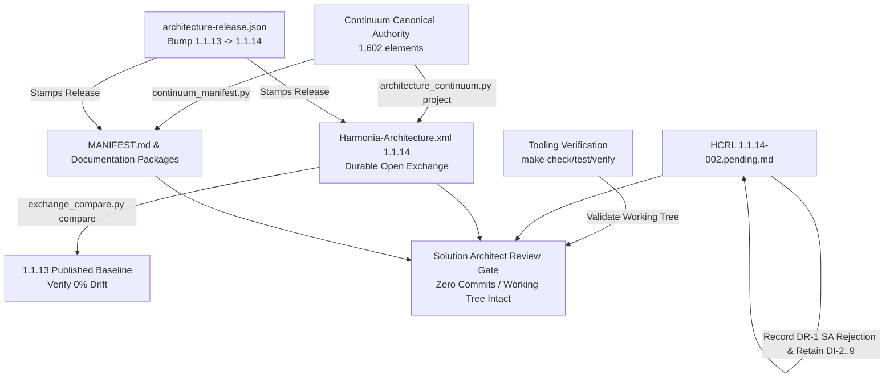

# Requirements

### Overview & Goals
- Close the Harmonia Enterprise Architecture 1.1.14 governance cycle and establish the completed 1.1.14 architecture release baseline in the working tree.
- Apply the Solution Architect's verbatim disposition on DR-1 rejecting the 1.1.14-002 review approach while retaining findings DI-2 through DI-9 as attributable discovery evidence.
- Produce durable 1.1.14 ArchiMate Open Exchange XML and derived documentation packages.
- Validate model identity, relationship, and View preservation via model comparison against the 1.1.13 baseline.
- Establish complete formal iteration-002 Task and Report provenance records and user-facing activity reporting under finite provenance rules.
- Strictly adhere to the additional Git constraint: prepare and validate the complete release state in the working tree with zero commits, pushes, merges, rebases, or other Git modifications, halting for Solution Architect review.

### Scope
- **In Scope**:
  - Setting up an isolated Python virtual environment (`/tmp/harmonia-tooling-venv`) with `enterprise-architecture/tooling/requirements.txt` dependencies and explicit Makefile runner.
  - Updating `enterprise-architecture/design/review/1.1.14/hcrl-1.1.14-002.pending.md` with verbatim SA disposition on DR-1, retaining DI-2..DI-9 as discovery evidence, decoupling forward DRP obligations, preserving iteration 001 accepted decisions (DR-2, DR-3, DI-1), and recording post-result confirmation pending.
  - Creating formal iteration-002 Task provenance under `enterprise-architecture/design/evidence/1.1.14/002/before/ai-agent-tasks/`.
  - Performing working-tree release increment `architecture_release.py bump --expect 1.1.13` to set release authority to 1.1.14 in `architecture-release.json` (uncommitted).
  - Generating durable 1.1.14 Open Exchange XML (`enterprise-architecture/design/archimate/published/1.1.14/Harmonia-Architecture.xml`), root `MANIFEST.md` header, and derived documentation packages (`enterprise-architecture/documentation/*/published/1.1.14/`) via `make all`.
  - Updating the active ArchiMate workbench pointer in `enterprise-architecture/design/archimate/README.md` to reference `published/1.1.14/Harmonia-Architecture.xml`.
  - Executing model comparison (`exchange_compare.py compare`) against the 1.1.13 baseline to verify model identity, relationship, and View preservation.
  - Running tooling verification targets (`make check`, `make verify-independent`, `make browser-test`).
  - Determining that conditional SA structural-review gates (§5:225–245) are not triggered, and recording Archi no-edit transport check as UNAVAILABLE due to missing Archi binary.
  - Authoring formal iteration-002 Report under `enterprise-architecture/design/evidence/1.1.14/002/after/ai-agent-reports/` and activity report under `.junie/reports/close-1.1.14-002-and-publish-1.1.14.md`.
  - Verifying repository cleanliness and halting for Solution Architect review with all changes prepared in the working tree and zero Git modifications.
- **Out of Scope**:
  - Committing, pushing, merging, rebasing, amending, tagging, or otherwise modifying Git history or remote repository state as part of this task, including after Solution Architect confirmation (any subsequent Git commit or push requires separate explicit instruction from the Solution Architect).
  - Registering `enterprise-architecture/design/register/1.1.14/hcrl-1.1.14-002.complete.md` prior to explicit Solution Architect post-result confirmation.
  - Introducing new architectural design or resolving DI-2 through DI-9 against implementation code.
  - Drafting or modifying Design Review Proposals (DRPs) (including the attached `DRP-Information-Unit-Framework.draft.002.md`).
  - Modifying production Java source code.
  - Modifying, staging, or committing any untracked files in `enterprise-architecture/design/offline-design/`.
  - Modifying historical completed records (iteration 001, release 1.1.13 or earlier).

### User Stories
- **As a Solution Architect**, I want pending HCRL 1.1.14-002 updated with my verbatim rejection of the review approach while retaining DI-2 through DI-9 as discovery evidence, so that future solution design is not prematurely constrained by existing implementation.
- **As an Enterprise Architect**, I want a durable, verified 1.1.14 ArchiMate Open Exchange XML publication and derived documentation packages produced from the canonical Continuum, so that 1.1.14 serves as a reliable navigable baseline for subsequent DRP development.
- **As a Governance Officer**, I want complete formal iteration-002 Task and Report provenance records and an activity report, so that the governance audit trail is preserved under finite provenance rules without recursive maintenance loops.
- **As a Repository Maintainer**, I want the complete release state prepared and verified in the working tree without any Git commits or pushes, so that human decision authority is preserved and the release state can be inspected before any history is written.

### Functional Requirements
- **FR-1 (HCRL 1.1.14-002 Update)**: `hcrl-1.1.14-002.pending.md` SHALL record DR-1 Solution Architect disposition verbatim: `"Rejected — Review approach no longer conforms to the adopted implementation strategy. Findings remain discovery evidence; resolving them individually against existing implementation would prematurely constrain solution design and invert the architecture-to-solution relationship."`
- **FR-2 (Discovery Retention)**: Findings DI-2 through DI-9 SHALL remain retained as discovery evidence in `hcrl-1.1.14-002.pending.md` and SHALL NOT be carried forward into a new HCRL.
- **FR-3 (Historical Context Preservation)**: Iteration 001 accepted decisions (DR-2 supporting minutiae, DR-3 finite-provenance framework repair, and DI-1 disposition) SHALL be preserved and explicitly referenced.
- **FR-4 (Uncommitted Release Bump)**: Root `architecture-release.json` SHALL be incremented to version 1.1.14 (previous 1.1.13) in the working tree without committing.
- **FR-5 (Durable Publication Generation)**: `Harmonia-Architecture.xml` SHALL be generated in `enterprise-architecture/design/archimate/published/1.1.14/`, root `MANIFEST.md` header SHALL reflect 1.1.14, and documentation packages SHALL be generated under `enterprise-architecture/documentation/*/published/1.1.14/`.
- **FR-6 (Active Workbench Pointer Update)**: `enterprise-architecture/design/archimate/README.md` SHALL be updated to identify `published/1.1.14/Harmonia-Architecture.xml` as the current active workbench projection.
- **FR-7 (Model Preservation Verification)**: `exchange_compare.py compare` between 1.1.13 and 1.1.14 projections SHALL verify 100% preservation of elements (1,602), relationships (1,651), and Views (1,209), with differences strictly confined to release metadata properties.
- **FR-8 (Formal Provenance Records)**: Iteration-002 Task and Report records SHALL be established with attributable ISO 8601 UTC timestamps and validated via `architecture_review_evidence.py`.
- **FR-9 (Activity Report)**: A comprehensive activity report SHALL be written to `.junie/reports/close-1.1.14-002-and-publish-1.1.14.md` detailing the disposition, evidence retention, publication state, check results, and Git status.
- **FR-10 (Strict Working-Tree Boundary)**: ZERO Git commits, tags, merges, rebases, or pushes SHALL be performed. The entire release state SHALL remain in the working tree for Solution Architect review.

### Non-Functional Requirements
- **NFR-1 (Axiomatic Conformance)**: The change SHALL strictly adhere to AX-04 (machinery reuse), AX-08 (evidence over machinery), AX-14 (semantic distinction preservation), AX-15 (uncertainty preservation), and AX-17 (distinguish approved from unresolved matters).
- **NFR-2 (Fail-Closed Governance)**: The agent SHALL halt at the Solution Architect review gate; self-confirmation is prohibited.
- **NFR-3 (Tooling Boundedness)**: All Makefile, test, and verification invocations SHALL execute within bounded limits (<= 90s for validation/checks, <= 420s for tests, <= 600s for independent verification).
- **NFR-4 (Tooling Isolation)**: Python dependencies SHALL be resolved in an isolated user-space virtual environment without requiring root or modifying host packages.
- **NFR-5 (Repository Hygiene)**: Pre-existing untracked files in `enterprise-architecture/design/offline-design/` SHALL remain untouched and uncommitted.

# Technical Design

### Current Implementation
- Release authority: `architecture-release.json` currently designates version 1.1.13 with previous version 1.1.12.
- Continuum authority: `enterprise-architecture/continuum/` contains 1,602 canonical elements with `MANIFEST.md` reflecting RAD 1.1.13.
- Published projection: `enterprise-architecture/design/archimate/published/1.1.13/Harmonia-Architecture.xml` is the latest durable projection.
- Pending review: `enterprise-architecture/design/review/1.1.14/hcrl-1.1.14-002.pending.md` currently has DR-1 disposition recorded as "Not recorded".
- Evidence directory: `enterprise-architecture/design/evidence/1.1.14/` contains `001/` but lacks `002/`.
- Untracked files: 33 untracked files exist under `enterprise-architecture/design/offline-design/` (including `DRP-Information-Unit-Framework.draft.002.md`).

### Key Decisions
- **Decision 1: Working-Tree Release Bump & Publication Prior to SA Review Gate**:
  *Chosen Approach*: Perform working-tree bump (`architecture_release.py bump --expect 1.1.13`) and generate durable 1.1.14 XML and documentation via `make all` before the Solution Architect review checkpoint.
  *Rationale*: Praxis §4:213 mandates preparing the patch increment during application to identify the release used for resulting-state verification. `architecture_continuum.py:381–385` stamps the root release version into model properties. Following the 1.1.13 precedent, the Solution Architect must inspect the actual incorporated result rather than an unversioned candidate.
- **Decision 2: Strict Zero-Commit / Working-Tree Only Execution**:
  *Chosen Approach*: Prepare and validate the entire release state in the working tree and halt for Solution Architect review, executing zero Git commits, pushes, merges, rebases, or tags.
  *Rationale*: Strictly obeys the real-time follow-up constraint. Committing or pushing requires separate explicit instruction from the Solution Architect.
- **Decision 3: Verbatim Review-Approach Rejection with Discovery Retention**:
  *Chosen Approach*: Update DR-1 in HCRL 1.1.14-002 with the exact supplied text rejecting the review approach, while retaining DI-2 through DI-9 as discovery evidence.
  *Rationale*: Complies with AX-08, AX-14, and AX-17. Findings remain valid empirical discovery evidence to inform future architecture-led DRPs; resolving them individually against existing implementation would invert the architecture-to-solution hierarchy.
- **Decision 4: Isolated Scratch Virtual Environment (`/tmp/harmonia-tooling-venv`)**:
  *Chosen Approach*: Create a dedicated virtualenv using Python 3.14 with `--without-pip` + `get-pip.py`, and pass `PYTHON=` to all Makefile invocations.
  *Rationale*: Host Python lacks `jsonschema` and `ensurepip`. Isolated virtualenv avoids PEP 668 host restrictions and ensures deterministic execution.
- **Decision 5: Honest Tooling Limitation Reporting for Archi Transport Check**:
  *Chosen Approach*: Record `verify_continuum_transport.py` as UNAVAILABLE due to absence of Archi binary on PATH, rather than asserting a synthetic pass.
  *Rationale*: AX-15 mandates preserving genuine uncertainty and reporting tool limitations. Model integrity is verified via `exchange_compare.py`.
- **Decision 6: Non-Triggered Assessment for Conditional SA Structural Gates**:
  *Chosen Approach*: Evaluate and document that conditional SA structural-review gates (praxis §5:225–245) are not triggered.
  *Rationale*: Zero Continuum elements, navigation items (`navigation.json`), or View layouts are modified; only release metadata changes.

### Proposed Changes
- `enterprise-architecture/design/review/1.1.14/hcrl-1.1.14-002.pending.md`: Apply verbatim DR-1 disposition, retain DI-2..DI-9 as discovery evidence, decouple forward DRP obligations, preserve 001 accepted history (DR-2, DR-3, DI-1), and record result confirmation pending.
- `architecture-release.json`: Bump to `version: 1.1.14`, `previous_version: 1.1.13` (uncommitted).
- `enterprise-architecture/design/archimate/published/1.1.14/Harmonia-Architecture.xml`: Generate durable Open Exchange model.
- `enterprise-architecture/continuum/MANIFEST.md`: Update header to reflect RAD 1.1.14.
- `enterprise-architecture/documentation/*/published/1.1.14/`: Generate Manifest and RAD documentation packages.
- `enterprise-architecture/design/archimate/README.md`: Update active workbench pointer to 1.1.14.
- `enterprise-architecture/design/evidence/1.1.14/002/before/ai-agent-tasks/<timestamp>-close-1.1.14-002-and-publish-1.1.14.md`: Create formal Task record.
- `enterprise-architecture/design/evidence/1.1.14/002/after/ai-agent-reports/<timestamp>-close-1.1.14-002-and-publish-1.1.14.md`: Create formal Report record.
- `.junie/reports/close-1.1.14-002-and-publish-1.1.14.md`: Emit activity report.

### File Structure
```
enterprise-architecture/
├── design/
│   ├── archimate/
│   │   ├── README.md                                                  # Modified: active pointer -> 1.1.14
│   │   └── published/
│   │       └── 1.1.14/
│   │           └── Harmonia-Architecture.xml                          # Added: durable Open Exchange publication
│   ├── evidence/
│   │   └── 1.1.14/
│   │       └── 002/
│   │           ├── before/ai-agent-tasks/<timestamp>-...md            # Added: formal Task provenance
│   │           └── after/ai-agent-reports/<timestamp>-...md           # Added: formal Report provenance
│   └── review/
│       └── 1.1.14/
│           └── hcrl-1.1.14-002.pending.md                             # Modified: DR-1 disposition, DI-2..9 retention
├── continuum/
│   └── MANIFEST.md                                                    # Modified: generated header -> 1.1.14
├── documentation/
│   ├── continuum-manifest/published/1.1.14/                           # Added: generated manifest package
│   └── continuum-rad/published/1.1.14/                                # Added: generated RAD package
architecture-release.json                                              # Modified: version bumped -> 1.1.14
.junie/
└── reports/
    └── close-1.1.14-002-and-publish-1.1.14.md                         # Added: user activity report
```

### Architecture Diagram


### Risks & Mitigations
- **Risk 1: Accidental Git Commit or History Mutation**:
  *Mitigation*: Strict constraint enforcement. Verification checks `git log -1` to assert HEAD is unchanged (`b73b02c`) and `git status` confirms zero commits or staged commits. Any commit or push is deferred to separate explicit SA instruction.
- **Risk 2: Disturbance of Untracked Offline Design Drafts**:
  *Mitigation*: The 33 files under `enterprise-architecture/design/offline-design/` (including `DRP-Information-Unit-Framework.draft.002.md`) are excluded from staging, modifying, or cleaning. `git status` is monitored to ensure they remain untouched.
- **Risk 3: Conflation of Initial DR-1 Rejection with Final Result Confirmation**:
  *Mitigation*: The pending HCRL records the DR-1 rejection on approach while explicitly marking post-result confirmation pending. Complete HCRL registration is held until the SA reviews the incorporated working-tree result.
- **Risk 4: Tooling Environment Dependency Failures**:
  *Mitigation*: Isolated virtualenv bootstrap in `/tmp/harmonia-tooling-venv` with pinned `requirements.txt` dependencies and explicit `PYTHON=` variable for Makefile invocations.
- **Risk 5: Recursive Provenance Loops**:
  *Mitigation*: Adhere to finite provenance rule. The formal Report and activity report are emitted once after substantive activity and verified without recursive amendment passes.

# Testing

### Validation Approach
Validation combines schema checks, axiom verification, model comparison, tooling unit tests, independent verification, and Git state assertions across all touched artefacts.

### Key Scenarios
- **KS-1 (Baseline & Continuum Schema Integrity)**:
  `architecture_continuum.py validate` confirms all 1,602 Continuum elements and axioms are schema-valid.
- **KS-2 (Release Authority Verification)**:
  `architecture_release.py check` confirms valid bump from 1.1.13 to 1.1.14 with previous version 1.1.13.
- **KS-3 (Open Exchange Model Comparison)**:
  `exchange_compare.py compare` confirms 1,602 elements, 1,651 relationships, and 1,209 Views are preserved identically between 1.1.13 and 1.1.14 projections, with differences restricted to release metadata properties.
- **KS-4 (Tooling Unit Test Suite)**:
  `python -m unittest discover -s enterprise-architecture/tooling/tests` passes all unit tests.
- **KS-5 (Makefile Release Verification)**:
  `make -C enterprise-architecture/tooling PYTHON=... check`, `verify-independent`, and `browser-test` pass within bounded limits.
- **KS-6 (Iteration Provenance Validation)**:
  `architecture_review_evidence.py --version 1.1.14 --iteration 002` returns PASS for Task and Report layout and timestamp correspondence.
- **KS-7 (Git Cleanliness & Zero-Commit Verification)**:
  `git log -1` confirms commit hash remains `b73b02c`, `git status` verifies modified files match authorised release targets, zero commits have been added, and `offline-design/` untracked files remain untouched.

### Edge Cases
- **EC-1 (Absent Archi Binary)**:
  Environment lacks Archi executable on PATH. `verify_continuum_transport.py` is marked UNAVAILABLE and documented as a limitation for the Solution Architect rather than producing a fake pass (AX-15).
- **EC-2 (Pre-Existing Untracked Files)**:
  `git status --porcelain` shows 33 untracked files under `enterprise-architecture/design/offline-design/`. The plan ensures they are neither modified nor absorbed into release products.
- **EC-3 (Stale Legacy Documentation Pointers)**:
  Documentation READMEs referencing 1.1.10 are preserved as historical context, while the active ArchiMate workbench README is updated to 1.1.14.

# Delivery Steps

### ✓ Step 1: Tooling Environment Provisioning and Pre-Flight Integrity Verification
Goal: Provision isolated Python virtual environment with `requirements.txt` dependencies and confirm baseline release authority (1.1.13) and Continuum integrity.
An isolated Python virtual environment with all required dependencies is operational, and baseline 1.1.13 release authority and Continuum integrity are verified.

- Create an isolated virtual environment at `/tmp/harmonia-tooling-venv` using Python 3.14 with `--without-pip` and bootstrap pip using `get-pip.py`.
- Install dependencies from `enterprise-architecture/tooling/requirements.txt` (`lxml`, `jsonschema`, `Markdown`) into the virtual environment without modifying host packages.
- Execute pre-flight release check `architecture_release.py check` to verify release authority is 1.1.13.
- Execute pre-flight Continuum validation `architecture_continuum.py validate` to verify all 1,602 elements and axioms are schema-valid.
- Run tooling unit tests (`test_architecture_release.py`, `test_architecture_review_evidence.py`) via the virtual environment interpreter to ensure test harness readiness.

### ✓ Step 2: Pending HCRL 1.1.14-002 Update, Discovery Retention, and Task Provenance
Goal: Update `hcrl-1.1.14-002.pending.md` applying the verbatim SA rejection of the review approach, retaining DI-2..DI-9 as discovery evidence, decoupling forward DRP obligations, referencing 001 accepted decisions, and record formal iteration-002 Task provenance.
Pending HCRL 1.1.14-002 is updated with the Solution Architect's verbatim DR-1 disposition, retaining DI-2 through DI-9 as discovery evidence, and formal iteration-002 Task provenance is authored.

- Author formal Task detail under `enterprise-architecture/design/evidence/1.1.14/002/before/ai-agent-tasks/<timestamp>-close-1.1.14-002-and-publish-1.1.14.md` recording task parameters, scope boundaries, and attributable ISO 8601 UTC timestamp.
- Update `enterprise-architecture/design/review/1.1.14/hcrl-1.1.14-002.pending.md` decision table to record DR-1 Solution Architect disposition verbatim: "Rejected — Review approach no longer conforms to the adopted implementation strategy. Findings remain discovery evidence; resolving them individually against existing implementation would prematurely constrain solution design and invert the architecture-to-solution relationship."
- Explicitly record in `hcrl-1.1.14-002.pending.md` that findings DI-2 through DI-9 remain retained as discovery evidence and SHALL NOT be carried forward as unresolved architectural obligations into a new HCRL.
- Document adopted forward strategy in `hcrl-1.1.14-002.pending.md`: architecture-led solution development using Design Review Proposals (DRPs) developing Motivation, Strategy, Business, and Application architecture before implementation.
- Preserve iteration 001 as a completed historical boundary, referencing accepted decisions DR-2 (supporting minutiae), DR-3 (finite-provenance governance framework repair), and DI-1 disposition.
- Record that Solution Architect post-result confirmation of the incorporated release products remains pending.
- Ensure all untracked files in `enterprise-architecture/design/offline-design/` (including `DRP-Information-Unit-Framework.draft.002.md`) remain untouched.

### ✓ Step 3: Working-Tree Release Authority Bump, Durable Publication, and Model Comparison
Goal: Prepare uncommitted 1.1.14 release increment in working tree, generate durable 1.1.14 Open Exchange XML and documentation packages, update active workbench pointer, and execute model comparison against the 1.1.13 baseline.
Release authority is bumped to 1.1.14 in the working tree, durable 1.1.14 Open Exchange XML and documentation packages are generated, and model comparison confirms zero semantic drift beyond release metadata.

- Execute working-tree release increment via `architecture_release.py bump --expect 1.1.13`, updating `architecture-release.json` to 1.1.14 without committing.
- Run `make -C enterprise-architecture/tooling PYTHON=/tmp/harmonia-tooling-venv/bin/python all` to generate durable 1.1.14 Open Exchange XML at `enterprise-architecture/design/archimate/published/1.1.14/Harmonia-Architecture.xml`, update `enterprise-architecture/continuum/MANIFEST.md` header, and produce derived packages under `enterprise-architecture/documentation/continuum-manifest/published/1.1.14/` and `enterprise-architecture/documentation/continuum-rad/published/1.1.14/`.
- Update active ArchiMate workbench pointer in `enterprise-architecture/design/archimate/README.md` to reference `published/1.1.14/Harmonia-Architecture.xml` while preserving historical documentation pointers.
- Execute model comparison using `exchange_compare.py compare --baseline enterprise-architecture/design/archimate/published/1.1.13/Harmonia-Architecture.xml --submitted enterprise-architecture/design/archimate/published/1.1.14/Harmonia-Architecture.xml` to verify exact preservation of 1,602 elements, 1,651 relationships, and 1,209 Views.

### ✓ Step 4: Tooling Verification, Provenance and Activity Reporting, and Solution Architect Review Handoff
Goal: Run tooling verification targets, emit formal iteration-002 Report and user-facing activity reports, verify working tree Git state (zero commits, untouched offline drafts), and stop for Solution Architect review.
All tooling verification targets pass, formal iteration-002 Report and user-facing activity reports are produced, repository Git state is verified to have zero commits, and the complete working tree is presented for Solution Architect review.

- Run bounded Makefile release verification targets: `make check`, `make verify-independent`, and `make browser-test` using the virtual environment Python interpreter.
- Evaluate conditional Solution Architect structural-review gates (praxis §5:225–245) and document why they are not triggered (zero navigation or visual structure drift).
- Record the Archi no-edit transport verification check (`verify_continuum_transport.py`) as UNAVAILABLE due to absence of Archi binary on PATH, preserving uncertainty under AX-15.
- Create formal iteration Report under `enterprise-architecture/design/evidence/1.1.14/002/after/ai-agent-reports/<timestamp>-close-1.1.14-002-and-publish-1.1.14.md` and validate iteration evidence layout via `architecture_review_evidence.py --version 1.1.14 --iteration 002`.
- Emit user-facing activity report at `.junie/reports/close-1.1.14-002-and-publish-1.1.14.md` detailing disposition, DI retention, published artefacts, verification outcomes, files changed, and Git working tree state without recursive reporting loops.
- Verify Git repository state via `git status` to ensure zero commits, tags, merges, rebases, or pushes were executed, modified files are restricted to authorised release artefacts, and `offline-design/` drafts remain untouched.
- Halt execution and present the complete validated working-tree release state to the Solution Architect for final review, confirming that any subsequent Git commit or push requires separate explicit instruction.