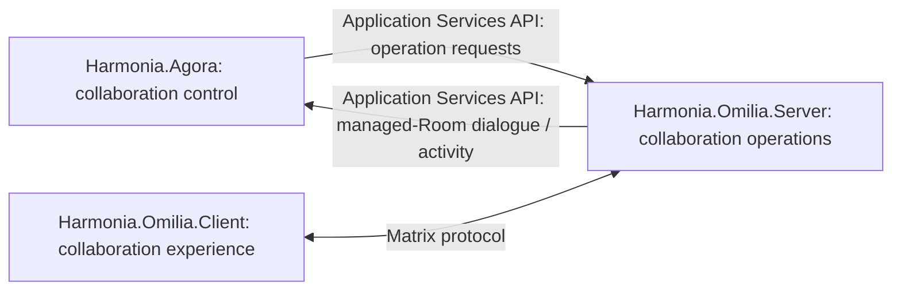

<!-- continuum-source-succession -->
> **RAD-1.1.5 source succession:** Historical source and navigation; all architectural sections incorporated. See the [canonical continuum](../../../enterprise-architecture/continuum/documentation/published/1.1.5/README.md) and [section correspondence](../../../enterprise-architecture/design/evidence/1.1.5/002/after/source-succession.json). Original source wording and standing below are preserved.

<!-- Copyright (c) 2026 Mark Hunter. Licensed under GPL-3.0-or-later. -->

# Agora controlled collaboration and Omilia realisation

**Standing: adjudicated Candidate Architecture within Domain05 Step A.**
[U16](sources.md#u16) incorporates the supplied DesignNote and explicit task
adjudications. This view replaces earlier candidate projection-only, roster-owner
and generic clinical-submission accounts. It does not accept the whole candidate,
complete A4 or authorise Step B. [Scope and authority](README.md) apply.

<a id="control-and-operations"></a>

<!-- continuum-supersession:start -->
------- Legacy Content - Superseded ------- Start ------
Superseded by canonical continuum element(s), RAD-1.1.5 authorised ingestion:
- [Agora](../../../enterprise-architecture/continuum/application/application-component/d1c4053e68384080b8eb79d2008632ba.md)
Original source standing and unresolved qualifications are preserved.
---------------------------------------------------------

## Collaboration control and collaboration operations

> **Agora controls; Omilia operates.**

**Harmonia.Agora** is Harmonia's collaboration control component. Agora owns
Harmonia collaboration semantics and control and provides native Teams/Slack-like
collaboration: direct/group dialogue, Rooms/Spaces, collaborative discussion,
collaboration media and associated state. General collaboration is within this
responsibility, not an external capability supplied in place of Agora.

For designated **Agora-managed Rooms/Spaces**, Agora controls lifecycle intent,
membership intent (who should be added or removed), information published by
Harmonia, and listening/capture policy. Agora listens to dialogue/activity in
**all** its managed Rooms/Spaces. Patient, Practitioner, Location and Service are
examples of associated governed contexts, not a final taxonomy or creation rule.

**Harmonia.Omilia** is the Harmonia collaboration subsystem:

| Component | Responsibility | Upstream implementation/provenance |
| :--- | :--- | :--- |
| **Harmonia.Omilia.Server** | Owns/performs underlying Room/Space, user, membership, dialogue/message, collaboration-event and applicable collaboration-media operations. Exposes the Application Services API. | Derived from Matrix Synapse; intended cloned/modified realisation. |
| **Harmonia.Omilia.Client** | Provides the associated Harmonia collaboration client/user experience. | Derived from Element; intended cloned/modified realisation. |

Their architectural identity is **Harmonia.Omilia**. Synapse/Element lineage is
implementation and provenance information, not component identity or a source of
unstated requirements. The Server's worker relationship does not give Agora
ownership of Omilia's operational mechanics. Conversely, platform operations do
not give Omilia Harmonia collaboration policy, semantics or control authority.
These are logical responsibilities; no new Maven module, runtime topology or
implementation completion is asserted.


------- Legacy Content - Superseded ------- Finish ----
<!-- continuum-supersession:end -->


<a id="application-services-api"></a>

<!-- continuum-supersession:start -->
------- Legacy Content - Superseded ------- Start ------
Superseded by canonical continuum element(s), RAD-1.1.5 authorised ingestion:
- [Harmonia.Omilia.Server](../../../enterprise-architecture/continuum/application/application-component/369907025d06492bb414a72cea834a77.md)
Original source standing and unresolved qualifications are preserved.
---------------------------------------------------------

## Application Services API

Omilia.Server exposes an **Application Services API** used by Agora both to
request collaboration operations and to receive managed-Room dialogue/activity.



Agora decides to create/change a managed Room/Space, add/remove a participant or
publish information; Omilia.Server performs the operation. Room activity returns
through the same architectural boundary. The exact API contract, technology and
mapping to upstream Matrix interfaces remain deferred. Historical Admin,
Client-Server and AS-transaction endpoints do not define this new contract.

Workflow/execution collaboration continues through Petasos with **no direct
Agora-to-Ponos dependency**. Matrix DTO encapsulation, Themis default-deny
governance and zero-PHI Room aliases/names/topics remain repository constraints.
Membership or receipt of a notification does not confer information-access rights.

[U19](sources.md#u19) establishes the administrative interaction boundary:
Administrator → Omilia → Agora → Administrative Function → specialised
Administrative Ergon → governed subsystem operation. Stopped-Twin resumption
uses this pattern, with normal authorisation, Context, execution and Kleio audit
controls; Agora and Omilia do not directly resume or manipulate the Twin.
The arrows describe semantic progression and retain Petasos execution handoff
and Agora's no-direct-Ponos-dependency rule. Iris provides a separate path through
Iris-BackEnd and does **not** directly interact with Agora or Omilia. Broader
Administrative Function reconciliation is [deferred](gaps.md#administrative-function-finding).

Identity mapping/provisioning is collaboration integration, not authentication
authority. Existing isolation constraints are not relaxed; detailed security,
privacy and external/federated interactions remain deferred.


------- Legacy Content - Superseded ------- Finish ----
<!-- continuum-supersession:end -->


<a id="membership-and-roster"></a>

<!-- continuum-supersession:start -->
------- Legacy Content - Superseded ------- Start ------
Superseded by canonical continuum element(s), RAD-1.1.5 authorised ingestion:
- [Agora](../../../enterprise-architecture/continuum/application/application-component/d1c4053e68384080b8eb79d2008632ba.md)
Original source standing and unresolved qualifications are preserved.
---------------------------------------------------------

## Managed membership and the roster boundary

**Roster Management is a Separately Provided Capability (SEP).** For R1.x/R2.x,
Harmonia requires only applicable **Shift Start** and **Shift End** periods from
that capability. Roster-derived information may contribute operational context
for Agora's membership decisions; it does not determine or own Room membership.

```text
Roster Management (SEP): applicable Shift Start / Shift End
                      |
                      v
Operational context -> Agora membership intent
                              |
                              | Application Services API
                              v
                       Omilia.Server membership operation
```

Harmonia does not own roster management; Agora is not roster authority, and the
Provider Registry/Group model does not become one. Agora controls managed-Room
membership intent; Omilia.Server performs corresponding membership operations.
PractitionerCapacity remains operational/authorisation context, **not a roster**
or an authority grant. Its exact contribution to membership derivation is deferred.
No rostering, scheduling, workforce allocation, substitution, shift management or
general workforce-management responsibility is introduced into Agora.


------- Legacy Content - Superseded ------- Finish ----
<!-- continuum-supersession:end -->


<a id="information-ownership"></a>

<!-- continuum-supersession:start -->
------- Legacy Content - Superseded ------- Start ------
Superseded by canonical continuum element(s), RAD-1.1.5 authorised ingestion:
- [Agora](../../../enterprise-architecture/continuum/application/application-component/d1c4053e68384080b8eb79d2008632ba.md)
Original source standing and unresolved qualifications are preserved.
---------------------------------------------------------

## Native collaboration ownership and conduit behaviour

**Agora owns/manages its native collaboration information and state**, including
managed-Room dialogue/actions, discussion/messages, Room/Space and membership state,
collaboration references/activity and native collaboration media. Omilia.Server
performs their underlying collaboration operations; this does not transfer their
application-level ownership or semantics to Omilia.

Where clinical, operational, workflow, task, escalation, approval, notification or
other Harmonia information originates in another responsibility and is conveyed
through Agora, **Agora is the collaboration conduit**. Publication/presentation
does not transfer authoritative ownership of the underlying information. Agora
may own the collaboration representation, reference or activity used to convey it;
the originating responsibility retains its information and domain authority.

Application ownership, operational mechanics and authoritative durable
establishment are distinct. [AX-05](../governance/architectural-axioms.md#ax-05)
continues to govern Mneme application-facing managed access and Mnemosyne durable
state; no independent authoritative Agora/Omilia store or direct-JPA access path
is authorised here. Detailed collaboration persistence, mapping/transaction
structures, storage allocation and retention remain deferred. A legacy homeserver
database or JPA repository does not settle that design.


------- Legacy Content - Superseded ------- Finish ----
<!-- continuum-supersession:end -->


<a id="managed-room-capture"></a>

<!-- continuum-supersession:start -->
------- Legacy Content - Superseded ------- Start ------
Superseded by canonical continuum element(s), RAD-1.1.5 authorised ingestion:
- [Agora](../../../enterprise-architecture/continuum/application/application-component/d1c4053e68384080b8eb79d2008632ba.md)
Original source standing and unresolved qualifications are preserved.
---------------------------------------------------------

## Managed Rooms as bidirectional Harmonia interaction surfaces

Defined meaningful interactions in managed Rooms may be captured and introduced
into wider governed Harmonia processing as applicable **Communication Information
Units and/or Pragma**. The model is **capture/derivation**, not ownership transfer
or generic promotion of chat into the clinical record.

```text
Harmonia -> Agora -> Omilia.Server -> Patient Managed Room
                     publish: "New Diagnostic Report Available"
                                          |
                            Practitioner: "Report Reviewed"
                                          |
                                          v
                                    Omilia.Server
                                          |
                                 Application Services API
                                          v
                                        Agora
                                          |
                                capture defined interaction
                                          v
                          Communication Information Unit and/or Pragma
                                          |
                                          v
                              Harmonia governed processing
```

The Diagnostic Report remains with its originating information responsibility.
The original Agora dialogue/action remains part of Agora's collaboration record.
Capture can create **new governed Harmonia information/activity** through the
applicable execution and information-management responsibilities. It does not
move the original record or itself establish clinical-record authority.

**Not every utterance, message or keystroke becomes a Pragma or Harmonia work.**
The exact defined interactions, Communication Information Unit representation,
Pragma specialisations and provenance/reference representations are deferred.
No NLP, AI interpretation, recognition algorithm, UI mechanism or unconstrained
clinical interpretation is established.


------- Legacy Content - Superseded ------- Finish ----
<!-- continuum-supersession:end -->


<a id="dialogue-logging-and-audit"></a>

<!-- continuum-supersession:start -->
------- Legacy Content - Superseded ------- Start ------
Superseded by canonical continuum element(s), RAD-1.1.5 authorised ingestion:
- [Agora](../../../enterprise-architecture/continuum/application/application-component/d1c4053e68384080b8eb79d2008632ba.md)
Original source standing and unresolved qualifications are preserved.
---------------------------------------------------------

## Dialogue retention, activity logging and audit

Managed-Room dialogue is captured/retained as Agora collaboration information.
Room activity may be logged; defined activities may additionally be auditable
under applicable audit policy. Collaboration retention is not diagnostic logging.
Existing zero-PHI diagnostic rules apply; dialogue retention does not permit
unmasked PHI in non-clinical logs.

```text
Captured dialogue != AuditEvent
Logged activity   != AuditEvent

Audit-worthy occurrence -> Kleio -> authoritative audit information
```

Agora reports applicable occurrences through Kleio's established boundary.
[Kleio](component-register.md#c03) retains authoritative audit management,
construction/capture of AuditEvent, mandatory capture authority and fail-closed
constraints. Neither Agora nor Omilia becomes an authoritative audit manager.
The detailed event catalogue, logging architecture and retention policy remain
deferred; Kleio architecture is unchanged.


------- Legacy Content - Superseded ------- Finish ----
<!-- continuum-supersession:end -->


<a id="binary-and-media-custody"></a>

<!-- continuum-supersession:start -->
------- Legacy Content - Superseded ------- Start ------
Superseded by canonical continuum element(s), RAD-1.1.5 authorised ingestion:
- [Agora](../../../enterprise-architecture/continuum/application/application-component/d1c4053e68384080b8eb79d2008632ba.md)
Original source standing and unresolved qualifications are preserved.
---------------------------------------------------------

## Binary and media custody

Agora-native collaboration media may be Agora-managed collaboration information;
Omilia.Server performs applicable media operations. A clinical, diagnostic,
operational or other formally managed binary linked, referenced or presented in a
Room remains with its originating information responsibility. Agora may own the
collaboration reference/activity without owning the referenced object.

[U17](sources.md#u17) allocates F31/D15 **Binary Content Management** to
[Harmonia.Sylloge](sylloge-binary-content-management.md#agora-and-omilia-boundary).
For formally managed clinical/operational binaries, Sylloge manages association,
resolution, retrieval, assembly and custody knowledge. Agora retains the
collaboration record/reference when it presents, links to, discusses, notifies
about or captures activity concerning that content. None of those actions makes
Agora its custodian; Omilia acquires no Binary Content Management responsibility.
Sylloge management does not require physical custody: a payload may remain with
an external authoritative/source system. [CDG-25](gaps.md#binary-custody-question)
now retains deferred detailed design with the application responsibility closed.


------- Legacy Content - Superseded ------- Finish ----
<!-- continuum-supersession:end -->


<a id="deferred-collaboration-design"></a>

<!-- continuum-supersession:start -->
------- Legacy Content - Superseded ------- Start ------
Superseded by canonical continuum element(s), RAD-1.1.5 authorised ingestion:
- [Agora](../../../enterprise-architecture/continuum/application/application-component/d1c4053e68384080b8eb79d2008632ba.md)
Original source standing and unresolved qualifications are preserved.
---------------------------------------------------------

## Deliberate deferred design and discovery

The following remain non-blocking collaboration design/discovery items because
control, operations, information ownership, governed capture and audit owners are
established above:

- Room versus Space terminology/taxonomy, creation criteria and detailed lifecycle.
- Membership rules/derivation and exact use of PractitionerCapacity/Shift Start/End.
- Application Services API contract, technology and upstream-interface mapping.
- Agora collaboration persistence/storage, mapping/transaction structures,
  binary/media persistence mechanics, access/link mechanics and retention policy.
- Captured-interaction provenance, Communication Information Unit representation,
  Pragma specialisations and rules defining meaningful interactions.
- Free-text interpretation, including any NLP/AI or interaction-recognition design.
- Audit-event catalogue, detailed logging and security/privacy mechanics.
- Omilia.Server/Client modifications, human-experience integration and detailed
  external/federated Matrix interaction. This does not defer or permit direct
  Iris-to-Agora/Omilia interaction; that boundary is established by U19.
- Notification/escalation mechanics and optional Statistics/Tasks/Diagnostics
  projections/providers; no fixed four-room hierarchy is established.

These details SHALL NOT be supplied by analogy with Matrix, Synapse, Element,
Teams or Slack. [CDG-19/21–23/52](gaps.md#agora-omilia-contracts) retains their
disposition; Sylloge's separate detailed deferrals remain CDG-25.


------- Legacy Content - Superseded ------- Finish ----
<!-- continuum-supersession:end -->
