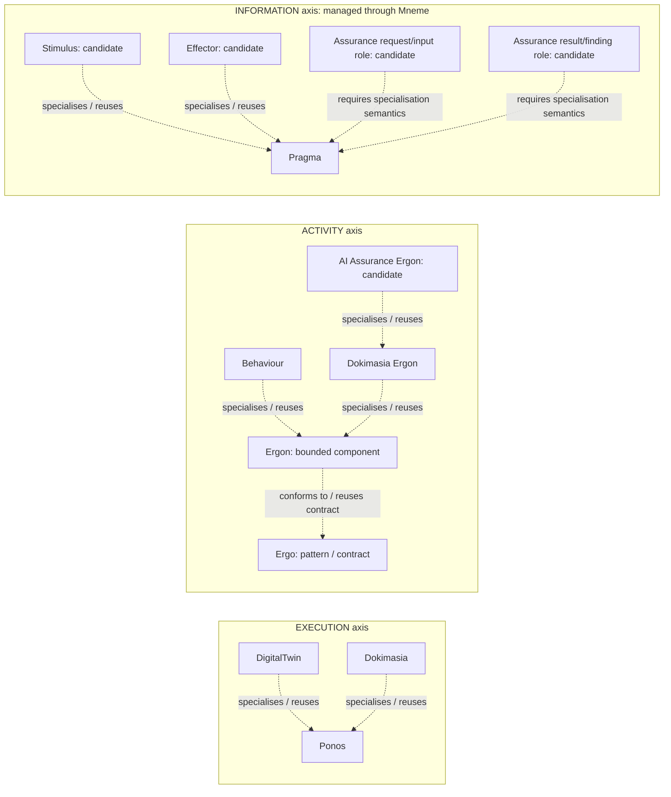
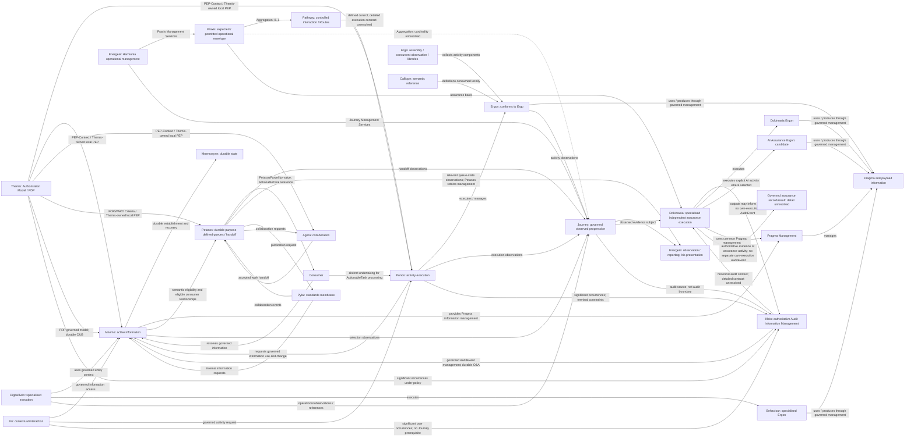

<!-- Copyright (c) 2026 Mark Hunter. Licensed under GPL-3.0-or-later. -->

# Harmonia Candidate Information Systems Architecture — System Map

**Standing: reconstructed and adjudicated candidate; [Step-A boundary](README.md) applies.**
The map groups documented responsibilities and preserves named constructs. It
does not prescribe deployment, map upstream capabilities or select an MVP.
Components are detailed in the [register](component-register.md); source keys
resolve through [Sources](sources.md).

## Structural hierarchy

The following is a software responsibility map. “Grouping” identifies a
documented solution grouping without assigning it additional semantic or
operational authority. “Slice” denotes a documented responsibility area within
a component, not an approved separate process or service. Indented entries
express labelled responsibility relationships or domains, not
Composition, programming-language containment or deployment. Leaves called
“construct” or “Data Object” are not all independently executable components.

```text
Harmonia Information System — candidate software solution
  Calliope — semantic definitions, shared models and conversion support [C01]
    Canonical model / schema / terminology-binding support
    Event, payload, reason and topic definitions (Data Objects)
    HL7/FHIR converter support
  Themis — Authorisation Model management and distributed enforcement [C02]
    PAP — Authorisation Model administration/lifecycle
    PRP — authoritative model repository semantics; durability through Mneme/C&G
    PDP — reasoning over model, authenticated Identity and context
    PEP-Context — contextual Criteria projection for authenticated Identity
    Themis-owned PEP capability — embedded at hosts controlling governed actions
  Kleio — authoritative Audit Information Management [C03]
    Audit Capture — clients report occurrences; Kleio constructs FHIR AuditEvent
    Immutable audit history — preservation/retrieval and longitudinal evidence
    Historical context preparation/use — distinct from authoritative evidence
    Durability through Mneme/Mnemosyne O&A; independent audit targets permitted
    Detailed internal decomposition unresolved
  Hestia — documented information-management/preservation grouping
    Mneme — governed active information access and coordination [C09]
      Governed read/write and observation/coordination services [C11]
      Pragma Management — managed task/context/progression information [C28]
        PragmaFactory — creates/initialises Pragma; archetype embodiment [C08]
        Pragma — managed Application Data Object [C07]
        Publishing — provider eligibility/filtering [C36]
        Subscription — consumer selection [C37]
        Pattern — governed evaluation/matching [C38]
      Active representations and working definitions (Data Objects)
    Mnemosyne — authoritative durable establishment/preservation [C12]
      Clinical Information — persistence responsibility domain
      Harmonia Configuration & Governance — persistence responsibility domain
      Harmonia Operations & Assurance — persistence responsibility domain
  Energeia — discrete Software Component; Harmonia operational management [C39]
    Direct responsibility: Praxis Management Services [F11]
    Direct responsibility: Journey Management Services [F38]
    Direct responsibility: operational observation / reporting [F39]
    R3 direction: Adaptive Load and Resilience Service — deferred [F40]
    Associated execution/activity constructs (Association; no Composition inferred):
      Ponos — reusable execution framework/component pattern [C04]
        Governed execution / scheduling / progression / execution re-attempts
      Ergo — reusable activity pattern and platform-integration contract [C05]
      Ergon — bounded fine-grained task-completion software component [C23]
        IngressEndpoint / EgressEndpoint — Application Interfaces [C29]
      Erga — meaningful Ergon collections, assembly, observation and libraries [C24]
      DigitalTwin — Ponos-specialised entity-coordination execution component [C19]
      Behaviour — Ergon-specialised DigitalTwin activity component [C25]
      Dokimasia — Ponos-specialised independent assurance execution component [C20]
      Dokimasia Ergon — Ergon-specialised bounded assurance activity [C26]
      AI Assurance Ergon — candidate Dokimasia Ergon specialisation [C27]
    Application ownership: Praxis — expected/permitted operational envelope [C06]
      Aggregation: Pathway [0..1]; Journey cardinalities unresolved
    Application ownership: Journey — governed observed progression [C35]
  Petasos — durable message/event queue management [C10]
    Creation / operation / operational status of purpose-defined queues
    Common queue datatype: PetasosParcel — passed by value
    Associated information predominantly by reference; originating owners retained
    Persistent handoff / destination mechanics / redelivery / recovery / dead-letter
    ActionableTask reference handoff is one use case; event purposes remain distinct
  Pylai — standards-facing interoperability/publication membrane [C14]
    Inbound HL7 interaction responsibility slice
    Outbound HL7 publication/delivery-observation slice
    FHIR registry interaction responsibility slice
  Iris — contextual human interaction [C15]
    Clinical viewer [C16]
    Operations console [C16]
    Administration / provider self-service views [C16]
    Backend-for-frontend mediation [C17]
    Shared presentation/design-system support
  Agora — governed collaboration [C18]
    Identity and collaboration-context mapping
    Space/room lifecycle and membership reconciliation
    Collaboration event/transaction ingress and messaging handoff
    Protocol adapter encapsulation (implementation support)
```

Energeia's discrete responsibility follows [U06](sources.md#u06), extending
[U02](sources.md#u02) without changing its execution/activity specialisations or
Mneme-associated Pragma Management. Execution/activity entries are associated
responsibilities; their Specialisation/Realisation contracts are shown below.
Praxis/Journey application management is direct Energeia responsibility.
Ponos does not contain Ergo, Ergon, DigitalTwin or Dokimasia. Hestia grouping
is described in [L09/L10/L23](sources.md#l09), not inferred from Maven parents.
Clinical / C&G / O&A persistence responsibility domains follow U06; they
establish no database or service topology. L09/L10's two-slice account is historical. Iris's presentation/mediation distinction
is documented in [L11/L23](sources.md#l11). Agora's functional slices follow
[L12](sources.md#l12), not a promotion of its four Maven modules.

[U07–U09](README.md#kleio-themis-petasos-adjudication) refine Kleio, Themis and
Petasos responsibilities. PAP/PRP/PDP denote Themis responsibilities, not selected
services/processes; distributed PEP is Themis-owned capability hosted where the
action can be prevented. Audit targets are independent authoritative persistence
targets, not prescribed replicas or a general O&A topology. Kleio audit capture
is essential for Harmonia operation and independent of Journey participation.

The following do not have a supported structural parent in that tree:

| Construct / solution area | Representation and standing |
| :--- | :--- |
| **Provider Registry [C13]** | Documented cross-component application collaboration spanning Pylai, Themis, Petasos, Ponos/Praxis/Erga, Mneme/Mnemosyne and Iris; not automatically a new enclosing subsystem. [L15](sources.md#l15). |
| **Operator/developer support [C22]** | Documented CLI, activity/sequence authoring, shared design support and telemetry contracts. Tools retain association with their target components; no invented common platform subsystem. [L19/L21/L23](sources.md#l19). |
| **Media Server / runtime terminology service** | No sufficiently defined component boundary found. DocumentReference and binary payloads, compiled bindings and proposed terminology services are retained in the data/features views; named server allocation remains unknown. [L17/L19/L27](sources.md#l17). |

**Paradeigma [C21]** is associated simulation/verification support, outside the
production collaboration hierarchy. Its documented PAS, EMR, LMS, RIS-PAC,
scenario, synthetic-generator/fault-injection and verification responsibilities
are retained. It exercises production interfaces; production components must
not depend on it. Its “digital twins of external applications” wording does not
establish Harmonia Digital Twin archetypes. [L22](sources.md#l22), AGENTS Invariant 1.

<a id="specialisation-and-reuse"></a>

## Specialisation and reuse — three related axes

This view is separate from the responsibility hierarchy. Axis boxes group kinds of
architectural responsibility; they are not runtime containers. Dashed labelled
arrows run from specialised/reusing construct to its base contract. Ergo is a
conceptual pattern realised/reused by Ergon, rather than a Ponos child or a
second execution framework. Literal programming-language inheritance is not
required. [U02](sources.md#u02) and the
[common specialisation principle](README.md#specialisation-principle) govern.



Assurance request/input and result/finding are candidate semantic roles, not
final names, schemas, cardinalities or lifecycles. Erga's collection/assembly
relationship is distinct from the activity specialisation axis. The key
relationship meanings are:

| Relationship kind | Candidate meaning |
| :--- | :--- |
| **Association / application responsibility** | Energeia is associated with distinct execution/activity constructs and owns Praxis/Journey management. Mneme provides Pragma Management, logically aggregating PragmaFactory and managing Pragma. No Composition or deployment boundary follows. |
| **Specialisation / reuse** | DigitalTwin and Dokimasia specialise Ponos; Behaviour and Dokimasia Ergon specialise Ergon; AI Assurance Ergon specialises Dokimasia Ergon; Stimulus/Effector are candidate Pragma specialisations. |
| **Realisation / activity contract** | Ergon conforms to/reuses Ergo's loading/logic/unloading and platform-integration contract; specialisations retain those facilities. |
| **Aggregation / collection / assembly** | Erga collates Ergon into executable assemblies/hubs, manages/observes concurrent activity instances and supports coherent libraries/change management; not merely an informal plural. |
| **Execution** | Ponos executes/manages Ergon. DigitalTwin executes specialised Behaviour; Dokimasia executes its assurance Ergon, including explicit AI activity where selected. Execution does not confer information management. |
| **Management** | Mneme / Pragma Management manages Pragma and its specialised representations; Mnemosyne establishes durable state. PragmaFactory creates/initialises representations associated with the archetype meta-concept. |
| **Collaboration** | Tightly coupled Ponos and Ergo/Ergon responsibilities collaborate with Mneme, Petasos, Themis and platform evidence/reporting contracts; they are peers within Energeia. |

DigitalTwin owns the per-Twin queue pattern as a specialised responsibility;
only Twins with pending work become active and are serviced by bounded execution
resources. Many Twins do not require a thread per Twin. Behaviour and specialised
Pragma retain common process-management, assurance, reporting and integration
instead of introducing DigitalTwin equivalents. Dokimasia follows the same
reuse rule subject to its [two terminal constraints](component-register.md#dokimasia-terminal-boundaries).
AI component existence/responsibility is established; detailed architecture is
subject to [CDG-35 discovery](gaps.md#dokimasia-ai-discovery).

## Control and observational constructs

These navigation entries are deliberately separate from the structural tree:

| Kind | Constructs and established relationships |
| :--- | :--- |
| Application Interfaces | PathwayEndpoint C29: each Ergon exposes IngressEndpoint and EgressEndpoint. |
| Behavioural/flow abstraction | PathwayElement C30 specialises as inter-component PathwaySegment C31 and encapsulated intra-component PathwayTraversal C32. |
| Routing/control | Route C33 = ordered PathwaySegment [1..N]; Pathway C34 controls endpoint interaction with available Route(s). Praxis aggregates Pathway [0..1] within its operational/assurance envelope. |
| Observation / Application Data Object | Journey C35 represents governed observed progression across Pathway, Pub/Sub and mixed execution; Energeia owns Journey Management Services; detailed construction/reference contracts unresolved. |
| Aggregated logical responsibilities / definition objects | Publishing C36, Subscription C37 and Pattern C38 under Mneme Pragma Management; their names do not imply separate deployable components. |

The [shared semantic diagrams](pathways-journeys-and-handoff.md) distinguish
defined control, dynamic information selection, handoff, execution and common
Journey observation/assurance. A graph-shaped Journey does not create a Pathway
or redefine Route. No final Journey-to-PathwayElement schema is established.

## Collaboration map

Arrows describe responsibilities crossing a seam, not containment, mandatory
network hops, exact APIs, or one synchronous sequence. Dotted arrows are
explicitly incomplete candidate relationships. Themis and Kleio participation
applies across governed boundaries; the diagram does not require all activity
to pass through one central runtime service.



| Relationship | Documentary basis and limit |
| :--- | :--- |
| Mneme persists through / recovers from Mnemosyne | A01 AX-05, A02 Seam 1; L13 ADR-018/019. Active state is reconstructable; cache acceptance is not durable establishment. |
| Ponos executes Ergon conforming to Ergo; Erga aggregates; Energeia owns Praxis/Journey | U02/U06. Execution, contract reuse, Aggregation and application management are distinct; detailed Praxis-to-activity relationships remain unresolved. |
| Mneme Pragma Management aggregates PragmaFactory and manages Pragma | U01/U02. Factory creates/initialises candidate representations associated with the meta-concept, not an instantiated archetype Information Asset. Detailed contracts/persistence remain unknown; no automatic Praxis equivalence. |
| DigitalTwin specialises Ponos and uses governed entity information | U02 and A02 Seams 2–3. Per-Twin queues are specialised responsibility; bounded resources service pending work. Detailed control/state contract remains unknown. |
| Dokimasia specialises Ponos and executes assurance Ergon | U02 preserves A04 independence; reuse does not give the assured activity control of assurance determination. AI activity boundary is established; detailed architecture CDG-35 remains open. |
| Components use Themis PEP and Kleio Audit Capture | U07/U08, A01 AX-07–09. Themis-owned local PEP uses Identity-specific Criteria; valid sufficient context may support in-flight activity during PDP loss, while required new context must wait. Kleio constructs immutable AuditEvents from client occurrences, independent of Journey. Dokimasia terminal rules remain. Detailed contracts CDG-42/43. |
| Ingress / execution / publication and event sharing use Petasos | U05/U09: purpose-defined durable queues carry PetasosParcel by value; associated information predominantly by reference. ActionableTask/Pragma remains through Mneme and each undertaking has its own FulfillmentTask. Queue status belongs to Petasos; Energeia observes/reports. Acceptance, commit, completion and external ACK remain distinct. |
| Agora coordinates with execution through Petasos | AGENTS Invariant 10; L12 §3. No direct Agora-to-Ponos dependency. A detailed information-summary/provider contract is not established. |
| Pylai publishes governed information externally | A01 AX-02/13 and A02 Seams 4/G4. Projection is non-destructive and fail-closed; egress ends management of the emitted representation. Transport packaging does not transfer logical ownership. |

## Preserved model boundaries

The [Task/Pragma candidate](README.md#task-decisions) preserves work versus
undertaking even where both use Pragma. Ergon is behaviour and acquires no
discrete Information Resource. Praxis's higher-order expected/permitted
operational envelope is adjudicated;
historical blueprint, composed behaviour and actual assurance-activity descriptions
do not establish representation or definition-to-instance equivalences. Praxis
aggregates Pathway [0..1] and relevant Journey observations without inferred
Composition; detailed lifecycle/relationships remain unresolved. Evidence
does not itself constitute assurance; Dokimasia does not manage its operational
subject. Information custody, active management, durable persistence and domain
authority are not aliases. These limits apply to every source-derived feature
and relationship, with unresolved cases recorded in [CDG](gaps.md).
