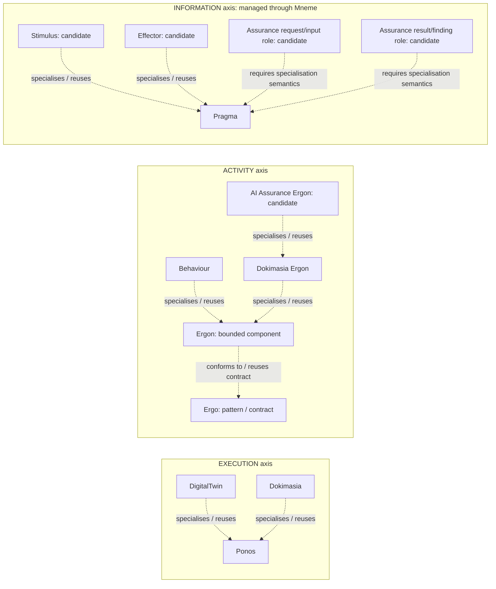

<!-- Copyright (c) 2026 Mark Hunter. Licensed under GPL-3.0-or-later. -->

# Harmonia Candidate Information Systems Architecture — System Map

**Standing: reconstructed and adjudicated candidate; [Step-A boundary](README.md) applies.**
The map groups documented responsibilities and preserves named constructs. It
does not prescribe deployment, map upstream capabilities or select an MVP.
Components are detailed in the [register](component-register.md); source keys
resolve through [Sources](sources.md).

## Structural hierarchy

The following is a software responsibility map. “Grouping” identifies a
documented solution grouping without assigning it additional semantic or
operational authority. “Slice” denotes a documented responsibility area within
a component, not an approved separate process or service. Indented entries
express labelled responsibility relationships or domains; indentation alone
does not establish Composition, programming-language containment or deployment.
The explicit Composition of loaded Context values is separately established. Leaves called
“construct” or “Data Object” are not all independently executable components.

```text
Harmonia Information System — candidate software solution
  Calliope — governed models, datasets and shared security/assurance nomenclature [C01]
    Calliope-Models — development/build-time model and library dependencies [C41]
      Models / Metadata Types / Criteria Definitions / Topics
      Filter Types / Filter Elements / Core Harmonia Element Libraries
      Security and Assurance nomenclature definitions
      Development representations of known runtime datasets; no runtime membership authority
    Calliope-DataSets — runtime mutable governed content management [C42]
      ValueSets / CodeSets / Structured Metadata / applicable ontology content
      Release-bounded Function.Name / Function.Scope / Information.Compartments / Information.Classification
      Authoritative ontology-set review for Harmonia use; detailed boundary deferred
      Established Mneme/Mnemosyne persistence; existing Ponos/Ergo/Praxis where workflow required
  Themis — Authorisation Model management and distributed enforcement [C02]
    PAP — model administration/lifecycle; governed management through Ergo/Praxis
    PRP — authoritative model repository semantics; durability through Mneme/C&G
    Criterion — applicable dimensions AND; grants across Criteria UNION
    Nested Criteria collections / AuthorisationRoles / direct and role assignments
    PDP — resolution/compilation over model, Identity, temporal and applicable Capacity context
    PEP-Criteria — precomputed Identity-specific permitted combinations
    PEP-Context — operational enforcement context supplying PEP-Criteria
    Themis-owned PEP library — constrained deterministic enforcement at action-controlling hosts
  Kleio — authoritative Audit Information Management [C03]
    Audit Capture — Kleio-specific governed intrinsic platform authority; Identity is evidence
    Clients report occurrences; Kleio constructs FHIR AuditEvent
    Immutable audit history — preservation/retrieval and longitudinal evidence
    Historical context preparation/use — distinct from authoritative evidence
    Durability through Mneme/Mnemosyne O&A; independent audit targets permitted
    Detailed internal decomposition unresolved
  Hestia — documented Context/Pragma and persistence grouping
    Mneme — Context and Pragma Manager [C09]
      Principal exposed services: Context Load / Context Save
      Principal exposed services: Adhoc Resource Access / Adhoc Search
      Context — temporal loaded resource values; bucket Composition [D26]
      Supporting governed access/change contracts; no extra services [C11]
      Resource Harmonisation Manager — internal exceptional path [C40]
      Pragma Management — managed task/context/progression information [C28]
        PragmaFactory — creates/initialises Pragma; archetype embodiment [C08]
        Pragma — managed Application Data Object [C07]
          Pathway-continuation is a role; independent outputs need not continue current Praxis
        Publishing — provider eligibility/filtering [C36]
        Subscription — consumer selection [C37]
        Pattern — governed evaluation/matching [C38]
      Active representations and working definitions (Data Objects)
    Mnemosyne — Persistence Manager; authoritative establishment/reporting [C12]
      Transaction oversight; persistent-service oversight and reporting
      Shard management; authoritative persistence reporting; persistence logging
      Compartment validation/reapplication; Themis-owned PEP hosting
      Search Management — underlying authoritative persistence search
      Research Metadata Management — AI derivation occurs outside Mnemosyne
      Clinical Information — persistence responsibility domain
      Harmonia Configuration & Governance — persistence responsibility domain
      Harmonia Operations & Assurance — persistence responsibility domain
  Sylloge — Binary Content Management subsystem [C49]
    Binary-content metadata and Information Unit associations [F31/D15]
    Location / resolution; retrieval; on-demand assembly from one or more payloads
    Knowledge of Harmonia-managed versus externally managed content
    Physical custody may remain external; no mandatory copying into Harmonia
    Applicable Harmonia persistence services remain Mnemosyne responsibility
  Energeia — discrete Software Component; Harmonia operational management [C39]
    Direct responsibility: Praxis Management Services [F11]
    Direct responsibility: Journey Management Services [F38]
    Direct responsibility: operational observation / reporting [F39]
    R3 direction: Adaptive Load and Resilience Service — deferred [F40]
    Associated peer execution/activity constructs (Association; no Composition inferred):
      Ponos — reusable execution framework/component pattern [C04]
        Governed execution / scheduling / progression / execution re-attempts
      Ergo — reusable activity pattern and platform-integration contract [C05]
      Ergon — bounded fine-grained task-completion software component [C23]
        IngressEndpoint / EgressEndpoint — Application Interfaces [C29]
      Erga — meaningful Ergon collections, assembly, observation and libraries [C24]
      DigitalTwin — Ponos-specialised entity-coordination execution component [C19]
      Behaviour [1..*] — Ergon-specialised DigitalTwin activity component [C25]
        Each realised through Praxis / Pathway / exactly one Ergo
      Dokimasia — Ponos-specialised independent assurance execution component [C20]
      Dokimasia Ergon — Ergon-specialised bounded assurance activity [C26]
      AI Assurance Ergon — candidate Dokimasia Ergon specialisation [C27]
    Application ownership: Praxis — expected/permitted operational envelope [C06]
      Defines Pathway fulfilment / Context requirements / segment criteria / continuation semantics
      R1.x/R2.x Context concrete; R3.x dynamic Context / dynamically configured generic Ergo deferred
      Praxis.Horos / IngressHoros / EgressHoros — logical boundary [C46]
      Aggregation: Pathway [0..1]; Journey cardinalities unresolved
    Application ownership: Journey — meaningful observed Praxis progression [C35]
      Continuation lineage is an observable thread, not complete Pragma provenance
  Petasos — durable message/event queue management [C10]
    Creation / operation / operational status of purpose-defined queues
    Common queue datatype: PetasosParcel — passed by value
    Associated information predominantly by reference; originating owners retained
    Persistent handoff / destination mechanics / redelivery / recovery / dead-letter
    ActionableTask reference handoff is one use case; event purposes remain distinct
  Pylai — External Interoperability Service; all external communication styles [C14]
    Terma / IngressTerma / EgressTerma — external communication stack; no application meaning [C43]
    Communication retry only within active interaction/Diadromí; no durable application recovery
    Diadromí — transient, non-recoverable carriage / interaction context [C44]
    Diadromí-Controller — Server READ/SEARCH progression / governance; no recoverable state [C45]
    Interaction patterns (not deployment units):
      PylaiPathway — external interaction ↔ governed Praxis/Ergo work
      PylaiBroker — executing Ergo.BusinessLogic ↔ external communication
      PylaiServer — changes through Pathway; READ/SEARCH through Controller
    HL7 / FHIR / API / RMI / file / polling mechanisms; technical realisation deferred
  Iris — contextual human interaction [C15]
    Clinical viewer [C16]
    Operations console [C16]
    Administration / provider self-service views [C16]
    Human interaction for Themis administration, review and approval; no model ownership
    Backend-for-frontend mediation [C17]
    Shared presentation/design-system support
  Agora — Harmonia collaboration control and native collaboration [C18]
    Managed Room/Space lifecycle intent; membership intent; Harmonia publication
    Owns native dialogue/actions, collaboration state/references and native media
    Listens to all managed Rooms; captures defined interactions into governed processing
    Conduit for other Harmonia information; no ownership transfer
    Roster Management SEP: applicable Shift Start/End context only
  Omilia — Harmonia collaboration subsystem; Agora controls, Omilia operates
    Harmonia.Omilia.Server — Room/Space, user, membership, dialogue/event/media operations [C47]
      Application Services API: Agora requests operations and receives managed-Room activity
      Derived from Matrix Synapse; provenance, not architectural identity
    Harmonia.Omilia.Client — collaboration user experience; derived from Element [C48]
      Matrix protocol to Server; human-experience integration deferred
      No direct Iris-to-Agora/Omilia interaction
```

**Identity.Authentication is external SEP**, integrated through OIDC/OAuth; it
is not another Harmonia-owned subsystem in this tree. Keycloak + PostgreSQL is
the default FOSS development/test/POC IdP and remains replaceable without
Keycloak-specific architectural dependencies. Authentication grants no Harmonia
authority. [U12](sources.md#u12), [Identity/Themis definitions](component-register.md#c02).

Energeia's discrete responsibility follows [U06](sources.md#u06), extending
[U02](sources.md#u02) without changing its execution/activity specialisations or
Mneme-associated Pragma Management. Execution/activity entries are associated
responsibilities; their Specialisation/Realisation contracts are shown below.
Praxis/Journey application management is direct Energeia responsibility.
Ponos does not contain Ergo, Ergon, DigitalTwin or Dokimasia. Hestia grouping
is described in [L09/L10/L23](sources.md#l09), not inferred from Maven parents.
Energeia C39 and Ponos C04 are peer application components. The indented
Association view does not place Ponos inside Energeia or Praxis; Praxis provides
the semantic/operational execution envelope. [U19](sources.md#u19).
Clinical / C&G / O&A persistence responsibility domains follow U06; they
establish no database or service topology. L09/L10's two-slice account is historical. Iris's presentation/mediation distinction
is documented in [L11/L23](sources.md#l11). Agora and Omilia responsibilities follow
[U16](sources.md#u16); historical [L12](sources.md#l12) module/API slices remain
implementation provenance, not the complete collaboration architecture.

[U17 Sylloge](sylloge-binary-content-management.md) establishes Binary Content
Management independently of Mneme Context/Pragma Management and Mnemosyne
Persistence Management. Information Unit association, payload, physical custody
and application responsibility remain distinct. This logical subsystem allocation
selects no module, process, deployment or storage boundary.

[U07–U09](README.md#kleio-themis-petasos-adjudication) refine Kleio, Themis and
Petasos responsibilities. PAP/PRP/PDP denote Themis responsibilities, not selected
services/processes; distributed PEP is Themis-owned capability hosted where the
action can be prevented. Audit targets are independent authoritative persistence
targets, not prescribed replicas or a general O&A topology. Kleio audit capture
is essential for Harmonia operation and independent of Journey participation.
[U15](sources.md#u15) establishes Kleio-specific intrinsic platform capture authority
under security policy; the audited Identity is evidence, not that authority.

The following do not have a supported structural parent in that tree:

| Construct / solution area | Representation and standing |
| :--- | :--- |
| **Provider Registry [C13]** | Documented cross-component application collaboration spanning Pylai, Themis, Petasos, Ponos/Praxis/Erga, Mneme/Mnemosyne and Iris; not automatically a new enclosing subsystem. [L15](sources.md#l15). |
| **Operator/developer support [C22]** | Documented CLI, activity/sequence authoring, shared design support and telemetry contracts. Tools retain association with their target components; no invented common platform subsystem. [L19/L21/L23](sources.md#l19). |
| **Detailed clinical terminology services** | U13 establishes DataSets content management without settling every proposed terminology service, CDG-24/49. Sylloge's separately established F31/D15 responsibility is in the hierarchy above. |

**Paradeigma [C21]** is associated simulation/verification support, outside the
production collaboration hierarchy. Its documented PAS, EMR, LMS, RIS-PAC,
scenario, synthetic-generator/fault-injection and verification responsibilities
are retained. It exercises production interfaces; production components must
not depend on it. Its “digital twins of external applications” wording does not
establish Harmonia Digital Twin archetypes. [L22](sources.md#l22), AGENTS Invariant 1.

<a id="specialisation-and-reuse"></a>

## Specialisation and reuse — three related axes

This view is separate from the responsibility hierarchy. Axis boxes group kinds of
architectural responsibility; they are not runtime containers. Dashed labelled
arrows run from specialised/reusing construct to its base contract. Ergo is a
conceptual pattern realised/reused by Ergon, rather than a Ponos child or a
second execution framework. Literal programming-language inheritance is not
required. [U02](sources.md#u02) and the
[common specialisation principle](README.md#specialisation-principle) govern.



Assurance request/input and result/finding are candidate semantic roles, not
final names, schemas, cardinalities or lifecycles. Erga's collection/assembly
relationship is distinct from the activity specialisation axis. The key
relationship meanings are:

| Relationship kind | Candidate meaning |
| :--- | :--- |
| **Association / application responsibility** | Energeia is associated with distinct execution/activity constructs and owns Praxis/Journey management. Mneme provides Pragma Management, logically aggregating PragmaFactory and managing Pragma. No Composition or deployment boundary follows. |
| **Specialisation / reuse** | DigitalTwin and Dokimasia specialise Ponos; Behaviour and Dokimasia Ergon specialise Ergon; AI Assurance Ergon specialises Dokimasia Ergon; Stimulus/Effector are candidate Pragma specialisations. |
| **Realisation / activity contract** | Ergon conforms to/reuses Ergo's loading/logic/unloading and platform-integration contract; specialisations retain those facilities. |
| **Aggregation / collection / assembly** | Erga collates Ergon into executable assemblies/hubs, manages/observes concurrent activity instances and supports coherent libraries/change management; not merely an informal plural. |
| **Execution** | Ponos executes/manages Ergon. DigitalTwin executes specialised Behaviour; Dokimasia executes its assurance Ergon, including explicit AI activity where selected. Execution does not confer information management. |
| **Management** | Mneme / Pragma Management manages Pragma and its specialised representations; Mnemosyne establishes durable state. PragmaFactory creates/initialises representations associated with the archetype meta-concept. |
| **Collaboration** | Energeia and Ponos are peer application components; Ponos and Ergo/Ergon collaborate with Mneme, Petasos, Themis and platform evidence/reporting contracts. Praxis is an execution envelope, not structural containment. |

DigitalTwin owns its single Stimulus/Effector input-queue pattern as a specialised
responsibility. **At most one input is processed at a time**, through sequential
execution of interested Behaviours subject to failure disposition, each receiving
its own BehaviourStimulus/BehaviourEffector and fresh Context after the preceding
Behaviour's completion/save on the normal path.
R1.x/R2.x developer configuration supplies sequencing policy through the framework
API; absent that policy, order is unspecified. The applicable sequence remains
stable throughout the current input; configuration changes apply to subsequent
inputs. `ContinueBehaviourOnFailure` contains failure to the current execution,
leaving the Behaviour active and other interested Behaviours and queue processing
unaffected. `StopBehaviourOnFailure` stops the failing Behaviour immediately,
allows remaining interested Behaviours to complete the current input, then halts
the Twin. `StopDigitalTwinOnFailure` terminates the failing Behaviour and halts
the Twin immediately; no remaining Behaviour processes the current input and no
subsequent queued input is processed. Stopped Twins retain queued inputs pending
governed administrative resume; stopped-Behaviour recovery remains deferred.
Bounded execution resources service runnable
pending work; concurrency is across independent Twins, without a thread per Twin.
[U19](design-notes/DesignNote-Digital-Twin-Behaviour-and-Execution-Semantics.md).
Behaviour and specialised Pragma retain common process-management, assurance,
reporting and integration
instead of introducing DigitalTwin equivalents. Dokimasia follows the same
reuse rule subject to its [two terminal constraints](component-register.md#dokimasia-terminal-boundaries).
AI component existence/responsibility is established; detailed architecture is
subject to [CDG-35 discovery](gaps.md#dokimasia-ai-discovery).

## Control and observational constructs

These navigation entries are deliberately separate from the structural tree:

| Kind | Constructs and established relationships |
| :--- | :--- |
| Application Interfaces | PathwayEndpoint C29: each Ergon exposes IngressEndpoint and EgressEndpoint. |
| Behavioural/flow abstraction | PathwayElement C30 specialises as inter-component PathwaySegment C31 and encapsulated intra-component PathwayTraversal C32. |
| Logical Praxis boundary | Praxis.Horos C46, specialised as IngressHoros/EgressHoros; external interaction through Terma/Diadromí does not create a technical Praxis endpoint. |
| Routing/control | Pathway C34 defines the conceptual Ergo sequence through endpoint interaction and available Route(s); Route C33 = ordered PathwaySegment [1..N]. Praxis defines fulfilment, Context requirements and continuation semantics, aggregating Pathway [0..1]; the execution framework performs processing/routing. |
| Observation / Application Data Object | Journey C35 represents meaningful observed Praxis progression across Pathway, Pub/Sub and mixed execution. Continuation lineage supports Pathway observation without representing complete Pragma provenance. Energeia owns Journey Management Services; detailed construction/reference contracts unresolved. |
| Aggregated logical responsibilities / definition objects | Publishing C36, Subscription C37 and Pattern C38 under Mneme Pragma Management; their names do not imply separate deployable components. |

The [shared semantic diagrams](pathways-journeys-and-handoff.md) distinguish
defined control, dynamic information selection, handoff, execution and common
Journey observation/assurance. A graph-shaped Journey does not create a Pathway
or redefine Route. No final Journey-to-PathwayElement schema is established.

[U18 output/continuation semantics](pathways-journeys-and-handoff.md#pathway-continuation)
distinguish independent output-derived Pragma from the Pragma role used to
continue the current Praxis along its Pathway. Other outputs may enter governed
Pub/Sub, another Praxis, other processing or no further processing. This adds
no Pragma subtype or component; construction/designation/representation remains
deferred. Praxis defines the semantics without orchestration/choreography;
Ponos/Ergo executes, Mneme manages Context/Pragma and semantic selection, and
Petasos owns applicable durable physical handoff. Mneme may manage richer
relationships/provenance than the originating Journey.

The [Context lifecycle and management view](context-and-persistence-management.md)
records Mneme's four services, Loader/Unloader boundary and new Content as Pragma
Output. Search and Research Metadata are Mnemosyne responsibilities; AI derivation
occurs through appropriate Harmonia execution outside Mnemosyne. These are logical
responsibilities, not new deployment units.

## Collaboration map

Arrows describe responsibilities crossing a seam, not containment, mandatory
network hops, exact APIs, or one synchronous sequence. Dotted arrows are
explicitly incomplete candidate relationships. Themis and Kleio participation
applies across governed boundaries; the diagram does not require all activity
to pass through one central runtime service.

```mermaid
flowchart LR
    Iris["Iris: contextual interaction"] -->|governed information access| Mneme["Mneme: Context and Pragma Manager"]
    Iris -->|governed activity request| Ponos["Ponos: activity execution"]
    Mneme -->|persistence requirements; recovery| Mnemosyne["Mnemosyne: Persistence Manager"]
    Mnemosyne -->|authoritative persistence outcome| Mneme
    Mneme -->|Adhoc Search requirement| Search["Mnemosyne: Search Management"]
    Mnemosyne -->|responsibility| Search
    Mnemosyne -->|responsibility| Research["Research Metadata Management"]
    Research -->|distinct derived metadata usable by search| Search
    Derivation["Appropriate Harmonia behavioural/execution construct: AI derivation"] -->|distinct Research Metadata; source Content unchanged| Research
    Ponos -->|uses Ergo framework Context Load / Save collaboration| Mneme
    Mneme -->|manages| Context["Context: temporal loaded values; bucket Composition"]
    Ergon -->|primarily acts on loaded values; working changes| Context
    Ergon -->|new Content expressed as Pragma Output| Pragma
    Ergon -->|bounded Adhoc Resource Access / Adhoc Search| Mneme
    Mneme -->|exceptional delivery conditions| RHM["Resource Harmonisation Manager: internal"]
    RHM -->|new governed work through established work/execution contract| Ponos
    Ponos -->|executes bounded new work| Harmonisation["Appropriate Harmonisation Ergon"]
    Mneme -->|provides Pragma information management| PM["Pragma Management"]
    PM -->|manages| Pragma["Pragma and payload information"]
    Twin["DigitalTwin: specialised execution"] -->|uses governed entity context| Mneme
    Twin -->|executes| Behaviour["Behaviour: specialised Ergon"]
    Behaviour -->|uses / produces through governed management| Pragma
    Energeia["Energeia: Harmonia operational management"] -->|Praxis Management Services| Praxis["Praxis: expected / permitted operational envelope"]
    Praxis -->|Aggregation: 0..1| Pathway["Pathway: conceptual Ergo sequence / Routes"]
    Praxis -->|Context definitions / continuation semantics; no orchestration| Ponos
    Energeia -->|Journey Management Services| Journey["Journey: governed observed progression"]
    Praxis -.->|Aggregation: cardinality unresolved| Journey
    Ponos -->|executes / manages| Ergon["Ergon: conforms to Ergo"]
    Erga["Erga: assembly / concurrent observation / libraries"] -->|collects activity components| Ergon
    Ergon -->|uses / produces through governed management| Pragma
    Mneme -->|semantic eligibility and eligible consumer relationships| Petasos["Petasos: durable purpose-defined queues / handoff"]
    Petasos -->|PetasosParcel by value; ActionableTask reference| Consumer["Consumer"]
    Consumer -->|resolves governed information| Mneme
    Consumer -->|distinct undertaking for ActionableTask processing| Ponos
    Pathway -->|defined control; detailed execution contract unresolved| Ponos
    Mneme -->|selection observations| Journey["Journey: governed observed progression"]
    Petasos -->|handoff observations| Journey
    Petasos -->|relevant queue-state observations; Petasos retains management| Reporting
    Ponos -->|execution observations| Journey
    Twin -->|operational observations / references| Journey
    Ergon -->|activity observations| Journey
    Journey --> Reporting["Energeia R1.x/R2.x: Observe → Report; Iris presentation"]
    Mnemosyne -->|persistence operational state; management retained| Reporting
    Journey -->|observed evidence subject| Dokimasia
    Praxis -->|assurance basis| Dokimasia
    Pylai["Pylai: External Interoperability Service"] -->|"Pathway: Praxis.Horos / governed Ergo work"| Ergon
    Ergon -->|"Broker: external interaction from executing BusinessLogic"| Pylai
    Pylai -->|"Server READ / SEARCH through transient Diadromí-Controller"| Mneme
    Pylai -->|"ingress Ergo.Egress to Queue TermaName; durable Parcel handoff"| Petasos
    Petasos -->|"governed work may require external communication"| Pylai
    Agora["Agora: collaboration control / native record"] -->|"defined captured interactions / collaboration events"| Petasos
    Petasos -->|"collaboration requests; originating information ownership retained"| Agora
    Agora -->|"Application Services API: operations requested"| OmiliaServer["Harmonia.Omilia.Server: collaboration operations"]
    OmiliaServer -->|"Application Services API: all managed-Room dialogue / activity"| Agora
    OmiliaClient["Harmonia.Omilia.Client"] <-->|"Matrix protocol"| OmiliaServer
    Roster["Roster Management: SEP"] -->|"R1.x/R2.x applicable Shift Start / End context"| Agora
    Agora -->|"audit-worthy occurrences; dialogue / logs are not AuditEvent"| Kleio
    IU["Information Unit"] -->|"binary-content association / reference"| Sylloge["Sylloge: Binary Content Management"]
    Mneme -->|"may obtain / resolve binary content; detailed contract deferred"| Sylloge
    Sylloge -->|"where Harmonia persistence required; through established Mneme access boundary"| Mnemosyne
    Agora -->|"reference to formally managed binary; collaboration record retained"| Sylloge
    Calliope["Calliope-Models: build-time definitions / structural contracts"] -->|definitions consumed locally| Ergon
    DataSets["Calliope-DataSets: governed runtime content"] -->|"established Context / Pragma access and persistence"| Mneme
    DataSets -->|"existing execution where dataset governance requires workflow"| Ponos
    IdP["External OIDC/OAuth IdP: Authentication SEP"] -->|"trusted Identity; no Harmonia authority"| Themis["Themis: governed model / PDP compilation"]
    Calliope -->|"nomenclature definitions; no policy decisions"| Themis
    DataSets -->|"controlled authorisation vocabularies; no grants by membership"| Themis
    Themis -->|"trusted Identity interpretation / local Themis PEP"| Pylai
    Pylai -->|"significant transaction occurrence; Kleio constructs AuditEvent"| Kleio
    Pylai -->|"applicable business progression / interoperability failure observations"| Journey
    Themis -->|"PEP-Criteria through PEP-Context / local Themis PEP"| Ponos
    Themis -->|"PEP-Criteria through PEP-Context / local Themis PEP"| Mneme
    Themis -->|"security policy / hosted enforcement; authority applicable to operation"| Mnemosyne
    Themis -->|"PEP-Criteria through PEP-Context / local Themis PEP"| Agora
    Themis -->|"FORWARD PEP-Criteria / local Themis PEP"| Petasos
    Themis -->|PRP governed model; durable C&G| Mneme
    Ponos -->|significant occurrences; terminal constraints| Kleio["Kleio: authoritative Audit Information Management"]
    Themis -->|significant occurrences under policy| Kleio
    Iris -->|significant user occurrences; no Journey prerequisite| Kleio
    Journey -->|audit source; not audit boundary| Kleio
    Kleio -->|mandatory capture under Kleio platform authority; durable O&A| Mneme
    Themis -->|Harmonia security policy governs mandatory capture| Kleio
    Dokimasia["Dokimasia: specialised independent assurance execution"] -->|outputs may inform audit; no own-execution AuditEvent| Kleio
    Kleio -->|historical audit context; detailed contract unresolved| Dokimasia
    Dokimasia -->|executes| DokErgon["Dokimasia Ergon"]
    Dokimasia -->|executes explicit AI activity where selected| AI["AI Assurance Ergon: candidate"]
    DokErgon -->|uses / produces through governed management| Pragma
    AI -->|uses / produces through governed management| Pragma
    Dokimasia -->|uses common Pragma management| PM
    Dokimasia -->|authoritative evidence of assurance activity; no separate own-execution AuditEvent| AssuranceRecord["Governed assurance record/result: detail unresolved"]
```



| Relationship | Documentary basis and limit |
| :--- | :--- |
| Mneme Context/Pragma management uses Mnemosyne persistence/recovery/search | U10/U11 and AX-05. Loaded values/new Outputs do not establish durable state; Mnemosyne reports authoritative outcomes and performs authoritative persistence search. |
| Mneme exceptional delivery uses common Ponos execution | U10: internal Resource Harmonisation Manager causes new governed Harmonisation Ergon work through the established contract; no resumed originating Ergon or duplicate execution framework. |
| Context bucket composes loaded values | U10: **Composition**, not Aggregation; constituent values have authoritative state/version bases distinct from Context version. No universal distributed transaction snapshot. |
| Ponos executes Ergon conforming to Ergo; Erga aggregates; Energeia owns Praxis/Journey | U02/U06. Execution, contract reuse, Aggregation and application management are distinct; detailed Praxis-to-activity relationships remain unresolved. |
| Mneme Pragma Management aggregates PragmaFactory and manages Pragma | U01/U02. Factory creates/initialises candidate representations associated with the meta-concept, not an instantiated archetype Information Asset. Detailed contracts/persistence remain unknown; no automatic Praxis equivalence. |
| DigitalTwin specialises Ponos and uses governed entity information | U02/U19 and A02 Seams 2–3. Single input queue, sequential Behaviour-specific processing with fresh Context, developer sequencing stable for each input and three escalating failure dispositions are established. Stopped Twins retain pending work for authorised administrative recovery. Detailed runtime/state/API and stopped-Behaviour recovery contracts remain CDG-07/54. |
| Dokimasia specialises Ponos and executes assurance Ergon | U02 preserves A04 independence; reuse does not give the assured activity control of assurance determination. AI activity boundary is established; detailed architecture CDG-35 remains open. |
| Components use Themis PEP and Kleio Audit Capture | U07/U08, A01 AX-07–09. Themis-owned local PEP uses Identity-specific Criteria; valid sufficient context may support in-flight activity during PDP loss, while required new context must wait. Kleio constructs immutable AuditEvents from client occurrences, independent of Journey. U15 distinguishes Kleio-specific intrinsic platform capture authority under security policy from the originating Identity recorded as evidence; insufficient capture authority fails closed. Dokimasia terminal rules remain. Detailed contracts CDG-42/43. |
| Ingress / execution / publication and event sharing use Petasos | U05/U09: purpose-defined durable queues carry PetasosParcel by value; associated information predominantly by reference. ActionableTask/Pragma remains through Mneme and each undertaking has its own FulfillmentTask. Queue status belongs to Petasos; Energeia observes/reports. Acceptance, commit, completion and external ACK remain distinct. |
| Agora controls; Omilia operates; execution collaboration uses Petasos | U16 and AGENTS Invariant 10. Agora owns native collaboration and captures defined interactions without transferring the original record; source information conveyed through Rooms retains its owner. Omilia.Server exposes the bidirectional Application Services API; Omilia.Client is the collaboration client. Roster SEP supplies applicable Shift Start/End context only. No direct Agora-to-Ponos dependency; APIs/storage/representation detail deferred. [Canonical view](agora-omilia-collaboration.md). |
| Pylai manages external interoperability | U14: Terma acts, Diadromí carries transient interaction; Pathway/Broker/Server have distinct execution/access patterns. Horos is the logical Praxis boundary, with egress return before unloading. AX-02/13 projection remains non-destructive/fail-closed. Identity, audit and assurance stay separate. U15 resolves CDG-51: Terma owns communication mechanics and active-interaction retry, with application meaning in applicable execution and no durable Terma/Diadromí recovery. |

The [Calliope view](calliope-models-and-datasets.md) separates build-time definitions
from current governed runtime content. The [Pylai/Horos view](pylai-external-interoperability.md)
provides the ingress, egress handover and Server READ/SEARCH diagrams. Diadromí is
transient/non-recoverable; Petasos recovery and Mnemosyne durable state remain distinct.
Controller participation is limited to the established pattern, not every interaction.

## Preserved model boundaries

The [Task/Pragma candidate](README.md#task-decisions) preserves work versus
undertaking even where both use Pragma. Ergon is behaviour and acquires no
discrete Information Resource. Praxis's higher-order expected/permitted
operational envelope is adjudicated;
historical blueprint, composed behaviour and actual assurance-activity descriptions
do not establish representation or definition-to-instance equivalences. Praxis
aggregates Pathway [0..1] and relevant Journey observations without inferred
Composition; detailed lifecycle/relationships remain unresolved. Evidence
does not itself constitute assurance; Dokimasia does not manage its operational
subject. Information custody, active management, durable persistence and domain
authority are not aliases. These limits apply to every source-derived feature
and relationship, with unresolved cases recorded in [CDG](gaps.md).
Sylloge management does not require physical custody of every payload; native
Agora media and formal binary content retain their separate application owners.
