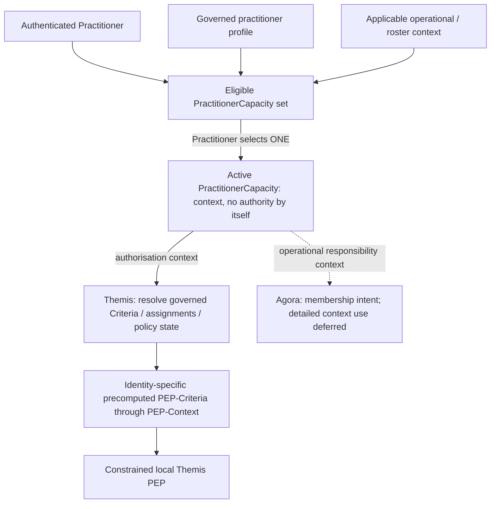

<!-- Copyright (c) 2026 Mark Hunter. Licensed under GPL-3.0-or-later. -->

# Candidate Component and Construct Register

**Standing: Harmonia Candidate Information Systems Architecture.**
[Orientation](README.md), [system map](candidate-system-map.md) and
[source dispositions](sources.md) govern this register. It includes significant
behavioural and data constructs as well as software components; inclusion is
not a claim that every row is an independent component or required release feature.
Primary responsibility, feature allocation and information/persistence are
read together with the [feature](candidate-feature-map.md) and
[data](data-and-persistence.md) views.

**Current baseline:** A4 — PASS; accepted for Step B. The
[B1 method](traceability/step-b-method.md) governs subsequent traceability.
Metabolē is a Domain04 conceptual construct, not another component/register row;
the C07/C44 Realisation links below create no B2 allocations. Dated statements
that earlier corrections did not accept A4 retain their historical scope.

## Semantic, policy and evidence responsibilities

<a id="c01"></a>

### C01 — Calliope

- **Role/responsibility:** management/governance of foundational models, definitions
  and mutable datasets, including first-class Security and Assurance Nomenclature
  and authoritative review of ontology sets for Harmonia use. [U13](sources.md#u13),
  [canonical Calliope view](calliope-models-and-datasets.md).
- **Distinct submodules:** **Calliope-Models C41** supplies design/build-time
  Models, Metadata Types, Criteria Definitions, Topics, Filter Types, Filter Elements,
  core Harmonia element libraries and security/assurance definitions.
  **Calliope-DataSets C42** manages runtime mutable ValueSets, CodeSets, Structured
  Metadata and applicable governed ontology content. No common lifecycle or
  undifferentiated metadata repository is inferred.
- **Authority:** development representations support type-safe human/IDE/AI-assisted
  programming; current membership/content uses runtime authority. Models/build
  definitions establish structural access contracts; DataSets do not bootstrap them.
  Definition ownership confers neither runtime execution nor originating clinical authority.
- **Persistence/collaboration:** DataSets uses established Mneme/Mnemosyne
  responsibilities; Calliope is not a Persistence Manager. Governed workflow may
  reuse Ponos/Ergo/Praxis, without another engine or detailed management UI.
  Themis decides/enforces, Dokimasia assures and Kleio audits.
- **Standing:** U13 settles the two responsibilities, not their packaging, runtime
  ontology boundary or representation/workflow mechanisms (CDG-24/49). Existing
  pure-library dependency constraints apply to Models; U15 resolves the
  [realisation boundary](calliope-models-and-datasets.md#calliope-realisation).
  General converter-support
  versus activity allocation remains CDG-05; no terminology product is selected.

<a id="authorisation-nomenclature"></a>

#### Controlled authorisation nomenclature

[U12](sources.md#u12) establishes these **release-bounded ValueSets**:

| ValueSet | Architectural shorthand / meaning |
| :--- | :--- |
| `Application.Function.AuthorisationPoint.Names` | **Function.Name**: architecturally significant application AuthorisationPoints at which enforcement is meaningful. An AuthorisationPoint identifies a governed function; it is not itself a permission. |
| `Application.Function.AllowedAction.Names` | **Function.Scope**: the bounded set of actions applicable at AuthorisationPoints. Existing concepts include **ACCESS**, **CHANGE** and **FORWARD**; these are not asserted to be the complete final ValueSet. |
| `Information.Compartments` | Governed information compartments; an applicable dimension is expressed as **Information.Compartment**. |
| `Information.Classification` | Governed information classifications. |

`Application.Function.AuthorisationPoint.Names` SHALL be comprehensive enough
to satisfy business security requirements for the release while constrained
enough to avoid unnecessary management, development and support burden.
Complete release-specific contents remain [deferred](gaps.md#identity-deferred-design).

**Calliope defines/governs the nomenclature. Themis owns policy association,
resolution and enforcement.** ValueSet membership alone grants no authority
and does not establish every Cartesian combination as meaningful or permitted.

The controlled vocabularies fall within [Calliope-DataSets](calliope-models-and-datasets.md#security-and-assurance-nomenclature);
their structural definitions/contracts belong to Calliope-Models. This allocation
does not reopen U12 or permit unrestricted runtime changes to release-bounded
content; detailed release/change rules remain deferred.

<a id="c02"></a>

### C02 — Themis

- **Role/responsibility:** **Themis owns and manages Harmonia's Authorisation
  Model**, including PAP, PRP, PDP, Criteria/collections, AuthorisationRoles,
  Identity assignments, role/group resolution, Criteria compilation and the
  distributed PEP framework. Themis consumes trusted authenticated Identity;
  it does not authenticate that Identity. [U12](sources.md#u12) refines
  [U08](sources.md#u08) within [AX-07](../governance/architectural-axioms.md#ax-07).
- **PAP — Policy Administration Point:** administration and lifecycle management
  of the Themis-owned model. Management/review/approval activity uses
  [Ergo/Praxis and Iris](#authorisation-administration); detailed Praxes/Erga,
  UI and versioning mechanisms remain deferred. No general-purpose policy
  language is implied by policy administration.
- **PRP — Policy Repository Point:** authoritative repository semantics for the
  Authorisation Model. Durable persistence may be delegated through **Themis PRP
  → Mneme → Mnemosyne Harmonia Configuration & Governance**. This requires no
  dedicated Themis physical database and transfers no model ownership to persistence.
- **PDP — Policy Decision Point:** resolves authoritative policy, authenticated
  Identity and applicable context into precomputed Identity-specific
  **PEP-Criteria**, supplied through **PEP-Context** for local enforcement.
  An immediate decision remains possible; it uses the same governed semantics.
- **Governed actions:** **Can I ACCESS XYZ? Can I CHANGE ABC? Can I FORWARD DEF?**
  ACCESS, CHANGE and FORWARD are distinct; they SHALL NOT collapse into CRUD.
  FORWARD may depend on destination/context independently of ACCESS.
  Unauthenticated or unauthorised operations default to **DENY**; unavailable
  authoritative policy determination remains distinct from that decision.

<a id="identity-authentication"></a>

#### Identity.Authentication — separately provided trusted Identity

**Identity.Authentication establishes WHO an Individual or System is. It is a
Separately Provided Capability (SEP).** The primary pattern is standards-based
OIDC/OAuth integration with an externally managed Identity Provider (IdP).
Harmonia does not own or provide an identity-management, credential-management,
password-management or MFA framework.

> **Keycloak + PostgreSQL SHALL provide the default FOSS Identity Provider for
> development, test and POC environments.**

Keycloak remains an external, replaceable implementation component. Harmonia's
Identity.Authentication architecture SHALL NOT acquire Keycloak-specific
dependencies. This target does not prescribe a production IdP or an internal
Harmonia credential store. Authentication establishes trusted Identity only;
it SHALL NOT determine Harmonia Function permissions, Function.Scope or PEP-Criteria.

**Identity.Authorisation** establishes what that authenticated Identity may do
within Harmonia and is Themis-owned. The same authorisation model applies to
human and system Identities; differing allowable assignments do not establish
separate architectures.

<a id="identity-terminology"></a>

#### Identity and role terminology

| Term | Candidate meaning and boundary |
| :--- | :--- |
| **Identity** | The authenticated Individual or System consumed by Themis. This use does not redefine Information Unit Identity or the Domain04 professional identifier assertions. |
| **Practitioner** | The individual practitioner, retaining the [Domain04 workforce-entity meaning](../04-information-architecture/information-families/practitioner.md#31-practitioner); registration status is a separate assertion. |
| **FHIR PractitionerRole** | The formal practitioner role/service relationship represented through FHIR. |
| **PractitionerCapacity** | The selected operational capacity in which a Practitioner is currently acting within Harmonia; it does not itself confer authority. |
| **AuthorisationRole** | A named, governed, assignable collection of additive Themis Criteria and/or Criteria collections. It is distinct from PractitionerCapacity, FHIR PractitionerRole and a Domain03 Business Role. |
| **Criterion / Criteria** | One governed permitted combination / multiple such combinations in the Themis Authorisation Model. |
| **PEP-Criteria** | The precomputed, Identity-specific set of permitted combinations derived by Themis for constrained local enforcement. |
| **PEP-Context** | The Themis-derived operational enforcement context for an authenticated Identity, through which applicable PEP-Criteria is supplied. It is distinct from the general Mneme working Context. |

The [Domain04 Practitioner Role Binding](../04-information-architecture/information-families/practitioner.md#36-practitioner-role-binding)
and [Domain03 Business Roles](../03-business-architecture/actors-roles/roles.md)
retain their meanings. Neither lexical similarity nor FHIR convention establishes
their mapping to PractitionerCapacity or AuthorisationRole.

<a id="authorisation-criteria"></a>

#### Criterion conjunction and additive grants

A Criterion represents a **governed permitted combination** across applicable
dimensions, using [Calliope-controlled nomenclature](#authorisation-nomenclature):

```text
Criterion =
    Information.Compartment
    AND Information.Classification
    AND Function.Name
    AND Function.Scope
    AND applicable Temporal constraints
```

The four principal dimensions describe **what** is authorised; applicable
temporal constraints describe **when**. Within an individual Criterion,
applicable dimensions are **conjunctive**. Between Criteria, grants are
**additive / UNION**: each Criterion independently contributes its permitted
combination. Only explicitly governed combinations have authorisation meaning.
Absence of a matching effective Criterion results in **DENY**.

**Explicit negative/DENY Criteria are not part of this Candidate Architecture.**
Neither arbitrary Boolean policy expressions, deny-overrides semantics nor a
general-purpose policy language is introduced by this model.

<a id="criteria-collections-and-authorisationroles"></a>

#### Criteria containment, AuthorisationRoles and Identity assignments

Criteria support containment, collection and nesting for management and reuse:

```text
CriteriaCollection                 (conceptual label; final name unresolved)
  ├── Criterion
  ├── Criterion
  └── CriteriaCollection
       ├── Criterion
       └── Criterion
```

Flattening nested collections produces the same additive set of effective
Criteria. Nesting creates no arbitrary Boolean semantics and requires no Role
hierarchy. The exact implementation name/class hierarchy and representation
remain deferred; this diagram establishes no lifecycle/ownership semantics
beyond the stated management/reuse requirement.

An **AuthorisationRole** is named, governed and assignable and contains Criteria
and/or Criteria collections. Its contents are additive:

```text
EffectiveCriteria(AuthorisationRole)
    = UNION(all contained Criteria)

IdentityEffectiveCriteria =
    DirectCriteria
    UNION AuthorisationRole1.Criteria
    UNION AuthorisationRole2.Criteria
    UNION ...
```

An Identity may have directly assigned Criteria, one or more AuthorisationRoles,
or both. This applies to human and system Identities. The UNION is of applicable
grants, subject to governed assignments, temporal validity, revocation and
applicable operational context; it does not remove a Criterion's conjunctions
or require every contained Criterion to match simultaneously.

<a id="temporal-validity-and-revocation"></a>

#### Predetermined temporal validity and explicit revocation

**Temporal validity** establishes predetermined applicability/validity bounds.
Temporal constraints may apply to a Criterion, a direct Criterion assignment,
an AuthorisationRole assignment and applicable operational context such as
PractitionerCapacity. The exact temporal expression model remains deferred.

**Revocation** withdraws an otherwise valid authorisation. It SHALL NOT be
modelled merely as temporal expiry. Both concepts are required. Propagation of
revocation and invalidation of already-issued PEP-Criteria/PEP-Context remain
unresolved; no mechanism or continued validity after revocation is inferred.

<a id="practitioner-capacity"></a>

#### PractitionerCapacity and operational responsibility

For a Practitioner, the available PractitionerCapacity set is constrained by
the practitioner's governed profile and applicable operational context. The
Practitioner selects **one active PractitionerCapacity** for the applicable
session/operational or roster context. It supplies operational context used by
Themis when deriving effective authorisation; **it does not itself confer authority**.
Selection UI and the exact PractitionerCapacity ↔ FHIR PractitionerRole mapping
remain deferred.

> **Authentication establishes who the Individual is. PractitionerCapacity
> establishes the capacity in which a Practitioner is currently acting. Themis
> establishes what that Identity, acting in that capacity, may do.**



Themis answers **“May this Identity perform this action on this information?”**
Future Agora collaboration detail concerns **“Is this Practitioner currently
responsible for receiving/responding to this operational activity?”** These are
separate responsibilities even where they consume the same PractitionerCapacity.
Receipt of an escalation or approval notification grants no information access.
Following it into Iris or another application surface requires normal Themis PEP
enforcement using current valid PEP-Criteria. U16 establishes
[Agora control and Omilia operations](agora-omilia-collaboration.md#membership-and-roster);
detailed membership, escalation and approval-routing mechanics remain deferred.

<a id="pep-context"></a>

#### PEP-Context and distributed enforcement

> **PEP-Context is the Themis-derived policy enforcement context established for
> an authenticated Identity. It supplies the precomputed PEP-Criteria applicable
> to that Identity that a Themis Policy Enforcement Point requires for local
> enforcement decisions.**

**PEP-Criteria is a precomputed, Identity-specific set of permitted combinations**,
not a general-purpose executable policy language distributed to PEPs. Themis
resolves direct Criteria, AuthorisationRole-derived Criteria, nested collections,
applicable temporal constraints, PractitionerCapacity context where applicable
and authoritative policy state. PEPs SHALL NOT receive the complete model merely
because they need enforcement information.

```text
Policy                Authorisation Model managed by Themis
Criteria              governed permitted combinations in the Authorisation Model
PEP-Criteria          precomputed Identity-specific permitted combinations
PEP-Context           operational context supplying applicable PEP-Criteria
Enforcement Decision  local PEP determination for a particular proposed action
```

Enforcement occurs at the component capable of preventing the action. A PEP may
be a Themis-provided library/framework element embedded within a host module.
**The distributed PEP capability, implementation and enforcement semantics are
Themis-owned/derived/built.** The host controls the actual operation; Themis
supplies enforcement mechanism and semantics. Hosts SHALL NOT independently
reinterpret the Authorisation Model in place of the Themis PEP. No separate
central Policy Enforcement Software Component is created.

A local PEP SHALL perform deliberately **constrained, deterministic enforcement**
against authenticated Identity context, effective Information.Compartment and
Information.Classification, Function.Name, Function.Scope, applicable temporal
state and the Identity's valid PEP-Criteria. It SHALL NOT become a general-purpose
policy interpreter.

Themis SHALL retain sufficient provenance to explain effective PEP-Criteria
derivation: authoritative Criteria, collections, direct/AuthorisationRole
assignments and applicable policy state. Runtime PEP-Criteria need not carry
the full derivation history; stable references may support it. No final wire/data
structure, cache, refresh or distribution mechanism is prescribed.

PEP-Context and existing security-context contracts are operational context;
they do not automatically become persisted resource content. Their detailed
relationship, schema and distribution mechanisms remain unresolved;
PEP-Context is not silently equated with a historical class or transport carrier.

<a id="effective-information-security-attributes"></a>

#### Untagged information and effective security attributes

> **Absence of explicit information security metadata does not imply absence
> of security control. Untagged information is not unrestricted information.**

Where required Information.Compartment and/or Information.Classification
attributes are absent, effective values SHALL be established through governed,
deterministic rules. If required effective attributes cannot be established,
enforcement SHALL fail closed.

Deriving effective attributes for an authorisation decision is distinct from
persistently assigning/changing security metadata on an Information Unit.
Themis enforces the resulting attributes; it is not assumed to own all semantic
derivation rules. Exact derivation ownership and precedence, including possible
context/containment relationships, remain [deferred](gaps.md#identity-deferred-design).
Mnemosyne's established compartment validation/reapplication responsibility does
not settle those semantic rules.

<a id="themis-availability-and-delegation"></a>

#### Availability and delegation

An in-flight activity with a **valid PEP-Context sufficient for its required
enforcement decisions** may continue during temporary PDP unavailability.
PDP availability is required for a **new, renewed or replacement PEP-Context**.
If the PDP cannot establish that required context, the activity SHALL NOT proceed
beyond the point requiring it and must wait. **PDP unavailability is not policy
denial**: policy permits, policy denies, and authoritative policy determination
cannot presently be established remain distinct. This grants no unauthenticated
or unauthorised action permission and weakens no required audit-capture boundary.
Detailed validity, timeout/retry, revocation and renewal mechanisms are unresolved.

At this stage delegation is **Identity / PEP-Criteria pass-off (forwarding)**,
subject to applicable **FORWARD** authority. Provenance SHALL preserve both the
originating Identity and receiving/acting Identity; the receiver does not become
the originator. No separate general-purpose delegation subsystem is introduced.
Detailed forwarding lifecycle/representation, PDP interaction and governance
mechanisms remain deferred; forwarding establishes no unrestricted impersonation
or authority-broadening rule.

<a id="authorisation-administration"></a>

#### Governed authorisation administration and target allocation

Authorisation administration is governed Harmonia work. Criteria creation/change,
collection management, AuthorisationRole management, direct Identity Criteria
assignment, AuthorisationRole assignment, temporal changes and revocation SHALL
be subject to appropriate governed management/review/approval processes through
**Ergo/Praxis**, with **Iris** providing human interaction. Detailed PAP management
Praxes/Erga and approval rules remain deferred; this does not make every change
require an identical approval sequence.

| Responsibility | Candidate target |
| :--- | :--- |
| Identity authentication | Keycloak / external OIDC IdP; SEP, Keycloak + PostgreSQL default for development/test/POC |
| Controlled authorisation nomenclature | Calliope |
| Authorisation model, Criteria/collections, AuthorisationRoles and Identity assignments | Themis-owned |
| Role/group resolution | Themis-owned; no separate human/system authorisation architecture |
| Criteria compilation | Themis-owned |
| Policy repository | Themis PRP, persisted through Harmonia via Mneme / Mnemosyne C&G |
| Policy administration | Themis PAP |
| Governed management / review / approval workflows | Ergo/Praxis |
| Administration UI | Iris; no authorisation-model ownership or detailed reusable-form design |
| Runtime enforcement | Themis PEP library at action-controlling hosts |
| Untagged information handling | Governed effective-attribute resolution; exact ownership/precedence deferred |

Harmonia owns its authorisation semantics. **jCasbin, OPA, Cedar or another
general-purpose policy framework is not an architectural dependency.** FOSS
implementations may later supply implementation references where appropriate;
their conceptual models SHALL NOT redefine Harmonia semantics.

- **Collaboration/exclusions:** governed access, activity, publication and
  collaboration hosts use Themis-owned PEP capability. Petasos hosts governed
  FORWARD enforcement because it controls the queue operation. Praxis may supply
  relevant context but is not the Authorisation Model; authorisation does not
  establish Praxis conformance. Themis is neither Audit nor Assurance. Significant
  policy/enforcement occurrences are reported through Kleio Audit Capture under
  applicable policy; clients need not construct FHIR AuditEvent.
  **Calliope defines security/assurance nomenclature; Themis decides/enforces;
  Dokimasia assures; Kleio audits.** Governance, Authorisation, Assurance and Audit
  remain distinct responsibilities; Praxis conformance and assurance findings
  are not authorisation grants. Dokimasia terminal constraints remain unchanged.
- **Standing:** U12 consolidates the adjudicated Identity Candidate Architecture
  and refines U08's Criteria, policy-language deferral and delegation wording.
  It does not accept all Domain05 candidate material or begin Step B.
  [CDG-42](gaps.md#themis-detailed-contracts) retains detailed design.
  U15 resolves the former U08 §15 conflict through Kleio-specific
  [mandatory capture authority](#kleio-capture-authority), governed under AX-07.
  Historical fixed gate counts and automatic context persistence remain
  CDG-15/30 provenance, without reopening established security boundaries.

<a id="c03"></a>

### C03 — Kleio

- **Role/responsibility:** **Harmonia's authoritative Audit Information Management
  component.** Kleio owns authoritative Audit Capture, creation/management of
  authoritative audit information, canonical FHIR **AuditEvent** representation,
  preservation/retrieval of audit history, semantically significant user/system
  audit activity and provision/preparation of historical audit context for
  operational and assurance use. [U07](sources.md#u07), [AX-08](../governance/architectural-axioms.md#ax-08).
- **Audit Capture:** clients report semantically significant auditable occurrences
  and necessary context through a **Kleio-provided contract/library/API**.
  **Clients SHALL NOT be required to construct FHIR AuditEvent resources.** Kleio
  constructs and manages the authoritative representation; client API and mapping
  details remain unresolved.
- **Information:** FHIR AuditEvent is the authoritative audit-event representation,
  without requiring every internal Kleio structure to be an AuditEvent. Indexes,
  correlation structures and prepared historical context may support management.
  **Authoritative audit evidence SHALL remain distinguishable from derived,
  correlated, contextualised or prepared historical views.** Existing meaningful
  provenance responsibilities remain; AuditEvent does not redefine all evidence.
- **User activity:** semantically significant access/view, governed search,
  create/change/delete, submit/approve/reject, disclosure/export, operational action
  and relevant denied activity may require capture. These are examples, not a
  universal event taxonomy; “delete” grants no physical managed-information DELETE.
  Generic UI telemetry/clickstream is outside Kleio; UI security assurance and
  governance remain **Somebody Else's Problem (SEP)**.
- **Collaboration/exclusions:** **Audit is not Governance. Audit is not Assurance.**
  Kleio may consume Journey information and Dokimasia outputs and provide
  historical audit context back to Dokimasia, without evaluating assurance or
  governing the subject. Dokimasia's governed record/result remains authoritative
  evidence of its assurance activity; its [terminal rules](#dokimasia-terminal-boundaries)
  prohibit a separate own-execution AuditEvent and recursive assurance. Consumption
  of its outputs does not circumvent those rules.

<a id="kleio-capture-authority"></a>

#### Mandatory capture authority and the audited Identity

> **Subject of audit evidence ≠ authority performing audit capture.**

Kleio performs mandatory authoritative audit capture under **intrinsic platform
authority** associated with its established architectural audit responsibility.
The originating/acting Identity remains evidence recorded by Kleio; it is not
the authority under which the mandatory AuditEvent is persisted. Kleio does not
borrow that Identity's PEP-Criteria merely to record its activity, including
activity denied to that Identity.

Identity-derived authority granted to human/system Identities remains resolved
and enforced through Themis. Kleio capture executes within established security
context and remains governed by Harmonia security policy, with Themis retaining
policy evaluation ownership. Mandatory capture is neither a security bypass nor
a policy exception. [AX-07](../governance/architectural-axioms.md#kleio-mandatory-capture-authority)
incorporates this adjudication.

Where authoritative audit capture is required for a governed operation and
Kleio cannot exercise that platform authority sufficiently to capture the
required evidence, the governed operation **SHALL fail closed**. Durable target
availability remains necessary; authority alone establishes no successful capture.

This authority applies specifically to Kleio mandatory authoritative audit
capture. It grants no equivalent authority to other components or other Kleio
activities. Any proposed equivalent responsibility requires separate architecture
adjudication; representation, policy/enforcement mechanics and transaction
coordination remain [CDG-43](gaps.md#kleio-detailed-contracts).

<a id="audit-history-and-evidence"></a>

#### Immutable history and longitudinal evidence

Authoritative AuditEvents are immutable. An existing AuditEvent SHALL NOT be
corrected, amended, overwritten or silently replaced. Correction or qualification
SHALL create a **new AuditEvent**, preserve the earlier event unchanged and refer
back to it as appropriate. The earlier assertion remains part of historical record.

Journey is the governed representation of observed Harmonia activity/progression;
AuditEvent is the authoritative audit representation of a significant auditable
occurrence. Journey is an important audit source, **not the audit boundary**.
A Journey may relate to many AuditEvents; an AuditEvent may exist without Journey.
**Journey participation SHALL NOT be a prerequisite for Audit Capture.**

> **Reference by default; replicate only where necessary to preserve longitudinal
> audit evidence.**

Kleio SHALL NOT duplicate authoritative source information merely because it is
audit-relevant. Where historical state can be reliably resolved longitudinally,
Kleio references it with sufficient **identity, version, provenance and temporal
detail**. Version identity alone is not assumed to supply all temporal detail.
Only where the authoritative source cannot guarantee retrieval of the information
as it existed at the audited point in time may Kleio clone/replicate the necessary
source information within or in association with the authoritative AuditEvent to
preserve required longitudinal evidence. Detailed FHIR attachment/reference
mechanisms remain unresolved.

<a id="auditability-and-availability"></a>

#### Auditability and R1.x/R2.x availability

> **Harmonia SHALL NOT perform an auditable activity unless the required audit
> information can be authoritatively and durably captured.**
>
> **If Kleio cannot authoritatively capture required audit information, Harmonia
> is DOWN.**

Audit Capture is not best-effort and SHALL NOT be assumed reconstructable later
from logs, Journey information or incidental operational state. Transaction,
retry/failover and health/readiness mechanisms are deliberately unresolved.

Kleio retains audit application ownership; Mneme provides governed Context/Pragma access
and Mnemosyne **Harmonia Operations & Assurance** establishes durable audit state.
For R1.x/R2.x, multiple **independent authoritative audit persistence targets**
through Mneme/Mnemosyne are permitted. At least **one configured target capable
of durably establishing the required audit information** is sufficient for
continued Harmonia operation. If none can establish it, Harmonia is unavailable
and fails closed. Target count, selection and whether one/some/all receive an
event are unresolved; targets SHALL NOT be called replicas without established
replication semantics.

> **For R1.x/R2.x, audit data harmonisation between independent Mnemosyne audit
> persistence targets is outside Harmonia scope — Somebody Else's Problem (SEP).**

R1.x/R2.x guarantees neither identical histories, complete copies of all
AuditEvents, automatic convergence, reconciliation after disconnection nor unified
cross-target longitudinal history. Different targets may expose different histories;
an immutable AuditEvent remains authoritative without its target holding the whole
corpus. No future harmonisation/convergence mechanism is selected.

- **Standing:** U07 resolves responsibility, representation, immutability,
  longitudinal evidence, availability and release scope; [CDG-43](gaps.md#kleio-detailed-contracts)
  retains detailed capture/query/correlation/retention/processing and persistence
  mechanisms. Historical FHIR/operational storage structures remain provenance,
  without competing with the established O&A semantic alignment.

## Energeia management and associated execution responsibilities

Energeia is a **discrete Harmonia Software Component responsible for management
of Harmonia's operational activity**, under [U06](sources.md#u06). Its direct
Praxis/Journey management and operational observation/reporting
responsibilities justify that boundary. Ponos, Ergo, Ergon, Erga and specialised
execution/activity constructs remain **associated** with Energeia. Their
Specialisation, Realisation, Aggregation and execution relationships are explicit
in the [system map](candidate-system-map.md#specialisation-and-reuse); no Composition,
programming-language containment, process or deployment follows from association.
Pragma information management remains with Mneme.
Energeia C39 and Ponos C04 are peer application components; Praxis is an
execution envelope, not structural containment of Ponos. The repository/module
grouping does not override this logical boundary. [U19](sources.md#u19).

<a id="c39"></a>

### C39 — Energeia

- **Role/responsibility:** discrete Software Component owning Harmonia operational
  management: “Is Harmonia itself operating as expected?” It observes work-to-be-done,
  work-being-done and work-done, outstanding ActionableTasks, FulfillmentTask
  activity, Journey progression, stalled/incomplete activity, Praxis context,
  abnormal behaviour and operational information for reporting/assurance.
- **Candidate services/features:** **Praxis Management Services** (F11) and
  **Journey Management Services** (F38), plus operational observation
  and reporting (F39). Detailed Feature/Service/internal-construct/subordinate-
  Component decomposition remains unresolved (CDG-39); service-set names do not
  manufacture independently deployable components.
- **Information:** owns Praxis C06 and Journey C35 at the application level.
  Mneme manages their governed information and retains ActionableTask,
  FulfillmentTask and Pragma management. Observing operational significance does
  not transfer management of that information or referenced clinical facts.
- **Persistence:** Mnemosyne C&G provides Praxis/configuration durability;
  Mnemosyne O&A provides Journey/operational-assurance durability, through Mneme
  governed management. Energeia application ownership is distinct from durable
  persistence responsibility; physical structures remain unresolved.
- **Collaboration/relationships:** associated execution/activity responsibilities
  retain U02 specialisation/reuse. Praxis aggregates Pathway [0..1] and has a
  working Aggregation relationship to Journey with cardinalities unresolved.
  Dokimasia uses Praxis as assurance basis and Journey as observed evidence
  subject, preserving independence and terminal rules. Iris presents operational
  views; presentation does not own Harmonia operational management.
- **Release boundary:** for **R1.x/R2.x, Observe → Report**. Energeia
  SHALL NOT autonomously change execution, redistribute workload, modify Routes,
  Pathways, Pub/Sub or Praxis, intervene in resilience or adjust capacity merely
  from workload, failure, Journey, capacity, assurance or anomaly observations.
  Existing explicitly governed execution/recovery behaviour retains its own
  authority; observation grants no new adaptive authority.
- **Separate management plane:** external IT/Ops manages infrastructure, network,
  containers/Kubernetes, JVM/runtime, databases, technical health/capacity and
  platform resilience. Energeia manages/observes Harmonia as Harmonia. This
  distinction selects no deployment topology or infrastructure integration.
- **Deferred direction:** **R3 Adaptive Load and Resilience Service** (F40):
  Observe → Analyse → Decide → Adapt, with feedback to observation. R1.x/R2.x
  observability should permit later capability without embedding it now.
  Policy/control loops, algorithms, mechanisms, infrastructure integration and
  AI decision architecture are deliberately undesigned (CDG-41).
- **Standing:** U06 adjudicated these candidate responsibilities; it did not
  itself establish whole-candidate acceptance or Step B. Current A4/B1 standing
  is recorded in the [orientation](README.md). Possible upstream omissions require
  later review, without deriving Business Architecture or capability demand here.

<a id="c04"></a>

### C04 — Ponos

- **Role/responsibility:** reusable execution framework/component pattern, peer
  to Energeia C39, for governed execution and observable activity progression.
  [U02](sources.md#u02) adjudicates this role; [A02](sources.md#a02) and
  [L02/L01/L23](sources.md#l02) retain responsibility context and historical detail.
- **Features/contained constructs:** work ingress and dispatcher, workflow/sequence
  resolution where governed control is established, activity invocation, execution
  concurrency/timeouts, execution retry/re-attempts, checkpoint coordination and
  administrative inspection. Applies Praxis-defined output-processing/continuation
  semantics and routing; not every output-derived Pragma continues that Praxis.
  [U18](sources.md#u18) establishes the distinction, leaving representation open.
  Subscription matching belongs to Mneme; handoff
  redelivery/recovery and dead-letter semantics belong to Petasos.
  Consumer loops/thread pools are documented mechanisms, not logical children.
  Ordinary semantic interest fan-out to different Ergon types is orthogonal to
  ActionableTask.ExecutionConcurrency permitting concurrent undertakings by
  instances of the same type, each through its own FulfillmentTask. DigitalTwin
  specialises execution with serial Behaviour processing within a Twin; common
  concurrency facilities do not permit intra-Twin Behaviour concurrency (U19).
- **Information:** executes consumer undertakings using governed information/context
  resolved through Mneme; consults established control definitions and produces
  execution/progression observations contributing to Journey. Petasos handoff
  does not make an opaque payload into a Ponos-owned Pragma.
- **Persistence:** coordinates recoverable handoff through Petasos and governed
  information change through Mneme/Mnemosyne. Does not establish durable state
  by completing an activity or writing a checkpoint to a cache.
- **Collaboration/exclusions:** tightly coupled to peer Ergo/Ergon responsibilities,
  executing/managing bounded Ergon activity conforming to the Ergo contract;
  does not structurally contain Ergo or Ergon. Uses Praxis, Erga, Themis, Mneme
  Pragma Management and Petasos. DigitalTwin C19 and Dokimasia C20 specialise/
  reuse this pattern; they are not children inside a Ponos runtime. Conceptual
  supertype language does not mandate literal implementation inheritance.
  Does not own Pragma information management, Publishing/Subscription/Pattern
  semantic selection, workflow definitions, concrete domain logic, broker lifecycle,
  external standards/transport or universal clinical-work determination.
- **Standing:** specialisation relationships adjudicated for the candidate by U02;
  detailed model remains candidate. CDG-03/08/16–18 retain incomplete control
  and continuation semantics. Numerical worker/retry defaults are not baselined.

<a id="c05"></a>

### C05 — Ergo

- **Role/responsibility:** reusable conceptual activity pattern and
  platform-integration contract for conforming Ergon, within Energeia.
  [U02](sources.md#u02), preserving [A05](sources.md#a05).
- **Features/contract:** Praxis manages applicable Context definitions, concrete
  for R1.x/R2.x; Ergo Definition declares the likely, non-exhaustive resource set.
  Framework collaboration with Mneme Context Load materialises required values.
  Ergo Context Loader exposes the already-loaded Context → defined logic →
  Context Unloader returns results → Mneme Context Save. Loader/Unloader are
  distinct from Mneme services; Unloader is not persistence. [U10 lifecycle](context-and-persistence-management.md#ergon-information-access);
  common process-management, Petasos adapters/platform integration, assurance
  integration, logging/observability, reporting, checkpoint/platform integration
  and other common activity facilities. Integration points are architectural
  contracts, not selected APIs or technologies.
- **Pylai specialisation:** [U14 ingress/egress lifecycle](pylai-external-interoperability.md#pylai-pathway-ingress)
  establishes initial Context/Task.input through the special ingress Loader, with
  semantic transformation in BusinessLogic. EgressHoros returns interaction
  state/outcome after Capturer and before Unloader completion; normal service
  responsibility is preserved without imposing this pattern on Server READ/SEARCH.
- **Information/persistence:** governs the activity boundary around information
  use/production; Mneme manages Context/Pragma and Mnemosyne establishes durable
  state. No independent raw database or universal transaction boundary is assigned.
- **Collaboration/exclusions:** tightly coupled to Ponos execution, realised/
  reused by Ergon and its specialisations, using Calliope/Themis/Mneme/Petasos.
  Ergo is not the execution framework, an Erga collection or a synonym for Ergon.
- **Standing:** responsibility distinction adjudicated by U02; detailed contracts
  remain candidate. C23/C24 now separately record Ergon and Erga; the prior C05
  combined entry is not retained as a single component.

<a id="c23"></a>

### C23 — Ergon

- **Role/responsibility:** a single well-defined software component encapsulating
  a bounded fine-grained task-completion activity set within the Ergo contract,
  executed/managed through Ponos. [U01/U02](sources.md#u02), [L03/L19](sources.md#l03).
- **Features:** specialised transformation/mapping, validation, identifier/reference
  checking, enrichment, routing, result processing, fan-out or registry-change
  behaviour. Reuses C05 common facilities; `ErgonBase` is historical contract
  support, not an architectural inheritance requirement.
- **Information:** acts upon or generates Pragma, payload/resource information,
  outputs, checkpoints and observations through governed contracts. It primarily
  acts on loaded Context values, may change working values and may generate new
  Content as **Pragma Output**, distinct from Context mutation. Bounded **Adhoc
  Resource Access / Adhoc Search** remains permitted for emerging needs. **No discrete
  Information Architecture representation or Ergon Information Resource exists
  merely because the component is an Ergon.** Activity is not information about it.
- **Output progression:** one or more execution outputs may yield multiple Pragma.
  The [Pathway-continuation role](pathways-journeys-and-handoff.md#pathway-continuation)
  identifies information continuing the current Praxis; independently resulting
  Pragma remain available for governed use, without automatically advancing it.
- **Persistence/collaboration:** requests governed information use/change through
  Mneme; does not own Pragma management or durable state. Erga collects components;
  Ponos executes them; Petasos effects persistent handoff. Every Ergon exposes
  IngressEndpoint and EgressEndpoint C29; traversal does not expose internal logic.
  Praxis relationship detail remains open. The originating Ergon owns no persistence
  mechanics, shard/database transactions or generic conflict resolution; exceptional
  harmonisation is new governed work under U10.
- **Specialisations:** Behaviour C25, Dokimasia Ergon C26 and, through the latter,
  AI Assurance Ergon C27. They retain normal Ergo/Ergon facilities, constrained
  by the specialised role and Dokimasia's terminal rules where applicable.
- **Standing/exclusions:** bounded behaviour established for the candidate;
  competing atomic/pure/idempotent/branching claims remain CDG-05. An ordinary
  Ergon may intentionally invoke an AI service internally as an implementation
  choice without becoming AI Assurance Ergon or transferring authority.

<a id="c24"></a>

### C24 — Erga

- **Role/responsibility:** meaningful collections of Ergon within Energeia,
  distinct from the Ergo contract, an individual Ergon or the Ponos execution
  framework. [U02](sources.md#u02).
- **Features:** executable assembly/hubs; management, capture and observation of
  multiple concurrent Ergon, including concurrent instances of the same type;
  libraries of conceptually related Ergon with coherent change management,
  testing, versioning and release constraints. This is more than an informal
  plural or an arbitrary list of Ergon.
- **Information/persistence:** assembly/library and concurrent activity information
  are relevant concerns; detailed Data Objects, identity and lifecycle are not
  established here. Collection does not confer information-management or durable
  persistence responsibility for the information its activities use.
- **Collaboration/exclusions:** collects Ergon conforming to Ergo and collaborates
  with Ponos execution and common platform management/observation. Full Praxis
  composition relationships remain for separate adjudication; no new engine,
  deployment hub or collection-wide transaction boundary is prescribed.
- **Standing:** distinct candidate responsibility adjudicated by U02; detailed
  assembly/library contracts remain unfinalised.

<a id="c25"></a>

### C25 — Behaviour

- **Realisation:** each DigitalTwin has **Behaviour [1..*]**. Each Behaviour is
  realised through **Praxis → Pathway → Ergo [exactly 1]**. A one-Ergo Praxis
  retains required Context, expected criteria/outcomes, fulfilment semantics and
  housekeeping; it is neither an orchestrator nor a choreographer.
  [U19 DesignNote](design-notes/DesignNote-Digital-Twin-Behaviour-and-Execution-Semantics.md).
- **Role/features:** Ergon specialisation for DigitalTwin operation. It inherits/
  reuses Context Loading and Context Unloading, process-management mechanisms,
  Petasos/platform integration, assurance integration, logging/observability,
  reporting, checkpoint/platform integration and other common Ergo/Ergon facilities.
  [U02](sources.md#u02), [common specialisation principle](README.md#specialisation-principle).
- **Information/persistence/collaboration:** receives its own identifiable
  **BehaviourStimulus / BehaviourEffector** derived from an input in which it has
  registered interest. Operates relative to the Twin's singular represented
  entity. Its Praxis-defined Context is loaded fresh after the preceding
  Behaviour completes and saves its consequences; Mneme manages Load/Save and
  Pragma, Mnemosyne establishes durable state and Petasos handles handoff.
- **Execution/output/failure:** interested Behaviours execute sequentially for
  each input. Outputs may enter normal governed processing, resolving Twin-relative
  references only where required. Same-Twin Stimulus/Effector outputs join its
  normal queue without recursive interruption. The developer's
  `ContinueBehaviourOnFailure` contains failure to the current execution; the
  Behaviour remains active, other interested Behaviours and normal queue processing
  continue. `StopBehaviourOnFailure` stops the failing Behaviour immediately,
  lets remaining interested Behaviours complete the current input, then halts
  the Twin. `StopDigitalTwinOnFailure` terminates the failing Behaviour and halts
  the Twin immediately; remaining current-input and subsequent queued processing
  stop. Sequencing policy is developer-owned through the framework API; the
  applicable sequence stays stable throughout an input, and configuration changes
  apply to subsequent inputs. No priority metadata or Pathway orchestration (U19).
- **Standing/exclusions:** discrete candidate activity specialisation, not an
  independent activity framework parallel to Ergo/Ergon. DigitalTwin adds only
  genuinely Twin-specific behaviour instead of duplicating platform mechanisms;
  Behaviour acquires no standalone Information Resource merely by being activity.

<a id="c26"></a>

### C26 — Dokimasia Ergon

- **Role/features:** discrete Ergon specialisation representing a bounded assurance
  activity executed within a Dokimasia workflow. Reuses normal Ergo/Ergon
  execution, Context Loading/Unloading, process-management, integration,
  checkpoint, logging/observability and reporting contracts. [U02](sources.md#u02).
- **Information/persistence/collaboration:** uses governed assurance input,
  applicable basis and evidence, and may produce assurance information through
  Mneme Pragma Management. No detailed schema, evidence-access API, storage or
  additional Information Resource is inferred. Executed through Dokimasia's
  specialised Ponos model.
- **Standing/exclusions:** discrete candidate component responsibility established;
  subject to [Dokimasia terminal constraints](#dokimasia-terminal-boundaries).
  AI Assurance Ergon C27 specialises this component. Other potential assurance
  classifications, including deterministic/human subclasses, require adjudication.

<a id="c27"></a>

### C27 — AI Assurance Ergon

- **Role/features:** candidate Dokimasia Ergon specialisation where AI-based
  processing is itself an explicit governed participant in Dokimasia workflow.
  Its existence and discrete responsibility are established by [U02](sources.md#u02);
  its detailed Information Systems architecture is not finalised.
- **Distinction:** ordinary Ergon may call AI internally as an implementation
  choice. AI Assurance Ergon makes that AI activity an explicit governed assurance
  workflow activity. This allocates neither every use of AI to this component
  nor a mandatory AI step to every Dokimasia workflow.
- **Information/persistence/collaboration:** inherits C26/C23/C05 contracts and
  common Pragma Management, process-management, platform integration and reporting.
  AI invocation confers no originating domain or assurance-determination authority
  on the service/model. Context, disclosure, results, provenance/evidence and
  detailed workflow interactions require [CDG-35 discovery](gaps.md#dokimasia-ai-discovery).
- **Standing/exclusions:** established component boundary with candidate detailed
  design; no LLM, agent framework, SDK, model, provider or service technology
  selected. Discovery precedes final implementation modelling. Inherits both
  Dokimasia terminal rules; unresolved design does not invalidate its boundary.

<a id="c06"></a>

### C06 — Praxis

- **Role/ownership:** higher-order operational construct defining expected/permitted
  context and the operational/assurance envelope. **Energeia C39 owns Praxis**
  and provides **Praxis Management Services F11** under [U06](sources.md#u06).
  It is not another execution engine or necessarily an independent component.
- **Fulfilment semantics:** Pathway defines the conceptual Ergo sequence; Praxis
  defines how it is fulfilled: applicable Context definitions required by the
  Ergo framework, segment criteria/outcomes, continuation derivation semantics
  and other Praxis-level housekeeping. Ponos/Ergo performs output processing and
  routing. Context requirements are concrete in R1.x/R2.x; criteria-driven dynamic
  Context and dynamically configured reusable/generic Ergo remain deferred R3.x
  direction, without an AI-driven selection/configuration mechanism.
- **Information/relationships:** candidate interface configuration, Topic exclusions
  and potentially inclusions, operational constraints/configuration and assurance
  rules. **Aggregation: Pathway [0..1]**; working **Aggregation: Journey** with
  cardinalities unresolved. No Composition or shared lifecycle is inferred.
  Praxis may exist without a Pathway for Publish/Subscribe activity.
  The specialised [Digital Twin Behaviour pattern](#c25) uses a Pathway with
  exactly one Ergo; it retains full Praxis semantics and does not change the
  general Aggregation cardinality.
- **Management/persistence:** Mneme manages governed representations; Mnemosyne
  **C&G** provides durable persistence responsibility. Ponos consumes Praxis for
  execution and Dokimasia uses it as the primary normative assurance basis;
  neither use nor persistence transfers application ownership.
- **Retained detail:** schema, lifecycle/versioning, activation/deactivation,
  replacement/retirement and in-flight effects remain CDG-01/06. Historical
  TaskSequence/PraxisDefinition/PraxisImplementation and A04 actual-assurance-
  activity descriptions do not establish equivalence or a definition-to-instance
  model. U06 supersedes the earlier wholly unresolved broader-Praxis standing.
- **Logical boundary:** [Praxis.Horos C46](#c46), with IngressHoros/EgressHoros,
  names the Praxis boundary. EgressHoros hands interaction state/outcome back
  before Ergo.ContextUnloader completes; it is not a technical endpoint.
- **Exclusions:** Praxis is not Pathway, Route, a sequence of Ergo/Ergon, an
  orchestrator, choreographer, runtime engine or Pub/Sub graph. Mneme semantic
  selection, Petasos concrete persistent handoff and Ponos execution remain distinct.
  No detailed Praxis schema is invented.

## Information management, preservation and middleware

<a id="c28"></a>

### C28 — Pragma Management

- **Role/responsibility:** Mneme-associated information-management responsibility
  area with logical Aggregation of PragmaFactory C08 and Publishing C36,
  Subscription C37, Pattern C38 responsibilities, managing Pragma C07.
  [U02/U03/U05](sources.md#u05). Aggregation/management identifies responsibility,
  not Composition or a required process/service.
- **Features/information:** creation/initialisation through PragmaFactory and
  governed management of Pragma representations and common process-management,
  assurance, reporting and platform integration associated with that information.
  Publishing/Subscription definitions, Pattern semantics/evaluation, matching,
  selection, semantic eligibility and eligible recipient/consumer relationships
  belong here; concrete persistent destination/handoff mechanics remain Petasos.
  Pragma expresses activity inputs/outputs; new Content is **Pragma Output**, distinct
  from changed Context working values. Mneme manages its subsequent consequences
  under [U10](context-and-persistence-management.md#pragma-output).
  U18 distinguishes independently resulting Pragma from the Pathway-continuation
  role without transferring Praxis semantics or execution/routing to Mneme.
  Stimulus/Effector and candidate Dokimasia Pragma semantic roles
  reuse these facilities instead of requiring specialist equivalents.
- **Persistence/collaboration:** active use/coordination through Mneme; authoritative
  durable establishment through Mnemosyne. Ponos executes, Petasos provides
  messaging/recoverable handoff and Ergon supplies bounded activity behaviour.
- **Standing/exclusions:** candidate responsibility allocations established by
  U02/U03/U05;
  detailed management contracts and persistence structures remain unresolved.
  Execution of, behaviour upon, or handoff of managed information does not
  confer information-management responsibility for that information.

<a id="c07"></a>

### C07 — Pragma

- **Architectural Realisation:** Pragma realises
  [Metabolē](../04-information-architecture/patterns/metabole.md#2-architectural-realisation)
  for governed Harmonia information/activity progression. Mneme retains
  management; this is not synonymy, a common runtime type or a shared
  lifecycle/persistence contract with Pylai.Diadromí.

- **Role/responsibility:** managed information / Application Data Object under
  Mneme Pragma Management C28, used for task/context/progression representation.
  It is not structurally in Energeia merely because execution operates on it.
  [U01/U02](sources.md#u02); [L05/L01/L19](sources.md#l05) retain carrier provenance.
- **Features/contained constructs:** identity/correlation/causation, inputs/outputs
  or payload references, context, state/checkpoints, parent association and
  governed observations concerning destination delivery. Operational handoff/
  delivery obligation state belongs to Petasos; exact observation relationships
  remain unresolved (CDG-18). Every Pragma contains or references a payload such
  as an Information Unit; metadata/Container/Content distinctions are described
  in the [semantic shape](pathways-journeys-and-handoff.md#pragma-and-topic).
- **Information:** PragmaCheckpoint, ErgonPayload/references, **Pragma Outputs expressing new Content
  separately from changed Context values**, execution metadata
  and work-related information. Both ActionableTask and FulfillmentTask have
  candidate Pragma representation with WorkOrder/ToDo/Stimulus/Effector forms;
  work instance and undertaking remain distinct. Stimulus and Effector are
  candidate Pragma specialisations; their schemas/lifecycles remain unknown.
  Dokimasia also requires candidate Pragma specialisation semantics with assurance
  request/input and assurance result/finding roles; names, schemas, cardinalities
  and lifecycle models await adjudication (CDG-09). These specialisations reuse
  common Pragma process-management, assurance, reporting and other management
  facilities. They introduce no new Domain04 Information Concepts here.
- **Persistence:** relevant Pragma operational information is an O&A classification
  candidate under U06. Legacy active-cache and FHIR Task/non-FHIR structure variants
  do not settle detailed history, representation or outcome contracts
  (CDG-02/03/12/13); the envelope is not authoritative merely by existing.
- **Continuation role:** [U18](pathways-journeys-and-handoff.md#pathway-continuation)
  distinguishes Pragma independently resulting from Ergon outputs from the Pragma
  used to continue the current Praxis along its Pathway. Continuation is a role,
  not a new subtype; construction versus output designation versus another governed
  representation remains deferred. Independent Pragma may have other governed
  use or no further processing. Mneme relationships/provenance may exceed the
  originating Journey's observed progression.
- **Collaboration/exclusions:** created/consumed/updated at ingress and execution,
  observed through presentation and outbound status handling. Does not execute
  business logic, own pools/consumer loops, define workflow blueprints or convey
  itself over wire transports.
- **Standing:** candidate carrier, not a complete Task/undertaking/outcome model
  or evidence repository. No universal state machine, automatic context persistence,
  TaskOutcome schema or ReportedTask meaning is approved here.

<a id="c08"></a>

### C08 — PragmaFactory

- **Role:** candidate logical application embodiment associated with the
  ActionableTaskArchetype meta-concept, within Mneme Pragma Management C28.
  [U01/U02](sources.md#u02). The meta-concept is not itself an instantiated
  Information Asset; the factory is not a new upstream Information Resource.
- **Responsibilities/features:** creates/initialises appropriate Pragma
  representations. Detailed instantiation/selection/validation, parameters and
  policy contracts remain **unknown**; the basic responsibility does not finalise
  a factory feature contract.
- **Contained constructs/information/persistence:** subcomponents, realised
  definition Data Objects, inputs/outputs and persistence responsibility unknown.
- **Collaborations/exclusions:** management allocation is established by U02;
  detailed callers and contracts remain unresolved. It must not be equated to a
  TaskSequence seeder or PraxisDefinition by inference.
- **Standing:** explicitly instructed candidate solution meaning, CDG-04; not
  invented from a matching class and not rejected for missing implementation.

<a id="c09"></a>

### C09 — Mneme

- **Role/responsibility:** **Harmonia's Context and Pragma Manager**. Mneme manages
  the information context of activity through Pragma/Context, providing controlled,
  concurrent and seamless access to existing values and management of new Content.
  [U10](sources.md#u10) refines AX-05/11 active representation/coordination.
- **Principal exposed services:** **Context Load, Context Save, Adhoc Resource
  Access, Adhoc Search** — four services. [Lifecycle](context-and-persistence-management.md#ergon-information-access)
  distinguishes Mneme materialisation/save from Ergo Loader/Unloader boundaries.
  Likely resource sets are non-exhaustive; bounded runtime acquisition is supported.
- **Internal responsibilities:** Pragma Management C28 retains PragmaFactory and
  Publishing/Subscription/Pattern semantic eligibility/selection. Context management
  composes authoritative resource values into a versioned temporal snapshot;
  Resource Harmonisation Manager C40 manages exceptional delivery conditions.
  C11 supporting contracts do not add exposed services.
- **Information:** Context D26 is the working value environment; Pragma C07 is
  the input/output envelope. Changed Context values and new Content expressed as
  Pragma Output D28 remain distinct. Mneme manages their subsequent consequences.
- **Persistence:** active state is reconstructable; Mnemosyne alone establishes
  durable state and authoritatively reports persistence outcomes. Working changes,
  cache retention/replication and output production confer no durable authority.
  Context/resource versions and active generation remain distinct.
- **Collaboration/exclusions:** Ergo framework anticipates/loads; Ergon primarily
  acts on Context values and may acquire Adhoc information. Resource harmonisation
  uses new governed Harmonisation Ergon work through common Ponos execution, not
  originating-Ergon conflict resolution. Adhoc Search uses Mnemosyne Search Management.
  Petasos retains handoff; Themis owns enforcement. Mneme is not a generic repository,
  execution framework, durable version authority or raw database/cache access path.
- **Standing:** U10 adjudicates Context/Pragma responsibility; detailed representation,
  concurrency/access/Output and harmonisation contracts remain CDG-45/46; older
  cache/write-behind and access variants remain CDG-10/11/16/27/31.

<a id="c10"></a>

### C10 — Petasos

- **Role/responsibility:** **Harmonia's durable message/event queue-management
  component**, a first-class shared messaging/event capability. Petasos manages
  creation, operation and operational state/status of its durable queues.
  [U09](sources.md#u09) extends the U05 handoff boundary, preserving AX-10.
- **Purpose-defined queues:** purposes include inter-Ergon information flow,
  defined communication/event sharing, notification/event sharing and other
  architecturally established Harmonia event-sharing services. Queue purpose is
  architecturally defined; queues are not arbitrary generic queues. Final taxonomy,
  names, registration/configuration and topology remain unresolved.
- **Features:** queue management and durable Parcel communication/event handling;
  persistent handoff obligations, bounded backlog, destination mechanics and
  handoff redelivery/recovery/dead-letter and designated replay responsibilities
  remain. Detailed delivery/ordering/duplicate/replay/recovery contracts are not
  newly selected; CDG-16/17/19/34/37/44 retain uncertainty.

<a id="petasos-parcel"></a>

#### PetasosParcel and information ownership

Every Petasos queue carries the single common datatype **PetasosParcel**.
It represents the queued Harmonia communication/event and is conceptually
analogous to **FHIR Communication**, without established literal equivalence.
No schema or mapping to historical PetasosMessage/ErgonEvent is inferred.

```text
PetasosParcel          pass-by-value; the queued communication/event
Referenced Information predominantly pass-by-reference;
                       remains managed by its authoritative component
```

**PetasosParcel is passed by value.** Petasos does not transport only references
and does not duplicate all associated information into the Parcel. Petasos owns
Parcel messaging/event semantics and queue operations; references confer no
ownership of the referenced information.

For the **ActionableTask handoff special case**, ActionableTask/Pragma and payload
remain managed through Mneme. A Parcel may reference that ActionableTask and is
itself queued by value. Petasos does not transport another consumer's
FulfillmentTask; each consumer undertaking the ActionableTask establishes its own
distinct FulfillmentTask. The established no-payload-copy rule for this case
does not make all Parcels reference-only. [Handoff view](pathways-journeys-and-handoff.md#persistent-handoff).

- **Persistence:** durable queues/Parcels and handoff recovery state are Petasos
  responsibility; referenced managed-information durable establishment remains
  Mnemosyne. Queue persistence mechanisms are not selected and queues do not
  become automatically permanent audit evidence.
- **Operational observation:** Petasos owns queue operational state/status.
  Energeia may **observe/report** relevant state, without acquiring queue management
  or autonomous queue control. Detailed metrics/state structures remain unresolved.
- **Themis collaboration:** for a governed FORWARD action, Petasos is the host/
  enforcement location because it controls the queue operation. Applicable
  enforcement SHALL use **Themis-owned PEP capability** and relevant **PEP-Criteria through PEP-Context**. Themis owns authorisation/enforcement semantics; Petasos owns the
  operation. Detailed protocol remains unresolved.
- **Other collaborations/exclusions:** serves Ergon, ingress, execution,
  publication, Agora and architecturally established communication/notification
  services. It is not subordinate to Ponos, ActionableTask-only, a reference
  transport helper or merely a generic enterprise broker abstraction. Mneme owns
  Publishing/Subscription/Pattern semantic selection; Ponos owns execution.
- **Standing:** U09 resolves queue responsibility and common datatype/pass semantics;
  [CDG-44](gaps.md#petasos-detailed-contracts) retains schema, queue and interaction
  detail. Internal middleware remains Domain05; external protocols remain Domain06.

<a id="c11"></a>

### C11 — Supporting governed access and change contracts

- **Role/responsibility:** supporting Mneme contract intent retained from
  [L14](sources.md#l14), constrained by AX-05/07/14/15 and [U10](sources.md#u10).
  This is **not an additional exposed service set**; Mneme's principal surface is
  Context Load, Context Save, Adhoc Resource Access and Adhoc Search.
- **Features/information:** governed read/change, active observation/coordination,
  authoritative preconditions/commit, guarded convergence and distinct outcomes;
  ResourceKey, GovernedRead, active token, authoritative version, WriteResult and
  PersistenceOperationEnvelope remain historical candidate contract descriptions.
- **Persistence/collaboration:** Mnemosyne establishes/reports durable state;
  Mneme coordinates active use and post-commit convergence. Known commit/degraded
  convergence/uncertain outcome remain distinct. Themis governs applicable operations.
- **Standing/exclusions:** precise relationship to the four services and Context
  lifecycle remains unresolved, CDG-45/31. Historical signatures and algorithms
  establish no extra API, raw-cache/database alternative, physical DELETE or
  automatic security-context persistence.

<a id="c12"></a>

### C12 — Mnemosyne

- **Role/responsibility:** **Harmonia's Persistence Manager** under
  [U11](sources.md#u11), establishing authoritative durable state/version and the
  information/metadata required to sustain activity Context. Persistence conveys
  no originating information/application ownership.
- **First-class responsibilities:** transaction oversight; persistent-service
  oversight/reporting; shard management; authoritative persistence reporting;
  persistence logging; compartment validation/reapplication; hosting Themis-owned
  PEP enforcement; **Search Management**; **Research Metadata Management**.
  [The management view](context-and-persistence-management.md#mnemosyne-responsibility)
  establishes each boundary. Underlying services may retain their own transactions;
  Mnemosyne does not become infrastructure management.
- **Information/outcomes:** durable representations/version/metadata, persistence
  observations and outcomes, search capability metadata and distinct Research Metadata.
  API/engine success is not automatically the authoritative Harmonia outcome;
  uncertain effects remain explicit. Persistence logging is distinct from Kleio audit.
- **Search:** Mneme exposes Adhoc Search; Mnemosyne performs underlying authoritative
  managed-persistence search, without treating a transient cache as complete.
  Persistence-domain/shard/service/search-index capability metadata may be managed.
- **Research Metadata:** manages capture, persistence, management and search utilisation
  of AI-derived meaning/relationships across content sets based on proximity. Source
  Content remains unchanged and derived metadata distinguishable. Deriving AI
  processing executes **outside Mnemosyne** through appropriate Harmonia behaviour/
  execution. Detailed provenance/confidence/schema remain unresolved.
- **Persistence domains:** Clinical Information, C&G and O&A retain U06 guardrails:
  coherent C&G authority; O&A horizontal partitionability preserving identity,
  provenance, relationships and meaning. Domains select no database/service topology
  or shard key. Mnemosyne manages shards within semantic constraints, without
  independently deciding sharding safety.
- **Governance:** compartments are validated/reapplied without loss or weakening;
  semantic applicability is not independently determined here. Themis owns PEP
  semantics and Criteria; Mnemosyne controls/prevents the persistence operation.
  Kleio mandatory AuditEvent persistence uses its
  [governed intrinsic platform authority](#kleio-capture-authority), distinct
  from the audited Identity; Mnemosyne gains no equivalent intrinsic authority.
- **Existing registry support:** server-side Provider Registry durable integrity,
  preservation/history and recovery responsibilities remain as described in C13
  and the data view; this correction does not redesign their semantic validation.
- **Collaboration/exclusions:** Mneme manages Context/Pragma information consequences;
  Mnemosyne establishes/reports persistence. Energeia observes/reports persistence
  operational state, without acquiring management. No application-facing raw storage,
  AI derivation inside Mnemosyne, technology selection or workflow engine is established.
- **Standing:** U11 and explicit task decisions settle responsibilities; detailed
  oversight/transaction/compartment/outcome/search/Research Metadata contracts remain
  CDG-47/48, alongside historical structures CDG-12/13/40.

<a id="c49"></a>

### C49 — Harmonia.Sylloge

- **Role/responsibility:** **Binary Content Management subsystem** responsible
  for governed association, resolution, retrieval and assembly of binary content
  associated with Harmonia-managed information. [U17 canonical view](sylloge-binary-content-management.md#sylloge-responsibility).
- **Feature/information:** F31/D15; binary-content metadata, Information Unit
  associations, location/resolution knowledge, retrieval, on-demand assembly from
  one or more payloads and knowledge of Harmonia-managed versus externally
  managed content. Logical information and binary payload remain distinct.
- **Custody/persistence:** physical custody may remain external; management does
  not require copying every payload into Harmonia. Where applicable, Mnemosyne
  provides Harmonia persistence services without acquiring Binary Content
  Management. Sylloge is not a generic persistence manager.
- **Collaborations/exclusions:** Mneme remains Context and Pragma Manager with its
  established service boundary; applicable processing components may obtain/resolve
  content through Sylloge. Agora retains native collaboration media and the
  record/reference/activity concerning formal binary content; Sylloge retains
  that content's Binary Content Management. Omilia acquires no such responsibility.
  Source information/domain authority and external physical custody are preserved.
- **Standing:** U17 adjudicated Candidate Architecture; former A2 responsibility
  question CDG-25 closed. [Storage, representations, APIs, algorithms and lifecycle
  mechanisms](sylloge-binary-content-management.md#sylloge-deferred-design) remain
  non-blocking later design. No module, dependency or deployment allocation.

<a id="c13"></a>

### C13 — Provider Registry solution collaboration

- **Role/responsibility:** documented application solution for directory resources
  and governed changes across existing components, rather than a new enclosing
  platform component. [L15/L18](sources.md#l15).
- **Features/contained constructs:** synchronous read/search, request-for-change,
  per-resource validation/identifier uniqueness/reference checks, candidate automated
  approval, durable commit and observable task progress. Seven per-resource Ergon
  activities and a registry change sequence are documented behavioural specialisations;
  Erga supplies the distinct collection/assembly/library responsibility.
- **Information:** Practitioner, PractitionerRole, Organization, Location,
  HealthcareService, Endpoint and Group; change Pragma/input/output, errors and
  resulting versions. Endpoint and Group remain independently referenced resources.
- **Persistence:** clinical/FHIR Mnemosyne slice; current-row versus history
  structures unclear. Iris is presentation-only; server-side governance remains
  with Mnemosyne Clinical, Ergon activities within Erga, and Themis under
  AGENTS Invariant 3.
- **Collaboration/exclusions:** Pylai interaction, Themis, Petasos, Ponos/Praxis/Erga,
  Mneme/Mnemosyne and Iris Administration. Does not automatically own all provider,
  care-team or national-source facts, or imply an EMPI.
- **Standing:** documented candidate domain solution, CDG-03/11/12/21/32/33.
  Direct persistence search and published async response claims are not approved
  external contracts by inclusion here.

## Boundary, human interaction and collaboration

<a id="c14"></a>

### C14 — Pylai

- **Role/responsibility:** **Harmonia's External Interoperability Service**,
  enabling/managing system-to-system communication irrespective of style, protocol,
  standard or technology. Messaging, synchronous/asynchronous RMI, APIs, files and
  polling are supported architectural possibilities; RMI does not mean Java RMI.
  [U14](sources.md#u14), [canonical Pylai/Horos view](pylai-external-interoperability.md).
- **Constructs/patterns:** Terma C43 acts at the logical external interface;
  Diadromí C44 carries/represents transient interaction. PylaiPathway connects
  governed Praxis/Ergo work; PylaiBroker serves executing BusinessLogic;
  PylaiServer changes use Pathway and READ/SEARCH uses Diadromí-Controller C45.
  These patterns do not mandate classes, services or deployment boundaries.
- **Information/persistence:** Communication Information Unit preserves raw payload,
  communication metadata and applicable external identity; exact schema unresolved.
  Ingress Loader establishes Task.input/Context, with semantic mapping in paired
  BusinessLogic. Durable acceptance requires authoritative Pragma/Task persistence
  through Mneme/Mnemosyne. Protocol ACK and queue/cache success are distinct.
  Diadromí is transient and non-recoverable; Petasos owns durable Parcel handoff.
- **Security/evidence:** carries external identity; Themis establishes Harmonia
  authority/enforcement. Kleio constructs authoritative AuditEvent from reported
  significant transactions; Dokimasia assures; Journey records applicable observed
  business progression or interoperability failure. None of these are synonyms.
- **Exclusions/standing:** no execution framework, persistence manager, authority
  inference, fabricated READ/SEARCH work or mandatory Controller for all interactions.
  AX-02/13 non-destructive fail-closed publication remains. Technology/handover
  details remain CDG-32/34/50; CDG-51 records the resolved Strategy boundary.
  Kleio mandatory capture uses its own governed platform authority, not the
  external/acting Identity's grants; Pylai gains no such authority.

<a id="c15"></a>

### C15 — Iris

- **Role/responsibility:** contextual human interaction, presentation, input and
  governed requests. [A02](sources.md#a02), [L11/L21/L23](sources.md#l11).
- **Features/contained constructs:** clinical, operations and administration
  applications (C16), mediation (C17), shared shell/design system and role-tailored
  workspaces. These are documented presentation responsibilities, not product modules
  promoted solely by their directory names.
- **Information/persistence:** displays contextual resource and operational views,
  captures user intent/assertions, transient browser selections/filters/state.
  No authoritative clinical/registry or persistence ownership; authority of human
  input comes from the actor/process/source, not Iris.
- **Collaboration/exclusions:** uses defined governed information/activity interfaces
  and Themis. No raw-cache/database alternative, JPA/SQL, backend registry validation,
  autonomous workflow engine or clinical decision authority.
  Iris does not directly interact with Agora or Omilia. Administrative intent
  passes through Iris-BackEnd to an Administrative Function and specialised
  Administrative Ergon, not direct subsystem manipulation (U19).
- **Standing:** established high-level responsibility; candidate detailed views,
  CDG-11/24/26/28. Diagnostic zero-PHI controls do not turn clinical presentation
  into a technical-identifiers-only application.

<a id="c16"></a>

### C16 — Iris clinical, console and administration applications

| Application | Candidate features / information interaction | Persistence, collaboration and standing |
| :--- | :--- | :--- |
| **Iris Clinical** | Patient lookup, multiple workspaces, longitudinal timeline, encounters, medications/results and source/provenance context; viewer first, selective authoring conditional. | Governed read/presentation through mediation; no clinical record storage. L11/L18/L23 and L13 ADR-008; proposed authoring/terminology prerequisites L27 remain CDG-24. |
| **Iris Console** | Health/dependency/instance views, queues/backlog, interfaces, worker/sequence/Pragma/checkpoint inspection, correlation event trace and alerts. | Transient telemetry/diagnostic views; evidence is separate. Aggregator/provider support documented; origin, lifecycle and completeness vary (L21, CDG-26/28). UI perspectives are not a component taxonomy. |
| **Iris Administration** | Directory search/detail, governed practitioner-profile/professional-credential proposals, departmental change-review/work queue, data-quality and security-policy inspection; human interaction for Themis administration/review/approval. | Client of governed interactions; no authoritative validation state machine, referential rules, database or authorisation-model ownership. Professional credentials are distinct from IdP-managed login credentials. L11/L18/L23 and U12; authentication remains SEP, management/approval uses Ergo/Praxis; detailed forms/UI deferred. |

These applications contain views and shared presentation controls; individual
Vue components are implementation detail. They collaborate with C17 and governed
services. Details beyond the documented views, including universal workflow
approval rules and durable UI state, are unknown.

<a id="c17"></a>

### C17 — Iris backend-for-frontend mediation

- **Role/features:** decoupled presentation service mediation and clinical versus
  operations request separation; telemetry aggregation and provider contracts.
  [L11/L21/L23](sources.md#l11).
- **Information/contained constructs:** projected resources, task/sequence views,
  subsystem status, dependency/queue/gateway observations and alert diagnostics;
  operations aggregator and health-provider support, not a new information authority.
- **Persistence/collaboration:** uses Mneme-facing governed access, Themis and
  approved execution requests; backend/presentation state is not durable truth.
  Documented raw Hot Rod/cache paths remain conflicting (CDG-11).
  **Iris-BackEnd** mediates administrative intent into governed Administrative
  Function/Administrative Ergon execution. It does not directly resume a stopped
  Twin or provide a privileged subsystem backdoor (U19).
- **Exclusions/standing:** no direct JPA/PostgreSQL or server-side registry governance.
  Candidate mediation component; ports/server frameworks/provider class catalogues
  are support details, and telemetry persistence/provenance remains CDG-28.

<a id="c18"></a>

### C18 — Agora

- **Role/responsibility:** **Harmonia.Agora**, collaboration control and semantics;
  native Teams/Slack-like collaboration. **Agora controls; Omilia operates.**
  [U16 canonical view](agora-omilia-collaboration.md#control-and-operations)
  replaces the earlier projection-only account.
- **Features:** controls designated managed Room/Space lifecycle and membership
  intent and Harmonia publication; listens to dialogue/activity in **all** managed
  Rooms/Spaces through Omilia.Server's Application Services API. Defined meaningful
  interactions may be captured as Communication Information Units and/or Pragma
  for governed Harmonia processing. Not every message becomes work.
- **Information:** owns/manages native collaboration record/state: dialogue/actions,
  Room/Space and membership state, references/activity and native collaboration
  media. Information merely conveyed through Agora retains its originating owner.
  Capture derives new governed information/activity; original dialogue remains Agora's.
- **Membership:** Agora controls intent; Omilia.Server performs membership
  operations. Roster Management is SEP; only applicable Shift Start/End periods
  are required for R1.x/R2.x operational context. No roster/workforce authority or
  inference that PractitionerCapacity/Provider Registry is a roster.
- **Persistence/audit:** application ownership is established, not a storage
  allocation. AX-05 remains controlling; collaboration persistence/media mechanics,
  mapping/transaction structures and retention are deferred. Dialogue retention
  and logging are distinct from audit; applicable occurrences go to Kleio, which
  retains authoritative Audit Information Management and existing capture rules.
- **Collaborations/exclusions:** Omilia.Server performs underlying operations;
  Agora acquires no ownership of those mechanics. Petasos mediates execution
  collaboration, with no direct Ponos dependency. AGENTS Invariant 10 preserves
  Themis default-deny, Matrix DTO encapsulation and zero-PHI Room metadata;
  diagnostic logging remains zero-PHI. Membership/notification confers no access
  grant, clinical-work authority or originating-information ownership.
- **Standing:** U16 adjudicated candidate; exact taxonomy, membership derivation,
  API, representations, persistence, security/privacy and human-experience
  integration remain [deferred](agora-omilia-collaboration.md#deferred-collaboration-design);
  no direct Iris-to-Agora/Omilia interaction is permitted (U19).
  Partial transaction effects remain CDG-19. [Sylloge C49](#c49) owns F31/D15
  Binary Content Management under U17; Agora retains collaboration references.
  Historical class/table names are implementation evidence.

### Omilia — Harmonia collaboration subsystem

The following responsibilities are distinct from Agora control. Upstream lineage
records provenance, not architectural identity, Maven allocation or deployment.

<a id="c47"></a>

### C47 — Harmonia.Omilia.Server

- **Role/responsibility:** owns/performs underlying Room/Space, user, membership,
  dialogue/message, collaboration-event and applicable collaboration-media
  operations. Exposes the **Application Services API** for Agora operation requests
  and dialogue/activity delivery from Agora-managed Rooms/Spaces.
- **Boundary:** operational worker, not owner of Harmonia collaboration semantics,
  membership intent or originating clinical/operational information. Agora owns
  native collaboration information; AX-05 durable-state responsibility remains.
- **Provenance/standing:** derived from Matrix Synapse; U16 adjudicated candidate.
  API technology, modifications and persistence mechanics are deferred, not
  inferred from historical Synapse deployment/configuration.

<a id="c48"></a>

### C48 — Harmonia.Omilia.Client

- **Role/responsibility:** Harmonia collaboration client providing the associated
  collaboration user experience; communicates with Omilia.Server using Matrix
  protocol. Presentation does not confer information or collaboration-control
  authority.
- **Provenance/standing:** derived from Element; U16 adjudicated candidate.
  Detailed modifications and human-experience integration remain deferred;
  Iris has no direct Agora/Omilia interaction (U19).

## Specialised execution components associated with Energeia

<a id="c19"></a>

### C19 — DigitalTwin

- **Role/features:** specialised Ponos-based execution component for entity-specific
  operational coordination associated with Energeia. [U02](sources.md#u02) establishes
  specialisation/reuse, not containment by a Ponos runtime. The Digital Twin
  responsibility in [A02](sources.md#a02) remains controlling: entity-related
  execution SHOULD use the Twin unless explicitly justified otherwise.
- **Twin-specific execution:** one input queue containing Stimulus and Effector.
  At most one queued input is processed at a time; interested Behaviours execute
  **sequentially**, subject to the failure dispositions below. Each receives its
  own BehaviourStimulus/BehaviourEffector and fresh Praxis-defined Context after
  its predecessor's completion/save on the normal path. No shared immutable
  input-level Context.
  [U19 serialisation and lifecycle](design-notes/DesignNote-Digital-Twin-Behaviour-and-Execution-Semantics.md).
  Bounded resources service runnable pending work; stopped Twins retain pending
  inputs. Concurrency is across independent Twins, without a thread per Twin.
- **Sequence/failure/recovery:** R1.x/R2.x framework loads/exposes Behaviours and
  provides/maintains the sequencing API; developer configuration supplies policy.
  Without it, order is unspecified. The applicable sequence remains stable for
  the current input; changes apply to subsequently processed inputs.
  `ContinueBehaviourOnFailure` contains failure to the current execution while
  keeping the Behaviour active and other interested Behaviours and queue processing
  unaffected. `StopBehaviourOnFailure` stops the failing Behaviour immediately,
  lets remaining interested Behaviours finish the current input, then halts the
  Twin. `StopDigitalTwinOnFailure` terminates the failing Behaviour and halts the
  Twin immediately, preventing remaining current-input and subsequent queued
  processing. Stopped Twins do not
  automatically resume: authorised administrative input through Iris/Iris-BackEnd
  or Omilia/Agora leads to Administrative Function → Administrative Ergon →
  governed Twin operation. Neither channel directly manipulates the Twin.
  Detailed recovery of a stopped Behaviour remains deferred (CDG-54).
- **Information:** uses context drawn from governed entity information and
  relationships; entity/resource/Twin identity are not aliases. Historical patient,
  practitioner, wardsperson, organisation, care-team, ward and bed examples are
  illustrative archetypes, not an approved exhaustive component catalogue.
- **Persistence/significant information:** definition/configuration is a C&G
  classification candidate; operational state/activity is an O&A candidate under
  U06. Detailed coordination-state Data Objects, activation/deactivation,
  preservation and transient/durable qualification remain CDG-07. A Twin is not
  inherently a permanent object, table or FHIR resource.
- **Collaboration/exclusions:** executes Behaviour C25, which specialises Ergon
  and retains all common Ergo/Ergon facilities. Uses Mneme Pragma Management and
  candidate Stimulus/Effector specialisations; Ponos supplies common execution,
  Petasos supplies messaging/recoverable handoff. Follows the
  [specialisation principle](README.md#specialisation-principle); adds genuinely
  Twin-specific semantics instead of parallel platform mechanisms.
  Not a second engine, unmanaged persistent actor, separate
  policy/search service or authority over originating clinical facts/clinical work.
- **Standing:** U02 specialisation and U19 Behaviour execution semantics established;
  representation/runtime details remain CDG-07/54. DigitalTwin and Dokimasia are sibling
  Ponos specialisations; neither contains the other or manages Pragma by execution.

<a id="c20"></a>

### C20 — Dokimasia

- **Role/features:** specialised Ponos-based execution component associated with Energeia
  coordinating independent governed assurance activity over a subject. Journey
  C35 is the common observed-progression evidence subject/substrate for Pathway
  and Pub/Sub
  assurance under U04/U05; this does not limit all assurance subjects to Journey.
  [U02](sources.md#u02) settles the candidate specialisation relationship; actual
  Assurance Praxis evaluates available
  evidence against applicable basis and produces governed assurance information.
  [A04 §2](sources.md#a04), [L31](sources.md#l31). **Praxis is the assurance basis;
  Journey is the observed evidence subject** under U06. Pathway/Route expectations
  contribute through applicable Praxis rather than constituting the general basis.
- **Information:** evidence/context/basis and assurance assessment/finding/outcome
  areas are documented. Journey observations remain distinct from inferred
  interpretation and assurance findings. Dokimasia activity/findings/results are
  O&A classification candidates under U06; detailed Data Objects, identity and
  preservation remain unresolved. Candidate vocabulary is not promoted into an
  Information Family.
- **Activity/collaboration:** executes discrete Dokimasia Ergon C26 specialisations,
  including candidate AI Assurance Ergon C27. Reuses Ponos execution, Ergo/Ergon
  activity, Mneme Pragma Management, process-management, platform integration,
  reporting and observability. This is specialisation/reuse, not runtime containment
  or a parallel assurance execution platform.
- **Information/persistence:** corresponding Pragma specialisation semantics are
  required; assurance request/input and assurance result/finding are candidate
  roles whose names, schemas, cardinalities and lifecycle remain unresolved.
  Evidence-access/control independence, detailed workflow composition and durable
  structures remain CDG-08/09. Common framework reuse does not let the assured
  activity determine, suppress, manufacture or alter its own assurance outcome.
- **Exclusions:** evidence, workflow completion and operational status are not
  assurance; custody does not make Kleio the evaluator. Dokimasia does not manage
  operational subject escalation/remediation and is not an established Twin subtype.
  AI invocation confers no authority on the model/service. Dokimasia can manage
  its own assurance work while the subject retains its operational management.
- **Standing:** conceptual independence remains established by A04; execution
  and discrete activity responsibilities are adjudicated for the candidate by U02.
  Detailed AI architecture requires CDG-35 discovery. No upstream responsibility
  is reopened; detailed Praxis/Journey and assurance contracts remain unresolved.

<a id="dokimasia-terminal-boundaries"></a>

### Dokimasia terminal-boundary constraints

These are architectural constraints on C20 and its specialised activity
components, including C26/C27, rather than optional implementation suggestions.

1. **No recursive Dokimasia:** a Dokimasia execution SHALL NOT itself be subject
   to monitoring, assurance or assessment by another Dokimasia execution.
   This is the terminal assurance boundary.
2. **No separate AuditEvent:** a Dokimasia execution SHALL NOT generate a separate
   AuditEvent for its own execution. The governed Dokimasia assurance record/result
   provides authoritative evidence of that assurance activity.

Dokimasia remains governed by established security context, Themis and normal
execution-integrity contracts. Common reporting, controlled logging/observability
and stewardship/management observation remain available; they do not create a
second Dokimasia assessment. Inherited assurance/evidence integration respects
these terminal constraints rather than recursively assuring the assurance activity
or duplicating its evidence as an own-execution AuditEvent. Record representation,
preservation and access contracts remain unresolved; the evidence rule establishes
neither a new repository nor detailed Pragma/outcome lifecycle semantics.

## Simulation and developer/operator support

<a id="c21"></a>

### C21 — Paradeigma simulation and verification support

- **Role/features/contained constructs:** isolated synthetic PAS, EMR, LMS and
  RIS-PAC simulators, seeded patient/provider/order/result generation, scenario
  orchestration, failure/security/logging probes and architecture/integration
  verification. [L22](sources.md#l22).
- **Information/persistence:** synthetic personas, encounters, orders/results,
  scenario configuration and test state; ephemeral fixtures/test lifecycle.
  No production information-management or durable clinical-authority responsibility.
- **Collaboration/exclusions:** exercises production interfaces as simulated
  external participants. Production imports/dependencies/simulation flags forbidden;
  support simulator state is not a fourth production persistence tier.
- **Standing:** documented support subsystem with established isolation guardrail;
  no MVP or production feature allocation follows from its inclusion here.

<a id="c22"></a>

### C22 — Developer and operator support constructs

- **Role/features:** documented activity and workflow authoring/loading/reload,
  schema/converter consumption, CLI inspection/administration, shared presentation
  shell/status controls, telemetry/health-provider contracts and verification support.
  [L02/L19/L21/L23](sources.md#l23).
- **Contained constructs:** Ponos administrative CLI, Mnemosyne/operations CLI,
  Pylai diagnostic CLI; Praxis loaders/seeders; Iris shared design system and
  subsystem health providers. Association follows the managed component;
  this row is a support inventory, not a newly invented common subsystem.
- **Information/persistence:** workflow definition/configuration, status/probe
  observations, command requests and synthetic diagnostic messages. Formal command
  authority, durable command evidence and telemetry lifecycle are incomplete.
- **Collaboration/exclusions:** governed component operations and observation
  boundaries apply to support tools. CLI convenience does not authorize bypassing
  Mneme or promoting tool-local state to truth (CDG-11/28).
  U19 establishes Administrative Functions as first-class governed functions
  implemented through specialised Ergon. Administrative tools convey intent;
  they do not supply privileged subsystem backdoors. The broader catalogue and
  reconciliation remain [CDG-55](gaps.md#administrative-function-finding).
- **Standing:** candidate support features and implementation/navigation detail;
  exact APIs, packaging and runtime platform remain downstream concerns.

## Interface, control, observational and contained logical constructs

The following IDs are navigation aids. They classify adjudicated constructs;
they do not manufacture independent components or deployment boundaries.
[U04/U05](sources.md#u04) and the [shared semantic view](pathways-journeys-and-handoff.md)
govern. Detailed control/definition contracts remain CDG-01/06/36 and Journey
contracts remain CDG-38; no final physical representation is selected.

<a id="c29"></a>

### C29 — PathwayEndpoint

Application Interface conceptually equivalent to ArchiMate ApplicationInterface.
Every Ergon exposes IngressEndpoint and EgressEndpoint. These surfaces do not
expose internal processing; endpoint identity and technical interfaces remain open.

<a id="c30"></a>

### C30 — PathwayElement

Generic representation of information/activity flow between and across component
boundaries, specialising at least as PathwaySegment and PathwayTraversal. It is a
behavioural/flow abstraction, not an Application Component or a final Journey schema.

<a id="c31"></a>

### C31 — PathwaySegment

Inter-component flow from Ergon A.EgressEndpoint to Ergon B.IngressEndpoint;
conceptually comparable to ArchiMate ApplicationInteraction between ApplicationInterfaces.
Segments provide the elements of Route's ordered routing/control sequence.

<a id="c32"></a>

### C32 — PathwayTraversal

Intra-component passage from an Ergon's IngressEndpoint to its EgressEndpoint.
It establishes component traversal while preserving internal business-logic
encapsulation; it does not become a Route element merely for reporting continuity.

<a id="c33"></a>

### C33 — Route

Routing/control construct: an ordered sequence of PathwaySegment [1..N].
Route is not redefined as generic PathwayElement or an observed Journey graph.
Representation and management/preservation contracts remain unresolved.

<a id="c34"></a>

### C34 — Pathway

Defines the conceptual sequence of Ergo through which execution progresses,
expressed through controlled interaction between PathwayEndpoints and available
Route(s). Praxis defines how that sequence is fulfilled, including Context and
continuation semantics; execution/routing remains with the framework.
Praxis **aggregates Pathway [0..1]** within its operational/assurance envelope.
Publish/Subscribe
is a distinct progression mechanism and need not have a Pathway.

<a id="c35"></a>

### C35 — Journey

First-class observational construct / candidate Application Data Object: governed
observed progression reconstructed from available execution evidence, whether
Pathway-controlled, Pub/Sub or mixed. It may be graph-shaped and have no Pathway.
Primary reporting, analysis and assurance subject; Dokimasia may
interpret it under applicable basis without replacing observations with inference.
**Energeia owns Journey and Journey Management Services F38** under U06. Mneme
manages governed information; Mnemosyne **O&A** provides durable persistence
responsibility. Journey aggregates/references observations/information from Mneme,
Petasos, Ponos, Ergon, DigitalTwin and other components/evidence mechanisms where
appropriate, retaining their ownership. Comparatively small discrete Journey
information may describe substantial activity/evidence: aggregate semantically,
without indiscriminate duplication. Detailed representation/construction, lifecycle,
retention, graph/evidence/causal/correlation/reference schema and inference contracts
remain unresolved ([CDG-38](gaps.md#journey-contracts)); Journey is not a shard key.
Journey is neither an engine, AI narrative nor automatic permanent AuditEvent.
For Pathway-based Praxis fulfilment, continuation-Pragma lineage provides an
important observable progression thread. **Journey lineage is not complete
Pragma provenance**: independent outputs may establish their own activity,
Pub/Sub interactions, Praxes and Journeys. Mneme may manage richer relationships.
Journey is not a complete provenance graph, execution log, audit trail or Petasos
queue history. [U18 reconciliation](pathways-journeys-and-handoff.md#journey-and-assurance).

<a id="c36"></a>

### C36 — Publishing

Contained Mneme Pragma Management semantic responsibility and governed provider
definition: Pattern-based filtering can prevent egress Pragma being made available
through publication when a Pattern matches. Governs provider eligibility, distinct
from consumer interest. Definition lifecycle/persistence and evaluation detail remain open.

<a id="c37"></a>

### C37 — Subscription

Contained Mneme Pragma Management semantic responsibility and governed consumer
definition: requests available Pragma matching Pattern be made available/forwarded
to the consumer input queue or equivalent destination. Mneme matches/selects;
Petasos effects resulting handoff. Registration/lifecycle and detailed fan-out remain open.

<a id="c38"></a>

### C38 — Pattern

Contained Mneme semantic evaluation responsibility / governed selection construct
used by Publishing and Subscription. May evaluate established Pragma, Unit-level
Container and Content metadata, Topic, source and other governed characteristics.
Topic is classification/metadata rather than a destination. Final Pattern language,
attributes/operators, precedence, query/index and technology remain unresolved.
Filter Types and Filter Elements are Calliope-Models build-time definitions;
runtime Pattern management/evaluation/matching remains Mneme-owned under U13.

<a id="c40"></a>

### C40 — Resource Harmonisation Manager

**Internal Mneme responsibility/capability, not a fifth exposed service or an
independent execution framework.** [U10](sources.md#u10) establishes the
[exceptional delivery path](context-and-persistence-management.md#resource-harmonisation).
It identifies/manages conditions that cannot proceed normally and causes appropriate
bounded Harmonisation Ergon work; it does not perform domain harmonisation itself.

- **Expected use:** approximately 5% or less at worst of resource-delivery activity,
  a design expectation, not a hard SLA. Normal handling remains efficient.
- **Execution:** new governed work through the established Harmonia work/execution
  contract reuses Ponos; no resumed originating Ergon, duplicate/embedded execution
  framework or originating-Ergon generic conflict resolution.
- **Information/reuse:** relevant condition/state/Context is preserved for governed
  handling; a reusable Ergo Library remains a candidate reuse mechanism only.
- **Unresolved:** categories, detection/concurrency/harmonisation algorithms,
  Harmonisation Ergon catalogue, detailed work contracts and repeated-harmonisation
  terminal/escalation handling (CDG-46). No UI/forms architecture is selected.
  Kleio cross-target audit harmonisation remains R1.x/R2.x SEP.

<a id="c41"></a>

### C41 — Calliope-Models

Distinct Calliope design/build-time submodule: Models, Metadata Types, Criteria
Definitions, Topics, Filter Types/Elements, core element libraries and security/
assurance nomenclature definitions. Design → Code → Build → Test → Release → Deploy.
Provides structural access contracts and useful development representations of
known runtime DataSets as normal library dependencies; those representations do
not establish current membership. Models' pure-library dependency semantics remain.
Definition ownership is not runtime operational ownership. [U13 lifecycle and authority](calliope-models-and-datasets.md#calliope-models).

<a id="c42"></a>

### C42 — Calliope-DataSets

Distinct Calliope runtime management/repository responsibility for mutable governed
ValueSets, CodeSets, Structured Metadata and applicable ontology content. Owns
governed content, not persistence machinery; uses established Mneme/Mnemosyne and,
where workflow is required, existing Ponos/Ergo/Praxis. Models/build definitions
establish its structural contracts. Detailed ontology boundary, workflow, UI and
physical realisation remain [deferred](calliope-models-and-datasets.md#calliope-deferred).

<a id="c43"></a>

### C43 — Pylai.Terma

Logical external interoperability interface/boundary; IngressTerma/EgressTerma
describe information direction, not client/server or connection-initiation role.
Terma acts: external connection/session handling, protocols, listening/polling,
framing, segmentation/reassembly, protocol acknowledgements, API/RMI/file mechanics,
communication-local retry and identity carriage. Technical endpoints
may realise it. It supplies neither Harmonia authority nor semantic BusinessLogic
and is not an Ergo. [U14/U15 definition](pylai-external-interoperability.md#terma-and-diadromi):
the applicable execution framework owns application meaning, except where an
explicit interaction pattern provides otherwise. Retry is limited to the active
interaction/Diadromí; Terma has no durable application recovery.
[CDG-51](gaps.md#pylai-strategy-conflict) records Strategy reconciliation.

<a id="c44"></a>

### C44 — Pylai.Diadromí

**Architectural Realisation:** Pylai.Diadromí realises
[Metabolē](../04-information-architecture/patterns/metabole.md#2-architectural-realisation)
for transient Pylai interoperability progression. Pylai retains responsibility;
no common manager, inheritance or shared persistence/lifecycle with Pragma follows.

Transient carriage/interaction context between Terma and its Harmonia-side
participant during an external interaction. May span segments, protocol exchanges,
intermediate ACKs and active retries; it performs no Terma protocol logic. Lost or
uncompletable interaction terminates; appropriate client retry creates a **new**
Diadromí. No recoverable interaction state, Ergon/Task/Pragma equivalence or durable
Petasos handoff semantics. Evidence may remain and uncertain effects remain AX-15.
[Transience contract](pylai-external-interoperability.md#diadromi-recoverability).

<a id="c45"></a>

### C45 — Pylai.Diadromí-Controller

Manages Harmonia-side progression/governance when interaction is not governed by
an executing Praxis/Ergon. Current Server READ/SEARCH pattern coordinates Themis,
Kleio and applicable Dokimasia participation, then Mneme Adhoc Resource Access /
Adhoc Search, returning through the **same active** Diadromí. No fabricated work,
additional Mneme service or duplication of the coordinated responsibilities.
SHALL NOT maintain recoverable interaction state. Wider Controller use is an
implementation consideration, not a universal architectural requirement.
[Server pattern](pylai-external-interoperability.md#pylai-server-controller).

<a id="c46"></a>

### C46 — Praxis.Horos

Logical Praxis boundary, specialised as Praxis.IngressHoros / Praxis.EgressHoros.
Replaces Praxis “Endpoint” only in that meaning; Ergon PathwayEndpoint interfaces, FHIR
Endpoint resources and technical/network/Camel endpoints retain their meanings.
EgressHoros governs handover out into Pylai egress and handover back of resulting
state/outcome into Praxis activity **before Ergo.ContextUnloader completes**.
It is not an endpoint technology or separate execution engine. Representation and
runtime mechanics remain deferred. [Canonical ordering](pylai-external-interoperability.md#praxis-egress-horos).
