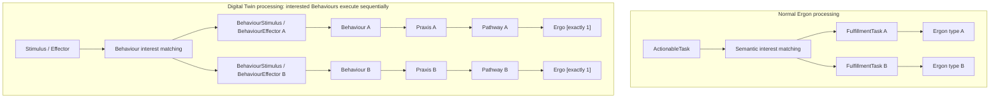
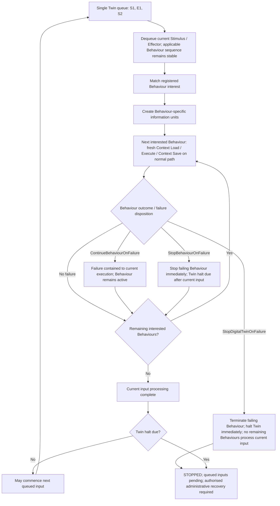
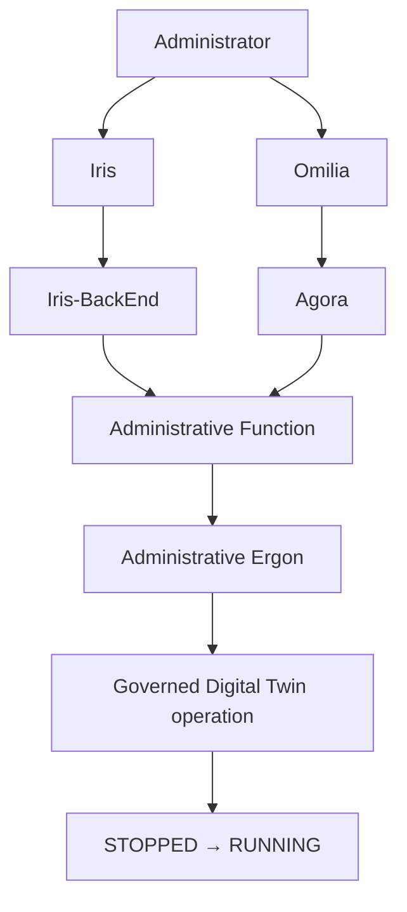

<!-- Copyright (c) 2026 Mark Hunter. Licensed under GPL-3.0-or-later. -->

# DesignNote — Digital Twin Behaviour and Execution Semantics

## Status

**Agreed A4.7 architectural decisions captured for review — 2026-10-12.**

**Architecture Layer:** Domain05 — Information Systems Layer.

This note records the explicit human architectural decisions supplied during
Domain05 A4.7, registered as [U19](../sources.md#u19). It reconciles the
[Candidate Architecture](../README.md); it does **not** declare A4.7 PASS,
accept the whole candidate, commence Step B or authorise implementation.
The [Architectural Axioms](../../governance/architectural-axioms.md) remain
controlling. Deferred mechanisms remain distinguishable from agreed semantics.

## 1. Purpose and architectural boundaries

Capture Digital Twin Behaviour structure, entity-relative execution, input
serialisation, Context lifecycle, sequencing, outputs, failure and authorised
administrative resumption. This is a semantic contract, not a new execution
engine, runtime topology or information schema.

| Relevant authority | Consistency of this decision |
| :--- | :--- |
| AX-04, AX-10, AX-12 | Harmonia defines serialisation, sequencing and failure meaning; common execution and durable handoff facilities remain reusable. No thread, queue product or runtime mechanism is prescribed. |
| AX-05, AX-06, AX-11 | Mneme manages Context/Pragma and their consequences; Mnemosyne establishes authoritative durable state. Loaded or changed values do not themselves establish authority. |
| AX-07, AX-08, AX-09 | Behaviour execution and administrative work remain authorised and auditable through normal boundaries. Operational state is not automatically durable audit evidence. |
| AX-14, AX-15 | Interest fan-out, execution concurrency, input completion, failure disposition and uncertain effects remain distinct. Failure does not prove that no information consequences occurred. |
| AX-16, AX-18 | Twin-relative operational activity progresses with the represented entity without acquiring authority over originating clinical facts or externally governed clinical work. |
| AX-17 | The explicit decisions below settle bounded semantics; unestablished representations and deferred mechanisms are not inferred. A4.7 acceptance remains human adjudication. |

Energeia owns/manages **Praxis and Journey**. Ponos owns **governed execution**;
Energeia and Ponos are peer application components. Praxis supplies a semantic
and operational execution envelope and does not structurally contain Ponos.
Existing [specialisation/reuse relationships](../candidate-system-map.md#specialisation-and-reuse)
remain intact: DigitalTwin specialises/reuses Ponos and Behaviour specialises/
reuses Ergon, without mandating implementation inheritance.

Mneme owns **Context and Pragma management**; Mnemosyne owns **authoritative
persistence management**. Petasos owns **durable purpose-defined handoff and
queueing**. Themis authorises/enforces; Kleio owns authoritative audit information.
Iris provides general human interaction; Agora owns collaboration control and
semantics; Omilia provides collaboration operations and experience. Iris does
not directly interact with Agora or Omilia. Administrative access confers no
privileged route into subsystem internals.

## 2. Digital Twin Behaviour structure

```text
Digital Twin
  └── Behaviour [1..*]
        └── Praxis
              └── Pathway
                    └── Ergo [exactly 1]
```

A Digital Twin has one or more Behaviours. Each Behaviour is realised through
a Praxis and a Pathway containing **exactly one Ergo**. A one-Ergo Praxis is
a genuine Praxis: Praxis is not synonymous with multi-step workflow complexity.
Its required Context definitions, expected criteria/outcomes, fulfilment semantics
and Praxis-level housekeeping still apply.

Praxis defines Pathway fulfilment; it is neither an orchestrator nor a
choreographer. Behaviour sequencing is a Twin execution responsibility, not
Pathway orchestration. This specialised pattern retains the general
[Praxis → Pathway Aggregation [0..1]](../pathways-journeys-and-handoff.md#praxis-operational-context)
and does not require all other Praxes to have a Pathway or exactly one Ergo.
The structure describes realisation, not new Composition, process or deployment
boundaries.

## 3. Twin-relative execution

A Digital Twin establishes an execution reference frame relative to the singular
real-world entity it represents. A Patient Twin executes relative to one Patient,
a Practitioner Twin to one Practitioner, and a Bed Twin to one Bed. These are
examples, not an exhaustive archetype catalogue or an identity-equivalence rule.

Compared with ordinary Ergon execution:

1. Context and available information are interpreted relative to that entity.
2. Stimulus and Effector inputs are structured relative to that entity.
3. No intra-Twin Behaviour concurrency is assumed or permitted by the current
   execution model.

References may be implicit within the Twin execution domain where its reference
frame establishes their meaning. Globally explicit references need not be
repeated throughout Behaviour processing. This convenience does not change
governed information ownership or authorisation.

## 4. One input queue and Behaviour-specific information

Each Digital Twin maintains a **single input queue containing Stimulus and
Effector**. On dequeue, the framework determines which Behaviours have registered
interest in that input and creates a discrete, identifiable information unit
for each interested Behaviour:

```text
Stimulus                         Effector
  ├── BehaviourStimulus → A         ├── BehaviourEffector → A
  ├── BehaviourStimulus → B         ├── BehaviourEffector → B
  └── BehaviourStimulus → C         └── BehaviourEffector → C
```

**BehaviourStimulus:** an identifiable Behaviour-specific instance derived from
a Stimulus and presented to the ingress of a Behaviour that has registered
interest in that Stimulus.

**BehaviourEffector:** an identifiable Behaviour-specific instance derived from
an Effector and presented to the ingress of a Behaviour that has registered
interest in that Effector.

These terms replace working terminology such as `ActionableStimulus` and
`FulfillmentStimulus`. They establish semantic information units, not a physical
schema, new Domain04 Information Resource or implementation inheritance hierarchy.
Existing candidate Stimulus/Effector Pragma specialisation standing remains;
this note does not settle those representation contracts.

### Normal Ergon and Digital Twin processing

Ordinary Ergon processing matches semantic interest in an ActionableTask and
establishes a separate FulfillmentTask for each interested Ergon undertaking.
Twin processing analogously matches Behaviour interest and derives the
corresponding BehaviourStimulus or BehaviourEffector.



**Diagram A:** fan-out shows semantic interest and Behaviour realisation, not
concurrent execution. The equivalence is semantic and architectural. It implies
neither inheritance nor identical information types, and does not establish
Stimulus/Effector processing through ActionableTask/FulfillmentTask.

## 5. Interest fan-out and execution concurrency

For ordinary Ergon processing, multiple independent **Ergon types** may register
interest in the same ActionableTask; each receives a separate FulfillmentTask.
Separately, **ActionableTask.ExecutionConcurrency** may permit multiple instances
of the **same Ergon type** to undertake that ActionableTask concurrently, each
through its own FulfillmentTask instance. Interest fan-out and execution
concurrency are orthogonal. Existing Domain04 outcome participation, output and
TaskOutcome semantics remain unchanged.

For Twin processing, multiple Behaviours may register interest in one Stimulus
or Effector and each receives its own Behaviour-specific information unit.
Those interested Behaviours execute **sequentially** within that Twin.
Concurrency is expected **across independent Digital Twins**, rather than between
Behaviours within one Twin. The runtime/threading mechanism remains deferred;
there is no requirement for a thread per Twin.

## 6. Digital Twin serialisation invariant

> **A Digital Twin processes at most one queued Stimulus or Effector at a time.**

Interested Behaviours process their respective BehaviourStimulus or
BehaviourEffector **sequentially**, subject to the
[failure dispositions](#10-behaviour-failure-dispositions). With no failure,
processing completes after the interested Behaviour sequence completes. Failure
may stop the failing Behaviour or halt the Twin, including immediately interrupting
the current input. The Twin may commence the next queued input only after current
input processing completes and no Twin halt applies. An empty queue or a stopped
Twin does not imply that an input is executing.



**Diagram B:** order is established through developer configuration, or is
unspecified when none is supplied; the applicable sequence remains stable for
the current input. Failure disposition applies at the failing Behaviour:
`StopDigitalTwinOnFailure` bypasses remaining current-input processing, while
`StopBehaviourOnFailure` halts the Twin after the remaining interested Behaviours
complete. Load / Execute / Save shows the normal path, not further processing
after an immediate stop. Context Save denotes Mneme management of consequences,
not a new persistence mechanism or automatic proof of authoritative commit.

## 7. Fresh Context for each Behaviour

Each Behaviour has its own **Praxis-defined Context requirements**. Mneme loads
Context fresh when that Behaviour begins, and manages its Context Save:

```text
Behaviour A: Context Load → Execute → Context Save
                                               ↓
Behaviour B: fresh Context Load → Execute → Context Save
                                                     ↓
Behaviour C: fresh Context Load → Execute → Context Save
```

On the normal path, Behaviour B's Context is loaded **after A has completed and
saved its information consequences**; C's is loaded after B, and so forth.
Progression after failure remains subject to section 10. Later Behaviours may
therefore observe authoritative information consequences established by earlier Behaviours.
There is **no single immutable input-level Context snapshot** shared by all
interested Behaviours.

Praxis defines required Context; Mneme retains Context management, materialisation
and save. Normal [Loader/Unloader versus Load/Save boundaries](../context-and-persistence-management.md#ergon-information-access)
apply. Mnemosyne alone establishes authoritative durable state; working changes
and Context Save invocation do not manufacture confirmed persistence outcomes.
Existing exceptional harmonisation and AX-15 uncertainty semantics remain intact.
This note adds no cross-Behaviour transaction, universal globally consistent
snapshot or conflict-resolution mechanism.

## 8. Behaviour sequence and developer policy

**R1.x/R2.x shall support an API** through which developer-supplied executable-
domain configuration may establish the execution sequence of loaded Behaviours.

```text
Digital Twin executable domain starts
    → Behaviours loaded
    → developer sequencing/configuration hook
    → Behaviour sequence established
    → Twin ready for input processing
```

The framework owns loading/discovery, exposing the loaded Behaviour set,
providing the API to establish or update the sequence, maintaining that sequence
and executing interested Behaviours accordingly. **The developer owns sequencing
policy.** Where no developer-defined sequence is supplied, execution order is
**unspecified**; serial execution and fresh per-Behaviour Context still apply.

> **The Behaviour sequence applicable when processing of a Stimulus or Effector
> commences remains stable for the duration of that input. Changes to the
> configured Behaviour sequence apply to subsequently processed inputs.**

This constrains execution semantics without prescribing how the sequencing API
implements configuration changes.

R1.x/R2.x introduces no priority metadata, dependency graph, Before/After
relationships, Criteria-based ordering or adaptive sequencing. Behaviour
sequencing is not Pathway orchestration. Richer R3.x sequencing/priority
mechanisms and dynamic/Criteria-driven sequencing remain deferred.

## 9. Behaviour outputs and egress

A Behaviour may generate ordinary Harmonia-governed outputs, including Stimulus,
Effector, ActionableTask, Pragma and other governed information appropriate to its
processing. Outputs may enter the normal Harmonia processing fabric: **Twin
Behaviour processing is not a closed execution loop**.

Outputs **should retain entity-relative references and Context semantics** where
this simplifies Behaviour implementation. When output crosses into general
Harmonia processing, output processing may need to resolve/dereference those
references into the explicit governed representation the receiving context
requires:

```text
Twin-relative Behaviour execution
    → Behaviour output
    → resolve / dereference where required
    → general Harmonia processing
```

No transformation is required where the output is already sufficiently explicit.
This is an internal execution-context boundary; applicable Pylai external
interoperability/publication controls still apply if information subsequently
leaves Harmonia. The reference-resolution implementation mechanism is deferred.

Output Stimulus or Effector applicable to the **same Twin** enters that Twin's
**normal input queue**. It does not recursively interrupt or re-enter processing
of the current input, and remains subject to serialisation and any stop disposition.

## 10. Behaviour failure dispositions

The Behaviour developer defines the failure disposition. R1.x/R2.x establishes
three dispositions with distinct effects on the failing Behaviour, the current
Stimulus or Effector and subsequent queued inputs:

| Disposition | Failing Behaviour | Other interested Behaviours / current input | Digital Twin / subsequent inputs |
| :--- | :--- | :--- | :--- |
| `ContinueBehaviourOnFailure` | Failure applies to the current Behaviour execution. The Behaviour remains active and may process subsequent applicable Stimulus or Effector inputs normally. | Unaffected; continue processing the current input normally. | Continues normal queue processing. |
| `StopBehaviourOnFailure` | Stops immediately and undertakes no further processing. | Unaffected by that immediate stop; continue processing the current input. | Halts once the remaining interested Behaviours complete the current input. No subsequent queued input is processed before authorised administrative intervention. |
| `StopDigitalTwinOnFailure` | Terminates immediately. | No remaining Behaviour processes the current input. | Stops immediately. No subsequent queued Stimulus or Effector is processed; queued inputs remain pending subject to deferred administrative recovery semantics. |

> **StopBehaviourOnFailure stops the failing Behaviour immediately, permits the
> remaining Behaviours to complete the current Twin input, and then halts the
> Digital Twin.**

These are increasing scopes of failure containment/escalation:

```text
ContinueBehaviourOnFailure
    → contain failure to the current Behaviour execution

StopBehaviourOnFailure
    → stop the failing Behaviour immediately
    → remaining interested Behaviours complete the current input
    → halt the Digital Twin

StopDigitalTwinOnFailure
    → halt the entire Digital Twin immediately
```

A pending Twin halt from `StopBehaviourOnFailure` is not undone by another
Behaviour's `ContinueBehaviourOnFailure`; `StopDigitalTwinOnFailure` always halts
the Twin immediately, including while remaining Behaviours are being processed.
Failure does not prove that no information consequences occurred; AX-15
uncertainty remains binding. No default disposition, automatic retry, replay or
skip semantics is introduced.

## 11. Authorised administrative recovery

A Twin halted by `StopBehaviourOnFailure` or `StopDigitalTwinOnFailure`
**does not automatically resume**.
Queued Stimulus and Effector inputs remain pending. Resumption requires authorised
administrative input initiated through an appropriate human interaction channel,
such as Iris or Omilia:



The two human-interaction branches are alternatives, not a direct Iris/Agora/
Omilia integration. Iris and Omilia do not directly manipulate or resume the
Twin; Iris-BackEnd and Agora also provide no privileged subsystem backdoor.
Agora's execution handoff retains Petasos and its prohibition on direct Ponos
dependency. Arrows show semantic progression, not new synchronous APIs or dependencies.

The Administrative Function is executed through specialised Administrative
Ergon under normal authorisation, Context management, execution and Kleio audit
controls. This establishes authorised resume only; retry/replay/skip operations
and recovery-console semantics are not designed here. The detailed treatment of
a Behaviour stopped by `StopBehaviourOnFailure`, including whether/how it is
reset, resumed, replaced or otherwise recovered, remains deferred to the
Administrative Function/recovery design.

## 12. Broader Administrative Function finding

> **Administrative Functions are first-class governed Harmonia functions
> implemented through specialised Ergon. They are not privileged shortcuts
> through presentation, collaboration or backend components into the internals
> of Harmonia subsystems.**

> **Administration is not an exception to the Harmonia execution architecture;
> it is governed work performed through that architecture.**

This finding potentially applies to operational, processing, configuration and
governance administration beyond Digital Twins. It is flagged for **subsequent
Domain05 reconciliation** in [CDG-55](../gaps.md#administrative-function-finding).
This task creates neither a complete administration architecture nor a catalogue
of Administrative Functions or Administrative Ergon.

## 13. Deferred matters and open questions

The following are intentionally unresolved; none is supplied by an implementation
convention or by the conceptual diagrams:

- richer R3.x Behaviour sequencing/priority mechanisms;
- dynamic/Criteria-driven Behaviour sequencing;
- detailed Administrative Function and Administrative Ergon catalogue;
- detailed recovery operations beyond authorised resume;
- treatment of a Behaviour stopped by `StopBehaviourOnFailure`, including
  whether/how it is reset, resumed, replaced or otherwise recovered;
- implementation of Twin-relative reference resolution/dereferencing;
- exact runtime/threading mechanism for concurrency across independent Twins;
- AI-assisted Behaviour selection/configuration concepts; and
- whether future releases introduce additional Behaviour failure dispositions.

Related [CDG-07/54](../gaps.md#digital-twin-execution-contracts) representation and
execution details remain open: Stimulus/Effector and Behaviour-specific IU
schemas/identity/lifecycle; registration/API contracts and sequence-update
implementation within the stable-current-input guardrail; and handling of
Context Save, exceptional harmonisation or authoritative outcomes that cannot
be established normally. Serialisation, fresh loading and AX-15 remain
binding; no default failure disposition or uncertain-save continuation algorithm
is invented. The review leaves these detailed questions explicit rather than
claiming their mechanisms are settled.

The [U19 reconciliation record](../sources.md#u19) identifies affected candidate
views and the authorised AGENTS taxonomy correction. Documentation readiness
supports **Mark/ChatGPT A4.7 architectural adjudication**; it does not establish
that adjudication's result.
