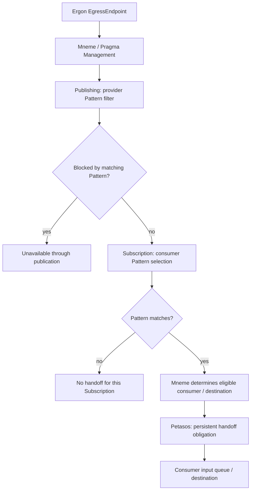
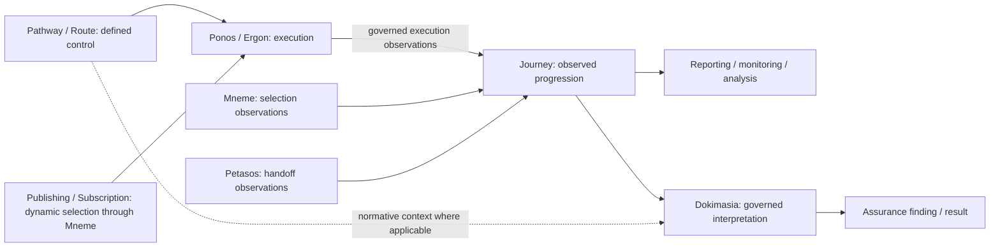

<!-- Copyright (c) 2026 Mark Hunter. Licensed under GPL-3.0-or-later. -->

# Candidate Pathway, Journey, Publish/Subscribe and Handoff Architecture

**Standing: Domain05 Step A adjudicated Candidate Architecture, 2026-10-11.**
[U03–U05](sources.md#u03) record the supplied human-adjudicated DesignNotes and
explicit task decisions incorporated here. [Scope](README.md) applies: this
correction does not accept the whole candidate, commence Step B or establish
implementation design. Existing [Energeia specialisation](README.md#energeia-adjudication)
and [Domain04 observability](../04-information-architecture/guardrails/observable-information-and-domain-meaning.md#2-observability-and-encapsulated-domain-meaning)
remain controlling. Technology engines may later realise these semantics;
their conventions supply no missing architectural decision (AX-04/17).

<a id="pathway-model"></a>

## Pathway design and control

| Construct | Architectural kind and adjudicated meaning |
| :--- | :--- |
| **PathwayEndpoint C29** | Application Interface conceptually equivalent to an ArchiMate ApplicationInterface. Every Ergon exposes an **IngressEndpoint** and an **EgressEndpoint**. |
| **PathwayElement C30** | Generic behavioural/flow representation between and across component boundaries; at least Segment and Traversal specialisations are established. |
| **PathwaySegment C31** | Inter-component flow from Ergon A.EgressEndpoint to Ergon B.IngressEndpoint; conceptually comparable to an ArchiMate ApplicationInteraction between ApplicationInterfaces. |
| **PathwayTraversal C32** | Intra-component passage from an Ergon's IngressEndpoint to its EgressEndpoint. It establishes that the component was traversed, without exposing its internal business logic. |
| **Route C33** | Ordered sequence of **PathwaySegment [1..N]**, principally for routing/control. Traversal's observational usefulness does not redefine Route as generic PathwayElements. |
| **Pathway C34** | Controlled interaction between PathwayEndpoints, identifying the Route or Routes available for that interaction. |

```text
Ergon A.IngressEndpoint -- PathwayTraversal A --> Ergon A.EgressEndpoint
                                                         |
                                                   PathwaySegment AB
                                                         |
                                                         v
Ergon B.IngressEndpoint -- PathwayTraversal B --> Ergon B.EgressEndpoint

Route = ordered PathwaySegment [1..N]
Pathway = controlled endpoint interaction with available Route(s)
Praxis -- may have --> Pathway [0..1]
```

These are interface, behavioural and control constructs. Their names do not
require independently deployed Application Components. The flow representation
preserves Ergon encapsulation.
The exact information representations, management/persistence allocations and
control contracts are not selected here.

**Praxis remains unresolved beyond Pathway [0..1].** Praxis is not synonymous
with Pathway, Route, a sequence of Ergo/Ergon, a runtime engine or a Pub/Sub
graph. Historical blueprint/composition/execution descriptions remain evidence
of the unresolved question in [CDG-01](gaps.md). This cardinality supplies no
broader Praxis definition, composition or instance semantics.

<a id="publication-and-selection"></a>

## Dynamic information selection through Mneme

Defined Pathways and Publish/Subscribe are two distinct information-progression
mechanisms. Pub/Sub does not require a predefined end-to-end Route or Pathway.
Mneme / Pragma Management owns the contained logical responsibilities for
**Publishing C36**, **Subscription C37** and **Pattern C38**. No separate
deployment boundary is implied by these names.

| Construct / responsibility | Adjudicated meaning |
| :--- | :--- |
| **Publishing** | Governed provider-side eligibility/filtering: a provider may prevent egress Pragma from being made available through publication when its Pattern matches. It answers “What may leave / be made available by this provider?” |
| **Subscription** | Governed consumer-side selection: a consumer requests that available Pragma matching a Pattern be made available/forwarded to its input queue or equivalent destination. It answers “What does this consumer want to receive?” |
| **Pattern** | Common governed evaluation of characteristics associated with Pragma metadata, Information Unit Container and Content metadata, Topic, source and other established metadata. Final language, supported attributes/operators, precedence, query syntax, indexing and algorithms remain unresolved. |
| **Mneme** | Manages definitions, Pattern semantics/evaluation, matching, selection and information eligibility; determines eligible consumer/destination relationships. |
| **Petasos** | Persistently manages and reliably effects the resulting handoff; destination mechanics do not confer semantic selection responsibility. |
| **Ponos** | Manages resulting execution and progression; subsequent execution does not confer Subscription matching responsibility. |



Publishing and Subscription are deliberately asymmetric. Provider permission
to publish does not require a consumer to be selected, and consumer interest
does not override provider filtering or governed authorization. The diagram
expresses those meanings, not an evaluation algorithm or transaction order.
Themis governs applicable operations under established security context.

This Publishing mechanism concerns availability within Harmonia. An Ergon's
EgressEndpoint does not itself end Harmonia management of the governed payload.
Pylai's standards-facing external publication remains the separate AX-13
boundary, with non-destructive fail-closed projection of an emitted representation.

> **Mneme coordinates the governed management, selection, publication,
> subscription and availability of information. It does not coordinate execution
> of the activities that consume that information.**

<a id="pragma-and-topic"></a>

## Pragma payload and Topic semantics

Every Pragma contains or references a payload such as an Information Unit.
The working semantic shape relevant to Pattern evaluation is:

```text
Pragma
  Pragma Metadata
    origin / targetDestination / timestamps / processing status / ...
  Payload (contained or referenced)
    InformationUnit
      Container
        Topic / other metadata (including source)
      Content
        Topic / other metadata (including source)
```

This is semantic notation, not a final Java/API/storage schema. “Container”
denotes the Unit-level aspect in this application view; it neither reinstates
the retired **Information Container** concept nor replaces Domain04's
[Identity / Metadata / Content / Context partition](../04-information-architecture/metamodel/information-architecture-metamodel.md#61-conceptual-partition).
Its exact relationship to that partition remains a detailed representation
question; Identity and Management Context are not removed by this illustration.

**Topic is governed classification/metadata participating in Pattern evaluation.**
It may occur at more than one semantic level. Container Topic and Content Topic
need not mean the same thing. Topic is not synonymous with destination, queue
or channel; source, origin and targetDestination are not automatically synonyms.
Detailed metadata definitions and Container/Content Topic semantics remain
unresolved. Neither broker topic naming nor framework routing conventions
establish those definitions.

<a id="persistent-handoff"></a>

## Persistent handoff without information ownership

> **Mneme determines whether and where managed information should be made
> available according to Publishing, Subscription and Pattern semantics;
> Petasos is responsible for persistently managing and reliably effecting the
> resulting handoff.**

Petasos is a shared persistent/recoverable messaging and handoff subsystem.
For Pragma-based processing, the governed Pragma and Information Unit payload
remain managed through Mneme. Petasos manages the identity/reference required
to resolve that information and the metadata/state necessary for handoff and
recovery. It does not transport the managed Information Unit payload in this
pattern or acquire management authority over it.

For ActionableTask processing the established conceptual collaboration is:

```text
Mneme manages ActionableTask / Pragma and payload
  --> selection / eligibility
Petasos persistently manages handoff obligation
  --> identity/reference + handoff metadata
Consumer resolves governed information through Mneme
  --> creates / morphs its distinct FulfillmentTask undertaking
Ponos manages execution / progression
  --> Ergon supplies bounded behaviour within Ergo's contract
```

**Petasos distributes the opportunity to undertake work, not the undertaking
itself**, for this ActionableTask pattern. Context Loading/Unloading uses
Mneme's governed information contracts; durable state establishment remains
Mnemosyne's responsibility. Handoff acceptance, information commit, undertaking
completion, work resolution and external acknowledgement remain distinct.

Petasos also supports Communication Event, Notification Event and other
established messaging/handoff forms. Their exact semantics remain unresolved;
this task establishes neither an ActionableTask-only subsystem nor a universal
reference-only message format. Producer/consumer/destination API terminology
may describe machinery but cannot replace the information-management boundary.

<a id="state-and-recovery"></a>

## Distinct state and recovery responsibilities

| State / concern | Responsibility and boundary |
| :--- | :--- |
| **Pragma / managed-information state** | Governed information managed through Mneme; authoritative durable establishment/preservation through Mnemosyne. May record a governed observation concerning delivery without owning the handoff obligation. |
| **Petasos handoff/delivery state** | Operational state of a particular persistent handoff obligation, including delivery attempt, redelivery/recovery and dead-letter handoff semantics. |
| **FulfillmentTask undertaking state** | Information representing a particular identifiable undertaking, distinct from ActionableTask and other undertakings. Consumer establishment and Mneme information management do not collapse into runtime execution state. |
| **Ponos execution/progression state** | Runtime execution, scheduling/concurrency, execution failure and execution retry/re-attempt or activity progression semantics. |

Pragma “destination-specific delivery observations” means governed information
recording observations concerning delivery. **Operational ownership of the
delivery/handoff obligation remains with Petasos.** REC-002 destination
granularity is preserved; the exact relationship among Petasos observations,
Pragma/checkpoints, Task outputs and parent progression remains unresolved.
No observation is silently treated as a completion or TaskOutcome algorithm.

Ponos execution retry and Petasos handoff redelivery are different operations.
Detailed acknowledgements, retry/recovery, duplicates, replay, ordering and
continuation contracts remain unresolved. An uncertain previous effect remains
uncertain under AX-15; technical failure alone proves neither success nor
non-occurrence. No safe re-attempt algorithm is invented here.

<a id="fan-out-boundary"></a>

## Fan-out: established principle and retained detail

The supplied Publish/Subscribe DesignNote §§11–13/21 **partially adjudicates**
the fan-out question:

- A single Pragma may match multiple Subscriptions. The common managed Pragma
  and payload remain within Mneme; Petasos may manage multiple independent
  handoff obligations/queue entries referring to it. Payload duplication is
  not inherently required.
- For ActionableTask processing, each consumer that undertakes the work
  creates/morphs its **distinct FulfillmentTask**. Selection or handoff alone
  does not establish an undertaking. This preserves Domain04's
  [ActionableTask → FulfillmentTask [0..*] distinction](../04-information-architecture/information-families/task-work.md#23-fulfillmenttask--identifiable-undertaking).

**Detailed fan-out identity/lifecycle semantics remain unresolved:** reference,
copy and version binding; exact morph/derivation mechanics; Pragma identity for
undertaking representations; targetDestination and per-consumer processing
state; concurrent processing and mutable-state isolation; lineage/causation;
Journey correlation/reconstruction and assurance. No copy-per-subscriber or
shared mutable processing-state model follows. Domain04 execution concurrency,
outcome participation, output rules and TaskOutcome ownership remain unchanged.
[CDG-37](gaps.md#pubsub-fanout) retains the remaining question.

<a id="journey-and-assurance"></a>

## Journey: common observation and assurance subject

> **Journey is the governed representation of Harmonia's observed progression
> of information and activity, reconstructed from available execution evidence
> and forming the primary subject of reporting, monitoring, analysis and
> assurance, irrespective of whether that progression arose through
> Pathway-controlled routing, Publish/Subscribe processing, or a combination
> of both.**

Journey C35 is a first-class observational construct / candidate Application
Data Object, not an execution engine or merely a telemetry report. A Journey
may exist without a corresponding Pathway and may be graph-shaped because
observed progression can branch, fan out, converge or combine mechanisms.
Pathway controls permitted progression; Journey represents observed progression.



The arrows describe evidence contribution and use; they assign no Journey
construction service, management owner, evidence repository, schema or retention
contract. Journey construction and information-management ownership remain
unresolved in [CDG-38](gaps.md#journey-contracts).

| Contributing responsibility | Examples of available governed observations |
| :--- | :--- |
| **Mneme** | Publishing permitted/blocked; Subscription matched; Pattern condition matched; consumer/destination selected. |
| **Petasos** | Handoff established; destination identified; delivery attempted; delivery succeeded/failed or uncertain; redelivery/recovery observations. |
| **Consumer / Ponos / Ergon** | Undertaking established; execution attempted/occurred; activity result; checkpoint and progression observations. |

These contributions can distinguish selection without handoff, handoff without
observed execution, and execution with failure or unexpected results. An absent
observation does not prove non-occurrence. Available evidence bounds the Journey;
missing or uncertain evidence remains distinguishable from established fact.

Reporting, monitoring, analysis and Dokimasia assurance SHALL be capable of
operating against Journey. Journey is expected to be the fundamental assurance
building block. Possible interpretation includes progression, branching and
convergence, conformance to a governing Pathway/Route where one exists, missing
or unexpected activity, failure/incomplete progression, information exposure,
policy/security anomalies, relationships between apparently separate activities
and significance in context. These are possible uses, not mandatory algorithms.
Without a Pathway, other applicable assurance bases may provide the expectations.

```text
What Harmonia observed --> Journey
  --> what Harmonia can reason from those observations
  --> Dokimasia / governed AI Assurance activity
  --> what Harmonia concludes: Assurance Finding / Result
```

Journey is factual with respect to available governed observations/evidence.
Inferred relationships SHALL remain distinguishable from directly observed
relationships. Deterministic or AI interpretation cannot replace underlying
observations with inferred fact or turn Journey into an AI-generated narrative.
The inference/evidence representation and detailed Journey model are unresolved.
Evidence contribution, operational observation, AuditEvent and assurance finding
remain distinct; not every Journey observation becomes a permanent AuditEvent
(AX-08/09). Dokimasia's [terminal constraints](component-register.md#dokimasia-terminal-boundaries)
and operational independence remain intact.
