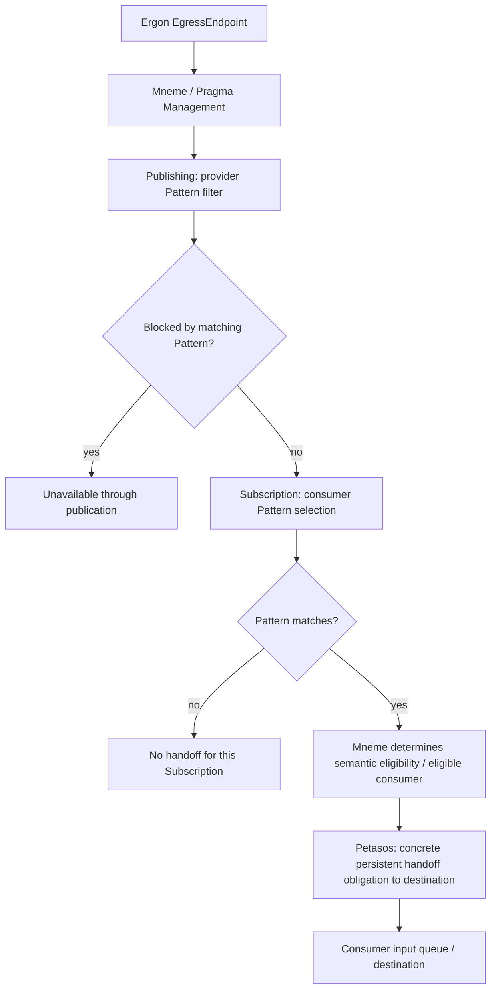
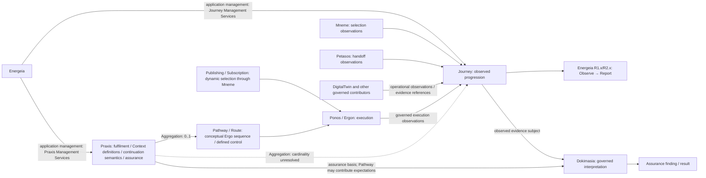

<!-- continuum-source-succession -->
> **RAD-1.1.5 source succession:** Partial section succession; unwrapped scope/governance and unresolved material retain their recorded roles. See the [canonical continuum](../../../enterprise-architecture/continuum/documentation/published/1.1.5/README.md) and [section correspondence](../../../enterprise-architecture/design/evidence/1.1.5/002/after/source-succession.json). Original source wording and standing below are preserved.

<!-- Copyright (c) 2026 Mark Hunter. Licensed under GPL-3.0-or-later. -->

# Candidate Pathway, Journey, Publish/Subscribe and Handoff Architecture

**Standing: Domain05 Step A adjudicated Candidate Architecture, through 2026-10-12.**
[U03–U15](sources.md#u03) and [U18](sources.md#u18) record the human-adjudicated
DesignNotes and explicit task decisions incorporated here. [Scope](README.md) applies: this
correction does not accept the whole candidate, commence Step B or establish
implementation design. Existing [Energeia specialisation](README.md#energeia-adjudication)
and [Domain04 observability](../04-information-architecture/guardrails/observable-information-and-domain-meaning.md#2-observability-and-encapsulated-domain-meaning)
remain controlling. Technology engines may later realise these semantics;
their conventions supply no missing architectural decision (AX-04/17).

<a id="pathway-model"></a>

## Pathway design and control

| Construct | Architectural kind and adjudicated meaning |
| :--- | :--- |
| **PathwayEndpoint C29** | Application Interface conceptually equivalent to an ArchiMate ApplicationInterface. Every Ergon exposes an **IngressEndpoint** and an **EgressEndpoint**. |
| **PathwayElement C30** | Generic behavioural/flow representation between and across component boundaries; at least Segment and Traversal specialisations are established. |
| **PathwaySegment C31** | Inter-component flow from Ergon A.EgressEndpoint to Ergon B.IngressEndpoint; conceptually comparable to an ArchiMate ApplicationInteraction between ApplicationInterfaces. |
| **PathwayTraversal C32** | Intra-component passage from an Ergon's IngressEndpoint to its EgressEndpoint. It establishes that the component was traversed, without exposing its internal business logic. |
| **Route C33** | Ordered sequence of **PathwaySegment [1..N]**, principally for routing/control. Traversal's observational usefulness does not redefine Route as generic PathwayElements. |
| **Pathway C34** | Defines the conceptual sequence of Ergo through which execution progresses, expressed through controlled interaction between PathwayEndpoints and available Route(s). |

```text
Ergon A.IngressEndpoint -- PathwayTraversal A --> Ergon A.EgressEndpoint
                                                         |
                                                   PathwaySegment AB
                                                         |
                                                         v
Ergon B.IngressEndpoint -- PathwayTraversal B --> Ergon B.EgressEndpoint

Route = ordered PathwaySegment [1..N]
Pathway = conceptual Ergo sequence, expressed through endpoint interaction / Route(s)
Praxis -- Aggregation --> Pathway [0..1]
```

These are interface, behavioural and control constructs. Their names do not
require independently deployed Application Components. The flow representation
preserves Ergon encapsulation.
The exact information representations and control contracts remain unresolved.
Praxis application ownership and the semantic persistence domains are now
established below and in [Data/Persistence](data-and-persistence.md#persistence-responsibility-domains).

<a id="praxis-operational-context"></a>

<!-- continuum-supersession:start -->
------- Legacy Content - Superseded ------- Start ------
Superseded by canonical continuum element(s), RAD-1.1.5 authorised ingestion:
- [Praxis](../../../enterprise-architecture/continuum/application/data-object/0f961462340348b290fd844357d54d67.md)
Original source standing and unresolved qualifications are preserved.
---------------------------------------------------------

## Praxis: operational context and assurance basis

**Praxis is the higher-order operational construct establishing the operational
and assurance envelope within which Harmonia activity occurs.** The conversational
description “super Pathway/Journey” identifies its higher-order context; it
establishes neither a supertype nor an execution engine. Praxis defines expected
or permitted operational context, including candidate externally visible interface
information, overall Topic exclusions and potentially inclusions, operational
configuration/constraints and assurance rules/expectations.

**Pathway defines the conceptual Ergo sequence; Praxis defines how that Pathway
is fulfilled.** Praxis manages the definition of Context required by the Ergo
framework, expected criteria/outcomes for Pathway segments, output-to-next-input
continuation semantics and other Praxis-level fulfilment housekeeping. Ponos/Ergo
performs governed execution, output processing and routing using those semantics;
**Praxis is neither an orchestrator nor a choreographer**.

The [U19 Digital Twin Behaviour pattern](design-notes/DesignNote-Digital-Twin-Behaviour-and-Execution-Semantics.md)
is a genuine one-Ergo Praxis: Digital Twin → Behaviour [1..*] → Praxis →
Pathway → Ergo [exactly 1]. Required Context, criteria/outcomes, fulfilment and
housekeeping still apply. This specialised realisation does not alter the general
Praxis → Pathway Aggregation [0..1]. Energeia and Ponos are peer application
components; Praxis's semantic/operational envelope does not structurally contain
Ponos. Behaviour sequencing is not Pathway orchestration.

**Energeia owns the Praxis application responsibility** and SHALL provide the
candidate **Praxis Management Services** responsibility set:

- definition and registration;
- discovery and retrieval;
- operational configuration and externally visible interface configuration;
- Topic inclusion/exclusion policy;
- Pathway relationship/aggregation management;
- applicable Context definitions, segment criteria/outcomes and continuation semantics;
- assurance-rule association and other Praxis-wide operational constraints.

These responsibilities are not yet decomposed into separate Application Features,
Application Services, internal constructs or subordinate Software Components.
Topic inclusion's necessity, the interface model and assurance-rule attachment
contract remain unresolved. Managing interface configuration does not transfer
Pylai's external contract/publication responsibility to Energeia; Praxis Topic
policy does not transfer Mneme's Publishing/Subscription/Pattern selection.

| Architectural relationship | Established meaning and limit |
| :--- | :--- |
| Energeia → Praxis | Application ownership/management through Praxis Management Services. Mneme manages its governed information; Ponos uses it for execution; Dokimasia uses it as assurance basis. |
| Praxis → Pathway | **Aggregation [0..1]**. Praxis may exist without a Pathway because activity may proceed through Publish/Subscribe. |
| Praxis → Journey | Working **Aggregation** of relevant observed progression; exact cardinalities and association contracts remain unresolved. No Composition or shared lifecycle is inferred. |
| Journey → contributing information/evidence | Semantic **Aggregation/reference** without transfer of originating ownership or indiscriminate duplication. |

Praxis is not equivalent to Pathway, Route, a sequence of Ergo/Ergon, a runtime
engine or a Pub/Sub graph. Historical blueprint/composition/execution descriptions
are retained provenance, not competing current definitions. Detailed Praxis
representation and lifecycle remain [CDG-01/06](gaps.md): versioning,
activation/deactivation, replacement, retirement and treatment of in-flight
activity following change are deliberately unestablished.


------- Legacy Content - Superseded ------- Finish ----
<!-- continuum-supersession:end -->


<a id="pathway-continuation"></a>

<!-- continuum-supersession:start -->
------- Legacy Content - Superseded ------- Start ------
Superseded by canonical continuum element(s), RAD-1.1.5 authorised ingestion:
- [Pragma Topic](../../../enterprise-architecture/continuum/application/data-object/27ad143e7c784e378556af8a57c438f7.md)
Original source standing and unresolved qualifications are preserved.
---------------------------------------------------------

## Ergon outputs and the Pathway-continuation role

Ergon execution may produce one or more outputs; their processing may result in
multiple Pragma. **Not every resulting Pragma advances the current Pathway.**
The **Pathway-continuation Pragma** is the role identifying derived information
required to continue fulfilment of the current Praxis along its Pathway. Praxis
defines derivation semantics; the execution framework performs applicable output
processing and routing. Mneme retains management of all resulting Pragma and
Context; Petasos retains durable physical handoff where applicable.

Other resulting Pragma remain independently available governed artefacts for
Mneme Publish/Subscribe, another Praxis, other governed processing or no further
processing. Production alone establishes neither continuation of the current
Pathway nor a requirement to publish or consume each output.

**Continuation is a Pragma role, not a new subtype.** Whether continuation always
constructs a new Pragma, designates a resulting output Pragma, or uses another
governed representation is explicitly deferred. The adjudication and conceptual
branching example are in the [DesignNote](design-notes/DesignNote-Pragma-Outputs-and-Pathway-Continuation.md);
[CDG-53](gaps.md#continuation-representation) preserves the modelling decision.

**R1.x/R2.x Context requirements remain concretely defined.** Existing likely
resource declarations and bounded Adhoc access remain supported. R3.x may
introduce criteria-driven dynamic Context determination and dynamically configured
reusable/generic Ergo; that direction and its mechanisms remain deferred, with
no AI-driven selection/configuration introduced here.


------- Legacy Content - Superseded ------- Finish ----
<!-- continuum-supersession:end -->


<a id="publication-and-selection"></a>

## Praxis.Horos and external interaction

[U14 Pylai/Horos](pylai-external-interoperability.md#praxis-horos) introduces
Praxis.Horos, Praxis.IngressHoros and Praxis.EgressHoros for logical Praxis
boundaries, superseding Praxis “Endpoint” in that meaning only. U04's Ergon
PathwayEndpoint / IngressEndpoint / EgressEndpoint Application Interfaces retain
their meaning; technical/network/Camel endpoints and FHIR Endpoint are unchanged.
Horos is not another technical endpoint or a universal rename of those interfaces.

PylaiPathway ingress uses Terma → transient Diadromí → IngressHoros → Ergo.Ingress,
with special initial Context establishment, semantic processing by BusinessLogic
and Ergo.Egress → Petasos.Queue[TermaName] as Praxis.PathwaySegment. Durable
acceptance waits for authoritative Pragma/Task persistence; protocol ACK may
represent only progress. EgressHoros hands out after BusinessLogicCapturer and
back before ContextUnloader completes. [Canonical lifecycle diagrams](pylai-external-interoperability.md#pylai-pathway-ingress)
record both orders without selecting runtime mechanics.

Broker interaction from existing BusinessLogic and Server READ/SEARCH through
Diadromí-Controller do not manufacture a Praxis/Pathway/work undertaking. Applicable
Themis, Kleio, Dokimasia and Journey participation remains. U15 distinguishes
Terma's communication stack from application interpretation in the applicable
execution framework, subject to the explicit patterns above. Communication-local
retry requires the same active interaction and Diadromí. A lost/terminated
Diadromí cannot resume; an appropriate client retry creates a new interaction
and Diadromí. Terma/Diadromí provides no durable application recovery. Petasos
and established execution retain durable messaging/recovery responsibilities.

<!-- continuum-supersession:start -->
------- Legacy Content - Superseded ------- Start ------
Superseded by canonical continuum element(s), RAD-1.1.5 authorised ingestion:
- [Pragma Management](../../../enterprise-architecture/continuum/application/application-function/ab0cdaa7ed4149ee856216efa5a265c4.md)
Original source standing and unresolved qualifications are preserved.
---------------------------------------------------------

## Dynamic information selection through Mneme

Defined Pathways and Publish/Subscribe are two distinct information-progression
mechanisms. Pub/Sub does not require a predefined end-to-end Route or Pathway.
Independent output-derived Pragma may enter this governed selection independently
of the originating Praxis's [Pathway continuation](#pathway-continuation).
Mneme / Pragma Management owns the logically aggregated responsibilities for
**Publishing C36**, **Subscription C37** and **Pattern C38**. No separate
deployment boundary is implied by these names.

| Construct / responsibility | Adjudicated meaning |
| :--- | :--- |
| **Publishing** | Governed provider-side eligibility/filtering: a provider may prevent egress Pragma from being made available through publication when its Pattern matches. It answers “What may leave / be made available by this provider?” |
| **Subscription** | Governed consumer-side selection: a consumer requests that available Pragma matching a Pattern be made available/forwarded to its input queue or equivalent destination. It answers “What does this consumer want to receive?” |
| **Pattern** | Common governed evaluation of characteristics associated with Pragma metadata, Information Unit Container and Content metadata, Topic, source and other established metadata. Final language, supported attributes/operators, precedence, query syntax, indexing and algorithms remain unresolved. |
| **Mneme** | Manages definitions, Pattern semantics/evaluation, matching, selection and semantic eligibility; establishes eligible recipient/consumer relationships. |
| **Petasos** | Establishes and manages the concrete persistent handoff obligation to the destination and reliably effects it; destination mechanics/state do not confer semantic selection responsibility. |
| **Ponos** | Manages resulting execution and progression; subsequent execution does not confer Subscription matching responsibility. |



Publishing and Subscription are deliberately asymmetric. Provider permission
to publish does not require a consumer to be selected, and consumer interest
does not override provider filtering or governed authorization. The diagram
expresses those meanings, not an evaluation algorithm or transaction order.
Themis governs applicable operations under established security context.

This Publishing mechanism concerns availability within Harmonia. An Ergon's
EgressEndpoint does not itself end Harmonia management of the governed payload.
Pylai's standards-facing external publication remains the separate AX-13
boundary, with non-destructive fail-closed projection of an emitted representation.

> **Mneme manages activity Context and Pragma, including governed semantic
> selection, publication, subscription and availability. Execution of consuming
> activities remains with Ponos.**

Internal Resource Harmonisation Manager may cause **new governed work** through
the established work/execution contract and common Ponos execution; it does not
execute harmonisation or embed a second framework. This refines the information/
execution seam without transferring handoff obligations from Petasos.


------- Legacy Content - Superseded ------- Finish ----
<!-- continuum-supersession:end -->


<a id="pragma-and-topic"></a>

<!-- continuum-supersession:start -->
------- Legacy Content - Superseded ------- Start ------
Superseded by canonical continuum element(s), RAD-1.1.5 authorised ingestion:
- [Pragma Topic](../../../enterprise-architecture/continuum/application/data-object/27ad143e7c784e378556af8a57c438f7.md)
Original source standing and unresolved qualifications are preserved.
---------------------------------------------------------

## Pragma payload and Topic semantics

Pragma **realises
[Metabolē](../04-information-architecture/patterns/metabole.md#2-architectural-realisation)**
for governed information/activity progression. The following payload shape
retains its application meaning; Realisation neither equates Pragma with the
conceptual construct nor requires a shared representation/lifecycle with Diadromí.
Mneme retains Pragma management.

Every Pragma contains or references a payload such as an Information Unit.
The working semantic shape relevant to Pattern evaluation is:

```text
Pragma
  Pragma Metadata
    origin / targetDestination / timestamps / processing status / ...
  Payload (contained or referenced)
    InformationUnit
      Container
        Topic / other metadata (including source)
      Content
        Topic / other metadata (including source)
```

This is semantic notation, not a final Java/API/storage schema. “Container”
denotes the Unit-level aspect in this application view; it neither reinstates
the retired **Information Container** concept nor replaces Domain04's
[Identity / Metadata / Content / Context partition](../04-information-architecture/metamodel/information-architecture-metamodel.md#61-conceptual-partition).
Its exact relationship to that partition remains a detailed representation
question; Identity and Management Context are not removed by this illustration.

**Topic is governed classification/metadata participating in Pattern evaluation.**
It may occur at more than one semantic level. Container Topic and Content Topic
need not mean the same thing. Topic is not synonymous with destination, queue
or channel; source, origin and targetDestination are not automatically synonyms.
Detailed metadata definitions and Container/Content Topic semantics remain
unresolved. Neither broker topic naming nor framework routing conventions
establish those definitions.


------- Legacy Content - Superseded ------- Finish ----
<!-- continuum-supersession:end -->


<a id="persistent-handoff"></a>

<!-- continuum-supersession:start -->
------- Legacy Content - Superseded ------- Start ------
Superseded by canonical continuum element(s), RAD-1.1.5 authorised ingestion:
- [Petasos](../../../enterprise-architecture/continuum/application/application-component/195e5f10db8e419391354197b5d7a8cc.md)
- [PetasosParcel Topic](../../../enterprise-architecture/continuum/application/data-object/f0a88f05a0cb438cb42572ec07fb8513.md)
Original source standing and unresolved qualifications are preserved.
---------------------------------------------------------

## Persistent handoff without information ownership

> **Mneme determines semantic eligibility and eligible recipient/consumer
> relationships under Publishing, Subscription and Pattern semantics. Petasos
> establishes and manages the concrete persistent handoff obligation to the
> destination and reliably effects that handoff. Ponos manages execution.**

Eligible consumer relationships express semantic selection. They do not assign
queue binding, destination mechanics or concrete handoff state to Mneme.

Petasos is Harmonia's durable message/event queue-management component.
It creates, operates and owns the operational state/status of **purpose-defined
queues** for inter-Ergon flow and other architecturally established communication,
notification and event sharing. Every queue carries **PetasosParcel by value**;
associated information is predominantly by reference to governed information
managed elsewhere. Parcel is conceptually analogous to FHIR Communication;
literal equivalence and detailed schema are not established.

For the ActionableTask handoff special case, governed ActionableTask/Pragma and
Information Unit payload remain managed through Mneme. A by-value Parcel may
carry references and communication/handoff metadata required for resolution and
recovery. Petasos acquires no management authority over the referenced information
and does not copy the managed ActionableTask payload in this pattern.

```text
Mneme manages ActionableTask / Pragma and payload
  --> semantic selection / eligibility
Petasos persistently manages handoff obligation
  --> queues PetasosParcel by value, referring to ActionableTask
Consumer resolves governed information through Mneme
  --> establishes its own distinct FulfillmentTask undertaking
Ponos manages execution / progression
  --> Ergon supplies bounded behaviour within Ergo's contract
```

**Petasos distributes the opportunity to undertake work, not another consumer's
FulfillmentTask**, in this pattern. Each consumer undertaking the ActionableTask
establishes a distinct FulfillmentTask; no undertaking is transported on its behalf.
The Ergo framework works with **Mneme Context Load** to materialise anticipated
values before **Context Loader** exposes them to business logic. **Context Unloader**
returns changed working values and new Content as **Pragma Output** across that
boundary; **Mneme Context Save** manages subsequent consequences. The Unloader is
not persistence. Bounded Adhoc Resource Access/Search remains supported; Mnemosyne
establishes/reports durable state. [U10/U11 lifecycle](context-and-persistence-management.md#ergon-information-access). Handoff acceptance, information commit, undertaking
completion, work resolution and external acknowledgement remain distinct.

ActionableTask handoff is one Petasos use case. Communication/Notification Events
and other established event-sharing purposes use the common PetasosParcel datatype
without becoming ActionableTasks or losing their own semantics. The no-payload-copy
rule above SHALL NOT be generalised to reference-only Petasos transport or to
copying all referenced information into every Parcel. Final purpose taxonomy,
names, Parcel schema and detailed delivery contracts remain [CDG-44](gaps.md#petasos-detailed-contracts).

Petasos owns queue operational state/status; Energeia may observe/report it,
without acquiring queue management or autonomous control. For governed FORWARD,
Petasos hosts enforcement because it controls the operation, using **Themis-owned
PEP capability and relevant PEP-Criteria through PEP-Context**. Themis owns semantics; Petasos
owns the queue operation. Detailed protocols/state metrics remain unresolved.


------- Legacy Content - Superseded ------- Finish ----
<!-- continuum-supersession:end -->


<a id="state-and-recovery"></a>

<!-- continuum-supersession:start -->
------- Legacy Content - Superseded ------- Start ------
Superseded by canonical continuum element(s), RAD-1.1.5 authorised ingestion:
- [Petasos](../../../enterprise-architecture/continuum/application/application-component/195e5f10db8e419391354197b5d7a8cc.md)
Original source standing and unresolved qualifications are preserved.
---------------------------------------------------------

## Distinct state and recovery responsibilities

| State / concern | Responsibility and boundary |
| :--- | :--- |
| **Pragma / managed-information state** | Governed information managed through Mneme; authoritative durable establishment/preservation through Mnemosyne. May record a governed observation concerning delivery without owning the handoff obligation. |
| **Petasos queue/handoff/delivery state** | Queue operational state/status and operational state of a particular persistent handoff obligation, including delivery attempt, redelivery/recovery and dead-letter handoff semantics. |
| **FulfillmentTask undertaking state** | Information representing a particular identifiable undertaking, distinct from ActionableTask and other undertakings. Consumer establishment and Mneme Context/Pragma management do not collapse into runtime execution state. |
| **Pylai Diadromí interaction state** | Transient and non-recoverable; loss terminates the interaction and appropriate client retry creates a new Diadromí. Controller keeps no recoverable state. Retained observations/evidence do not restore it or prove earlier effects did not occur. |
| **Ponos execution/progression state** | Runtime execution, scheduling/concurrency, execution failure and execution retry/re-attempt or activity progression semantics. |
| **Digital Twin input/Behaviour progression** | U19: at most one input at a time; interested Behaviours execute sequentially with the applicable sequence stable for that input. Sequence changes apply to subsequent inputs. ContinueBehaviourOnFailure contains failure to the current execution, leaving the Behaviour active and other interested Behaviours and queue processing unaffected. StopBehaviourOnFailure stops the failing Behaviour immediately, lets remaining interested Behaviours complete the current input, then halts the Twin. StopDigitalTwinOnFailure terminates the failing Behaviour and halts the Twin immediately, preventing remaining current-input and subsequent queued processing. Stopped Twins retain queued inputs pending governed administrative resume; generic retry/redelivery does not automatically resume them. Stopped-Behaviour recovery remains deferred. |

Pragma “destination-specific delivery observations” means governed information
recording observations concerning delivery. **Operational ownership of the
delivery/handoff obligation remains with Petasos.** REC-002 destination
granularity is preserved; the exact relationship among Petasos observations,
Pragma/checkpoints, Task outputs and parent progression remains unresolved.
No observation is silently treated as a completion or TaskOutcome algorithm.

Ponos execution retry and Petasos handoff redelivery are different operations.
Detailed acknowledgements, retry/recovery, duplicates, replay, ordering and
continuation contracts remain unresolved. An uncertain previous effect remains
uncertain under AX-15; technical failure alone proves neither success nor
non-occurrence. No safe re-attempt algorithm is invented here.


------- Legacy Content - Superseded ------- Finish ----
<!-- continuum-supersession:end -->


<a id="fan-out-boundary"></a>

<!-- continuum-supersession:start -->
------- Legacy Content - Superseded ------- Start ------
Superseded by canonical continuum element(s), RAD-1.1.5 authorised ingestion:
- [Petasos](../../../enterprise-architecture/continuum/application/application-component/195e5f10db8e419391354197b5d7a8cc.md)
Original source standing and unresolved qualifications are preserved.
---------------------------------------------------------

## Fan-out: established principle and retained detail

The supplied Publish/Subscribe DesignNote §§11–13/21 **partially adjudicates**
the fan-out question:

- A single Pragma may match multiple Subscriptions. The common managed Pragma
  and payload remain within Mneme; Petasos may manage multiple independent
  handoff obligations/queue entries carrying PetasosParcels by value, referring
  to it. Payload duplication is
  not inherently required.
- For ActionableTask processing, each consumer that undertakes the work
  creates/morphs its **distinct FulfillmentTask**. Selection or handoff alone
  does not establish an undertaking. This preserves Domain04's
  [ActionableTask → FulfillmentTask [0..*] distinction](../04-information-architecture/information-families/task-work.md#23-fulfillmenttask--identifiable-undertaking).

Semantic interest fan-out and execution concurrency are orthogonal. Multiple
independent **Ergon types** interested in an ActionableTask each receive a separate
FulfillmentTask. Separately, **ActionableTask.ExecutionConcurrency** may permit
multiple instances of the **same Ergon type** to undertake it concurrently,
each through its own FulfillmentTask. This does not change outcome participation
or TaskOutcome ownership.

Twin input interest matching analogously produces an identifiable
**BehaviourStimulus / BehaviourEffector per interested Behaviour**, without
establishing inheritance, identical information types or execution through
ActionableTask/FulfillmentTask. Interested Behaviours execute sequentially within
one Twin; concurrency is across independent Twins. Each loads its Praxis-defined
Context fresh after the preceding Behaviour completes/saves. [U19](sources.md#u19).

**Detailed fan-out identity/lifecycle semantics remain unresolved:** reference,
copy and version binding; exact morph/derivation mechanics; Pragma identity for
undertaking representations; targetDestination and per-consumer processing
state; concurrent processing and mutable-state isolation; lineage/causation;
Journey correlation/reconstruction and assurance. No copy-per-subscriber or
shared mutable processing-state model follows. Domain04 execution concurrency,
outcome participation, output rules and TaskOutcome ownership remain unchanged.
[CDG-37](gaps.md#pubsub-fanout) retains the remaining question.


------- Legacy Content - Superseded ------- Finish ----
<!-- continuum-supersession:end -->


<a id="journey-and-assurance"></a>

<!-- continuum-supersession:start -->
------- Legacy Content - Superseded ------- Start ------
Superseded by canonical continuum element(s), RAD-1.1.5 authorised ingestion:
- [Journey](../../../enterprise-architecture/continuum/application/data-object/359b901df27f4b43b5a2ff14a8484e34.md)
Original source standing and unresolved qualifications are preserved.
---------------------------------------------------------

## Journey: common observation and assurance subject

> **Journey is the governed representation of meaningful observed progression
> of information and activity in fulfilment of a Praxis, reconstructed from
> available execution evidence and forming the primary subject of reporting, analysis and
> assurance, irrespective of whether that progression arose through
> Pathway-controlled routing, Publish/Subscribe processing, or a combination
> of both.**

Journey C35 is a first-class observational construct / candidate Application
Data Object, not an execution engine or merely a telemetry report. A Journey
may exist without a corresponding Pathway and may be graph-shaped because
observed progression can branch, fan out, converge or combine mechanisms.
Pathway controls permitted progression; Journey represents observed progression.

For a Praxis with a Pathway, Journey observes meaningful fulfilment against that
Pathway. **Pathway-continuation Pragma lineage is an important observable thread;
Journey lineage is not complete Pragma provenance.** Independently resulting
Pragma may establish their own activity, Pub/Sub interactions, Praxes and Journeys.
Common origin does not automatically include all that subsequent processing in
the originating Journey. Mneme may manage richer Pragma relationships/provenance
than that Journey represents. Journey remains neither a complete graph of information
provenance, execution log, audit trail nor Petasos queue history. Detailed
correlation remains open; graph-shaped observation does not imply complete provenance.

**Energeia owns Journey as an application responsibility** and SHALL provide
candidate **Journey Management Services**. These manage the governed representation
of observed progression and its semantic aggregation/references, supporting
operational reporting and assurance consumption. The detailed service
and construction contracts remain unresolved. Mneme remains the **Context and Pragma Manager**; Mnemosyne **Harmonia Operations & Assurance**
provides durable persistence responsibility. Application ownership does not
make Energeia a persistence owner or owner of all referenced information.

Journey is expected to hold comparatively little discrete information while
aggregating/referencing potentially substantial distributed activity/evidence.
**Aggregate semantically; do not duplicate governed information indiscriminately.**
Efficient Journey reconstruction/use is an architectural objective, not a graph
schema, correlation/causal algorithm, retention period or shard-key decision.



Labelled arrows distinguish application management, Aggregation and evidence
contribution/use. Detailed Journey representation/construction, reference/evidence
schema, causal/correlation/reconstruction algorithms and lifecycle/retention remain
[CDG-38](gaps.md#journey-contracts); Energeia ownership is resolved by U06.

| Contributing responsibility | Examples of available governed observations |
| :--- | :--- |
| **Mneme** | Publishing permitted/blocked; Subscription matched; Pattern condition matched; eligible consumer selected. |
| **Petasos** | Handoff established; destination identified; delivery attempted; delivery succeeded/failed or uncertain; redelivery/recovery observations. |
| **Consumer / Ponos / Ergon** | Undertaking established; execution attempted/occurred; activity result; checkpoint and progression observations. |
| **Pylai** | Applicable successful logical business interaction or technology/interoperability failure within the governed Journey; no universal Journey, fabricated Praxis or per-network-event AuditEvent requirement. |
| **DigitalTwin / other components / assurance-evidence mechanisms** | Governed operational observations or references where appropriate, preserving originating responsibility and Dokimasia terminal rules. |

These contributions can distinguish selection without handoff, handoff without
observed execution, and execution with failure or unexpected results. An absent
observation does not prove non-occurrence. Available evidence bounds the Journey;
missing or uncertain evidence remains distinguishable from established fact.

Reporting, analysis and Dokimasia assurance SHALL be capable of
operating against Journey. **Praxis is the assurance basis; Journey is the
evidence subject.** A Pathway/Route may contribute normative expectations as part
of the applicable Praxis; Pathway alone is not the general assurance basis.
Possible interpretation includes progression, branching and
convergence, conformance to applicable Praxis expectations, missing
or unexpected activity, failure/incomplete progression, information exposure,
policy/security anomalies, relationships between apparently separate activities
and significance in context. These are possible uses, not mandatory algorithms.
Praxis provides the operational and assurance envelope even where activity uses
Publish/Subscribe without a Pathway.

```text
Praxis: expected / permitted context       Journey: observed progression
         assurance rules                           evidence
                    \                               /
                     +------------+----------------+
                                  v
                              Dokimasia
                                  v
                        Assurance Finding / Result
```

```text
What Harmonia observed --> Journey
  --> what Harmonia can reason from those observations
  --> Dokimasia / governed AI Assurance activity
  --> what Harmonia concludes: Assurance Finding / Result
```

Journey is factual with respect to available governed observations/evidence.
Inferred relationships SHALL remain distinguishable from directly observed
relationships. Deterministic or AI interpretation cannot replace underlying
observations with inferred fact or turn Journey into an AI-generated narrative.
The inference/evidence representation and detailed Journey model are unresolved.
Evidence contribution, operational observation, AuditEvent and assurance finding
remain distinct; not every Journey observation becomes a permanent AuditEvent
(AX-08/09). Dokimasia's [terminal constraints](component-register.md#dokimasia-terminal-boundaries)
and operational independence remain intact.


------- Legacy Content - Superseded ------- Finish ----
<!-- continuum-supersession:end -->


<a id="journey-and-audit"></a>

<!-- continuum-supersession:start -->
------- Legacy Content - Superseded ------- Start ------
Superseded by canonical continuum element(s), RAD-1.1.5 authorised ingestion:
- [Journey](../../../enterprise-architecture/continuum/application/data-object/359b901df27f4b43b5a2ff14a8484e34.md)
Original source standing and unresolved qualifications are preserved.
---------------------------------------------------------

## Journey and authoritative Audit Capture

Journey represents governed observed activity/progression; AuditEvent represents
an authoritative significant auditable occurrence. Journey is an important audit
source, **not the audit boundary**. A Journey may relate to many AuditEvents and
an AuditEvent may exist without Journey participation. **Journey participation
SHALL NOT be a prerequisite for Audit Capture.**

Kleio may consume Journey and Dokimasia outputs and provide historical audit
context back to Dokimasia. Audit is neither Governance nor Assurance; derived/
correlated/prepared historical views remain distinguishable from authoritative
evidence. Dokimasia's terminal rules continue to prohibit a separate own-execution
AuditEvent and recursive assurance; output consumption does not introduce either.

Client components report significant occurrences through Kleio's contract;
Kleio constructs immutable FHIR AuditEvent. Required authoritative durable audit
capture is a precondition of Harmonia operation, independent of Journey availability
or later reconstruction. [Kleio's history/availability rules](component-register.md#auditability-and-availability)
and O&A independent-target/harmonisation-SEP release boundary apply.

U15 establishes [Kleio-specific mandatory capture authority](component-register.md#kleio-capture-authority)
under Harmonia security policy. The audited Identity remains evidence, not the
authority persisting its mandatory AuditEvent; its PEP-Criteria is not borrowed.
Insufficient capture authority fails the governed operation closed. This supplies
no equivalent intrinsic authority to Journey, Energeia or other components.


------- Legacy Content - Superseded ------- Finish ----
<!-- continuum-supersession:end -->
