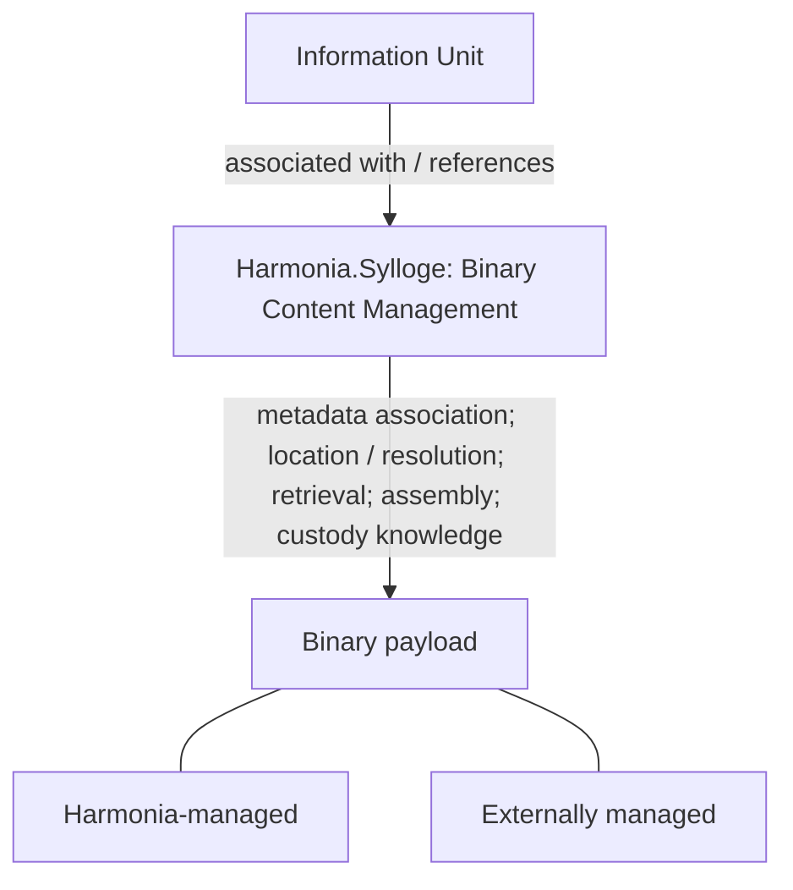

<!-- continuum-source-succession -->
> **RAD-1.1.5 source succession:** Historical source and navigation; all architectural sections incorporated. See the [canonical continuum](../../../enterprise-architecture/continuum/documentation/published/1.1.5/README.md) and [section correspondence](../../../enterprise-architecture/design/evidence/1.1.5/002/after/source-succession.json). Original source wording and standing below are preserved.

<!-- Copyright (c) 2026 Mark Hunter. Licensed under GPL-3.0-or-later. -->

# Harmonia.Sylloge — Binary Content Management

**Standing: adjudicated Candidate Architecture within Domain05 Step A, 2026-10-12.**
[U17](sources.md#u17) records the explicit architectural adjudication resolving
F31/D15 and CDG-25. [Scope and authority](README.md) apply. That review did not
itself establish A4 acceptance or commence Step B. The explicit 2026-10-13 B1
task confirms A4 PASS. The [current standing](README.md) additionally records
the bounded B2.1 PASS; B2.2 is not commenced. This adds no Sylloge mapping.

<a id="sylloge-responsibility"></a>

<!-- continuum-supersession:start -->
------- Legacy Content - Superseded ------- Start ------
Superseded by canonical continuum element(s), RAD-1.1.5 authorised ingestion:
- [Harmonia.Sylloge](../../../enterprise-architecture/continuum/application/application-component/feea742463b84021b66853d287d8916f.md)
Original source standing and unresolved qualifications are preserved.
---------------------------------------------------------

## Application responsibility

> **Harmonia.Sylloge — Binary Content Management subsystem responsible for the
> governed association, resolution, retrieval and assembly of binary content
> associated with Harmonia-managed information.**

Sylloge is an Information Systems Layer application subsystem/component. Its
Candidate Architecture responsibility includes:

- Management of binary-content metadata.
- Management of associations between Harmonia Information Units and associated
  binary content.
- Knowledge sufficient to locate and resolve binary content.
- Retrieval of binary content.
- Assembly on demand where required logical content is represented by, or
  constructed from, one or more binary payloads.
- Knowledge of whether applicable binary content is Harmonia-managed or
  externally managed.

This establishes **Binary Content Management** as an application information
responsibility. F31 allocates the behaviour and D15 records the associated
information responsibility; neither a storage product nor an upstream Information
Concept is introduced by that allocation.


------- Legacy Content - Superseded ------- Finish ----
<!-- continuum-supersession:end -->


<a id="management-and-custody"></a>

<!-- continuum-supersession:start -->
------- Legacy Content - Superseded ------- Start ------
Superseded by canonical continuum element(s), RAD-1.1.5 authorised ingestion:
- [Harmonia.Sylloge](../../../enterprise-architecture/continuum/application/application-component/feea742463b84021b66853d287d8916f.md)
Original source standing and unresolved qualifications are preserved.
---------------------------------------------------------

## Management and physical custody



**Sylloge's responsibility for binary content does not imply that Harmonia must
physically persist every binary payload.** Physical custody may remain with an
external authoritative/source system. Knowledge of and governed access to that
content do not require copying it into Harmonia. External management and
originating information/domain authority remain explicit.

Where Harmonia takes physical custody, Sylloge retains Binary Content Management
responsibility without becoming a generic persistence manager. Logical clinical
information and its binary payload remain distinct; an Information Unit reference
does not itself establish physical custody or make the payload an Information Unit.


------- Legacy Content - Superseded ------- Finish ----
<!-- continuum-supersession:end -->


<a id="mneme-and-mnemosyne-boundary"></a>

<!-- continuum-supersession:start -->
------- Legacy Content - Superseded ------- Start ------
Superseded by canonical continuum element(s), RAD-1.1.5 authorised ingestion:
- [Harmonia.Sylloge](../../../enterprise-architecture/continuum/application/application-component/feea742463b84021b66853d287d8916f.md)
Original source standing and unresolved qualifications are preserved.
---------------------------------------------------------

## Mneme and Mnemosyne

**Application information responsibility is distinct from persistence
responsibility.** Mnemosyne remains Harmonia's Persistence Manager. Where
Sylloge-managed content or metadata requires Harmonia persistence, Mnemosyne may
provide the applicable persistence services under the established
[Mneme/Mnemosyne boundary](context-and-persistence-management.md#mnemosyne-responsibility).
That service relationship does not transfer Binary Content Management to
Mnemosyne or confer durable-state establishment on Sylloge.

Mneme remains the **Context and Pragma Manager**, with its four principal exposed
services and established managed-information access boundary. Sylloge is not
absorbed into Mneme and creates no alternative raw cache/database access path.
Where processing needs binary content, Mneme, Ponos, Ergo or another applicable
component may interact with Sylloge to obtain or resolve it. This is a minimal
responsibility relationship; detailed calls, routing and contracts are deferred.
No Mneme service, Mnemosyne responsibility or persistence domain is redesigned.


------- Legacy Content - Superseded ------- Finish ----
<!-- continuum-supersession:end -->


<a id="agora-and-omilia-boundary"></a>

<!-- continuum-supersession:start -->
------- Legacy Content - Superseded ------- Start ------
Superseded by canonical continuum element(s), RAD-1.1.5 authorised ingestion:
- [Harmonia.Sylloge](../../../enterprise-architecture/continuum/application/application-component/feea742463b84021b66853d287d8916f.md)
Original source standing and unresolved qualifications are preserved.
---------------------------------------------------------

## Agora and Omilia

Agora-native collaboration media may remain **Agora-managed collaboration
information**. Omilia performs collaboration operations under the established
[Agora/Omilia architecture](agora-omilia-collaboration.md#control-and-operations).

```text
Formally managed clinical/operational binary content
                       |
                       v
                    Sylloge
                       ^
                       |
                    reference
                       |
               Agora-managed Room
```

When a Room presents, links to, discusses, notifies about or captures activity
concerning formally managed binary content, Agora retains the collaboration
record/reference/activity. Sylloge retains Binary Content Management for that
content; Agora does not thereby become its custodian. Omilia acquires no Binary
Content Management responsibility. The originating logical information owner and
any external physical custodian retain their respective responsibilities.


------- Legacy Content - Superseded ------- Finish ----
<!-- continuum-supersession:end -->


<a id="sylloge-deferred-design"></a>

<!-- continuum-supersession:start -->
------- Legacy Content - Superseded ------- Start ------
Superseded by canonical continuum element(s), RAD-1.1.5 authorised ingestion:
- [Harmonia.Sylloge](../../../enterprise-architecture/continuum/application/application-component/feea742463b84021b66853d287d8916f.md)
Original source standing and unresolved qualifications are preserved.
---------------------------------------------------------

## Deliberate deferred design

The application responsibility is established, rather than deferred out of the
Candidate Architecture. The following remain later design matters under
[CDG-25](gaps.md#binary-custody-question):

- Object storage, filesystem, database BLOB, PACS/VNA and content-addressable
  storage technology or architecture.
- Streaming, caching, replication, binary sharding, compression, encryption
  mechanisms and physical storage topology.
- FHIR Binary, DocumentReference, Media and DICOM representations.
- Detailed retrieval APIs, assembly algorithms and external repository adapters.
- Lifecycle, retention and binary versioning mechanisms.

No assumption that all content is copied into Harmonia accompanies these
deferrals. The Logical Data ↔ Application Features ↔ Application Components triad
and the distinction between Logical Data, Application Data Objects, Persistence
Data Structures and Technology Platforms remain. Themis governance, Kleio audit,
originating authority and AX-05/06/07/13/14/15/17/18 constraints apply without a new
security, audit or persistence mechanism. No build, process or deployment boundary
is selected.


------- Legacy Content - Superseded ------- Finish ----
<!-- continuum-supersession:end -->
