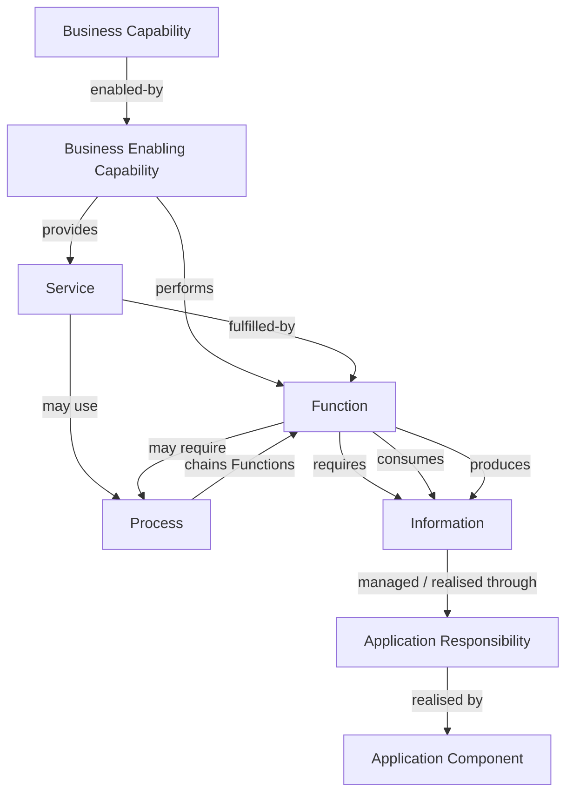

<!-- Copyright (c) 2026 Mark Hunter. Licensed under GPL-3.0-or-later. -->

# Domain05 Step B — Capability + Information Traceability Method

**Current standing, 2026-10-13 — B2.1: PASS; B2.2 is not commenced.**
The B1 reconciliation was returned for Mark/ChatGPT adjudication; this bounded
B2.1 reconciliation does not separately declare B1 PASS.

## 1. Authority, baseline and scope

The explicit B1 task decision confirms **A4 — PASS**: the current Candidate
Information Systems Architecture is the accepted baseline for Step B.
Acceptance means sufficiently faithful for traceability, not a final Solution
Architecture, demonstrated upstream coverage or an MVP decision. Existing
non-blocking deferrals in the [candidate register](../component-register.md)
and [gap register](../gaps.md) remain explicit.

This document is the canonical Step B traceability method. It records the
supplied adjudicated B1 rules and validates their use with the bounded
[Health Information Access example](health-information-access-worked-example.md).
The separately recorded [B2.1 PASS](b2-1-individual-care-delivery-health-information-access.md)
establishes only Individual Care Delivery and its six agreed L2 capabilities
`enabled-by Health Information Access`. The method does not allocate every
example Function to software, invent Capability ancestry/identifiers or
establish exhaustive coverage. B2.2 remains outside this reconciliation.

The [Completion Plan](../../architecture-completion-plan.md#33-domain05-five-stage-completion-method),
[Architectural Axioms](../../governance/architectural-axioms.md) and repository
guardrails govern. Material axioms are AX-01/04 (information/capability meaning
independent of machinery), AX-05/07 (state authority and security),
AX-08/09 (evidence and transient state), AX-13 (external boundary),
AX-14/15 (distinctions and uncertainty), and AX-17/18 (authority and no inferred
relationships). Dual anchors, typed relationships and deferred allocation
preserve these constraints.

## 2. Canonical semantic sources

Harmonia's [Function and Service definitions](../../03-business-architecture/metamodel/business-architecture-metamodel.md#3-function-and-service-semantics)
and [Process definition](../../03-business-architecture/metamodel/business-architecture-metamodel.md#4-business-process-semantics)
govern across architectural views. They define state transition, client Service
Contract and ordered decomposition respectively; Function size does not change
its type. A Service may use Functions directly, Processes, or both. Functions
and Processes may be recursively composed. No mandatory
Service → Process → Function hierarchy follows.

[Metabolē](../../04-information-architecture/patterns/metabole.md) is the
canonical Domain04 conceptual information-progression construct. Its
ActivityContext, additive progression and architectural Realisation definitions
are referenced here rather than independently redefined.

## 3. Governing traceability rules

### B1-R01 — Dual Anchor

Traceability SHALL begin from both **Business Capability**, representing why
enterprise support is required, and **Business Enabling Capability**, representing
what reusable enabling capability Harmonia provides. Their architectural purposes
SHALL remain distinguishable. Existing upstream names/identities and unresolved
ancestry SHALL be preserved; neither anchor may be manufactured to fill a view.

### B1-R02 — No Layer Skipping

Traceability SHALL preserve meaningful intermediate reasoning through enabling
capability, Service/Function, Information and application responsibility. A direct
Capability → Application Component mapping MAY be derived for reporting or
navigation; it SHALL NOT replace that reasoning. This does not require every
individual trace to visit every possible graph node.

### B1-R03 — Information Relationship Semantics

Function/Information traceability SHALL distinguish at least:

| Relationship | Meaning |
| :--- | :--- |
| **Requires** | Information that must be available for a Function to perform its state transition correctly but upon which the Function is not necessarily acting as the subject of that transition. |
| **Consumes** | Information upon which the Function **semantically acts** while performing its state transition. |
| **Produces** | Information established by the Function as a consequence of that state transition. |

`Consumes` denotes semantic action; it does not imply destructive removal from
the progressing information. Information merely carried within a Metabolē does
not thereby become `requires` or `consumes` information for every Function.

### B1-R04 — Function Semantics

Use the canonical [Function definition](../../03-business-architecture/metamodel/business-architecture-metamodel.md#31-business-function-rule).
Identify the defined state change and its bounded concern, irrespective of size
or external exposure.

### B1-R05 — Service Semantics

Use the canonical [Service definition](../../03-business-architecture/metamodel/business-architecture-metamodel.md#32-business-service-exposure-rule).
Identify what the client can request, obtain or be informed about, and the
governing Service Contract.

### B1-R06 — Process Semantics

Use the canonical [Process definition](../../03-business-architecture/metamodel/business-architecture-metamodel.md#4-business-process-semantics).
Primary Information traceability SHALL remain with the Function responsible for
the information interaction. Process-level views MAY aggregate Function
relationships for navigation/analysis; they SHALL NOT replace Function-level
traceability.

### B1-R07 — Semantic Independence from Modelling Frameworks

Harmonia architecture definitions govern Service, Function and Process meaning.
External modelling frameworks may represent them where useful; framework
semantics SHALL NOT redefine their Harmonia meaning. Use framework concepts where
they accurately express Harmonia relationships, including architectural
**Realisation** between Metabolē and Pragma/Pylai.Diadromí.

### B1-R08 — Accountability

Service, Function and Process definitions SHALL be sufficiently bounded to assign
meaningful accountability:

| Construct | Accountability |
| :--- | :--- |
| Service | Fulfilment of the Service Contract. |
| Function | Achievement of the defined state change. |
| Process | Progression and coordination of constituent Functions. |

### B1-R09 — Additive Metabolē Progression

Service fulfilment MAY progress through a Metabolē carrying governing Context and
accumulated information associated with fulfilment of the Service Request.
Functions operate upon information relevant to their state transition and add
resulting information. Information established by preceding Functions remains
available to subsequent Functions, subject to applicable information-management,
security and lifecycle constraints.

### B1-R10 — Function Information Accountability

Presence within a Metabolē SHALL NOT imply that every Function consumes, requires
or is accountable for that information. Traceability SHALL identify only
information relationships material to the Function's defined state transition.

### B1-R11 — Derivation Provenance

A progressing Metabolē SHALL retain sufficient provenance/derivation to establish
the derivation of accumulated information and its relationship to the originating
activity/request. Provenance / derivation ≠ Audit Evidence ≠ Assurance Evidence.
Kleio audit and Dokimasia assurance responsibilities SHALL NOT transfer into
Metabolē.

### B1-R12 — Metabolē Realisation

Metabolē is the conceptual Information Architecture construct for bounded
information progression through change/activity. Concrete constructs may realise
it within their architectural domains. Explicit current realisations are
**Pragma** and **Pylai.Diadromí**, as established in the
[canonical Realisation relationship](../../04-information-architecture/patterns/metabole.md#2-architectural-realisation).
Realisation does not imply a common runtime type, lifecycle, persistence or
application-management responsibility.

## 4. Traceability graph

Step B uses a graph, not a rigid 1:1 hierarchy:

The graph is a reasoning shape, not a claim that these are all the same
relationship type. Information/application responsibility relationships must
state the relevant responsibility; information use alone does not allocate
ownership. Service/Function/Process identities and relationships remain bounded
by their owning capability responsibility.

Not every Function is exposed by a Service; not every Function needs a Process.
A Service may use Functions and/or Processes. Capabilities may relate many to
many; a Function may have multiple Information relationships; multiple
application responsibilities/components may collaborate in realising a
capability. No trace must pass through every node.

For subsequent passes, retain source references, relationship type and rationale,
the relevant bounded state change/contract/progression, and the standing of each
relationship. Record unresolved relationships explicitly under AX-17. A derived
component summary must remain navigable back to this reasoning. These recording
requirements establish a method, not a B2 mapping or a new identifier scheme.

### Capability-enablement semantics

`enabled-by` expresses a **material capability-enablement relationship**. It
does not transfer Business Capability accountability to the Business Enabling
Capability. It does not mean every runtime exercise of the Business Capability
must invoke the Business Enabling Capability. Capability traceability SHALL NOT
be treated as a mandatory runtime dependency model.

For B2.1, Health Information Access enables governed access to relevant health
and care information; it does not interpret, judge, plan, authorise or perform
clinical care. Information access does not itself confer authority to act on
that information. The [B2.1 record](b2-1-individual-care-delivery-health-information-access.md)
holds the approved L1 and six L2 relationships and their rationales.

The canonical Domain02 rules govern capability/context distinction:

- [B2-R05 — Capability Is Independent of Care Delivery Context](../../02-strategy/capabilities/business-capabilities.md#b2-r05).
- [B2-R06 — Context Independence Test](../../02-strategy/capabilities/business-capabilities.md#b2-r06).

### B2-R07 — Health Information Access Scope

Health Information Access enables governed access to information concerning an
individual's health, clinical state, care intent, care delivery and health
outcomes. It does not represent general-purpose access to operational,
workforce, financial, corporate or service-resource information merely because
such information may be relevant to healthcare activity.

| Information concern | Capability boundary |
| :--- | :--- |
| Individual clinical / health / care information | Health Information Access |
| Operational / workforce / financial / corporate / service-resource information | Appropriate other enabling capability |

This scope rule preserves the conceptual distinction without resolving every
edge case or assigning additional enabling-capability relationships.

## 5. Application responsibility restraint

The [worked example](health-information-access-worked-example.md) validates
Function-level information semantics without premature allocation. Later Step B
passes establish application realisation traceability against the accepted
candidate. Existing responsibilities remain:

| Responsibility | Existing owner |
| :--- | :--- |
| Context and Pragma management | Mneme |
| Authoritative persistence/search management | Mnemosyne |
| Authorisation decisions and enforcement | Themis |
| Definitions, models and nomenclature | Calliope |
| Audit information | Kleio |
| Assurance | Dokimasia |
| External interoperability | Pylai |

The six example Functions are not six components or six new Services.
Metabolē establishes no common manager. Existing detailed deferrals remain.
B2.1 records capability enablement only; it adds no application allocation and
does not commence B2.2.
