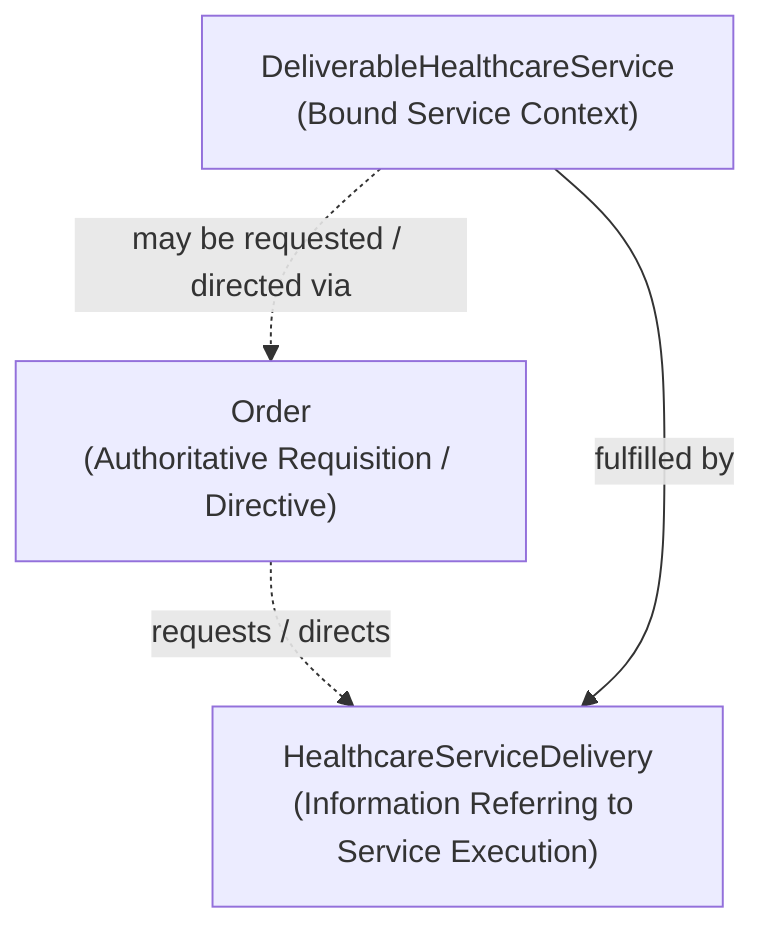

<!-- continuum-source-succession -->
------- Legacy Content - Superseded ------- Start ------
Superseded as an active architectural carrier by the [canonical element continuum](../../../../enterprise-architecture/documentation/continuum-manifest/published/1.1.5/README.md).
[Exact source/identity correspondence](../../../../enterprise-architecture/design/evidence/1.1.5/002/after/source-succession.json) records this historical generated carrier. Its original bytes and then-current claims are retained below; it is no longer a current authoring source.
---------------------------------------------------------

<!-- Copyright (c) 2026 Mark Hunter. SPDX-License-Identifier: GPL-3.0-or-later -->

# Accepted Information Architecture — RAD-1.1.0

The Solution Architect authorised promotion of the corrected, reviewed Run-002
candidate into **RAD-1.1.0**, with predecessor **RAD-1.0.10**, on 2026-10-20.
The [release decision](release-1.1.0.json) pins the exact accepted source,
candidate, no-edit Archi export, reviewed CRs and representation provenance.
The governed complete-model publication is
[Harmonia-Architecture-1.1.0.xml](../../../archimate/exchange/publish/1.1.0/Harmonia-Architecture-1.1.0.xml).
Its [publication evidence](../../../archimate/processing/publishing/1.1.0/information-architecture-publication.md)
records validation, final-model Archi transport and the final human inspection handoff.

**CR-001–154 are incorporated; CR-155–158 remain On-Hold / Unresolved and unchanged.**
The 32 new Topics retain their already allocated resource-owned UUIDv4 IDs;
promotion allocates none. All 1,362 established canonical identities and 38
representation rebindings remain preserved. The publication contains 1,394
elements, 1,137 relationships and 1,209 architect-authored Views. No Class,
Package, ImplementationObject or other new metamodel construct is introduced.

## Reconciliation provenance

The Solution Architect accepted **CR-001–CR-154 as authored** on 2026-10-20,
including review of the Run-002 candidate in Archi. The exact
[decision](../../../archimate/processing/ingestion/1.0.10/run-002/reconciliation/execution-001/decision.json) and
[issued instructions](../../../archimate/processing/ingestion/1.0.10/run-002/reconciliation/execution-001/reviewed-instructions.md)
establish this bounded accepted amendment. The resource-owned
[accepted source](accepted-ingestion-1.0.10.json) contains 82 information elements,
60 relationships and 12 authored View changes. The `1.0.10` filename identifies
the ingestion baseline. This source and its unpublished standing remain immutable
reconciliation history; the release decision promotes its accepted instances.
Root [release authority](../../../../architecture-release.json) now records 1.1.0.

This amendment governs the current representation, authored definition and names
of the exact accepted instances by canonical identity. It supersedes the previous
projection type, binding and name fields for those instances in the original
[information capture](information-architecture.json), preserving that capture
unchanged as baseline/history. The 38 retypings retain their Canonical IDs and
record prior BusinessObject names/types and previous Exchange bindings; the 12
retained BusinessObjects record their prior names. The 32 new Topics own UUIDv4
IDs allocated once and persisted here. Canonical IDs identify elements;
relationships, Views, nodes and connections retain their Exchange identities.

The [Information Architecture domain](../../04-information-architecture/README.md)
and its conceptual/application distinction retain their authority. Accepted logical
Topic instances establish no conceptual counterpart, database schema, FHIR
equivalence, runtime owner or new subsystem/deployment boundary. Containment
expresses the submitted native Composition semantics; Aggregation retains its
separate meaning. Historical narrative and unresolved qualifications within the
authored Documentation remain explicit; acceptance does not expand them into
universal metamodel rules or infer missing details. Other RADS definitions and
unaffected source captures retain their standing.

The [Round-Trip Praxis](../archimate-round-trip-engineering-praxis.md),
[identity/naming contract](../canonical-identity-and-naming.md) and explicit
acceptance govern the reconciliation. Shared machinery derives metadata and
Element/Relationship navigation from semantic containment. The original candidate,
Archi export, published baseline, detection evidence and prior review remain
immutable. All 1,209 authored Views, including their complete navigation, remain
exactly the reviewed candidate's presentation.

CR-155–158 remain **On-Hold / Unresolved**: Context Topic, Pragma Topic,
PetasosParcel Topic and Pylai.Diadromí Topic have no explicit Topic specialisation.
Their existing native DataObject content, identities and metadata remain unchanged.
No classification is inferred from a name or prior derived Property.

The [unpublished reconciled model](../../../archimate/processing/ingestion/1.0.10/run-002/reconciliation/execution-001/artifacts/reconciled.xml)
and [validation](../../../archimate/processing/ingestion/1.0.10/run-002/reconciliation/execution-001/artifacts/validation.json)
remain preserved processing results. The architect's inspection applies to the
accepted candidate. The final identity-bearing publication's actual Archi
import/export evidence is recorded with RAD-1.1.0; final human inspection of that
release remains the handoff. Known export navigation-ID/order and definition-language residuals
are retained in the [transport review](../../../archimate/processing/ingestion/1.0.10/run-002/roundtrip-results.md).

## Accepted information resources

| CR | Current displayName | Native type | Canonical ID | Previous binding |
| --- | --- | --- | --- | --- |
| [CR-001](../../../archimate/processing/ingestion/1.0.10/run-002/change-review.md#cr-001) | [Topic] Authority | DataObject | `99dc695355384ea29ac3515b9178dfd0` | `New instance` |
| [CR-002](../../../archimate/processing/ingestion/1.0.10/run-002/change-review.md#cr-002) | [Topic] Care | DataObject | `f702d357183847dd8f0fd09545679ffd` | `New instance` |
| [CR-003](../../../archimate/processing/ingestion/1.0.10/run-002/change-review.md#cr-003) | [Topic] CareLocation | DataObject | `cfc241a7b6904bd19ccc1b9adbac0393` | `New instance` |
| [CR-004](../../../archimate/processing/ingestion/1.0.10/run-002/change-review.md#cr-004) | [Topic] CommunicationAddress | DataObject | `410be08eea0b4653a88f4e4235354cea` | `New instance` |
| [CR-005](../../../archimate/processing/ingestion/1.0.10/run-002/change-review.md#cr-005) | [Topic] Contact | DataObject | `5c33b01e23964ef5935be79364e7c0f9` | `New instance` |
| [CR-006](../../../archimate/processing/ingestion/1.0.10/run-002/change-review.md#cr-006) | [Topic] Coordination | DataObject | `882234c291ca4c6492ad6dfbe1e23fea` | `New instance` |
| [CR-007](../../../archimate/processing/ingestion/1.0.10/run-002/change-review.md#cr-007) | [Topic] Demographics | DataObject | `95a13e957f5c471797869b901085266c` | `New instance` |
| [CR-008](../../../archimate/processing/ingestion/1.0.10/run-002/change-review.md#cr-008) | [Topic] EncounterContext | DataObject | `a8be2b6474cd43cd9845b93258bd2fe3` | `New instance` |
| [CR-009](../../../archimate/processing/ingestion/1.0.10/run-002/change-review.md#cr-009) | [Topic] EncounterProgression | DataObject | `a3badcf73eaa4331b75d7b3eb6e67fc8` | `New instance` |
| [CR-010](../../../archimate/processing/ingestion/1.0.10/run-002/change-review.md#cr-010) | [Topic] Enterprise | DataObject | `5c5da6a06dac413aa2809a1397f8a3b9` | `New instance` |
| [CR-011](../../../archimate/processing/ingestion/1.0.10/run-002/change-review.md#cr-011) | [Topic] Equipment | DataObject | `8e658834311d41e68a8ecf71d8ccd5db` | `New instance` |
| [CR-012](../../../archimate/processing/ingestion/1.0.10/run-002/change-review.md#cr-012) | [Topic] ExecutionConcurrency | DataObject | `0781dd44748d42338c18bf01993af656` | `New instance` |
| [CR-013](../../../archimate/processing/ingestion/1.0.10/run-002/change-review.md#cr-013) | [Topic] Individual | DataObject | `4af969b8c23a4dcab7569dc51b263383` | `New instance` |
| [CR-014](../../../archimate/processing/ingestion/1.0.10/run-002/change-review.md#cr-014) | [Topic] OrderChange | DataObject | `73abd9430cfa4395ac38b41acfb169ec` | `New instance` |
| [CR-015](../../../archimate/processing/ingestion/1.0.10/run-002/change-review.md#cr-015) | [Topic] OrderContext | DataObject | `614c48fd853643578788b738f8017b53` | `New instance` |
| [CR-016](../../../archimate/processing/ingestion/1.0.10/run-002/change-review.md#cr-016) | [Topic] OrderProgressionEvent | DataObject | `8fb3a767d7a04d638ef76f98d61496b1` | `New instance` |
| [CR-017](../../../archimate/processing/ingestion/1.0.10/run-002/change-review.md#cr-017) | [Topic] OrderResult | DataObject | `24187967f53446479c87d7676c66ba12` | `New instance` |
| [CR-018](../../../archimate/processing/ingestion/1.0.10/run-002/change-review.md#cr-018) | [Topic] OrderRouting | DataObject | `06bde79727884b27b3599e373b3cee5f` | `New instance` |
| [CR-019](../../../archimate/processing/ingestion/1.0.10/run-002/change-review.md#cr-019) | [Topic] Ordering | DataObject | `1c4e2d5ce4574856a7d3605838e8afcb` | `New instance` |
| [CR-020](../../../archimate/processing/ingestion/1.0.10/run-002/change-review.md#cr-020) | [Topic] OutcomeConcurrency | DataObject | `72c505782347448d8f89d74ef76359af` | `New instance` |
| [CR-021](../../../archimate/processing/ingestion/1.0.10/run-002/change-review.md#cr-021) | [Topic] OutputRules | DataObject | `a035fe1913db4d2589a2e4edde8db737` | `New instance` |
| [CR-022](../../../archimate/processing/ingestion/1.0.10/run-002/change-review.md#cr-022) | [Topic] PatientSchedule | DataObject | `c109f726f6ae4ee1b7fde1c012cfae74` | `New instance` |
| [CR-023](../../../archimate/processing/ingestion/1.0.10/run-002/change-review.md#cr-023) | [Topic] Place | DataObject | `36539e3eee7041e585aa3c5a06424bcc` | `New instance` |
| [CR-024](../../../archimate/processing/ingestion/1.0.10/run-002/change-review.md#cr-024) | [Topic] Referral | DataObject | `d79d14c20bf14ecdab0434d4aa7db9b8` | `New instance` |
| [CR-025](../../../archimate/processing/ingestion/1.0.10/run-002/change-review.md#cr-025) | [Topic] ReferralContext | DataObject | `9eb5906e93ca4625bdb675a3397c4c8d` | `New instance` |
| [CR-026](../../../archimate/processing/ingestion/1.0.10/run-002/change-review.md#cr-026) | [Topic] Relationship | DataObject | `c0ec3c75d9c54b3097e12c240ee816fe` | `New instance` |
| [CR-027](../../../archimate/processing/ingestion/1.0.10/run-002/change-review.md#cr-027) | [Topic] ScheduleChange | DataObject | `0e98b52f18274a81ad3e3b9ff9cca747` | `New instance` |
| [CR-028](../../../archimate/processing/ingestion/1.0.10/run-002/change-review.md#cr-028) | [Topic] ScheduleState | DataObject | `6c4e9a91baf7460387d298366c5c6d0a` | `New instance` |
| [CR-029](../../../archimate/processing/ingestion/1.0.10/run-002/change-review.md#cr-029) | [Topic] Scheduling | DataObject | `1225bfab0a6c4312875091a027f24275` | `New instance` |
| [CR-030](../../../archimate/processing/ingestion/1.0.10/run-002/change-review.md#cr-030) | [Topic] Service | DataObject | `0b990e0c64684bb8a45643e48eb4470a` | `New instance` |
| [CR-031](../../../archimate/processing/ingestion/1.0.10/run-002/change-review.md#cr-031) | [Topic] TaskCompletion | DataObject | `8a9351cd170940d0b36f8d56584f15ec` | `New instance` |
| [CR-032](../../../archimate/processing/ingestion/1.0.10/run-002/change-review.md#cr-032) | [Topic] Workforce | DataObject | `9f689e261140436eb94295d63e2b3370` | `New instance` |
| [CR-033](../../../archimate/processing/ingestion/1.0.10/run-002/change-review.md#cr-033) | [Topic] Appointment | DataObject | `9badf0d360b64215bc60e74eec954018` | `id-7822a5a67faa552e8ad13755e852ef15` |
| [CR-034](../../../archimate/processing/ingestion/1.0.10/run-002/change-review.md#cr-034) | [Topic] CarePlace | DataObject | `779f2295b0b648dda9dbd21c4ade3ba0` | `id-40fba4cb065f52819995aea0bed06a00` |
| [CR-035](../../../archimate/processing/ingestion/1.0.10/run-002/change-review.md#cr-035) | [Topic] Device | DataObject | `25c1b751956446cea17065b6254419d5` | `id-af29f5d403b75648a991cca25b699c9c` |
| [CR-036](../../../archimate/processing/ingestion/1.0.10/run-002/change-review.md#cr-036) | [Topic] DeviceAssociation | DataObject | `303f8586953d450d8d82d3d5f76e488a` | `id-357c6acd043f58708e08b9a9e741814e` |
| [CR-037](../../../archimate/processing/ingestion/1.0.10/run-002/change-review.md#cr-037) | [Topic] DeviceDefinition | DataObject | `2a879d06b17143be8bbfc35cdaab8bdf` | `id-bbe22ad139ae54b0bdd5da53720d942a` |
| [CR-038](../../../archimate/processing/ingestion/1.0.10/run-002/change-review.md#cr-038) | [Topic] Encounter | DataObject | `fb464349f13b41c4ae9920a743fc6c12` | `id-28e7db48ce415ca2a982e0abd38e2d61` |
| [CR-039](../../../archimate/processing/ingestion/1.0.10/run-002/change-review.md#cr-039) | [Topic] Episode | DataObject | `3927d161556d48f4b2cc57bd46ab785d` | `id-76e17ba541cd5d2db988c503af32cfad` |
| [CR-040](../../../archimate/processing/ingestion/1.0.10/run-002/change-review.md#cr-040) | [Topic] Geolocation | DataObject | `771b2e814946401bbe6dd6b4fdd3fb42` | `id-74957499ad6e57dd83efe1b68f7c5bce` |
| [CR-041](../../../archimate/processing/ingestion/1.0.10/run-002/change-review.md#cr-041) | [Topic] Identity | DataObject | `3b72456b5686449f95ad26bfbbae07f3` | `id-4d30e501991f53e1ab718ceae9cc9599` |
| [CR-042](../../../archimate/processing/ingestion/1.0.10/run-002/change-review.md#cr-042) | [Topic] Location | DataObject | `9ee4df4d76864bb1ac90fe1077c56c6f` | `id-2b0f9a56b0d65f3fbc793090ebea0f8d` |
| [CR-043](../../../archimate/processing/ingestion/1.0.10/run-002/change-review.md#cr-043) | [Topic] LocationClassification | DataObject | `3896c910c28646098f0707efe88169ee` | `id-c16743d7b1fb5172afa5130095798191` |
| [CR-044](../../../archimate/processing/ingestion/1.0.10/run-002/change-review.md#cr-044) | [Topic] LocationIdentity | DataObject | `5f8299e31ee5410583007473c75d578f` | `id-86e72752878753f2b1ab604f303f1fc6` |
| [CR-045](../../../archimate/processing/ingestion/1.0.10/run-002/change-review.md#cr-045) | [Topic] Order | DataObject | `2a791e0e1f6b45c0a57fb8233f73faa5` | `id-88dc53e48abd506d9d0433e1f46e72e2` |
| [CR-046](../../../archimate/processing/ingestion/1.0.10/run-002/change-review.md#cr-046) | [Topic] Organisation | DataObject | `dd3ba70128874caeb2d5da419d006c49` | `id-3fbc97f72c185d82a3d1fef758f27eed` |
| [CR-047](../../../archimate/processing/ingestion/1.0.10/run-002/change-review.md#cr-047) | [Topic] OrganisationClassification | DataObject | `227974cf26054bdea17038ecd6c0aa3a` | `id-d18afdbb120f549eb39194e960859797` |
| [CR-048](../../../archimate/processing/ingestion/1.0.10/run-002/change-review.md#cr-048) | [Topic] OrganisationContact | DataObject | `cad820b906fa40f28824278fb18b7497` | `id-fa50c7b9750e5f63ac219c4904f2cc08` |
| [CR-049](../../../archimate/processing/ingestion/1.0.10/run-002/change-review.md#cr-049) | [Topic] OrganisationIdentity | DataObject | `c240be16de76415682237a238b3d3fc8` | `id-0e2aac3ee1785338821600bbaed24b5f` |
| [CR-050](../../../archimate/processing/ingestion/1.0.10/run-002/change-review.md#cr-050) | [Topic] OrganisationProfile | DataObject | `04adbfc449bb4b9e9ae6e7fdf8a66bf9` | `id-7e853ce10d0050a78fcd7b690d505c7f` |
| [CR-051](../../../archimate/processing/ingestion/1.0.10/run-002/change-review.md#cr-051) | [Topic] OrganisationalUnit | DataObject | `2c884cdd6a4b41a184818e3a7e540897` | `id-bf12d24b62bb595eaa2325a6a7bea26e` |
| [CR-052](../../../archimate/processing/ingestion/1.0.10/run-002/change-review.md#cr-052) | [Topic] Patient | DataObject | `e92ea15616ea43c9a1d698e34ed1376b` | `id-3676faa2f7715169839dc9ebc08b9faa` |
| [CR-053](../../../archimate/processing/ingestion/1.0.10/run-002/change-review.md#cr-053) | [Topic] Person | DataObject | `1163ffac87814f319578ef5cb95dcd4d` | `id-915f3fef43fc5aeeb89bb30650a10fba` |
| [CR-054](../../../archimate/processing/ingestion/1.0.10/run-002/change-review.md#cr-054) | [Topic] Practitioner | DataObject | `4e8f2bd581a5418889813cf7ee414750` | `id-87934f3b3f1b53c7abb886d8050defe4` |
| [CR-055](../../../archimate/processing/ingestion/1.0.10/run-002/change-review.md#cr-055) | [Topic] PractitionerRole | DataObject | `cb7ac98f62aa4599ba57263338cb8b3c` | `id-f30e3f1749b054f7b47be51220f516a5` |
| [CR-056](../../../archimate/processing/ingestion/1.0.10/run-002/change-review.md#cr-056) | [Topic] Privilege | DataObject | `75e194f6168945588ed30cc6c78d04cc` | `id-44f337ee36a254d6aa7f29a7341b166a` |
| [CR-057](../../../archimate/processing/ingestion/1.0.10/run-002/change-review.md#cr-057) | [Topic] ProfessionalIdentity | DataObject | `2f2868f077fc47afbb541925a9801b2c` | `id-cbbec381b72c5cef85d842142075b459` |
| [CR-058](../../../archimate/processing/ingestion/1.0.10/run-002/change-review.md#cr-058) | [Topic] ProfessionalProfile | DataObject | `703bb80c062743eeb7ed8dea3ffeaaa0` | `id-9343d10e09a456508da158f89802d1c7` |
| [CR-059](../../../archimate/processing/ingestion/1.0.10/run-002/change-review.md#cr-059) | [Topic] ReferralOutcome | DataObject | `18ad2e58913b4a938e172df7b03f366a` | `id-8e3f000b84c25352869c1a2d34f5493e` |
| [CR-060](../../../archimate/processing/ingestion/1.0.10/run-002/change-review.md#cr-060) | [Topic] ReferralProgression | DataObject | `bc70a1055ca34eed8143856816587f67` | `id-33ce6c9ab8dc56d4a49938ccf113346b` |
| [CR-061](../../../archimate/processing/ingestion/1.0.10/run-002/change-review.md#cr-061) | [Topic] Registration | DataObject | `26c72794993044af98b5329b8b14ae89` | `id-ec9b517a38d45cf2aa9e7539ee9b253d` |
| [CR-062](../../../archimate/processing/ingestion/1.0.10/run-002/change-review.md#cr-062) | [Topic] ServiceAssurance | DataObject | `07a1f83c9b4e462eaef1595c2a50d560` | `id-f8190710c306583ebf7b4f8d879483ee` |
| [CR-063](../../../archimate/processing/ingestion/1.0.10/run-002/change-review.md#cr-063) | [Topic] ServiceDelivery | DataObject | `4627ee33845744f2ae2e10c84e313755` | `id-cf030f3db0f159888df2760c4786786c` |
| [CR-064](../../../archimate/processing/ingestion/1.0.10/run-002/change-review.md#cr-064) | [Topic] ServiceOffering | DataObject | `441b0891822f4add834ea930c3fe58b7` | `id-d4f3a0305c8954ebbda80cef33fc4178` |
| [CR-065](../../../archimate/processing/ingestion/1.0.10/run-002/change-review.md#cr-065) | [Topic] ServiceOutcome | DataObject | `4fb589629e7f405db44d6a87a2b5e36b` | `id-89bfa28c8be251408ed51a17551aa6ab` |
| [CR-066](../../../archimate/processing/ingestion/1.0.10/run-002/change-review.md#cr-066) | [Topic] ServiceProvision | DataObject | `8d41e9fb6a164deb93afb5fc4c671e10` | `id-49cd5bc99ffa5fae998d0a2fa6919a50` |
| [CR-067](../../../archimate/processing/ingestion/1.0.10/run-002/change-review.md#cr-067) | [Topic] Task | DataObject | `c43139289cb649b4836521a96a51604c` | `id-01e5208d1d15549c812dcedd2c0644a7` |
| [CR-068](../../../archimate/processing/ingestion/1.0.10/run-002/change-review.md#cr-068) | [Topic] TaskDefinition | DataObject | `1d6d4c3a2df440be94262855fa6564eb` | `id-f45454d186e25fd6ac447be05b4a587e` |
| [CR-069](../../../archimate/processing/ingestion/1.0.10/run-002/change-review.md#cr-069) | [Topic] TaskFulfillment | DataObject | `30f4deffcd694f07bf54b2b192695d4f` | `id-9f79c79ae085520499239a4d0d149a2f` |
| [CR-070](../../../archimate/processing/ingestion/1.0.10/run-002/change-review.md#cr-070) | [Topic] TaskOutcome | DataObject | `08d8ee19a30f418f9d5bc497ced0d1ef` | `id-894142dc29e756d6b00b40201e324409` |
| [CR-071](../../../archimate/processing/ingestion/1.0.10/run-002/change-review.md#cr-071) | [BusinessObject] Availability Schedule | BusinessObject | `96638431fc39486d879d080768a68fe9` | `id-765973bf247b582299f7f5f4235189ab` |
| [CR-072](../../../archimate/processing/ingestion/1.0.10/run-002/change-review.md#cr-072) | [BusinessObject] Carer Relationship | BusinessObject | `e95d07cf27c041de955665e7b2af8f52` | `id-6b1053f5a61952e9a97e6d064d3c596a` |
| [CR-073](../../../archimate/processing/ingestion/1.0.10/run-002/change-review.md#cr-073) | [BusinessObject] Eligibility Rule Set | BusinessObject | `cdb296a83e7e4a17b5e80a9c910c114f` | `id-653db1787e3b5860807c599af6bf2dac` |
| [CR-074](../../../archimate/processing/ingestion/1.0.10/run-002/change-review.md#cr-074) | [BusinessObject] Family Relationship | BusinessObject | `8adbce49ffdd46a19e95cf40f2aa36fd` | `id-f0377a823dc25d5f811b7b936d92119e` |
| [CR-075](../../../archimate/processing/ingestion/1.0.10/run-002/change-review.md#cr-075) | [BusinessObject] Identifier | BusinessObject | `b3141f382ca04bf4bb214c12300ebbfb` | `id-06079d9b16f15f28bb289eaaa18f39a7` |
| [CR-076](../../../archimate/processing/ingestion/1.0.10/run-002/change-review.md#cr-076) | [BusinessObject] Identity Alias | BusinessObject | `b444496792a24c33b439f9cb59a12d98` | `id-ccd827c077af5f3a9512e6d99f864935` |
| [CR-077](../../../archimate/processing/ingestion/1.0.10/run-002/change-review.md#cr-077) | [BusinessObject] Identity Correction | BusinessObject | `7c74034576cf4972bbb6e86e0f0e1e58` | `id-87757aeb9c0d5e7db43f5cd4d92a4672` |
| [CR-078](../../../archimate/processing/ingestion/1.0.10/run-002/change-review.md#cr-078) | [BusinessObject] Identity Correlation Graph | BusinessObject | `8d0a2577d3364dbda96798afe0800200` | `id-ee2ac92f7f905636916a76bea997e247` |
| [CR-079](../../../archimate/processing/ingestion/1.0.10/run-002/change-review.md#cr-079) | [BusinessObject] Information Unit | BusinessObject | `10284034c8534b639284386b064f2c54` | `id-0525ac7ff42457dd9339e3ad95255296` |
| [CR-080](../../../archimate/processing/ingestion/1.0.10/run-002/change-review.md#cr-080) | [BusinessObject] Legal Representation | BusinessObject | `33ddad9f1ce1424bbe0fb9a25efadb9f` | `id-fb0ceb5c213759a688d5ea96b749c812` |
| [CR-081](../../../archimate/processing/ingestion/1.0.10/run-002/change-review.md#cr-081) | [BusinessObject] Metabolē | BusinessObject | `c34b4929f71946708d37dbe6c1da920a` | `id-d867f2dd90255f48bd90c1c0f79492a5` |
| [CR-082](../../../archimate/processing/ingestion/1.0.10/run-002/change-review.md#cr-082) | [BusinessObject] Search Result Set | BusinessObject | `b683ae87c72a4c16aba948a4b8cb0998` | `id-e10a6048c177527a9214cd063c4588bd` |

## Accepted semantic relationships

All 59 native Composition assertions and the one Aggregation retain their exact
identities, endpoints, directions, Names, Properties and Documentation.

| CR | Native type | Source → target |
| --- | --- | --- |
| [CR-083](../../../archimate/processing/ingestion/1.0.10/run-002/change-review.md#cr-083) | Composition | [Topic] Care → [Topic] CareLocation |
| [CR-084](../../../archimate/processing/ingestion/1.0.10/run-002/change-review.md#cr-084) | Composition | [Topic] Care → [Topic] Encounter |
| [CR-085](../../../archimate/processing/ingestion/1.0.10/run-002/change-review.md#cr-085) | Composition | [Topic] Care → [Topic] EncounterContext |
| [CR-086](../../../archimate/processing/ingestion/1.0.10/run-002/change-review.md#cr-086) | Composition | [Topic] Care → [Topic] EncounterProgression |
| [CR-087](../../../archimate/processing/ingestion/1.0.10/run-002/change-review.md#cr-087) | Composition | [Topic] Care → [Topic] Episode |
| [CR-088](../../../archimate/processing/ingestion/1.0.10/run-002/change-review.md#cr-088) | Composition | [Topic] Coordination → [Topic] Referral |
| [CR-089](../../../archimate/processing/ingestion/1.0.10/run-002/change-review.md#cr-089) | Composition | [Topic] Coordination → [Topic] ReferralContext |
| [CR-090](../../../archimate/processing/ingestion/1.0.10/run-002/change-review.md#cr-090) | Composition | [Topic] Coordination → [Topic] ReferralOutcome |
| [CR-091](../../../archimate/processing/ingestion/1.0.10/run-002/change-review.md#cr-091) | Composition | [Topic] Coordination → [Topic] ReferralProgression |
| [CR-092](../../../archimate/processing/ingestion/1.0.10/run-002/change-review.md#cr-092) | Composition | [Topic] Enterprise → [Topic] Organisation |
| [CR-093](../../../archimate/processing/ingestion/1.0.10/run-002/change-review.md#cr-093) | Composition | [Topic] Enterprise → [Topic] OrganisationClassification |
| [CR-094](../../../archimate/processing/ingestion/1.0.10/run-002/change-review.md#cr-094) | Composition | [Topic] Enterprise → [Topic] OrganisationContact |
| [CR-095](../../../archimate/processing/ingestion/1.0.10/run-002/change-review.md#cr-095) | Composition | [Topic] Enterprise → [Topic] OrganisationIdentity |
| [CR-096](../../../archimate/processing/ingestion/1.0.10/run-002/change-review.md#cr-096) | Composition | [Topic] Enterprise → [Topic] OrganisationProfile |
| [CR-097](../../../archimate/processing/ingestion/1.0.10/run-002/change-review.md#cr-097) | Composition | [Topic] Enterprise → [Topic] OrganisationalUnit |
| [CR-098](../../../archimate/processing/ingestion/1.0.10/run-002/change-review.md#cr-098) | Aggregation | [Topic] Equipment → [Topic] CommunicationAddress |
| [CR-099](../../../archimate/processing/ingestion/1.0.10/run-002/change-review.md#cr-099) | Composition | [Topic] Equipment → [Topic] Device |
| [CR-100](../../../archimate/processing/ingestion/1.0.10/run-002/change-review.md#cr-100) | Composition | [Topic] Equipment → [Topic] DeviceAssociation |
| [CR-101](../../../archimate/processing/ingestion/1.0.10/run-002/change-review.md#cr-101) | Composition | [Topic] Equipment → [Topic] DeviceDefinition |
| [CR-102](../../../archimate/processing/ingestion/1.0.10/run-002/change-review.md#cr-102) | Composition | [Topic] Individual → [Topic] Authority |
| [CR-103](../../../archimate/processing/ingestion/1.0.10/run-002/change-review.md#cr-103) | Composition | [Topic] Individual → [Topic] Contact |
| [CR-104](../../../archimate/processing/ingestion/1.0.10/run-002/change-review.md#cr-104) | Composition | [Topic] Individual → [Topic] Demographics |
| [CR-105](../../../archimate/processing/ingestion/1.0.10/run-002/change-review.md#cr-105) | Composition | [Topic] Individual → [Topic] Identity |
| [CR-106](../../../archimate/processing/ingestion/1.0.10/run-002/change-review.md#cr-106) | Composition | [Topic] Individual → [Topic] Patient |
| [CR-107](../../../archimate/processing/ingestion/1.0.10/run-002/change-review.md#cr-107) | Composition | [Topic] Individual → [Topic] Person |
| [CR-108](../../../archimate/processing/ingestion/1.0.10/run-002/change-review.md#cr-108) | Composition | [Topic] Individual → [Topic] Relationship |
| [CR-109](../../../archimate/processing/ingestion/1.0.10/run-002/change-review.md#cr-109) | Composition | [Topic] Ordering → [Topic] Order |
| [CR-110](../../../archimate/processing/ingestion/1.0.10/run-002/change-review.md#cr-110) | Composition | [Topic] Ordering → [Topic] OrderChange |
| [CR-111](../../../archimate/processing/ingestion/1.0.10/run-002/change-review.md#cr-111) | Composition | [Topic] Ordering → [Topic] OrderContext |
| [CR-112](../../../archimate/processing/ingestion/1.0.10/run-002/change-review.md#cr-112) | Composition | [Topic] Ordering → [Topic] OrderProgressionEvent |
| [CR-113](../../../archimate/processing/ingestion/1.0.10/run-002/change-review.md#cr-113) | Composition | [Topic] Ordering → [Topic] OrderResult |
| [CR-114](../../../archimate/processing/ingestion/1.0.10/run-002/change-review.md#cr-114) | Composition | [Topic] Ordering → [Topic] OrderRouting |
| [CR-115](../../../archimate/processing/ingestion/1.0.10/run-002/change-review.md#cr-115) | Composition | [Topic] Place → [Topic] CarePlace |
| [CR-116](../../../archimate/processing/ingestion/1.0.10/run-002/change-review.md#cr-116) | Composition | [Topic] Place → [Topic] Geolocation |
| [CR-117](../../../archimate/processing/ingestion/1.0.10/run-002/change-review.md#cr-117) | Composition | [Topic] Place → [Topic] Location |
| [CR-118](../../../archimate/processing/ingestion/1.0.10/run-002/change-review.md#cr-118) | Composition | [Topic] Place → [Topic] LocationClassification |
| [CR-119](../../../archimate/processing/ingestion/1.0.10/run-002/change-review.md#cr-119) | Composition | [Topic] Place → [Topic] LocationIdentity |
| [CR-120](../../../archimate/processing/ingestion/1.0.10/run-002/change-review.md#cr-120) | Composition | [Topic] Scheduling → [Topic] Appointment |
| [CR-121](../../../archimate/processing/ingestion/1.0.10/run-002/change-review.md#cr-121) | Composition | [Topic] Scheduling → [Topic] PatientSchedule |
| [CR-122](../../../archimate/processing/ingestion/1.0.10/run-002/change-review.md#cr-122) | Composition | [Topic] Scheduling → [Topic] ScheduleChange |
| [CR-123](../../../archimate/processing/ingestion/1.0.10/run-002/change-review.md#cr-123) | Composition | [Topic] Scheduling → [Topic] ScheduleState |
| [CR-124](../../../archimate/processing/ingestion/1.0.10/run-002/change-review.md#cr-124) | Composition | [Topic] Service → [Topic] ServiceAssurance |
| [CR-125](../../../archimate/processing/ingestion/1.0.10/run-002/change-review.md#cr-125) | Composition | [Topic] Service → [Topic] ServiceDelivery |
| [CR-126](../../../archimate/processing/ingestion/1.0.10/run-002/change-review.md#cr-126) | Composition | [Topic] Service → [Topic] ServiceOffering |
| [CR-127](../../../archimate/processing/ingestion/1.0.10/run-002/change-review.md#cr-127) | Composition | [Topic] Service → [Topic] ServiceOutcome |
| [CR-128](../../../archimate/processing/ingestion/1.0.10/run-002/change-review.md#cr-128) | Composition | [Topic] Service → [Topic] ServiceProvision |
| [CR-129](../../../archimate/processing/ingestion/1.0.10/run-002/change-review.md#cr-129) | Composition | [Topic] TaskCompletion → [Topic] ExecutionConcurrency |
| [CR-130](../../../archimate/processing/ingestion/1.0.10/run-002/change-review.md#cr-130) | Composition | [Topic] TaskCompletion → [Topic] OutcomeConcurrency |
| [CR-131](../../../archimate/processing/ingestion/1.0.10/run-002/change-review.md#cr-131) | Composition | [Topic] TaskCompletion → [Topic] OutputRules |
| [CR-132](../../../archimate/processing/ingestion/1.0.10/run-002/change-review.md#cr-132) | Composition | [Topic] TaskCompletion → [Topic] Task |
| [CR-133](../../../archimate/processing/ingestion/1.0.10/run-002/change-review.md#cr-133) | Composition | [Topic] TaskCompletion → [Topic] TaskDefinition |
| [CR-134](../../../archimate/processing/ingestion/1.0.10/run-002/change-review.md#cr-134) | Composition | [Topic] TaskCompletion → [Topic] TaskFulfillment |
| [CR-135](../../../archimate/processing/ingestion/1.0.10/run-002/change-review.md#cr-135) | Composition | [Topic] TaskCompletion → [Topic] TaskOutcome |
| [CR-136](../../../archimate/processing/ingestion/1.0.10/run-002/change-review.md#cr-136) | Composition | [Topic] Workforce → [Topic] CommunicationAddress |
| [CR-137](../../../archimate/processing/ingestion/1.0.10/run-002/change-review.md#cr-137) | Composition | [Topic] Workforce → [Topic] Practitioner |
| [CR-138](../../../archimate/processing/ingestion/1.0.10/run-002/change-review.md#cr-138) | Composition | [Topic] Workforce → [Topic] PractitionerRole |
| [CR-139](../../../archimate/processing/ingestion/1.0.10/run-002/change-review.md#cr-139) | Composition | [Topic] Workforce → [Topic] Privilege |
| [CR-140](../../../archimate/processing/ingestion/1.0.10/run-002/change-review.md#cr-140) | Composition | [Topic] Workforce → [Topic] ProfessionalIdentity |
| [CR-141](../../../archimate/processing/ingestion/1.0.10/run-002/change-review.md#cr-141) | Composition | [Topic] Workforce → [Topic] ProfessionalProfile |
| [CR-142](../../../archimate/processing/ingestion/1.0.10/run-002/change-review.md#cr-142) | Composition | [Topic] Workforce → [Topic] Registration |

Equipment → CommunicationAddress is **Aggregation**. Workforce →
CommunicationAddress is the independently authored **Composition** and supplies
its contextual naming ancestry. Care → Encounter retains both parent/self and
child-folder/child-reference navigation, including the contained leaf.

## Accepted View presentations

These are authored presentation records, not semantic containment inputs. The
11 additions and existing InformationMap revision preserve all membership, order,
nesting, geometry, style, connections, Documentation and authored navigation.

| CR | Authored View | Exchange identity |
| --- | --- | --- |
| [CR-143](../../../archimate/processing/ingestion/1.0.10/run-002/change-review.md#cr-143) | [Topic] Care | `id-92781b38f5d946828f64a7916a7a18ad` |
| [CR-144](../../../archimate/processing/ingestion/1.0.10/run-002/change-review.md#cr-144) | [Topic] Coordination | `id-18e0217911394fec9c22da7620f497d2` |
| [CR-145](../../../archimate/processing/ingestion/1.0.10/run-002/change-review.md#cr-145) | [Topic] Enterprise | `id-37a27c14f07d45d0bb34399fb1ddd5b8` |
| [CR-146](../../../archimate/processing/ingestion/1.0.10/run-002/change-review.md#cr-146) | [Topic] Equipment | `id-d0c8d828b67e440c88cf1fa5c0fab1dc` |
| [CR-147](../../../archimate/processing/ingestion/1.0.10/run-002/change-review.md#cr-147) | [Topic] Individual | `id-5ba19156cb0042078a310cbe57ead042` |
| [CR-148](../../../archimate/processing/ingestion/1.0.10/run-002/change-review.md#cr-148) | [Topic] Ordering | `id-f149b52ad8cd4590b0d52597460ec64d` |
| [CR-149](../../../archimate/processing/ingestion/1.0.10/run-002/change-review.md#cr-149) | [Topic] Place | `id-efe1fe4f30854c45909458e496aced94` |
| [CR-150](../../../archimate/processing/ingestion/1.0.10/run-002/change-review.md#cr-150) | [Topic] Scheduling | `id-e386cab4c72748ff8b35ebb6a2e0fc02` |
| [CR-151](../../../archimate/processing/ingestion/1.0.10/run-002/change-review.md#cr-151) | [Topic] Service | `id-c36226e854dd4c2192d650bb3ecef384` |
| [CR-152](../../../archimate/processing/ingestion/1.0.10/run-002/change-review.md#cr-152) | [Topic] TaskCompletion | `id-f11523a5e2a449a9af538d768f977b0b` |
| [CR-153](../../../archimate/processing/ingestion/1.0.10/run-002/change-review.md#cr-153) | [Topic] Workforce | `id-80049507c9254357acb5b3a8ad40a8dd` |
| [CR-154](../../../archimate/processing/ingestion/1.0.10/run-002/change-review.md#cr-154) | InformationMap — representation boundary | `id-f04466cd677051cc98098438b8a4f980` |

## Accepted resource definitions and governed names

The following Documentation retains the accepted candidate’s text and historical/
proposed qualifications. Repository links are rebased for this document. The
source XML retains the exact original Documentation, language attributes,
Properties and complete authored content.

### CR-001 — [Topic] Authority

Canonical ID `99dc695355384ea29ac3515b9178dfd0`; Exchange `id-3d77d9bbfd9747c792d456d41f489bae`.

Friendly name `Individual.Authority`; canonical name `TOPIC-Individual.TOPIC-Authority`.

**Description**: Information describing another party's authority to represent, consent for, make decisions for, or otherwise act on behalf of an individual.

### CR-002 — [Topic] Care

Canonical ID `f702d357183847dd8f0fd09545679ffd`; Exchange `id-395f82a0d8664955b6f542d80de3f5b5`.

Friendly name `Care`; canonical name `TOPIC-Care`.

**Description**: Information establishing the contexts within which healthcare occurs, including encounters, episodes, care-place associations, progression events and longitudinal relationships that provide continuity and context across care interactions.

### CR-003 — [Topic] CareLocation

Canonical ID `cfc241a7b6904bd19ccc1b9adbac0393`; Exchange `id-02f975c032b549d4b7e951d0a427533a`.

Friendly name `Care.CareLocation`; canonical name `TOPIC-Care.TOPIC-CareLocation`.

**Description**
Information describing the association between an Encounter and the place or places in which care occurs, including changes in location during the Encounter.

### CR-004 — [Topic] CommunicationAddress

Canonical ID `410be08eea0b4653a88f4e4235354cea`; Exchange `id-a60925c7b1db471589f42b064429bb82`.

Friendly name `Workforce.CommunicationAddress`; canonical name `TOPIC-Workforce.TOPIC-CommunicationAddress`.

**Description**
Information identifying an electronic communication destination associated with a practitioner or professional context, including the addressing and connection information required to communicate with that destination.

### CR-005 — [Topic] Contact

Canonical ID `5c33b01e23964ef5935be79364e7c0f9`; Exchange `id-5e6cbbe10a2c4a0b8e1d50fedd53c0c2`.

Friendly name `Individual.Contact`; canonical name `TOPIC-Individual.TOPIC-Contact`.

**Description**: Information describing how an individual may be contacted or communicated with, including applicable addresses and communication channels.

### CR-006 — [Topic] Coordination

Canonical ID `882234c291ca4c6492ad6dfbe1e23fea`; Exchange `id-68a83c289478490197dfb2920534da86`.

Friendly name `Coordination`; canonical name `TOPIC-Coordination`.

Information supporting the coordination of care between participants and providers, including referrals, their purpose and context, progression, supporting information and outcomes, without presuming that coordination necessarily transfers care responsibility.

### CR-007 — [Topic] Demographics

Canonical ID `95a13e957f5c471797869b901085266c`; Exchange `id-f922329ab6fe40b8ab2ddb9ebdc80867`.

Friendly name `Individual.Demographics`; canonical name `TOPIC-Individual.TOPIC-Demographics`.

**Description**: Information describing the demographic characteristics of an individual relevant to their identification, administration, healthcare or communication.

### CR-008 — [Topic] EncounterContext

Canonical ID `a8be2b6474cd43cd9845b93258bd2fe3`; Exchange `id-677d8b45df5a47efa21085a7fbfffe1a`.

Friendly name `Care.EncounterContext`; canonical name `TOPIC-Care.TOPIC-EncounterContext`.

**Description**
Information bringing together the relevant subject, participants, services, places and other contextual information required to understand an Encounter.

### CR-009 — [Topic] EncounterProgression

Canonical ID `a3badcf73eaa4331b75d7b3eb6e67fc8`; Exchange `id-e5fda3f50b22419bbac4e39e6cadc416`.

Friendly name `Care.EncounterProgression`; canonical name `TOPIC-Care.TOPIC-EncounterProgression`.

**Description**
Information describing changes in the administrative or operational progression of an Encounter over time, preserving the significant states and transitions associated with that interaction.

### CR-010 — [Topic] Enterprise

Canonical ID `5c5da6a06dac413aa2809a1397f8a3b9`; Exchange `id-74f9c5df31f2430ca725c39e285cd9c3`.

Friendly name `Enterprise`; canonical name `TOPIC-Enterprise`.

Information concerning healthcare organisations and organisational units, including their identity, classification, structure, profile, relationships, and contact information.

### CR-011 — [Topic] Equipment

Canonical ID `8e658834311d41e68a8ecf71d8ccd5db`; Exchange `id-40f54ad3867549dba20c6f197c0c43be`.

Friendly name `Equipment`; canonical name `TOPIC-Equipment`.

**Description**
Information concerning clinical devices and equipment, including device definitions, physical instances, identity, operational associations, location, subject and service relationships, and communication endpoints.

### CR-012 — [Topic] ExecutionConcurrency

Canonical ID `0781dd44748d42338c18bf01993af656`; Exchange `id-10b5bc11da7d43c999ea4a37e6ae58d1`.

Friendly name `TaskCompletion.ExecutionConcurrency`; canonical name `TOPIC-TaskCompletion.TOPIC-ExecutionConcurrency`.

**Description**
Information governing or describing concurrency applicable to the execution of work associated with a Task.

### CR-013 — [Topic] Individual

Canonical ID `4af969b8c23a4dcab7569dc51b263383`; Exchange `id-bd2c303e65434409b69777c403116005`.

Friendly name `Individual`; canonical name `TOPIC-Individual`.

**Description**: Information concerning an individual, their identity, identifiers, demographic characteristics, relationships, and their contextual participation as a subject of healthcare.

### CR-014 — [Topic] OrderChange

Canonical ID `73abd9430cfa4395ac38b41acfb169ec`; Exchange `id-baee40c9809143febeb1e82bf00724ac`.

Friendly name `Ordering.OrderChange`; canonical name `TOPIC-Ordering.TOPIC-OrderChange`.

Information describing a requested modification to an existing Order, including the nature, context and disposition of the requested change.

### CR-015 — [Topic] OrderContext

Canonical ID `614c48fd853643578788b738f8017b53`; Exchange `id-859e6f00b88a46b4b7647a1fe8fe946a`.

Friendly name `Ordering.OrderContext`; canonical name `TOPIC-Ordering.TOPIC-OrderContext`.

Information bringing together the subject, requester, requested activity, intended performer and other context necessary to understand and act upon an Order.

### CR-016 — [Topic] OrderProgressionEvent

Canonical ID `8fb3a767d7a04d638ef76f98d61496b1`; Exchange `id-6215587fc627479f906c85881f1acc05`.

Friendly name `Ordering.OrderProgressionEvent`; canonical name `TOPIC-Ordering.TOPIC-OrderProgressionEvent`.

**Description**
Information describing significant changes in the state and handling of an Order as it progresses from request through fulfilment or other resolution.

### CR-017 — [Topic] OrderResult

Canonical ID `24187967f53446479c87d7676c66ba12`; Exchange `id-ea0e962d9eb7422c910091d8de80f8a8`.

Friendly name `Ordering.OrderResult`; canonical name `TOPIC-Ordering.TOPIC-OrderResult`.

**Description**
Information establishing the relationship between an Order and information produced as a consequence of its fulfilment.

### CR-018 — [Topic] OrderRouting

Canonical ID `06bde79727884b27b3599e373b3cee5f`; Exchange `id-28bf91e4dae44a3eaa32741d43368075`.

Friendly name `Ordering.OrderRouting`; canonical name `TOPIC-Ordering.TOPIC-OrderRouting`.

**Description**
Information describing where and how an Order is to be directed for acceptance, processing or fulfilment.

### CR-019 — [Topic] Ordering

Canonical ID `1c4e2d5ce4574856a7d3605838e8afcb`; Exchange `id-939dda01afdc40eabc1bb723f9da5b7b`.

Friendly name `Ordering`; canonical name `TOPIC-Ordering`.

**Description**
Information concerning formal requests for services or activities, including their intent, routing, progression, modification, contextual information and correlation with resulting information or fulfilment.

### CR-020 — [Topic] OutcomeConcurrency

Canonical ID `72c505782347448d8f89d74ef76359af`; Exchange `id-51be9c9bc4654d6fa65dad89cdc5b0d3`.

Friendly name `TaskCompletion.OutcomeConcurrency`; canonical name `TOPIC-TaskCompletion.TOPIC-OutcomeConcurrency`.

**Description**
Information describing the concurrency rules applicable when determining or establishing the outcome of a Task.

### CR-021 — [Topic] OutputRules

Canonical ID `a035fe1913db4d2589a2e4edde8db737`; Exchange `id-41356fd06ed64e5f861e04f101d83da0`.

Friendly name `TaskCompletion.OutputRules`; canonical name `TOPIC-TaskCompletion.TOPIC-OutputRules`.

**Description**
Information describing the rules governing the outputs established as part of Task resolution.

### CR-022 — [Topic] PatientSchedule

Canonical ID `c109f726f6ae4ee1b7fde1c012cfae74`; Exchange `id-0aad63d77e7f41ac96b9ddcfc09a98a1`.

Friendly name `Scheduling.PatientSchedule`; canonical name `TOPIC-Scheduling.TOPIC-PatientSchedule`.

**Schedule**
Information presenting the scheduled healthcare interactions relevant to an individual, providing a consolidated patient-oriented perspective across applicable appointments and scheduling sources.

### CR-023 — [Topic] Place

Canonical ID `36539e3eee7041e585aa3c5a06424bcc`; Exchange `id-e7b6552e6cd748fcae781becea007f01`.

Friendly name `Place`; canonical name `TOPIC-Place`.

**Description**
Information concerning physical, geospatial, functional and care locations, including their identity, classification, spatial relationships, containment, characteristics, and care-place definitions.

### CR-024 — [Topic] Referral

Canonical ID `d79d14c20bf14ecdab0434d4aa7db9b8`; Exchange `id-8ca7580325de469586e67ca5b627b8c2`.

Friendly name `Coordination.Referral`; canonical name `TOPIC-Coordination.TOPIC-Referral`.

**Description**
Information describing a request for another healthcare participant or provider to assess, manage, provide care for, or assume responsibility concerning an individual.

### CR-025 — [Topic] ReferralContext

Canonical ID `9eb5906e93ca4625bdb675a3397c4c8d`; Exchange `id-f93795e4a3ba44a9a6a51e0b43aa3f51`.

Friendly name `Coordination.ReferralContext`; canonical name `TOPIC-Coordination.TOPIC-ReferralContext`.

**Description**
Information bringing together the subject, requester, recipient, purpose and other contextual information necessary to understand and act upon a Referral.

### CR-026 — [Topic] Relationship

Canonical ID `c0ec3c75d9c54b3097e12c240ee816fe`; Exchange `id-3f83a623c30d4ea19d8a6b6ef760782c`.

Friendly name `Individual.Relationship`; canonical name `TOPIC-Individual.TOPIC-Relationship`.

**Description**: Information describing relevant personal, family, carer, representative or other relationships between an individual and other people.

### CR-027 — [Topic] ScheduleChange

Canonical ID `0e98b52f18274a81ad3e3b9ff9cca747`; Exchange `id-9d712f74c4c748c794cf6f00044353a5`.

Friendly name `Scheduling.ScheduleChange`; canonical name `TOPIC-Scheduling.TOPIC-ScheduleChange`.

**Description**
Information describing a significant change to scheduled healthcare activity, including creation, rescheduling, cancellation or other alteration affecting the planned interaction.

### CR-028 — [Topic] ScheduleState

Canonical ID `6c4e9a91baf7460387d298366c5c6d0a`; Exchange `id-97827a0c71f14329a3ac885cec54cf51`.

Friendly name `Scheduling.ScheduleState`; canonical name `TOPIC-Scheduling.TOPIC-ScheduleState`.

**Description**
Information describing the synchronisation and current known state of scheduling information across participating sources or contexts.

### CR-029 — [Topic] Scheduling

Canonical ID `1225bfab0a6c4312875091a027f24275`; Exchange `id-294239d293f4437db7b9e5c9775e6be0`.

Friendly name `Scheduling`; canonical name `TOPIC-Scheduling`.

**Description**
Information concerning the scheduling and administrative context of healthcare interactions, including appointments, scheduling changes, synchronisation state, attendance-related information and consolidated schedule perspectives.

### CR-030 — [Topic] Service

Canonical ID `0b990e0c64684bb8a45643e48eb4470a`; Exchange `id-d4e25394de4544b883fe10dd669e7155`.

Friendly name `Service`; canonical name `TOPIC-Service`.

**Description**
Information describing healthcare services from definition and contextualised availability through delivery, outcome and assurance, including the relationships between services, providers, locations and the contexts in which services are provided.

### CR-031 — [Topic] TaskCompletion

Canonical ID `8a9351cd170940d0b36f8d56584f15ec`; Exchange `id-ea066123b5304c67ba344bb021d14dca`.

Friendly name `TaskCompletion`; canonical name `TOPIC-TaskCompletion`.

**Description** 
Information describing actionable work from reusable definition and instantiated task through undertaking and governed resolution, including execution participation, completion information, outcomes and resulting outputs.

### CR-032 — [Topic] Workforce

Canonical ID `9f689e261140436eb94295d63e2b3370`; Exchange `id-b931a047f2d24e27ab550368f9f63283`.

Friendly name `Workforce`; canonical name `TOPIC-Workforce`.

**Description**: Information concerning healthcare practitioners and workforce participants, including professional identity, registration, qualifications, privileges, organisational affiliations, roles, and communication endpoints.

### CR-033 — [Topic] Appointment

Canonical ID `9badf0d360b64215bc60e74eec954018`; Exchange `id-e45d6db0d1204eedba2ee91635fb905e`.

Friendly name `Scheduling.Appointment`; canonical name `TOPIC-Scheduling.TOPIC-Appointment`.

""Description**
Information describing a planned healthcare interaction, including its subject, participants, intended service, time, place and scheduling context.

**Status: RESOLVED — APPROVED, with explicit unresolved cardinality/qualification details.**

> **An Appointment may provide the prospective scheduling context for an Encounter. Where an Encounter occurs without a pre-existing Appointment, such as an emergency or walk-in interaction, an Appointment may be created retrospectively to represent the scheduling/administrative context associated with that Encounter.**

Appointment and Encounter are distinct Information Concepts. Their relationship is principally scheduling context, not mandatory lifecycle progression.

```text
Appointment ≠ Encounter
Appointment existence does not imply Encounter occurred
Encounter does not prove prospective Appointment existed
Retrospective Appointment establishment is not evidence of prospective scheduling
```

- No Appointment → Encounter cardinality is established. Cancellation, rescheduling, recurring appointments, group appointments and other scheduling contexts remain unreviewed for multiplicity.
- Prospective and retrospective context do not create separate Appointment Concepts. Scheduling-origin/context qualification is identified as a property/qualification for later review, without a defined representation or mandatory property structure.
- The decision does not assign the originator/authority for retrospective creation or transfer external booking authority to Harmonia.

**Review consequence:** G2-Q02 reflects approved prospective/retrospective meaning and retains only unreviewed qualification/classification/authority/cardinality details. G2-Q03 preserves actual care-interaction meaning while retaining administrative tracking/Assembly questions.

Source standing: Explicitly APPROVED G2 decision only; G2 remains candidate/open and all residual qualifications remain unresolved.

### CR-034 — [Topic] CarePlace

Canonical ID `779f2295b0b648dda9dbd21c4ade3ba0`; Exchange `id-2e0b4b866f6c45db8de068f6dffd409f`.

Friendly name `Place.CarePlace`; canonical name `TOPIC-Place.TOPIC-CarePlace`.

**Description**
Information describing the characteristics and intended healthcare function of a place in which care may be provided, independently of its transient operational state.

- **Semantic Classification**: `Definition`
- **Definition**: The static engineering, physical infrastructure, and architectural specification of a bed bay or clinical treatment point.
- **Key Characteristics**: Physical capacity, isolation classification (e.g. *Negative Pressure*, *Positive Pressure*, *Standard*), medical gas outlet provisions (e.g. *Oxygen*, *Suction*, *Medical Air*), emergency power backup, and fixed telemetry wiring.
- **Architectural Boundary**: Captures what the physical care-place **is** built to support, independent of its transient operational occupancy.

Source standing: Established Package1 conceptual information meaning; residual qualifications in selected section remain unchanged.

### CR-035 — [Topic] Device

Canonical ID `25c1b751956446cea17065b6254419d5`; Exchange `id-68ee1eb72f6044ed97960a0aca108823`.

Friendly name `Equipment.Device`; canonical name `TOPIC-Equipment.TOPIC-Device`.

**Description**
Information describing an identifiable physical device or item of equipment, including its identity, characteristics and relationship to its defining device type.

- **Semantic Classification**: `Entity`
- **Definition**: An identifiable, physical hardware asset manufactured as an instance of a `Device Definition`.
- **Key Characteristics**: Device Identifier (such as physical serial number or asset identification), manufacturing date, device version / configuration assertion, and asset operational status (with schemes such as Unique Device Identifier [UDI] and enterprise asset tags serving as illustrative examples).

Source standing: Established Package1 conceptual information meaning; residual qualifications in selected section remain unchanged.

### CR-036 — [Topic] DeviceAssociation

Canonical ID `303f8586953d450d8d82d3d5f76e488a`; Exchange `id-a51f6ce6955e4aa191fea853e05db14c`.

Friendly name `Equipment.DeviceAssociation`; canonical name `TOPIC-Equipment.TOPIC-DeviceAssociation`.

**Description**
Information describing the contextual association of a device with a subject, location, service or other entity, including the period for which that association applies.

- **Semantic Classification**: `Contextual / Temporal Relationship`
- **Definition**: A dynamic, time-bounded association binding a `Device Instance` to a patient, physical care-place, or clinical service.
- **Key Characteristics**: Association type, effective start and end timestamps, commissioning authority, and clinical context.

Source standing: Established Package1 conceptual information meaning; residual qualifications in selected section remain unchanged.

### CR-037 — [Topic] DeviceDefinition

Canonical ID `2a879d06b17143be8bbfc35cdaab8bdf`; Exchange `id-0714910831214bf18763a8f2aa9aa4b9`.

Friendly name `Equipment.DeviceDefinition`; canonical name `TOPIC-Equipment.TOPIC-DeviceDefinition`.

**Description**
Information describing a type or model of device, including the characteristics and specifications shared by device instances of that definition.

- **Semantic Classification**: `Definition`
- **Definition**: The governed type, manufacturer catalogue model, regulatory classification, and technical specification of a medical device (e.g. *Infusion Pump Model XYZ*, *12-Lead ECG Monitor Model ABC*).
- **Key Characteristics**: Manufacturer name, model identifier, commercial name, regulatory classification (e.g. medical device risk class), calibration requirements, and operational capabilities.

Source standing: Established Package1 conceptual information meaning; residual qualifications in selected section remain unchanged.

### CR-038 — [Topic] Encounter

Canonical ID `fb464349f13b41c4ae9920a743fc6c12`; Exchange `id-bcfd7137c33f4255ad3780826a64b4c5`.

Friendly name `Care.Encounter`; canonical name `TOPIC-Care.TOPIC-Encounter`.

**Status: RESOLVED — APPROVED, with explicit unresolved further authority/evidence details.**

**Description**: Information describing a bounded interaction in which healthcare is delivered or healthcare-related activity occurs for an individual within a particular context.

**Definition**
An Encounter may provide the care-interaction context within which zero or more Healthcare Service Deliveries occur. A Healthcare Service Delivery may occur without an associated Encounter.

Encounter and HealthcareServiceDelivery are distinct Information Concepts. A single Encounter may contextualise multiple HealthcareServiceDelivery instances [0..*], and delivery may exist independently of Encounter context.

- Encounter ≠ HealthcareServiceDelivery. Encounter existence does not establish that any service was delivered.
- The relationship is optional contextual association, not mandatory lifecycle progression, identity, containment or a component/state of Encounter.
- The approved [0..*] multiplicity concerns deliveries contextualised by an Encounter; no further reverse cardinality is inferred.
- Package1's DeliverableHealthcareService → optional Order → HealthcareServiceDelivery → ServiceOutcome semantics remain unchanged. Encounter is not made mandatory anywhere in that chain.
- Further source/correlation qualification and universal delivery/outcome ownership are not established by this decision.

**Review consequence:** G2-Q05's Encounter/delivery existence, basic meaning and multiplicity questions are resolved. Further qualifications and the Referral portion remain unreviewed; no Referral Disposition review is commenced.

Source standing: Explicitly APPROVED G2 decision only; G2 remains candidate/open and all residual qualifications remain unresolved.

### CR-039 — [Topic] Episode

Canonical ID `3927d161556d48f4b2cc57bd46ab785d`; Exchange `id-e2c9fed13a2840a3931c2990bfb76da5`.

Friendly name `Care.Episode`; canonical name `TOPIC-Care.TOPIC-Episode`.

**Status: RESOLVED — APPROVED, with explicit unresolved association/responsibility details.**

**Description**
Information describing a longitudinal context that relates healthcare activity over time for one or more health problems or conditions, providing continuity across relevant Encounters and other care interactions.

**Definition**
Episode is a longitudinal information context representing the treatment of one or more Problems or Conditions across a related series of Encounters, providing a coherent perspective for assurance, workflow and financial purposes.

Episode is now an independently meaningful Information Concept. The former non-authoritative Episode Context suggestion is promoted to Episode with this definition; its original rationale and standing remain historical in §7.

- Episode is not merely a Collection of Encounters. Encounter association contributes to longitudinal treatment context but does not define its complete meaning.
- Episode relates one or more Problems/Conditions [1..*] to a longitudinal course of treatment and may relate to multiple Encounters [0..*]. Not every Encounter for a healthcare subject necessarily belongs to a particular Episode.
- Encounter-association mechanisms/rules, detailed identity, originating authority, Harmonia information-responsibility allocation and temporal/lifecycle semantics remain unresolved. The decision allocates no reverse cardinality, upstream owner, Feature or Service.
- No Episode ownership of related Encounters is inferred; the association is not implementation containment. Assurance/workflow/financial perspective is not an allocation of authority for those activities.
- This architecturally approved meaning stands independently of representation. No FHIR EpisodeOfCare derivation, mapping or equivalence is established.

**Review consequence:** G2-Q04 no longer asks whether Episode exists or what its basic meaning is; only genuinely unresolved details remain. No Problems/Conditions family is derived.

Source standing: Explicitly APPROVED G2 decision only; G2 remains candidate/open and all residual qualifications remain unresolved.

### CR-040 — [Topic] Geolocation

Canonical ID `771b2e814946401bbe6dd6b4fdd3fb42`; Exchange `id-096e8600416144af8234d11193919b5d`.

Friendly name `Place.Geolocation`; canonical name `TOPIC-Place.TOPIC-Geolocation`.

**Description**
Information describing the geographical position or address of a location, supporting its physical identification and location.

- **Semantic Classification**: `Assertion / Spatial Coordinate`
- **Definition**: The physical address, geospatial coordinates (latitude/longitude), building elevation, and GIS geofence defining the physical location on Earth.

Source standing: Established Package1 conceptual information meaning; residual qualifications in selected section remain unchanged.

### CR-041 — [Topic] Identity

Canonical ID `3b72456b5686449f95ad26bfbbae07f3`; Exchange `id-e6876f4592f94aa28019ccccd493d31c`.

Friendly name `Individual.Identity`; canonical name `TOPIC-Individual.TOPIC-Identity`.

**Definition**: The governed set of identity traits, identifiers, names, and demographic assertions that establish the recognised identity of a `Person`.

**Description**: Information used to establish, distinguish and correlate an individual across identities, identifiers, aliases, sources and healthcare contexts.

**Semantic Classification**: `Assertion / Identity Bundle`

**Architectural Scope**: Governed by the `Person Identity` capability. Acts as the governed identity anchor linking identifiers, aliases, and correlation graphs.

Source standing: Established Package1 conceptual information meaning; residual qualifications in selected section remain unchanged.

### CR-042 — [Topic] Location

Canonical ID `9ee4df4d76864bb1ac90fe1077c56c6f`; Exchange `id-447dfe43d1ca46b19a53ab740bbb9638`.

Friendly name `Place.Location`; canonical name `TOPIC-Place.TOPIC-Location`.

**Description**
Information describing an identifiable physical, geographical or functional location relevant to healthcare delivery or administration.

- **Semantic Classification**: `Entity`
- **Definition**: An identifiable physical, geospatial, or functional place where healthcare is delivered, managed, or supported.
- **Architectural Scope**: Represents physical sites (e.g. *Main Hospital Campus*), buildings, wards, rooms, and specific bed bays, as well as mobile care units (e.g. *Mobile Outreach Clinic*).

Source standing: Established Package1 conceptual information meaning; residual qualifications in selected section remain unchanged.

### CR-043 — [Topic] LocationClassification

Canonical ID `3896c910c28646098f0707efe88169ee`; Exchange `id-8178d0276d5940bd9b78bc71debdbc17`.

Friendly name `Place.LocationClassification`; canonical name `TOPIC-Place.TOPIC-LocationClassification`.

**Description**
Information describing the type, function or other governed classification applicable to a location.

- **Semantic Classification**: `Assertion / Classification`
- **Definition**: The structural and functional categorisation of the location (e.g. *Campus*, *Building*, *Floor*, *Ward / Wing*, *Patient Room*, *Care-Place / Bed Bay*, *Operating Theatre*, *Consulting Suite*, *Mobile Unit*).

Source standing: Established Package1 conceptual information meaning; residual qualifications in selected section remain unchanged.

### CR-044 — [Topic] LocationIdentity

Canonical ID `5f8299e31ee5410583007473c75d578f`; Exchange `id-67717cfea182439aabeae1bbaac29a11`.

Friendly name `Place.LocationIdentity`; canonical name `TOPIC-Place.TOPIC-LocationIdentity`.

**Description**
Information used to identify, distinguish and correlate a location across organisations, authorities, systems and healthcare contexts.

- **Semantic Classification**: `Assertion / Identity Bundle`
- **Definition**: The governed set of enterprise and local identifiers that uniquely distinguish the location within an enterprise or regional jurisdiction.
- **Key Semantic Decomposition**:
  - `Identifier Value`: The location code or name (e.g. *CAMPUS-NORTH*, *WARD-3B*, *BED-304-A*).
  - `Identifier Authority / Namespace`: The health enterprise, government department, or facilities management namespace.

Source standing: Established Package1 conceptual information meaning; residual qualifications in selected section remain unchanged.

### CR-045 — [Topic] Order

Canonical ID `2a791e0e1f6b45c0a57fb8233f73faa5`; Exchange `id-a025ad6103e24c79b90f39a16b8b15a2`.

Friendly name `Ordering.Order`; canonical name `TOPIC-Ordering.TOPIC-Order`.

**Description**
Information describing a formal request for a service, activity or other fulfilment to be performed, including its subject, requester, intent and requested outcome.

Harmonia enforces an essential architectural rule regarding clinical requisitions and service delivery:

$$\text{Order} \neq \text{Healthcare Service}$$



### Key Semantics & Invariants
1. **Associated Request Mechanism**: An `Order` is an authoritative clinical requisition, directive, or prescription requesting the delivery of a service. It is **NOT** a mandatory lifecycle stage of `Healthcare Service`.
2. **Delivery Without an Order**: Service delivery may legitimately occur without an `Order` where business or clinical semantics permit (e.g. *Emergency Resuscitation*, *Triage Assessment*, *Direct Routine Nursing Care*, *Scheduled Facility Maintenance*).
3. **Independent Lifecycles**: An `Order` possesses its own lifecycle states (*Requested*, *Accepted*, *In-Progress*, *Completed*, *Discontinued*), owned by `Order Administration`, distinct from the lifecycle of the service delivery itself.

Source standing: Established Package1 conceptual information meaning; residual qualifications in selected section remain unchanged.

### CR-046 — [Topic] Organisation

Canonical ID `dd3ba70128874caeb2d5da419d006c49`; Exchange `id-da6abec4c12f4e689f8e7516dfece8f1`.

Friendly name `Enterprise.Organisation`; canonical name `TOPIC-Enterprise.TOPIC-Organisation`.

**Description**
Information describing an organisation participating in healthcare, including its identity, characteristics and role within the healthcare environment.

- **Semantic Classification**: `Entity`
- **Definition**: An identifiable legal, corporate, or administrative organisation operating within the healthcare domain (e.g. Health Service District, Hospital Network, Private Healthcare Provider, Diagnostic Laboratory Enterprise).
- **Architectural Scope**: Represents the overarching enterprise entity possessing legal identity, operational mandate, and administrative responsibility.

Source standing: Established Package1 conceptual information meaning; residual qualifications in selected section remain unchanged.

### CR-047 — [Topic] OrganisationClassification

Canonical ID `227974cf26054bdea17038ecd6c0aa3a`; Exchange `id-fca6a79f987a4a5283874c7f7698e67a`.

Friendly name `Enterprise.OrganisationClassification`; canonical name `TOPIC-Enterprise.TOPIC-OrganisationClassification`.

**Description**
Information describing the classifications applicable to an organisation, including its type, function or other governed categorisation.

- **Semantic Classification**: `Assertion / Classification`
- **Definition**: The categorisation of the organisation according to its structural, operational, and clinical mandate (e.g. *Tertiary Hospital*, *Regional Health District*, *Ambulatory Primary Care Clinic*, *Specialist Pathology Service*).

Source standing: Established Package1 conceptual information meaning; residual qualifications in selected section remain unchanged.

### CR-048 — [Topic] OrganisationContact

Canonical ID `cad820b906fa40f28824278fb18b7497`; Exchange `id-6e049c7915e04472a6e541023a75aad0`.

Friendly name `Enterprise.OrganisationContact`; canonical name `TOPIC-Enterprise.TOPIC-OrganisationContact`.

**Description**
Information describing how an organisation may be contacted or communicated with, including applicable addresses and communication channels.

- **Semantic Classification**: `Assertion / Contact Bundle`
- **Definition**: The official administrative communication details, registered physical and postal addresses, corporate telephone/electronic points of contact, and nominated official representatives.

Source standing: Established Package1 conceptual information meaning; residual qualifications in selected section remain unchanged.

### CR-049 — [Topic] OrganisationIdentity

Canonical ID `c240be16de76415682237a238b3d3fc8`; Exchange `id-760c399c8f624e1cb3dcdda8ebaef492`.

Friendly name `Enterprise.OrganisationIdentity`; canonical name `TOPIC-Enterprise.TOPIC-OrganisationIdentity`.

**Description**
Information used to identify, distinguish and correlate an organisation across authorities, systems and healthcare contexts.

- **Semantic Classification**: `Assertion / Identity Bundle`
- **Definition**: The governed set of official enterprise identifiers, registry bindings, and external directory identifiers establishing the identity of the organisation.
- **Key Semantic Decomposition**:
  - `Identifier Value`: The token or registration number identifying the organisation.
  - `Identifier Authority / Namespace`: The statutory authority, national healthcare directory, or enterprise namespace issuing the identifier.

Source standing: Established Package1 conceptual information meaning; residual qualifications in selected section remain unchanged.

### CR-050 — [Topic] OrganisationProfile

Canonical ID `04adbfc449bb4b9e9ae6e7fdf8a66bf9`; Exchange `id-312455f62266455785f3b8b033e70d1b`.

Friendly name `Enterprise.OrganisationProfile`; canonical name `TOPIC-Enterprise.TOPIC-OrganisationProfile`.

**Description**
Information describing the characteristics of an organisation relevant to its participation in healthcare, including descriptive and operational attributes.

- **Semantic Classification**: `Assertion / Profile Bundle`
- **Definition**: The verified set of administrative and corporate attributes describing the organisation, including registered legal name, public trading names, corporate registration numbers, and formal accreditation status.

Source standing: Established Package1 conceptual information meaning; residual qualifications in selected section remain unchanged.

### CR-051 — [Topic] OrganisationalUnit

Canonical ID `2c884cdd6a4b41a184818e3a7e540897`; Exchange `id-0235e0eaeafd42b683a53bacd2e40939`.

Friendly name `Enterprise.OrganisationalUnit`; canonical name `TOPIC-Enterprise.TOPIC-OrganisationalUnit`.

**Description**
Information describing a defined subdivision of an organisation and its position within the organisation's structural context.

- **Semantic Classification**: `Entity / Administrative Subdivision`
- **Definition**: An identifiable internal division, clinical directorate, operational department, or specialty unit within a healthcare organisation (e.g. *Division of Surgery*, *Department of Cardiology*, *Pharmacy Department*).
- **Architectural Scope**: Represents structured administrative subdivisions that manage resources, staff, and services under the umbrella of the parent organisation.

Source standing: Established Package1 conceptual information meaning; residual qualifications in selected section remain unchanged.

### CR-052 — [Topic] Patient

Canonical ID `e92ea15616ea43c9a1d698e34ed1376b`; Exchange `id-054fbdf6f3af4478991d93805b2ca8d5`.

Friendly name `Individual.Patient`; canonical name `TOPIC-Individual.TOPIC-Patient`.

**Definition** 
The subject-oriented context in which health information, clinical activity, or care delivery concerns a `Person`.

**Description** 
Information describing an individual in their context as a recipient or subject of healthcare, including the healthcare-specific identity and administrative context required to support care.

**Semantic Classification**: `Contextual Binding`

**Key Characteristics**: Demographic history, language/interpreter requirements, cultural and spiritual preferences, communication preferences, and vital status assertions (e.g., verified birth date, death notification).

**Architectural Scope**: Captures the individual's profile as a consumer of health services without assuming active patient status in a specific facility.

Source standing: Established Package1 conceptual information meaning; residual qualifications in selected section remain unchanged.

### CR-053 — [Topic] Person

Canonical ID `1163ffac87814f319578ef5cb95dcd4d`; Exchange `id-55ba50d6357443f8ba4b1f7dabca86af`.

Friendly name `Individual.Person`; canonical name `TOPIC-Individual.TOPIC-Person`.

**Definition**: The identifiable biological and legal human entity.

**Description**: Information describing an individual as an enduring human entity, independent of any particular healthcare interaction, role or episode of care.

**Semantic Classification**: `Entity`

**Architectural Scope**: Represents the enduring human being independently of any specific clinical encounter, healthcare facility, or operational role. A `Person` exists prior to and outside of any interaction with the healthcare system.

Source standing: Established Package1 conceptual information meaning; residual qualifications in selected section remain unchanged.

### CR-054 — [Topic] Practitioner

Canonical ID `4e8f2bd581a5418889813cf7ee414750`; Exchange `id-95d2d62cef524640b2be13f60236e2d6`.

Friendly name `Workforce.Practitioner`; canonical name `TOPIC-Workforce.TOPIC-Practitioner`.

**Definition**: An identifiable individual healthcare workforce or professional entity.

**Description**: Information describing an individual participating professionally in healthcare, independent of a particular organisational position, assignment or service context.

**Semantic Classification**: `Entity`

**Architectural Scope**: Represents the individual professional independently of statutory registration status. A `Practitioner` may be known to Harmonia prior to verification, when registration is pending or not applicable (e.g. unregistered healthcare workers, support staff), or when registration is externally authoritative.

**Boundary Rule**: $\text{Practitioner} \neq \text{Professional Registration}$. Registration is a governed assertion concerning a Practitioner, not the definition of the Practitioner entity itself.

Source standing: Established Package1 conceptual information meaning; residual qualifications in selected section remain unchanged.

### CR-055 — [Topic] PractitionerRole

Canonical ID `cb7ac98f62aa4599ba57263338cb8b3c`; Exchange `id-5cd100ca4e5846df934b20e77c862c46`.

Friendly name `Workforce.PractitionerRole`; canonical name `TOPIC-Workforce.TOPIC-PractitionerRole`.

**Definition**: The contextual binding of a `Practitioner` to a specific clinical capacity, service, facility, or department within an organisation (e.g. *Specialist Physician in Cardiology Department*, *On-Call Registrar*).

**Description**: Information describing the contextual relationship between a practitioner and the organisation, service, location or role through which they participate in healthcare delivery.

**Semantic Classification**: `Contextual Binding`

**Key Characteristics**: Contextual title/role, participating organisation, participating healthcare service, physical practice locations, active schedule, and linked communication endpoints.

Source standing: Established Package1 conceptual information meaning; residual qualifications in selected section remain unchanged.

### CR-056 — [Topic] Privilege

Canonical ID `75e194f6168945588ed30cc6c78d04cc`; Exchange `id-8f2fe2656ad14cf6bae74dc7b82c538a`.

Friendly name `Workforce.Privilege`; canonical name `TOPIC-Workforce.TOPIC-Privilege`.

**Definition**: An enterprise-approved scope of clinical practice, procedural authorization, admission entitlement, or prescribing privilege granted by a healthcare organisation.

**Description**: Information describing the activities, services or clinical practices a practitioner is authorised to undertake within a particular organisational or service context.

**Semantic Classification**: `Assertion / Entitlement Directive`

**Key Characteristics**: Granting organisation, authorized clinical scope / procedure codes, supervision requirements, effective validity period, and approving clinical governance authority.

Source standing: Established Package1 conceptual information meaning; residual qualifications in selected section remain unchanged.

### CR-057 — [Topic] ProfessionalIdentity

Canonical ID `2f2868f077fc47afbb541925a9801b2c`; Exchange `id-4918492afd7047f9a319fc990aee8632`.

Friendly name `Workforce.ProfessionalIdentity`; canonical name `TOPIC-Workforce.TOPIC-ProfessionalIdentity`.

**Definition**: The governed set of professional identifiers, credential assertions, and demographic traits establishing the professional identity of a `Practitioner`.

**Description**: Information establishing and correlating the professional identity of a practitioner across organisations, authorities and healthcare contexts.

**Semantic Classification**: `Assertion / Identity Bundle`
**Key Semantic Decomposition**:
  - `Identifier Value`: The token or registration number identifying the practitioner.
  - `Identifier Authority / Namespace`: The statutory body, national authority, or enterprise issuing the identifier.

Source standing: Established Package1 conceptual information meaning; residual qualifications in selected section remain unchanged.

### CR-058 — [Topic] ProfessionalProfile

Canonical ID `703bb80c062743eeb7ed8dea3ffeaaa0`; Exchange `id-fd3815b7d59a43b89055809d6f99d8a4`.

Friendly name `Workforce.ProfessionalProfile`; canonical name `TOPIC-Workforce.TOPIC-ProfessionalProfile`.

**Definition**: The verified set of educational qualifications, clinical competencies, certified subspecialties, and academic credentials possessed by a practitioner.

**Description**: Information describing the professional characteristics of a practitioner, including qualifications, competencies, specialties and other information relevant to professional practice.

**Semantic Classification**: `Assertion / Profile Bundle`

Source standing: Established Package1 conceptual information meaning; residual qualifications in selected section remain unchanged.

### CR-059 — [Topic] ReferralOutcome

Canonical ID `18ad2e58913b4a938e172df7b03f366a`; Exchange `id-91f8d90bfd7a4513ad620ff57d634b6a`.

Friendly name `Coordination.ReferralOutcome`; canonical name `TOPIC-Coordination.TOPIC-ReferralOutcome`.

**Description**
Information describing the outcome or resolution of a Referral, including the resulting disposition and relevant information returned to participants involved in the referral.

**Status: RESOLVED — APPROVED. G2-Q01 is resolved; G2 remains open.**

Referral Disposition is **not retained as an independent Information Concept**. The assurance and governance requirement previously represented by that B candidate is instead represented by **Referral Outcome**.

> **Referral Outcome is the governed information concerning what ultimately became of a Referral, sufficient to support assurance, governance and traceability over the Referral and its progression.**

**Semantic classification:** Outcome; provenance-bearing information with Assertion characteristics where a source reports what became of the Referral. This is not ServiceOutcome equivalence or a downstream representation category.

Referral Outcome exists principally to support the ability to account for Referrals within the applicable governance/assurance scope. Where established and appropriate, it may include the resulting outcome, basis/reason, source/originator, authority, temporal context and relationships to relevant resulting activity or information. No canonical Referral Outcome value set is established.

```text
Referral ≠ Referral Progression Event ≠ Referral Outcome
Referral Outcome ≠ Responsibility Assumption ≠ Transfer of Care ≠ HealthcareServiceDelivery ≠ ServiceOutcome
Referral information semantics ≠ Referral Administration workflow progression
```

Referral Outcome may reference or relate to those Concepts where appropriate; its existence establishes none of them. Recording that a Referral was accepted, progressed or otherwise reached an outcome does not itself prove that care responsibility was actually assumed or transferred. G1 K1's intent/disposition/responsibility/Transfer of Care distinctions remain intact. Outcome is not equated with acceptance.

**Referral Progression Event:** Retained as historical information concerning significant occurrences in the administrative/business progression of a Referral. Not every Event represents a Referral Outcome, and the historical progression record is not collapsed into the final/current Outcome.

**Assurance / governance coverage — RF-IR5:** Harmonia must support assurance that Referrals within the applicable governance scope can be accounted for through sufficient progression and outcome information to establish what became of them. This requirement is applied to established Referral Administration / Manage Referral Progression / Referral Status & Outcome Service responsibility without allocating a new owner, Feature, Service or Collection.

```text
Referral population within governance scope → progression/outcome evidence → assurance coverage
```

An inability to establish what became of a Referral is itself an assurance gap. No Referral Outcome is manufactured to make coverage appear complete. Where the outcome is not known, its absence is preserved explicitly.

**Workflow closure / finalisation:** This belongs to the progression of the Business Process / Referral Administration activity, not intrinsic Referral disposition information. The workflow may reach a state in which no further Referral Administration activity is required. This does not require a Referral Finalisation or Referral Closure Information Concept, a terminal state intrinsic to Referral, or Referral Outcome to double as workflow state. No workflow terminal states are defined and the Business Process state machine is not reproduced as the Information Concept lifecycle.

**Authority, temporal meaning and provenance:** Harmonia governs the outcome information for assurance and traceability; it does not infer substantive authority from recording or possessing it. Outcome may require provenance sufficient to establish what outcome was understood, source/originator, authority where relevant, when established/effective, and rationale/qualification where relevant. These are not all universally mandatory attributes. Detailed governance-scope criteria, evidence sufficiency, authority eligibility and contextual provenance/temporal qualification remain unestablished where existing architecture supplies no detail.

**Review history and consequence:** Q01 retains its original B question. The former Referral Disposition candidate proposed an independent Assertion for an attributable decision/reported disposition, with acceptance, decline, redirection and context-specific waitlisting examples. Architectural review rejects that separate Concept and reframes its assurance/governance purpose as Referral Outcome. Recipient-decision meanings and the canonical upstream Referral Disposition Log label are not erased. Q01 is resolved, without answering acceptance's clinical responsibility effects or the precise Referral–delivery/outcome relationships under Q05. Responsibility Assumption Assertion remains a non-authoritative D suggestion.

**Persistence boundary:** Only the Referral family, this review record and the necessary Referral navigation text are reconciled. Q02–Q07 and the complete G2-D01–D03 record remain unchanged. Frozen upstream architecture, Foundation, Package1 and initial historical report/diff are not modified. No other G2 question, G3, later Package2 family, FHIR mapping or downstream representation is commenced. G1 remains CLOSED; G2 is not CLOSED.

Source standing: Explicitly APPROVED G2-D04; no promotion of Referral family/package or independent Referral Disposition.

### CR-060 — [Topic] ReferralProgression

Canonical ID `bc70a1055ca34eed8143856816587f67`; Exchange `id-e2d4a8d68db8479595418454b474cd15`.

Friendly name `Coordination.ReferralProgression`; canonical name `TOPIC-Coordination.TOPIC-ReferralProgression`.

**Description** 
Information describing the progression of a Referral over time, including significant changes in its state, handling or disposition.

**Status: RESOLVED — APPROVED. G2-Q01 is resolved; G2 remains open.**

Referral Disposition is **not retained as an independent Information Concept**. The assurance and governance requirement previously represented by that B candidate is instead represented by **Referral Outcome**.

> **Referral Outcome is the governed information concerning what ultimately became of a Referral, sufficient to support assurance, governance and traceability over the Referral and its progression.**

**Semantic classification:** Outcome; provenance-bearing information with Assertion characteristics where a source reports what became of the Referral. This is not ServiceOutcome equivalence or a downstream representation category.

Referral Outcome exists principally to support the ability to account for Referrals within the applicable governance/assurance scope. Where established and appropriate, it may include the resulting outcome, basis/reason, source/originator, authority, temporal context and relationships to relevant resulting activity or information. No canonical Referral Outcome value set is established.

```text
Referral ≠ Referral Progression Event ≠ Referral Outcome
Referral Outcome ≠ Responsibility Assumption ≠ Transfer of Care ≠ HealthcareServiceDelivery ≠ ServiceOutcome
Referral information semantics ≠ Referral Administration workflow progression
```

Referral Outcome may reference or relate to those Concepts where appropriate; its existence establishes none of them. Recording that a Referral was accepted, progressed or otherwise reached an outcome does not itself prove that care responsibility was actually assumed or transferred. G1 K1's intent/disposition/responsibility/Transfer of Care distinctions remain intact. Outcome is not equated with acceptance.

**Referral Progression Event:** Retained as historical information concerning significant occurrences in the administrative/business progression of a Referral. Not every Event represents a Referral Outcome, and the historical progression record is not collapsed into the final/current Outcome.

**Assurance / governance coverage — RF-IR5:** Harmonia must support assurance that Referrals within the applicable governance scope can be accounted for through sufficient progression and outcome information to establish what became of them. This requirement is applied to established Referral Administration / Manage Referral Progression / Referral Status & Outcome Service responsibility without allocating a new owner, Feature, Service or Collection.

```text
Referral population within governance scope → progression/outcome evidence → assurance coverage
```

An inability to establish what became of a Referral is itself an assurance gap. No Referral Outcome is manufactured to make coverage appear complete. Where the outcome is not known, its absence is preserved explicitly.

**Workflow closure / finalisation:** This belongs to the progression of the Business Process / Referral Administration activity, not intrinsic Referral disposition information. The workflow may reach a state in which no further Referral Administration activity is required. This does not require a Referral Finalisation or Referral Closure Information Concept, a terminal state intrinsic to Referral, or Referral Outcome to double as workflow state. No workflow terminal states are defined and the Business Process state machine is not reproduced as the Information Concept lifecycle.

**Authority, temporal meaning and provenance:** Harmonia governs the outcome information for assurance and traceability; it does not infer substantive authority from recording or possessing it. Outcome may require provenance sufficient to establish what outcome was understood, source/originator, authority where relevant, when established/effective, and rationale/qualification where relevant. These are not all universally mandatory attributes. Detailed governance-scope criteria, evidence sufficiency, authority eligibility and contextual provenance/temporal qualification remain unestablished where existing architecture supplies no detail.

**Review history and consequence:** Q01 retains its original B question. The former Referral Disposition candidate proposed an independent Assertion for an attributable decision/reported disposition, with acceptance, decline, redirection and context-specific waitlisting examples. Architectural review rejects that separate Concept and reframes its assurance/governance purpose as Referral Outcome. Recipient-decision meanings and the canonical upstream Referral Disposition Log label are not erased. Q01 is resolved, without answering acceptance's clinical responsibility effects or the precise Referral–delivery/outcome relationships under Q05. Responsibility Assumption Assertion remains a non-authoritative D suggestion.

**Persistence boundary:** Only the Referral family, this review record and the necessary Referral navigation text are reconciled. Q02–Q07 and the complete G2-D01–D03 record remain unchanged. Frozen upstream architecture, Foundation, Package1 and initial historical report/diff are not modified. No other G2 question, G3, later Package2 family, FHIR mapping or downstream representation is commenced. G1 remains CLOSED; G2 is not CLOSED.

Source standing: G2-D04 explicitly retains significant historical progression information; historical describes represented occurrences, not historical architectural standing.

### CR-061 — [Topic] Registration

Canonical ID `26c72794993044af98b5329b8b14ae89`; Exchange `id-a8c22b5fdca742f2bb699e154dab57ca`.

Friendly name `Workforce.Registration`; canonical name `TOPIC-Workforce.TOPIC-Registration`.

**Definition**: A formal, externally governed assertion attesting that a practitioner is registered with a statutory registration board or regulatory authority.

**Description**: Information describing a practitioner's professional registration, including the registering authority, profession, registration status, scope and applicable period.


**Semantic Classification**: `Assertion / Governed Relationship`

**Key Characteristics**: Registration authority, registration category, endorsed specialties, condition/restriction status, and validity period.

**Authority Invariant**: Originates from an external regulatory authority. Harmonia records verification provenance without claiming originating registration authority.

Source standing: Established Package1 conceptual information meaning; residual qualifications in selected section remain unchanged.

### CR-062 — [Topic] ServiceAssurance

Canonical ID `07a1f83c9b4e462eaef1595c2a50d560`; Exchange `id-226e5dddcac040d99e482ac142e8888a`.

Friendly name `Service.ServiceAssurance`; canonical name `TOPIC-Service.TOPIC-ServiceAssurance`.

**Description**
Information describing the assurance context associated with a healthcare service, including the evidence or determination that its provision satisfies applicable expectations, requirements or obligations.

- **Semantic Classification**: `Accountability / Audit Record`
- **Definition**: The formal retrospective quality evaluation, clinical audit, accreditation review, or funding/billing reconciliation assessed against delivered services and outcomes.
- **Architectural Scope & Ownership Assessment**: Evaluates single service deliveries or aggregated cohorts across an episode of care. Because Harmonia's core operational capabilities do not claim R1 architectural ownership for statutory health insurance billing reconciliation or external accreditation governance, `AssuredHealthcareService` is designated as a **Reference / Contextual Concept** where Harmonia consumes or supports assurance interfaces without owning the external statutory authority.

Source standing: Established Package1 conceptual information meaning; residual qualifications in selected section remain unchanged.

### CR-063 — [Topic] ServiceDelivery

Canonical ID `4627ee33845744f2ae2e10c84e313755`; Exchange `id-2a4ae1ab99ca4483b2380e5da7cfb26e`.

Friendly name `Service.ServiceDelivery`; canonical name `TOPIC-Service.TOPIC-ServiceDelivery`.

**Description**
Information describing the actual provision of a healthcare service within a particular subject, provider, place and delivery context.

- **Semantic Classification**: `Activity / Fulfilment`
- **Definition**: An Information Concept referring to the real-world execution or performance of a healthcare service for a specific target subject (or facility target) at a concrete point in time. It represents information about the activity rather than becoming the activity or implying that Harmonia performs it.
- **Key Characteristics**: Actual start/end timestamps, performing practitioners, delivery location, executing devices/equipment, and execution status progression.
- **Healthcare Subject Invariant**: While clinical service deliveries typically associate with a `Healthcare Subject Context`, broader service semantics (e.g., *Facility Sanitisation*, *Water Quality Testing*, *Equipment Calibration*) do not universally require a Healthcare Subject.

Source standing: Established Package1 conceptual information meaning; residual qualifications in selected section remain unchanged.

### CR-064 — [Topic] ServiceOffering

Canonical ID `441b0891822f4add834ea930c3fe58b7`; Exchange `id-736c9a76f70e48439cb33cc1be79dcca`.

Friendly name `Service.ServiceOffering`; canonical name `TOPIC-Service.TOPIC-ServiceOffering`.

**Description**
Information describing a healthcare service that an organisation or provider makes available, including its nature, characteristics and conditions of availability.

- **Semantic Classification**: `Definition`
- **Definition**: The canonical service offering defined within a healthcare enterprise or jurisdictional catalogue (e.g. *12-Lead Electrocardiography*, *Acute Inpatient Haemodialysis*, *Wound Debridement Protocol*, *Ward Sanitisation Protocol*).
- **Key Characteristics**: Service classification, specialty taxonomy, clinical indications, contraindications, required workforce competencies, supported delivery modalities, and permitted composition structures.
- **Recursive Composition**: An `OfferedHealthcareService` may contain other `OfferedHealthcareService` definitions (e.g. *Cardiology Service* contains *Echocardiography* and *Stress ECG*).

Source standing: Established Package1 conceptual information meaning; residual qualifications in selected section remain unchanged.

### CR-065 — [Topic] ServiceOutcome

Canonical ID `4fb589629e7f405db44d6a87a2b5e36b`; Exchange `id-ff42982a524f43d7b4fee1bf5bb6a8e1`.

Friendly name `Service.ServiceOutcome`; canonical name `TOPIC-Service.TOPIC-ServiceOutcome`.

**Description**
Information describing the outcome resulting from the delivery of a healthcare service, including the relevant disposition or consequences of that delivery.

- **Semantic Classification**: `Outcome`
- **Definition**: An Information Concept concerning a result, finding, change, consequence or administrative artefact associated with a service delivery. These information kinds remain distinct; representing them does not confer responsibility for their production, clinical interpretation or originating authority.
- **Key Scope**: Spans across:
  - **Clinical Outcomes**: Diagnoses, physiological improvements, symptom resolutions;
  - **Diagnostic Outcomes**: Pathology findings, radiology reports, ECG interpretations;
  - **Therapeutic Outcomes**: Medication administration confirmations, surgical revisions;
  - **Operational Outcomes**: Sanitised bed bay certification, repaired asset state;
  - **Administrative Outcomes**: Completed intake assessments, eligibility confirmations.
- **Preserved uncertainty**: Exact information-kind semantics and a universal Delivery/Outcome ownership model are not established. No single representation model, lifecycle or performing Capability is inferred.

Source standing: Established Package1 conceptual information meaning; residual qualifications in selected section remain unchanged.

### CR-066 — [Topic] ServiceProvision

Canonical ID `8d41e9fb6a164deb93afb5fc4c671e10`; Exchange `id-45c96a7f74a5439abe63dbf78e35c9e0`.

Friendly name `Service.ServiceProvision`; canonical name `TOPIC-Service.TOPIC-ServiceProvision`.

**Description**
Information describing an offered service contextualised for actual provision, including the provider, location, applicable conditions and other bindings necessary for the service to be delivered.

- **Semantic Classification**: `Contextual Binding`
- **Definition**: The contextual binding of an `OfferedHealthcareService` to a specific providing organisation, delivery location, participating practitioner roles, operational availability schedules, and eligibility rule sets.
- **Key Characteristics**: Bound service definition, performing organisation, delivery site, participating practitioner role bindings, intake schedule, and catchment criteria.

Source standing: Established Package1 conceptual information meaning; residual qualifications in selected section remain unchanged.

### CR-067 — [Topic] Task

Canonical ID `c43139289cb649b4836521a96a51604c`; Exchange `id-7f487e4882e64758bcb268ff474f4f33`.

Friendly name `TaskCompletion.Task`; canonical name `TOPIC-TaskCompletion.TOPIC-Task`.

**Description**
Information describing an identifiable instance of work to be completed, including its purpose, context, state and applicable completion expectations.

For example, the archetype **"Climb a ladder"** describes a kind of work;
**"ladder-climb-0023"** identifies a particular `ActionableTask` of that kind.
These are conceptual examples, not an identifier scheme.

An `ActionableTask` SHALL NOT mean the reusable definition or the execution /
undertaking of the work. Its contextual work meaning remains distinct from
information about particular undertakings.

An `ActionableTask` explicitly governs execution concurrency, which
undertakings participate in resolving its outcome, and how their outputs
establish its `Task.Output(s)`. The following three controls are independent
semantic properties, not an implementation structure or execution mechanism.

#### 2.2.1 ActionableTask.ExecutionConcurrency

```text
ActionableTask.ExecutionConcurrency = [1..x]
```

`ExecutionConcurrency` establishes how many `FulfillmentTask` undertakings of
the `ActionableTask` may execute concurrently. It concerns execution
concurrency only; it does not determine which undertakings establish the
`TaskOutcome`. This permitted concurrency range does not require an
undertaking to exist or execute: an ActionableTask may still have zero
undertakings. No universal value for `x` or concurrency execution mechanism
is established here.

#### 2.2.2 ActionableTask.OutcomeConcurrency.Mode

```text
ActionableTask.OutcomeConcurrency.Mode =
    FirstToFinish | AssignedToFinish | Aggregate
```

This property determines **which FulfillmentTask undertaking or undertakings
participate in resolving the ActionableTask outcome**.

| Mode | Participation semantics |
| :--- | :--- |
| **FirstToFinish** | The applicable first finishing/qualifying `FulfillmentTask` establishes participation in resolution of the outcome. This defines neither detailed terminal-state qualification nor cancellation or execution mechanics for other undertakings. |
| **AssignedToFinish** | A particular assigned `FulfillmentTask` has responsibility for establishing the outcome. Other undertakings may exist or execute concurrently; their existence or completion does not independently establish the ActionableTask outcome. The assignment mechanism is not defined here. |
| **Aggregate** | Multiple applicable `FulfillmentTask` undertakings participate in resolving the ActionableTask outcome. This selects the participating undertakings; it does not require recursive TaskOutcome composition or determine how their outputs form the resulting output. |

#### 2.2.3 ActionableTask.Outcome.OutputRules.Mode

```text
ActionableTask.Outcome.OutputRules.Mode = Direct | Collection | Derived
```

This independent property determines **how the outputs of the participating
FulfillmentTasks establish the ActionableTask's Task.Output(s)**.

| Mode | Output semantics | Conceptual path |
| :--- | :--- | :--- |
| **Direct** | The applicable participating `FulfillmentTask` output is used directly as the ActionableTask output. | `FulfillmentTask.Output` → `TaskOutcome` → `Task.Output`. |
| **Collection** | The applicable participating `FulfillmentTask` outputs collectively form the ActionableTask output, preserving them as the relevant collection/set. Collection does not itself imply derivation of new domain meaning. | `FulfillmentTask.Output [0..*]` → Collection → `TaskOutcome` → `Task.Output(s)`. |
| **Derived** | A new ActionableTask output is derived from the applicable participating `FulfillmentTask` outputs according to explicitly defined rules. | `FulfillmentTask.Output(s)` → Explicit Rules → `TaskOutcome` → `Task.Output(s)`. |

`Derived` is an information semantic. It prescribes no implementation
mechanism for executing the explicit rules. Harmonia need not infer the
encapsulated domain meaning of participating outputs in order to apply those
rules; the
[observable-information/domain-meaning boundary](../../04-information-architecture/guardrails/observable-information-and-domain-meaning.md#2-observability-and-encapsulated-domain-meaning)
continues to apply. Developer-defined Ergo logic and optional runtime AI
retain their existing boundaries; neither is prescribed as the means of
derivation.

#### 2.2.4 Orthogonality of the Three Controls

| ActionableTask concern | Question answered |
| :--- | :--- |
| **ExecutionConcurrency** | How many FulfillmentTasks may execute concurrently? |
| **OutcomeConcurrency.Mode** | Which FulfillmentTask undertaking(s) participate in resolving the ActionableTask outcome? |
| **Outcome.OutputRules.Mode** | How are the participating FulfillmentTask outputs used to establish the ActionableTask Task.Output(s)? |

These controls SHALL remain orthogonal and SHALL NOT be collapsed into one
lifecycle, state or concurrency mechanism. Multiple undertakings may execute
concurrently while only one participates in the TaskOutcome. Multiple may
participate while their outputs are collected or used to derive another
output. No universal mode combination, default or execution algorithm is
inferred from these examples.

Source standing: Bounded adjudicated conceptual Task meaning; section 5 reservations, including runtime TaskOutcome identity/lifecycle, remain unresolved.

### CR-068 — [Topic] TaskDefinition

Canonical ID `1d6d4c3a2df440be94262855fa6564eb`; Exchange `id-e9fdef73242543ea8a772b75664320c6`.

Friendly name `TaskCompletion.TaskDefinition`; canonical name `TOPIC-TaskCompletion.TOPIC-TaskDefinition`.

**Description**
Information defining a reusable form of actionable work, including the characteristics, expectations and constraints applicable when instances of that work are created.

**ActionableTaskArchetype** is the reusable definition/archetype for a kind of
actionable work. It describes the meaning and constraints of work that may
subsequently be instantiated. It SHALL NOT be treated as an instance of work.

Its semantics may include, where applicable:

- the expected nature of the work;
- permissible parameters and constraints;
- prerequisites and performer requirements;
- completion or satisfaction expectations; and
- expectations concerning information/content consumed, manipulated or
  produced by the work.

An archetype may establish expectations concerning encapsulated content
without defining that content's structural representation or requiring
Harmonia to comprehend its domain semantics. The
[observable-information boundary](../../04-information-architecture/guardrails/observable-information-and-domain-meaning.md#2-observability-and-encapsulated-domain-meaning)
applies.

Source standing: Bounded adjudicated conceptual Task meaning; section 5 reservations, including runtime TaskOutcome identity/lifecycle, remain unresolved.

### CR-069 — [Topic] TaskFulfillment

Canonical ID `30f4deffcd694f07bf54b2b192695d4f`; Exchange `id-8f4afa96ab204ee5bc50d49de65a4d66`.

Friendly name `TaskCompletion.TaskFulfillment`; canonical name `TOPIC-TaskCompletion.TOPIC-TaskFulfillment`.

**Description**
Information describing an identifiable undertaking performed toward completion of a Task, allowing the work performed and its relationship to the originating Task to be represented.

**FulfillmentTask** represents an identifiable undertaking of an
`ActionableTask`: doing or attempting to do that particular work. It carries
the execution-related information necessary to represent the undertaking,
including, where applicable:

- performer / executing actor and execution context;
- commencement and timing;
- progression and execution state;
- completion, failure, suspension or other applicable execution information;
  and
- other execution metadata/scaffolding needed to represent the undertaking.

It has its own execution state and may produce output. It does **not
independently own TaskOutcome**. One or more undertakings may contribute to
resolution of the parent ActionableTask according to that ActionableTask's
explicitly defined outcome policy.

An `ActionableTask` may have **zero, one or multiple `FulfillmentTasks`**.
Multiple undertakings MAY execute concurrently where the ActionableTask's
`ExecutionConcurrency` permits them. Execution state SHALL NOT be collapsed into
`ActionableTask` on the assumption that each work instance has exactly one
execution.

Completion of one `FulfillmentTask` does **not inherently establish
satisfaction or completion of its parent `ActionableTask`**. Satisfaction
depends on the definition and context of the work, with outcome resolution
governed by the ActionableTask's explicit outcome policy. No universal
execution state machine or satisfaction rule is established here. Information
representing an undertaking remains distinct from the undertaking itself.

Source standing: Bounded adjudicated conceptual Task meaning; section 5 reservations, including runtime TaskOutcome identity/lifecycle, remain unresolved.

### CR-070 — [Topic] TaskOutcome

Canonical ID `08d8ee19a30f418f9d5bc497ced0d1ef`; Exchange `id-6b55745c9cfb4f7ebe738fd8cbcd132d`.

Friendly name `TaskCompletion.TaskOutcome`; canonical name `TOPIC-TaskCompletion.TOPIC-TaskOutcome`.

**Description**
Information describing the governed resolution of a Task, including its completion disposition, resulting information and applicable outputs.

> **TaskOutcome is the governed resolution of an ActionableTask according to
> that ActionableTask's explicitly defined outcome policy.**

TaskOutcome belongs to and resolves the ActionableTask. It does not
independently belong to a FulfillmentTask. Conceptually it:

- **references FulfillmentTask [0..*]**: identifies the undertaking or
  undertakings that participated in establishing the outcome, as determined
  by `OutcomeConcurrency.Mode`;
- **contains Task Completion Metadata**: Harmonia-governed information
  concerning resolution/completion of the ActionableTask; no complete
  metadata schema is defined here; and
- **contains / represents Task.Output(s)**: the resulting ActionableTask
  output established from the participating undertakings' outputs according
  to `Outcome.OutputRules.Mode`.

The encapsulated domain content of a `Task.Output` may remain semantically
opaque to Harmonia. Neither output information nor TaskOutcome becomes the
physical, clinical or other phenomenon represented. No detailed Task.Output
payload structure is established here.

**Recursive TaskOutcome containment is excluded from this model.** Multiple
execution results are represented through references from the single
governed TaskOutcome to the relevant participating FulfillmentTask
undertakings, rather than through recursive outcome aggregation hierarchies.
Aggregate participation does not imply recursive composition. The remaining
questions in §5 remain unresolved.

Source standing: Bounded adjudicated conceptual Task meaning; section 5 reservations, including runtime TaskOutcome identity/lifecycle, remain unresolved.

Under [AX-17](../../governance/architectural-axioms.md#ax-17), the following
remaining Task / Work matters require subsequent architectural adjudication
or separately governed detailed definition:

- TaskOutcome identity rules;
- detailed cardinalities beyond the established relationships, including
  whether an outcome is mandatory;
- detailed TaskOutcome lifecycle/state semantics;
- detailed Task Completion Metadata and Task.Output payload structures, and
  their representation mechanisms;
- detailed finishing/qualification rules, assignment mechanisms and
  concurrency execution mechanics; and
- task-specific explicit output rules and their downstream execution
  mechanisms.

Outcome ownership, participation modes, output-rule modes, their orthogonality
and exclusion of recursive TaskOutcome composition are adjudicated above;
they SHALL NOT be presented as still provisional or unresolved. This
refinement allocates no previously unestablished archetype-authoring or
outcome-authority owner.

**ReportedTask remains unresolved.** Its existing intersection with
Definition → Contextualisation → Fulfilment → Outcome → Accountability does
not reaffirm its previous definition or require a separate accountable report.
Its necessity and semantics may overlap accountability, assurance, audit,
historical representation and evidence, and require separate adjudication.
It is neither removed nor normalised into one of those concerns here. No
ReportedTask relationships, identity, immutability or lifecycle are settled.

The metamodel, reusable pattern and general lifecycle/containment guidance
SHALL NOT be used to fill these reserved questions by inference. The bounded
semantics above are established; the remaining Task / Work family and Domain04
are not declared complete.

### CR-071 — [BusinessObject] Availability Schedule

Canonical ID `96638431fc39486d879d080768a68fe9`; Exchange `id-765973bf247b582299f7f5f4235189ab`.

Friendly name `AvailabilitySchedule`; canonical name `BO-AvailabilitySchedule`.

`DeliverableHealthcareService` is the canonical Information Concept representing the reified Service Provision mapping. It binds:
- **`OfferedHealthcareService`**: The governing definition of what service is offered;
- **`Healthcare Organisation`**: The providing enterprise fulfilling the Domain 03 **Business Role** `Service Provider`;
- **`Healthcare Location`**: The physical care site, clinic, or ward where delivery occurs;
- **`Practitioner Role Binding`**: The clinical workforce roles qualified and assigned to deliver the service;
- **`Availability Schedule`**: The operating hours, intake periods, and appointment booking windows;
- **`Eligibility Rule Set`**: The clinical indications, catchment areas, and patient age/acuity constraints.

Source standing: Established Package1 conceptual information meaning; residual qualifications in selected section remain unchanged.

### CR-072 — [BusinessObject] Carer Relationship

Canonical ID `e95d07cf27c041de955665e7b2af8f52`; Exchange `id-6b1053f5a61952e9a97e6d064d3c596a`.

Friendly name `CarerRelationship`; canonical name `BO-CarerRelationship`.

| Relationship | Source & Role | Target & Role | Type / Qualification | Governed Evidence & Semantics |
| :--- | :--- | :--- | :--- | :--- |
| **Family Relationship** | `Person` (*Family Member*) | `Person` (*Family Member*) | *Familial Association* (e.g. Parent, Child, Sibling, Spouse) | Biological, legal, or social relationship with optional effective period and verification. |
| **Carer Relationship** | `Person` (*Carer / Support*) | `Person` (*Care Recipient*) | *Carer Association* | Nominated primary/secondary carer supporting the individual's daily living and care needs. |
| **Legal Representation** | `Person` (*Authorised Representative*) | `Person` (*Represented Subject*) | *Legal Mandate* (e.g. Guardian, Appointed Proxy, Substitute Decision Maker) | Verified statutory or judicial mandate specifying scope of legal authority, validity period, and evidence documentation. |
| **Support Person** | `Person` (*Nominated Support*) | `Person` (*Supported Subject*) | *Informal Support* | Nominated contact or advocate for communication and emotional support. |

Source standing: Established Package1 conceptual information meaning; residual qualifications in selected section remain unchanged.

### CR-073 — [BusinessObject] Eligibility Rule Set

Canonical ID `cdb296a83e7e4a17b5e80a9c910c114f`; Exchange `id-653db1787e3b5860807c599af6bf2dac`.

Friendly name `EligibilityRuleSet`; canonical name `BO-EligibilityRuleSet`.

`DeliverableHealthcareService` is the canonical Information Concept representing the reified Service Provision mapping. It binds:
- **`OfferedHealthcareService`**: The governing definition of what service is offered;
- **`Healthcare Organisation`**: The providing enterprise fulfilling the Domain 03 **Business Role** `Service Provider`;
- **`Healthcare Location`**: The physical care site, clinic, or ward where delivery occurs;
- **`Practitioner Role Binding`**: The clinical workforce roles qualified and assigned to deliver the service;
- **`Availability Schedule`**: The operating hours, intake periods, and appointment booking windows;
- **`Eligibility Rule Set`**: The clinical indications, catchment areas, and patient age/acuity constraints.

Source standing: Established Package1 conceptual information meaning; residual qualifications in selected section remain unchanged.

### CR-074 — [BusinessObject] Family Relationship

Canonical ID `8adbce49ffdd46a19e95cf40f2aa36fd`; Exchange `id-f0377a823dc25d5f811b7b936d92119e`.

Friendly name `FamilyRelationship`; canonical name `BO-FamilyRelationship`.

| Relationship | Source & Role | Target & Role | Type / Qualification | Governed Evidence & Semantics |
| :--- | :--- | :--- | :--- | :--- |
| **Family Relationship** | `Person` (*Family Member*) | `Person` (*Family Member*) | *Familial Association* (e.g. Parent, Child, Sibling, Spouse) | Biological, legal, or social relationship with optional effective period and verification. |
| **Carer Relationship** | `Person` (*Carer / Support*) | `Person` (*Care Recipient*) | *Carer Association* | Nominated primary/secondary carer supporting the individual's daily living and care needs. |
| **Legal Representation** | `Person` (*Authorised Representative*) | `Person` (*Represented Subject*) | *Legal Mandate* (e.g. Guardian, Appointed Proxy, Substitute Decision Maker) | Verified statutory or judicial mandate specifying scope of legal authority, validity period, and evidence documentation. |
| **Support Person** | `Person` (*Nominated Support*) | `Person` (*Supported Subject*) | *Informal Support* | Nominated contact or advocate for communication and emotional support. |

Source standing: Established Package1 conceptual information meaning; residual qualifications in selected section remain unchanged.

### CR-075 — [BusinessObject] Identifier

Canonical ID `b3141f382ca04bf4bb214c12300ebbfb`; Exchange `id-06079d9b16f15f28bb289eaaa18f39a7`.

Friendly name `Identifier`; canonical name `BO-Identifier`.

- **Semantic Classification**: `Assertion`
- **Definition**: A distinct identifier token issued within a specific namespace authority to identify a person.
- **Key Semantic Decomposition**:
  - `Identifier Value`: The lexical string or token representing the identity code.
  - `Identifier Authority / Namespace`: The issuing organisation, national scheme, or local domain establishing the uniqueness and validity of the value.
- **Architectural Rule**: An identifier is NEVER modelled as an unqualified, opaque string. It is always qualified by its originating authority/namespace.

Source standing: Established Package1 conceptual information meaning; residual qualifications in selected section remain unchanged.

### CR-076 — [BusinessObject] Identity Alias

Canonical ID `b444496792a24c33b439f9cb59a12d98`; Exchange `id-ccd827c077af5f3a9512e6d99f864935`.

Friendly name `IdentityAlias`; canonical name `BO-IdentityAlias`.

- **Semantic Classification**: `Assertion`
- **Definition**: A name, title, or alias by which a person is known in a specific legal, cultural, or operational context.
- **Key Characteristics**: Alias type (e.g. *Legal Name*, *Preferred Name*, *Former Name*, *Emergency Alias*), name components, effective period, and verification status.

Source standing: Established Package1 conceptual information meaning; residual qualifications in selected section remain unchanged.

### CR-077 — [BusinessObject] Identity Correction

Canonical ID `7c74034576cf4972bbb6e86e0f0e1e58`; Exchange `id-87757aeb9c0d5e7db43f5cd4d92a4672`.

Friendly name `IdentityCorrection`; canonical name `BO-IdentityCorrection`.

- **Semantic Classification**: `Activity / Governance Record`
- **Definition**: The audited record and managed consequences of source-established identity corrections, including merge, split/unlink outcomes and demographic rectification within established administrative scope. Harmonia does not adjudicate the originating person-merge decision.
- **Key Characteristics**: Source-established correction type (*Merge*, *Split*, *Rectification*), target identities, supplied rationale, originating authorising party, and timestamp. Exact correction/evidence semantics beyond the established authority boundary remain unresolved.
- **Governance Invariant**: Identity corrections preserve full provenance and audit logs. They do not destructively overwrite historical assertions or break historical provenance chains. Source authorities remain distinct and intact.

Source standing: Established Package1 conceptual information meaning; residual qualifications in selected section remain unchanged.

### CR-078 — [BusinessObject] Identity Correlation Graph

Canonical ID `8d0a2577d3364dbda96798afe0800200`; Exchange `id-ee2ac92f7f905636916a76bea997e247`.

Friendly name `IdentityCorrelationGraph`; canonical name `BO-IdentityCorrelationGraph`.

- **Semantic Classification**: `Relationship / Correlation Graph`
- **Definition**: The network of qualified associations linking distinct identifiers originating from different authority namespaces to the same underlying `Person`.
- **Key Characteristics**: Source-established linkage type, supplied confidence/verification evidence, originating decision authority, and effective period. These describe attributable received information; they do not assign matching or merge-decision authority to Harmonia. Detailed linkage/evidence semantics remain unresolved.
- **Authority Invariant**: Cross-authority correlation links distinct identifier namespaces without merging or transferring their originating authorities, and without implying destructive consolidation into a single authoritative source identity.

Source standing: Established Package1 conceptual information meaning; residual qualifications in selected section remain unchanged.

### CR-079 — [BusinessObject] Information Unit

Canonical ID `10284034c8534b639284386b064f2c54`; Exchange `id-0525ac7ff42457dd9339e3ad95255296`.

Friendly name `InformationUnit`; canonical name `BO-InformationUnit`.

> **An Information Unit is the governed boundary within which Harmonia associates a Governed Representation with its Management Context.**

An Information Unit is bounded, governed and a unit of Harmonia-managed
information. It is **not necessarily atomic**: boundedness does not imply
indivisibility. An Information Unit MAY contain structured, composite or related
information according to its defined Information Unit structure.

**Information Unit** is the canonical term for this concept. **Information
Container** is retired as its proposed name; legitimate technology or application
uses of container and the existing containment pattern retain their meaning.
No architectural mapping to `PetasosParcel` is established. Any future
implementation mapping must be derived downstream.

### 6.1 Conceptual Partition

```text
Information Unit
│
├── Identity
│
├── Metadata
│
├── Content
│
└── Context
```

| Conceptual partition | Meaning |
| :--- | :--- |
| **Identity** | Identifies the Information Unit. |
| **Metadata** | Describes how Harmonia recognises and manages the Information Unit. |
| **Content** | Contains the represented information and its representation characteristics. |
| **Context** | Contains the management context governing the information over time. |

These are conceptual partitions, **not a final schema**. They SHALL NOT be
interpreted as requiring four implementation objects, database structures,
Java classes or serialised elements. The partition does not prescribe a physical
separation or a complete allocation of management concerns to implementation
representations.

All dotted notation below is illustrative conceptual notation only. It SHALL
NOT establish final attribute names, datatypes, identifier schemes, cardinalities
or implementation representations, and does not enumerate complete structures.

### 6.2 Identity

> **Identity identifies the Information Unit itself.**

Illustrative notation: `InformationUnit.Identity.InstanceId`.

Information Unit identity, the identity of the represented information, and the
identity of a real-world entity represented by that information are potentially
distinct architectural concerns. None SHALL be inferred to be another merely
because an implementation or external representation uses a common identifier.
The Information Concept's [Identity & Reference characteristics](#31-identity--reference)
remain distinct from this Information Unit identity. The complete Identity
structure is not established here.

### 6.3 Metadata

> **Metadata describes the Information Unit and the characteristics required for Harmonia to recognise and manage that Information Unit.**

Illustrative notation: `InformationUnit.Metadata.StructureId`. This MAY
conceptually identify the defined Information Unit structure/type to which the
Information Unit conforms. It concerns the **Unit structure**, not the semantic
structure/model of the information represented within it. The complete Metadata
attribute set, naming, cardinality and representation are not established here.

### 6.4 Content

> **Content contains the information represented by the Information Unit together with the representation characteristics necessary to interpret that content.**

Illustrative notation:

```text
InformationUnit.Content.Data
InformationUnit.Content.StructureId
InformationUnit.Content.Format
```

**Content Structure** conceptually identifies the semantic/structural definition
to which the represented content conforms. **Content Format** conceptually
identifies the concrete representation or encoding of that content.

Downstream architecture might, for example, distinguish a semantic structure,
profile or model from JSON, XML, a binary representation or a media type. These
examples are non-normative: no supported model, format, mapping or mandatory
attribute is established by them. Concrete encoding/format SHALL NOT be treated
as equivalent to semantic information structure.

| Illustrative notation | Distinct architectural concern |
| :--- | :--- |
| `InformationUnit.Metadata.StructureId` | The structure/type of the Information Unit. |
| `InformationUnit.Content.StructureId` | The semantic structure/model of the represented information within Content. |
| `InformationUnit.Content.Format` | The concrete representation or encoding of that Content. |

Unit Structure, Content Structure and Content Format SHALL remain distinct.
Sharing a notation suffix or a downstream representation does not collapse
these concerns.

### 6.5 Context

> **Context contains the management context through which Harmonia governs, understands and safely manages the represented information over time.**

The complementary [Metabolē pattern](../../04-information-architecture/patterns/metabole.md) defines bounded
progression of one or more Information Units, with applicable Context,
provenance/derivation and accumulated outputs. Its conceptual
[ActivityContext](../../04-information-architecture/patterns/metabole.md#3-context-and-activitycontext)
classifies the broad activity; it neither replaces this Unit Management Context
nor equates it with Mneme's loaded-value Context or Themis PEP-Context.

The following are currently identified **conceptual management concerns**. They
are not a final attribute list or schema, nor a mandatory populated field bundle.

| Concern | Conceptual meaning and boundary |
| :--- | :--- |
| **Provenance** | Where/how information arose or was established. |
| **Authority** | Whose assertion, relationship or determination is authoritative within the applicable context. |
| **Version** | Identifies a governed progression of an Information Unit's representation. |
| **Lifecycle** | The applicable information lifecycle and its governance; no universal lifecycle or new state set is defined. |
| **Temporal Context** | The temporal context needed to understand and manage the represented information; no new temporal model is defined. |
| **Relationships** | Applicable relationships relevant to management and interpretation; no new relationship taxonomy is defined. |
| **Active Generation** | Identifies a particular valid manifestation of an Information Unit established for active management or use. |

**Provenance and Authority SHALL NOT be collapsed.** The source supplying
information is not necessarily the originating authority for every assertion or
relationship represented by it. The existing granular assertion/relationship
authority and provenance distinctions remain applicable; this model does not
complete the wider authority/credibility vocabulary or evidence/retention model.

**Version and Active Generation SHALL NOT be collapsed.** Under
[AX-05](../../governance/architectural-axioms.md#ax-05), authoritative durable
progression and valid active managed-state generation remain distinct concurrency
domains. Mnemosyne establishes authoritative durable state/version; Mneme manages
active representation and coordination. Failed or degraded convergence SHALL NOT
establish or advance a valid active-state generation; untrusted active
coordination requires reconciliation with authoritative state. Neither domain
may substitute for the other or promote cached/process-local state to durable
authority. This preserves the established boundary without completing the
managed-state model or prescribing concurrency mechanisms.

Management Context does not imply that every management concern is durable
resource content. [AX-07](../../governance/architectural-axioms.md#ax-07) preserves
security context as operational context without automatic persistence as
information content; [AX-08](../../governance/architectural-axioms.md#ax-08) and
[AX-09](../../governance/architectural-axioms.md#ax-09) distinguish meaningful
durable evidence from transient operational state. No retention or security
representation mechanism is inferred here.

#### 6.5.1 Version and Active Generation

> **Version identifies a governed progression of an Information Unit's representation.**

> **Active Generation identifies a particular valid manifestation of an Information Unit established for active management or use.**

These definitions are complementary and identify different semantic dimensions:
**Version concerns governed information progression. Active Generation concerns
active manifestation.**

**Multiple Active Generations MAY derive from the same Version. A change of
Active Generation does not, by itself, indicate a change of Version.**

```text
Information Unit
      │
      ├── Version V7
      │      ├── Active Generation G21
      │      ├── Active Generation G22
      │      └── Active Generation G23
      │
      └── Version V8
             └── Active Generation G24
```

The labels are illustrative only; they establish no identifier syntax, sequence
mechanism or numbering scheme. The model also permits a Version with no current
Active Generation. It establishes no maximum number of Generations.

Version and Active Generation remain conceptual concerns within Information Unit
Context. Their inclusion in Context does not require simple scalar fields and
defines no canonical Version or Generation attributes. The architecture
establishes semantics, not schema.

#### 6.5.2 Observability and Manifestation

Independent processes/functions may act upon manifestations of the same
Information Unit Version established at different observable points. For
example, Process A may act upon G21, Process B upon G22 and Process C upon G23,
with all three manifestations derived from V7:

```text
                Information Unit
                   Version V7
                       │
          ┌────────────┼────────────┐
          │            │            │
          ▼            ▼            ▼
      Process A    Process B    Process C
          │            │            │
          ▼            ▼            ▼
         G21          G22          G23
```

The arrows illustrate which manifestations the processes act upon; they do not
define Generation creation, assignment or ownership. The processes can therefore
share governed information progression while acting against different active
manifestations. Version alone cannot express that distinction.

**Active Generation identifies the manifestation, not the process acting upon
it.** Multiple processes/functions MAY legitimately act upon the same Active
Generation. The example requires neither a separate Generation for each process
nor any process-to-Generation cardinality or affinity.

#### 6.5.3 Generation and Temporal Context

> **Active Generation is not a timestamp or measure of time.**

Temporal Context may help explain when a manifestation was established,
applicable or observed, but Temporal Context and Active Generation are distinct
Information Architecture concerns. A single Active Generation may remain valid
across an interval. Different Active Generations need not be distinguished by
wall-clock time. No timestamp, clock, sequence counter or temporal implementation
mechanism is established.

```text
Version change           = governed information progression
Active Generation change = different valid active manifestation
                         ≠ necessarily information progression
```

Active Generation SHALL NOT be treated as another form of Version. A difference
in active manifestation does not, by itself, establish authoritative information
progression.

#### 6.5.4 Durable Authority and Unresolved Realisation

> **An Active Generation SHALL NOT be treated as an authoritative durable Version merely because Harmonia has manifested or acted upon it.**

Active manifestation does not manufacture durable authoritative progression.
The [AX-05 boundary](../../governance/architectural-axioms.md#ax-05) preserved above
continues to govern: authoritative durable Version and valid Active Generation
remain distinct, and failed or degraded convergence following authoritative state
progression SHALL NOT establish or advance a valid active-state generation.
Active use does not establish durable authoritative progression.

This distinction does not imply that every Active Generation must be persisted,
becomes or produces a Version, is durable, constitutes historical truth or
constitutes evidence. Applicable existing evidence and lifecycle obligations
retain their scope; those relationships are not established by manifestation
alone.

These information semantics may later inform Mneme active managed information,
cache-instance management, concurrent active manifestations, Mnemosyne
authoritative durable representation, convergence, conflict handling and
reconstruction of active state. **Domain04 SHALL establish the information
semantics before downstream architecture determines their realisation.** This
distinction prescribes no cache, persistence, concurrency or coordination
mechanism and SHALL NOT be retrofitted to existing implementation behaviour.

The remaining managed-state questions are deliberately unresolved here; the
[establishment and failure boundary](#656-establishment-and-semantic-indivisibility)
below does not determine their realisation:

- how manifestation begins or is realised, a Generation's lifetime or retirement,
  and when it ceases to be active;
- its ownership, visibility, or process, cache, node or cluster affinity;
- how concurrent Generations reconcile, how active state converges, or what
  follows uncertain effect;
- persistence or retention, association with historical truth or evidence,
  and relationships to snapshots, lifecycle state, Praxis progression or
  entity state.

The distinction does not determine whether retrieval manifests a Generation
or how returned Units or result sets are manifested. The separately adjudicated
[search semantics](../../04-information-architecture/patterns/search-results.md) establish a managed metadata
Search Result Set referencing the Information Unit Versions comprising a
managed search result; search alone creates neither copies nor new Versions
of those returned Units. External search acquisition belongs to the governed
Ergo activity that intentionally performs it. These decisions do not change
Version / Active Generation semantics. The separately established
[bounded Task / Work model](../../04-information-architecture/information-families/task-work.md) and its
retained questions also remain unchanged, as do Assurance and capacity
information questions.

#### 6.5.5 Version / Active Generation Guardrails

These VG-01–VG-08 identifiers are local to this semantic distinction.

| Guardrail | Required semantic boundary |
| :--- | :--- |
| **VG-01 — Different Dimensions** | Version and Active Generation identify different semantic dimensions. |
| **VG-02 — Version Progression** | Version identifies governed progression of an Information Unit's representation. |
| **VG-03 — Active Manifestation** | Active Generation identifies a particular valid manifestation established for active management or use. |
| **VG-04 — Multiple Generations per Version** | Multiple Active Generations MAY derive from the same Version. |
| **VG-05 — Generation Change != Version Change** | A change in Active Generation does not by itself establish information progression or a new Version. |
| **VG-06 — Manifestation, Not Process** | Active Generation identifies the manifestation, not the process/function using it. |
| **VG-07 — Generation != Time** | Active Generation is not a timestamp or measure of time. |
| **VG-08 — No Durable Authority by Manifestation** | An Active Generation SHALL NOT become an authoritative durable Version merely because Harmonia manifested or acted upon it. |

#### 6.5.6 Establishment and Semantic Indivisibility

> **Active Generation is a successful-state concept. An unsuccessful attempt to manifest an Information Unit does not create an invalid Active Generation; it fails to establish an Active Generation.**

> **Active Generation establishment is semantically indivisible. Partial, degraded or incomplete manifestation SHALL NOT constitute an Active Generation.**

The manifestation must be successfully established in full according to the
applicable governed architecture; otherwise no Active Generation is established
by that attempt.

```text
Manifestation Attempt
      │
      ├── successfully established in full
      │           └── Active Generation established
      │
      └── otherwise
                  └── No Active Generation established by this attempt
```

There is no partially valid, degraded, incomplete or half-established Active
Generation. Runtime work may pass through partial, intermediate, degraded or
failed conditions while attempting manifestation. Those belong to the
manifestation activity or its mechanics and SHALL NOT acquire the semantic
standing of an Active Generation. These examples define no implementation state
names, attributes or schema. This rule establishes no universal structural,
semantic, temporal, authority, security, provenance, relationship or cache
validation checklist.

**Semantic indivisibility is not transactional atomicity.** Either an Active
Generation has been successfully established or it has not. This semantic outcome
SHALL NOT imply database or distributed transactions, atomic cache operations,
distributed locks, mutexes, optimistic locking, MVCC, compare-and-swap,
synchronised execution, or single-thread, single-node execution. How downstream
architecture guarantees or implements the outcome remains to be derived.

#### 6.5.7 Operational Failure and Information State

> **Failure to establish an Active Generation is an operational failure within Harmonia. It describes the unsuccessful manifestation activity and SHALL NOT, by itself, alter the Version or state of the Information Unit from which manifestation was attempted.**

> **Operational knowledge that Harmonia failed to manifest information is not, by itself, a change to that information.**

The attempt and its outcome belong to Harmonia's operational activity. The
Information Unit and its Version remain governed by their own information
semantics. Manifestation failure does not, merely by occurring, establish that
the source Version is invalid or changed, that a new Version exists, that the
Information Unit lifecycle has changed, that the represented information is
defective or no longer authoritative, or that historical truth has changed.
Any such consequence requires separate established architecture.

Manifestation failure SHALL NOT be modelled as Information Unit state merely
because downstream realisation may need to record, audit, monitor or respond to
that failure. No failure-state attribute or lifecycle transition is defined here.
Active manifestation and its failure do not manufacture authoritative durable
progression; the existing AX-05 boundary remains applicable.

#### 6.5.8 Existing Active Generation Preservation

> **Failure to establish a subsequent Active Generation SHALL NOT, by itself, invalidate an already established Active Generation.**

For example, successful manifestation of Version V7 establishes G31. A later
manifestation attempt from V7 fails:

```text
Information Unit Version V7
      │
      ├── manifestation succeeds ──> G31 established
      │
      └── later manifestation fails ──> Operational Failure
                                       does not, by itself, invalidate G31
```

The later failure does not retroactively alter G31's successful establishment.
The labels are illustrative and define no identifier or sequence mechanism.
The rule establishes only that another manifestation attempt's failure is not,
by itself, an invalidating event. It defines no indefinite lifetime, expiry,
lease, freshness, automatic fallback, selection, replacement, invalidation
trigger, precedence or current-generation semantics. AX-05's existing
failed/degraded-convergence and untrusted-coordination requirements remain
applicable; this narrow preservation rule does not settle their realisation.

**Domain04 deliberately stops at these establishment and failure semantics.**
Manifestation initiation, component responsibility, data loading, Context
assembly, completeness/coherence checks, success commit, failure detection and
operational representation, logging, audit, alerts, retry and recovery remain
downstream architecture and engineering. Generation caching, distribution,
replication, expiry, replacement, invalidation and concurrent interaction are
also undetermined. No broader managed-state reconciliation follows from this
semantic boundary.

#### 6.5.9 Active Generation Establishment / Failure Guardrails

These AG-01–AG-07 identifiers are local to establishment and failure semantics
and supplement VG-01–VG-08 without replacing them.

| Guardrail | Required semantic boundary |
| :--- | :--- |
| **AG-01 — Successful-State Concept** | An Active Generation exists only when manifestation has been successfully established. |
| **AG-02 — Semantic Indivisibility** | Active Generation establishment is semantically indivisible. Partial, degraded or incomplete manifestation SHALL NOT constitute an Active Generation. |
| **AG-03 — Failure Establishes No Generation** | An unsuccessful manifestation attempt fails to establish an Active Generation; it does not establish an invalid or degraded Active Generation. |
| **AG-04 — Operational Failure Boundary** | Failure to establish an Active Generation is an operational failure within Harmonia and SHALL NOT, by itself, alter the Version or state of the Information Unit from which manifestation was attempted. |
| **AG-05 — Information / Operational Separation** | Operational knowledge of manifestation failure SHALL NOT, by itself, be treated as a change to the information being manifested. |
| **AG-06 — Existing Generation Preservation** | Failure to establish a subsequent Active Generation SHALL NOT, by itself, invalidate an already established Active Generation. |
| **AG-07 — No Transactional Inference** | Semantic indivisibility SHALL NOT imply any particular transactional, concurrency, persistence or cache mechanism. |

Source standing: Established conceptual governed management boundary; no downstream schema or representation mapping.

### CR-080 — [BusinessObject] Legal Representation

Canonical ID `33ddad9f1ce1424bbe0fb9a25efadb9f`; Exchange `id-fb0ceb5c213759a688d5ea96b749c812`.

Friendly name `LegalRepresentation`; canonical name `BO-LegalRepresentation`.

| Relationship | Source & Role | Target & Role | Type / Qualification | Governed Evidence & Semantics |
| :--- | :--- | :--- | :--- | :--- |
| **Family Relationship** | `Person` (*Family Member*) | `Person` (*Family Member*) | *Familial Association* (e.g. Parent, Child, Sibling, Spouse) | Biological, legal, or social relationship with optional effective period and verification. |
| **Carer Relationship** | `Person` (*Carer / Support*) | `Person` (*Care Recipient*) | *Carer Association* | Nominated primary/secondary carer supporting the individual's daily living and care needs. |
| **Legal Representation** | `Person` (*Authorised Representative*) | `Person` (*Represented Subject*) | *Legal Mandate* (e.g. Guardian, Appointed Proxy, Substitute Decision Maker) | Verified statutory or judicial mandate specifying scope of legal authority, validity period, and evidence documentation. |
| **Support Person** | `Person` (*Nominated Support*) | `Person` (*Supported Subject*) | *Informal Support* | Nominated contact or advocate for communication and emotional support. |

Source standing: Established Package1 conceptual information meaning; residual qualifications in selected section remain unchanged.

### CR-081 — [BusinessObject] Metabolē

Canonical ID `c34b4929f71946708d37dbe6c1da920a`; Exchange `id-d867f2dd90255f48bd90c1c0f79492a5`.

Friendly name `Metabolē`; canonical name `BO-Metabolē`.

> **Metabolē** is a conceptual information construct representing the bounded
> progression of one or more Information Units through a change or activity.
> A Metabolē incorporates the input information, applicable Context and
> provenance/derivation associated with that progression and accumulates the
> resulting output information.

```text
Metabolē
 ├── Input       [IU 1..*]
 ├── Context
 │    ├── ActivityContext
 │    └── other applicable Context
 ├── Provenance / Derivation
 └── Output      [IU 0..*]
```

The [Information Unit](../../04-information-architecture/metamodel/information-architecture-metamodel.md#6-information-unit)
remains the governed information boundary. Metabolē describes the bounded
progression involving Units; it does not replace their identities, originating
authority, Management Context or lifecycle. Its conceptual partitions do not
prescribe nesting, copying, reference structures, physical representation or a
new universal lifecycle.

Metabolē is conceptual. It is not an application subsystem, persistence service,
execution component or runtime manager. No `MetaboleManager` or equivalent
application responsibility SHALL be inferred.

Source standing: Adjudicated conceptual IA extension, 2026-10-13; no application manager.

### CR-082 — [BusinessObject] Search Result Set

Canonical ID `b683ae87c72a4c16aba948a4b8cb0998`; Exchange `id-e10a6048c177527a9214cd063c4588bd`.

Friendly name `SearchResultSet`; canonical name `BO-SearchResultSet`.

> **A search over Harmonia-managed information produces a governed
> metadata-based Search Result Set referencing the Information Unit Versions
> comprising that result. Search does not, by itself, duplicate or create new
> versions of the returned managed information.**

**Search Result Set** names this managed metadata collection. It specialises
the established [Collection meaning](../../04-information-architecture/metamodel/information-architecture-metamodel.md#21-semantic-classifications)
and [membership distinction](../../04-information-architecture/patterns/containment-and-collections.md#3-collections-vs-containment-distinct-semantics)
through search-specific Version-reference membership. It introduces no new
semantic category or Information Concept-to-Information Unit equivalence.
“Search Result Metadata-Set” describes the same concept rather than an
additional concept or representation.

Management attaches to the result set's own governed search/result metadata
and membership within its Information Unit boundary. The referenced
Information Units / Versions retain their existing management boundaries,
authority and history. Creating the result artefact SHALL NOT create copies
of the returned Units, new Versions of those Units, a BLOB of duplicated
managed information, or another authority for that information.

```text
Harmonia-Managed Information
        |
        | search
        v
Search Result Set (managed metadata collection)
        |
        +-- Search / Result Metadata
        |
        +-- Result Membership [0..*]
                |
                +-- Information Unit Version Reference
```

### 2.1 Information Unit Version Membership

Membership records the applicable **Information Unit Version**, expressing:

> **These were the managed Information Unit Versions comprising the result
> of this search.**

It SHALL NOT resolve later to whichever Active Generation or current Version
happens to exist when the result set is examined. For example, membership
identifying Unit U's Version V7 continues to identify V7 after U progresses to
V8 or has a different active manifestation. These labels establish no
identifier scheme. The [closed Version / Active Generation semantics](../../04-information-architecture/metamodel/information-architecture-metamodel.md#651-version-and-active-generation)
remain unchanged.

The set contains membership references, not copies of member content. The
conceptual `0..*` membership permits an empty result. It establishes neither
a reference encoding nor downstream retrieval, retention or manifestation
mechanics, and implies no universal atomic observation of all members.

### 2.2 Search / Result Metadata

The set SHALL contain sufficient metadata to represent the search and its
result as a governed information artefact. Semantic categories may include
search context, search criteria, execution/result time, result-set identity,
result membership and other metadata necessary to establish the governed
meaning of the result.

These categories are not a complete metadata schema, mandatory field list,
datatype or serialization. They prescribe no database, API or cache structure.
Search context does not automatically persist operational security context as
resource content; AX-07 remains applicable.

### 2.3 Search and Separate Self-Contained Artefacts

Version-specific membership preserves the meaning of a search result; it does
not make ordinary search a generic snapshot mechanism. The Search Result Set
is not a self-contained duplicated parcel of the referenced content.

Export, snapshot, document generation, archival package, transmission package
or another self-contained information artefact requires a separate semantic
act/capability. Such acts are not intrinsic to search and are not designed here.
The existing [Assembly/View and snapshot distinctions](../../04-information-architecture/assemblies-views/assemblies-and-views.md#3-assembly-lifecycle-vs-constituent-lifecycle)
remain applicable without an automatic Search Result Set-to-Assembly mapping.

Source standing: Adjudicated conceptual managed metadata collection; Search Result Metadata-Set is the same concept, not an additional element.

------- Legacy Content - Superseded ------- Finish ----
