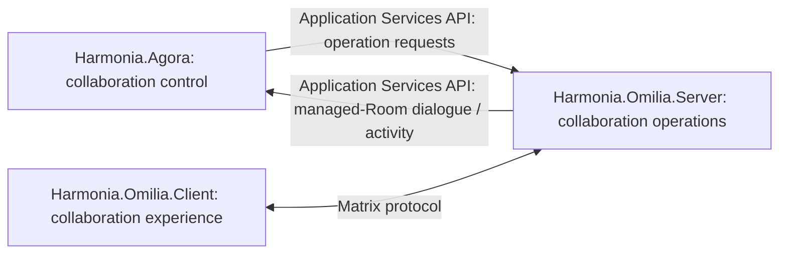

---
{
  "schemaVersion": 1,
  "canonicalId": "369907025d06492bb414a72cea834a77",
  "archimateType": "ApplicationComponent",
  "specialization": null,
  "displayName": "Harmonia.Omilia.Server",
  "friendlyName": "HarmoniaOmiliaServer",
  "canonicalName": null,
  "standing": {
    "semantic": "Candidate — accepted Step-B baseline; final Solution Architecture unapproved",
    "currentness": "current",
    "qualification": "Exact source standing retained; migration/identity allocation does not approve architectural assertions."
  },
  "identity": {
    "allocation": "UUIDv4 allocated once under the explicit RAD-1.1.5 migration Task",
    "authority": "enterprise-architecture/design/evidence/1.1.5/002/before/ai-agent-tasks/20261021T092725Z-establish-and-apply-element-continuum.md",
    "sourceAbsenceCheck": "No existing governed canonical source binding for this bounded definition; no name-based correspondence adopted."
  },
  "naming": {
    "authority": "docs/markdown/governance/canonical-identity-and-naming.md",
    "mode": "Local lexical component; no root or containment completeness inferred",
    "expected": {
      "friendlyName": "HarmoniaOmiliaServer",
      "canonicalName": null
    }
  },
  "provenance": [
    {
      "source": "docs/markdown/05-information-systems-architecture/component-register.md",
      "selector": "### C47 — Harmonia.Omilia.Server",
      "role": "ingested architectural definition or explicit source contribution",
      "revision": "aadcd55252fa7965be8a4321832ecc6d5b97c6e0",
      "sha256": "7f493dae1db3e77fe0342f7c21501763a4af2b4de9c59871a109626eaaad5aa0",
      "standing": "Candidate — accepted Step-B baseline; final Solution Architecture unapproved"
    },
    {
      "source": "docs/markdown/05-information-systems-architecture/agora-omilia-collaboration.md",
      "selector": "## Application Services API",
      "role": "ingested architectural definition or explicit source contribution",
      "revision": "aadcd55252fa7965be8a4321832ecc6d5b97c6e0",
      "sha256": "49ee8d088dc0a75dd3dc7f85051f438d8cfe147ccaeaba20f24db38d9819348b",
      "standing": "Candidate — adjudicated Domain05 Step-B baseline; final Solution Architecture unapproved"
    },
    {
      "source": "docs/markdown/05-information-systems-architecture/candidate-feature-map.md",
      "selector": "table assertion: | F23 | Bidirectional collaboration operations/activity boundary; historical transaction deduplication intent | Omilia.Server Application Services API: Agora requests operations and receives dialogue/activity in all managed Rooms; Petasos mediates wider execution collaboration | Operation intent/results, Room activity and collaboration transaction information | U16 settles owners and direction, not exact API or Matrix endpoint mapping. Historical AS transaction ID/status mechanisms remain L12; partial publication, marker failure and uncertain effects CDG-19; storage/API detail CDG-22/52. No exactly-once claim. |",
      "role": "ingested architectural definition or explicit source contribution",
      "revision": "aadcd55252fa7965be8a4321832ecc6d5b97c6e0",
      "sha256": "0585ca8887145ca21832bf1fcbf0f1829d1201251c7d7f68055b116bdf4afaab",
      "standing": "Candidate — adjudicated Domain05 Step-B baseline; final Solution Architecture unapproved"
    },
    {
      "source": "docs/markdown/05-information-systems-architecture/candidate-feature-map.md",
      "selector": "table assertion: | F46 | Omilia collaboration operations and client experience | [Harmonia.Omilia.Server C47](component-register.md#c47) and [Harmonia.Omilia.Client C48](component-register.md#c48); distinct from Agora control | Server Room/Space, user, membership, message/event/media operations; Client collaboration experience over Matrix protocol | U16 adjudicated candidate. Server derived from Matrix Synapse; Client from Element. Lineage is provenance; API, modifications, storage and Client/Iris detail deferred CDG-52. |",
      "role": "ingested architectural definition or explicit source contribution",
      "revision": "aadcd55252fa7965be8a4321832ecc6d5b97c6e0",
      "sha256": "0585ca8887145ca21832bf1fcbf0f1829d1201251c7d7f68055b116bdf4afaab",
      "standing": "Candidate — adjudicated Domain05 Step-B baseline; final Solution Architecture unapproved"
    }
  ],
  "sourceBindings": [
    {
      "source": "docs/markdown/05-information-systems-architecture/component-register.md",
      "selector": "### C47 — Harmonia.Omilia.Server"
    },
    {
      "source": "docs/markdown/05-information-systems-architecture/agora-omilia-collaboration.md",
      "selector": "## Application Services API"
    },
    {
      "source": "docs/markdown/05-information-systems-architecture/candidate-feature-map.md",
      "selector": "table assertion: | F23 | Bidirectional collaboration operations/activity boundary; historical transaction deduplication intent | Omilia.Server Application Services API: Agora requests operations and receives dialogue/activity in all managed Rooms; Petasos mediates wider execution collaboration | Operation intent/results, Room activity and collaboration transaction information | U16 settles owners and direction, not exact API or Matrix endpoint mapping. Historical AS transaction ID/status mechanisms remain L12; partial publication, marker failure and uncertain effects CDG-19; storage/API detail CDG-22/52. No exactly-once claim. |"
    },
    {
      "source": "docs/markdown/05-information-systems-architecture/candidate-feature-map.md",
      "selector": "table assertion: | F46 | Omilia collaboration operations and client experience | [Harmonia.Omilia.Server C47](component-register.md#c47) and [Harmonia.Omilia.Client C48](component-register.md#c48); distinct from Agora control | Server Room/Space, user, membership, message/event/media operations; Client collaboration experience over Matrix protocol | U16 adjudicated candidate. Server derived from Matrix Synapse; Client from Element. Lineage is provenance; API, modifications, storage and Client/Iris detail deferred CDG-52. |"
    }
  ],
  "exchange": {
    "identifier": "id-81e0e924bc8d5ab2a578d75ac43d9684",
    "properties": []
  },
  "relationships": [],
  "unresolvedProperties": {
    "canonicalName": "Formal qualifier for native ApplicationComponent is not established in the current naming contract; HCRL 1.1.5-002 DR-5. Identity and source content are independently determinate."
  },
  "representation": {
    "sourceLinksRebased": true,
    "authority": "HCRL 1.1.5-002 DR-3; source meaning unchanged"
  }
}
---

# Harmonia.Omilia.Server

## Architectural content

- **Role/responsibility:** owns/performs underlying Room/Space, user, membership,
  dialogue/message, collaboration-event and applicable collaboration-media
  operations. Exposes the **Application Services API** for Agora operation requests
  and dialogue/activity delivery from Agora-managed Rooms/Spaces.
- **Boundary:** operational worker, not owner of Harmonia collaboration semantics,
  membership intent or originating clinical/operational information. Agora owns
  native collaboration information; AX-05 durable-state responsibility remains.
- **Provenance/standing:** derived from Matrix Synapse; U16 adjudicated candidate.
  API technology, modifications and persistence mechanics are deferred, not
  inferred from historical Synapse deployment/configuration.

## Source-qualified contribution

Source: `docs/markdown/05-information-systems-architecture/agora-omilia-collaboration.md` — ## Application Services API. Standing: Candidate — adjudicated Domain05 Step-B baseline; final Solution Architecture unapproved.

Omilia.Server exposes an **Application Services API** used by Agora both to
request collaboration operations and to receive managed-Room dialogue/activity.

Agora decides to create/change a managed Room/Space, add/remove a participant or
publish information; Omilia.Server performs the operation. Room activity returns
through the same architectural boundary. The exact API contract, technology and
mapping to upstream Matrix interfaces remain deferred. Historical Admin,
Client-Server and AS-transaction endpoints do not define this new contract.

Workflow/execution collaboration continues through Petasos with **no direct
Agora-to-Ponos dependency**. Matrix DTO encapsulation, Themis default-deny
governance and zero-PHI Room aliases/names/topics remain repository constraints.
Membership or receipt of a notification does not confer information-access rights.

[U19](../../../../docs/markdown/05-information-systems-architecture/sources.md#u19) establishes the administrative interaction boundary:
Administrator → Omilia → Agora → Administrative Function → specialised
Administrative Ergon → governed subsystem operation. Stopped-Twin resumption
uses this pattern, with normal authorisation, Context, execution and Kleio audit
controls; Agora and Omilia do not directly resume or manipulate the Twin.
The arrows describe semantic progression and retain Petasos execution handoff
and Agora's no-direct-Ponos-dependency rule. Iris provides a separate path through
Iris-BackEnd and does **not** directly interact with Agora or Omilia. Broader
Administrative Function reconciliation is [deferred](../../../../docs/markdown/05-information-systems-architecture/gaps.md#administrative-function-finding).

Identity mapping/provisioning is collaboration integration, not authentication
authority. Existing isolation constraints are not relaxed; detailed security,
privacy and external/federated interactions remain deferred.

## Source-qualified contribution

Source: `docs/markdown/05-information-systems-architecture/candidate-feature-map.md` — ``table assertion: | F23 | Bidirectional collaboration operations/activity boundary; historical transaction deduplication intent | Omilia.Server Application Services API: Agora requests operations and receives dialogue/activity in all managed Rooms; Petasos mediates wider execution collaboration | Operation intent/results, Room activity and collaboration transaction information | U16 settles owners and direction, not exact API or Matrix endpoint mapping. Historical AS transaction ID/status mechanisms remain L12; partial publication, marker failure and uncertain effects CDG-19; storage/API detail CDG-22/52. No exactly-once claim. |``. Standing: Candidate — adjudicated Domain05 Step-B baseline; final Solution Architecture unapproved.

| F23 | Bidirectional collaboration operations/activity boundary; historical transaction deduplication intent | Omilia.Server Application Services API: Agora requests operations and receives dialogue/activity in all managed Rooms; Petasos mediates wider execution collaboration | Operation intent/results, Room activity and collaboration transaction information | U16 settles owners and direction, not exact API or Matrix endpoint mapping. Historical AS transaction ID/status mechanisms remain L12; partial publication, marker failure and uncertain effects CDG-19; storage/API detail CDG-22/52. No exactly-once claim. |

## Source-qualified contribution

Source: `docs/markdown/05-information-systems-architecture/candidate-feature-map.md` — ``table assertion: | F46 | Omilia collaboration operations and client experience | [Harmonia.Omilia.Server C47](component-register.md#c47) and [Harmonia.Omilia.Client C48](component-register.md#c48); distinct from Agora control | Server Room/Space, user, membership, message/event/media operations; Client collaboration experience over Matrix protocol | U16 adjudicated candidate. Server derived from Matrix Synapse; Client from Element. Lineage is provenance; API, modifications, storage and Client/Iris detail deferred CDG-52. |``. Standing: Candidate — adjudicated Domain05 Step-B baseline; final Solution Architecture unapproved.

| F46 | Omilia collaboration operations and client experience | [Harmonia.Omilia.Server C47](369907025d06492bb414a72cea834a77.md) and [Harmonia.Omilia.Client C48](33b8421ffc444b78b2d059201a58a688.md); distinct from Agora control | Server Room/Space, user, membership, message/event/media operations; Client collaboration experience over Matrix protocol | U16 adjudicated candidate. Server derived from Matrix Synapse; Client from Element. Lineage is provenance; API, modifications, storage and Client/Iris detail deferred CDG-52. |
