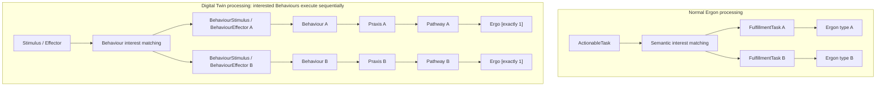
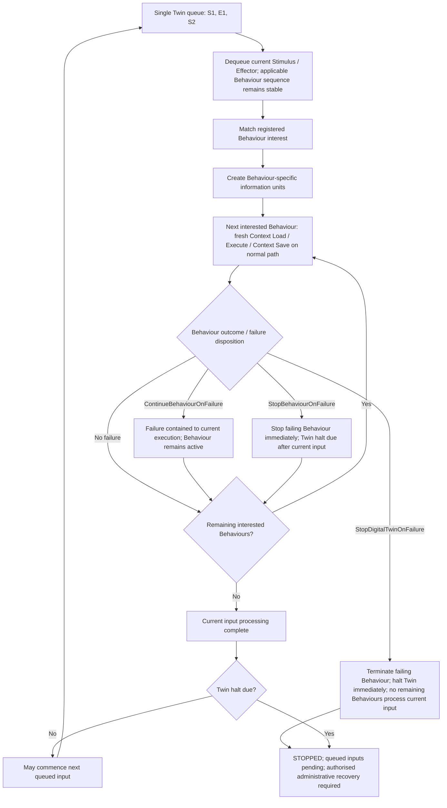
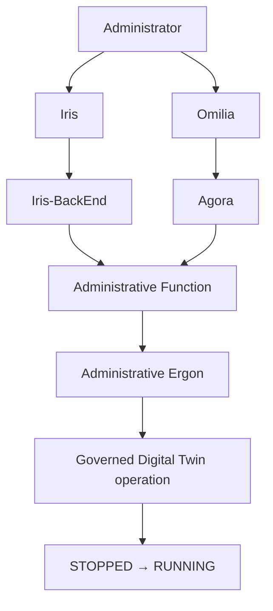

---
{
  "schemaVersion": 1,
  "canonicalId": "3f64d339648246e99e8866c8089f8960",
  "archimateType": "ApplicationComponent",
  "specialization": null,
  "displayName": "DigitalTwin",
  "friendlyName": "DigitalTwin",
  "canonicalName": null,
  "standing": {
    "semantic": "Candidate — accepted Step-B baseline; final Solution Architecture unapproved",
    "currentness": "current",
    "qualification": "Exact source standing retained; migration/identity allocation does not approve architectural assertions."
  },
  "identity": {
    "allocation": "UUIDv4 allocated once under the explicit RAD-1.1.5 migration Task",
    "authority": "enterprise-architecture/design/evidence/1.1.5/002/before/ai-agent-tasks/20261021T092725Z-establish-and-apply-element-continuum.md",
    "sourceAbsenceCheck": "No existing governed canonical source binding for this bounded definition; no name-based correspondence adopted."
  },
  "naming": {
    "authority": "docs/markdown/governance/canonical-identity-and-naming.md",
    "mode": "Local lexical component; no root or containment completeness inferred",
    "expected": {
      "friendlyName": "DigitalTwin",
      "canonicalName": null
    }
  },
  "provenance": [
    {
      "source": "docs/markdown/05-information-systems-architecture/component-register.md",
      "selector": "### C19 — DigitalTwin",
      "role": "ingested architectural definition or explicit source contribution",
      "revision": "aadcd55252fa7965be8a4321832ecc6d5b97c6e0",
      "sha256": "7f493dae1db3e77fe0342f7c21501763a4af2b4de9c59871a109626eaaad5aa0",
      "standing": "Candidate — accepted Step-B baseline; final Solution Architecture unapproved"
    },
    {
      "source": "docs/markdown/05-information-systems-architecture/context-and-persistence-management.md",
      "selector": "## Digital Twin Behaviour Context lifecycle",
      "role": "ingested architectural definition or explicit source contribution",
      "revision": "aadcd55252fa7965be8a4321832ecc6d5b97c6e0",
      "sha256": "4d2f4cd1890ad51e74fb87e75749ee6edb233b8e2e4fd28d9f00c852e21dd986",
      "standing": "Candidate — adjudicated Domain05 Step-B baseline; final Solution Architecture unapproved"
    },
    {
      "source": "docs/markdown/05-information-systems-architecture/candidate-feature-map.md",
      "selector": "table assertion: | F32 | Entity-relative Behaviour execution and single-input serialisation | [DigitalTwin C19](component-register.md#c19) specialises Ponos; Behaviour [1..*], each through Praxis → Pathway → exactly one Ergo; Mneme manages Context/Pragma | One Stimulus/Effector queue; identifiable BehaviourStimulus/BehaviourEffector per interested Behaviour; sequential execution with fresh Context after predecessor completion/save on the normal path; open governed outputs | U02/U19 preserve A02 entity boundary. Developer sequencing policy through framework API; unspecified order without configuration. Applicable sequence stable for each input; changes apply to subsequent inputs. ContinueBehaviourOnFailure contains failure to the current execution, leaving the Behaviour active and other interested Behaviours and queue processing unaffected. StopBehaviourOnFailure stops the failing Behaviour immediately, lets remaining interested Behaviours complete the current input, then halts the Twin. StopDigitalTwinOnFailure terminates the failing Behaviour and halts the Twin immediately, preventing remaining current-input and subsequent queued processing. Queued inputs remain pending authorised Administrative Function/Ergon resume; stopped-Behaviour recovery deferred. Concurrency across independent Twins, no thread per Twin. [DesignNote](design-notes/DesignNote-Digital-Twin-Behaviour-and-Execution-Semantics.md); detail CDG-07/54/55. |",
      "role": "ingested architectural definition or explicit source contribution",
      "revision": "aadcd55252fa7965be8a4321832ecc6d5b97c6e0",
      "sha256": "0585ca8887145ca21832bf1fcbf0f1829d1201251c7d7f68055b116bdf4afaab",
      "standing": "Candidate — adjudicated Domain05 Step-B baseline; final Solution Architecture unapproved"
    },
    {
      "source": "docs/markdown/05-information-systems-architecture/design-notes/DesignNote-Digital-Twin-Behaviour-and-Execution-Semantics.md",
      "selector": "## 1. Purpose and architectural boundaries",
      "role": "ingested architectural definition or explicit source contribution",
      "revision": "aadcd55252fa7965be8a4321832ecc6d5b97c6e0",
      "sha256": "0a99f554246a94877b72c63b2b53d5c39b5b84e1b63404aabf18efab73ddfa4d",
      "standing": "Agreed A4.7 decisions U19; whole-candidate acceptance and deferred mechanisms unchanged"
    },
    {
      "source": "docs/markdown/05-information-systems-architecture/design-notes/DesignNote-Digital-Twin-Behaviour-and-Execution-Semantics.md",
      "selector": "## 3. Twin-relative execution",
      "role": "ingested architectural definition or explicit source contribution",
      "revision": "aadcd55252fa7965be8a4321832ecc6d5b97c6e0",
      "sha256": "0a99f554246a94877b72c63b2b53d5c39b5b84e1b63404aabf18efab73ddfa4d",
      "standing": "Agreed A4.7 decisions U19; whole-candidate acceptance and deferred mechanisms unchanged"
    },
    {
      "source": "docs/markdown/05-information-systems-architecture/design-notes/DesignNote-Digital-Twin-Behaviour-and-Execution-Semantics.md",
      "selector": "## 4. One input queue and Behaviour-specific information",
      "role": "ingested architectural definition or explicit source contribution",
      "revision": "aadcd55252fa7965be8a4321832ecc6d5b97c6e0",
      "sha256": "0a99f554246a94877b72c63b2b53d5c39b5b84e1b63404aabf18efab73ddfa4d",
      "standing": "Agreed A4.7 decisions U19; whole-candidate acceptance and deferred mechanisms unchanged"
    },
    {
      "source": "docs/markdown/05-information-systems-architecture/design-notes/DesignNote-Digital-Twin-Behaviour-and-Execution-Semantics.md",
      "selector": "## 5. Interest fan-out and execution concurrency",
      "role": "ingested architectural definition or explicit source contribution",
      "revision": "aadcd55252fa7965be8a4321832ecc6d5b97c6e0",
      "sha256": "0a99f554246a94877b72c63b2b53d5c39b5b84e1b63404aabf18efab73ddfa4d",
      "standing": "Agreed A4.7 decisions U19; whole-candidate acceptance and deferred mechanisms unchanged"
    },
    {
      "source": "docs/markdown/05-information-systems-architecture/design-notes/DesignNote-Digital-Twin-Behaviour-and-Execution-Semantics.md",
      "selector": "## 6. Digital Twin serialisation invariant",
      "role": "ingested architectural definition or explicit source contribution",
      "revision": "aadcd55252fa7965be8a4321832ecc6d5b97c6e0",
      "sha256": "0a99f554246a94877b72c63b2b53d5c39b5b84e1b63404aabf18efab73ddfa4d",
      "standing": "Agreed A4.7 decisions U19; whole-candidate acceptance and deferred mechanisms unchanged"
    },
    {
      "source": "docs/markdown/05-information-systems-architecture/design-notes/DesignNote-Digital-Twin-Behaviour-and-Execution-Semantics.md",
      "selector": "## 11. Authorised administrative recovery",
      "role": "ingested architectural definition or explicit source contribution",
      "revision": "aadcd55252fa7965be8a4321832ecc6d5b97c6e0",
      "sha256": "0a99f554246a94877b72c63b2b53d5c39b5b84e1b63404aabf18efab73ddfa4d",
      "standing": "Agreed A4.7 decisions U19; whole-candidate acceptance and deferred mechanisms unchanged"
    },
    {
      "source": "docs/markdown/05-information-systems-architecture/design-notes/DesignNote-Digital-Twin-Behaviour-and-Execution-Semantics.md",
      "selector": "## 13. Deferred matters and open questions",
      "role": "ingested architectural definition or explicit source contribution",
      "revision": "aadcd55252fa7965be8a4321832ecc6d5b97c6e0",
      "sha256": "0a99f554246a94877b72c63b2b53d5c39b5b84e1b63404aabf18efab73ddfa4d",
      "standing": "Agreed A4.7 decisions U19; whole-candidate acceptance and deferred mechanisms unchanged"
    },
    {
      "source": "docs/markdown/05-information-systems-architecture/data-and-persistence.md",
      "selector": "table assertion: | D17 | Twin coordination context and assurance context/basis/evidence/assessment/finding/outcome candidate areas | DigitalTwin uses governed entity information; Dokimasia coordinates independent assurance. Evidence retains originating responsibility; execution/assessment does not confer information-management authority | Detailed coordination-state, evidence-access/control and persistence contracts remain unresolved; no Twin table or assurance Information Family fabricated | A02/A04 and U02 establish responsibility/specialisation independently of resemblance. CDG-07–09 retain detail; AI participation requires CDG-35 discovery. |",
      "role": "ingested architectural definition or explicit source contribution",
      "revision": "aadcd55252fa7965be8a4321832ecc6d5b97c6e0",
      "sha256": "8f1b4222a8e1303001235366a17de7555e56141711d5599c6851a7d865cb2dcd",
      "standing": "Candidate — adjudicated Domain05 Step-B baseline; final Solution Architecture unapproved"
    },
    {
      "source": "docs/markdown/05-information-systems-architecture/data-and-persistence.md",
      "selector": "table assertion: | D18 | **Stimulus / Effector** — candidate Pragma specialisations; **BehaviourStimulus / BehaviourEffector** — identifiable Behaviour-specific information units | Mneme / Pragma Management manages; framework derives one instance per interested Behaviour, presented to its ingress in the Twin-relative execution domain | One Twin input queue; sequential Behaviour processing subject to the three failure dispositions, fresh Praxis-defined Context per Behaviour after predecessor completion/save on the normal path; common management facilities and Mnemosyne durable establishment remain | U02/U19. Semantic analogy to ActionableTask/FulfillmentTask establishes neither inheritance, identical types nor implementation through them. Physical schemas/identity/lifecycle remain CDG-07/54; no new Domain04 Information Resource inferred. |",
      "role": "ingested architectural definition or explicit source contribution",
      "revision": "aadcd55252fa7965be8a4321832ecc6d5b97c6e0",
      "sha256": "8f1b4222a8e1303001235366a17de7555e56141711d5599c6851a7d865cb2dcd",
      "standing": "Candidate — adjudicated Domain05 Step-B baseline; final Solution Architecture unapproved"
    },
    {
      "source": "docs/markdown/05-information-systems-architecture/middleware.md",
      "selector": "table assertion: | M11 | **DigitalTwin entity-relative serial input processing** | Single Stimulus/Effector queue; interest matching creates BehaviourStimulus/BehaviourEffector per interested Behaviour; sequential one-Ergo Behaviour Praxes with fresh Mneme Context Load/Save on the normal path; same-Twin outputs requeue without interruption | U02/U19 preserve A02. Developer sequencing policy uses framework API; no policy means unspecified order. Applicable sequence stable for each input; changes apply to subsequent inputs. ContinueBehaviourOnFailure contains failure to the current execution, leaving the Behaviour active and other interested Behaviours and queue processing unaffected. StopBehaviourOnFailure stops the failing Behaviour immediately, lets remaining interested Behaviours complete the current input, then halts the Twin. StopDigitalTwinOnFailure terminates the failing Behaviour and halts the Twin immediately, preventing remaining current-input and subsequent queued processing. Pending queue requires governed administrative resume; stopped-Behaviour recovery deferred. Bounded concurrency across independent Twins, no thread per Twin. Runtime/schema/API detail CDG-07/54. |",
      "role": "ingested architectural definition or explicit source contribution",
      "revision": "aadcd55252fa7965be8a4321832ecc6d5b97c6e0",
      "sha256": "7ee1a4ab1c24abcb052daa5f0392270a8dc4997dd4083db8fea19736bc363213",
      "standing": "Candidate — adjudicated Domain05 Step-B baseline; final Solution Architecture unapproved"
    }
  ],
  "sourceBindings": [
    {
      "source": "docs/markdown/05-information-systems-architecture/component-register.md",
      "selector": "### C19 — DigitalTwin"
    },
    {
      "source": "docs/markdown/05-information-systems-architecture/context-and-persistence-management.md",
      "selector": "## Digital Twin Behaviour Context lifecycle"
    },
    {
      "source": "docs/markdown/05-information-systems-architecture/candidate-feature-map.md",
      "selector": "table assertion: | F32 | Entity-relative Behaviour execution and single-input serialisation | [DigitalTwin C19](component-register.md#c19) specialises Ponos; Behaviour [1..*], each through Praxis → Pathway → exactly one Ergo; Mneme manages Context/Pragma | One Stimulus/Effector queue; identifiable BehaviourStimulus/BehaviourEffector per interested Behaviour; sequential execution with fresh Context after predecessor completion/save on the normal path; open governed outputs | U02/U19 preserve A02 entity boundary. Developer sequencing policy through framework API; unspecified order without configuration. Applicable sequence stable for each input; changes apply to subsequent inputs. ContinueBehaviourOnFailure contains failure to the current execution, leaving the Behaviour active and other interested Behaviours and queue processing unaffected. StopBehaviourOnFailure stops the failing Behaviour immediately, lets remaining interested Behaviours complete the current input, then halts the Twin. StopDigitalTwinOnFailure terminates the failing Behaviour and halts the Twin immediately, preventing remaining current-input and subsequent queued processing. Queued inputs remain pending authorised Administrative Function/Ergon resume; stopped-Behaviour recovery deferred. Concurrency across independent Twins, no thread per Twin. [DesignNote](design-notes/DesignNote-Digital-Twin-Behaviour-and-Execution-Semantics.md); detail CDG-07/54/55. |"
    },
    {
      "source": "docs/markdown/05-information-systems-architecture/design-notes/DesignNote-Digital-Twin-Behaviour-and-Execution-Semantics.md",
      "selector": "## 1. Purpose and architectural boundaries"
    },
    {
      "source": "docs/markdown/05-information-systems-architecture/design-notes/DesignNote-Digital-Twin-Behaviour-and-Execution-Semantics.md",
      "selector": "## 3. Twin-relative execution"
    },
    {
      "source": "docs/markdown/05-information-systems-architecture/design-notes/DesignNote-Digital-Twin-Behaviour-and-Execution-Semantics.md",
      "selector": "## 4. One input queue and Behaviour-specific information"
    },
    {
      "source": "docs/markdown/05-information-systems-architecture/design-notes/DesignNote-Digital-Twin-Behaviour-and-Execution-Semantics.md",
      "selector": "## 5. Interest fan-out and execution concurrency"
    },
    {
      "source": "docs/markdown/05-information-systems-architecture/design-notes/DesignNote-Digital-Twin-Behaviour-and-Execution-Semantics.md",
      "selector": "## 6. Digital Twin serialisation invariant"
    },
    {
      "source": "docs/markdown/05-information-systems-architecture/design-notes/DesignNote-Digital-Twin-Behaviour-and-Execution-Semantics.md",
      "selector": "## 11. Authorised administrative recovery"
    },
    {
      "source": "docs/markdown/05-information-systems-architecture/design-notes/DesignNote-Digital-Twin-Behaviour-and-Execution-Semantics.md",
      "selector": "## 13. Deferred matters and open questions"
    },
    {
      "source": "docs/markdown/05-information-systems-architecture/data-and-persistence.md",
      "selector": "table assertion: | D17 | Twin coordination context and assurance context/basis/evidence/assessment/finding/outcome candidate areas | DigitalTwin uses governed entity information; Dokimasia coordinates independent assurance. Evidence retains originating responsibility; execution/assessment does not confer information-management authority | Detailed coordination-state, evidence-access/control and persistence contracts remain unresolved; no Twin table or assurance Information Family fabricated | A02/A04 and U02 establish responsibility/specialisation independently of resemblance. CDG-07–09 retain detail; AI participation requires CDG-35 discovery. |"
    },
    {
      "source": "docs/markdown/05-information-systems-architecture/data-and-persistence.md",
      "selector": "table assertion: | D18 | **Stimulus / Effector** — candidate Pragma specialisations; **BehaviourStimulus / BehaviourEffector** — identifiable Behaviour-specific information units | Mneme / Pragma Management manages; framework derives one instance per interested Behaviour, presented to its ingress in the Twin-relative execution domain | One Twin input queue; sequential Behaviour processing subject to the three failure dispositions, fresh Praxis-defined Context per Behaviour after predecessor completion/save on the normal path; common management facilities and Mnemosyne durable establishment remain | U02/U19. Semantic analogy to ActionableTask/FulfillmentTask establishes neither inheritance, identical types nor implementation through them. Physical schemas/identity/lifecycle remain CDG-07/54; no new Domain04 Information Resource inferred. |"
    },
    {
      "source": "docs/markdown/05-information-systems-architecture/middleware.md",
      "selector": "table assertion: | M11 | **DigitalTwin entity-relative serial input processing** | Single Stimulus/Effector queue; interest matching creates BehaviourStimulus/BehaviourEffector per interested Behaviour; sequential one-Ergo Behaviour Praxes with fresh Mneme Context Load/Save on the normal path; same-Twin outputs requeue without interruption | U02/U19 preserve A02. Developer sequencing policy uses framework API; no policy means unspecified order. Applicable sequence stable for each input; changes apply to subsequent inputs. ContinueBehaviourOnFailure contains failure to the current execution, leaving the Behaviour active and other interested Behaviours and queue processing unaffected. StopBehaviourOnFailure stops the failing Behaviour immediately, lets remaining interested Behaviours complete the current input, then halts the Twin. StopDigitalTwinOnFailure terminates the failing Behaviour and halts the Twin immediately, preventing remaining current-input and subsequent queued processing. Pending queue requires governed administrative resume; stopped-Behaviour recovery deferred. Bounded concurrency across independent Twins, no thread per Twin. Runtime/schema/API detail CDG-07/54. |"
    }
  ],
  "exchange": {
    "identifier": "id-3f824aa15a035e5e8db297141c867cff",
    "properties": []
  },
  "relationships": [],
  "unresolvedProperties": {
    "canonicalName": "Formal qualifier for native ApplicationComponent is not established in the current naming contract; HCRL 1.1.5-002 DR-5. Identity and source content are independently determinate."
  },
  "representation": {
    "sourceLinksRebased": true,
    "authority": "HCRL 1.1.5-002 DR-3; source meaning unchanged"
  }
}
---

# DigitalTwin

## Architectural content

- **Role/features:** specialised Ponos-based execution component for entity-specific
  operational coordination associated with Energeia. [U02](../../../../docs/markdown/05-information-systems-architecture/sources.md#u02) establishes
  specialisation/reuse, not containment by a Ponos runtime. The Digital Twin
  responsibility in [A02](../../../../docs/markdown/05-information-systems-architecture/sources.md#a02) remains controlling: entity-related
  execution SHOULD use the Twin unless explicitly justified otherwise.
- **Twin-specific execution:** one input queue containing Stimulus and Effector.
  At most one queued input is processed at a time; interested Behaviours execute
  **sequentially**, subject to the failure dispositions below. Each receives its
  own BehaviourStimulus/BehaviourEffector and fresh Praxis-defined Context after
  its predecessor's completion/save on the normal path. No shared immutable
  input-level Context.
  [U19 serialisation and lifecycle](../../../../docs/markdown/05-information-systems-architecture/design-notes/DesignNote-Digital-Twin-Behaviour-and-Execution-Semantics.md).
  Bounded resources service runnable pending work; stopped Twins retain pending
  inputs. Concurrency is across independent Twins, without a thread per Twin.
- **Sequence/failure/recovery:** R1.x/R2.x framework loads/exposes Behaviours and
  provides/maintains the sequencing API; developer configuration supplies policy.
  Without it, order is unspecified. The applicable sequence remains stable for
  the current input; changes apply to subsequently processed inputs.
  `ContinueBehaviourOnFailure` contains failure to the current execution while
  keeping the Behaviour active and other interested Behaviours and queue processing
  unaffected. `StopBehaviourOnFailure` stops the failing Behaviour immediately,
  lets remaining interested Behaviours finish the current input, then halts the
  Twin. `StopDigitalTwinOnFailure` terminates the failing Behaviour and halts the
  Twin immediately, preventing remaining current-input and subsequent queued
  processing. Stopped Twins do not
  automatically resume: authorised administrative input through Iris/Iris-BackEnd
  or Omilia/Agora leads to Administrative Function → Administrative Ergon →
  governed Twin operation. Neither channel directly manipulates the Twin.
  Detailed recovery of a stopped Behaviour remains deferred (CDG-54).
- **Information:** uses context drawn from governed entity information and
  relationships; entity/resource/Twin identity are not aliases. Historical patient,
  practitioner, wardsperson, organisation, care-team, ward and bed examples are
  illustrative archetypes, not an approved exhaustive component catalogue.
- **Persistence/significant information:** definition/configuration is a C&G
  classification candidate; operational state/activity is an O&A candidate under
  U06. Detailed coordination-state Data Objects, activation/deactivation,
  preservation and transient/durable qualification remain CDG-07. A Twin is not
  inherently a permanent object, table or FHIR resource.
- **Collaboration/exclusions:** executes Behaviour C25, which specialises Ergon
  and retains all common Ergo/Ergon facilities. Uses Mneme Pragma Management and
  candidate Stimulus/Effector specialisations; Ponos supplies common execution,
  Petasos supplies messaging/recoverable handoff. Follows the
  [specialisation principle](../../../../docs/markdown/05-information-systems-architecture/README.md#specialisation-principle); adds genuinely
  Twin-specific semantics instead of parallel platform mechanisms.
  Not a second engine, unmanaged persistent actor, separate
  policy/search service or authority over originating clinical facts/clinical work.
- **Standing:** U02 specialisation and U19 Behaviour execution semantics established;
  representation/runtime details remain CDG-07/54. DigitalTwin and Dokimasia are sibling
  Ponos specialisations; neither contains the other or manages Pragma by execution.

## Source-qualified contribution

Source: `docs/markdown/05-information-systems-architecture/context-and-persistence-management.md` — ## Digital Twin Behaviour Context lifecycle. Standing: Candidate — adjudicated Domain05 Step-B baseline; final Solution Architecture unapproved.

[U19](../../../../docs/markdown/05-information-systems-architecture/sources.md#u19) specialises the normal lifecycle for
[Digital Twin Behaviour execution](../../../../docs/markdown/05-information-systems-architecture/design-notes/DesignNote-Digital-Twin-Behaviour-and-Execution-Semantics.md).
Each Behaviour has its own Praxis-defined Context requirements, interpreted
relative to the singular represented entity. Interested Behaviours execute
sequentially, with **fresh Context Load → Execute → Context Save for each** on
the normal path. Normal progression loads the next Behaviour's Context only
after its predecessor has completed and saved its information consequences;
failure progression follows the [three failure dispositions](a26f06d66bec4981b266e202c46a9afb.md).
Later Behaviours may therefore observe
authoritative consequences established by earlier ones; there is no single
immutable Context snapshot shared by all Behaviours for an input.

Mneme retains Context materialisation/save and Pragma management; Mnemosyne alone
establishes authoritative durable state. This ordering grants neither cache
authority nor an automatic commit guarantee and does not replace exceptional
harmonisation or AX-15 uncertainty handling. Detailed continuation when a
Behaviour cannot establish its save outcome remains [open](../../../../docs/markdown/05-information-systems-architecture/gaps.md#digital-twin-execution-contracts).

Behaviour outputs can enter normal governed processing. Twin-relative references
may require resolution/dereferencing for the receiving context; sufficiently
explicit outputs need no transformation. Same-Twin Stimulus/Effector outputs
join its normal queue without interrupting the current input.

## Source-qualified contribution

Source: `docs/markdown/05-information-systems-architecture/candidate-feature-map.md` — ``table assertion: | F32 | Entity-relative Behaviour execution and single-input serialisation | [DigitalTwin C19](component-register.md#c19) specialises Ponos; Behaviour [1..*], each through Praxis → Pathway → exactly one Ergo; Mneme manages Context/Pragma | One Stimulus/Effector queue; identifiable BehaviourStimulus/BehaviourEffector per interested Behaviour; sequential execution with fresh Context after predecessor completion/save on the normal path; open governed outputs | U02/U19 preserve A02 entity boundary. Developer sequencing policy through framework API; unspecified order without configuration. Applicable sequence stable for each input; changes apply to subsequent inputs. ContinueBehaviourOnFailure contains failure to the current execution, leaving the Behaviour active and other interested Behaviours and queue processing unaffected. StopBehaviourOnFailure stops the failing Behaviour immediately, lets remaining interested Behaviours complete the current input, then halts the Twin. StopDigitalTwinOnFailure terminates the failing Behaviour and halts the Twin immediately, preventing remaining current-input and subsequent queued processing. Queued inputs remain pending authorised Administrative Function/Ergon resume; stopped-Behaviour recovery deferred. Concurrency across independent Twins, no thread per Twin. [DesignNote](design-notes/DesignNote-Digital-Twin-Behaviour-and-Execution-Semantics.md); detail CDG-07/54/55. |``. Standing: Candidate — adjudicated Domain05 Step-B baseline; final Solution Architecture unapproved.

| F32 | Entity-relative Behaviour execution and single-input serialisation | [DigitalTwin C19](3f64d339648246e99e8866c8089f8960.md) specialises Ponos; Behaviour [1..*], each through Praxis → Pathway → exactly one Ergo; Mneme manages Context/Pragma | One Stimulus/Effector queue; identifiable BehaviourStimulus/BehaviourEffector per interested Behaviour; sequential execution with fresh Context after predecessor completion/save on the normal path; open governed outputs | U02/U19 preserve A02 entity boundary. Developer sequencing policy through framework API; unspecified order without configuration. Applicable sequence stable for each input; changes apply to subsequent inputs. ContinueBehaviourOnFailure contains failure to the current execution, leaving the Behaviour active and other interested Behaviours and queue processing unaffected. StopBehaviourOnFailure stops the failing Behaviour immediately, lets remaining interested Behaviours complete the current input, then halts the Twin. StopDigitalTwinOnFailure terminates the failing Behaviour and halts the Twin immediately, preventing remaining current-input and subsequent queued processing. Queued inputs remain pending authorised Administrative Function/Ergon resume; stopped-Behaviour recovery deferred. Concurrency across independent Twins, no thread per Twin. [DesignNote](../../../../docs/markdown/05-information-systems-architecture/design-notes/DesignNote-Digital-Twin-Behaviour-and-Execution-Semantics.md); detail CDG-07/54/55. |

## Source-qualified contribution

Source: `docs/markdown/05-information-systems-architecture/design-notes/DesignNote-Digital-Twin-Behaviour-and-Execution-Semantics.md` — ## 1. Purpose and architectural boundaries. Standing: Agreed A4.7 decisions U19; whole-candidate acceptance and deferred mechanisms unchanged.

Capture Digital Twin Behaviour structure, entity-relative execution, input
serialisation, Context lifecycle, sequencing, outputs, failure and authorised
administrative resumption. This is a semantic contract, not a new execution
engine, runtime topology or information schema.

| Relevant authority | Consistency of this decision |
| :--- | :--- |
| AX-04, AX-10, AX-12 | Harmonia defines serialisation, sequencing and failure meaning; common execution and durable handoff facilities remain reusable. No thread, queue product or runtime mechanism is prescribed. |
| AX-05, AX-06, AX-11 | Mneme manages Context/Pragma and their consequences; Mnemosyne establishes authoritative durable state. Loaded or changed values do not themselves establish authority. |
| AX-07, AX-08, AX-09 | Behaviour execution and administrative work remain authorised and auditable through normal boundaries. Operational state is not automatically durable audit evidence. |
| AX-14, AX-15 | Interest fan-out, execution concurrency, input completion, failure disposition and uncertain effects remain distinct. Failure does not prove that no information consequences occurred. |
| AX-16, AX-18 | Twin-relative operational activity progresses with the represented entity without acquiring authority over originating clinical facts or externally governed clinical work. |
| AX-17 | The explicit decisions below settle bounded semantics; unestablished representations and deferred mechanisms are not inferred. A4.7 acceptance remains human adjudication. |

Energeia owns/manages **Praxis and Journey**. Ponos owns **governed execution**;
Energeia and Ponos are peer application components. Praxis supplies a semantic
and operational execution envelope and does not structurally contain Ponos.
Existing [specialisation/reuse relationships](../../../../docs/markdown/05-information-systems-architecture/candidate-system-map.md#specialisation-and-reuse)
remain intact: DigitalTwin specialises/reuses Ponos and Behaviour specialises/
reuses Ergon, without mandating implementation inheritance.

Mneme owns **Context and Pragma management**; Mnemosyne owns **authoritative
persistence management**. Petasos owns **durable purpose-defined handoff and
queueing**. Themis authorises/enforces; Kleio owns authoritative audit information.
Iris provides general human interaction; Agora owns collaboration control and
semantics; Omilia provides collaboration operations and experience. Iris does
not directly interact with Agora or Omilia. Administrative access confers no
privileged route into subsystem internals.

## Source-qualified contribution

Source: `docs/markdown/05-information-systems-architecture/design-notes/DesignNote-Digital-Twin-Behaviour-and-Execution-Semantics.md` — ## 3. Twin-relative execution. Standing: Agreed A4.7 decisions U19; whole-candidate acceptance and deferred mechanisms unchanged.

A Digital Twin establishes an execution reference frame relative to the singular
real-world entity it represents. A Patient Twin executes relative to one Patient,
a Practitioner Twin to one Practitioner, and a Bed Twin to one Bed. These are
examples, not an exhaustive archetype catalogue or an identity-equivalence rule.

Compared with ordinary Ergon execution:

1. Context and available information are interpreted relative to that entity.
2. Stimulus and Effector inputs are structured relative to that entity.
3. No intra-Twin Behaviour concurrency is assumed or permitted by the current
   execution model.

References may be implicit within the Twin execution domain where its reference
frame establishes their meaning. Globally explicit references need not be
repeated throughout Behaviour processing. This convenience does not change
governed information ownership or authorisation.

## Source-qualified contribution

Source: `docs/markdown/05-information-systems-architecture/design-notes/DesignNote-Digital-Twin-Behaviour-and-Execution-Semantics.md` — ## 4. One input queue and Behaviour-specific information. Standing: Agreed A4.7 decisions U19; whole-candidate acceptance and deferred mechanisms unchanged.

Each Digital Twin maintains a **single input queue containing Stimulus and
Effector**. On dequeue, the framework determines which Behaviours have registered
interest in that input and creates a discrete, identifiable information unit
for each interested Behaviour:

```text
Stimulus                         Effector
  ├── BehaviourStimulus → A         ├── BehaviourEffector → A
  ├── BehaviourStimulus → B         ├── BehaviourEffector → B
  └── BehaviourStimulus → C         └── BehaviourEffector → C
```

**BehaviourStimulus:** an identifiable Behaviour-specific instance derived from
a Stimulus and presented to the ingress of a Behaviour that has registered
interest in that Stimulus.

**BehaviourEffector:** an identifiable Behaviour-specific instance derived from
an Effector and presented to the ingress of a Behaviour that has registered
interest in that Effector.

These terms replace working terminology such as `ActionableStimulus` and
`FulfillmentStimulus`. They establish semantic information units, not a physical
schema, new Domain04 Information Resource or implementation inheritance hierarchy.
Existing candidate Stimulus/Effector Pragma specialisation standing remains;
this note does not settle those representation contracts.

### Normal Ergon and Digital Twin processing

Ordinary Ergon processing matches semantic interest in an ActionableTask and
establishes a separate FulfillmentTask for each interested Ergon undertaking.
Twin processing analogously matches Behaviour interest and derives the
corresponding BehaviourStimulus or BehaviourEffector.



**Diagram A:** fan-out shows semantic interest and Behaviour realisation, not
concurrent execution. The equivalence is semantic and architectural. It implies
neither inheritance nor identical information types, and does not establish
Stimulus/Effector processing through ActionableTask/FulfillmentTask.

## Source-qualified contribution

Source: `docs/markdown/05-information-systems-architecture/design-notes/DesignNote-Digital-Twin-Behaviour-and-Execution-Semantics.md` — ## 5. Interest fan-out and execution concurrency. Standing: Agreed A4.7 decisions U19; whole-candidate acceptance and deferred mechanisms unchanged.

For ordinary Ergon processing, multiple independent **Ergon types** may register
interest in the same ActionableTask; each receives a separate FulfillmentTask.
Separately, **ActionableTask.ExecutionConcurrency** may permit multiple instances
of the **same Ergon type** to undertake that ActionableTask concurrently, each
through its own FulfillmentTask instance. Interest fan-out and execution
concurrency are orthogonal. Existing Domain04 outcome participation, output and
TaskOutcome semantics remain unchanged.

For Twin processing, multiple Behaviours may register interest in one Stimulus
or Effector and each receives its own Behaviour-specific information unit.
Those interested Behaviours execute **sequentially** within that Twin.
Concurrency is expected **across independent Digital Twins**, rather than between
Behaviours within one Twin. The runtime/threading mechanism remains deferred;
there is no requirement for a thread per Twin.

## Source-qualified contribution

Source: `docs/markdown/05-information-systems-architecture/design-notes/DesignNote-Digital-Twin-Behaviour-and-Execution-Semantics.md` — ## 6. Digital Twin serialisation invariant. Standing: Agreed A4.7 decisions U19; whole-candidate acceptance and deferred mechanisms unchanged.

> **A Digital Twin processes at most one queued Stimulus or Effector at a time.**

Interested Behaviours process their respective BehaviourStimulus or
BehaviourEffector **sequentially**, subject to the
[failure dispositions](a26f06d66bec4981b266e202c46a9afb.md). With no failure,
processing completes after the interested Behaviour sequence completes. Failure
may stop the failing Behaviour or halt the Twin, including immediately interrupting
the current input. The Twin may commence the next queued input only after current
input processing completes and no Twin halt applies. An empty queue or a stopped
Twin does not imply that an input is executing.



**Diagram B:** order is established through developer configuration, or is
unspecified when none is supplied; the applicable sequence remains stable for
the current input. Failure disposition applies at the failing Behaviour:
`StopDigitalTwinOnFailure` bypasses remaining current-input processing, while
`StopBehaviourOnFailure` halts the Twin after the remaining interested Behaviours
complete. Load / Execute / Save shows the normal path, not further processing
after an immediate stop. Context Save denotes Mneme management of consequences,
not a new persistence mechanism or automatic proof of authoritative commit.

## Source-qualified contribution

Source: `docs/markdown/05-information-systems-architecture/design-notes/DesignNote-Digital-Twin-Behaviour-and-Execution-Semantics.md` — ## 11. Authorised administrative recovery. Standing: Agreed A4.7 decisions U19; whole-candidate acceptance and deferred mechanisms unchanged.

A Twin halted by `StopBehaviourOnFailure` or `StopDigitalTwinOnFailure`
**does not automatically resume**.
Queued Stimulus and Effector inputs remain pending. Resumption requires authorised
administrative input initiated through an appropriate human interaction channel,
such as Iris or Omilia:



The two human-interaction branches are alternatives, not a direct Iris/Agora/
Omilia integration. Iris and Omilia do not directly manipulate or resume the
Twin; Iris-BackEnd and Agora also provide no privileged subsystem backdoor.
Agora's execution handoff retains Petasos and its prohibition on direct Ponos
dependency. Arrows show semantic progression, not new synchronous APIs or dependencies.

The Administrative Function is executed through specialised Administrative
Ergon under normal authorisation, Context management, execution and Kleio audit
controls. This establishes authorised resume only; retry/replay/skip operations
and recovery-console semantics are not designed here. The detailed treatment of
a Behaviour stopped by `StopBehaviourOnFailure`, including whether/how it is
reset, resumed, replaced or otherwise recovered, remains deferred to the
Administrative Function/recovery design.

## Source-qualified contribution

Source: `docs/markdown/05-information-systems-architecture/design-notes/DesignNote-Digital-Twin-Behaviour-and-Execution-Semantics.md` — ## 13. Deferred matters and open questions. Standing: Agreed A4.7 decisions U19; whole-candidate acceptance and deferred mechanisms unchanged.

The following are intentionally unresolved; none is supplied by an implementation
convention or by the conceptual diagrams:

- richer R3.x Behaviour sequencing/priority mechanisms;
- dynamic/Criteria-driven Behaviour sequencing;
- detailed Administrative Function and Administrative Ergon catalogue;
- detailed recovery operations beyond authorised resume;
- treatment of a Behaviour stopped by `StopBehaviourOnFailure`, including
  whether/how it is reset, resumed, replaced or otherwise recovered;
- implementation of Twin-relative reference resolution/dereferencing;
- exact runtime/threading mechanism for concurrency across independent Twins;
- AI-assisted Behaviour selection/configuration concepts; and
- whether future releases introduce additional Behaviour failure dispositions.

Related [CDG-07/54](../../../../docs/markdown/05-information-systems-architecture/gaps.md#digital-twin-execution-contracts) representation and
execution details remain open: Stimulus/Effector and Behaviour-specific IU
schemas/identity/lifecycle; registration/API contracts and sequence-update
implementation within the stable-current-input guardrail; and handling of
Context Save, exceptional harmonisation or authoritative outcomes that cannot
be established normally. Serialisation, fresh loading and AX-15 remain
binding; no default failure disposition or uncertain-save continuation algorithm
is invented. The review leaves these detailed questions explicit rather than
claiming their mechanisms are settled.

The [U19 reconciliation record](../../../../docs/markdown/05-information-systems-architecture/sources.md#u19) identifies affected candidate
views and the authorised AGENTS taxonomy correction. Documentation readiness
supports **Mark/ChatGPT A4.7 architectural adjudication**; it does not establish
that adjudication's result.

## Source-qualified contribution

Source: `docs/markdown/05-information-systems-architecture/data-and-persistence.md` — ``table assertion: | D17 | Twin coordination context and assurance context/basis/evidence/assessment/finding/outcome candidate areas | DigitalTwin uses governed entity information; Dokimasia coordinates independent assurance. Evidence retains originating responsibility; execution/assessment does not confer information-management authority | Detailed coordination-state, evidence-access/control and persistence contracts remain unresolved; no Twin table or assurance Information Family fabricated | A02/A04 and U02 establish responsibility/specialisation independently of resemblance. CDG-07–09 retain detail; AI participation requires CDG-35 discovery. |``. Standing: Candidate — adjudicated Domain05 Step-B baseline; final Solution Architecture unapproved.

| D17 | Twin coordination context and assurance context/basis/evidence/assessment/finding/outcome candidate areas | DigitalTwin uses governed entity information; Dokimasia coordinates independent assurance. Evidence retains originating responsibility; execution/assessment does not confer information-management authority | Detailed coordination-state, evidence-access/control and persistence contracts remain unresolved; no Twin table or assurance Information Family fabricated | A02/A04 and U02 establish responsibility/specialisation independently of resemblance. CDG-07–09 retain detail; AI participation requires CDG-35 discovery. |

## Source-qualified contribution

Source: `docs/markdown/05-information-systems-architecture/data-and-persistence.md` — ``table assertion: | D18 | **Stimulus / Effector** — candidate Pragma specialisations; **BehaviourStimulus / BehaviourEffector** — identifiable Behaviour-specific information units | Mneme / Pragma Management manages; framework derives one instance per interested Behaviour, presented to its ingress in the Twin-relative execution domain | One Twin input queue; sequential Behaviour processing subject to the three failure dispositions, fresh Praxis-defined Context per Behaviour after predecessor completion/save on the normal path; common management facilities and Mnemosyne durable establishment remain | U02/U19. Semantic analogy to ActionableTask/FulfillmentTask establishes neither inheritance, identical types nor implementation through them. Physical schemas/identity/lifecycle remain CDG-07/54; no new Domain04 Information Resource inferred. |``. Standing: Candidate — adjudicated Domain05 Step-B baseline; final Solution Architecture unapproved.

| D18 | **Stimulus / Effector** — candidate Pragma specialisations; **BehaviourStimulus / BehaviourEffector** — identifiable Behaviour-specific information units | Mneme / Pragma Management manages; framework derives one instance per interested Behaviour, presented to its ingress in the Twin-relative execution domain | One Twin input queue; sequential Behaviour processing subject to the three failure dispositions, fresh Praxis-defined Context per Behaviour after predecessor completion/save on the normal path; common management facilities and Mnemosyne durable establishment remain | U02/U19. Semantic analogy to ActionableTask/FulfillmentTask establishes neither inheritance, identical types nor implementation through them. Physical schemas/identity/lifecycle remain CDG-07/54; no new Domain04 Information Resource inferred. |

## Source-qualified contribution

Source: `docs/markdown/05-information-systems-architecture/middleware.md` — ``table assertion: | M11 | **DigitalTwin entity-relative serial input processing** | Single Stimulus/Effector queue; interest matching creates BehaviourStimulus/BehaviourEffector per interested Behaviour; sequential one-Ergo Behaviour Praxes with fresh Mneme Context Load/Save on the normal path; same-Twin outputs requeue without interruption | U02/U19 preserve A02. Developer sequencing policy uses framework API; no policy means unspecified order. Applicable sequence stable for each input; changes apply to subsequent inputs. ContinueBehaviourOnFailure contains failure to the current execution, leaving the Behaviour active and other interested Behaviours and queue processing unaffected. StopBehaviourOnFailure stops the failing Behaviour immediately, lets remaining interested Behaviours complete the current input, then halts the Twin. StopDigitalTwinOnFailure terminates the failing Behaviour and halts the Twin immediately, preventing remaining current-input and subsequent queued processing. Pending queue requires governed administrative resume; stopped-Behaviour recovery deferred. Bounded concurrency across independent Twins, no thread per Twin. Runtime/schema/API detail CDG-07/54. |``. Standing: Candidate — adjudicated Domain05 Step-B baseline; final Solution Architecture unapproved.

| M11 | **DigitalTwin entity-relative serial input processing** | Single Stimulus/Effector queue; interest matching creates BehaviourStimulus/BehaviourEffector per interested Behaviour; sequential one-Ergo Behaviour Praxes with fresh Mneme Context Load/Save on the normal path; same-Twin outputs requeue without interruption | U02/U19 preserve A02. Developer sequencing policy uses framework API; no policy means unspecified order. Applicable sequence stable for each input; changes apply to subsequent inputs. ContinueBehaviourOnFailure contains failure to the current execution, leaving the Behaviour active and other interested Behaviours and queue processing unaffected. StopBehaviourOnFailure stops the failing Behaviour immediately, lets remaining interested Behaviours complete the current input, then halts the Twin. StopDigitalTwinOnFailure terminates the failing Behaviour and halts the Twin immediately, preventing remaining current-input and subsequent queued processing. Pending queue requires governed administrative resume; stopped-Behaviour recovery deferred. Bounded concurrency across independent Twins, no thread per Twin. Runtime/schema/API detail CDG-07/54. |
