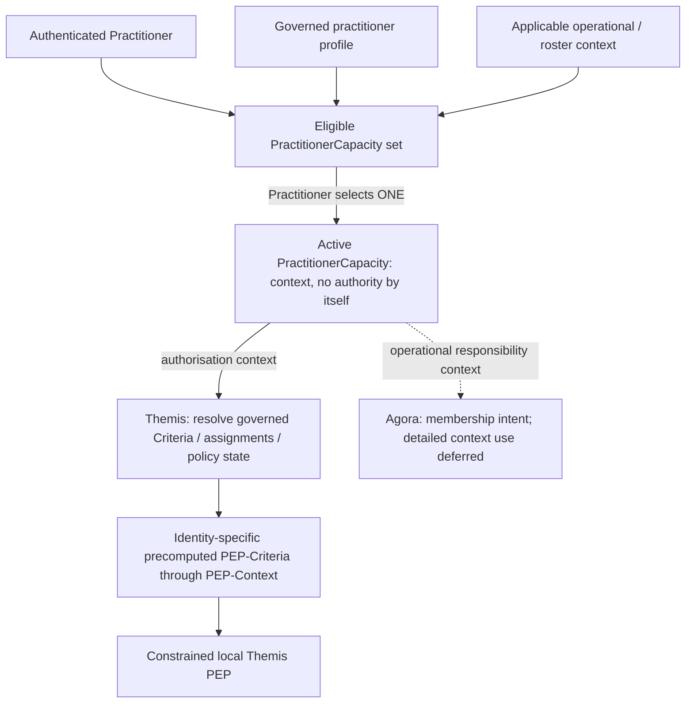

---
{
  "schemaVersion": 1,
  "canonicalId": "899d34ec491948b68aad09e507dea6d1",
  "archimateType": "ApplicationComponent",
  "specialization": null,
  "displayName": "Themis",
  "friendlyName": "Themis",
  "canonicalName": null,
  "standing": {
    "semantic": "Candidate — accepted Step-B baseline; final Solution Architecture unapproved",
    "currentness": "current",
    "qualification": "Exact source standing retained; migration/identity allocation does not approve architectural assertions."
  },
  "identity": {
    "allocation": "UUIDv4 allocated once under the explicit RAD-1.1.5 migration Task",
    "authority": "enterprise-architecture/design/evidence/1.1.5/002/before/ai-agent-tasks/20261021T092725Z-establish-and-apply-element-continuum.md",
    "sourceAbsenceCheck": "No existing governed canonical source binding for this bounded definition; no name-based correspondence adopted."
  },
  "naming": {
    "authority": "docs/markdown/governance/canonical-identity-and-naming.md",
    "mode": "Local lexical component; no root or containment completeness inferred",
    "expected": {
      "friendlyName": "Themis",
      "canonicalName": null
    }
  },
  "provenance": [
    {
      "source": "docs/markdown/05-information-systems-architecture/component-register.md",
      "selector": "### C02 — Themis",
      "role": "ingested architectural definition or explicit source contribution",
      "revision": "aadcd55252fa7965be8a4321832ecc6d5b97c6e0",
      "sha256": "7f493dae1db3e77fe0342f7c21501763a4af2b4de9c59871a109626eaaad5aa0",
      "standing": "Candidate — accepted Step-B baseline; final Solution Architecture unapproved"
    },
    {
      "source": "docs/markdown/05-information-systems-architecture/candidate-feature-map.md",
      "selector": "table assertion: | F03 | Identity authentication integration; Authorisation Model administration, resolution and distributed enforcement | [Authentication SEP](component-register.md#identity-authentication), external OIDC/OAuth IdP; [Themis C02](component-register.md#c02) owns PAP/PRP/PDP/PEP, governed management/approval through Ergo/Praxis, human interaction through Iris | Conjunctive Criterion; additive collections/AuthorisationRoles/direct grants; PractitionerCapacity context; Identity-specific precomputed PEP-Criteria through PEP-Context | U08/U12, AX-04/07/14/17/18. Keycloak + PostgreSQL default development/test/POC IdP, no product-specific dependency. Deterministic local PEP; no matching effective Criterion means DENY; no negative Criteria. Valid-context PDP-loss behaviour retained; forwarding subject to FORWARD with originating/acting provenance. Themis deferrals CDG-42; U15 resolves Kleio mandatory capture under governed intrinsic platform authority. |",
      "role": "ingested architectural definition or explicit source contribution",
      "revision": "aadcd55252fa7965be8a4321832ecc6d5b97c6e0",
      "sha256": "0585ca8887145ca21832bf1fcbf0f1829d1201251c7d7f68055b116bdf4afaab",
      "standing": "Candidate — adjudicated Domain05 Step-B baseline; final Solution Architecture unapproved"
    },
    {
      "source": "docs/markdown/05-information-systems-architecture/data-and-persistence.md",
      "selector": "table assertion: | D03 | Themis Authorisation Model: Criterion, nested collections, AuthorisationRole, direct/role assignments, temporal validity and distinct revocation; authenticated Identity, PractitionerCapacity, PEP-Criteria / PEP-Context and decisions | External IdP authenticates; Calliope governs nomenclature. Themis PAP/PRP/PDP owns model, resolution/compilation and derivation provenance; Themis local PEP enforces. Ergo/Praxis governs administration, Iris presents | PRP persisted through Mneme → Mnemosyne C&G; model ownership remains Themis. PEP-Criteria is precomputed and Identity-specific; operational context is not automatically persisted resource content. Significant occurrences use Kleio under policy | U08/U12, AX-04/05/07/14/17. Criterion dimensions AND; grants UNION; no explicit negative Criteria. No historical carrier or final schema inferred. Temporal validity/revocation distinct; forwarding preserves originating/acting Identity. Themis deferrals [CDG-42](gaps.md#themis-detailed-contracts). |",
      "role": "ingested architectural definition or explicit source contribution",
      "revision": "aadcd55252fa7965be8a4321832ecc6d5b97c6e0",
      "sha256": "8f1b4222a8e1303001235366a17de7555e56141711d5599c6851a7d865cb2dcd",
      "standing": "Candidate — adjudicated Domain05 Step-B baseline; final Solution Architecture unapproved"
    },
    {
      "source": "docs/markdown/05-information-systems-architecture/middleware.md",
      "selector": "table assertion: | M07 | **Themis constrained distributed enforcement and Kleio Audit Capture** | External OIDC/OAuth authentication establishes trusted Identity (SEP). Themis resolves authoritative Criteria/collections/direct and AuthorisationRole assignments, temporal constraints and applicable PractitionerCapacity into precomputed Identity-specific PEP-Criteria through PEP-Context; local Themis PEP enforces at action-controlling host. Kleio constructs immutable AuditEvent from significant client occurrences | U07/U08/U12, AX-04/07–09/14. Conjunctive Criterion, additive UNION grants, no negative Criteria or general-purpose interpreter. Valid sufficient context may continue during PDP loss; required new context waits, unavailability is not DENY. Untagged information governed/fail-closed. Required durable audit capture and Dokimasia terminal rules retained; CDG-42/43. |",
      "role": "ingested architectural definition or explicit source contribution",
      "revision": "aadcd55252fa7965be8a4321832ecc6d5b97c6e0",
      "sha256": "7ee1a4ab1c24abcb052daa5f0392270a8dc4997dd4083db8fea19736bc363213",
      "standing": "Candidate — adjudicated Domain05 Step-B baseline; final Solution Architecture unapproved"
    },
    {
      "source": "docs/markdown/05-information-systems-architecture/design-notes/DesignNote-Identity-Authentication-and-Authorisation-Architecture.md",
      "selector": "original lines 9-9",
      "revision": "aadcd55252fa7965be8a4321832ecc6d5b97c6e0",
      "role": "Exact DesignNote assertion contribution; source qualification retained",
      "authority": "enterprise-architecture/design/review/1.1.5/hcrl-1.1.5-002.pending.md#arb-semantic-reconciliation",
      "adjudication": "U12/U15/U16"
    },
    {
      "source": "docs/markdown/05-information-systems-architecture/design-notes/DesignNote-Identity-Authentication-and-Authorisation-Architecture.md",
      "selector": "original lines 11-11",
      "revision": "aadcd55252fa7965be8a4321832ecc6d5b97c6e0",
      "role": "Exact DesignNote assertion contribution; source qualification retained",
      "authority": "enterprise-architecture/design/review/1.1.5/hcrl-1.1.5-002.pending.md#arb-semantic-reconciliation",
      "adjudication": "U12/U15/U16"
    },
    {
      "source": "docs/markdown/05-information-systems-architecture/design-notes/DesignNote-Identity-Authentication-and-Authorisation-Architecture.md",
      "selector": "original lines 12-12",
      "revision": "aadcd55252fa7965be8a4321832ecc6d5b97c6e0",
      "role": "Exact DesignNote assertion contribution; source qualification retained",
      "authority": "enterprise-architecture/design/review/1.1.5/hcrl-1.1.5-002.pending.md#arb-semantic-reconciliation",
      "adjudication": "U12/U15/U16"
    },
    {
      "source": "docs/markdown/05-information-systems-architecture/design-notes/DesignNote-Identity-Authentication-and-Authorisation-Architecture.md",
      "selector": "original lines 13-13",
      "revision": "aadcd55252fa7965be8a4321832ecc6d5b97c6e0",
      "role": "Exact DesignNote assertion contribution; source qualification retained",
      "authority": "enterprise-architecture/design/review/1.1.5/hcrl-1.1.5-002.pending.md#arb-semantic-reconciliation",
      "adjudication": "U12/U15/U16"
    },
    {
      "source": "docs/markdown/05-information-systems-architecture/design-notes/DesignNote-Identity-Authentication-and-Authorisation-Architecture.md",
      "selector": "original lines 14-14",
      "revision": "aadcd55252fa7965be8a4321832ecc6d5b97c6e0",
      "role": "Exact DesignNote assertion contribution; source qualification retained",
      "authority": "enterprise-architecture/design/review/1.1.5/hcrl-1.1.5-002.pending.md#arb-semantic-reconciliation",
      "adjudication": "U12/U15/U16"
    },
    {
      "source": "docs/markdown/05-information-systems-architecture/design-notes/DesignNote-Identity-Authentication-and-Authorisation-Architecture.md",
      "selector": "original lines 15-15",
      "revision": "aadcd55252fa7965be8a4321832ecc6d5b97c6e0",
      "role": "Exact DesignNote assertion contribution; source qualification retained",
      "authority": "enterprise-architecture/design/review/1.1.5/hcrl-1.1.5-002.pending.md#arb-semantic-reconciliation",
      "adjudication": "U12/U15/U16"
    },
    {
      "source": "docs/markdown/05-information-systems-architecture/design-notes/DesignNote-Identity-Authentication-and-Authorisation-Architecture.md",
      "selector": "original lines 16-16",
      "revision": "aadcd55252fa7965be8a4321832ecc6d5b97c6e0",
      "role": "Exact DesignNote assertion contribution; source qualification retained",
      "authority": "enterprise-architecture/design/review/1.1.5/hcrl-1.1.5-002.pending.md#arb-semantic-reconciliation",
      "adjudication": "U12/U15/U16"
    },
    {
      "source": "docs/markdown/05-information-systems-architecture/design-notes/DesignNote-Identity-Authentication-and-Authorisation-Architecture.md",
      "selector": "original lines 17-17",
      "revision": "aadcd55252fa7965be8a4321832ecc6d5b97c6e0",
      "role": "Exact DesignNote assertion contribution; source qualification retained",
      "authority": "enterprise-architecture/design/review/1.1.5/hcrl-1.1.5-002.pending.md#arb-semantic-reconciliation",
      "adjudication": "U12/U15/U16"
    },
    {
      "source": "docs/markdown/05-information-systems-architecture/design-notes/DesignNote-Identity-Authentication-and-Authorisation-Architecture.md",
      "selector": "original lines 18-18",
      "revision": "aadcd55252fa7965be8a4321832ecc6d5b97c6e0",
      "role": "Exact DesignNote assertion contribution; source qualification retained",
      "authority": "enterprise-architecture/design/review/1.1.5/hcrl-1.1.5-002.pending.md#arb-semantic-reconciliation",
      "adjudication": "U12/U15/U16"
    },
    {
      "source": "docs/markdown/05-information-systems-architecture/design-notes/DesignNote-Identity-Authentication-and-Authorisation-Architecture.md",
      "selector": "original lines 19-19",
      "revision": "aadcd55252fa7965be8a4321832ecc6d5b97c6e0",
      "role": "Exact DesignNote assertion contribution; source qualification retained",
      "authority": "enterprise-architecture/design/review/1.1.5/hcrl-1.1.5-002.pending.md#arb-semantic-reconciliation",
      "adjudication": "U12/U15/U16"
    },
    {
      "source": "docs/markdown/05-information-systems-architecture/design-notes/DesignNote-Identity-Authentication-and-Authorisation-Architecture.md",
      "selector": "original lines 20-20",
      "revision": "aadcd55252fa7965be8a4321832ecc6d5b97c6e0",
      "role": "Exact DesignNote assertion contribution; source qualification retained",
      "authority": "enterprise-architecture/design/review/1.1.5/hcrl-1.1.5-002.pending.md#arb-semantic-reconciliation",
      "adjudication": "U12/U15/U16"
    },
    {
      "source": "docs/markdown/05-information-systems-architecture/design-notes/DesignNote-Identity-Authentication-and-Authorisation-Architecture.md",
      "selector": "original lines 21-21",
      "revision": "aadcd55252fa7965be8a4321832ecc6d5b97c6e0",
      "role": "Exact DesignNote assertion contribution; source qualification retained",
      "authority": "enterprise-architecture/design/review/1.1.5/hcrl-1.1.5-002.pending.md#arb-semantic-reconciliation",
      "adjudication": "U12/U15/U16"
    },
    {
      "source": "docs/markdown/05-information-systems-architecture/design-notes/DesignNote-Identity-Authentication-and-Authorisation-Architecture.md",
      "selector": "original lines 27-27",
      "revision": "aadcd55252fa7965be8a4321832ecc6d5b97c6e0",
      "role": "Exact DesignNote assertion contribution; source qualification retained",
      "authority": "enterprise-architecture/design/review/1.1.5/hcrl-1.1.5-002.pending.md#arb-semantic-reconciliation",
      "adjudication": "U12/U15/U16"
    },
    {
      "source": "docs/markdown/05-information-systems-architecture/design-notes/DesignNote-Identity-Authentication-and-Authorisation-Architecture.md",
      "selector": "original lines 31-31",
      "revision": "aadcd55252fa7965be8a4321832ecc6d5b97c6e0",
      "role": "Exact DesignNote assertion contribution; source qualification retained",
      "authority": "enterprise-architecture/design/review/1.1.5/hcrl-1.1.5-002.pending.md#arb-semantic-reconciliation",
      "adjudication": "U12/U15/U16"
    },
    {
      "source": "docs/markdown/05-information-systems-architecture/design-notes/DesignNote-Identity-Authentication-and-Authorisation-Architecture.md",
      "selector": "original lines 33-33",
      "revision": "aadcd55252fa7965be8a4321832ecc6d5b97c6e0",
      "role": "Exact DesignNote assertion contribution; source qualification retained",
      "authority": "enterprise-architecture/design/review/1.1.5/hcrl-1.1.5-002.pending.md#arb-semantic-reconciliation",
      "adjudication": "U12/U15/U16"
    },
    {
      "source": "docs/markdown/05-information-systems-architecture/design-notes/DesignNote-Identity-Authentication-and-Authorisation-Architecture.md",
      "selector": "original lines 35-35",
      "revision": "aadcd55252fa7965be8a4321832ecc6d5b97c6e0",
      "role": "Exact DesignNote assertion contribution; source qualification retained",
      "authority": "enterprise-architecture/design/review/1.1.5/hcrl-1.1.5-002.pending.md#arb-semantic-reconciliation",
      "adjudication": "U12/U15/U16"
    },
    {
      "source": "docs/markdown/05-information-systems-architecture/design-notes/DesignNote-Identity-Authentication-and-Authorisation-Architecture.md",
      "selector": "original lines 37-37",
      "revision": "aadcd55252fa7965be8a4321832ecc6d5b97c6e0",
      "role": "Exact DesignNote assertion contribution; source qualification retained",
      "authority": "enterprise-architecture/design/review/1.1.5/hcrl-1.1.5-002.pending.md#arb-semantic-reconciliation",
      "adjudication": "U12/U15/U16"
    },
    {
      "source": "docs/markdown/05-information-systems-architecture/design-notes/DesignNote-Identity-Authentication-and-Authorisation-Architecture.md",
      "selector": "original lines 41-41",
      "revision": "aadcd55252fa7965be8a4321832ecc6d5b97c6e0",
      "role": "Exact DesignNote assertion contribution; source qualification retained",
      "authority": "enterprise-architecture/design/review/1.1.5/hcrl-1.1.5-002.pending.md#arb-semantic-reconciliation",
      "adjudication": "U12/U15/U16"
    },
    {
      "source": "docs/markdown/05-information-systems-architecture/design-notes/DesignNote-Identity-Authentication-and-Authorisation-Architecture.md",
      "selector": "original lines 43-43",
      "revision": "aadcd55252fa7965be8a4321832ecc6d5b97c6e0",
      "role": "Exact DesignNote assertion contribution; source qualification retained",
      "authority": "enterprise-architecture/design/review/1.1.5/hcrl-1.1.5-002.pending.md#arb-semantic-reconciliation",
      "adjudication": "U12/U15/U16"
    },
    {
      "source": "docs/markdown/05-information-systems-architecture/design-notes/DesignNote-Identity-Authentication-and-Authorisation-Architecture.md",
      "selector": "original lines 47-47",
      "revision": "aadcd55252fa7965be8a4321832ecc6d5b97c6e0",
      "role": "Exact DesignNote assertion contribution; source qualification retained",
      "authority": "enterprise-architecture/design/review/1.1.5/hcrl-1.1.5-002.pending.md#arb-semantic-reconciliation",
      "adjudication": "U12/U15/U16"
    },
    {
      "source": "docs/markdown/05-information-systems-architecture/design-notes/DesignNote-Identity-Authentication-and-Authorisation-Architecture.md",
      "selector": "original lines 49-49",
      "revision": "aadcd55252fa7965be8a4321832ecc6d5b97c6e0",
      "role": "Exact DesignNote assertion contribution; source qualification retained",
      "authority": "enterprise-architecture/design/review/1.1.5/hcrl-1.1.5-002.pending.md#arb-semantic-reconciliation",
      "adjudication": "U12/U15/U16"
    },
    {
      "source": "docs/markdown/05-information-systems-architecture/design-notes/DesignNote-Identity-Authentication-and-Authorisation-Architecture.md",
      "selector": "original lines 51-51",
      "revision": "aadcd55252fa7965be8a4321832ecc6d5b97c6e0",
      "role": "Exact DesignNote assertion contribution; source qualification retained",
      "authority": "enterprise-architecture/design/review/1.1.5/hcrl-1.1.5-002.pending.md#arb-semantic-reconciliation",
      "adjudication": "U12/U15/U16"
    },
    {
      "source": "docs/markdown/05-information-systems-architecture/design-notes/DesignNote-Identity-Authentication-and-Authorisation-Architecture.md",
      "selector": "original lines 55-55",
      "revision": "aadcd55252fa7965be8a4321832ecc6d5b97c6e0",
      "role": "Exact DesignNote assertion contribution; source qualification retained",
      "authority": "enterprise-architecture/design/review/1.1.5/hcrl-1.1.5-002.pending.md#arb-semantic-reconciliation",
      "adjudication": "U12/U15/U16"
    },
    {
      "source": "docs/markdown/05-information-systems-architecture/design-notes/DesignNote-Identity-Authentication-and-Authorisation-Architecture.md",
      "selector": "original lines 59-59",
      "revision": "aadcd55252fa7965be8a4321832ecc6d5b97c6e0",
      "role": "Exact DesignNote assertion contribution; source qualification retained",
      "authority": "enterprise-architecture/design/review/1.1.5/hcrl-1.1.5-002.pending.md#arb-semantic-reconciliation",
      "adjudication": "U12/U15/U16"
    },
    {
      "source": "docs/markdown/05-information-systems-architecture/design-notes/DesignNote-Identity-Authentication-and-Authorisation-Architecture.md",
      "selector": "original lines 65-65",
      "revision": "aadcd55252fa7965be8a4321832ecc6d5b97c6e0",
      "role": "Exact DesignNote assertion contribution; source qualification retained",
      "authority": "enterprise-architecture/design/review/1.1.5/hcrl-1.1.5-002.pending.md#arb-semantic-reconciliation",
      "adjudication": "U12/U15/U16"
    },
    {
      "source": "docs/markdown/05-information-systems-architecture/design-notes/DesignNote-Identity-Authentication-and-Authorisation-Architecture.md",
      "selector": "original lines 67-67",
      "revision": "aadcd55252fa7965be8a4321832ecc6d5b97c6e0",
      "role": "Exact DesignNote assertion contribution; source qualification retained",
      "authority": "enterprise-architecture/design/review/1.1.5/hcrl-1.1.5-002.pending.md#arb-semantic-reconciliation",
      "adjudication": "U12/U15/U16"
    },
    {
      "source": "docs/markdown/05-information-systems-architecture/design-notes/DesignNote-Identity-Authentication-and-Authorisation-Architecture.md",
      "selector": "original lines 69-69",
      "revision": "aadcd55252fa7965be8a4321832ecc6d5b97c6e0",
      "role": "Exact DesignNote assertion contribution; source qualification retained",
      "authority": "enterprise-architecture/design/review/1.1.5/hcrl-1.1.5-002.pending.md#arb-semantic-reconciliation",
      "adjudication": "U12/U15/U16"
    },
    {
      "source": "docs/markdown/05-information-systems-architecture/design-notes/DesignNote-Identity-Authentication-and-Authorisation-Architecture.md",
      "selector": "original lines 70-70",
      "revision": "aadcd55252fa7965be8a4321832ecc6d5b97c6e0",
      "role": "Exact DesignNote assertion contribution; source qualification retained",
      "authority": "enterprise-architecture/design/review/1.1.5/hcrl-1.1.5-002.pending.md#arb-semantic-reconciliation",
      "adjudication": "U12/U15/U16"
    },
    {
      "source": "docs/markdown/05-information-systems-architecture/design-notes/DesignNote-Identity-Authentication-and-Authorisation-Architecture.md",
      "selector": "original lines 71-71",
      "revision": "aadcd55252fa7965be8a4321832ecc6d5b97c6e0",
      "role": "Exact DesignNote assertion contribution; source qualification retained",
      "authority": "enterprise-architecture/design/review/1.1.5/hcrl-1.1.5-002.pending.md#arb-semantic-reconciliation",
      "adjudication": "U12/U15/U16"
    },
    {
      "source": "docs/markdown/05-information-systems-architecture/design-notes/DesignNote-Identity-Authentication-and-Authorisation-Architecture.md",
      "selector": "original lines 73-73",
      "revision": "aadcd55252fa7965be8a4321832ecc6d5b97c6e0",
      "role": "Exact DesignNote assertion contribution; source qualification retained",
      "authority": "enterprise-architecture/design/review/1.1.5/hcrl-1.1.5-002.pending.md#arb-semantic-reconciliation",
      "adjudication": "U12/U15/U16"
    },
    {
      "source": "docs/markdown/05-information-systems-architecture/design-notes/DesignNote-Identity-Authentication-and-Authorisation-Architecture.md",
      "selector": "original lines 77-77",
      "revision": "aadcd55252fa7965be8a4321832ecc6d5b97c6e0",
      "role": "Exact DesignNote assertion contribution; source qualification retained",
      "authority": "enterprise-architecture/design/review/1.1.5/hcrl-1.1.5-002.pending.md#arb-semantic-reconciliation",
      "adjudication": "U12/U15/U16"
    },
    {
      "source": "docs/markdown/05-information-systems-architecture/design-notes/DesignNote-Identity-Authentication-and-Authorisation-Architecture.md",
      "selector": "original lines 79-79",
      "revision": "aadcd55252fa7965be8a4321832ecc6d5b97c6e0",
      "role": "Exact DesignNote assertion contribution; source qualification retained",
      "authority": "enterprise-architecture/design/review/1.1.5/hcrl-1.1.5-002.pending.md#arb-semantic-reconciliation",
      "adjudication": "U12/U15/U16"
    },
    {
      "source": "docs/markdown/05-information-systems-architecture/design-notes/DesignNote-Identity-Authentication-and-Authorisation-Architecture.md",
      "selector": "original lines 81-81",
      "revision": "aadcd55252fa7965be8a4321832ecc6d5b97c6e0",
      "role": "Exact DesignNote assertion contribution; source qualification retained",
      "authority": "enterprise-architecture/design/review/1.1.5/hcrl-1.1.5-002.pending.md#arb-semantic-reconciliation",
      "adjudication": "U12/U15/U16"
    },
    {
      "source": "docs/markdown/05-information-systems-architecture/design-notes/DesignNote-Identity-Authentication-and-Authorisation-Architecture.md",
      "selector": "original lines 85-85",
      "revision": "aadcd55252fa7965be8a4321832ecc6d5b97c6e0",
      "role": "Exact DesignNote assertion contribution; source qualification retained",
      "authority": "enterprise-architecture/design/review/1.1.5/hcrl-1.1.5-002.pending.md#arb-semantic-reconciliation",
      "adjudication": "U12/U15/U16"
    },
    {
      "source": "docs/markdown/05-information-systems-architecture/design-notes/DesignNote-Identity-Authentication-and-Authorisation-Architecture.md",
      "selector": "original lines 89-89",
      "revision": "aadcd55252fa7965be8a4321832ecc6d5b97c6e0",
      "role": "Exact DesignNote assertion contribution; source qualification retained",
      "authority": "enterprise-architecture/design/review/1.1.5/hcrl-1.1.5-002.pending.md#arb-semantic-reconciliation",
      "adjudication": "U12/U15/U16"
    },
    {
      "source": "docs/markdown/05-information-systems-architecture/design-notes/DesignNote-Identity-Authentication-and-Authorisation-Architecture.md",
      "selector": "original lines 91-91",
      "revision": "aadcd55252fa7965be8a4321832ecc6d5b97c6e0",
      "role": "Exact DesignNote assertion contribution; source qualification retained",
      "authority": "enterprise-architecture/design/review/1.1.5/hcrl-1.1.5-002.pending.md#arb-semantic-reconciliation",
      "adjudication": "U12/U15/U16"
    },
    {
      "source": "docs/markdown/05-information-systems-architecture/design-notes/DesignNote-Identity-Authentication-and-Authorisation-Architecture.md",
      "selector": "original lines 95-95",
      "revision": "aadcd55252fa7965be8a4321832ecc6d5b97c6e0",
      "role": "Exact DesignNote assertion contribution; source qualification retained",
      "authority": "enterprise-architecture/design/review/1.1.5/hcrl-1.1.5-002.pending.md#arb-semantic-reconciliation",
      "adjudication": "U12/U15/U16"
    },
    {
      "source": "docs/markdown/05-information-systems-architecture/design-notes/DesignNote-Identity-Authentication-and-Authorisation-Architecture.md",
      "selector": "original lines 99-104",
      "revision": "aadcd55252fa7965be8a4321832ecc6d5b97c6e0",
      "role": "Exact DesignNote assertion contribution; source qualification retained",
      "authority": "enterprise-architecture/design/review/1.1.5/hcrl-1.1.5-002.pending.md#arb-semantic-reconciliation",
      "adjudication": "U12/U15/U16"
    },
    {
      "source": "docs/markdown/05-information-systems-architecture/design-notes/DesignNote-Identity-Authentication-and-Authorisation-Architecture.md",
      "selector": "original lines 106-106",
      "revision": "aadcd55252fa7965be8a4321832ecc6d5b97c6e0",
      "role": "Exact DesignNote assertion contribution; source qualification retained",
      "authority": "enterprise-architecture/design/review/1.1.5/hcrl-1.1.5-002.pending.md#arb-semantic-reconciliation",
      "adjudication": "U12/U15/U16"
    },
    {
      "source": "docs/markdown/05-information-systems-architecture/design-notes/DesignNote-Identity-Authentication-and-Authorisation-Architecture.md",
      "selector": "original lines 108-108",
      "revision": "aadcd55252fa7965be8a4321832ecc6d5b97c6e0",
      "role": "Exact DesignNote assertion contribution; source qualification retained",
      "authority": "enterprise-architecture/design/review/1.1.5/hcrl-1.1.5-002.pending.md#arb-semantic-reconciliation",
      "adjudication": "U12/U15/U16"
    },
    {
      "source": "docs/markdown/05-information-systems-architecture/design-notes/DesignNote-Identity-Authentication-and-Authorisation-Architecture.md",
      "selector": "original lines 110-110",
      "revision": "aadcd55252fa7965be8a4321832ecc6d5b97c6e0",
      "role": "Exact DesignNote assertion contribution; source qualification retained",
      "authority": "enterprise-architecture/design/review/1.1.5/hcrl-1.1.5-002.pending.md#arb-semantic-reconciliation",
      "adjudication": "U12/U15/U16"
    },
    {
      "source": "docs/markdown/05-information-systems-architecture/design-notes/DesignNote-Identity-Authentication-and-Authorisation-Architecture.md",
      "selector": "original lines 112-112",
      "revision": "aadcd55252fa7965be8a4321832ecc6d5b97c6e0",
      "role": "Exact DesignNote assertion contribution; source qualification retained",
      "authority": "enterprise-architecture/design/review/1.1.5/hcrl-1.1.5-002.pending.md#arb-semantic-reconciliation",
      "adjudication": "U12/U15/U16"
    },
    {
      "source": "docs/markdown/05-information-systems-architecture/design-notes/DesignNote-Identity-Authentication-and-Authorisation-Architecture.md",
      "selector": "original lines 118-118",
      "revision": "aadcd55252fa7965be8a4321832ecc6d5b97c6e0",
      "role": "Exact DesignNote assertion contribution; source qualification retained",
      "authority": "enterprise-architecture/design/review/1.1.5/hcrl-1.1.5-002.pending.md#arb-semantic-reconciliation",
      "adjudication": "U12/U15/U16"
    },
    {
      "source": "docs/markdown/05-information-systems-architecture/design-notes/DesignNote-Identity-Authentication-and-Authorisation-Architecture.md",
      "selector": "original lines 122-127",
      "revision": "aadcd55252fa7965be8a4321832ecc6d5b97c6e0",
      "role": "Exact DesignNote assertion contribution; source qualification retained",
      "authority": "enterprise-architecture/design/review/1.1.5/hcrl-1.1.5-002.pending.md#arb-semantic-reconciliation",
      "adjudication": "U12/U15/U16"
    },
    {
      "source": "docs/markdown/05-information-systems-architecture/design-notes/DesignNote-Identity-Authentication-and-Authorisation-Architecture.md",
      "selector": "original lines 129-129",
      "revision": "aadcd55252fa7965be8a4321832ecc6d5b97c6e0",
      "role": "Exact DesignNote assertion contribution; source qualification retained",
      "authority": "enterprise-architecture/design/review/1.1.5/hcrl-1.1.5-002.pending.md#arb-semantic-reconciliation",
      "adjudication": "U12/U15/U16"
    },
    {
      "source": "docs/markdown/05-information-systems-architecture/design-notes/DesignNote-Identity-Authentication-and-Authorisation-Architecture.md",
      "selector": "original lines 131-131",
      "revision": "aadcd55252fa7965be8a4321832ecc6d5b97c6e0",
      "role": "Exact DesignNote assertion contribution; source qualification retained",
      "authority": "enterprise-architecture/design/review/1.1.5/hcrl-1.1.5-002.pending.md#arb-semantic-reconciliation",
      "adjudication": "U12/U15/U16"
    },
    {
      "source": "docs/markdown/05-information-systems-architecture/design-notes/DesignNote-Identity-Authentication-and-Authorisation-Architecture.md",
      "selector": "original lines 137-137",
      "revision": "aadcd55252fa7965be8a4321832ecc6d5b97c6e0",
      "role": "Exact DesignNote assertion contribution; source qualification retained",
      "authority": "enterprise-architecture/design/review/1.1.5/hcrl-1.1.5-002.pending.md#arb-semantic-reconciliation",
      "adjudication": "U12/U15/U16"
    },
    {
      "source": "docs/markdown/05-information-systems-architecture/design-notes/DesignNote-Identity-Authentication-and-Authorisation-Architecture.md",
      "selector": "original lines 139-139",
      "revision": "aadcd55252fa7965be8a4321832ecc6d5b97c6e0",
      "role": "Exact DesignNote assertion contribution; source qualification retained",
      "authority": "enterprise-architecture/design/review/1.1.5/hcrl-1.1.5-002.pending.md#arb-semantic-reconciliation",
      "adjudication": "U12/U15/U16"
    },
    {
      "source": "docs/markdown/05-information-systems-architecture/design-notes/DesignNote-Identity-Authentication-and-Authorisation-Architecture.md",
      "selector": "original lines 141-141",
      "revision": "aadcd55252fa7965be8a4321832ecc6d5b97c6e0",
      "role": "Exact DesignNote assertion contribution; source qualification retained",
      "authority": "enterprise-architecture/design/review/1.1.5/hcrl-1.1.5-002.pending.md#arb-semantic-reconciliation",
      "adjudication": "U12/U15/U16"
    },
    {
      "source": "docs/markdown/05-information-systems-architecture/design-notes/DesignNote-Identity-Authentication-and-Authorisation-Architecture.md",
      "selector": "original lines 145-146",
      "revision": "aadcd55252fa7965be8a4321832ecc6d5b97c6e0",
      "role": "Exact DesignNote assertion contribution; source qualification retained",
      "authority": "enterprise-architecture/design/review/1.1.5/hcrl-1.1.5-002.pending.md#arb-semantic-reconciliation",
      "adjudication": "U12/U15/U16"
    },
    {
      "source": "docs/markdown/05-information-systems-architecture/design-notes/DesignNote-Identity-Authentication-and-Authorisation-Architecture.md",
      "selector": "original lines 150-150",
      "revision": "aadcd55252fa7965be8a4321832ecc6d5b97c6e0",
      "role": "Exact DesignNote assertion contribution; source qualification retained",
      "authority": "enterprise-architecture/design/review/1.1.5/hcrl-1.1.5-002.pending.md#arb-semantic-reconciliation",
      "adjudication": "U12/U15/U16"
    },
    {
      "source": "docs/markdown/05-information-systems-architecture/design-notes/DesignNote-Identity-Authentication-and-Authorisation-Architecture.md",
      "selector": "original lines 154-154",
      "revision": "aadcd55252fa7965be8a4321832ecc6d5b97c6e0",
      "role": "Exact DesignNote assertion contribution; source qualification retained",
      "authority": "enterprise-architecture/design/review/1.1.5/hcrl-1.1.5-002.pending.md#arb-semantic-reconciliation",
      "adjudication": "U12/U15/U16"
    },
    {
      "source": "docs/markdown/05-information-systems-architecture/design-notes/DesignNote-Identity-Authentication-and-Authorisation-Architecture.md",
      "selector": "original lines 155-155",
      "revision": "aadcd55252fa7965be8a4321832ecc6d5b97c6e0",
      "role": "Exact DesignNote assertion contribution; source qualification retained",
      "authority": "enterprise-architecture/design/review/1.1.5/hcrl-1.1.5-002.pending.md#arb-semantic-reconciliation",
      "adjudication": "U12/U15/U16"
    },
    {
      "source": "docs/markdown/05-information-systems-architecture/design-notes/DesignNote-Identity-Authentication-and-Authorisation-Architecture.md",
      "selector": "original lines 156-156",
      "revision": "aadcd55252fa7965be8a4321832ecc6d5b97c6e0",
      "role": "Exact DesignNote assertion contribution; source qualification retained",
      "authority": "enterprise-architecture/design/review/1.1.5/hcrl-1.1.5-002.pending.md#arb-semantic-reconciliation",
      "adjudication": "U12/U15/U16"
    },
    {
      "source": "docs/markdown/05-information-systems-architecture/design-notes/DesignNote-Identity-Authentication-and-Authorisation-Architecture.md",
      "selector": "original lines 157-157",
      "revision": "aadcd55252fa7965be8a4321832ecc6d5b97c6e0",
      "role": "Exact DesignNote assertion contribution; source qualification retained",
      "authority": "enterprise-architecture/design/review/1.1.5/hcrl-1.1.5-002.pending.md#arb-semantic-reconciliation",
      "adjudication": "U12/U15/U16"
    },
    {
      "source": "docs/markdown/05-information-systems-architecture/design-notes/DesignNote-Identity-Authentication-and-Authorisation-Architecture.md",
      "selector": "original lines 159-159",
      "revision": "aadcd55252fa7965be8a4321832ecc6d5b97c6e0",
      "role": "Exact DesignNote assertion contribution; source qualification retained",
      "authority": "enterprise-architecture/design/review/1.1.5/hcrl-1.1.5-002.pending.md#arb-semantic-reconciliation",
      "adjudication": "U12/U15/U16"
    },
    {
      "source": "docs/markdown/05-information-systems-architecture/design-notes/DesignNote-Identity-Authentication-and-Authorisation-Architecture.md",
      "selector": "original lines 161-166",
      "revision": "aadcd55252fa7965be8a4321832ecc6d5b97c6e0",
      "role": "Exact DesignNote assertion contribution; source qualification retained",
      "authority": "enterprise-architecture/design/review/1.1.5/hcrl-1.1.5-002.pending.md#arb-semantic-reconciliation",
      "adjudication": "U12/U15/U16"
    },
    {
      "source": "docs/markdown/05-information-systems-architecture/design-notes/DesignNote-Identity-Authentication-and-Authorisation-Architecture.md",
      "selector": "original lines 168-168",
      "revision": "aadcd55252fa7965be8a4321832ecc6d5b97c6e0",
      "role": "Exact DesignNote assertion contribution; source qualification retained",
      "authority": "enterprise-architecture/design/review/1.1.5/hcrl-1.1.5-002.pending.md#arb-semantic-reconciliation",
      "adjudication": "U12/U15/U16"
    },
    {
      "source": "docs/markdown/05-information-systems-architecture/design-notes/DesignNote-Identity-Authentication-and-Authorisation-Architecture.md",
      "selector": "original lines 170-170",
      "revision": "aadcd55252fa7965be8a4321832ecc6d5b97c6e0",
      "role": "Exact DesignNote assertion contribution; source qualification retained",
      "authority": "enterprise-architecture/design/review/1.1.5/hcrl-1.1.5-002.pending.md#arb-semantic-reconciliation",
      "adjudication": "U12/U15/U16"
    },
    {
      "source": "docs/markdown/05-information-systems-architecture/design-notes/DesignNote-Identity-Authentication-and-Authorisation-Architecture.md",
      "selector": "original lines 174-174",
      "revision": "aadcd55252fa7965be8a4321832ecc6d5b97c6e0",
      "role": "Exact DesignNote assertion contribution; source qualification retained",
      "authority": "enterprise-architecture/design/review/1.1.5/hcrl-1.1.5-002.pending.md#arb-semantic-reconciliation",
      "adjudication": "U12/U15/U16"
    },
    {
      "source": "docs/markdown/05-information-systems-architecture/design-notes/DesignNote-Identity-Authentication-and-Authorisation-Architecture.md",
      "selector": "original lines 178-178",
      "revision": "aadcd55252fa7965be8a4321832ecc6d5b97c6e0",
      "role": "Exact DesignNote assertion contribution; source qualification retained",
      "authority": "enterprise-architecture/design/review/1.1.5/hcrl-1.1.5-002.pending.md#arb-semantic-reconciliation",
      "adjudication": "U12/U15/U16"
    },
    {
      "source": "docs/markdown/05-information-systems-architecture/design-notes/DesignNote-Identity-Authentication-and-Authorisation-Architecture.md",
      "selector": "original lines 180-180",
      "revision": "aadcd55252fa7965be8a4321832ecc6d5b97c6e0",
      "role": "Exact DesignNote assertion contribution; source qualification retained",
      "authority": "enterprise-architecture/design/review/1.1.5/hcrl-1.1.5-002.pending.md#arb-semantic-reconciliation",
      "adjudication": "U12/U15/U16"
    },
    {
      "source": "docs/markdown/05-information-systems-architecture/design-notes/DesignNote-Identity-Authentication-and-Authorisation-Architecture.md",
      "selector": "original lines 181-181",
      "revision": "aadcd55252fa7965be8a4321832ecc6d5b97c6e0",
      "role": "Exact DesignNote assertion contribution; source qualification retained",
      "authority": "enterprise-architecture/design/review/1.1.5/hcrl-1.1.5-002.pending.md#arb-semantic-reconciliation",
      "adjudication": "U12/U15/U16"
    },
    {
      "source": "docs/markdown/05-information-systems-architecture/design-notes/DesignNote-Identity-Authentication-and-Authorisation-Architecture.md",
      "selector": "original lines 182-182",
      "revision": "aadcd55252fa7965be8a4321832ecc6d5b97c6e0",
      "role": "Exact DesignNote assertion contribution; source qualification retained",
      "authority": "enterprise-architecture/design/review/1.1.5/hcrl-1.1.5-002.pending.md#arb-semantic-reconciliation",
      "adjudication": "U12/U15/U16"
    },
    {
      "source": "docs/markdown/05-information-systems-architecture/design-notes/DesignNote-Identity-Authentication-and-Authorisation-Architecture.md",
      "selector": "original lines 183-183",
      "revision": "aadcd55252fa7965be8a4321832ecc6d5b97c6e0",
      "role": "Exact DesignNote assertion contribution; source qualification retained",
      "authority": "enterprise-architecture/design/review/1.1.5/hcrl-1.1.5-002.pending.md#arb-semantic-reconciliation",
      "adjudication": "U12/U15/U16"
    },
    {
      "source": "docs/markdown/05-information-systems-architecture/design-notes/DesignNote-Identity-Authentication-and-Authorisation-Architecture.md",
      "selector": "original lines 184-184",
      "revision": "aadcd55252fa7965be8a4321832ecc6d5b97c6e0",
      "role": "Exact DesignNote assertion contribution; source qualification retained",
      "authority": "enterprise-architecture/design/review/1.1.5/hcrl-1.1.5-002.pending.md#arb-semantic-reconciliation",
      "adjudication": "U12/U15/U16"
    },
    {
      "source": "docs/markdown/05-information-systems-architecture/design-notes/DesignNote-Identity-Authentication-and-Authorisation-Architecture.md",
      "selector": "original lines 190-190",
      "revision": "aadcd55252fa7965be8a4321832ecc6d5b97c6e0",
      "role": "Exact DesignNote assertion contribution; source qualification retained",
      "authority": "enterprise-architecture/design/review/1.1.5/hcrl-1.1.5-002.pending.md#arb-semantic-reconciliation",
      "adjudication": "U12/U15/U16"
    },
    {
      "source": "docs/markdown/05-information-systems-architecture/design-notes/DesignNote-Identity-Authentication-and-Authorisation-Architecture.md",
      "selector": "original lines 194-194",
      "revision": "aadcd55252fa7965be8a4321832ecc6d5b97c6e0",
      "role": "Exact DesignNote assertion contribution; source qualification retained",
      "authority": "enterprise-architecture/design/review/1.1.5/hcrl-1.1.5-002.pending.md#arb-semantic-reconciliation",
      "adjudication": "U12/U15/U16"
    },
    {
      "source": "docs/markdown/05-information-systems-architecture/design-notes/DesignNote-Identity-Authentication-and-Authorisation-Architecture.md",
      "selector": "original lines 198-198",
      "revision": "aadcd55252fa7965be8a4321832ecc6d5b97c6e0",
      "role": "Exact DesignNote assertion contribution; source qualification retained",
      "authority": "enterprise-architecture/design/review/1.1.5/hcrl-1.1.5-002.pending.md#arb-semantic-reconciliation",
      "adjudication": "U12/U15/U16"
    },
    {
      "source": "docs/markdown/05-information-systems-architecture/design-notes/DesignNote-Identity-Authentication-and-Authorisation-Architecture.md",
      "selector": "original lines 200-200",
      "revision": "aadcd55252fa7965be8a4321832ecc6d5b97c6e0",
      "role": "Exact DesignNote assertion contribution; source qualification retained",
      "authority": "enterprise-architecture/design/review/1.1.5/hcrl-1.1.5-002.pending.md#arb-semantic-reconciliation",
      "adjudication": "U12/U15/U16"
    },
    {
      "source": "docs/markdown/05-information-systems-architecture/design-notes/DesignNote-Identity-Authentication-and-Authorisation-Architecture.md",
      "selector": "original lines 202-202",
      "revision": "aadcd55252fa7965be8a4321832ecc6d5b97c6e0",
      "role": "Exact DesignNote assertion contribution; source qualification retained",
      "authority": "enterprise-architecture/design/review/1.1.5/hcrl-1.1.5-002.pending.md#arb-semantic-reconciliation",
      "adjudication": "U12/U15/U16"
    },
    {
      "source": "docs/markdown/05-information-systems-architecture/design-notes/DesignNote-Identity-Authentication-and-Authorisation-Architecture.md",
      "selector": "original lines 203-203",
      "revision": "aadcd55252fa7965be8a4321832ecc6d5b97c6e0",
      "role": "Exact DesignNote assertion contribution; source qualification retained",
      "authority": "enterprise-architecture/design/review/1.1.5/hcrl-1.1.5-002.pending.md#arb-semantic-reconciliation",
      "adjudication": "U12/U15/U16"
    },
    {
      "source": "docs/markdown/05-information-systems-architecture/design-notes/DesignNote-Identity-Authentication-and-Authorisation-Architecture.md",
      "selector": "original lines 204-204",
      "revision": "aadcd55252fa7965be8a4321832ecc6d5b97c6e0",
      "role": "Exact DesignNote assertion contribution; source qualification retained",
      "authority": "enterprise-architecture/design/review/1.1.5/hcrl-1.1.5-002.pending.md#arb-semantic-reconciliation",
      "adjudication": "U12/U15/U16"
    },
    {
      "source": "docs/markdown/05-information-systems-architecture/design-notes/DesignNote-Identity-Authentication-and-Authorisation-Architecture.md",
      "selector": "original lines 205-205",
      "revision": "aadcd55252fa7965be8a4321832ecc6d5b97c6e0",
      "role": "Exact DesignNote assertion contribution; source qualification retained",
      "authority": "enterprise-architecture/design/review/1.1.5/hcrl-1.1.5-002.pending.md#arb-semantic-reconciliation",
      "adjudication": "U12/U15/U16"
    },
    {
      "source": "docs/markdown/05-information-systems-architecture/design-notes/DesignNote-Identity-Authentication-and-Authorisation-Architecture.md",
      "selector": "original lines 206-206",
      "revision": "aadcd55252fa7965be8a4321832ecc6d5b97c6e0",
      "role": "Exact DesignNote assertion contribution; source qualification retained",
      "authority": "enterprise-architecture/design/review/1.1.5/hcrl-1.1.5-002.pending.md#arb-semantic-reconciliation",
      "adjudication": "U12/U15/U16"
    },
    {
      "source": "docs/markdown/05-information-systems-architecture/design-notes/DesignNote-Identity-Authentication-and-Authorisation-Architecture.md",
      "selector": "original lines 207-207",
      "revision": "aadcd55252fa7965be8a4321832ecc6d5b97c6e0",
      "role": "Exact DesignNote assertion contribution; source qualification retained",
      "authority": "enterprise-architecture/design/review/1.1.5/hcrl-1.1.5-002.pending.md#arb-semantic-reconciliation",
      "adjudication": "U12/U15/U16"
    },
    {
      "source": "docs/markdown/05-information-systems-architecture/design-notes/DesignNote-Identity-Authentication-and-Authorisation-Architecture.md",
      "selector": "original lines 208-208",
      "revision": "aadcd55252fa7965be8a4321832ecc6d5b97c6e0",
      "role": "Exact DesignNote assertion contribution; source qualification retained",
      "authority": "enterprise-architecture/design/review/1.1.5/hcrl-1.1.5-002.pending.md#arb-semantic-reconciliation",
      "adjudication": "U12/U15/U16"
    },
    {
      "source": "docs/markdown/05-information-systems-architecture/design-notes/DesignNote-Identity-Authentication-and-Authorisation-Architecture.md",
      "selector": "original lines 210-210",
      "revision": "aadcd55252fa7965be8a4321832ecc6d5b97c6e0",
      "role": "Exact DesignNote assertion contribution; source qualification retained",
      "authority": "enterprise-architecture/design/review/1.1.5/hcrl-1.1.5-002.pending.md#arb-semantic-reconciliation",
      "adjudication": "U12/U15/U16"
    },
    {
      "source": "docs/markdown/05-information-systems-architecture/design-notes/DesignNote-Identity-Authentication-and-Authorisation-Architecture.md",
      "selector": "original lines 212-212",
      "revision": "aadcd55252fa7965be8a4321832ecc6d5b97c6e0",
      "role": "Exact DesignNote assertion contribution; source qualification retained",
      "authority": "enterprise-architecture/design/review/1.1.5/hcrl-1.1.5-002.pending.md#arb-semantic-reconciliation",
      "adjudication": "U12/U15/U16"
    },
    {
      "source": "docs/markdown/05-information-systems-architecture/design-notes/DesignNote-Identity-Authentication-and-Authorisation-Architecture.md",
      "selector": "original lines 216-216",
      "revision": "aadcd55252fa7965be8a4321832ecc6d5b97c6e0",
      "role": "Exact DesignNote assertion contribution; source qualification retained",
      "authority": "enterprise-architecture/design/review/1.1.5/hcrl-1.1.5-002.pending.md#arb-semantic-reconciliation",
      "adjudication": "U12/U15/U16"
    },
    {
      "source": "docs/markdown/05-information-systems-architecture/design-notes/DesignNote-Identity-Authentication-and-Authorisation-Architecture.md",
      "selector": "original lines 217-217",
      "revision": "aadcd55252fa7965be8a4321832ecc6d5b97c6e0",
      "role": "Exact DesignNote assertion contribution; source qualification retained",
      "authority": "enterprise-architecture/design/review/1.1.5/hcrl-1.1.5-002.pending.md#arb-semantic-reconciliation",
      "adjudication": "U12/U15/U16"
    },
    {
      "source": "docs/markdown/05-information-systems-architecture/design-notes/DesignNote-Identity-Authentication-and-Authorisation-Architecture.md",
      "selector": "original lines 218-218",
      "revision": "aadcd55252fa7965be8a4321832ecc6d5b97c6e0",
      "role": "Exact DesignNote assertion contribution; source qualification retained",
      "authority": "enterprise-architecture/design/review/1.1.5/hcrl-1.1.5-002.pending.md#arb-semantic-reconciliation",
      "adjudication": "U12/U15/U16"
    },
    {
      "source": "docs/markdown/05-information-systems-architecture/design-notes/DesignNote-Identity-Authentication-and-Authorisation-Architecture.md",
      "selector": "original lines 219-219",
      "revision": "aadcd55252fa7965be8a4321832ecc6d5b97c6e0",
      "role": "Exact DesignNote assertion contribution; source qualification retained",
      "authority": "enterprise-architecture/design/review/1.1.5/hcrl-1.1.5-002.pending.md#arb-semantic-reconciliation",
      "adjudication": "U12/U15/U16"
    },
    {
      "source": "docs/markdown/05-information-systems-architecture/design-notes/DesignNote-Identity-Authentication-and-Authorisation-Architecture.md",
      "selector": "original lines 220-220",
      "revision": "aadcd55252fa7965be8a4321832ecc6d5b97c6e0",
      "role": "Exact DesignNote assertion contribution; source qualification retained",
      "authority": "enterprise-architecture/design/review/1.1.5/hcrl-1.1.5-002.pending.md#arb-semantic-reconciliation",
      "adjudication": "U12/U15/U16"
    },
    {
      "source": "docs/markdown/05-information-systems-architecture/design-notes/DesignNote-Identity-Authentication-and-Authorisation-Architecture.md",
      "selector": "original lines 221-221",
      "revision": "aadcd55252fa7965be8a4321832ecc6d5b97c6e0",
      "role": "Exact DesignNote assertion contribution; source qualification retained",
      "authority": "enterprise-architecture/design/review/1.1.5/hcrl-1.1.5-002.pending.md#arb-semantic-reconciliation",
      "adjudication": "U12/U15/U16"
    },
    {
      "source": "docs/markdown/05-information-systems-architecture/design-notes/DesignNote-Identity-Authentication-and-Authorisation-Architecture.md",
      "selector": "original lines 222-222",
      "revision": "aadcd55252fa7965be8a4321832ecc6d5b97c6e0",
      "role": "Exact DesignNote assertion contribution; source qualification retained",
      "authority": "enterprise-architecture/design/review/1.1.5/hcrl-1.1.5-002.pending.md#arb-semantic-reconciliation",
      "adjudication": "U12/U15/U16"
    },
    {
      "source": "docs/markdown/05-information-systems-architecture/design-notes/DesignNote-Identity-Authentication-and-Authorisation-Architecture.md",
      "selector": "original lines 223-223",
      "revision": "aadcd55252fa7965be8a4321832ecc6d5b97c6e0",
      "role": "Exact DesignNote assertion contribution; source qualification retained",
      "authority": "enterprise-architecture/design/review/1.1.5/hcrl-1.1.5-002.pending.md#arb-semantic-reconciliation",
      "adjudication": "U12/U15/U16"
    },
    {
      "source": "docs/markdown/05-information-systems-architecture/design-notes/DesignNote-Identity-Authentication-and-Authorisation-Architecture.md",
      "selector": "original lines 231-231",
      "revision": "aadcd55252fa7965be8a4321832ecc6d5b97c6e0",
      "role": "Exact DesignNote assertion contribution; source qualification retained",
      "authority": "enterprise-architecture/design/review/1.1.5/hcrl-1.1.5-002.pending.md#arb-semantic-reconciliation",
      "adjudication": "U12/U15/U16"
    },
    {
      "source": "docs/markdown/05-information-systems-architecture/design-notes/DesignNote-Identity-Authentication-and-Authorisation-Architecture.md",
      "selector": "original lines 235-235",
      "revision": "aadcd55252fa7965be8a4321832ecc6d5b97c6e0",
      "role": "Exact DesignNote assertion contribution; source qualification retained",
      "authority": "enterprise-architecture/design/review/1.1.5/hcrl-1.1.5-002.pending.md#arb-semantic-reconciliation",
      "adjudication": "U12/U15/U16"
    },
    {
      "source": "docs/markdown/05-information-systems-architecture/design-notes/DesignNote-Identity-Authentication-and-Authorisation-Architecture.md",
      "selector": "original lines 241-241",
      "revision": "aadcd55252fa7965be8a4321832ecc6d5b97c6e0",
      "role": "Exact DesignNote assertion contribution; source qualification retained",
      "authority": "enterprise-architecture/design/review/1.1.5/hcrl-1.1.5-002.pending.md#arb-semantic-reconciliation",
      "adjudication": "U12/U15/U16"
    },
    {
      "source": "docs/markdown/05-information-systems-architecture/design-notes/DesignNote-Identity-Authentication-and-Authorisation-Architecture.md",
      "selector": "original lines 247-247",
      "revision": "aadcd55252fa7965be8a4321832ecc6d5b97c6e0",
      "role": "Exact DesignNote assertion contribution; source qualification retained",
      "authority": "enterprise-architecture/design/review/1.1.5/hcrl-1.1.5-002.pending.md#arb-semantic-reconciliation",
      "adjudication": "U12/U15/U16"
    },
    {
      "source": "docs/markdown/05-information-systems-architecture/design-notes/DesignNote-Identity-Authentication-and-Authorisation-Architecture.md",
      "selector": "original lines 251-251",
      "revision": "aadcd55252fa7965be8a4321832ecc6d5b97c6e0",
      "role": "Exact DesignNote assertion contribution; source qualification retained",
      "authority": "enterprise-architecture/design/review/1.1.5/hcrl-1.1.5-002.pending.md#arb-semantic-reconciliation",
      "adjudication": "U12/U15/U16"
    },
    {
      "source": "docs/markdown/05-information-systems-architecture/design-notes/DesignNote-Identity-Authentication-and-Authorisation-Architecture.md",
      "selector": "original lines 252-252",
      "revision": "aadcd55252fa7965be8a4321832ecc6d5b97c6e0",
      "role": "Exact DesignNote assertion contribution; source qualification retained",
      "authority": "enterprise-architecture/design/review/1.1.5/hcrl-1.1.5-002.pending.md#arb-semantic-reconciliation",
      "adjudication": "U12/U15/U16"
    },
    {
      "source": "docs/markdown/05-information-systems-architecture/design-notes/DesignNote-Identity-Authentication-and-Authorisation-Architecture.md",
      "selector": "original lines 253-253",
      "revision": "aadcd55252fa7965be8a4321832ecc6d5b97c6e0",
      "role": "Exact DesignNote assertion contribution; source qualification retained",
      "authority": "enterprise-architecture/design/review/1.1.5/hcrl-1.1.5-002.pending.md#arb-semantic-reconciliation",
      "adjudication": "U12/U15/U16"
    },
    {
      "source": "docs/markdown/05-information-systems-architecture/design-notes/DesignNote-Identity-Authentication-and-Authorisation-Architecture.md",
      "selector": "original lines 254-254",
      "revision": "aadcd55252fa7965be8a4321832ecc6d5b97c6e0",
      "role": "Exact DesignNote assertion contribution; source qualification retained",
      "authority": "enterprise-architecture/design/review/1.1.5/hcrl-1.1.5-002.pending.md#arb-semantic-reconciliation",
      "adjudication": "U12/U15/U16"
    },
    {
      "source": "docs/markdown/05-information-systems-architecture/design-notes/DesignNote-Identity-Authentication-and-Authorisation-Architecture.md",
      "selector": "original lines 256-256",
      "revision": "aadcd55252fa7965be8a4321832ecc6d5b97c6e0",
      "role": "Exact DesignNote assertion contribution; source qualification retained",
      "authority": "enterprise-architecture/design/review/1.1.5/hcrl-1.1.5-002.pending.md#arb-semantic-reconciliation",
      "adjudication": "U12/U15/U16"
    },
    {
      "source": "docs/markdown/05-information-systems-architecture/design-notes/DesignNote-Identity-Authentication-and-Authorisation-Architecture.md",
      "selector": "original lines 258-258",
      "revision": "aadcd55252fa7965be8a4321832ecc6d5b97c6e0",
      "role": "Exact DesignNote assertion contribution; source qualification retained",
      "authority": "enterprise-architecture/design/review/1.1.5/hcrl-1.1.5-002.pending.md#arb-semantic-reconciliation",
      "adjudication": "U12/U15/U16"
    },
    {
      "source": "docs/markdown/05-information-systems-architecture/design-notes/DesignNote-Identity-Authentication-and-Authorisation-Architecture.md",
      "selector": "original lines 260-260",
      "revision": "aadcd55252fa7965be8a4321832ecc6d5b97c6e0",
      "role": "Exact DesignNote assertion contribution; source qualification retained",
      "authority": "enterprise-architecture/design/review/1.1.5/hcrl-1.1.5-002.pending.md#arb-semantic-reconciliation",
      "adjudication": "U12/U15/U16"
    },
    {
      "source": "docs/markdown/05-information-systems-architecture/design-notes/DesignNote-Identity-Authentication-and-Authorisation-Architecture.md",
      "selector": "original lines 262-262",
      "revision": "aadcd55252fa7965be8a4321832ecc6d5b97c6e0",
      "role": "Exact DesignNote assertion contribution; source qualification retained",
      "authority": "enterprise-architecture/design/review/1.1.5/hcrl-1.1.5-002.pending.md#arb-semantic-reconciliation",
      "adjudication": "U12/U15/U16"
    },
    {
      "source": "docs/markdown/05-information-systems-architecture/design-notes/DesignNote-Identity-Authentication-and-Authorisation-Architecture.md",
      "selector": "original lines 266-285",
      "revision": "aadcd55252fa7965be8a4321832ecc6d5b97c6e0",
      "role": "Exact DesignNote assertion contribution; source qualification retained",
      "authority": "enterprise-architecture/design/review/1.1.5/hcrl-1.1.5-002.pending.md#arb-semantic-reconciliation",
      "adjudication": "U12/U15/U16"
    },
    {
      "source": "docs/markdown/05-information-systems-architecture/design-notes/DesignNote-Identity-Authentication-and-Authorisation-Architecture.md",
      "selector": "original lines 287-287",
      "revision": "aadcd55252fa7965be8a4321832ecc6d5b97c6e0",
      "role": "Exact DesignNote assertion contribution; source qualification retained",
      "authority": "enterprise-architecture/design/review/1.1.5/hcrl-1.1.5-002.pending.md#arb-semantic-reconciliation",
      "adjudication": "U12/U15/U16"
    },
    {
      "source": "docs/markdown/05-information-systems-architecture/design-notes/DesignNote-Identity-Authentication-and-Authorisation-Architecture.md",
      "selector": "original lines 291-291",
      "revision": "aadcd55252fa7965be8a4321832ecc6d5b97c6e0",
      "role": "Exact DesignNote assertion contribution; source qualification retained",
      "authority": "enterprise-architecture/design/review/1.1.5/hcrl-1.1.5-002.pending.md#arb-semantic-reconciliation",
      "adjudication": "U12/U15/U16"
    },
    {
      "source": "docs/markdown/05-information-systems-architecture/design-notes/DesignNote-Identity-Authentication-and-Authorisation-Architecture.md",
      "selector": "original lines 292-292",
      "revision": "aadcd55252fa7965be8a4321832ecc6d5b97c6e0",
      "role": "Exact DesignNote assertion contribution; source qualification retained",
      "authority": "enterprise-architecture/design/review/1.1.5/hcrl-1.1.5-002.pending.md#arb-semantic-reconciliation",
      "adjudication": "U12/U15/U16"
    },
    {
      "source": "docs/markdown/05-information-systems-architecture/design-notes/DesignNote-Identity-Authentication-and-Authorisation-Architecture.md",
      "selector": "original lines 293-293",
      "revision": "aadcd55252fa7965be8a4321832ecc6d5b97c6e0",
      "role": "Exact DesignNote assertion contribution; source qualification retained",
      "authority": "enterprise-architecture/design/review/1.1.5/hcrl-1.1.5-002.pending.md#arb-semantic-reconciliation",
      "adjudication": "U12/U15/U16"
    },
    {
      "source": "docs/markdown/05-information-systems-architecture/design-notes/DesignNote-Identity-Authentication-and-Authorisation-Architecture.md",
      "selector": "original lines 295-295",
      "revision": "aadcd55252fa7965be8a4321832ecc6d5b97c6e0",
      "role": "Exact DesignNote assertion contribution; source qualification retained",
      "authority": "enterprise-architecture/design/review/1.1.5/hcrl-1.1.5-002.pending.md#arb-semantic-reconciliation",
      "adjudication": "U12/U15/U16"
    },
    {
      "source": "docs/markdown/05-information-systems-architecture/design-notes/DesignNote-Identity-Authentication-and-Authorisation-Architecture.md",
      "selector": "original lines 297-297",
      "revision": "aadcd55252fa7965be8a4321832ecc6d5b97c6e0",
      "role": "Exact DesignNote assertion contribution; source qualification retained",
      "authority": "enterprise-architecture/design/review/1.1.5/hcrl-1.1.5-002.pending.md#arb-semantic-reconciliation",
      "adjudication": "U12/U15/U16"
    },
    {
      "source": "docs/markdown/05-information-systems-architecture/design-notes/DesignNote-Identity-Authentication-and-Authorisation-Architecture.md",
      "selector": "original lines 299-299",
      "revision": "aadcd55252fa7965be8a4321832ecc6d5b97c6e0",
      "role": "Exact DesignNote assertion contribution; source qualification retained",
      "authority": "enterprise-architecture/design/review/1.1.5/hcrl-1.1.5-002.pending.md#arb-semantic-reconciliation",
      "adjudication": "U12/U15/U16"
    },
    {
      "source": "docs/markdown/05-information-systems-architecture/design-notes/DesignNote-Identity-Authentication-and-Authorisation-Architecture.md",
      "selector": "original lines 301-301",
      "revision": "aadcd55252fa7965be8a4321832ecc6d5b97c6e0",
      "role": "Exact DesignNote assertion contribution; source qualification retained",
      "authority": "enterprise-architecture/design/review/1.1.5/hcrl-1.1.5-002.pending.md#arb-semantic-reconciliation",
      "adjudication": "U12/U15/U16"
    },
    {
      "source": "docs/markdown/05-information-systems-architecture/design-notes/DesignNote-Identity-Authentication-and-Authorisation-Architecture.md",
      "selector": "original lines 303-303",
      "revision": "aadcd55252fa7965be8a4321832ecc6d5b97c6e0",
      "role": "Exact DesignNote assertion contribution; source qualification retained",
      "authority": "enterprise-architecture/design/review/1.1.5/hcrl-1.1.5-002.pending.md#arb-semantic-reconciliation",
      "adjudication": "U12/U15/U16"
    },
    {
      "source": "docs/markdown/05-information-systems-architecture/design-notes/DesignNote-Identity-Authentication-and-Authorisation-Architecture.md",
      "selector": "original lines 305-305",
      "revision": "aadcd55252fa7965be8a4321832ecc6d5b97c6e0",
      "role": "Exact DesignNote assertion contribution; source qualification retained",
      "authority": "enterprise-architecture/design/review/1.1.5/hcrl-1.1.5-002.pending.md#arb-semantic-reconciliation",
      "adjudication": "U12/U15/U16"
    },
    {
      "source": "docs/markdown/05-information-systems-architecture/design-notes/DesignNote-Identity-Authentication-and-Authorisation-Architecture.md",
      "selector": "original lines 309-309",
      "revision": "aadcd55252fa7965be8a4321832ecc6d5b97c6e0",
      "role": "Exact DesignNote assertion contribution; source qualification retained",
      "authority": "enterprise-architecture/design/review/1.1.5/hcrl-1.1.5-002.pending.md#arb-semantic-reconciliation",
      "adjudication": "U12/U15/U16"
    },
    {
      "source": "docs/markdown/05-information-systems-architecture/design-notes/DesignNote-Identity-Authentication-and-Authorisation-Architecture.md",
      "selector": "original lines 311-311",
      "revision": "aadcd55252fa7965be8a4321832ecc6d5b97c6e0",
      "role": "Exact DesignNote assertion contribution; source qualification retained",
      "authority": "enterprise-architecture/design/review/1.1.5/hcrl-1.1.5-002.pending.md#arb-semantic-reconciliation",
      "adjudication": "U12/U15/U16"
    },
    {
      "source": "docs/markdown/05-information-systems-architecture/design-notes/DesignNote-Identity-Authentication-and-Authorisation-Architecture.md",
      "selector": "original lines 315-315",
      "revision": "aadcd55252fa7965be8a4321832ecc6d5b97c6e0",
      "role": "Exact DesignNote assertion contribution; source qualification retained",
      "authority": "enterprise-architecture/design/review/1.1.5/hcrl-1.1.5-002.pending.md#arb-semantic-reconciliation",
      "adjudication": "U12/U15/U16"
    },
    {
      "source": "docs/markdown/05-information-systems-architecture/design-notes/DesignNote-Identity-Authentication-and-Authorisation-Architecture.md",
      "selector": "original lines 316-316",
      "revision": "aadcd55252fa7965be8a4321832ecc6d5b97c6e0",
      "role": "Exact DesignNote assertion contribution; source qualification retained",
      "authority": "enterprise-architecture/design/review/1.1.5/hcrl-1.1.5-002.pending.md#arb-semantic-reconciliation",
      "adjudication": "U12/U15/U16"
    },
    {
      "source": "docs/markdown/05-information-systems-architecture/design-notes/DesignNote-Identity-Authentication-and-Authorisation-Architecture.md",
      "selector": "original lines 317-317",
      "revision": "aadcd55252fa7965be8a4321832ecc6d5b97c6e0",
      "role": "Exact DesignNote assertion contribution; source qualification retained",
      "authority": "enterprise-architecture/design/review/1.1.5/hcrl-1.1.5-002.pending.md#arb-semantic-reconciliation",
      "adjudication": "U12/U15/U16"
    },
    {
      "source": "docs/markdown/05-information-systems-architecture/design-notes/DesignNote-Identity-Authentication-and-Authorisation-Architecture.md",
      "selector": "original lines 319-319",
      "revision": "aadcd55252fa7965be8a4321832ecc6d5b97c6e0",
      "role": "Exact DesignNote assertion contribution; source qualification retained",
      "authority": "enterprise-architecture/design/review/1.1.5/hcrl-1.1.5-002.pending.md#arb-semantic-reconciliation",
      "adjudication": "U12/U15/U16"
    },
    {
      "source": "docs/markdown/05-information-systems-architecture/design-notes/DesignNote-Identity-Authentication-and-Authorisation-Architecture.md",
      "selector": "original lines 325-325",
      "revision": "aadcd55252fa7965be8a4321832ecc6d5b97c6e0",
      "role": "Exact DesignNote assertion contribution; source qualification retained",
      "authority": "enterprise-architecture/design/review/1.1.5/hcrl-1.1.5-002.pending.md#arb-semantic-reconciliation",
      "adjudication": "U12/U15/U16"
    },
    {
      "source": "docs/markdown/05-information-systems-architecture/design-notes/DesignNote-Identity-Authentication-and-Authorisation-Architecture.md",
      "selector": "original lines 327-327",
      "revision": "aadcd55252fa7965be8a4321832ecc6d5b97c6e0",
      "role": "Exact DesignNote assertion contribution; source qualification retained",
      "authority": "enterprise-architecture/design/review/1.1.5/hcrl-1.1.5-002.pending.md#arb-semantic-reconciliation",
      "adjudication": "U12/U15/U16"
    },
    {
      "source": "docs/markdown/05-information-systems-architecture/design-notes/DesignNote-Identity-Authentication-and-Authorisation-Architecture.md",
      "selector": "original lines 328-328",
      "revision": "aadcd55252fa7965be8a4321832ecc6d5b97c6e0",
      "role": "Exact DesignNote assertion contribution; source qualification retained",
      "authority": "enterprise-architecture/design/review/1.1.5/hcrl-1.1.5-002.pending.md#arb-semantic-reconciliation",
      "adjudication": "U12/U15/U16"
    },
    {
      "source": "docs/markdown/05-information-systems-architecture/design-notes/DesignNote-Identity-Authentication-and-Authorisation-Architecture.md",
      "selector": "original lines 329-329",
      "revision": "aadcd55252fa7965be8a4321832ecc6d5b97c6e0",
      "role": "Exact DesignNote assertion contribution; source qualification retained",
      "authority": "enterprise-architecture/design/review/1.1.5/hcrl-1.1.5-002.pending.md#arb-semantic-reconciliation",
      "adjudication": "U12/U15/U16"
    },
    {
      "source": "docs/markdown/05-information-systems-architecture/design-notes/DesignNote-Identity-Authentication-and-Authorisation-Architecture.md",
      "selector": "original lines 330-330",
      "revision": "aadcd55252fa7965be8a4321832ecc6d5b97c6e0",
      "role": "Exact DesignNote assertion contribution; source qualification retained",
      "authority": "enterprise-architecture/design/review/1.1.5/hcrl-1.1.5-002.pending.md#arb-semantic-reconciliation",
      "adjudication": "U12/U15/U16"
    },
    {
      "source": "docs/markdown/05-information-systems-architecture/design-notes/DesignNote-Identity-Authentication-and-Authorisation-Architecture.md",
      "selector": "original lines 331-331",
      "revision": "aadcd55252fa7965be8a4321832ecc6d5b97c6e0",
      "role": "Exact DesignNote assertion contribution; source qualification retained",
      "authority": "enterprise-architecture/design/review/1.1.5/hcrl-1.1.5-002.pending.md#arb-semantic-reconciliation",
      "adjudication": "U12/U15/U16"
    },
    {
      "source": "docs/markdown/05-information-systems-architecture/design-notes/DesignNote-Identity-Authentication-and-Authorisation-Architecture.md",
      "selector": "original lines 332-332",
      "revision": "aadcd55252fa7965be8a4321832ecc6d5b97c6e0",
      "role": "Exact DesignNote assertion contribution; source qualification retained",
      "authority": "enterprise-architecture/design/review/1.1.5/hcrl-1.1.5-002.pending.md#arb-semantic-reconciliation",
      "adjudication": "U12/U15/U16"
    },
    {
      "source": "docs/markdown/05-information-systems-architecture/design-notes/DesignNote-Identity-Authentication-and-Authorisation-Architecture.md",
      "selector": "original lines 333-333",
      "revision": "aadcd55252fa7965be8a4321832ecc6d5b97c6e0",
      "role": "Exact DesignNote assertion contribution; source qualification retained",
      "authority": "enterprise-architecture/design/review/1.1.5/hcrl-1.1.5-002.pending.md#arb-semantic-reconciliation",
      "adjudication": "U12/U15/U16"
    },
    {
      "source": "docs/markdown/05-information-systems-architecture/design-notes/DesignNote-Identity-Authentication-and-Authorisation-Architecture.md",
      "selector": "original lines 334-334",
      "revision": "aadcd55252fa7965be8a4321832ecc6d5b97c6e0",
      "role": "Exact DesignNote assertion contribution; source qualification retained",
      "authority": "enterprise-architecture/design/review/1.1.5/hcrl-1.1.5-002.pending.md#arb-semantic-reconciliation",
      "adjudication": "U12/U15/U16"
    },
    {
      "source": "docs/markdown/05-information-systems-architecture/design-notes/DesignNote-Identity-Authentication-and-Authorisation-Architecture.md",
      "selector": "original lines 336-336",
      "revision": "aadcd55252fa7965be8a4321832ecc6d5b97c6e0",
      "role": "Exact DesignNote assertion contribution; source qualification retained",
      "authority": "enterprise-architecture/design/review/1.1.5/hcrl-1.1.5-002.pending.md#arb-semantic-reconciliation",
      "adjudication": "U12/U15/U16"
    },
    {
      "source": "docs/markdown/05-information-systems-architecture/design-notes/DesignNote-Identity-Authentication-and-Authorisation-Architecture.md",
      "selector": "original lines 338-338",
      "revision": "aadcd55252fa7965be8a4321832ecc6d5b97c6e0",
      "role": "Exact DesignNote assertion contribution; source qualification retained",
      "authority": "enterprise-architecture/design/review/1.1.5/hcrl-1.1.5-002.pending.md#arb-semantic-reconciliation",
      "adjudication": "U12/U15/U16"
    },
    {
      "source": "docs/markdown/05-information-systems-architecture/design-notes/DesignNote-Identity-Authentication-and-Authorisation-Architecture.md",
      "selector": "original lines 340-341",
      "revision": "aadcd55252fa7965be8a4321832ecc6d5b97c6e0",
      "role": "Exact DesignNote assertion contribution; source qualification retained",
      "authority": "enterprise-architecture/design/review/1.1.5/hcrl-1.1.5-002.pending.md#arb-semantic-reconciliation",
      "adjudication": "U12/U15/U16"
    },
    {
      "source": "docs/markdown/05-information-systems-architecture/design-notes/DesignNote-Identity-Authentication-and-Authorisation-Architecture.md",
      "selector": "original lines 343-351",
      "revision": "aadcd55252fa7965be8a4321832ecc6d5b97c6e0",
      "role": "Exact DesignNote assertion contribution; source qualification retained",
      "authority": "enterprise-architecture/design/review/1.1.5/hcrl-1.1.5-002.pending.md#arb-semantic-reconciliation",
      "adjudication": "U12/U15/U16"
    },
    {
      "source": "docs/markdown/05-information-systems-architecture/design-notes/DesignNote-Identity-Authentication-and-Authorisation-Architecture.md",
      "selector": "original lines 353-354",
      "revision": "aadcd55252fa7965be8a4321832ecc6d5b97c6e0",
      "role": "Exact DesignNote assertion contribution; source qualification retained",
      "authority": "enterprise-architecture/design/review/1.1.5/hcrl-1.1.5-002.pending.md#arb-semantic-reconciliation",
      "adjudication": "U12/U15/U16"
    },
    {
      "source": "docs/markdown/05-information-systems-architecture/design-notes/DesignNote-Identity-Authentication-and-Authorisation-Architecture.md",
      "selector": "original lines 356-357",
      "revision": "aadcd55252fa7965be8a4321832ecc6d5b97c6e0",
      "role": "Exact DesignNote assertion contribution; source qualification retained",
      "authority": "enterprise-architecture/design/review/1.1.5/hcrl-1.1.5-002.pending.md#arb-semantic-reconciliation",
      "adjudication": "U12/U15/U16"
    },
    {
      "source": "docs/markdown/05-information-systems-architecture/design-notes/DesignNote-Identity-Authentication-and-Authorisation-Architecture.md",
      "selector": "original lines 359-359",
      "revision": "aadcd55252fa7965be8a4321832ecc6d5b97c6e0",
      "role": "Exact DesignNote assertion contribution; source qualification retained",
      "authority": "enterprise-architecture/design/review/1.1.5/hcrl-1.1.5-002.pending.md#arb-semantic-reconciliation",
      "adjudication": "U12/U15/U16"
    },
    {
      "source": "docs/markdown/05-information-systems-architecture/design-notes/DesignNote-Identity-Authentication-and-Authorisation-Architecture.md",
      "selector": "original lines 363-363",
      "revision": "aadcd55252fa7965be8a4321832ecc6d5b97c6e0",
      "role": "Exact DesignNote assertion contribution; source qualification retained",
      "authority": "enterprise-architecture/design/review/1.1.5/hcrl-1.1.5-002.pending.md#arb-semantic-reconciliation",
      "adjudication": "U12/U15/U16"
    },
    {
      "source": "docs/markdown/05-information-systems-architecture/design-notes/DesignNote-Identity-Authentication-and-Authorisation-Architecture.md",
      "selector": "original lines 365-365",
      "revision": "aadcd55252fa7965be8a4321832ecc6d5b97c6e0",
      "role": "Exact DesignNote assertion contribution; source qualification retained",
      "authority": "enterprise-architecture/design/review/1.1.5/hcrl-1.1.5-002.pending.md#arb-semantic-reconciliation",
      "adjudication": "U12/U15/U16"
    },
    {
      "source": "docs/markdown/05-information-systems-architecture/design-notes/DesignNote-Identity-Authentication-and-Authorisation-Architecture.md",
      "selector": "original lines 367-379",
      "revision": "aadcd55252fa7965be8a4321832ecc6d5b97c6e0",
      "role": "Exact DesignNote assertion contribution; source qualification retained",
      "authority": "enterprise-architecture/design/review/1.1.5/hcrl-1.1.5-002.pending.md#arb-semantic-reconciliation",
      "adjudication": "U12/U15/U16"
    },
    {
      "source": "docs/markdown/05-information-systems-architecture/design-notes/DesignNote-Identity-Authentication-and-Authorisation-Architecture.md",
      "selector": "original lines 381-381",
      "revision": "aadcd55252fa7965be8a4321832ecc6d5b97c6e0",
      "role": "Exact DesignNote assertion contribution; source qualification retained",
      "authority": "enterprise-architecture/design/review/1.1.5/hcrl-1.1.5-002.pending.md#arb-semantic-reconciliation",
      "adjudication": "U12/U15/U16"
    },
    {
      "source": "docs/markdown/05-information-systems-architecture/design-notes/DesignNote-Identity-Authentication-and-Authorisation-Architecture.md",
      "selector": "original lines 387-387",
      "revision": "aadcd55252fa7965be8a4321832ecc6d5b97c6e0",
      "role": "Exact DesignNote assertion contribution; source qualification retained",
      "authority": "enterprise-architecture/design/review/1.1.5/hcrl-1.1.5-002.pending.md#arb-semantic-reconciliation",
      "adjudication": "U12/U15/U16"
    },
    {
      "source": "docs/markdown/05-information-systems-architecture/design-notes/DesignNote-Identity-Authentication-and-Authorisation-Architecture.md",
      "selector": "original lines 388-388",
      "revision": "aadcd55252fa7965be8a4321832ecc6d5b97c6e0",
      "role": "Exact DesignNote assertion contribution; source qualification retained",
      "authority": "enterprise-architecture/design/review/1.1.5/hcrl-1.1.5-002.pending.md#arb-semantic-reconciliation",
      "adjudication": "U12/U15/U16"
    },
    {
      "source": "docs/markdown/05-information-systems-architecture/design-notes/DesignNote-Identity-Authentication-and-Authorisation-Architecture.md",
      "selector": "original lines 389-389",
      "revision": "aadcd55252fa7965be8a4321832ecc6d5b97c6e0",
      "role": "Exact DesignNote assertion contribution; source qualification retained",
      "authority": "enterprise-architecture/design/review/1.1.5/hcrl-1.1.5-002.pending.md#arb-semantic-reconciliation",
      "adjudication": "U12/U15/U16"
    },
    {
      "source": "docs/markdown/05-information-systems-architecture/design-notes/DesignNote-Identity-Authentication-and-Authorisation-Architecture.md",
      "selector": "original lines 390-390",
      "revision": "aadcd55252fa7965be8a4321832ecc6d5b97c6e0",
      "role": "Exact DesignNote assertion contribution; source qualification retained",
      "authority": "enterprise-architecture/design/review/1.1.5/hcrl-1.1.5-002.pending.md#arb-semantic-reconciliation",
      "adjudication": "U12/U15/U16"
    },
    {
      "source": "docs/markdown/05-information-systems-architecture/design-notes/DesignNote-Identity-Authentication-and-Authorisation-Architecture.md",
      "selector": "original lines 391-391",
      "revision": "aadcd55252fa7965be8a4321832ecc6d5b97c6e0",
      "role": "Exact DesignNote assertion contribution; source qualification retained",
      "authority": "enterprise-architecture/design/review/1.1.5/hcrl-1.1.5-002.pending.md#arb-semantic-reconciliation",
      "adjudication": "U12/U15/U16"
    },
    {
      "source": "docs/markdown/05-information-systems-architecture/design-notes/DesignNote-Identity-Authentication-and-Authorisation-Architecture.md",
      "selector": "original lines 392-392",
      "revision": "aadcd55252fa7965be8a4321832ecc6d5b97c6e0",
      "role": "Exact DesignNote assertion contribution; source qualification retained",
      "authority": "enterprise-architecture/design/review/1.1.5/hcrl-1.1.5-002.pending.md#arb-semantic-reconciliation",
      "adjudication": "U12/U15/U16"
    },
    {
      "source": "docs/markdown/05-information-systems-architecture/design-notes/DesignNote-Identity-Authentication-and-Authorisation-Architecture.md",
      "selector": "original lines 393-393",
      "revision": "aadcd55252fa7965be8a4321832ecc6d5b97c6e0",
      "role": "Exact DesignNote assertion contribution; source qualification retained",
      "authority": "enterprise-architecture/design/review/1.1.5/hcrl-1.1.5-002.pending.md#arb-semantic-reconciliation",
      "adjudication": "U12/U15/U16"
    },
    {
      "source": "docs/markdown/05-information-systems-architecture/design-notes/DesignNote-Identity-Authentication-and-Authorisation-Architecture.md",
      "selector": "original lines 394-394",
      "revision": "aadcd55252fa7965be8a4321832ecc6d5b97c6e0",
      "role": "Exact DesignNote assertion contribution; source qualification retained",
      "authority": "enterprise-architecture/design/review/1.1.5/hcrl-1.1.5-002.pending.md#arb-semantic-reconciliation",
      "adjudication": "U12/U15/U16"
    },
    {
      "source": "docs/markdown/05-information-systems-architecture/design-notes/DesignNote-Identity-Authentication-and-Authorisation-Architecture.md",
      "selector": "original lines 395-395",
      "revision": "aadcd55252fa7965be8a4321832ecc6d5b97c6e0",
      "role": "Exact DesignNote assertion contribution; source qualification retained",
      "authority": "enterprise-architecture/design/review/1.1.5/hcrl-1.1.5-002.pending.md#arb-semantic-reconciliation",
      "adjudication": "U12/U15/U16"
    },
    {
      "source": "docs/markdown/05-information-systems-architecture/design-notes/DesignNote-Identity-Authentication-and-Authorisation-Architecture.md",
      "selector": "original lines 396-396",
      "revision": "aadcd55252fa7965be8a4321832ecc6d5b97c6e0",
      "role": "Exact DesignNote assertion contribution; source qualification retained",
      "authority": "enterprise-architecture/design/review/1.1.5/hcrl-1.1.5-002.pending.md#arb-semantic-reconciliation",
      "adjudication": "U12/U15/U16"
    },
    {
      "source": "docs/markdown/05-information-systems-architecture/design-notes/DesignNote-Identity-Authentication-and-Authorisation-Architecture.md",
      "selector": "original lines 397-397",
      "revision": "aadcd55252fa7965be8a4321832ecc6d5b97c6e0",
      "role": "Exact DesignNote assertion contribution; source qualification retained",
      "authority": "enterprise-architecture/design/review/1.1.5/hcrl-1.1.5-002.pending.md#arb-semantic-reconciliation",
      "adjudication": "U12/U15/U16"
    },
    {
      "source": "docs/markdown/05-information-systems-architecture/design-notes/DesignNote-Identity-Authentication-and-Authorisation-Architecture.md",
      "selector": "original lines 398-398",
      "revision": "aadcd55252fa7965be8a4321832ecc6d5b97c6e0",
      "role": "Exact DesignNote assertion contribution; source qualification retained",
      "authority": "enterprise-architecture/design/review/1.1.5/hcrl-1.1.5-002.pending.md#arb-semantic-reconciliation",
      "adjudication": "U12/U15/U16"
    },
    {
      "source": "docs/markdown/05-information-systems-architecture/design-notes/DesignNote-Identity-Authentication-and-Authorisation-Architecture.md",
      "selector": "original lines 399-399",
      "revision": "aadcd55252fa7965be8a4321832ecc6d5b97c6e0",
      "role": "Exact DesignNote assertion contribution; source qualification retained",
      "authority": "enterprise-architecture/design/review/1.1.5/hcrl-1.1.5-002.pending.md#arb-semantic-reconciliation",
      "adjudication": "U12/U15/U16"
    },
    {
      "source": "docs/markdown/05-information-systems-architecture/design-notes/DesignNote-Identity-Authentication-and-Authorisation-Architecture.md",
      "selector": "original lines 400-400",
      "revision": "aadcd55252fa7965be8a4321832ecc6d5b97c6e0",
      "role": "Exact DesignNote assertion contribution; source qualification retained",
      "authority": "enterprise-architecture/design/review/1.1.5/hcrl-1.1.5-002.pending.md#arb-semantic-reconciliation",
      "adjudication": "U12/U15/U16"
    },
    {
      "source": "docs/markdown/05-information-systems-architecture/design-notes/DesignNote-Identity-Authentication-and-Authorisation-Architecture.md",
      "selector": "original lines 401-401",
      "revision": "aadcd55252fa7965be8a4321832ecc6d5b97c6e0",
      "role": "Exact DesignNote assertion contribution; source qualification retained",
      "authority": "enterprise-architecture/design/review/1.1.5/hcrl-1.1.5-002.pending.md#arb-semantic-reconciliation",
      "adjudication": "U12/U15/U16"
    },
    {
      "source": "docs/markdown/05-information-systems-architecture/design-notes/DesignNote-Identity-Authentication-and-Authorisation-Architecture.md",
      "selector": "original lines 402-402",
      "revision": "aadcd55252fa7965be8a4321832ecc6d5b97c6e0",
      "role": "Exact DesignNote assertion contribution; source qualification retained",
      "authority": "enterprise-architecture/design/review/1.1.5/hcrl-1.1.5-002.pending.md#arb-semantic-reconciliation",
      "adjudication": "U12/U15/U16"
    },
    {
      "source": "docs/markdown/05-information-systems-architecture/design-notes/DesignNote-Identity-Authentication-and-Authorisation-Architecture.md",
      "selector": "original lines 403-403",
      "revision": "aadcd55252fa7965be8a4321832ecc6d5b97c6e0",
      "role": "Exact DesignNote assertion contribution; source qualification retained",
      "authority": "enterprise-architecture/design/review/1.1.5/hcrl-1.1.5-002.pending.md#arb-semantic-reconciliation",
      "adjudication": "U12/U15/U16"
    },
    {
      "source": "docs/markdown/05-information-systems-architecture/design-notes/DesignNote-Identity-Authentication-and-Authorisation-Architecture.md",
      "selector": "original lines 426-426",
      "revision": "aadcd55252fa7965be8a4321832ecc6d5b97c6e0",
      "role": "Exact DesignNote assertion contribution; source qualification retained",
      "authority": "enterprise-architecture/design/review/1.1.5/hcrl-1.1.5-002.pending.md#arb-semantic-reconciliation",
      "adjudication": "U12/U15/U16"
    },
    {
      "source": "docs/markdown/05-information-systems-architecture/design-notes/DesignNote-Identity-Authentication-and-Authorisation-Architecture.md",
      "selector": "original lines 428-428",
      "revision": "aadcd55252fa7965be8a4321832ecc6d5b97c6e0",
      "role": "Exact DesignNote assertion contribution; source qualification retained",
      "authority": "enterprise-architecture/design/review/1.1.5/hcrl-1.1.5-002.pending.md#arb-semantic-reconciliation",
      "adjudication": "U12/U15/U16"
    },
    {
      "source": "docs/markdown/05-information-systems-architecture/design-notes/DesignNote-Identity-Authentication-and-Authorisation-Architecture.md",
      "selector": "original lines 430-430",
      "revision": "aadcd55252fa7965be8a4321832ecc6d5b97c6e0",
      "role": "Exact DesignNote assertion contribution; source qualification retained",
      "authority": "enterprise-architecture/design/review/1.1.5/hcrl-1.1.5-002.pending.md#arb-semantic-reconciliation",
      "adjudication": "U12/U15/U16"
    },
    {
      "source": "docs/markdown/05-information-systems-architecture/design-notes/DesignNote-Identity-Authentication-and-Authorisation-Architecture.md",
      "selector": "original lines 432-444",
      "revision": "aadcd55252fa7965be8a4321832ecc6d5b97c6e0",
      "role": "Exact DesignNote assertion contribution; source qualification retained",
      "authority": "enterprise-architecture/design/review/1.1.5/hcrl-1.1.5-002.pending.md#arb-semantic-reconciliation",
      "adjudication": "U12/U15/U16"
    },
    {
      "source": "docs/markdown/05-information-systems-architecture/design-notes/DesignNote-Themis-Authorisation-Model-and-Distributed-Policy-Enforcement.md",
      "selector": "original lines 11-11",
      "revision": "aadcd55252fa7965be8a4321832ecc6d5b97c6e0",
      "role": "Exact DesignNote assertion contribution; source qualification retained",
      "authority": "enterprise-architecture/design/review/1.1.5/hcrl-1.1.5-002.pending.md#arb-semantic-reconciliation",
      "adjudication": "U08/U12/U15"
    },
    {
      "source": "docs/markdown/05-information-systems-architecture/design-notes/DesignNote-Themis-Authorisation-Model-and-Distributed-Policy-Enforcement.md",
      "selector": "original lines 15-15",
      "revision": "aadcd55252fa7965be8a4321832ecc6d5b97c6e0",
      "role": "Exact DesignNote assertion contribution; source qualification retained",
      "authority": "enterprise-architecture/design/review/1.1.5/hcrl-1.1.5-002.pending.md#arb-semantic-reconciliation",
      "adjudication": "U08/U12/U15"
    },
    {
      "source": "docs/markdown/05-information-systems-architecture/design-notes/DesignNote-Themis-Authorisation-Model-and-Distributed-Policy-Enforcement.md",
      "selector": "original lines 17-17",
      "revision": "aadcd55252fa7965be8a4321832ecc6d5b97c6e0",
      "role": "Exact DesignNote assertion contribution; source qualification retained",
      "authority": "enterprise-architecture/design/review/1.1.5/hcrl-1.1.5-002.pending.md#arb-semantic-reconciliation",
      "adjudication": "U08/U12/U15"
    },
    {
      "source": "docs/markdown/05-information-systems-architecture/design-notes/DesignNote-Themis-Authorisation-Model-and-Distributed-Policy-Enforcement.md",
      "selector": "original lines 19-19",
      "revision": "aadcd55252fa7965be8a4321832ecc6d5b97c6e0",
      "role": "Exact DesignNote assertion contribution; source qualification retained",
      "authority": "enterprise-architecture/design/review/1.1.5/hcrl-1.1.5-002.pending.md#arb-semantic-reconciliation",
      "adjudication": "U08/U12/U15"
    },
    {
      "source": "docs/markdown/05-information-systems-architecture/design-notes/DesignNote-Themis-Authorisation-Model-and-Distributed-Policy-Enforcement.md",
      "selector": "original lines 20-20",
      "revision": "aadcd55252fa7965be8a4321832ecc6d5b97c6e0",
      "role": "Exact DesignNote assertion contribution; source qualification retained",
      "authority": "enterprise-architecture/design/review/1.1.5/hcrl-1.1.5-002.pending.md#arb-semantic-reconciliation",
      "adjudication": "U08/U12/U15"
    },
    {
      "source": "docs/markdown/05-information-systems-architecture/design-notes/DesignNote-Themis-Authorisation-Model-and-Distributed-Policy-Enforcement.md",
      "selector": "original lines 21-21",
      "revision": "aadcd55252fa7965be8a4321832ecc6d5b97c6e0",
      "role": "Exact DesignNote assertion contribution; source qualification retained",
      "authority": "enterprise-architecture/design/review/1.1.5/hcrl-1.1.5-002.pending.md#arb-semantic-reconciliation",
      "adjudication": "U08/U12/U15"
    },
    {
      "source": "docs/markdown/05-information-systems-architecture/design-notes/DesignNote-Themis-Authorisation-Model-and-Distributed-Policy-Enforcement.md",
      "selector": "original lines 22-22",
      "revision": "aadcd55252fa7965be8a4321832ecc6d5b97c6e0",
      "role": "Exact DesignNote assertion contribution; source qualification retained",
      "authority": "enterprise-architecture/design/review/1.1.5/hcrl-1.1.5-002.pending.md#arb-semantic-reconciliation",
      "adjudication": "U08/U12/U15"
    },
    {
      "source": "docs/markdown/05-information-systems-architecture/design-notes/DesignNote-Themis-Authorisation-Model-and-Distributed-Policy-Enforcement.md",
      "selector": "original lines 58-58",
      "revision": "aadcd55252fa7965be8a4321832ecc6d5b97c6e0",
      "role": "Exact DesignNote assertion contribution; source qualification retained",
      "authority": "enterprise-architecture/design/review/1.1.5/hcrl-1.1.5-002.pending.md#arb-semantic-reconciliation",
      "adjudication": "U08/U12/U15"
    },
    {
      "source": "docs/markdown/05-information-systems-architecture/design-notes/DesignNote-Themis-Authorisation-Model-and-Distributed-Policy-Enforcement.md",
      "selector": "original lines 62-62",
      "revision": "aadcd55252fa7965be8a4321832ecc6d5b97c6e0",
      "role": "Exact DesignNote assertion contribution; source qualification retained",
      "authority": "enterprise-architecture/design/review/1.1.5/hcrl-1.1.5-002.pending.md#arb-semantic-reconciliation",
      "adjudication": "U08/U12/U15"
    },
    {
      "source": "docs/markdown/05-information-systems-architecture/design-notes/DesignNote-Themis-Authorisation-Model-and-Distributed-Policy-Enforcement.md",
      "selector": "original lines 64-64",
      "revision": "aadcd55252fa7965be8a4321832ecc6d5b97c6e0",
      "role": "Exact DesignNote assertion contribution; source qualification retained",
      "authority": "enterprise-architecture/design/review/1.1.5/hcrl-1.1.5-002.pending.md#arb-semantic-reconciliation",
      "adjudication": "U08/U12/U15"
    },
    {
      "source": "docs/markdown/05-information-systems-architecture/design-notes/DesignNote-Themis-Authorisation-Model-and-Distributed-Policy-Enforcement.md",
      "selector": "original lines 66-66",
      "revision": "aadcd55252fa7965be8a4321832ecc6d5b97c6e0",
      "role": "Exact DesignNote assertion contribution; source qualification retained",
      "authority": "enterprise-architecture/design/review/1.1.5/hcrl-1.1.5-002.pending.md#arb-semantic-reconciliation",
      "adjudication": "U08/U12/U15"
    },
    {
      "source": "docs/markdown/05-information-systems-architecture/design-notes/DesignNote-Themis-Authorisation-Model-and-Distributed-Policy-Enforcement.md",
      "selector": "original lines 67-67",
      "revision": "aadcd55252fa7965be8a4321832ecc6d5b97c6e0",
      "role": "Exact DesignNote assertion contribution; source qualification retained",
      "authority": "enterprise-architecture/design/review/1.1.5/hcrl-1.1.5-002.pending.md#arb-semantic-reconciliation",
      "adjudication": "U08/U12/U15"
    },
    {
      "source": "docs/markdown/05-information-systems-architecture/design-notes/DesignNote-Themis-Authorisation-Model-and-Distributed-Policy-Enforcement.md",
      "selector": "original lines 68-68",
      "revision": "aadcd55252fa7965be8a4321832ecc6d5b97c6e0",
      "role": "Exact DesignNote assertion contribution; source qualification retained",
      "authority": "enterprise-architecture/design/review/1.1.5/hcrl-1.1.5-002.pending.md#arb-semantic-reconciliation",
      "adjudication": "U08/U12/U15"
    },
    {
      "source": "docs/markdown/05-information-systems-architecture/design-notes/DesignNote-Themis-Authorisation-Model-and-Distributed-Policy-Enforcement.md",
      "selector": "original lines 70-70",
      "revision": "aadcd55252fa7965be8a4321832ecc6d5b97c6e0",
      "role": "Exact DesignNote assertion contribution; source qualification retained",
      "authority": "enterprise-architecture/design/review/1.1.5/hcrl-1.1.5-002.pending.md#arb-semantic-reconciliation",
      "adjudication": "U08/U12/U15"
    },
    {
      "source": "docs/markdown/05-information-systems-architecture/design-notes/DesignNote-Themis-Authorisation-Model-and-Distributed-Policy-Enforcement.md",
      "selector": "original lines 87-87",
      "revision": "aadcd55252fa7965be8a4321832ecc6d5b97c6e0",
      "role": "Exact DesignNote assertion contribution; source qualification retained",
      "authority": "enterprise-architecture/design/review/1.1.5/hcrl-1.1.5-002.pending.md#arb-semantic-reconciliation",
      "adjudication": "U08/U12/U15"
    },
    {
      "source": "docs/markdown/05-information-systems-architecture/design-notes/DesignNote-Themis-Authorisation-Model-and-Distributed-Policy-Enforcement.md",
      "selector": "original lines 89-89",
      "revision": "aadcd55252fa7965be8a4321832ecc6d5b97c6e0",
      "role": "Exact DesignNote assertion contribution; source qualification retained",
      "authority": "enterprise-architecture/design/review/1.1.5/hcrl-1.1.5-002.pending.md#arb-semantic-reconciliation",
      "adjudication": "U08/U12/U15"
    },
    {
      "source": "docs/markdown/05-information-systems-architecture/design-notes/DesignNote-Themis-Authorisation-Model-and-Distributed-Policy-Enforcement.md",
      "selector": "original lines 93-93",
      "revision": "aadcd55252fa7965be8a4321832ecc6d5b97c6e0",
      "role": "Exact DesignNote assertion contribution; source qualification retained",
      "authority": "enterprise-architecture/design/review/1.1.5/hcrl-1.1.5-002.pending.md#arb-semantic-reconciliation",
      "adjudication": "U08/U12/U15"
    },
    {
      "source": "docs/markdown/05-information-systems-architecture/design-notes/DesignNote-Themis-Authorisation-Model-and-Distributed-Policy-Enforcement.md",
      "selector": "original lines 95-95",
      "revision": "aadcd55252fa7965be8a4321832ecc6d5b97c6e0",
      "role": "Exact DesignNote assertion contribution; source qualification retained",
      "authority": "enterprise-architecture/design/review/1.1.5/hcrl-1.1.5-002.pending.md#arb-semantic-reconciliation",
      "adjudication": "U08/U12/U15"
    },
    {
      "source": "docs/markdown/05-information-systems-architecture/design-notes/DesignNote-Themis-Authorisation-Model-and-Distributed-Policy-Enforcement.md",
      "selector": "original lines 97-97",
      "revision": "aadcd55252fa7965be8a4321832ecc6d5b97c6e0",
      "role": "Exact DesignNote assertion contribution; source qualification retained",
      "authority": "enterprise-architecture/design/review/1.1.5/hcrl-1.1.5-002.pending.md#arb-semantic-reconciliation",
      "adjudication": "U08/U12/U15"
    },
    {
      "source": "docs/markdown/05-information-systems-architecture/design-notes/DesignNote-Themis-Authorisation-Model-and-Distributed-Policy-Enforcement.md",
      "selector": "original lines 101-101",
      "revision": "aadcd55252fa7965be8a4321832ecc6d5b97c6e0",
      "role": "Exact DesignNote assertion contribution; source qualification retained",
      "authority": "enterprise-architecture/design/review/1.1.5/hcrl-1.1.5-002.pending.md#arb-semantic-reconciliation",
      "adjudication": "U08/U12/U15"
    },
    {
      "source": "docs/markdown/05-information-systems-architecture/design-notes/DesignNote-Themis-Authorisation-Model-and-Distributed-Policy-Enforcement.md",
      "selector": "original lines 103-103",
      "revision": "aadcd55252fa7965be8a4321832ecc6d5b97c6e0",
      "role": "Exact DesignNote assertion contribution; source qualification retained",
      "authority": "enterprise-architecture/design/review/1.1.5/hcrl-1.1.5-002.pending.md#arb-semantic-reconciliation",
      "adjudication": "U08/U12/U15"
    },
    {
      "source": "docs/markdown/05-information-systems-architecture/design-notes/DesignNote-Themis-Authorisation-Model-and-Distributed-Policy-Enforcement.md",
      "selector": "original lines 105-105",
      "revision": "aadcd55252fa7965be8a4321832ecc6d5b97c6e0",
      "role": "Exact DesignNote assertion contribution; source qualification retained",
      "authority": "enterprise-architecture/design/review/1.1.5/hcrl-1.1.5-002.pending.md#arb-semantic-reconciliation",
      "adjudication": "U08/U12/U15"
    },
    {
      "source": "docs/markdown/05-information-systems-architecture/design-notes/DesignNote-Themis-Authorisation-Model-and-Distributed-Policy-Enforcement.md",
      "selector": "original lines 107-107",
      "revision": "aadcd55252fa7965be8a4321832ecc6d5b97c6e0",
      "role": "Exact DesignNote assertion contribution; source qualification retained",
      "authority": "enterprise-architecture/design/review/1.1.5/hcrl-1.1.5-002.pending.md#arb-semantic-reconciliation",
      "adjudication": "U08/U12/U15"
    },
    {
      "source": "docs/markdown/05-information-systems-architecture/design-notes/DesignNote-Themis-Authorisation-Model-and-Distributed-Policy-Enforcement.md",
      "selector": "original lines 124-124",
      "revision": "aadcd55252fa7965be8a4321832ecc6d5b97c6e0",
      "role": "Exact DesignNote assertion contribution; source qualification retained",
      "authority": "enterprise-architecture/design/review/1.1.5/hcrl-1.1.5-002.pending.md#arb-semantic-reconciliation",
      "adjudication": "U08/U12/U15"
    },
    {
      "source": "docs/markdown/05-information-systems-architecture/design-notes/DesignNote-Themis-Authorisation-Model-and-Distributed-Policy-Enforcement.md",
      "selector": "original lines 126-126",
      "revision": "aadcd55252fa7965be8a4321832ecc6d5b97c6e0",
      "role": "Exact DesignNote assertion contribution; source qualification retained",
      "authority": "enterprise-architecture/design/review/1.1.5/hcrl-1.1.5-002.pending.md#arb-semantic-reconciliation",
      "adjudication": "U08/U12/U15"
    },
    {
      "source": "docs/markdown/05-information-systems-architecture/design-notes/DesignNote-Themis-Authorisation-Model-and-Distributed-Policy-Enforcement.md",
      "selector": "original lines 130-130",
      "revision": "aadcd55252fa7965be8a4321832ecc6d5b97c6e0",
      "role": "Exact DesignNote assertion contribution; source qualification retained",
      "authority": "enterprise-architecture/design/review/1.1.5/hcrl-1.1.5-002.pending.md#arb-semantic-reconciliation",
      "adjudication": "U08/U12/U15"
    },
    {
      "source": "docs/markdown/05-information-systems-architecture/design-notes/DesignNote-Themis-Authorisation-Model-and-Distributed-Policy-Enforcement.md",
      "selector": "original lines 132-132",
      "revision": "aadcd55252fa7965be8a4321832ecc6d5b97c6e0",
      "role": "Exact DesignNote assertion contribution; source qualification retained",
      "authority": "enterprise-architecture/design/review/1.1.5/hcrl-1.1.5-002.pending.md#arb-semantic-reconciliation",
      "adjudication": "U08/U12/U15"
    },
    {
      "source": "docs/markdown/05-information-systems-architecture/design-notes/DesignNote-Themis-Authorisation-Model-and-Distributed-Policy-Enforcement.md",
      "selector": "original lines 134-134",
      "revision": "aadcd55252fa7965be8a4321832ecc6d5b97c6e0",
      "role": "Exact DesignNote assertion contribution; source qualification retained",
      "authority": "enterprise-architecture/design/review/1.1.5/hcrl-1.1.5-002.pending.md#arb-semantic-reconciliation",
      "adjudication": "U08/U12/U15"
    },
    {
      "source": "docs/markdown/05-information-systems-architecture/design-notes/DesignNote-Themis-Authorisation-Model-and-Distributed-Policy-Enforcement.md",
      "selector": "original lines 136-136",
      "revision": "aadcd55252fa7965be8a4321832ecc6d5b97c6e0",
      "role": "Exact DesignNote assertion contribution; source qualification retained",
      "authority": "enterprise-architecture/design/review/1.1.5/hcrl-1.1.5-002.pending.md#arb-semantic-reconciliation",
      "adjudication": "U08/U12/U15"
    },
    {
      "source": "docs/markdown/05-information-systems-architecture/design-notes/DesignNote-Themis-Authorisation-Model-and-Distributed-Policy-Enforcement.md",
      "selector": "original lines 137-137",
      "revision": "aadcd55252fa7965be8a4321832ecc6d5b97c6e0",
      "role": "Exact DesignNote assertion contribution; source qualification retained",
      "authority": "enterprise-architecture/design/review/1.1.5/hcrl-1.1.5-002.pending.md#arb-semantic-reconciliation",
      "adjudication": "U08/U12/U15"
    },
    {
      "source": "docs/markdown/05-information-systems-architecture/design-notes/DesignNote-Themis-Authorisation-Model-and-Distributed-Policy-Enforcement.md",
      "selector": "original lines 139-139",
      "revision": "aadcd55252fa7965be8a4321832ecc6d5b97c6e0",
      "role": "Exact DesignNote assertion contribution; source qualification retained",
      "authority": "enterprise-architecture/design/review/1.1.5/hcrl-1.1.5-002.pending.md#arb-semantic-reconciliation",
      "adjudication": "U08/U12/U15"
    },
    {
      "source": "docs/markdown/05-information-systems-architecture/design-notes/DesignNote-Themis-Authorisation-Model-and-Distributed-Policy-Enforcement.md",
      "selector": "original lines 170-170",
      "revision": "aadcd55252fa7965be8a4321832ecc6d5b97c6e0",
      "role": "Exact DesignNote assertion contribution; source qualification retained",
      "authority": "enterprise-architecture/design/review/1.1.5/hcrl-1.1.5-002.pending.md#arb-semantic-reconciliation",
      "adjudication": "U08/U12/U15"
    },
    {
      "source": "docs/markdown/05-information-systems-architecture/design-notes/DesignNote-Themis-Authorisation-Model-and-Distributed-Policy-Enforcement.md",
      "selector": "original lines 172-172",
      "revision": "aadcd55252fa7965be8a4321832ecc6d5b97c6e0",
      "role": "Exact DesignNote assertion contribution; source qualification retained",
      "authority": "enterprise-architecture/design/review/1.1.5/hcrl-1.1.5-002.pending.md#arb-semantic-reconciliation",
      "adjudication": "U08/U12/U15"
    },
    {
      "source": "docs/markdown/05-information-systems-architecture/design-notes/DesignNote-Themis-Authorisation-Model-and-Distributed-Policy-Enforcement.md",
      "selector": "original lines 174-174",
      "revision": "aadcd55252fa7965be8a4321832ecc6d5b97c6e0",
      "role": "Exact DesignNote assertion contribution; source qualification retained",
      "authority": "enterprise-architecture/design/review/1.1.5/hcrl-1.1.5-002.pending.md#arb-semantic-reconciliation",
      "adjudication": "U08/U12/U15"
    },
    {
      "source": "docs/markdown/05-information-systems-architecture/design-notes/DesignNote-Themis-Authorisation-Model-and-Distributed-Policy-Enforcement.md",
      "selector": "original lines 193-193",
      "revision": "aadcd55252fa7965be8a4321832ecc6d5b97c6e0",
      "role": "Exact DesignNote assertion contribution; source qualification retained",
      "authority": "enterprise-architecture/design/review/1.1.5/hcrl-1.1.5-002.pending.md#arb-semantic-reconciliation",
      "adjudication": "U08/U12/U15"
    },
    {
      "source": "docs/markdown/05-information-systems-architecture/design-notes/DesignNote-Themis-Authorisation-Model-and-Distributed-Policy-Enforcement.md",
      "selector": "original lines 195-195",
      "revision": "aadcd55252fa7965be8a4321832ecc6d5b97c6e0",
      "role": "Exact DesignNote assertion contribution; source qualification retained",
      "authority": "enterprise-architecture/design/review/1.1.5/hcrl-1.1.5-002.pending.md#arb-semantic-reconciliation",
      "adjudication": "U08/U12/U15"
    },
    {
      "source": "docs/markdown/05-information-systems-architecture/design-notes/DesignNote-Themis-Authorisation-Model-and-Distributed-Policy-Enforcement.md",
      "selector": "original lines 201-201",
      "revision": "aadcd55252fa7965be8a4321832ecc6d5b97c6e0",
      "role": "Exact DesignNote assertion contribution; source qualification retained",
      "authority": "enterprise-architecture/design/review/1.1.5/hcrl-1.1.5-002.pending.md#arb-semantic-reconciliation",
      "adjudication": "U08/U12/U15"
    },
    {
      "source": "docs/markdown/05-information-systems-architecture/design-notes/DesignNote-Themis-Authorisation-Model-and-Distributed-Policy-Enforcement.md",
      "selector": "original lines 218-218",
      "revision": "aadcd55252fa7965be8a4321832ecc6d5b97c6e0",
      "role": "Exact DesignNote assertion contribution; source qualification retained",
      "authority": "enterprise-architecture/design/review/1.1.5/hcrl-1.1.5-002.pending.md#arb-semantic-reconciliation",
      "adjudication": "U08/U12/U15"
    },
    {
      "source": "docs/markdown/05-information-systems-architecture/design-notes/DesignNote-Themis-Authorisation-Model-and-Distributed-Policy-Enforcement.md",
      "selector": "original lines 220-220",
      "revision": "aadcd55252fa7965be8a4321832ecc6d5b97c6e0",
      "role": "Exact DesignNote assertion contribution; source qualification retained",
      "authority": "enterprise-architecture/design/review/1.1.5/hcrl-1.1.5-002.pending.md#arb-semantic-reconciliation",
      "adjudication": "U08/U12/U15"
    },
    {
      "source": "docs/markdown/05-information-systems-architecture/design-notes/DesignNote-Themis-Authorisation-Model-and-Distributed-Policy-Enforcement.md",
      "selector": "original lines 222-222",
      "revision": "aadcd55252fa7965be8a4321832ecc6d5b97c6e0",
      "role": "Exact DesignNote assertion contribution; source qualification retained",
      "authority": "enterprise-architecture/design/review/1.1.5/hcrl-1.1.5-002.pending.md#arb-semantic-reconciliation",
      "adjudication": "U08/U12/U15"
    },
    {
      "source": "docs/markdown/05-information-systems-architecture/design-notes/DesignNote-Themis-Authorisation-Model-and-Distributed-Policy-Enforcement.md",
      "selector": "original lines 243-243",
      "revision": "aadcd55252fa7965be8a4321832ecc6d5b97c6e0",
      "role": "Exact DesignNote assertion contribution; source qualification retained",
      "authority": "enterprise-architecture/design/review/1.1.5/hcrl-1.1.5-002.pending.md#arb-semantic-reconciliation",
      "adjudication": "U08/U12/U15"
    },
    {
      "source": "docs/markdown/05-information-systems-architecture/design-notes/DesignNote-Themis-Authorisation-Model-and-Distributed-Policy-Enforcement.md",
      "selector": "original lines 260-260",
      "revision": "aadcd55252fa7965be8a4321832ecc6d5b97c6e0",
      "role": "Exact DesignNote assertion contribution; source qualification retained",
      "authority": "enterprise-architecture/design/review/1.1.5/hcrl-1.1.5-002.pending.md#arb-semantic-reconciliation",
      "adjudication": "U08/U12/U15"
    },
    {
      "source": "docs/markdown/05-information-systems-architecture/design-notes/DesignNote-Themis-Authorisation-Model-and-Distributed-Policy-Enforcement.md",
      "selector": "original lines 264-264",
      "revision": "aadcd55252fa7965be8a4321832ecc6d5b97c6e0",
      "role": "Exact DesignNote assertion contribution; source qualification retained",
      "authority": "enterprise-architecture/design/review/1.1.5/hcrl-1.1.5-002.pending.md#arb-semantic-reconciliation",
      "adjudication": "U08/U12/U15"
    },
    {
      "source": "docs/markdown/05-information-systems-architecture/design-notes/DesignNote-Themis-Authorisation-Model-and-Distributed-Policy-Enforcement.md",
      "selector": "original lines 265-265",
      "revision": "aadcd55252fa7965be8a4321832ecc6d5b97c6e0",
      "role": "Exact DesignNote assertion contribution; source qualification retained",
      "authority": "enterprise-architecture/design/review/1.1.5/hcrl-1.1.5-002.pending.md#arb-semantic-reconciliation",
      "adjudication": "U08/U12/U15"
    },
    {
      "source": "docs/markdown/05-information-systems-architecture/design-notes/DesignNote-Themis-Authorisation-Model-and-Distributed-Policy-Enforcement.md",
      "selector": "original lines 266-266",
      "revision": "aadcd55252fa7965be8a4321832ecc6d5b97c6e0",
      "role": "Exact DesignNote assertion contribution; source qualification retained",
      "authority": "enterprise-architecture/design/review/1.1.5/hcrl-1.1.5-002.pending.md#arb-semantic-reconciliation",
      "adjudication": "U08/U12/U15"
    },
    {
      "source": "docs/markdown/05-information-systems-architecture/design-notes/DesignNote-Themis-Authorisation-Model-and-Distributed-Policy-Enforcement.md",
      "selector": "original lines 369-369",
      "revision": "aadcd55252fa7965be8a4321832ecc6d5b97c6e0",
      "role": "Exact DesignNote assertion contribution; source qualification retained",
      "authority": "enterprise-architecture/design/review/1.1.5/hcrl-1.1.5-002.pending.md#arb-semantic-reconciliation",
      "adjudication": "U08/U12/U15"
    },
    {
      "source": "docs/markdown/05-information-systems-architecture/design-notes/DesignNote-Themis-Authorisation-Model-and-Distributed-Policy-Enforcement.md",
      "selector": "original lines 371-371",
      "revision": "aadcd55252fa7965be8a4321832ecc6d5b97c6e0",
      "role": "Exact DesignNote assertion contribution; source qualification retained",
      "authority": "enterprise-architecture/design/review/1.1.5/hcrl-1.1.5-002.pending.md#arb-semantic-reconciliation",
      "adjudication": "U08/U12/U15"
    },
    {
      "source": "docs/markdown/05-information-systems-architecture/design-notes/DesignNote-Themis-Authorisation-Model-and-Distributed-Policy-Enforcement.md",
      "selector": "original lines 373-373",
      "revision": "aadcd55252fa7965be8a4321832ecc6d5b97c6e0",
      "role": "Exact DesignNote assertion contribution; source qualification retained",
      "authority": "enterprise-architecture/design/review/1.1.5/hcrl-1.1.5-002.pending.md#arb-semantic-reconciliation",
      "adjudication": "U08/U12/U15"
    },
    {
      "source": "docs/markdown/05-information-systems-architecture/design-notes/DesignNote-Themis-Authorisation-Model-and-Distributed-Policy-Enforcement.md",
      "selector": "original lines 386-386",
      "revision": "aadcd55252fa7965be8a4321832ecc6d5b97c6e0",
      "role": "Exact DesignNote assertion contribution; source qualification retained",
      "authority": "enterprise-architecture/design/review/1.1.5/hcrl-1.1.5-002.pending.md#arb-semantic-reconciliation",
      "adjudication": "U08/U12/U15"
    },
    {
      "source": "docs/markdown/05-information-systems-architecture/design-notes/DesignNote-Themis-Authorisation-Model-and-Distributed-Policy-Enforcement.md",
      "selector": "original lines 390-390",
      "revision": "aadcd55252fa7965be8a4321832ecc6d5b97c6e0",
      "role": "Exact DesignNote assertion contribution; source qualification retained",
      "authority": "enterprise-architecture/design/review/1.1.5/hcrl-1.1.5-002.pending.md#arb-semantic-reconciliation",
      "adjudication": "U08/U12/U15"
    },
    {
      "source": "docs/markdown/05-information-systems-architecture/design-notes/DesignNote-Themis-Authorisation-Model-and-Distributed-Policy-Enforcement.md",
      "selector": "original lines 394-394",
      "revision": "aadcd55252fa7965be8a4321832ecc6d5b97c6e0",
      "role": "Exact DesignNote assertion contribution; source qualification retained",
      "authority": "enterprise-architecture/design/review/1.1.5/hcrl-1.1.5-002.pending.md#arb-semantic-reconciliation",
      "adjudication": "U08/U12/U15"
    },
    {
      "source": "docs/markdown/05-information-systems-architecture/design-notes/DesignNote-Themis-Authorisation-Model-and-Distributed-Policy-Enforcement.md",
      "selector": "original lines 395-395",
      "revision": "aadcd55252fa7965be8a4321832ecc6d5b97c6e0",
      "role": "Exact DesignNote assertion contribution; source qualification retained",
      "authority": "enterprise-architecture/design/review/1.1.5/hcrl-1.1.5-002.pending.md#arb-semantic-reconciliation",
      "adjudication": "U08/U12/U15"
    },
    {
      "source": "docs/markdown/05-information-systems-architecture/design-notes/DesignNote-Themis-Authorisation-Model-and-Distributed-Policy-Enforcement.md",
      "selector": "original lines 396-396",
      "revision": "aadcd55252fa7965be8a4321832ecc6d5b97c6e0",
      "role": "Exact DesignNote assertion contribution; source qualification retained",
      "authority": "enterprise-architecture/design/review/1.1.5/hcrl-1.1.5-002.pending.md#arb-semantic-reconciliation",
      "adjudication": "U08/U12/U15"
    },
    {
      "source": "docs/markdown/05-information-systems-architecture/design-notes/DesignNote-Themis-Authorisation-Model-and-Distributed-Policy-Enforcement.md",
      "selector": "original lines 397-397",
      "revision": "aadcd55252fa7965be8a4321832ecc6d5b97c6e0",
      "role": "Exact DesignNote assertion contribution; source qualification retained",
      "authority": "enterprise-architecture/design/review/1.1.5/hcrl-1.1.5-002.pending.md#arb-semantic-reconciliation",
      "adjudication": "U08/U12/U15"
    },
    {
      "source": "docs/markdown/05-information-systems-architecture/design-notes/DesignNote-Themis-Authorisation-Model-and-Distributed-Policy-Enforcement.md",
      "selector": "original lines 398-398",
      "revision": "aadcd55252fa7965be8a4321832ecc6d5b97c6e0",
      "role": "Exact DesignNote assertion contribution; source qualification retained",
      "authority": "enterprise-architecture/design/review/1.1.5/hcrl-1.1.5-002.pending.md#arb-semantic-reconciliation",
      "adjudication": "U08/U12/U15"
    },
    {
      "source": "docs/markdown/05-information-systems-architecture/design-notes/DesignNote-Themis-Authorisation-Model-and-Distributed-Policy-Enforcement.md",
      "selector": "original lines 399-399",
      "revision": "aadcd55252fa7965be8a4321832ecc6d5b97c6e0",
      "role": "Exact DesignNote assertion contribution; source qualification retained",
      "authority": "enterprise-architecture/design/review/1.1.5/hcrl-1.1.5-002.pending.md#arb-semantic-reconciliation",
      "adjudication": "U08/U12/U15"
    },
    {
      "source": "docs/markdown/05-information-systems-architecture/design-notes/DesignNote-Themis-Authorisation-Model-and-Distributed-Policy-Enforcement.md",
      "selector": "original lines 400-400",
      "revision": "aadcd55252fa7965be8a4321832ecc6d5b97c6e0",
      "role": "Exact DesignNote assertion contribution; source qualification retained",
      "authority": "enterprise-architecture/design/review/1.1.5/hcrl-1.1.5-002.pending.md#arb-semantic-reconciliation",
      "adjudication": "U08/U12/U15"
    },
    {
      "source": "docs/markdown/05-information-systems-architecture/design-notes/DesignNote-Themis-Authorisation-Model-and-Distributed-Policy-Enforcement.md",
      "selector": "original lines 401-401",
      "revision": "aadcd55252fa7965be8a4321832ecc6d5b97c6e0",
      "role": "Exact DesignNote assertion contribution; source qualification retained",
      "authority": "enterprise-architecture/design/review/1.1.5/hcrl-1.1.5-002.pending.md#arb-semantic-reconciliation",
      "adjudication": "U08/U12/U15"
    },
    {
      "source": "docs/markdown/05-information-systems-architecture/design-notes/DesignNote-Themis-Authorisation-Model-and-Distributed-Policy-Enforcement.md",
      "selector": "original lines 402-402",
      "revision": "aadcd55252fa7965be8a4321832ecc6d5b97c6e0",
      "role": "Exact DesignNote assertion contribution; source qualification retained",
      "authority": "enterprise-architecture/design/review/1.1.5/hcrl-1.1.5-002.pending.md#arb-semantic-reconciliation",
      "adjudication": "U08/U12/U15"
    },
    {
      "source": "docs/markdown/05-information-systems-architecture/design-notes/DesignNote-Themis-Authorisation-Model-and-Distributed-Policy-Enforcement.md",
      "selector": "original lines 403-403",
      "revision": "aadcd55252fa7965be8a4321832ecc6d5b97c6e0",
      "role": "Exact DesignNote assertion contribution; source qualification retained",
      "authority": "enterprise-architecture/design/review/1.1.5/hcrl-1.1.5-002.pending.md#arb-semantic-reconciliation",
      "adjudication": "U08/U12/U15"
    },
    {
      "source": "docs/markdown/05-information-systems-architecture/design-notes/DesignNote-Themis-Authorisation-Model-and-Distributed-Policy-Enforcement.md",
      "selector": "original lines 404-404",
      "revision": "aadcd55252fa7965be8a4321832ecc6d5b97c6e0",
      "role": "Exact DesignNote assertion contribution; source qualification retained",
      "authority": "enterprise-architecture/design/review/1.1.5/hcrl-1.1.5-002.pending.md#arb-semantic-reconciliation",
      "adjudication": "U08/U12/U15"
    },
    {
      "source": "docs/markdown/05-information-systems-architecture/design-notes/DesignNote-Themis-Authorisation-Model-and-Distributed-Policy-Enforcement.md",
      "selector": "original lines 405-405",
      "revision": "aadcd55252fa7965be8a4321832ecc6d5b97c6e0",
      "role": "Exact DesignNote assertion contribution; source qualification retained",
      "authority": "enterprise-architecture/design/review/1.1.5/hcrl-1.1.5-002.pending.md#arb-semantic-reconciliation",
      "adjudication": "U08/U12/U15"
    },
    {
      "source": "docs/markdown/05-information-systems-architecture/design-notes/DesignNote-Themis-Authorisation-Model-and-Distributed-Policy-Enforcement.md",
      "selector": "original lines 406-406",
      "revision": "aadcd55252fa7965be8a4321832ecc6d5b97c6e0",
      "role": "Exact DesignNote assertion contribution; source qualification retained",
      "authority": "enterprise-architecture/design/review/1.1.5/hcrl-1.1.5-002.pending.md#arb-semantic-reconciliation",
      "adjudication": "U08/U12/U15"
    },
    {
      "source": "docs/markdown/05-information-systems-architecture/design-notes/DesignNote-Themis-Authorisation-Model-and-Distributed-Policy-Enforcement.md",
      "selector": "original lines 407-407",
      "revision": "aadcd55252fa7965be8a4321832ecc6d5b97c6e0",
      "role": "Exact DesignNote assertion contribution; source qualification retained",
      "authority": "enterprise-architecture/design/review/1.1.5/hcrl-1.1.5-002.pending.md#arb-semantic-reconciliation",
      "adjudication": "U08/U12/U15"
    },
    {
      "source": "docs/markdown/05-information-systems-architecture/design-notes/DesignNote-Themis-Authorisation-Model-and-Distributed-Policy-Enforcement.md",
      "selector": "original lines 408-408",
      "revision": "aadcd55252fa7965be8a4321832ecc6d5b97c6e0",
      "role": "Exact DesignNote assertion contribution; source qualification retained",
      "authority": "enterprise-architecture/design/review/1.1.5/hcrl-1.1.5-002.pending.md#arb-semantic-reconciliation",
      "adjudication": "U08/U12/U15"
    },
    {
      "source": "docs/markdown/05-information-systems-architecture/design-notes/DesignNote-Themis-Authorisation-Model-and-Distributed-Policy-Enforcement.md",
      "selector": "original lines 410-410",
      "revision": "aadcd55252fa7965be8a4321832ecc6d5b97c6e0",
      "role": "Exact DesignNote assertion contribution; source qualification retained",
      "authority": "enterprise-architecture/design/review/1.1.5/hcrl-1.1.5-002.pending.md#arb-semantic-reconciliation",
      "adjudication": "U08/U12/U15"
    },
    {
      "source": "docs/markdown/05-information-systems-architecture/design-notes/DesignNote-Themis-Authorisation-Model-and-Distributed-Policy-Enforcement.md",
      "selector": "original lines 411-411",
      "revision": "aadcd55252fa7965be8a4321832ecc6d5b97c6e0",
      "role": "Exact DesignNote assertion contribution; source qualification retained",
      "authority": "enterprise-architecture/design/review/1.1.5/hcrl-1.1.5-002.pending.md#arb-semantic-reconciliation",
      "adjudication": "U08/U12/U15"
    },
    {
      "source": "docs/markdown/05-information-systems-architecture/design-notes/DesignNote-Themis-Authorisation-Model-and-Distributed-Policy-Enforcement.md",
      "selector": "original lines 412-412",
      "revision": "aadcd55252fa7965be8a4321832ecc6d5b97c6e0",
      "role": "Exact DesignNote assertion contribution; source qualification retained",
      "authority": "enterprise-architecture/design/review/1.1.5/hcrl-1.1.5-002.pending.md#arb-semantic-reconciliation",
      "adjudication": "U08/U12/U15"
    },
    {
      "source": "docs/markdown/05-information-systems-architecture/design-notes/DesignNote-Themis-Authorisation-Model-and-Distributed-Policy-Enforcement.md",
      "selector": "original lines 413-413",
      "revision": "aadcd55252fa7965be8a4321832ecc6d5b97c6e0",
      "role": "Exact DesignNote assertion contribution; source qualification retained",
      "authority": "enterprise-architecture/design/review/1.1.5/hcrl-1.1.5-002.pending.md#arb-semantic-reconciliation",
      "adjudication": "U08/U12/U15"
    },
    {
      "source": "docs/markdown/05-information-systems-architecture/design-notes/DesignNote-Themis-Authorisation-Model-and-Distributed-Policy-Enforcement.md",
      "selector": "original lines 414-414",
      "revision": "aadcd55252fa7965be8a4321832ecc6d5b97c6e0",
      "role": "Exact DesignNote assertion contribution; source qualification retained",
      "authority": "enterprise-architecture/design/review/1.1.5/hcrl-1.1.5-002.pending.md#arb-semantic-reconciliation",
      "adjudication": "U08/U12/U15"
    },
    {
      "source": "docs/markdown/05-information-systems-architecture/design-notes/DesignNote-Themis-Authorisation-Model-and-Distributed-Policy-Enforcement.md",
      "selector": "original lines 415-415",
      "revision": "aadcd55252fa7965be8a4321832ecc6d5b97c6e0",
      "role": "Exact DesignNote assertion contribution; source qualification retained",
      "authority": "enterprise-architecture/design/review/1.1.5/hcrl-1.1.5-002.pending.md#arb-semantic-reconciliation",
      "adjudication": "U08/U12/U15"
    },
    {
      "source": "docs/markdown/05-information-systems-architecture/design-notes/DesignNote-Themis-Authorisation-Model-and-Distributed-Policy-Enforcement.md",
      "selector": "original lines 416-416",
      "revision": "aadcd55252fa7965be8a4321832ecc6d5b97c6e0",
      "role": "Exact DesignNote assertion contribution; source qualification retained",
      "authority": "enterprise-architecture/design/review/1.1.5/hcrl-1.1.5-002.pending.md#arb-semantic-reconciliation",
      "adjudication": "U08/U12/U15"
    },
    {
      "source": "docs/markdown/05-information-systems-architecture/design-notes/DesignNote-Themis-Authorisation-Model-and-Distributed-Policy-Enforcement.md",
      "selector": "original lines 447-447",
      "revision": "aadcd55252fa7965be8a4321832ecc6d5b97c6e0",
      "role": "Exact DesignNote assertion contribution; source qualification retained",
      "authority": "enterprise-architecture/design/review/1.1.5/hcrl-1.1.5-002.pending.md#arb-semantic-reconciliation",
      "adjudication": "U08/U12/U15"
    },
    {
      "source": "docs/markdown/05-information-systems-architecture/design-notes/DesignNote-Themis-Authorisation-Model-and-Distributed-Policy-Enforcement.md",
      "selector": "original lines 449-449",
      "revision": "aadcd55252fa7965be8a4321832ecc6d5b97c6e0",
      "role": "Exact DesignNote assertion contribution; source qualification retained",
      "authority": "enterprise-architecture/design/review/1.1.5/hcrl-1.1.5-002.pending.md#arb-semantic-reconciliation",
      "adjudication": "U08/U12/U15"
    },
    {
      "source": "docs/markdown/05-information-systems-architecture/design-notes/DesignNote-Themis-Authorisation-Model-and-Distributed-Policy-Enforcement.md",
      "selector": "original lines 451-451",
      "revision": "aadcd55252fa7965be8a4321832ecc6d5b97c6e0",
      "role": "Exact DesignNote assertion contribution; source qualification retained",
      "authority": "enterprise-architecture/design/review/1.1.5/hcrl-1.1.5-002.pending.md#arb-semantic-reconciliation",
      "adjudication": "U08/U12/U15"
    },
    {
      "source": "docs/markdown/05-information-systems-architecture/design-notes/DesignNote-Themis-Authorisation-Model-and-Distributed-Policy-Enforcement.md",
      "selector": "original lines 453-453",
      "revision": "aadcd55252fa7965be8a4321832ecc6d5b97c6e0",
      "role": "Exact DesignNote assertion contribution; source qualification retained",
      "authority": "enterprise-architecture/design/review/1.1.5/hcrl-1.1.5-002.pending.md#arb-semantic-reconciliation",
      "adjudication": "U08/U12/U15"
    },
    {
      "source": "docs/markdown/05-information-systems-architecture/design-notes/DesignNote-Themis-Authorisation-Model-and-Distributed-Policy-Enforcement.md",
      "selector": "original lines 455-455",
      "revision": "aadcd55252fa7965be8a4321832ecc6d5b97c6e0",
      "role": "Exact DesignNote assertion contribution; source qualification retained",
      "authority": "enterprise-architecture/design/review/1.1.5/hcrl-1.1.5-002.pending.md#arb-semantic-reconciliation",
      "adjudication": "U08/U12/U15"
    },
    {
      "source": "docs/markdown/05-information-systems-architecture/design-notes/DesignNote-Themis-Authorisation-Model-and-Distributed-Policy-Enforcement.md",
      "selector": "original lines 457-457",
      "revision": "aadcd55252fa7965be8a4321832ecc6d5b97c6e0",
      "role": "Exact DesignNote assertion contribution; source qualification retained",
      "authority": "enterprise-architecture/design/review/1.1.5/hcrl-1.1.5-002.pending.md#arb-semantic-reconciliation",
      "adjudication": "U08/U12/U15"
    }
  ],
  "sourceBindings": [
    {
      "source": "docs/markdown/05-information-systems-architecture/component-register.md",
      "selector": "### C02 — Themis"
    },
    {
      "source": "docs/markdown/05-information-systems-architecture/candidate-feature-map.md",
      "selector": "table assertion: | F03 | Identity authentication integration; Authorisation Model administration, resolution and distributed enforcement | [Authentication SEP](component-register.md#identity-authentication), external OIDC/OAuth IdP; [Themis C02](component-register.md#c02) owns PAP/PRP/PDP/PEP, governed management/approval through Ergo/Praxis, human interaction through Iris | Conjunctive Criterion; additive collections/AuthorisationRoles/direct grants; PractitionerCapacity context; Identity-specific precomputed PEP-Criteria through PEP-Context | U08/U12, AX-04/07/14/17/18. Keycloak + PostgreSQL default development/test/POC IdP, no product-specific dependency. Deterministic local PEP; no matching effective Criterion means DENY; no negative Criteria. Valid-context PDP-loss behaviour retained; forwarding subject to FORWARD with originating/acting provenance. Themis deferrals CDG-42; U15 resolves Kleio mandatory capture under governed intrinsic platform authority. |"
    },
    {
      "source": "docs/markdown/05-information-systems-architecture/data-and-persistence.md",
      "selector": "table assertion: | D03 | Themis Authorisation Model: Criterion, nested collections, AuthorisationRole, direct/role assignments, temporal validity and distinct revocation; authenticated Identity, PractitionerCapacity, PEP-Criteria / PEP-Context and decisions | External IdP authenticates; Calliope governs nomenclature. Themis PAP/PRP/PDP owns model, resolution/compilation and derivation provenance; Themis local PEP enforces. Ergo/Praxis governs administration, Iris presents | PRP persisted through Mneme → Mnemosyne C&G; model ownership remains Themis. PEP-Criteria is precomputed and Identity-specific; operational context is not automatically persisted resource content. Significant occurrences use Kleio under policy | U08/U12, AX-04/05/07/14/17. Criterion dimensions AND; grants UNION; no explicit negative Criteria. No historical carrier or final schema inferred. Temporal validity/revocation distinct; forwarding preserves originating/acting Identity. Themis deferrals [CDG-42](gaps.md#themis-detailed-contracts). |"
    },
    {
      "source": "docs/markdown/05-information-systems-architecture/middleware.md",
      "selector": "table assertion: | M07 | **Themis constrained distributed enforcement and Kleio Audit Capture** | External OIDC/OAuth authentication establishes trusted Identity (SEP). Themis resolves authoritative Criteria/collections/direct and AuthorisationRole assignments, temporal constraints and applicable PractitionerCapacity into precomputed Identity-specific PEP-Criteria through PEP-Context; local Themis PEP enforces at action-controlling host. Kleio constructs immutable AuditEvent from significant client occurrences | U07/U08/U12, AX-04/07–09/14. Conjunctive Criterion, additive UNION grants, no negative Criteria or general-purpose interpreter. Valid sufficient context may continue during PDP loss; required new context waits, unavailability is not DENY. Untagged information governed/fail-closed. Required durable audit capture and Dokimasia terminal rules retained; CDG-42/43. |"
    },
    {
      "source": "docs/markdown/05-information-systems-architecture/design-notes/DesignNote-Identity-Authentication-and-Authorisation-Architecture.md",
      "selector": "original lines 9-9"
    },
    {
      "source": "docs/markdown/05-information-systems-architecture/design-notes/DesignNote-Identity-Authentication-and-Authorisation-Architecture.md",
      "selector": "original lines 11-11"
    },
    {
      "source": "docs/markdown/05-information-systems-architecture/design-notes/DesignNote-Identity-Authentication-and-Authorisation-Architecture.md",
      "selector": "original lines 12-12"
    },
    {
      "source": "docs/markdown/05-information-systems-architecture/design-notes/DesignNote-Identity-Authentication-and-Authorisation-Architecture.md",
      "selector": "original lines 13-13"
    },
    {
      "source": "docs/markdown/05-information-systems-architecture/design-notes/DesignNote-Identity-Authentication-and-Authorisation-Architecture.md",
      "selector": "original lines 14-14"
    },
    {
      "source": "docs/markdown/05-information-systems-architecture/design-notes/DesignNote-Identity-Authentication-and-Authorisation-Architecture.md",
      "selector": "original lines 15-15"
    },
    {
      "source": "docs/markdown/05-information-systems-architecture/design-notes/DesignNote-Identity-Authentication-and-Authorisation-Architecture.md",
      "selector": "original lines 16-16"
    },
    {
      "source": "docs/markdown/05-information-systems-architecture/design-notes/DesignNote-Identity-Authentication-and-Authorisation-Architecture.md",
      "selector": "original lines 17-17"
    },
    {
      "source": "docs/markdown/05-information-systems-architecture/design-notes/DesignNote-Identity-Authentication-and-Authorisation-Architecture.md",
      "selector": "original lines 18-18"
    },
    {
      "source": "docs/markdown/05-information-systems-architecture/design-notes/DesignNote-Identity-Authentication-and-Authorisation-Architecture.md",
      "selector": "original lines 19-19"
    },
    {
      "source": "docs/markdown/05-information-systems-architecture/design-notes/DesignNote-Identity-Authentication-and-Authorisation-Architecture.md",
      "selector": "original lines 20-20"
    },
    {
      "source": "docs/markdown/05-information-systems-architecture/design-notes/DesignNote-Identity-Authentication-and-Authorisation-Architecture.md",
      "selector": "original lines 21-21"
    },
    {
      "source": "docs/markdown/05-information-systems-architecture/design-notes/DesignNote-Identity-Authentication-and-Authorisation-Architecture.md",
      "selector": "original lines 27-27"
    },
    {
      "source": "docs/markdown/05-information-systems-architecture/design-notes/DesignNote-Identity-Authentication-and-Authorisation-Architecture.md",
      "selector": "original lines 31-31"
    },
    {
      "source": "docs/markdown/05-information-systems-architecture/design-notes/DesignNote-Identity-Authentication-and-Authorisation-Architecture.md",
      "selector": "original lines 33-33"
    },
    {
      "source": "docs/markdown/05-information-systems-architecture/design-notes/DesignNote-Identity-Authentication-and-Authorisation-Architecture.md",
      "selector": "original lines 35-35"
    },
    {
      "source": "docs/markdown/05-information-systems-architecture/design-notes/DesignNote-Identity-Authentication-and-Authorisation-Architecture.md",
      "selector": "original lines 37-37"
    },
    {
      "source": "docs/markdown/05-information-systems-architecture/design-notes/DesignNote-Identity-Authentication-and-Authorisation-Architecture.md",
      "selector": "original lines 41-41"
    },
    {
      "source": "docs/markdown/05-information-systems-architecture/design-notes/DesignNote-Identity-Authentication-and-Authorisation-Architecture.md",
      "selector": "original lines 43-43"
    },
    {
      "source": "docs/markdown/05-information-systems-architecture/design-notes/DesignNote-Identity-Authentication-and-Authorisation-Architecture.md",
      "selector": "original lines 47-47"
    },
    {
      "source": "docs/markdown/05-information-systems-architecture/design-notes/DesignNote-Identity-Authentication-and-Authorisation-Architecture.md",
      "selector": "original lines 49-49"
    },
    {
      "source": "docs/markdown/05-information-systems-architecture/design-notes/DesignNote-Identity-Authentication-and-Authorisation-Architecture.md",
      "selector": "original lines 51-51"
    },
    {
      "source": "docs/markdown/05-information-systems-architecture/design-notes/DesignNote-Identity-Authentication-and-Authorisation-Architecture.md",
      "selector": "original lines 55-55"
    },
    {
      "source": "docs/markdown/05-information-systems-architecture/design-notes/DesignNote-Identity-Authentication-and-Authorisation-Architecture.md",
      "selector": "original lines 59-59"
    },
    {
      "source": "docs/markdown/05-information-systems-architecture/design-notes/DesignNote-Identity-Authentication-and-Authorisation-Architecture.md",
      "selector": "original lines 65-65"
    },
    {
      "source": "docs/markdown/05-information-systems-architecture/design-notes/DesignNote-Identity-Authentication-and-Authorisation-Architecture.md",
      "selector": "original lines 67-67"
    },
    {
      "source": "docs/markdown/05-information-systems-architecture/design-notes/DesignNote-Identity-Authentication-and-Authorisation-Architecture.md",
      "selector": "original lines 69-69"
    },
    {
      "source": "docs/markdown/05-information-systems-architecture/design-notes/DesignNote-Identity-Authentication-and-Authorisation-Architecture.md",
      "selector": "original lines 70-70"
    },
    {
      "source": "docs/markdown/05-information-systems-architecture/design-notes/DesignNote-Identity-Authentication-and-Authorisation-Architecture.md",
      "selector": "original lines 71-71"
    },
    {
      "source": "docs/markdown/05-information-systems-architecture/design-notes/DesignNote-Identity-Authentication-and-Authorisation-Architecture.md",
      "selector": "original lines 73-73"
    },
    {
      "source": "docs/markdown/05-information-systems-architecture/design-notes/DesignNote-Identity-Authentication-and-Authorisation-Architecture.md",
      "selector": "original lines 77-77"
    },
    {
      "source": "docs/markdown/05-information-systems-architecture/design-notes/DesignNote-Identity-Authentication-and-Authorisation-Architecture.md",
      "selector": "original lines 79-79"
    },
    {
      "source": "docs/markdown/05-information-systems-architecture/design-notes/DesignNote-Identity-Authentication-and-Authorisation-Architecture.md",
      "selector": "original lines 81-81"
    },
    {
      "source": "docs/markdown/05-information-systems-architecture/design-notes/DesignNote-Identity-Authentication-and-Authorisation-Architecture.md",
      "selector": "original lines 85-85"
    },
    {
      "source": "docs/markdown/05-information-systems-architecture/design-notes/DesignNote-Identity-Authentication-and-Authorisation-Architecture.md",
      "selector": "original lines 89-89"
    },
    {
      "source": "docs/markdown/05-information-systems-architecture/design-notes/DesignNote-Identity-Authentication-and-Authorisation-Architecture.md",
      "selector": "original lines 91-91"
    },
    {
      "source": "docs/markdown/05-information-systems-architecture/design-notes/DesignNote-Identity-Authentication-and-Authorisation-Architecture.md",
      "selector": "original lines 95-95"
    },
    {
      "source": "docs/markdown/05-information-systems-architecture/design-notes/DesignNote-Identity-Authentication-and-Authorisation-Architecture.md",
      "selector": "original lines 99-104"
    },
    {
      "source": "docs/markdown/05-information-systems-architecture/design-notes/DesignNote-Identity-Authentication-and-Authorisation-Architecture.md",
      "selector": "original lines 106-106"
    },
    {
      "source": "docs/markdown/05-information-systems-architecture/design-notes/DesignNote-Identity-Authentication-and-Authorisation-Architecture.md",
      "selector": "original lines 108-108"
    },
    {
      "source": "docs/markdown/05-information-systems-architecture/design-notes/DesignNote-Identity-Authentication-and-Authorisation-Architecture.md",
      "selector": "original lines 110-110"
    },
    {
      "source": "docs/markdown/05-information-systems-architecture/design-notes/DesignNote-Identity-Authentication-and-Authorisation-Architecture.md",
      "selector": "original lines 112-112"
    },
    {
      "source": "docs/markdown/05-information-systems-architecture/design-notes/DesignNote-Identity-Authentication-and-Authorisation-Architecture.md",
      "selector": "original lines 118-118"
    },
    {
      "source": "docs/markdown/05-information-systems-architecture/design-notes/DesignNote-Identity-Authentication-and-Authorisation-Architecture.md",
      "selector": "original lines 122-127"
    },
    {
      "source": "docs/markdown/05-information-systems-architecture/design-notes/DesignNote-Identity-Authentication-and-Authorisation-Architecture.md",
      "selector": "original lines 129-129"
    },
    {
      "source": "docs/markdown/05-information-systems-architecture/design-notes/DesignNote-Identity-Authentication-and-Authorisation-Architecture.md",
      "selector": "original lines 131-131"
    },
    {
      "source": "docs/markdown/05-information-systems-architecture/design-notes/DesignNote-Identity-Authentication-and-Authorisation-Architecture.md",
      "selector": "original lines 137-137"
    },
    {
      "source": "docs/markdown/05-information-systems-architecture/design-notes/DesignNote-Identity-Authentication-and-Authorisation-Architecture.md",
      "selector": "original lines 139-139"
    },
    {
      "source": "docs/markdown/05-information-systems-architecture/design-notes/DesignNote-Identity-Authentication-and-Authorisation-Architecture.md",
      "selector": "original lines 141-141"
    },
    {
      "source": "docs/markdown/05-information-systems-architecture/design-notes/DesignNote-Identity-Authentication-and-Authorisation-Architecture.md",
      "selector": "original lines 145-146"
    },
    {
      "source": "docs/markdown/05-information-systems-architecture/design-notes/DesignNote-Identity-Authentication-and-Authorisation-Architecture.md",
      "selector": "original lines 150-150"
    },
    {
      "source": "docs/markdown/05-information-systems-architecture/design-notes/DesignNote-Identity-Authentication-and-Authorisation-Architecture.md",
      "selector": "original lines 154-154"
    },
    {
      "source": "docs/markdown/05-information-systems-architecture/design-notes/DesignNote-Identity-Authentication-and-Authorisation-Architecture.md",
      "selector": "original lines 155-155"
    },
    {
      "source": "docs/markdown/05-information-systems-architecture/design-notes/DesignNote-Identity-Authentication-and-Authorisation-Architecture.md",
      "selector": "original lines 156-156"
    },
    {
      "source": "docs/markdown/05-information-systems-architecture/design-notes/DesignNote-Identity-Authentication-and-Authorisation-Architecture.md",
      "selector": "original lines 157-157"
    },
    {
      "source": "docs/markdown/05-information-systems-architecture/design-notes/DesignNote-Identity-Authentication-and-Authorisation-Architecture.md",
      "selector": "original lines 159-159"
    },
    {
      "source": "docs/markdown/05-information-systems-architecture/design-notes/DesignNote-Identity-Authentication-and-Authorisation-Architecture.md",
      "selector": "original lines 161-166"
    },
    {
      "source": "docs/markdown/05-information-systems-architecture/design-notes/DesignNote-Identity-Authentication-and-Authorisation-Architecture.md",
      "selector": "original lines 168-168"
    },
    {
      "source": "docs/markdown/05-information-systems-architecture/design-notes/DesignNote-Identity-Authentication-and-Authorisation-Architecture.md",
      "selector": "original lines 170-170"
    },
    {
      "source": "docs/markdown/05-information-systems-architecture/design-notes/DesignNote-Identity-Authentication-and-Authorisation-Architecture.md",
      "selector": "original lines 174-174"
    },
    {
      "source": "docs/markdown/05-information-systems-architecture/design-notes/DesignNote-Identity-Authentication-and-Authorisation-Architecture.md",
      "selector": "original lines 178-178"
    },
    {
      "source": "docs/markdown/05-information-systems-architecture/design-notes/DesignNote-Identity-Authentication-and-Authorisation-Architecture.md",
      "selector": "original lines 180-180"
    },
    {
      "source": "docs/markdown/05-information-systems-architecture/design-notes/DesignNote-Identity-Authentication-and-Authorisation-Architecture.md",
      "selector": "original lines 181-181"
    },
    {
      "source": "docs/markdown/05-information-systems-architecture/design-notes/DesignNote-Identity-Authentication-and-Authorisation-Architecture.md",
      "selector": "original lines 182-182"
    },
    {
      "source": "docs/markdown/05-information-systems-architecture/design-notes/DesignNote-Identity-Authentication-and-Authorisation-Architecture.md",
      "selector": "original lines 183-183"
    },
    {
      "source": "docs/markdown/05-information-systems-architecture/design-notes/DesignNote-Identity-Authentication-and-Authorisation-Architecture.md",
      "selector": "original lines 184-184"
    },
    {
      "source": "docs/markdown/05-information-systems-architecture/design-notes/DesignNote-Identity-Authentication-and-Authorisation-Architecture.md",
      "selector": "original lines 190-190"
    },
    {
      "source": "docs/markdown/05-information-systems-architecture/design-notes/DesignNote-Identity-Authentication-and-Authorisation-Architecture.md",
      "selector": "original lines 194-194"
    },
    {
      "source": "docs/markdown/05-information-systems-architecture/design-notes/DesignNote-Identity-Authentication-and-Authorisation-Architecture.md",
      "selector": "original lines 198-198"
    },
    {
      "source": "docs/markdown/05-information-systems-architecture/design-notes/DesignNote-Identity-Authentication-and-Authorisation-Architecture.md",
      "selector": "original lines 200-200"
    },
    {
      "source": "docs/markdown/05-information-systems-architecture/design-notes/DesignNote-Identity-Authentication-and-Authorisation-Architecture.md",
      "selector": "original lines 202-202"
    },
    {
      "source": "docs/markdown/05-information-systems-architecture/design-notes/DesignNote-Identity-Authentication-and-Authorisation-Architecture.md",
      "selector": "original lines 203-203"
    },
    {
      "source": "docs/markdown/05-information-systems-architecture/design-notes/DesignNote-Identity-Authentication-and-Authorisation-Architecture.md",
      "selector": "original lines 204-204"
    },
    {
      "source": "docs/markdown/05-information-systems-architecture/design-notes/DesignNote-Identity-Authentication-and-Authorisation-Architecture.md",
      "selector": "original lines 205-205"
    },
    {
      "source": "docs/markdown/05-information-systems-architecture/design-notes/DesignNote-Identity-Authentication-and-Authorisation-Architecture.md",
      "selector": "original lines 206-206"
    },
    {
      "source": "docs/markdown/05-information-systems-architecture/design-notes/DesignNote-Identity-Authentication-and-Authorisation-Architecture.md",
      "selector": "original lines 207-207"
    },
    {
      "source": "docs/markdown/05-information-systems-architecture/design-notes/DesignNote-Identity-Authentication-and-Authorisation-Architecture.md",
      "selector": "original lines 208-208"
    },
    {
      "source": "docs/markdown/05-information-systems-architecture/design-notes/DesignNote-Identity-Authentication-and-Authorisation-Architecture.md",
      "selector": "original lines 210-210"
    },
    {
      "source": "docs/markdown/05-information-systems-architecture/design-notes/DesignNote-Identity-Authentication-and-Authorisation-Architecture.md",
      "selector": "original lines 212-212"
    },
    {
      "source": "docs/markdown/05-information-systems-architecture/design-notes/DesignNote-Identity-Authentication-and-Authorisation-Architecture.md",
      "selector": "original lines 216-216"
    },
    {
      "source": "docs/markdown/05-information-systems-architecture/design-notes/DesignNote-Identity-Authentication-and-Authorisation-Architecture.md",
      "selector": "original lines 217-217"
    },
    {
      "source": "docs/markdown/05-information-systems-architecture/design-notes/DesignNote-Identity-Authentication-and-Authorisation-Architecture.md",
      "selector": "original lines 218-218"
    },
    {
      "source": "docs/markdown/05-information-systems-architecture/design-notes/DesignNote-Identity-Authentication-and-Authorisation-Architecture.md",
      "selector": "original lines 219-219"
    },
    {
      "source": "docs/markdown/05-information-systems-architecture/design-notes/DesignNote-Identity-Authentication-and-Authorisation-Architecture.md",
      "selector": "original lines 220-220"
    },
    {
      "source": "docs/markdown/05-information-systems-architecture/design-notes/DesignNote-Identity-Authentication-and-Authorisation-Architecture.md",
      "selector": "original lines 221-221"
    },
    {
      "source": "docs/markdown/05-information-systems-architecture/design-notes/DesignNote-Identity-Authentication-and-Authorisation-Architecture.md",
      "selector": "original lines 222-222"
    },
    {
      "source": "docs/markdown/05-information-systems-architecture/design-notes/DesignNote-Identity-Authentication-and-Authorisation-Architecture.md",
      "selector": "original lines 223-223"
    },
    {
      "source": "docs/markdown/05-information-systems-architecture/design-notes/DesignNote-Identity-Authentication-and-Authorisation-Architecture.md",
      "selector": "original lines 231-231"
    },
    {
      "source": "docs/markdown/05-information-systems-architecture/design-notes/DesignNote-Identity-Authentication-and-Authorisation-Architecture.md",
      "selector": "original lines 235-235"
    },
    {
      "source": "docs/markdown/05-information-systems-architecture/design-notes/DesignNote-Identity-Authentication-and-Authorisation-Architecture.md",
      "selector": "original lines 241-241"
    },
    {
      "source": "docs/markdown/05-information-systems-architecture/design-notes/DesignNote-Identity-Authentication-and-Authorisation-Architecture.md",
      "selector": "original lines 247-247"
    },
    {
      "source": "docs/markdown/05-information-systems-architecture/design-notes/DesignNote-Identity-Authentication-and-Authorisation-Architecture.md",
      "selector": "original lines 251-251"
    },
    {
      "source": "docs/markdown/05-information-systems-architecture/design-notes/DesignNote-Identity-Authentication-and-Authorisation-Architecture.md",
      "selector": "original lines 252-252"
    },
    {
      "source": "docs/markdown/05-information-systems-architecture/design-notes/DesignNote-Identity-Authentication-and-Authorisation-Architecture.md",
      "selector": "original lines 253-253"
    },
    {
      "source": "docs/markdown/05-information-systems-architecture/design-notes/DesignNote-Identity-Authentication-and-Authorisation-Architecture.md",
      "selector": "original lines 254-254"
    },
    {
      "source": "docs/markdown/05-information-systems-architecture/design-notes/DesignNote-Identity-Authentication-and-Authorisation-Architecture.md",
      "selector": "original lines 256-256"
    },
    {
      "source": "docs/markdown/05-information-systems-architecture/design-notes/DesignNote-Identity-Authentication-and-Authorisation-Architecture.md",
      "selector": "original lines 258-258"
    },
    {
      "source": "docs/markdown/05-information-systems-architecture/design-notes/DesignNote-Identity-Authentication-and-Authorisation-Architecture.md",
      "selector": "original lines 260-260"
    },
    {
      "source": "docs/markdown/05-information-systems-architecture/design-notes/DesignNote-Identity-Authentication-and-Authorisation-Architecture.md",
      "selector": "original lines 262-262"
    },
    {
      "source": "docs/markdown/05-information-systems-architecture/design-notes/DesignNote-Identity-Authentication-and-Authorisation-Architecture.md",
      "selector": "original lines 266-285"
    },
    {
      "source": "docs/markdown/05-information-systems-architecture/design-notes/DesignNote-Identity-Authentication-and-Authorisation-Architecture.md",
      "selector": "original lines 287-287"
    },
    {
      "source": "docs/markdown/05-information-systems-architecture/design-notes/DesignNote-Identity-Authentication-and-Authorisation-Architecture.md",
      "selector": "original lines 291-291"
    },
    {
      "source": "docs/markdown/05-information-systems-architecture/design-notes/DesignNote-Identity-Authentication-and-Authorisation-Architecture.md",
      "selector": "original lines 292-292"
    },
    {
      "source": "docs/markdown/05-information-systems-architecture/design-notes/DesignNote-Identity-Authentication-and-Authorisation-Architecture.md",
      "selector": "original lines 293-293"
    },
    {
      "source": "docs/markdown/05-information-systems-architecture/design-notes/DesignNote-Identity-Authentication-and-Authorisation-Architecture.md",
      "selector": "original lines 295-295"
    },
    {
      "source": "docs/markdown/05-information-systems-architecture/design-notes/DesignNote-Identity-Authentication-and-Authorisation-Architecture.md",
      "selector": "original lines 297-297"
    },
    {
      "source": "docs/markdown/05-information-systems-architecture/design-notes/DesignNote-Identity-Authentication-and-Authorisation-Architecture.md",
      "selector": "original lines 299-299"
    },
    {
      "source": "docs/markdown/05-information-systems-architecture/design-notes/DesignNote-Identity-Authentication-and-Authorisation-Architecture.md",
      "selector": "original lines 301-301"
    },
    {
      "source": "docs/markdown/05-information-systems-architecture/design-notes/DesignNote-Identity-Authentication-and-Authorisation-Architecture.md",
      "selector": "original lines 303-303"
    },
    {
      "source": "docs/markdown/05-information-systems-architecture/design-notes/DesignNote-Identity-Authentication-and-Authorisation-Architecture.md",
      "selector": "original lines 305-305"
    },
    {
      "source": "docs/markdown/05-information-systems-architecture/design-notes/DesignNote-Identity-Authentication-and-Authorisation-Architecture.md",
      "selector": "original lines 309-309"
    },
    {
      "source": "docs/markdown/05-information-systems-architecture/design-notes/DesignNote-Identity-Authentication-and-Authorisation-Architecture.md",
      "selector": "original lines 311-311"
    },
    {
      "source": "docs/markdown/05-information-systems-architecture/design-notes/DesignNote-Identity-Authentication-and-Authorisation-Architecture.md",
      "selector": "original lines 315-315"
    },
    {
      "source": "docs/markdown/05-information-systems-architecture/design-notes/DesignNote-Identity-Authentication-and-Authorisation-Architecture.md",
      "selector": "original lines 316-316"
    },
    {
      "source": "docs/markdown/05-information-systems-architecture/design-notes/DesignNote-Identity-Authentication-and-Authorisation-Architecture.md",
      "selector": "original lines 317-317"
    },
    {
      "source": "docs/markdown/05-information-systems-architecture/design-notes/DesignNote-Identity-Authentication-and-Authorisation-Architecture.md",
      "selector": "original lines 319-319"
    },
    {
      "source": "docs/markdown/05-information-systems-architecture/design-notes/DesignNote-Identity-Authentication-and-Authorisation-Architecture.md",
      "selector": "original lines 325-325"
    },
    {
      "source": "docs/markdown/05-information-systems-architecture/design-notes/DesignNote-Identity-Authentication-and-Authorisation-Architecture.md",
      "selector": "original lines 327-327"
    },
    {
      "source": "docs/markdown/05-information-systems-architecture/design-notes/DesignNote-Identity-Authentication-and-Authorisation-Architecture.md",
      "selector": "original lines 328-328"
    },
    {
      "source": "docs/markdown/05-information-systems-architecture/design-notes/DesignNote-Identity-Authentication-and-Authorisation-Architecture.md",
      "selector": "original lines 329-329"
    },
    {
      "source": "docs/markdown/05-information-systems-architecture/design-notes/DesignNote-Identity-Authentication-and-Authorisation-Architecture.md",
      "selector": "original lines 330-330"
    },
    {
      "source": "docs/markdown/05-information-systems-architecture/design-notes/DesignNote-Identity-Authentication-and-Authorisation-Architecture.md",
      "selector": "original lines 331-331"
    },
    {
      "source": "docs/markdown/05-information-systems-architecture/design-notes/DesignNote-Identity-Authentication-and-Authorisation-Architecture.md",
      "selector": "original lines 332-332"
    },
    {
      "source": "docs/markdown/05-information-systems-architecture/design-notes/DesignNote-Identity-Authentication-and-Authorisation-Architecture.md",
      "selector": "original lines 333-333"
    },
    {
      "source": "docs/markdown/05-information-systems-architecture/design-notes/DesignNote-Identity-Authentication-and-Authorisation-Architecture.md",
      "selector": "original lines 334-334"
    },
    {
      "source": "docs/markdown/05-information-systems-architecture/design-notes/DesignNote-Identity-Authentication-and-Authorisation-Architecture.md",
      "selector": "original lines 336-336"
    },
    {
      "source": "docs/markdown/05-information-systems-architecture/design-notes/DesignNote-Identity-Authentication-and-Authorisation-Architecture.md",
      "selector": "original lines 338-338"
    },
    {
      "source": "docs/markdown/05-information-systems-architecture/design-notes/DesignNote-Identity-Authentication-and-Authorisation-Architecture.md",
      "selector": "original lines 340-341"
    },
    {
      "source": "docs/markdown/05-information-systems-architecture/design-notes/DesignNote-Identity-Authentication-and-Authorisation-Architecture.md",
      "selector": "original lines 343-351"
    },
    {
      "source": "docs/markdown/05-information-systems-architecture/design-notes/DesignNote-Identity-Authentication-and-Authorisation-Architecture.md",
      "selector": "original lines 353-354"
    },
    {
      "source": "docs/markdown/05-information-systems-architecture/design-notes/DesignNote-Identity-Authentication-and-Authorisation-Architecture.md",
      "selector": "original lines 356-357"
    },
    {
      "source": "docs/markdown/05-information-systems-architecture/design-notes/DesignNote-Identity-Authentication-and-Authorisation-Architecture.md",
      "selector": "original lines 359-359"
    },
    {
      "source": "docs/markdown/05-information-systems-architecture/design-notes/DesignNote-Identity-Authentication-and-Authorisation-Architecture.md",
      "selector": "original lines 363-363"
    },
    {
      "source": "docs/markdown/05-information-systems-architecture/design-notes/DesignNote-Identity-Authentication-and-Authorisation-Architecture.md",
      "selector": "original lines 365-365"
    },
    {
      "source": "docs/markdown/05-information-systems-architecture/design-notes/DesignNote-Identity-Authentication-and-Authorisation-Architecture.md",
      "selector": "original lines 367-379"
    },
    {
      "source": "docs/markdown/05-information-systems-architecture/design-notes/DesignNote-Identity-Authentication-and-Authorisation-Architecture.md",
      "selector": "original lines 381-381"
    },
    {
      "source": "docs/markdown/05-information-systems-architecture/design-notes/DesignNote-Identity-Authentication-and-Authorisation-Architecture.md",
      "selector": "original lines 387-387"
    },
    {
      "source": "docs/markdown/05-information-systems-architecture/design-notes/DesignNote-Identity-Authentication-and-Authorisation-Architecture.md",
      "selector": "original lines 388-388"
    },
    {
      "source": "docs/markdown/05-information-systems-architecture/design-notes/DesignNote-Identity-Authentication-and-Authorisation-Architecture.md",
      "selector": "original lines 389-389"
    },
    {
      "source": "docs/markdown/05-information-systems-architecture/design-notes/DesignNote-Identity-Authentication-and-Authorisation-Architecture.md",
      "selector": "original lines 390-390"
    },
    {
      "source": "docs/markdown/05-information-systems-architecture/design-notes/DesignNote-Identity-Authentication-and-Authorisation-Architecture.md",
      "selector": "original lines 391-391"
    },
    {
      "source": "docs/markdown/05-information-systems-architecture/design-notes/DesignNote-Identity-Authentication-and-Authorisation-Architecture.md",
      "selector": "original lines 392-392"
    },
    {
      "source": "docs/markdown/05-information-systems-architecture/design-notes/DesignNote-Identity-Authentication-and-Authorisation-Architecture.md",
      "selector": "original lines 393-393"
    },
    {
      "source": "docs/markdown/05-information-systems-architecture/design-notes/DesignNote-Identity-Authentication-and-Authorisation-Architecture.md",
      "selector": "original lines 394-394"
    },
    {
      "source": "docs/markdown/05-information-systems-architecture/design-notes/DesignNote-Identity-Authentication-and-Authorisation-Architecture.md",
      "selector": "original lines 395-395"
    },
    {
      "source": "docs/markdown/05-information-systems-architecture/design-notes/DesignNote-Identity-Authentication-and-Authorisation-Architecture.md",
      "selector": "original lines 396-396"
    },
    {
      "source": "docs/markdown/05-information-systems-architecture/design-notes/DesignNote-Identity-Authentication-and-Authorisation-Architecture.md",
      "selector": "original lines 397-397"
    },
    {
      "source": "docs/markdown/05-information-systems-architecture/design-notes/DesignNote-Identity-Authentication-and-Authorisation-Architecture.md",
      "selector": "original lines 398-398"
    },
    {
      "source": "docs/markdown/05-information-systems-architecture/design-notes/DesignNote-Identity-Authentication-and-Authorisation-Architecture.md",
      "selector": "original lines 399-399"
    },
    {
      "source": "docs/markdown/05-information-systems-architecture/design-notes/DesignNote-Identity-Authentication-and-Authorisation-Architecture.md",
      "selector": "original lines 400-400"
    },
    {
      "source": "docs/markdown/05-information-systems-architecture/design-notes/DesignNote-Identity-Authentication-and-Authorisation-Architecture.md",
      "selector": "original lines 401-401"
    },
    {
      "source": "docs/markdown/05-information-systems-architecture/design-notes/DesignNote-Identity-Authentication-and-Authorisation-Architecture.md",
      "selector": "original lines 402-402"
    },
    {
      "source": "docs/markdown/05-information-systems-architecture/design-notes/DesignNote-Identity-Authentication-and-Authorisation-Architecture.md",
      "selector": "original lines 403-403"
    },
    {
      "source": "docs/markdown/05-information-systems-architecture/design-notes/DesignNote-Identity-Authentication-and-Authorisation-Architecture.md",
      "selector": "original lines 426-426"
    },
    {
      "source": "docs/markdown/05-information-systems-architecture/design-notes/DesignNote-Identity-Authentication-and-Authorisation-Architecture.md",
      "selector": "original lines 428-428"
    },
    {
      "source": "docs/markdown/05-information-systems-architecture/design-notes/DesignNote-Identity-Authentication-and-Authorisation-Architecture.md",
      "selector": "original lines 430-430"
    },
    {
      "source": "docs/markdown/05-information-systems-architecture/design-notes/DesignNote-Identity-Authentication-and-Authorisation-Architecture.md",
      "selector": "original lines 432-444"
    },
    {
      "source": "docs/markdown/05-information-systems-architecture/design-notes/DesignNote-Themis-Authorisation-Model-and-Distributed-Policy-Enforcement.md",
      "selector": "original lines 11-11"
    },
    {
      "source": "docs/markdown/05-information-systems-architecture/design-notes/DesignNote-Themis-Authorisation-Model-and-Distributed-Policy-Enforcement.md",
      "selector": "original lines 15-15"
    },
    {
      "source": "docs/markdown/05-information-systems-architecture/design-notes/DesignNote-Themis-Authorisation-Model-and-Distributed-Policy-Enforcement.md",
      "selector": "original lines 17-17"
    },
    {
      "source": "docs/markdown/05-information-systems-architecture/design-notes/DesignNote-Themis-Authorisation-Model-and-Distributed-Policy-Enforcement.md",
      "selector": "original lines 19-19"
    },
    {
      "source": "docs/markdown/05-information-systems-architecture/design-notes/DesignNote-Themis-Authorisation-Model-and-Distributed-Policy-Enforcement.md",
      "selector": "original lines 20-20"
    },
    {
      "source": "docs/markdown/05-information-systems-architecture/design-notes/DesignNote-Themis-Authorisation-Model-and-Distributed-Policy-Enforcement.md",
      "selector": "original lines 21-21"
    },
    {
      "source": "docs/markdown/05-information-systems-architecture/design-notes/DesignNote-Themis-Authorisation-Model-and-Distributed-Policy-Enforcement.md",
      "selector": "original lines 22-22"
    },
    {
      "source": "docs/markdown/05-information-systems-architecture/design-notes/DesignNote-Themis-Authorisation-Model-and-Distributed-Policy-Enforcement.md",
      "selector": "original lines 58-58"
    },
    {
      "source": "docs/markdown/05-information-systems-architecture/design-notes/DesignNote-Themis-Authorisation-Model-and-Distributed-Policy-Enforcement.md",
      "selector": "original lines 62-62"
    },
    {
      "source": "docs/markdown/05-information-systems-architecture/design-notes/DesignNote-Themis-Authorisation-Model-and-Distributed-Policy-Enforcement.md",
      "selector": "original lines 64-64"
    },
    {
      "source": "docs/markdown/05-information-systems-architecture/design-notes/DesignNote-Themis-Authorisation-Model-and-Distributed-Policy-Enforcement.md",
      "selector": "original lines 66-66"
    },
    {
      "source": "docs/markdown/05-information-systems-architecture/design-notes/DesignNote-Themis-Authorisation-Model-and-Distributed-Policy-Enforcement.md",
      "selector": "original lines 67-67"
    },
    {
      "source": "docs/markdown/05-information-systems-architecture/design-notes/DesignNote-Themis-Authorisation-Model-and-Distributed-Policy-Enforcement.md",
      "selector": "original lines 68-68"
    },
    {
      "source": "docs/markdown/05-information-systems-architecture/design-notes/DesignNote-Themis-Authorisation-Model-and-Distributed-Policy-Enforcement.md",
      "selector": "original lines 70-70"
    },
    {
      "source": "docs/markdown/05-information-systems-architecture/design-notes/DesignNote-Themis-Authorisation-Model-and-Distributed-Policy-Enforcement.md",
      "selector": "original lines 87-87"
    },
    {
      "source": "docs/markdown/05-information-systems-architecture/design-notes/DesignNote-Themis-Authorisation-Model-and-Distributed-Policy-Enforcement.md",
      "selector": "original lines 89-89"
    },
    {
      "source": "docs/markdown/05-information-systems-architecture/design-notes/DesignNote-Themis-Authorisation-Model-and-Distributed-Policy-Enforcement.md",
      "selector": "original lines 93-93"
    },
    {
      "source": "docs/markdown/05-information-systems-architecture/design-notes/DesignNote-Themis-Authorisation-Model-and-Distributed-Policy-Enforcement.md",
      "selector": "original lines 95-95"
    },
    {
      "source": "docs/markdown/05-information-systems-architecture/design-notes/DesignNote-Themis-Authorisation-Model-and-Distributed-Policy-Enforcement.md",
      "selector": "original lines 97-97"
    },
    {
      "source": "docs/markdown/05-information-systems-architecture/design-notes/DesignNote-Themis-Authorisation-Model-and-Distributed-Policy-Enforcement.md",
      "selector": "original lines 101-101"
    },
    {
      "source": "docs/markdown/05-information-systems-architecture/design-notes/DesignNote-Themis-Authorisation-Model-and-Distributed-Policy-Enforcement.md",
      "selector": "original lines 103-103"
    },
    {
      "source": "docs/markdown/05-information-systems-architecture/design-notes/DesignNote-Themis-Authorisation-Model-and-Distributed-Policy-Enforcement.md",
      "selector": "original lines 105-105"
    },
    {
      "source": "docs/markdown/05-information-systems-architecture/design-notes/DesignNote-Themis-Authorisation-Model-and-Distributed-Policy-Enforcement.md",
      "selector": "original lines 107-107"
    },
    {
      "source": "docs/markdown/05-information-systems-architecture/design-notes/DesignNote-Themis-Authorisation-Model-and-Distributed-Policy-Enforcement.md",
      "selector": "original lines 124-124"
    },
    {
      "source": "docs/markdown/05-information-systems-architecture/design-notes/DesignNote-Themis-Authorisation-Model-and-Distributed-Policy-Enforcement.md",
      "selector": "original lines 126-126"
    },
    {
      "source": "docs/markdown/05-information-systems-architecture/design-notes/DesignNote-Themis-Authorisation-Model-and-Distributed-Policy-Enforcement.md",
      "selector": "original lines 130-130"
    },
    {
      "source": "docs/markdown/05-information-systems-architecture/design-notes/DesignNote-Themis-Authorisation-Model-and-Distributed-Policy-Enforcement.md",
      "selector": "original lines 132-132"
    },
    {
      "source": "docs/markdown/05-information-systems-architecture/design-notes/DesignNote-Themis-Authorisation-Model-and-Distributed-Policy-Enforcement.md",
      "selector": "original lines 134-134"
    },
    {
      "source": "docs/markdown/05-information-systems-architecture/design-notes/DesignNote-Themis-Authorisation-Model-and-Distributed-Policy-Enforcement.md",
      "selector": "original lines 136-136"
    },
    {
      "source": "docs/markdown/05-information-systems-architecture/design-notes/DesignNote-Themis-Authorisation-Model-and-Distributed-Policy-Enforcement.md",
      "selector": "original lines 137-137"
    },
    {
      "source": "docs/markdown/05-information-systems-architecture/design-notes/DesignNote-Themis-Authorisation-Model-and-Distributed-Policy-Enforcement.md",
      "selector": "original lines 139-139"
    },
    {
      "source": "docs/markdown/05-information-systems-architecture/design-notes/DesignNote-Themis-Authorisation-Model-and-Distributed-Policy-Enforcement.md",
      "selector": "original lines 170-170"
    },
    {
      "source": "docs/markdown/05-information-systems-architecture/design-notes/DesignNote-Themis-Authorisation-Model-and-Distributed-Policy-Enforcement.md",
      "selector": "original lines 172-172"
    },
    {
      "source": "docs/markdown/05-information-systems-architecture/design-notes/DesignNote-Themis-Authorisation-Model-and-Distributed-Policy-Enforcement.md",
      "selector": "original lines 174-174"
    },
    {
      "source": "docs/markdown/05-information-systems-architecture/design-notes/DesignNote-Themis-Authorisation-Model-and-Distributed-Policy-Enforcement.md",
      "selector": "original lines 193-193"
    },
    {
      "source": "docs/markdown/05-information-systems-architecture/design-notes/DesignNote-Themis-Authorisation-Model-and-Distributed-Policy-Enforcement.md",
      "selector": "original lines 195-195"
    },
    {
      "source": "docs/markdown/05-information-systems-architecture/design-notes/DesignNote-Themis-Authorisation-Model-and-Distributed-Policy-Enforcement.md",
      "selector": "original lines 201-201"
    },
    {
      "source": "docs/markdown/05-information-systems-architecture/design-notes/DesignNote-Themis-Authorisation-Model-and-Distributed-Policy-Enforcement.md",
      "selector": "original lines 218-218"
    },
    {
      "source": "docs/markdown/05-information-systems-architecture/design-notes/DesignNote-Themis-Authorisation-Model-and-Distributed-Policy-Enforcement.md",
      "selector": "original lines 220-220"
    },
    {
      "source": "docs/markdown/05-information-systems-architecture/design-notes/DesignNote-Themis-Authorisation-Model-and-Distributed-Policy-Enforcement.md",
      "selector": "original lines 222-222"
    },
    {
      "source": "docs/markdown/05-information-systems-architecture/design-notes/DesignNote-Themis-Authorisation-Model-and-Distributed-Policy-Enforcement.md",
      "selector": "original lines 243-243"
    },
    {
      "source": "docs/markdown/05-information-systems-architecture/design-notes/DesignNote-Themis-Authorisation-Model-and-Distributed-Policy-Enforcement.md",
      "selector": "original lines 260-260"
    },
    {
      "source": "docs/markdown/05-information-systems-architecture/design-notes/DesignNote-Themis-Authorisation-Model-and-Distributed-Policy-Enforcement.md",
      "selector": "original lines 264-264"
    },
    {
      "source": "docs/markdown/05-information-systems-architecture/design-notes/DesignNote-Themis-Authorisation-Model-and-Distributed-Policy-Enforcement.md",
      "selector": "original lines 265-265"
    },
    {
      "source": "docs/markdown/05-information-systems-architecture/design-notes/DesignNote-Themis-Authorisation-Model-and-Distributed-Policy-Enforcement.md",
      "selector": "original lines 266-266"
    },
    {
      "source": "docs/markdown/05-information-systems-architecture/design-notes/DesignNote-Themis-Authorisation-Model-and-Distributed-Policy-Enforcement.md",
      "selector": "original lines 369-369"
    },
    {
      "source": "docs/markdown/05-information-systems-architecture/design-notes/DesignNote-Themis-Authorisation-Model-and-Distributed-Policy-Enforcement.md",
      "selector": "original lines 371-371"
    },
    {
      "source": "docs/markdown/05-information-systems-architecture/design-notes/DesignNote-Themis-Authorisation-Model-and-Distributed-Policy-Enforcement.md",
      "selector": "original lines 373-373"
    },
    {
      "source": "docs/markdown/05-information-systems-architecture/design-notes/DesignNote-Themis-Authorisation-Model-and-Distributed-Policy-Enforcement.md",
      "selector": "original lines 386-386"
    },
    {
      "source": "docs/markdown/05-information-systems-architecture/design-notes/DesignNote-Themis-Authorisation-Model-and-Distributed-Policy-Enforcement.md",
      "selector": "original lines 390-390"
    },
    {
      "source": "docs/markdown/05-information-systems-architecture/design-notes/DesignNote-Themis-Authorisation-Model-and-Distributed-Policy-Enforcement.md",
      "selector": "original lines 394-394"
    },
    {
      "source": "docs/markdown/05-information-systems-architecture/design-notes/DesignNote-Themis-Authorisation-Model-and-Distributed-Policy-Enforcement.md",
      "selector": "original lines 395-395"
    },
    {
      "source": "docs/markdown/05-information-systems-architecture/design-notes/DesignNote-Themis-Authorisation-Model-and-Distributed-Policy-Enforcement.md",
      "selector": "original lines 396-396"
    },
    {
      "source": "docs/markdown/05-information-systems-architecture/design-notes/DesignNote-Themis-Authorisation-Model-and-Distributed-Policy-Enforcement.md",
      "selector": "original lines 397-397"
    },
    {
      "source": "docs/markdown/05-information-systems-architecture/design-notes/DesignNote-Themis-Authorisation-Model-and-Distributed-Policy-Enforcement.md",
      "selector": "original lines 398-398"
    },
    {
      "source": "docs/markdown/05-information-systems-architecture/design-notes/DesignNote-Themis-Authorisation-Model-and-Distributed-Policy-Enforcement.md",
      "selector": "original lines 399-399"
    },
    {
      "source": "docs/markdown/05-information-systems-architecture/design-notes/DesignNote-Themis-Authorisation-Model-and-Distributed-Policy-Enforcement.md",
      "selector": "original lines 400-400"
    },
    {
      "source": "docs/markdown/05-information-systems-architecture/design-notes/DesignNote-Themis-Authorisation-Model-and-Distributed-Policy-Enforcement.md",
      "selector": "original lines 401-401"
    },
    {
      "source": "docs/markdown/05-information-systems-architecture/design-notes/DesignNote-Themis-Authorisation-Model-and-Distributed-Policy-Enforcement.md",
      "selector": "original lines 402-402"
    },
    {
      "source": "docs/markdown/05-information-systems-architecture/design-notes/DesignNote-Themis-Authorisation-Model-and-Distributed-Policy-Enforcement.md",
      "selector": "original lines 403-403"
    },
    {
      "source": "docs/markdown/05-information-systems-architecture/design-notes/DesignNote-Themis-Authorisation-Model-and-Distributed-Policy-Enforcement.md",
      "selector": "original lines 404-404"
    },
    {
      "source": "docs/markdown/05-information-systems-architecture/design-notes/DesignNote-Themis-Authorisation-Model-and-Distributed-Policy-Enforcement.md",
      "selector": "original lines 405-405"
    },
    {
      "source": "docs/markdown/05-information-systems-architecture/design-notes/DesignNote-Themis-Authorisation-Model-and-Distributed-Policy-Enforcement.md",
      "selector": "original lines 406-406"
    },
    {
      "source": "docs/markdown/05-information-systems-architecture/design-notes/DesignNote-Themis-Authorisation-Model-and-Distributed-Policy-Enforcement.md",
      "selector": "original lines 407-407"
    },
    {
      "source": "docs/markdown/05-information-systems-architecture/design-notes/DesignNote-Themis-Authorisation-Model-and-Distributed-Policy-Enforcement.md",
      "selector": "original lines 408-408"
    },
    {
      "source": "docs/markdown/05-information-systems-architecture/design-notes/DesignNote-Themis-Authorisation-Model-and-Distributed-Policy-Enforcement.md",
      "selector": "original lines 410-410"
    },
    {
      "source": "docs/markdown/05-information-systems-architecture/design-notes/DesignNote-Themis-Authorisation-Model-and-Distributed-Policy-Enforcement.md",
      "selector": "original lines 411-411"
    },
    {
      "source": "docs/markdown/05-information-systems-architecture/design-notes/DesignNote-Themis-Authorisation-Model-and-Distributed-Policy-Enforcement.md",
      "selector": "original lines 412-412"
    },
    {
      "source": "docs/markdown/05-information-systems-architecture/design-notes/DesignNote-Themis-Authorisation-Model-and-Distributed-Policy-Enforcement.md",
      "selector": "original lines 413-413"
    },
    {
      "source": "docs/markdown/05-information-systems-architecture/design-notes/DesignNote-Themis-Authorisation-Model-and-Distributed-Policy-Enforcement.md",
      "selector": "original lines 414-414"
    },
    {
      "source": "docs/markdown/05-information-systems-architecture/design-notes/DesignNote-Themis-Authorisation-Model-and-Distributed-Policy-Enforcement.md",
      "selector": "original lines 415-415"
    },
    {
      "source": "docs/markdown/05-information-systems-architecture/design-notes/DesignNote-Themis-Authorisation-Model-and-Distributed-Policy-Enforcement.md",
      "selector": "original lines 416-416"
    },
    {
      "source": "docs/markdown/05-information-systems-architecture/design-notes/DesignNote-Themis-Authorisation-Model-and-Distributed-Policy-Enforcement.md",
      "selector": "original lines 447-447"
    },
    {
      "source": "docs/markdown/05-information-systems-architecture/design-notes/DesignNote-Themis-Authorisation-Model-and-Distributed-Policy-Enforcement.md",
      "selector": "original lines 449-449"
    },
    {
      "source": "docs/markdown/05-information-systems-architecture/design-notes/DesignNote-Themis-Authorisation-Model-and-Distributed-Policy-Enforcement.md",
      "selector": "original lines 451-451"
    },
    {
      "source": "docs/markdown/05-information-systems-architecture/design-notes/DesignNote-Themis-Authorisation-Model-and-Distributed-Policy-Enforcement.md",
      "selector": "original lines 453-453"
    },
    {
      "source": "docs/markdown/05-information-systems-architecture/design-notes/DesignNote-Themis-Authorisation-Model-and-Distributed-Policy-Enforcement.md",
      "selector": "original lines 455-455"
    },
    {
      "source": "docs/markdown/05-information-systems-architecture/design-notes/DesignNote-Themis-Authorisation-Model-and-Distributed-Policy-Enforcement.md",
      "selector": "original lines 457-457"
    }
  ],
  "exchange": {
    "identifier": "id-3e045743cb6f5764a05a74a9870c8425",
    "properties": []
  },
  "relationships": [],
  "unresolvedProperties": {
    "canonicalName": "Formal qualifier for native ApplicationComponent is not established in the current naming contract; HCRL 1.1.5-002 DR-5. Identity and source content are independently determinate."
  },
  "representation": {
    "sourceLinksRebased": true,
    "authority": "HCRL 1.1.5-002 DR-3; source meaning unchanged"
  }
}
---

# Themis

## Architectural content

- **Role/responsibility:** **Themis owns and manages Harmonia's Authorisation
  Model**, including PAP, PRP, PDP, Criteria/collections, AuthorisationRoles,
  Identity assignments, role/group resolution, Criteria compilation and the
  distributed PEP framework. Themis consumes trusted authenticated Identity;
  it does not authenticate that Identity. [U12](../../../../docs/markdown/05-information-systems-architecture/sources.md#u12) refines
  [U08](../../../../docs/markdown/05-information-systems-architecture/sources.md#u08) within [AX-07](../../motivation/principle/5de2ae2c3b794c2d9f3a14efd51d564f.md).
- **PAP — Policy Administration Point:** administration and lifecycle management
  of the Themis-owned model. Management/review/approval activity uses
  [Ergo/Praxis and Iris](../../../../docs/markdown/05-information-systems-architecture/component-register.md#authorisation-administration); detailed Praxes/Erga,
  UI and versioning mechanisms remain deferred. No general-purpose policy
  language is implied by policy administration.
- **PRP — Policy Repository Point:** authoritative repository semantics for the
  Authorisation Model. Durable persistence may be delegated through **Themis PRP
  → Mneme → Mnemosyne Harmonia Configuration & Governance**. This requires no
  dedicated Themis physical database and transfers no model ownership to persistence.
- **PDP — Policy Decision Point:** resolves authoritative policy, authenticated
  Identity and applicable context into precomputed Identity-specific
  **PEP-Criteria**, supplied through **PEP-Context** for local enforcement.
  An immediate decision remains possible; it uses the same governed semantics.
- **Governed actions:** **Can I ACCESS XYZ? Can I CHANGE ABC? Can I FORWARD DEF?**
  ACCESS, CHANGE and FORWARD are distinct; they SHALL NOT collapse into CRUD.
  FORWARD may depend on destination/context independently of ACCESS.
  Unauthenticated or unauthorised operations default to **DENY**; unavailable
  authoritative policy determination remains distinct from that decision.

<a id="identity-authentication"></a>

#### Identity.Authentication — separately provided trusted Identity

**Identity.Authentication establishes WHO an Individual or System is. It is a
Separately Provided Capability (SEP).** The primary pattern is standards-based
OIDC/OAuth integration with an externally managed Identity Provider (IdP).
Harmonia does not own or provide an identity-management, credential-management,
password-management or MFA framework.

> **Keycloak + PostgreSQL SHALL provide the default FOSS Identity Provider for
> development, test and POC environments.**

Keycloak remains an external, replaceable implementation component. Harmonia's
Identity.Authentication architecture SHALL NOT acquire Keycloak-specific
dependencies. This target does not prescribe a production IdP or an internal
Harmonia credential store. Authentication establishes trusted Identity only;
it SHALL NOT determine Harmonia Function permissions, Function.Scope or PEP-Criteria.

**Identity.Authorisation** establishes what that authenticated Identity may do
within Harmonia and is Themis-owned. The same authorisation model applies to
human and system Identities; differing allowable assignments do not establish
separate architectures.

<a id="identity-terminology"></a>

#### Identity and role terminology

| Term | Candidate meaning and boundary |
| :--- | :--- |
| **Identity** | The authenticated Individual or System consumed by Themis. This use does not redefine Information Unit Identity or the Domain04 professional identifier assertions. |
| **Practitioner** | The individual practitioner, retaining the [Domain04 workforce-entity meaning](../../../../docs/markdown/04-information-architecture/information-families/practitioner.md#31-practitioner); registration status is a separate assertion. |
| **FHIR PractitionerRole** | The formal practitioner role/service relationship represented through FHIR. |
| **PractitionerCapacity** | The selected operational capacity in which a Practitioner is currently acting within Harmonia; it does not itself confer authority. |
| **AuthorisationRole** | A named, governed, assignable collection of additive Themis Criteria and/or Criteria collections. It is distinct from PractitionerCapacity, FHIR PractitionerRole and a Domain03 Business Role. |
| **Criterion / Criteria** | One governed permitted combination / multiple such combinations in the Themis Authorisation Model. |
| **PEP-Criteria** | The precomputed, Identity-specific set of permitted combinations derived by Themis for constrained local enforcement. |
| **PEP-Context** | The Themis-derived operational enforcement context for an authenticated Identity, through which applicable PEP-Criteria is supplied. It is distinct from the general Mneme working Context. |

The [Domain04 Practitioner Role Binding](../../../../docs/markdown/04-information-architecture/information-families/practitioner.md#36-practitioner-role-binding)
and [Domain03 Business Roles](../../../../docs/markdown/03-business-architecture/actors-roles/roles.md)
retain their meanings. Neither lexical similarity nor FHIR convention establishes
their mapping to PractitionerCapacity or AuthorisationRole.

<a id="authorisation-criteria"></a>

#### Criterion conjunction and additive grants

A Criterion represents a **governed permitted combination** across applicable
dimensions, using [Calliope-controlled nomenclature](../../../../docs/markdown/05-information-systems-architecture/component-register.md#authorisation-nomenclature):

```text
Criterion =
    Information.Compartment
    AND Information.Classification
    AND Function.Name
    AND Function.Scope
    AND applicable Temporal constraints
```

The four principal dimensions describe **what** is authorised; applicable
temporal constraints describe **when**. Within an individual Criterion,
applicable dimensions are **conjunctive**. Between Criteria, grants are
**additive / UNION**: each Criterion independently contributes its permitted
combination. Only explicitly governed combinations have authorisation meaning.
Absence of a matching effective Criterion results in **DENY**.

**Explicit negative/DENY Criteria are not part of this Candidate Architecture.**
Neither arbitrary Boolean policy expressions, deny-overrides semantics nor a
general-purpose policy language is introduced by this model.

<a id="criteria-collections-and-authorisationroles"></a>

#### Criteria containment, AuthorisationRoles and Identity assignments

Criteria support containment, collection and nesting for management and reuse:

```text
CriteriaCollection                 (conceptual label; final name unresolved)
  ├── Criterion
  ├── Criterion
  └── CriteriaCollection
       ├── Criterion
       └── Criterion
```

Flattening nested collections produces the same additive set of effective
Criteria. Nesting creates no arbitrary Boolean semantics and requires no Role
hierarchy. The exact implementation name/class hierarchy and representation
remain deferred; this diagram establishes no lifecycle/ownership semantics
beyond the stated management/reuse requirement.

An **AuthorisationRole** is named, governed and assignable and contains Criteria
and/or Criteria collections. Its contents are additive:

```text
EffectiveCriteria(AuthorisationRole)
    = UNION(all contained Criteria)

IdentityEffectiveCriteria =
    DirectCriteria
    UNION AuthorisationRole1.Criteria
    UNION AuthorisationRole2.Criteria
    UNION ...
```

An Identity may have directly assigned Criteria, one or more AuthorisationRoles,
or both. This applies to human and system Identities. The UNION is of applicable
grants, subject to governed assignments, temporal validity, revocation and
applicable operational context; it does not remove a Criterion's conjunctions
or require every contained Criterion to match simultaneously.

<a id="temporal-validity-and-revocation"></a>

#### Predetermined temporal validity and explicit revocation

**Temporal validity** establishes predetermined applicability/validity bounds.
Temporal constraints may apply to a Criterion, a direct Criterion assignment,
an AuthorisationRole assignment and applicable operational context such as
PractitionerCapacity. The exact temporal expression model remains deferred.

**Revocation** withdraws an otherwise valid authorisation. It SHALL NOT be
modelled merely as temporal expiry. Both concepts are required. Propagation of
revocation and invalidation of already-issued PEP-Criteria/PEP-Context remain
unresolved; no mechanism or continued validity after revocation is inferred.

<a id="practitioner-capacity"></a>

#### PractitionerCapacity and operational responsibility

For a Practitioner, the available PractitionerCapacity set is constrained by
the practitioner's governed profile and applicable operational context. The
Practitioner selects **one active PractitionerCapacity** for the applicable
session/operational or roster context. It supplies operational context used by
Themis when deriving effective authorisation; **it does not itself confer authority**.
Selection UI and the exact PractitionerCapacity ↔ FHIR PractitionerRole mapping
remain deferred.

> **Authentication establishes who the Individual is. PractitionerCapacity
> establishes the capacity in which a Practitioner is currently acting. Themis
> establishes what that Identity, acting in that capacity, may do.**



Themis answers **“May this Identity perform this action on this information?”**
Future Agora collaboration detail concerns **“Is this Practitioner currently
responsible for receiving/responding to this operational activity?”** These are
separate responsibilities even where they consume the same PractitionerCapacity.
Receipt of an escalation or approval notification grants no information access.
Following it into Iris or another application surface requires normal Themis PEP
enforcement using current valid PEP-Criteria. U16 establishes
[Agora control and Omilia operations](d1c4053e68384080b8eb79d2008632ba.md);
detailed membership, escalation and approval-routing mechanics remain deferred.

<a id="pep-context"></a>

#### PEP-Context and distributed enforcement

> **PEP-Context is the Themis-derived policy enforcement context established for
> an authenticated Identity. It supplies the precomputed PEP-Criteria applicable
> to that Identity that a Themis Policy Enforcement Point requires for local
> enforcement decisions.**

**PEP-Criteria is a precomputed, Identity-specific set of permitted combinations**,
not a general-purpose executable policy language distributed to PEPs. Themis
resolves direct Criteria, AuthorisationRole-derived Criteria, nested collections,
applicable temporal constraints, PractitionerCapacity context where applicable
and authoritative policy state. PEPs SHALL NOT receive the complete model merely
because they need enforcement information.

```text
Policy                Authorisation Model managed by Themis
Criteria              governed permitted combinations in the Authorisation Model
PEP-Criteria          precomputed Identity-specific permitted combinations
PEP-Context           operational context supplying applicable PEP-Criteria
Enforcement Decision  local PEP determination for a particular proposed action
```

Enforcement occurs at the component capable of preventing the action. A PEP may
be a Themis-provided library/framework element embedded within a host module.
**The distributed PEP capability, implementation and enforcement semantics are
Themis-owned/derived/built.** The host controls the actual operation; Themis
supplies enforcement mechanism and semantics. Hosts SHALL NOT independently
reinterpret the Authorisation Model in place of the Themis PEP. No separate
central Policy Enforcement Software Component is created.

A local PEP SHALL perform deliberately **constrained, deterministic enforcement**
against authenticated Identity context, effective Information.Compartment and
Information.Classification, Function.Name, Function.Scope, applicable temporal
state and the Identity's valid PEP-Criteria. It SHALL NOT become a general-purpose
policy interpreter.

Themis SHALL retain sufficient provenance to explain effective PEP-Criteria
derivation: authoritative Criteria, collections, direct/AuthorisationRole
assignments and applicable policy state. Runtime PEP-Criteria need not carry
the full derivation history; stable references may support it. No final wire/data
structure, cache, refresh or distribution mechanism is prescribed.

PEP-Context and existing security-context contracts are operational context;
they do not automatically become persisted resource content. Their detailed
relationship, schema and distribution mechanisms remain unresolved;
PEP-Context is not silently equated with a historical class or transport carrier.

<a id="effective-information-security-attributes"></a>

#### Untagged information and effective security attributes

> **Absence of explicit information security metadata does not imply absence
> of security control. Untagged information is not unrestricted information.**

Where required Information.Compartment and/or Information.Classification
attributes are absent, effective values SHALL be established through governed,
deterministic rules. If required effective attributes cannot be established,
enforcement SHALL fail closed.

Deriving effective attributes for an authorisation decision is distinct from
persistently assigning/changing security metadata on an Information Unit.
Themis enforces the resulting attributes; it is not assumed to own all semantic
derivation rules. Exact derivation ownership and precedence, including possible
context/containment relationships, remain [deferred](../../../../docs/markdown/05-information-systems-architecture/gaps.md#identity-deferred-design).
Mnemosyne's established compartment validation/reapplication responsibility does
not settle those semantic rules.

<a id="themis-availability-and-delegation"></a>

#### Availability and delegation

An in-flight activity with a **valid PEP-Context sufficient for its required
enforcement decisions** may continue during temporary PDP unavailability.
PDP availability is required for a **new, renewed or replacement PEP-Context**.
If the PDP cannot establish that required context, the activity SHALL NOT proceed
beyond the point requiring it and must wait. **PDP unavailability is not policy
denial**: policy permits, policy denies, and authoritative policy determination
cannot presently be established remain distinct. This grants no unauthenticated
or unauthorised action permission and weakens no required audit-capture boundary.
Detailed validity, timeout/retry, revocation and renewal mechanisms are unresolved.

At this stage delegation is **Identity / PEP-Criteria pass-off (forwarding)**,
subject to applicable **FORWARD** authority. Provenance SHALL preserve both the
originating Identity and receiving/acting Identity; the receiver does not become
the originator. No separate general-purpose delegation subsystem is introduced.
Detailed forwarding lifecycle/representation, PDP interaction and governance
mechanisms remain deferred; forwarding establishes no unrestricted impersonation
or authority-broadening rule.

<a id="authorisation-administration"></a>

#### Governed authorisation administration and target allocation

Authorisation administration is governed Harmonia work. Criteria creation/change,
collection management, AuthorisationRole management, direct Identity Criteria
assignment, AuthorisationRole assignment, temporal changes and revocation SHALL
be subject to appropriate governed management/review/approval processes through
**Ergo/Praxis**, with **Iris** providing human interaction. Detailed PAP management
Praxes/Erga and approval rules remain deferred; this does not make every change
require an identical approval sequence.

| Responsibility | Candidate target |
| :--- | :--- |
| Identity authentication | Keycloak / external OIDC IdP; SEP, Keycloak + PostgreSQL default for development/test/POC |
| Controlled authorisation nomenclature | Calliope |
| Authorisation model, Criteria/collections, AuthorisationRoles and Identity assignments | Themis-owned |
| Role/group resolution | Themis-owned; no separate human/system authorisation architecture |
| Criteria compilation | Themis-owned |
| Policy repository | Themis PRP, persisted through Harmonia via Mneme / Mnemosyne C&G |
| Policy administration | Themis PAP |
| Governed management / review / approval workflows | Ergo/Praxis |
| Administration UI | Iris; no authorisation-model ownership or detailed reusable-form design |
| Runtime enforcement | Themis PEP library at action-controlling hosts |
| Untagged information handling | Governed effective-attribute resolution; exact ownership/precedence deferred |

Harmonia owns its authorisation semantics. **jCasbin, OPA, Cedar or another
general-purpose policy framework is not an architectural dependency.** FOSS
implementations may later supply implementation references where appropriate;
their conceptual models SHALL NOT redefine Harmonia semantics.

- **Collaboration/exclusions:** governed access, activity, publication and
  collaboration hosts use Themis-owned PEP capability. Petasos hosts governed
  FORWARD enforcement because it controls the queue operation. Praxis may supply
  relevant context but is not the Authorisation Model; authorisation does not
  establish Praxis conformance. Themis is neither Audit nor Assurance. Significant
  policy/enforcement occurrences are reported through Kleio Audit Capture under
  applicable policy; clients need not construct FHIR AuditEvent.
  **Calliope defines security/assurance nomenclature; Themis decides/enforces;
  Dokimasia assures; Kleio audits.** Governance, Authorisation, Assurance and Audit
  remain distinct responsibilities; Praxis conformance and assurance findings
  are not authorisation grants. Dokimasia terminal constraints remain unchanged.
- **Standing:** U12 consolidates the adjudicated Identity Candidate Architecture
  and refines U08's Criteria, policy-language deferral and delegation wording.
  It does not accept all Domain05 candidate material or begin Step B.
  [CDG-42](../../../../docs/markdown/05-information-systems-architecture/gaps.md#themis-detailed-contracts) retains detailed design.
  U15 resolves the former U08 §15 conflict through Kleio-specific
  [mandatory capture authority](../../../../docs/markdown/05-information-systems-architecture/component-register.md#kleio-capture-authority), governed under AX-07.
  Historical fixed gate counts and automatic context persistence remain
  CDG-15/30 provenance, without reopening established security boundaries.

## Source-qualified contribution

Source: `docs/markdown/05-information-systems-architecture/candidate-feature-map.md` — ``table assertion: | F03 | Identity authentication integration; Authorisation Model administration, resolution and distributed enforcement | [Authentication SEP](component-register.md#identity-authentication), external OIDC/OAuth IdP; [Themis C02](component-register.md#c02) owns PAP/PRP/PDP/PEP, governed management/approval through Ergo/Praxis, human interaction through Iris | Conjunctive Criterion; additive collections/AuthorisationRoles/direct grants; PractitionerCapacity context; Identity-specific precomputed PEP-Criteria through PEP-Context | U08/U12, AX-04/07/14/17/18. Keycloak + PostgreSQL default development/test/POC IdP, no product-specific dependency. Deterministic local PEP; no matching effective Criterion means DENY; no negative Criteria. Valid-context PDP-loss behaviour retained; forwarding subject to FORWARD with originating/acting provenance. Themis deferrals CDG-42; U15 resolves Kleio mandatory capture under governed intrinsic platform authority. |``. Standing: Candidate — adjudicated Domain05 Step-B baseline; final Solution Architecture unapproved.

| F03 | Identity authentication integration; Authorisation Model administration, resolution and distributed enforcement | [Authentication SEP](../../../../docs/markdown/05-information-systems-architecture/component-register.md#identity-authentication), external OIDC/OAuth IdP; [Themis C02](899d34ec491948b68aad09e507dea6d1.md) owns PAP/PRP/PDP/PEP, governed management/approval through Ergo/Praxis, human interaction through Iris | Conjunctive Criterion; additive collections/AuthorisationRoles/direct grants; PractitionerCapacity context; Identity-specific precomputed PEP-Criteria through PEP-Context | U08/U12, AX-04/07/14/17/18. Keycloak + PostgreSQL default development/test/POC IdP, no product-specific dependency. Deterministic local PEP; no matching effective Criterion means DENY; no negative Criteria. Valid-context PDP-loss behaviour retained; forwarding subject to FORWARD with originating/acting provenance. Themis deferrals CDG-42; U15 resolves Kleio mandatory capture under governed intrinsic platform authority. |

## Source-qualified contribution

Source: `docs/markdown/05-information-systems-architecture/data-and-persistence.md` — ``table assertion: | D03 | Themis Authorisation Model: Criterion, nested collections, AuthorisationRole, direct/role assignments, temporal validity and distinct revocation; authenticated Identity, PractitionerCapacity, PEP-Criteria / PEP-Context and decisions | External IdP authenticates; Calliope governs nomenclature. Themis PAP/PRP/PDP owns model, resolution/compilation and derivation provenance; Themis local PEP enforces. Ergo/Praxis governs administration, Iris presents | PRP persisted through Mneme → Mnemosyne C&G; model ownership remains Themis. PEP-Criteria is precomputed and Identity-specific; operational context is not automatically persisted resource content. Significant occurrences use Kleio under policy | U08/U12, AX-04/05/07/14/17. Criterion dimensions AND; grants UNION; no explicit negative Criteria. No historical carrier or final schema inferred. Temporal validity/revocation distinct; forwarding preserves originating/acting Identity. Themis deferrals [CDG-42](gaps.md#themis-detailed-contracts). |``. Standing: Candidate — adjudicated Domain05 Step-B baseline; final Solution Architecture unapproved.

| D03 | Themis Authorisation Model: Criterion, nested collections, AuthorisationRole, direct/role assignments, temporal validity and distinct revocation; authenticated Identity, PractitionerCapacity, PEP-Criteria / PEP-Context and decisions | External IdP authenticates; Calliope governs nomenclature. Themis PAP/PRP/PDP owns model, resolution/compilation and derivation provenance; Themis local PEP enforces. Ergo/Praxis governs administration, Iris presents | PRP persisted through Mneme → Mnemosyne C&G; model ownership remains Themis. PEP-Criteria is precomputed and Identity-specific; operational context is not automatically persisted resource content. Significant occurrences use Kleio under policy | U08/U12, AX-04/05/07/14/17. Criterion dimensions AND; grants UNION; no explicit negative Criteria. No historical carrier or final schema inferred. Temporal validity/revocation distinct; forwarding preserves originating/acting Identity. Themis deferrals [CDG-42](../../../../docs/markdown/05-information-systems-architecture/gaps.md#themis-detailed-contracts). |

## Source-qualified contribution

Source: `docs/markdown/05-information-systems-architecture/middleware.md` — ``table assertion: | M07 | **Themis constrained distributed enforcement and Kleio Audit Capture** | External OIDC/OAuth authentication establishes trusted Identity (SEP). Themis resolves authoritative Criteria/collections/direct and AuthorisationRole assignments, temporal constraints and applicable PractitionerCapacity into precomputed Identity-specific PEP-Criteria through PEP-Context; local Themis PEP enforces at action-controlling host. Kleio constructs immutable AuditEvent from significant client occurrences | U07/U08/U12, AX-04/07–09/14. Conjunctive Criterion, additive UNION grants, no negative Criteria or general-purpose interpreter. Valid sufficient context may continue during PDP loss; required new context waits, unavailability is not DENY. Untagged information governed/fail-closed. Required durable audit capture and Dokimasia terminal rules retained; CDG-42/43. |``. Standing: Candidate — adjudicated Domain05 Step-B baseline; final Solution Architecture unapproved.

| M07 | **Themis constrained distributed enforcement and Kleio Audit Capture** | External OIDC/OAuth authentication establishes trusted Identity (SEP). Themis resolves authoritative Criteria/collections/direct and AuthorisationRole assignments, temporal constraints and applicable PractitionerCapacity into precomputed Identity-specific PEP-Criteria through PEP-Context; local Themis PEP enforces at action-controlling host. Kleio constructs immutable AuditEvent from significant client occurrences | U07/U08/U12, AX-04/07–09/14. Conjunctive Criterion, additive UNION grants, no negative Criteria or general-purpose interpreter. Valid sufficient context may continue during PDP loss; required new context waits, unavailability is not DENY. Untagged information governed/fail-closed. Required durable audit capture and Dokimasia terminal rules retained; CDG-42/43. |

## ARB DesignNote assertion contributions

These bounded source assertions are reconciled under the cited U-decisions and ARB release Praxis. They retain the source's candidate, scope and detailed-design qualifications. They do not accept the whole Domain05 candidate or create a new element per paragraph. Later-corrected assertions are retained in the disposition evidence instead of being restored here.

### DesignNote-Identity-Authentication-and-Authorisation-Architecture — original lines 9-9

Source: `docs/markdown/05-information-systems-architecture/design-notes/DesignNote-Identity-Authentication-and-Authorisation-Architecture.md`; U12/U15/U16; source-qualified assertion, current subject standing unchanged.

This Design Note records the current Harmonia Candidate Architecture for Identity.Authentication and Identity.Authorisation.

### DesignNote-Identity-Authentication-and-Authorisation-Architecture — original lines 11-11

Source: `docs/markdown/05-information-systems-architecture/design-notes/DesignNote-Identity-Authentication-and-Authorisation-Architecture.md`; U12/U15/U16; source-qualified assertion, current subject standing unchanged.

It establishes:

### DesignNote-Identity-Authentication-and-Authorisation-Architecture — original lines 12-12

Source: `docs/markdown/05-information-systems-architecture/design-notes/DesignNote-Identity-Authentication-and-Authorisation-Architecture.md`; U12/U15/U16; source-qualified assertion, current subject standing unchanged.

- the boundary between externally provided authentication and Harmonia-owned authorisation;

### DesignNote-Identity-Authentication-and-Authorisation-Architecture — original lines 13-13

Source: `docs/markdown/05-information-systems-architecture/design-notes/DesignNote-Identity-Authentication-and-Authorisation-Architecture.md`; U12/U15/U16; source-qualified assertion, current subject standing unchanged.

- the controlled authorisation nomenclature owned by Calliope;

### DesignNote-Identity-Authentication-and-Authorisation-Architecture — original lines 14-14

Source: `docs/markdown/05-information-systems-architecture/design-notes/DesignNote-Identity-Authentication-and-Authorisation-Architecture.md`; U12/U15/U16; source-qualified assertion, current subject standing unchanged.

- the Themis authorisation model;

### DesignNote-Identity-Authentication-and-Authorisation-Architecture — original lines 15-15

Source: `docs/markdown/05-information-systems-architecture/design-notes/DesignNote-Identity-Authentication-and-Authorisation-Architecture.md`; U12/U15/U16; source-qualified assertion, current subject standing unchanged.

- Criteria, Criteria containment, AuthorisationRole and assignment semantics;

### DesignNote-Identity-Authentication-and-Authorisation-Architecture — original lines 16-16

Source: `docs/markdown/05-information-systems-architecture/design-notes/DesignNote-Identity-Authentication-and-Authorisation-Architecture.md`; U12/U15/U16; source-qualified assertion, current subject standing unchanged.

- temporal validity and revocation as distinct concerns;

### DesignNote-Identity-Authentication-and-Authorisation-Architecture — original lines 17-17

Source: `docs/markdown/05-information-systems-architecture/design-notes/DesignNote-Identity-Authentication-and-Authorisation-Architecture.md`; U12/U15/U16; source-qualified assertion, current subject standing unchanged.

- precomputed Identity-specific PEP-Criteria and local PEP enforcement;

### DesignNote-Identity-Authentication-and-Authorisation-Architecture — original lines 18-18

Source: `docs/markdown/05-information-systems-architecture/design-notes/DesignNote-Identity-Authentication-and-Authorisation-Architecture.md`; U12/U15/U16; source-qualified assertion, current subject standing unchanged.

- PractitionerCapacity as the active operational capacity of a practitioner;

### DesignNote-Identity-Authentication-and-Authorisation-Architecture — original lines 19-19

Source: `docs/markdown/05-information-systems-architecture/design-notes/DesignNote-Identity-Authentication-and-Authorisation-Architecture.md`; U12/U15/U16; source-qualified assertion, current subject standing unchanged.

- the relationship between PractitionerCapacity, authorisation and operational responsibility;

### DesignNote-Identity-Authentication-and-Authorisation-Architecture — original lines 20-20

Source: `docs/markdown/05-information-systems-architecture/design-notes/DesignNote-Identity-Authentication-and-Authorisation-Architecture.md`; U12/U15/U16; source-qualified assertion, current subject standing unchanged.

- governed management and approval of authorisation changes; and

### DesignNote-Identity-Authentication-and-Authorisation-Architecture — original lines 21-21

Source: `docs/markdown/05-information-systems-architecture/design-notes/DesignNote-Identity-Authentication-and-Authorisation-Architecture.md`; U12/U15/U16; source-qualified assertion, current subject standing unchanged.

- architectural constraints for untagged information and delegation.

### DesignNote-Identity-Authentication-and-Authorisation-Architecture — original lines 27-27

Source: `docs/markdown/05-information-systems-architecture/design-notes/DesignNote-Identity-Authentication-and-Authorisation-Architecture.md`; U12/U15/U16; source-qualified assertion, current subject standing unchanged.

Identity comprises two distinct concerns:

### DesignNote-Identity-Authentication-and-Authorisation-Architecture — original lines 31-31

Source: `docs/markdown/05-information-systems-architecture/design-notes/DesignNote-Identity-Authentication-and-Authorisation-Architecture.md`; U12/U15/U16; source-qualified assertion, current subject standing unchanged.

Identity.Authentication establishes **WHO** an Individual or System is.

### DesignNote-Identity-Authentication-and-Authorisation-Architecture — original lines 33-33

Source: `docs/markdown/05-information-systems-architecture/design-notes/DesignNote-Identity-Authentication-and-Authorisation-Architecture.md`; U12/U15/U16; source-qualified assertion, current subject standing unchanged.

Identity.Authentication is a **Separately Provided Capability (SEP)**. Harmonia's primary authentication pattern is standards-based OIDC/OAuth integration with an externally managed Identity Provider.

### DesignNote-Identity-Authentication-and-Authorisation-Architecture — original lines 35-35

Source: `docs/markdown/05-information-systems-architecture/design-notes/DesignNote-Identity-Authentication-and-Authorisation-Architecture.md`; U12/U15/U16; source-qualified assertion, current subject standing unchanged.

Harmonia does not provide or own an identity-management or credential-management framework.

### DesignNote-Identity-Authentication-and-Authorisation-Architecture — original lines 37-37

Source: `docs/markdown/05-information-systems-architecture/design-notes/DesignNote-Identity-Authentication-and-Authorisation-Architecture.md`; U12/U15/U16; source-qualified assertion, current subject standing unchanged.

For development, test and POC deployments:

### DesignNote-Identity-Authentication-and-Authorisation-Architecture — original lines 41-41

Source: `docs/markdown/05-information-systems-architecture/design-notes/DesignNote-Identity-Authentication-and-Authorisation-Architecture.md`; U12/U15/U16; source-qualified assertion, current subject standing unchanged.

Keycloak is therefore the default implementation, not the architecture.

### DesignNote-Identity-Authentication-and-Authorisation-Architecture — original lines 43-43

Source: `docs/markdown/05-information-systems-architecture/design-notes/DesignNote-Identity-Authentication-and-Authorisation-Architecture.md`; U12/U15/U16; source-qualified assertion, current subject standing unchanged.

Identity.Authentication establishes a trusted authenticated identity but SHALL NOT determine Harmonia Function permissions, Function Scope or PEP-Criteria.

### DesignNote-Identity-Authentication-and-Authorisation-Architecture — original lines 47-47

Source: `docs/markdown/05-information-systems-architecture/design-notes/DesignNote-Identity-Authentication-and-Authorisation-Architecture.md`; U12/U15/U16; source-qualified assertion, current subject standing unchanged.

Identity.Authorisation establishes what an authenticated Identity may do within Harmonia.

### DesignNote-Identity-Authentication-and-Authorisation-Architecture — original lines 49-49

Source: `docs/markdown/05-information-systems-architecture/design-notes/DesignNote-Identity-Authentication-and-Authorisation-Architecture.md`; U12/U15/U16; source-qualified assertion, current subject standing unchanged.

Themis owns the Harmonia authorisation model, policy administration, policy repository semantics, policy decision/resolution and PEP enforcement framework.

### DesignNote-Identity-Authentication-and-Authorisation-Architecture — original lines 51-51

Source: `docs/markdown/05-information-systems-architecture/design-notes/DesignNote-Identity-Authentication-and-Authorisation-Architecture.md`; U12/U15/U16; source-qualified assertion, current subject standing unchanged.

Themis consumes trusted authenticated Identity. It does not authenticate that Identity.

### DesignNote-Identity-Authentication-and-Authorisation-Architecture — original lines 55-55

Source: `docs/markdown/05-information-systems-architecture/design-notes/DesignNote-Identity-Authentication-and-Authorisation-Architecture.md`; U12/U15/U16; source-qualified assertion, current subject standing unchanged.

> **Authentication establishes WHO. PractitionerCapacity establishes the capacity in which a Practitioner is acting. Themis establishes WHAT that Identity, acting in that capacity, may do.**

### DesignNote-Identity-Authentication-and-Authorisation-Architecture — original lines 59-59

Source: `docs/markdown/05-information-systems-architecture/design-notes/DesignNote-Identity-Authentication-and-Authorisation-Architecture.md`; U12/U15/U16; source-qualified assertion, current subject standing unchanged.

Calliope owns and governs the controlled nomenclature used by the Themis authorisation model.

### DesignNote-Identity-Authentication-and-Authorisation-Architecture — original lines 65-65

Source: `docs/markdown/05-information-systems-architecture/design-notes/DesignNote-Identity-Authentication-and-Authorisation-Architecture.md`; U12/U15/U16; source-qualified assertion, current subject standing unchanged.

Architectural shorthand: **Function.Name**

### DesignNote-Identity-Authentication-and-Authorisation-Architecture — original lines 67-67

Source: `docs/markdown/05-information-systems-architecture/design-notes/DesignNote-Identity-Authentication-and-Authorisation-Architecture.md`; U12/U15/U16; source-qualified assertion, current subject standing unchanged.

Defines the bounded set of architecturally significant application authorisation points at which policy enforcement is meaningful.

### DesignNote-Identity-Authentication-and-Authorisation-Architecture — original lines 69-69

Source: `docs/markdown/05-information-systems-architecture/design-notes/DesignNote-Identity-Authentication-and-Authorisation-Architecture.md`; U12/U15/U16; source-qualified assertion, current subject standing unchanged.

The ValueSet SHALL be:

### DesignNote-Identity-Authentication-and-Authorisation-Architecture — original lines 70-70

Source: `docs/markdown/05-information-systems-architecture/design-notes/DesignNote-Identity-Authentication-and-Authorisation-Architecture.md`; U12/U15/U16; source-qualified assertion, current subject standing unchanged.

- comprehensive enough to satisfy business security requirements for the release; and

### DesignNote-Identity-Authentication-and-Authorisation-Architecture — original lines 71-71

Source: `docs/markdown/05-information-systems-architecture/design-notes/DesignNote-Identity-Authentication-and-Authorisation-Architecture.md`; U12/U15/U16; source-qualified assertion, current subject standing unchanged.

- constrained enough to avoid excessive management, development and support burden.

### DesignNote-Identity-Authentication-and-Authorisation-Architecture — original lines 73-73

Source: `docs/markdown/05-information-systems-architecture/design-notes/DesignNote-Identity-Authentication-and-Authorisation-Architecture.md`; U12/U15/U16; source-qualified assertion, current subject standing unchanged.

An AuthorisationPoint identifies a governed application function. It is not itself a permission.

### DesignNote-Identity-Authentication-and-Authorisation-Architecture — original lines 77-77

Source: `docs/markdown/05-information-systems-architecture/design-notes/DesignNote-Identity-Authentication-and-Authorisation-Architecture.md`; U12/U15/U16; source-qualified assertion, current subject standing unchanged.

Architectural shorthand: **Function.Scope**

### DesignNote-Identity-Authentication-and-Authorisation-Architecture — original lines 79-79

Source: `docs/markdown/05-information-systems-architecture/design-notes/DesignNote-Identity-Authentication-and-Authorisation-Architecture.md`; U12/U15/U16; source-qualified assertion, current subject standing unchanged.

Defines the bounded set of actions that may be permitted at applicable AuthorisationPoints.

### DesignNote-Identity-Authentication-and-Authorisation-Architecture — original lines 81-81

Source: `docs/markdown/05-information-systems-architecture/design-notes/DesignNote-Identity-Authentication-and-Authorisation-Architecture.md`; U12/U15/U16; source-qualified assertion, current subject standing unchanged.

Known architectural action concepts include ACCESS, CHANGE and FORWARD. The complete release-specific ValueSet remains subject to definition and governance.

### DesignNote-Identity-Authentication-and-Authorisation-Architecture — original lines 85-85

Source: `docs/markdown/05-information-systems-architecture/design-notes/DesignNote-Identity-Authentication-and-Authorisation-Architecture.md`; U12/U15/U16; source-qualified assertion, current subject standing unchanged.

Defines the governed information compartments used when constraining authorisation.

### DesignNote-Identity-Authentication-and-Authorisation-Architecture — original lines 89-89

Source: `docs/markdown/05-information-systems-architecture/design-notes/DesignNote-Identity-Authentication-and-Authorisation-Architecture.md`; U12/U15/U16; source-qualified assertion, current subject standing unchanged.

Defines the governed information classifications used when constraining authorisation.

### DesignNote-Identity-Authentication-and-Authorisation-Architecture — original lines 91-91

Source: `docs/markdown/05-information-systems-architecture/design-notes/DesignNote-Identity-Authentication-and-Authorisation-Architecture.md`; U12/U15/U16; source-qualified assertion, current subject standing unchanged.

Calliope defines these vocabularies. Themis owns their policy association, resolution and enforcement.

### DesignNote-Identity-Authentication-and-Authorisation-Architecture — original lines 95-95

Source: `docs/markdown/05-information-systems-architecture/design-notes/DesignNote-Identity-Authentication-and-Authorisation-Architecture.md`; U12/U15/U16; source-qualified assertion, current subject standing unchanged.

A Criterion represents a governed permitted combination across the applicable authorisation dimensions.

### DesignNote-Identity-Authentication-and-Authorisation-Architecture — original lines 99-104

Source: `docs/markdown/05-information-systems-architecture/design-notes/DesignNote-Identity-Authentication-and-Authorisation-Architecture.md`; U12/U15/U16; source-qualified assertion, current subject standing unchanged.

    Criterion =
        Information.Compartment
        AND Information.Classification
        AND Function.Name
        AND Function.Scope
        AND applicable Temporal constraints

### DesignNote-Identity-Authentication-and-Authorisation-Architecture — original lines 106-106

Source: `docs/markdown/05-information-systems-architecture/design-notes/DesignNote-Identity-Authentication-and-Authorisation-Architecture.md`; U12/U15/U16; source-qualified assertion, current subject standing unchanged.

The four principal authorisation dimensions describe **what** is authorised. Temporal constraints describe **when** that authorisation is applicable.

### DesignNote-Identity-Authentication-and-Authorisation-Architecture — original lines 108-108

Source: `docs/markdown/05-information-systems-architecture/design-notes/DesignNote-Identity-Authentication-and-Authorisation-Architecture.md`; U12/U15/U16; source-qualified assertion, current subject standing unchanged.

Within a Criterion, applicable dimensions are conjunctive.

### DesignNote-Identity-Authentication-and-Authorisation-Architecture — original lines 110-110

Source: `docs/markdown/05-information-systems-architecture/design-notes/DesignNote-Identity-Authentication-and-Authorisation-Architecture.md`; U12/U15/U16; source-qualified assertion, current subject standing unchanged.

Only explicitly established governed combinations have authorisation meaning. The existence of values in each ValueSet does not imply that every Cartesian combination is meaningful or permitted.

### DesignNote-Identity-Authentication-and-Authorisation-Architecture — original lines 112-112

Source: `docs/markdown/05-information-systems-architecture/design-notes/DesignNote-Identity-Authentication-and-Authorisation-Architecture.md`; U12/U15/U16; source-qualified assertion, current subject standing unchanged.

Absence of a matching effective Criterion results in **DENY**.

### DesignNote-Identity-Authentication-and-Authorisation-Architecture — original lines 118-118

Source: `docs/markdown/05-information-systems-architecture/design-notes/DesignNote-Identity-Authentication-and-Authorisation-Architecture.md`; U12/U15/U16; source-qualified assertion, current subject standing unchanged.

Criteria may be collected and nested for management and reuse.

### DesignNote-Identity-Authentication-and-Authorisation-Architecture — original lines 122-127

Source: `docs/markdown/05-information-systems-architecture/design-notes/DesignNote-Identity-Authentication-and-Authorisation-Architecture.md`; U12/U15/U16; source-qualified assertion, current subject standing unchanged.

    CriteriaCollection
      ├── Criterion
      ├── Criterion
      └── CriteriaCollection
           ├── Criterion
           └── Criterion

### DesignNote-Identity-Authentication-and-Authorisation-Architecture — original lines 129-129

Source: `docs/markdown/05-information-systems-architecture/design-notes/DesignNote-Identity-Authentication-and-Authorisation-Architecture.md`; U12/U15/U16; source-qualified assertion, current subject standing unchanged.

Containment is primarily a management and reuse construct. It does not create arbitrary Boolean policy expressions.

### DesignNote-Identity-Authentication-and-Authorisation-Architecture — original lines 131-131

Source: `docs/markdown/05-information-systems-architecture/design-notes/DesignNote-Identity-Authentication-and-Authorisation-Architecture.md`; U12/U15/U16; source-qualified assertion, current subject standing unchanged.

Flattening nested collections produces the same additive set of effective Criteria.

### DesignNote-Identity-Authentication-and-Authorisation-Architecture — original lines 137-137

Source: `docs/markdown/05-information-systems-architecture/design-notes/DesignNote-Identity-Authentication-and-Authorisation-Architecture.md`; U12/U15/U16; source-qualified assertion, current subject standing unchanged.

An **AuthorisationRole** is a named, governed, assignable collection of authorisation Criteria and/or Criteria collections.

### DesignNote-Identity-Authentication-and-Authorisation-Architecture — original lines 139-139

Source: `docs/markdown/05-information-systems-architecture/design-notes/DesignNote-Identity-Authentication-and-Authorisation-Architecture.md`; U12/U15/U16; source-qualified assertion, current subject standing unchanged.

Criteria contained by an AuthorisationRole are **additive**.

### DesignNote-Identity-Authentication-and-Authorisation-Architecture — original lines 141-141

Source: `docs/markdown/05-information-systems-architecture/design-notes/DesignNote-Identity-Authentication-and-Authorisation-Architecture.md`; U12/U15/U16; source-qualified assertion, current subject standing unchanged.

Each Criterion independently contributes its permitted capability to the effective Criteria derived from the AuthorisationRole.

### DesignNote-Identity-Authentication-and-Authorisation-Architecture — original lines 145-146

Source: `docs/markdown/05-information-systems-architecture/design-notes/DesignNote-Identity-Authentication-and-Authorisation-Architecture.md`; U12/U15/U16; source-qualified assertion, current subject standing unchanged.

    EffectiveCriteria(AuthorisationRole)
        = UNION(all contained Criteria)

### DesignNote-Identity-Authentication-and-Authorisation-Architecture — original lines 150-150

Source: `docs/markdown/05-information-systems-architecture/design-notes/DesignNote-Identity-Authentication-and-Authorisation-Architecture.md`; U12/U15/U16; source-qualified assertion, current subject standing unchanged.

Role hierarchy is not required merely to provide reuse or nesting; Criteria containment provides that capability.

### DesignNote-Identity-Authentication-and-Authorisation-Architecture — original lines 154-154

Source: `docs/markdown/05-information-systems-architecture/design-notes/DesignNote-Identity-Authentication-and-Authorisation-Architecture.md`; U12/U15/U16; source-qualified assertion, current subject standing unchanged.

An Identity may have:

### DesignNote-Identity-Authentication-and-Authorisation-Architecture — original lines 155-155

Source: `docs/markdown/05-information-systems-architecture/design-notes/DesignNote-Identity-Authentication-and-Authorisation-Architecture.md`; U12/U15/U16; source-qualified assertion, current subject standing unchanged.

- directly assigned Criteria;

### DesignNote-Identity-Authentication-and-Authorisation-Architecture — original lines 156-156

Source: `docs/markdown/05-information-systems-architecture/design-notes/DesignNote-Identity-Authentication-and-Authorisation-Architecture.md`; U12/U15/U16; source-qualified assertion, current subject standing unchanged.

- one or more assigned AuthorisationRoles; or

### DesignNote-Identity-Authentication-and-Authorisation-Architecture — original lines 157-157

Source: `docs/markdown/05-information-systems-architecture/design-notes/DesignNote-Identity-Authentication-and-Authorisation-Architecture.md`; U12/U15/U16; source-qualified assertion, current subject standing unchanged.

- both.

### DesignNote-Identity-Authentication-and-Authorisation-Architecture — original lines 159-159

Source: `docs/markdown/05-information-systems-architecture/design-notes/DesignNote-Identity-Authentication-and-Authorisation-Architecture.md`; U12/U15/U16; source-qualified assertion, current subject standing unchanged.

The resulting authorisation grants are additive:

### DesignNote-Identity-Authentication-and-Authorisation-Architecture — original lines 161-166

Source: `docs/markdown/05-information-systems-architecture/design-notes/DesignNote-Identity-Authentication-and-Authorisation-Architecture.md`; U12/U15/U16; source-qualified assertion, current subject standing unchanged.

    IdentityEffectiveCriteria =
        DirectCriteria
        UNION AuthorisationRole1.Criteria
        UNION AuthorisationRole2.Criteria
        UNION ...
        UNION AuthorisationRoleN.Criteria

### DesignNote-Identity-Authentication-and-Authorisation-Architecture — original lines 168-168

Source: `docs/markdown/05-information-systems-architecture/design-notes/DesignNote-Identity-Authentication-and-Authorisation-Architecture.md`; U12/U15/U16; source-qualified assertion, current subject standing unchanged.

The union semantics apply to grants. Individual Criteria retain conjunctive semantics across their applicable dimensions.

### DesignNote-Identity-Authentication-and-Authorisation-Architecture — original lines 170-170

Source: `docs/markdown/05-information-systems-architecture/design-notes/DesignNote-Identity-Authentication-and-Authorisation-Architecture.md`; U12/U15/U16; source-qualified assertion, current subject standing unchanged.

The model applies to both human and system Identities. Different allowable assignments may exist, but a separate authorisation architecture is not required for system identities.

### DesignNote-Identity-Authentication-and-Authorisation-Architecture — original lines 174-174

Source: `docs/markdown/05-information-systems-architecture/design-notes/DesignNote-Identity-Authentication-and-Authorisation-Architecture.md`; U12/U15/U16; source-qualified assertion, current subject standing unchanged.

Temporal validity and revocation are distinct authorisation concerns.

### DesignNote-Identity-Authentication-and-Authorisation-Architecture — original lines 178-178

Source: `docs/markdown/05-information-systems-architecture/design-notes/DesignNote-Identity-Authentication-and-Authorisation-Architecture.md`; U12/U15/U16; source-qualified assertion, current subject standing unchanged.

Temporal constraints define predetermined periods or conditions during which a Criterion or assignment is valid.

### DesignNote-Identity-Authentication-and-Authorisation-Architecture — original lines 180-180

Source: `docs/markdown/05-information-systems-architecture/design-notes/DesignNote-Identity-Authentication-and-Authorisation-Architecture.md`; U12/U15/U16; source-qualified assertion, current subject standing unchanged.

Temporal constraints may apply to:

### DesignNote-Identity-Authentication-and-Authorisation-Architecture — original lines 181-181

Source: `docs/markdown/05-information-systems-architecture/design-notes/DesignNote-Identity-Authentication-and-Authorisation-Architecture.md`; U12/U15/U16; source-qualified assertion, current subject standing unchanged.

- a Criterion;

### DesignNote-Identity-Authentication-and-Authorisation-Architecture — original lines 182-182

Source: `docs/markdown/05-information-systems-architecture/design-notes/DesignNote-Identity-Authentication-and-Authorisation-Architecture.md`; U12/U15/U16; source-qualified assertion, current subject standing unchanged.

- a direct Criterion assignment;

### DesignNote-Identity-Authentication-and-Authorisation-Architecture — original lines 183-183

Source: `docs/markdown/05-information-systems-architecture/design-notes/DesignNote-Identity-Authentication-and-Authorisation-Architecture.md`; U12/U15/U16; source-qualified assertion, current subject standing unchanged.

- an AuthorisationRole assignment; and

### DesignNote-Identity-Authentication-and-Authorisation-Architecture — original lines 184-184

Source: `docs/markdown/05-information-systems-architecture/design-notes/DesignNote-Identity-Authentication-and-Authorisation-Architecture.md`; U12/U15/U16; source-qualified assertion, current subject standing unchanged.

- operational context such as PractitionerCapacity where applicable.

### DesignNote-Identity-Authentication-and-Authorisation-Architecture — original lines 190-190

Source: `docs/markdown/05-information-systems-architecture/design-notes/DesignNote-Identity-Authentication-and-Authorisation-Architecture.md`; U12/U15/U16; source-qualified assertion, current subject standing unchanged.

Revocation withdraws an otherwise valid authorisation.

### DesignNote-Identity-Authentication-and-Authorisation-Architecture — original lines 194-194

Source: `docs/markdown/05-information-systems-architecture/design-notes/DesignNote-Identity-Authentication-and-Authorisation-Architecture.md`; U12/U15/U16; source-qualified assertion, current subject standing unchanged.

The detailed propagation and invalidation mechanism for already-issued PEP-Criteria / PEP-Context remains a design concern. The Candidate Architecture requires support for both predetermined temporal expiry and explicit revocation.

### DesignNote-Identity-Authentication-and-Authorisation-Architecture — original lines 198-198

Source: `docs/markdown/05-information-systems-architecture/design-notes/DesignNote-Identity-Authentication-and-Authorisation-Architecture.md`; U12/U15/U16; source-qualified assertion, current subject standing unchanged.

Themis resolves its authorisation model into a **precomputed, Identity-specific set of permitted combinations**: PEP-Criteria.

### DesignNote-Identity-Authentication-and-Authorisation-Architecture — original lines 200-200

Source: `docs/markdown/05-information-systems-architecture/design-notes/DesignNote-Identity-Authentication-and-Authorisation-Architecture.md`; U12/U15/U16; source-qualified assertion, current subject standing unchanged.

PEP-Criteria is not a general-purpose policy program to be interpreted by every PEP.

### DesignNote-Identity-Authentication-and-Authorisation-Architecture — original lines 202-202

Source: `docs/markdown/05-information-systems-architecture/design-notes/DesignNote-Identity-Authentication-and-Authorisation-Architecture.md`; U12/U15/U16; source-qualified assertion, current subject standing unchanged.

The PDP resolves:

### DesignNote-Identity-Authentication-and-Authorisation-Architecture — original lines 203-203

Source: `docs/markdown/05-information-systems-architecture/design-notes/DesignNote-Identity-Authentication-and-Authorisation-Architecture.md`; U12/U15/U16; source-qualified assertion, current subject standing unchanged.

- direct Criteria;

### DesignNote-Identity-Authentication-and-Authorisation-Architecture — original lines 204-204

Source: `docs/markdown/05-information-systems-architecture/design-notes/DesignNote-Identity-Authentication-and-Authorisation-Architecture.md`; U12/U15/U16; source-qualified assertion, current subject standing unchanged.

- AuthorisationRole assignments;

### DesignNote-Identity-Authentication-and-Authorisation-Architecture — original lines 205-205

Source: `docs/markdown/05-information-systems-architecture/design-notes/DesignNote-Identity-Authentication-and-Authorisation-Architecture.md`; U12/U15/U16; source-qualified assertion, current subject standing unchanged.

- nested Criteria collections;

### DesignNote-Identity-Authentication-and-Authorisation-Architecture — original lines 206-206

Source: `docs/markdown/05-information-systems-architecture/design-notes/DesignNote-Identity-Authentication-and-Authorisation-Architecture.md`; U12/U15/U16; source-qualified assertion, current subject standing unchanged.

- applicable temporal constraints;

### DesignNote-Identity-Authentication-and-Authorisation-Architecture — original lines 207-207

Source: `docs/markdown/05-information-systems-architecture/design-notes/DesignNote-Identity-Authentication-and-Authorisation-Architecture.md`; U12/U15/U16; source-qualified assertion, current subject standing unchanged.

- PractitionerCapacity context where applicable; and

### DesignNote-Identity-Authentication-and-Authorisation-Architecture — original lines 208-208

Source: `docs/markdown/05-information-systems-architecture/design-notes/DesignNote-Identity-Authentication-and-Authorisation-Architecture.md`; U12/U15/U16; source-qualified assertion, current subject standing unchanged.

- authoritative policy state.

### DesignNote-Identity-Authentication-and-Authorisation-Architecture — original lines 210-210

Source: `docs/markdown/05-information-systems-architecture/design-notes/DesignNote-Identity-Authentication-and-Authorisation-Architecture.md`; U12/U15/U16; source-qualified assertion, current subject standing unchanged.

The resulting PEP-Criteria is distributed through the applicable PEP-Context and can be enforced locally.

### DesignNote-Identity-Authentication-and-Authorisation-Architecture — original lines 212-212

Source: `docs/markdown/05-information-systems-architecture/design-notes/DesignNote-Identity-Authentication-and-Authorisation-Architecture.md`; U12/U15/U16; source-qualified assertion, current subject standing unchanged.

This supports the established availability rule that an existing valid PEP-Context may continue to support in-flight/local enforcement during PDP unavailability. If a new, renewed or replacement authorisation context is required and the PDP is unavailable, activity waits; PDP unavailability is not itself a DENY decision.

### DesignNote-Identity-Authentication-and-Authorisation-Architecture — original lines 216-216

Source: `docs/markdown/05-information-systems-architecture/design-notes/DesignNote-Identity-Authentication-and-Authorisation-Architecture.md`; U12/U15/U16; source-qualified assertion, current subject standing unchanged.

A local PEP evaluates the requested operation against:

### DesignNote-Identity-Authentication-and-Authorisation-Architecture — original lines 217-217

Source: `docs/markdown/05-information-systems-architecture/design-notes/DesignNote-Identity-Authentication-and-Authorisation-Architecture.md`; U12/U15/U16; source-qualified assertion, current subject standing unchanged.

- authenticated Identity context;

### DesignNote-Identity-Authentication-and-Authorisation-Architecture — original lines 218-218

Source: `docs/markdown/05-information-systems-architecture/design-notes/DesignNote-Identity-Authentication-and-Authorisation-Architecture.md`; U12/U15/U16; source-qualified assertion, current subject standing unchanged.

- effective Information.Compartment;

### DesignNote-Identity-Authentication-and-Authorisation-Architecture — original lines 219-219

Source: `docs/markdown/05-information-systems-architecture/design-notes/DesignNote-Identity-Authentication-and-Authorisation-Architecture.md`; U12/U15/U16; source-qualified assertion, current subject standing unchanged.

- effective Information.Classification;

### DesignNote-Identity-Authentication-and-Authorisation-Architecture — original lines 220-220

Source: `docs/markdown/05-information-systems-architecture/design-notes/DesignNote-Identity-Authentication-and-Authorisation-Architecture.md`; U12/U15/U16; source-qualified assertion, current subject standing unchanged.

- Function.Name;

### DesignNote-Identity-Authentication-and-Authorisation-Architecture — original lines 221-221

Source: `docs/markdown/05-information-systems-architecture/design-notes/DesignNote-Identity-Authentication-and-Authorisation-Architecture.md`; U12/U15/U16; source-qualified assertion, current subject standing unchanged.

- Function.Scope;

### DesignNote-Identity-Authentication-and-Authorisation-Architecture — original lines 222-222

Source: `docs/markdown/05-information-systems-architecture/design-notes/DesignNote-Identity-Authentication-and-Authorisation-Architecture.md`; U12/U15/U16; source-qualified assertion, current subject standing unchanged.

- applicable temporal state; and

### DesignNote-Identity-Authentication-and-Authorisation-Architecture — original lines 223-223

Source: `docs/markdown/05-information-systems-architecture/design-notes/DesignNote-Identity-Authentication-and-Authorisation-Architecture.md`; U12/U15/U16; source-qualified assertion, current subject standing unchanged.

- the Identity's valid PEP-Criteria.

### DesignNote-Identity-Authentication-and-Authorisation-Architecture — original lines 231-231

Source: `docs/markdown/05-information-systems-architecture/design-notes/DesignNote-Identity-Authentication-and-Authorisation-Architecture.md`; U12/U15/U16; source-qualified assertion, current subject standing unchanged.

Runtime PEP-Criteria may use stable references rather than carrying the complete derivation history.

### DesignNote-Identity-Authentication-and-Authorisation-Architecture — original lines 235-235

Source: `docs/markdown/05-information-systems-architecture/design-notes/DesignNote-Identity-Authentication-and-Authorisation-Architecture.md`; U12/U15/U16; source-qualified assertion, current subject standing unchanged.

Absence of an explicit information security tag SHALL NOT imply absence of security control.

### DesignNote-Identity-Authentication-and-Authorisation-Architecture — original lines 241-241

Source: `docs/markdown/05-information-systems-architecture/design-notes/DesignNote-Identity-Authentication-and-Authorisation-Architecture.md`; U12/U15/U16; source-qualified assertion, current subject standing unchanged.

Deriving effective security attributes for an authorisation decision is distinct from persistently assigning or changing security metadata on an Information Unit.

### DesignNote-Identity-Authentication-and-Authorisation-Architecture — original lines 247-247

Source: `docs/markdown/05-information-systems-architecture/design-notes/DesignNote-Identity-Authentication-and-Authorisation-Architecture.md`; U12/U15/U16; source-qualified assertion, current subject standing unchanged.

The term **PractitionerCapacity** distinguishes Harmonia's active operational context from both the FHIR PractitionerRole resource and Themis AuthorisationRole.

### DesignNote-Identity-Authentication-and-Authorisation-Architecture — original lines 251-251

Source: `docs/markdown/05-information-systems-architecture/design-notes/DesignNote-Identity-Authentication-and-Authorisation-Architecture.md`; U12/U15/U16; source-qualified assertion, current subject standing unchanged.

- **Practitioner** — the individual practitioner.

### DesignNote-Identity-Authentication-and-Authorisation-Architecture — original lines 252-252

Source: `docs/markdown/05-information-systems-architecture/design-notes/DesignNote-Identity-Authentication-and-Authorisation-Architecture.md`; U12/U15/U16; source-qualified assertion, current subject standing unchanged.

- **FHIR PractitionerRole** — the formal practitioner role/service relationship represented through FHIR.

### DesignNote-Identity-Authentication-and-Authorisation-Architecture — original lines 253-253

Source: `docs/markdown/05-information-systems-architecture/design-notes/DesignNote-Identity-Authentication-and-Authorisation-Architecture.md`; U12/U15/U16; source-qualified assertion, current subject standing unchanged.

- **PractitionerCapacity** — the selected operational capacity in which the Practitioner is currently acting within Harmonia.

### DesignNote-Identity-Authentication-and-Authorisation-Architecture — original lines 254-254

Source: `docs/markdown/05-information-systems-architecture/design-notes/DesignNote-Identity-Authentication-and-Authorisation-Architecture.md`; U12/U15/U16; source-qualified assertion, current subject standing unchanged.

- **AuthorisationRole** — a governed collection of additive authorisation Criteria used by Themis.

### DesignNote-Identity-Authentication-and-Authorisation-Architecture — original lines 256-256

Source: `docs/markdown/05-information-systems-architecture/design-notes/DesignNote-Identity-Authentication-and-Authorisation-Architecture.md`; U12/U15/U16; source-qualified assertion, current subject standing unchanged.

For a Practitioner, the available PractitionerCapacities are constrained by the practitioner's governed profile and applicable operational context.

### DesignNote-Identity-Authentication-and-Authorisation-Architecture — original lines 258-258

Source: `docs/markdown/05-information-systems-architecture/design-notes/DesignNote-Identity-Authentication-and-Authorisation-Architecture.md`; U12/U15/U16; source-qualified assertion, current subject standing unchanged.

A Practitioner selects **one active PractitionerCapacity** for the applicable session or operational/roster context.

### DesignNote-Identity-Authentication-and-Authorisation-Architecture — original lines 260-260

Source: `docs/markdown/05-information-systems-architecture/design-notes/DesignNote-Identity-Authentication-and-Authorisation-Architecture.md`; U12/U15/U16; source-qualified assertion, current subject standing unchanged.

PractitionerCapacity does not itself confer authority.

### DesignNote-Identity-Authentication-and-Authorisation-Architecture — original lines 262-262

Source: `docs/markdown/05-information-systems-architecture/design-notes/DesignNote-Identity-Authentication-and-Authorisation-Architecture.md`; U12/U15/U16; source-qualified assertion, current subject standing unchanged.

> **The selected PractitionerCapacity provides operational context used by Themis when deriving effective authorisation. Authority remains derived from governed Criteria applicable to the authenticated Identity within that Capacity.**

### DesignNote-Identity-Authentication-and-Authorisation-Architecture — original lines 266-285

Source: `docs/markdown/05-information-systems-architecture/design-notes/DesignNote-Identity-Authentication-and-Authorisation-Architecture.md`; U12/U15/U16; source-qualified assertion, current subject standing unchanged.

    Authenticated Practitioner
            +
    Practitioner Profile
            +
    applicable operational/roster context
            ↓
    eligible PractitionerCapacity set
            ↓
    SELECT ONE
            ↓
    Active PractitionerCapacity
            ├── Themis authorisation context
            │      ↓
            │   PEP-Criteria
            │
            └── operational responsibility context
                   ↓
                Agora / Synapse membership
                   ↓
             escalation / approval notifications

### DesignNote-Identity-Authentication-and-Authorisation-Architecture — original lines 287-287

Source: `docs/markdown/05-information-systems-architecture/design-notes/DesignNote-Identity-Authentication-and-Authorisation-Architecture.md`; U12/U15/U16; source-qualified assertion, current subject standing unchanged.

The detailed mapping between PractitionerCapacity and FHIR PractitionerRole remains a later design concern.

### DesignNote-Identity-Authentication-and-Authorisation-Architecture — original lines 291-291

Source: `docs/markdown/05-information-systems-architecture/design-notes/DesignNote-Identity-Authentication-and-Authorisation-Architecture.md`; U12/U15/U16; source-qualified assertion, current subject standing unchanged.

PractitionerCapacity may establish both:

### DesignNote-Identity-Authentication-and-Authorisation-Architecture — original lines 292-292

Source: `docs/markdown/05-information-systems-architecture/design-notes/DesignNote-Identity-Authentication-and-Authorisation-Architecture.md`; U12/U15/U16; source-qualified assertion, current subject standing unchanged.

1. the operating context used by Themis when deriving effective PEP-Criteria; and

### DesignNote-Identity-Authentication-and-Authorisation-Architecture — original lines 293-293

Source: `docs/markdown/05-information-systems-architecture/design-notes/DesignNote-Identity-Authentication-and-Authorisation-Architecture.md`; U12/U15/U16; source-qualified assertion, current subject standing unchanged.

2. operational responsibility/membership context consumed by other Harmonia capabilities, including future Agora/Synapse mechanisms.

### DesignNote-Identity-Authentication-and-Authorisation-Architecture — original lines 295-295

Source: `docs/markdown/05-information-systems-architecture/design-notes/DesignNote-Identity-Authentication-and-Authorisation-Architecture.md`; U12/U15/U16; source-qualified assertion, current subject standing unchanged.

These concerns remain distinct.

### DesignNote-Identity-Authentication-and-Authorisation-Architecture — original lines 297-297

Source: `docs/markdown/05-information-systems-architecture/design-notes/DesignNote-Identity-Authentication-and-Authorisation-Architecture.md`; U12/U15/U16; source-qualified assertion, current subject standing unchanged.

Themis answers:

### DesignNote-Identity-Authentication-and-Authorisation-Architecture — original lines 299-299

Source: `docs/markdown/05-information-systems-architecture/design-notes/DesignNote-Identity-Authentication-and-Authorisation-Architecture.md`; U12/U15/U16; source-qualified assertion, current subject standing unchanged.

> **May this Identity perform this action on this information?**

### DesignNote-Identity-Authentication-and-Authorisation-Architecture — original lines 301-301

Source: `docs/markdown/05-information-systems-architecture/design-notes/DesignNote-Identity-Authentication-and-Authorisation-Architecture.md`; U12/U15/U16; source-qualified assertion, current subject standing unchanged.

Agora/Synapse will answer questions concerning current operational responsibility, notification, escalation and approval routing.

### DesignNote-Identity-Authentication-and-Authorisation-Architecture — original lines 303-303

Source: `docs/markdown/05-information-systems-architecture/design-notes/DesignNote-Identity-Authentication-and-Authorisation-Architecture.md`; U12/U15/U16; source-qualified assertion, current subject standing unchanged.

Receipt of an escalation or approval notification does not itself grant information access. When the Practitioner follows such an activity into Iris or another application surface, Themis PEP enforcement applies using the current valid PEP-Criteria.

### DesignNote-Identity-Authentication-and-Authorisation-Architecture — original lines 305-305

Source: `docs/markdown/05-information-systems-architecture/design-notes/DesignNote-Identity-Authentication-and-Authorisation-Architecture.md`; U12/U15/U16; source-qualified assertion, current subject standing unchanged.

Detailed Agora/Synapse architecture is explicitly outside the scope of this Design Note.

### DesignNote-Identity-Authentication-and-Authorisation-Architecture — original lines 309-309

Source: `docs/markdown/05-information-systems-architecture/design-notes/DesignNote-Identity-Authentication-and-Authorisation-Architecture.md`; U12/U15/U16; source-qualified assertion, current subject standing unchanged.

Harmonia does not require a separate general-purpose delegation architecture at this stage.

### DesignNote-Identity-Authentication-and-Authorisation-Architecture — original lines 311-311

Source: `docs/markdown/05-information-systems-architecture/design-notes/DesignNote-Identity-Authentication-and-Authorisation-Architecture.md`; U12/U15/U16; source-qualified assertion, current subject standing unchanged.

Delegation is represented as **Identity / PEP-Criteria pass-off (forwarding)**.

### DesignNote-Identity-Authentication-and-Authorisation-Architecture — original lines 315-315

Source: `docs/markdown/05-information-systems-architecture/design-notes/DesignNote-Identity-Authentication-and-Authorisation-Architecture.md`; U12/U15/U16; source-qualified assertion, current subject standing unchanged.

Provenance SHALL preserve the distinction between:

### DesignNote-Identity-Authentication-and-Authorisation-Architecture — original lines 316-316

Source: `docs/markdown/05-information-systems-architecture/design-notes/DesignNote-Identity-Authentication-and-Authorisation-Architecture.md`; U12/U15/U16; source-qualified assertion, current subject standing unchanged.

- the Identity from which authority originated; and

### DesignNote-Identity-Authentication-and-Authorisation-Architecture — original lines 317-317

Source: `docs/markdown/05-information-systems-architecture/design-notes/DesignNote-Identity-Authentication-and-Authorisation-Architecture.md`; U12/U15/U16; source-qualified assertion, current subject standing unchanged.

- the Identity operating using forwarded authority.

### DesignNote-Identity-Authentication-and-Authorisation-Architecture — original lines 319-319

Source: `docs/markdown/05-information-systems-architecture/design-notes/DesignNote-Identity-Authentication-and-Authorisation-Architecture.md`; U12/U15/U16; source-qualified assertion, current subject standing unchanged.

Forwarding does not cause the receiving Identity to become the originating Identity.

### DesignNote-Identity-Authentication-and-Authorisation-Architecture — original lines 325-325

Source: `docs/markdown/05-information-systems-architecture/design-notes/DesignNote-Identity-Authentication-and-Authorisation-Architecture.md`; U12/U15/U16; source-qualified assertion, current subject standing unchanged.

Authorisation administration is governed Harmonia work.

### DesignNote-Identity-Authentication-and-Authorisation-Architecture — original lines 327-327

Source: `docs/markdown/05-information-systems-architecture/design-notes/DesignNote-Identity-Authentication-and-Authorisation-Architecture.md`; U12/U15/U16; source-qualified assertion, current subject standing unchanged.

Changes such as:

### DesignNote-Identity-Authentication-and-Authorisation-Architecture — original lines 328-328

Source: `docs/markdown/05-information-systems-architecture/design-notes/DesignNote-Identity-Authentication-and-Authorisation-Architecture.md`; U12/U15/U16; source-qualified assertion, current subject standing unchanged.

- creation/change of Criteria;

### DesignNote-Identity-Authentication-and-Authorisation-Architecture — original lines 329-329

Source: `docs/markdown/05-information-systems-architecture/design-notes/DesignNote-Identity-Authentication-and-Authorisation-Architecture.md`; U12/U15/U16; source-qualified assertion, current subject standing unchanged.

- Criteria collection management;

### DesignNote-Identity-Authentication-and-Authorisation-Architecture — original lines 330-330

Source: `docs/markdown/05-information-systems-architecture/design-notes/DesignNote-Identity-Authentication-and-Authorisation-Architecture.md`; U12/U15/U16; source-qualified assertion, current subject standing unchanged.

- AuthorisationRole management;

### DesignNote-Identity-Authentication-and-Authorisation-Architecture — original lines 331-331

Source: `docs/markdown/05-information-systems-architecture/design-notes/DesignNote-Identity-Authentication-and-Authorisation-Architecture.md`; U12/U15/U16; source-qualified assertion, current subject standing unchanged.

- direct Identity Criteria assignment;

### DesignNote-Identity-Authentication-and-Authorisation-Architecture — original lines 332-332

Source: `docs/markdown/05-information-systems-architecture/design-notes/DesignNote-Identity-Authentication-and-Authorisation-Architecture.md`; U12/U15/U16; source-qualified assertion, current subject standing unchanged.

- AuthorisationRole assignment;

### DesignNote-Identity-Authentication-and-Authorisation-Architecture — original lines 333-333

Source: `docs/markdown/05-information-systems-architecture/design-notes/DesignNote-Identity-Authentication-and-Authorisation-Architecture.md`; U12/U15/U16; source-qualified assertion, current subject standing unchanged.

- temporal changes; and

### DesignNote-Identity-Authentication-and-Authorisation-Architecture — original lines 334-334

Source: `docs/markdown/05-information-systems-architecture/design-notes/DesignNote-Identity-Authentication-and-Authorisation-Architecture.md`; U12/U15/U16; source-qualified assertion, current subject standing unchanged.

- revocation

### DesignNote-Identity-Authentication-and-Authorisation-Architecture — original lines 336-336

Source: `docs/markdown/05-information-systems-architecture/design-notes/DesignNote-Identity-Authentication-and-Authorisation-Architecture.md`; U12/U15/U16; source-qualified assertion, current subject standing unchanged.

SHALL be subject to appropriate governed management and approval processes.

### DesignNote-Identity-Authentication-and-Authorisation-Architecture — original lines 338-338

Source: `docs/markdown/05-information-systems-architecture/design-notes/DesignNote-Identity-Authentication-and-Authorisation-Architecture.md`; U12/U15/U16; source-qualified assertion, current subject standing unchanged.

The architectural responsibility split is:

### DesignNote-Identity-Authentication-and-Authorisation-Architecture — original lines 340-341

Source: `docs/markdown/05-information-systems-architecture/design-notes/DesignNote-Identity-Authentication-and-Authorisation-Architecture.md`; U12/U15/U16; source-qualified assertion, current subject standing unchanged.

    Calliope
       └── controlled authorisation nomenclature

### DesignNote-Identity-Authentication-and-Authorisation-Architecture — original lines 343-351

Source: `docs/markdown/05-information-systems-architecture/design-notes/DesignNote-Identity-Authentication-and-Authorisation-Architecture.md`; U12/U15/U16; source-qualified assertion, current subject standing unchanged.

    Themis
       ├── PAP
       ├── PRP
       ├── PDP
       ├── authorisation model
       ├── Criteria / collections / AuthorisationRoles
       ├── Identity assignments
       ├── Criteria compilation
       └── PEP framework

### DesignNote-Identity-Authentication-and-Authorisation-Architecture — original lines 353-354

Source: `docs/markdown/05-information-systems-architecture/design-notes/DesignNote-Identity-Authentication-and-Authorisation-Architecture.md`; U12/U15/U16; source-qualified assertion, current subject standing unchanged.

    Ergo / Praxis
       └── governed authorisation-management and approval activity

### DesignNote-Identity-Authentication-and-Authorisation-Architecture — original lines 356-357

Source: `docs/markdown/05-information-systems-architecture/design-notes/DesignNote-Identity-Authentication-and-Authorisation-Architecture.md`; U12/U15/U16; source-qualified assertion, current subject standing unchanged.

    Iris
       └── human interaction for management, review and approval

### DesignNote-Identity-Authentication-and-Authorisation-Architecture — original lines 359-359

Source: `docs/markdown/05-information-systems-architecture/design-notes/DesignNote-Identity-Authentication-and-Authorisation-Architecture.md`; U12/U15/U16; source-qualified assertion, current subject standing unchanged.

Iris does not own the authorisation model merely because it supplies its human-facing management interface.

### DesignNote-Identity-Authentication-and-Authorisation-Architecture — original lines 363-363

Source: `docs/markdown/05-information-systems-architecture/design-notes/DesignNote-Identity-Authentication-and-Authorisation-Architecture.md`; U12/U15/U16; source-qualified assertion, current subject standing unchanged.

The Candidate Architecture does not require a third-party general-purpose authorisation engine.

### DesignNote-Identity-Authentication-and-Authorisation-Architecture — original lines 365-365

Source: `docs/markdown/05-information-systems-architecture/design-notes/DesignNote-Identity-Authentication-and-Authorisation-Architecture.md`; U12/U15/U16; source-qualified assertion, current subject standing unchanged.

Current target responsibility allocation is:

### DesignNote-Identity-Authentication-and-Authorisation-Architecture — original lines 367-379

Source: `docs/markdown/05-information-systems-architecture/design-notes/DesignNote-Identity-Authentication-and-Authorisation-Architecture.md`; U12/U15/U16; source-qualified assertion, current subject standing unchanged.

| Responsibility | Target |
|---|---|
| Identity authentication | Keycloak / external OIDC IdP |
| Authorisation nomenclature | Calliope |
| Authorisation model | Themis-owned |
| Role/group resolution | Themis-owned |
| Criteria compilation | Themis-owned |
| Policy repository | Themis PRP, persisted through Harmonia |
| Policy administration | Themis PAP |
| Approval workflows | Ergo/Praxis |
| Administration UI | Iris |
| Runtime enforcement | Themis PEP library |
| Untagged information handling | Governed effective-attribute resolution |

### DesignNote-Identity-Authentication-and-Authorisation-Architecture — original lines 381-381

Source: `docs/markdown/05-information-systems-architecture/design-notes/DesignNote-Identity-Authentication-and-Authorisation-Architecture.md`; U12/U15/U16; source-qualified assertion, current subject standing unchanged.

Existing FOSS policy frameworks such as jCasbin, OPA, Cedar and related implementations may be used as design references and, where licensing permits, sources of reusable implementation patterns. Their conceptual models SHALL NOT redefine Harmonia's authorisation semantics.

### DesignNote-Identity-Authentication-and-Authorisation-Architecture — original lines 387-387

Source: `docs/markdown/05-information-systems-architecture/design-notes/DesignNote-Identity-Authentication-and-Authorisation-Architecture.md`; U12/U15/U16; source-qualified assertion, current subject standing unchanged.

1. Authentication establishes Identity; it does not establish Harmonia authority.

### DesignNote-Identity-Authentication-and-Authorisation-Architecture — original lines 388-388

Source: `docs/markdown/05-information-systems-architecture/design-notes/DesignNote-Identity-Authentication-and-Authorisation-Architecture.md`; U12/U15/U16; source-qualified assertion, current subject standing unchanged.

2. Identity.Authentication is SEP.

### DesignNote-Identity-Authentication-and-Authorisation-Architecture — original lines 389-389

Source: `docs/markdown/05-information-systems-architecture/design-notes/DesignNote-Identity-Authentication-and-Authorisation-Architecture.md`; U12/U15/U16; source-qualified assertion, current subject standing unchanged.

3. Calliope owns controlled authorisation nomenclature; Themis owns policy semantics and enforcement.

### DesignNote-Identity-Authentication-and-Authorisation-Architecture — original lines 390-390

Source: `docs/markdown/05-information-systems-architecture/design-notes/DesignNote-Identity-Authentication-and-Authorisation-Architecture.md`; U12/U15/U16; source-qualified assertion, current subject standing unchanged.

4. Within a Criterion, applicable dimensions are conjunctive.

### DesignNote-Identity-Authentication-and-Authorisation-Architecture — original lines 391-391

Source: `docs/markdown/05-information-systems-architecture/design-notes/DesignNote-Identity-Authentication-and-Authorisation-Architecture.md`; U12/U15/U16; source-qualified assertion, current subject standing unchanged.

5. Between Criteria, grants are additive (UNION).

### DesignNote-Identity-Authentication-and-Authorisation-Architecture — original lines 392-392

Source: `docs/markdown/05-information-systems-architecture/design-notes/DesignNote-Identity-Authentication-and-Authorisation-Architecture.md`; U12/U15/U16; source-qualified assertion, current subject standing unchanged.

6. Direct Criteria and AuthorisationRole-derived Criteria are additive.

### DesignNote-Identity-Authentication-and-Authorisation-Architecture — original lines 393-393

Source: `docs/markdown/05-information-systems-architecture/design-notes/DesignNote-Identity-Authentication-and-Authorisation-Architecture.md`; U12/U15/U16; source-qualified assertion, current subject standing unchanged.

7. Absence of a matching effective Criterion is DENY.

### DesignNote-Identity-Authentication-and-Authorisation-Architecture — original lines 394-394

Source: `docs/markdown/05-information-systems-architecture/design-notes/DesignNote-Identity-Authentication-and-Authorisation-Architecture.md`; U12/U15/U16; source-qualified assertion, current subject standing unchanged.

8. Explicit negative/DENY Criteria are not part of the Candidate Architecture.

### DesignNote-Identity-Authentication-and-Authorisation-Architecture — original lines 395-395

Source: `docs/markdown/05-information-systems-architecture/design-notes/DesignNote-Identity-Authentication-and-Authorisation-Architecture.md`; U12/U15/U16; source-qualified assertion, current subject standing unchanged.

9. Temporal validity and revocation are distinct.

### DesignNote-Identity-Authentication-and-Authorisation-Architecture — original lines 396-396

Source: `docs/markdown/05-information-systems-architecture/design-notes/DesignNote-Identity-Authentication-and-Authorisation-Architecture.md`; U12/U15/U16; source-qualified assertion, current subject standing unchanged.

10. PEP-Criteria is precomputed and Identity-specific.

### DesignNote-Identity-Authentication-and-Authorisation-Architecture — original lines 397-397

Source: `docs/markdown/05-information-systems-architecture/design-notes/DesignNote-Identity-Authentication-and-Authorisation-Architecture.md`; U12/U15/U16; source-qualified assertion, current subject standing unchanged.

11. The local PEP performs constrained deterministic enforcement rather than general policy interpretation.

### DesignNote-Identity-Authentication-and-Authorisation-Architecture — original lines 398-398

Source: `docs/markdown/05-information-systems-architecture/design-notes/DesignNote-Identity-Authentication-and-Authorisation-Architecture.md`; U12/U15/U16; source-qualified assertion, current subject standing unchanged.

12. Untagged information is not unrestricted information.

### DesignNote-Identity-Authentication-and-Authorisation-Architecture — original lines 399-399

Source: `docs/markdown/05-information-systems-architecture/design-notes/DesignNote-Identity-Authentication-and-Authorisation-Architecture.md`; U12/U15/U16; source-qualified assertion, current subject standing unchanged.

13. PractitionerCapacity establishes active operating context but does not itself grant authority.

### DesignNote-Identity-Authentication-and-Authorisation-Architecture — original lines 400-400

Source: `docs/markdown/05-information-systems-architecture/design-notes/DesignNote-Identity-Authentication-and-Authorisation-Architecture.md`; U12/U15/U16; source-qualified assertion, current subject standing unchanged.

14. Only one PractitionerCapacity is active for the applicable practitioner session/operational context.

### DesignNote-Identity-Authentication-and-Authorisation-Architecture — original lines 401-401

Source: `docs/markdown/05-information-systems-architecture/design-notes/DesignNote-Identity-Authentication-and-Authorisation-Architecture.md`; U12/U15/U16; source-qualified assertion, current subject standing unchanged.

15. Operational responsibility and authorisation are distinct even when derived from the same PractitionerCapacity.

### DesignNote-Identity-Authentication-and-Authorisation-Architecture — original lines 402-402

Source: `docs/markdown/05-information-systems-architecture/design-notes/DesignNote-Identity-Authentication-and-Authorisation-Architecture.md`; U12/U15/U16; source-qualified assertion, current subject standing unchanged.

16. Delegated/forwarded authority preserves provenance and remains subject to FORWARD authorisation.

### DesignNote-Identity-Authentication-and-Authorisation-Architecture — original lines 403-403

Source: `docs/markdown/05-information-systems-architecture/design-notes/DesignNote-Identity-Authentication-and-Authorisation-Architecture.md`; U12/U15/U16; source-qualified assertion, current subject standing unchanged.

17. Authorisation-model changes are governed work and may require review/approval through Ergo/Praxis.

### DesignNote-Identity-Authentication-and-Authorisation-Architecture — original lines 426-426

Source: `docs/markdown/05-information-systems-architecture/design-notes/DesignNote-Identity-Authentication-and-Authorisation-Architecture.md`; U12/U15/U16; source-qualified assertion, current subject standing unchanged.

For Domain05 Candidate Architecture purposes, Identity.Authentication and Identity.Authorisation are considered sufficiently adjudicated.

### DesignNote-Identity-Authentication-and-Authorisation-Architecture — original lines 428-428

Source: `docs/markdown/05-information-systems-architecture/design-notes/DesignNote-Identity-Authentication-and-Authorisation-Architecture.md`; U12/U15/U16; source-qualified assertion, current subject standing unchanged.

The architecture deliberately avoids building a general-purpose IAM or policy-programming framework. It instead establishes a constrained Harmonia authorisation model whose effective grants can be resolved centrally by Themis and enforced deterministically at distributed PEPs.

### DesignNote-Identity-Authentication-and-Authorisation-Architecture — original lines 430-430

Source: `docs/markdown/05-information-systems-architecture/design-notes/DesignNote-Identity-Authentication-and-Authorisation-Architecture.md`; U12/U15/U16; source-qualified assertion, current subject standing unchanged.

The central relationship is:

### DesignNote-Identity-Authentication-and-Authorisation-Architecture — original lines 432-444

Source: `docs/markdown/05-information-systems-architecture/design-notes/DesignNote-Identity-Authentication-and-Authorisation-Architecture.md`; U12/U15/U16; source-qualified assertion, current subject standing unchanged.

    WHO?
      Identity.Authentication
              +
    IN WHAT CAPACITY?
      PractitionerCapacity (where applicable)
              +
    WHAT GOVERNED AUTHORITY?
      Themis Criteria / AuthorisationRoles / Policy
              ↓
         PEP-Criteria
              ↓
    WHAT MAY THIS IDENTITY DO HERE?
      Local Themis PEP

### DesignNote-Themis-Authorisation-Model-and-Distributed-Policy-Enforcement — original lines 11-11

Source: `docs/markdown/05-information-systems-architecture/design-notes/DesignNote-Themis-Authorisation-Model-and-Distributed-Policy-Enforcement.md`; U08/U12/U15; source-qualified assertion, current subject standing unchanged.

It establishes the component boundary and principal responsibilities needed for Domain05 Candidate Architecture Step A without prematurely selecting a policy language, Criteria representation, cache mechanism, validity/invalidation model, delegation mechanism, physical persistence topology, or implementation framework.

### DesignNote-Themis-Authorisation-Model-and-Distributed-Policy-Enforcement — original lines 15-15

Source: `docs/markdown/05-information-systems-architecture/design-notes/DesignNote-Themis-Authorisation-Model-and-Distributed-Policy-Enforcement.md`; U08/U12/U15; source-qualified assertion, current subject standing unchanged.

**Themis owns and manages Harmonia's Authorisation Model.**

### DesignNote-Themis-Authorisation-Model-and-Distributed-Policy-Enforcement — original lines 17-17

Source: `docs/markdown/05-information-systems-architecture/design-notes/DesignNote-Themis-Authorisation-Model-and-Distributed-Policy-Enforcement.md`; U08/U12/U15; source-qualified assertion, current subject standing unchanged.

The Authorisation Model is:

### DesignNote-Themis-Authorisation-Model-and-Distributed-Policy-Enforcement — original lines 19-19

Source: `docs/markdown/05-information-systems-architecture/design-notes/DesignNote-Themis-Authorisation-Model-and-Distributed-Policy-Enforcement.md`; U08/U12/U15; source-qualified assertion, current subject standing unchanged.

- administered through the **Policy Administration Point (PAP)**;

### DesignNote-Themis-Authorisation-Model-and-Distributed-Policy-Enforcement — original lines 20-20

Source: `docs/markdown/05-information-systems-architecture/design-notes/DesignNote-Themis-Authorisation-Model-and-Distributed-Policy-Enforcement.md`; U08/U12/U15; source-qualified assertion, current subject standing unchanged.

- maintained as authoritative policy through the **Policy Repository Point (PRP)**;

### DesignNote-Themis-Authorisation-Model-and-Distributed-Policy-Enforcement — original lines 21-21

Source: `docs/markdown/05-information-systems-architecture/design-notes/DesignNote-Themis-Authorisation-Model-and-Distributed-Policy-Enforcement.md`; U08/U12/U15; source-qualified assertion, current subject standing unchanged.

- evaluated and reasoned over by the **Policy Decision Point (PDP)**; and

### DesignNote-Themis-Authorisation-Model-and-Distributed-Policy-Enforcement — original lines 22-22

Source: `docs/markdown/05-information-systems-architecture/design-notes/DesignNote-Themis-Authorisation-Model-and-Distributed-Policy-Enforcement.md`; U08/U12/U15; source-qualified assertion, current subject standing unchanged.

- expressed to distributed Policy Enforcement Points through a **PEP-Context** containing the Criteria applicable to an authenticated Identity.

### DesignNote-Themis-Authorisation-Model-and-Distributed-Policy-Enforcement — original lines 58-58

Source: `docs/markdown/05-information-systems-architecture/design-notes/DesignNote-Themis-Authorisation-Model-and-Distributed-Policy-Enforcement.md`; U08/U12/U15; source-qualified assertion, current subject standing unchanged.

Themis is therefore not merely a generic security component. Its architectural purpose is to provide consistent, governed authorisation policy management, reasoning and enforcement semantics across Harmonia.

### DesignNote-Themis-Authorisation-Model-and-Distributed-Policy-Enforcement — original lines 62-62

Source: `docs/markdown/05-information-systems-architecture/design-notes/DesignNote-Themis-Authorisation-Model-and-Distributed-Policy-Enforcement.md`; U08/U12/U15; source-qualified assertion, current subject standing unchanged.

Harmonia components use Themis policy services when they need to determine whether a governed information action may occur.

### DesignNote-Themis-Authorisation-Model-and-Distributed-Policy-Enforcement — original lines 64-64

Source: `docs/markdown/05-information-systems-architecture/design-notes/DesignNote-Themis-Authorisation-Model-and-Distributed-Policy-Enforcement.md`; U08/U12/U15; source-qualified assertion, current subject standing unchanged.

The principal questions currently established are:

### DesignNote-Themis-Authorisation-Model-and-Distributed-Policy-Enforcement — original lines 66-66

Source: `docs/markdown/05-information-systems-architecture/design-notes/DesignNote-Themis-Authorisation-Model-and-Distributed-Policy-Enforcement.md`; U08/U12/U15; source-qualified assertion, current subject standing unchanged.

1. **Can I ACCESS XYZ?**

### DesignNote-Themis-Authorisation-Model-and-Distributed-Policy-Enforcement — original lines 67-67

Source: `docs/markdown/05-information-systems-architecture/design-notes/DesignNote-Themis-Authorisation-Model-and-Distributed-Policy-Enforcement.md`; U08/U12/U15; source-qualified assertion, current subject standing unchanged.

2. **Can I CHANGE ABC?**

### DesignNote-Themis-Authorisation-Model-and-Distributed-Policy-Enforcement — original lines 68-68

Source: `docs/markdown/05-information-systems-architecture/design-notes/DesignNote-Themis-Authorisation-Model-and-Distributed-Policy-Enforcement.md`; U08/U12/U15; source-qualified assertion, current subject standing unchanged.

3. **Can I FORWARD DEF?**

### DesignNote-Themis-Authorisation-Model-and-Distributed-Policy-Enforcement — original lines 70-70

Source: `docs/markdown/05-information-systems-architecture/design-notes/DesignNote-Themis-Authorisation-Model-and-Distributed-Policy-Enforcement.md`; U08/U12/U15; source-qualified assertion, current subject standing unchanged.

These verbs SHALL NOT be reduced to CRUD semantics.

### DesignNote-Themis-Authorisation-Model-and-Distributed-Policy-Enforcement — original lines 87-87

Source: `docs/markdown/05-information-systems-architecture/design-notes/DesignNote-Themis-Authorisation-Model-and-Distributed-Policy-Enforcement.md`; U08/U12/U15; source-qualified assertion, current subject standing unchanged.

The same Identity may legitimately receive different outcomes for these different actions.

### DesignNote-Themis-Authorisation-Model-and-Distributed-Policy-Enforcement — original lines 89-89

Source: `docs/markdown/05-information-systems-architecture/design-notes/DesignNote-Themis-Authorisation-Model-and-Distributed-Policy-Enforcement.md`; U08/U12/U15; source-qualified assertion, current subject standing unchanged.

Likewise, FORWARD may produce different outcomes for different destinations or circumstances.

### DesignNote-Themis-Authorisation-Model-and-Distributed-Policy-Enforcement — original lines 93-93

Source: `docs/markdown/05-information-systems-architecture/design-notes/DesignNote-Themis-Authorisation-Model-and-Distributed-Policy-Enforcement.md`; U08/U12/U15; source-qualified assertion, current subject standing unchanged.

The **PAP** provides the Themis responsibility through which the Harmonia Authorisation Model is defined, administered and governed.

### DesignNote-Themis-Authorisation-Model-and-Distributed-Policy-Enforcement — original lines 95-95

Source: `docs/markdown/05-information-systems-architecture/design-notes/DesignNote-Themis-Authorisation-Model-and-Distributed-Policy-Enforcement.md`; U08/U12/U15; source-qualified assertion, current subject standing unchanged.

Conceptually, PAP responsibility includes management of authorisation policy and its lifecycle.

### DesignNote-Themis-Authorisation-Model-and-Distributed-Policy-Enforcement — original lines 97-97

Source: `docs/markdown/05-information-systems-architecture/design-notes/DesignNote-Themis-Authorisation-Model-and-Distributed-Policy-Enforcement.md`; U08/U12/U15; source-qualified assertion, current subject standing unchanged.

The detailed policy-authoring language, governance workflow, approval mechanism, versioning scheme, administration interface and change process are deliberately unresolved.

### DesignNote-Themis-Authorisation-Model-and-Distributed-Policy-Enforcement — original lines 101-101

Source: `docs/markdown/05-information-systems-architecture/design-notes/DesignNote-Themis-Authorisation-Model-and-Distributed-Policy-Enforcement.md`; U08/U12/U15; source-qualified assertion, current subject standing unchanged.

The **PRP** provides the authoritative repository responsibility for the Harmonia Authorisation Model.

### DesignNote-Themis-Authorisation-Model-and-Distributed-Policy-Enforcement — original lines 103-103

Source: `docs/markdown/05-information-systems-architecture/design-notes/DesignNote-Themis-Authorisation-Model-and-Distributed-Policy-Enforcement.md`; U08/U12/U15; source-qualified assertion, current subject standing unchanged.

Themis owns the repository semantics and authority of the Authorisation Model.

### DesignNote-Themis-Authorisation-Model-and-Distributed-Policy-Enforcement — original lines 105-105

Source: `docs/markdown/05-information-systems-architecture/design-notes/DesignNote-Themis-Authorisation-Model-and-Distributed-Policy-Enforcement.md`; U08/U12/U15; source-qualified assertion, current subject standing unchanged.

This does not require Themis to own a dedicated physical database or persistence engine.

### DesignNote-Themis-Authorisation-Model-and-Distributed-Policy-Enforcement — original lines 107-107

Source: `docs/markdown/05-information-systems-architecture/design-notes/DesignNote-Themis-Authorisation-Model-and-Distributed-Policy-Enforcement.md`; U08/U12/U15; source-qualified assertion, current subject standing unchanged.

Durable persistence may be delegated through Harmonia information-management and persistence services:

### DesignNote-Themis-Authorisation-Model-and-Distributed-Policy-Enforcement — original lines 124-124

Source: `docs/markdown/05-information-systems-architecture/design-notes/DesignNote-Themis-Authorisation-Model-and-Distributed-Policy-Enforcement.md`; U08/U12/U15; source-qualified assertion, current subject standing unchanged.

The Authorisation Model aligns naturally with the **Harmonia Configuration & Governance (C&G)** persistence responsibility domain.

### DesignNote-Themis-Authorisation-Model-and-Distributed-Policy-Enforcement — original lines 126-126

Source: `docs/markdown/05-information-systems-architecture/design-notes/DesignNote-Themis-Authorisation-Model-and-Distributed-Policy-Enforcement.md`; U08/U12/U15; source-qualified assertion, current subject standing unchanged.

Persistence responsibility does not transfer ownership of the Authorisation Model from Themis.

### DesignNote-Themis-Authorisation-Model-and-Distributed-Policy-Enforcement — original lines 130-130

Source: `docs/markdown/05-information-systems-architecture/design-notes/DesignNote-Themis-Authorisation-Model-and-Distributed-Policy-Enforcement.md`; U08/U12/U15; source-qualified assertion, current subject standing unchanged.

The **PDP** reasons over the applicable Authorisation Model, authenticated Identity and relevant context to establish the policy information required for enforcement.

### DesignNote-Themis-Authorisation-Model-and-Distributed-Policy-Enforcement — original lines 132-132

Source: `docs/markdown/05-information-systems-architecture/design-notes/DesignNote-Themis-Authorisation-Model-and-Distributed-Policy-Enforcement.md`; U08/U12/U15; source-qualified assertion, current subject standing unchanged.

The PDP is not restricted to producing a simple YES/NO response.

### DesignNote-Themis-Authorisation-Model-and-Distributed-Policy-Enforcement — original lines 134-134

Source: `docs/markdown/05-information-systems-architecture/design-notes/DesignNote-Themis-Authorisation-Model-and-Distributed-Policy-Enforcement.md`; U08/U12/U15; source-qualified assertion, current subject standing unchanged.

A PDP result may comprise:

### DesignNote-Themis-Authorisation-Model-and-Distributed-Policy-Enforcement — original lines 136-136

Source: `docs/markdown/05-information-systems-architecture/design-notes/DesignNote-Themis-Authorisation-Model-and-Distributed-Policy-Enforcement.md`; U08/U12/U15; source-qualified assertion, current subject standing unchanged.

- an immediate decision; and/or

### DesignNote-Themis-Authorisation-Model-and-Distributed-Policy-Enforcement — original lines 137-137

Source: `docs/markdown/05-information-systems-architecture/design-notes/DesignNote-Themis-Authorisation-Model-and-Distributed-Policy-Enforcement.md`; U08/U12/U15; source-qualified assertion, current subject standing unchanged.

- reusable **Criteria** applicable to the authenticated Identity and relevant context.

### DesignNote-Themis-Authorisation-Model-and-Distributed-Policy-Enforcement — original lines 139-139

Source: `docs/markdown/05-information-systems-architecture/design-notes/DesignNote-Themis-Authorisation-Model-and-Distributed-Policy-Enforcement.md`; U08/U12/U15; source-qualified assertion, current subject standing unchanged.

The principal reusable product of successful PDP reasoning is a **PEP-Context**.

### DesignNote-Themis-Authorisation-Model-and-Distributed-Policy-Enforcement — original lines 170-170

Source: `docs/markdown/05-information-systems-architecture/design-notes/DesignNote-Themis-Authorisation-Model-and-Distributed-Policy-Enforcement.md`; U08/U12/U15; source-qualified assertion, current subject standing unchanged.

Policy Enforcement is distributed across Harmonia, because enforcement must occur at the point where the proposed governed action can actually be prevented.

### DesignNote-Themis-Authorisation-Model-and-Distributed-Policy-Enforcement — original lines 172-172

Source: `docs/markdown/05-information-systems-architecture/design-notes/DesignNote-Themis-Authorisation-Model-and-Distributed-Policy-Enforcement.md`; U08/U12/U15; source-qualified assertion, current subject standing unchanged.

However, the distributed PEP is **Themis-derived, Themis-owned and Themis-built capability**.

### DesignNote-Themis-Authorisation-Model-and-Distributed-Policy-Enforcement — original lines 174-174

Source: `docs/markdown/05-information-systems-architecture/design-notes/DesignNote-Themis-Authorisation-Model-and-Distributed-Policy-Enforcement.md`; U08/U12/U15; source-qualified assertion, current subject standing unchanged.

A PEP may therefore be realised as a Themis-provided library/framework element embedded within another Harmonia module.

### DesignNote-Themis-Authorisation-Model-and-Distributed-Policy-Enforcement — original lines 193-193

Source: `docs/markdown/05-information-systems-architecture/design-notes/DesignNote-Themis-Authorisation-Model-and-Distributed-Policy-Enforcement.md`; U08/U12/U15; source-qualified assertion, current subject standing unchanged.

The host component controls the actual operation. The Themis-owned PEP applies Themis Criteria and provides consistent local enforcement semantics.

### DesignNote-Themis-Authorisation-Model-and-Distributed-Policy-Enforcement — original lines 195-195

Source: `docs/markdown/05-information-systems-architecture/design-notes/DesignNote-Themis-Authorisation-Model-and-Distributed-Policy-Enforcement.md`; U08/U12/U15; source-qualified assertion, current subject standing unchanged.

> **The PEP instance is distributed; PEP capability and enforcement semantics remain Themis-owned.**

### DesignNote-Themis-Authorisation-Model-and-Distributed-Policy-Enforcement — original lines 201-201

Source: `docs/markdown/05-information-systems-architecture/design-notes/DesignNote-Themis-Authorisation-Model-and-Distributed-Policy-Enforcement.md`; U08/U12/U15; source-qualified assertion, current subject standing unchanged.

Three concepts SHALL remain distinct:

### DesignNote-Themis-Authorisation-Model-and-Distributed-Policy-Enforcement — original lines 218-218

Source: `docs/markdown/05-information-systems-architecture/design-notes/DesignNote-Themis-Authorisation-Model-and-Distributed-Policy-Enforcement.md`; U08/U12/U15; source-qualified assertion, current subject standing unchanged.

The PDP owns interpretation/reasoning over the Authorisation Model.

### DesignNote-Themis-Authorisation-Model-and-Distributed-Policy-Enforcement — original lines 220-220

Source: `docs/markdown/05-information-systems-architecture/design-notes/DesignNote-Themis-Authorisation-Model-and-Distributed-Policy-Enforcement.md`; U08/U12/U15; source-qualified assertion, current subject standing unchanged.

The PEP does not require direct access to the PRP or the complete Authorisation Model. It applies the Criteria contained within an applicable PEP-Context.

### DesignNote-Themis-Authorisation-Model-and-Distributed-Policy-Enforcement — original lines 222-222

Source: `docs/markdown/05-information-systems-architecture/design-notes/DesignNote-Themis-Authorisation-Model-and-Distributed-Policy-Enforcement.md`; U08/U12/U15; source-qualified assertion, current subject standing unchanged.

This prevents each embedded PEP from becoming an independent miniature PDP.

### DesignNote-Themis-Authorisation-Model-and-Distributed-Policy-Enforcement — original lines 243-243

Source: `docs/markdown/05-information-systems-architecture/design-notes/DesignNote-Themis-Authorisation-Model-and-Distributed-Policy-Enforcement.md`; U08/U12/U15; source-qualified assertion, current subject standing unchanged.

Where an activity requires a **new, renewed or replacement PEP-Context**, the PDP must be available to establish that context.

### DesignNote-Themis-Authorisation-Model-and-Distributed-Policy-Enforcement — original lines 260-260

Source: `docs/markdown/05-information-systems-architecture/design-notes/DesignNote-Themis-Authorisation-Model-and-Distributed-Policy-Enforcement.md`; U08/U12/U15; source-qualified assertion, current subject standing unchanged.

PDP unavailability is therefore not itself a policy denial.

### DesignNote-Themis-Authorisation-Model-and-Distributed-Policy-Enforcement — original lines 264-264

Source: `docs/markdown/05-information-systems-architecture/design-notes/DesignNote-Themis-Authorisation-Model-and-Distributed-Policy-Enforcement.md`; U08/U12/U15; source-qualified assertion, current subject standing unchanged.

- policy permits;

### DesignNote-Themis-Authorisation-Model-and-Distributed-Policy-Enforcement — original lines 265-265

Source: `docs/markdown/05-information-systems-architecture/design-notes/DesignNote-Themis-Authorisation-Model-and-Distributed-Policy-Enforcement.md`; U08/U12/U15; source-qualified assertion, current subject standing unchanged.

- policy denies;

### DesignNote-Themis-Authorisation-Model-and-Distributed-Policy-Enforcement — original lines 266-266

Source: `docs/markdown/05-information-systems-architecture/design-notes/DesignNote-Themis-Authorisation-Model-and-Distributed-Policy-Enforcement.md`; U08/U12/U15; source-qualified assertion, current subject standing unchanged.

- authoritative policy determination cannot presently be established.

### DesignNote-Themis-Authorisation-Model-and-Distributed-Policy-Enforcement — original lines 369-369

Source: `docs/markdown/05-information-systems-architecture/design-notes/DesignNote-Themis-Authorisation-Model-and-Distributed-Policy-Enforcement.md`; U08/U12/U15; source-qualified assertion, current subject standing unchanged.

Themis owns authorisation policy decisions and their reasoning.

### DesignNote-Themis-Authorisation-Model-and-Distributed-Policy-Enforcement — original lines 371-371

Source: `docs/markdown/05-information-systems-architecture/design-notes/DesignNote-Themis-Authorisation-Model-and-Distributed-Policy-Enforcement.md`; U08/U12/U15; source-qualified assertion, current subject standing unchanged.

Kleio owns authoritative Audit Information Management.

### DesignNote-Themis-Authorisation-Model-and-Distributed-Policy-Enforcement — original lines 373-373

Source: `docs/markdown/05-information-systems-architecture/design-notes/DesignNote-Themis-Authorisation-Model-and-Distributed-Policy-Enforcement.md`; U08/U12/U15; source-qualified assertion, current subject standing unchanged.

Significant Themis policy activity and enforcement outcomes may constitute auditable occurrences and be reported through Kleio Audit Capture.

### DesignNote-Themis-Authorisation-Model-and-Distributed-Policy-Enforcement — original lines 386-386

Source: `docs/markdown/05-information-systems-architecture/design-notes/DesignNote-Themis-Authorisation-Model-and-Distributed-Policy-Enforcement.md`; U08/U12/U15; source-qualified assertion, current subject standing unchanged.

Kleio does not become part of Themis policy decision-making merely because it records an auditable occurrence.

### DesignNote-Themis-Authorisation-Model-and-Distributed-Policy-Enforcement — original lines 390-390

Source: `docs/markdown/05-information-systems-architecture/design-notes/DesignNote-Themis-Authorisation-Model-and-Distributed-Policy-Enforcement.md`; U08/U12/U15; source-qualified assertion, current subject standing unchanged.

The exact audit/reporting semantics for Themis decisions and PEP enforcement are deliberately unresolved.

### DesignNote-Themis-Authorisation-Model-and-Distributed-Policy-Enforcement — original lines 394-394

Source: `docs/markdown/05-information-systems-architecture/design-notes/DesignNote-Themis-Authorisation-Model-and-Distributed-Policy-Enforcement.md`; U08/U12/U15; source-qualified assertion, current subject standing unchanged.

1. **Themis owns and manages Harmonia's Authorisation Model.**

### DesignNote-Themis-Authorisation-Model-and-Distributed-Policy-Enforcement — original lines 395-395

Source: `docs/markdown/05-information-systems-architecture/design-notes/DesignNote-Themis-Authorisation-Model-and-Distributed-Policy-Enforcement.md`; U08/U12/U15; source-qualified assertion, current subject standing unchanged.

2. **Themis provides PAP, PRP and PDP responsibilities.**

### DesignNote-Themis-Authorisation-Model-and-Distributed-Policy-Enforcement — original lines 396-396

Source: `docs/markdown/05-information-systems-architecture/design-notes/DesignNote-Themis-Authorisation-Model-and-Distributed-Policy-Enforcement.md`; U08/U12/U15; source-qualified assertion, current subject standing unchanged.

3. **The Authorisation Model is administered through the PAP.**

### DesignNote-Themis-Authorisation-Model-and-Distributed-Policy-Enforcement — original lines 397-397

Source: `docs/markdown/05-information-systems-architecture/design-notes/DesignNote-Themis-Authorisation-Model-and-Distributed-Policy-Enforcement.md`; U08/U12/U15; source-qualified assertion, current subject standing unchanged.

4. **The Authorisation Model is maintained authoritatively through the PRP.**

### DesignNote-Themis-Authorisation-Model-and-Distributed-Policy-Enforcement — original lines 398-398

Source: `docs/markdown/05-information-systems-architecture/design-notes/DesignNote-Themis-Authorisation-Model-and-Distributed-Policy-Enforcement.md`; U08/U12/U15; source-qualified assertion, current subject standing unchanged.

5. **The PDP reasons over the Authorisation Model, authenticated Identity and relevant context.**

### DesignNote-Themis-Authorisation-Model-and-Distributed-Policy-Enforcement — original lines 399-399

Source: `docs/markdown/05-information-systems-architecture/design-notes/DesignNote-Themis-Authorisation-Model-and-Distributed-Policy-Enforcement.md`; U08/U12/U15; source-qualified assertion, current subject standing unchanged.

6. **The principal reusable PDP product is a PEP-Context containing applicable Criteria.**

### DesignNote-Themis-Authorisation-Model-and-Distributed-Policy-Enforcement — original lines 400-400

Source: `docs/markdown/05-information-systems-architecture/design-notes/DesignNote-Themis-Authorisation-Model-and-Distributed-Policy-Enforcement.md`; U08/U12/U15; source-qualified assertion, current subject standing unchanged.

7. **PEP-Context is established for an authenticated Identity within a relevant context.**

### DesignNote-Themis-Authorisation-Model-and-Distributed-Policy-Enforcement — original lines 401-401

Source: `docs/markdown/05-information-systems-architecture/design-notes/DesignNote-Themis-Authorisation-Model-and-Distributed-Policy-Enforcement.md`; U08/U12/U15; source-qualified assertion, current subject standing unchanged.

8. **The complete Authorisation Model need not be distributed to PEPs.**

### DesignNote-Themis-Authorisation-Model-and-Distributed-Policy-Enforcement — original lines 402-402

Source: `docs/markdown/05-information-systems-architecture/design-notes/DesignNote-Themis-Authorisation-Model-and-Distributed-Policy-Enforcement.md`; U08/U12/U15; source-qualified assertion, current subject standing unchanged.

9. **Policy, Criteria and local enforcement decision SHALL remain distinct concepts.**

### DesignNote-Themis-Authorisation-Model-and-Distributed-Policy-Enforcement — original lines 403-403

Source: `docs/markdown/05-information-systems-architecture/design-notes/DesignNote-Themis-Authorisation-Model-and-Distributed-Policy-Enforcement.md`; U08/U12/U15; source-qualified assertion, current subject standing unchanged.

10. **Policy Enforcement occurs locally at the component controlling the governed action.**

### DesignNote-Themis-Authorisation-Model-and-Distributed-Policy-Enforcement — original lines 404-404

Source: `docs/markdown/05-information-systems-architecture/design-notes/DesignNote-Themis-Authorisation-Model-and-Distributed-Policy-Enforcement.md`; U08/U12/U15; source-qualified assertion, current subject standing unchanged.

11. **Distributed PEP capability, implementation and enforcement semantics are Themis-owned.**

### DesignNote-Themis-Authorisation-Model-and-Distributed-Policy-Enforcement — original lines 405-405

Source: `docs/markdown/05-information-systems-architecture/design-notes/DesignNote-Themis-Authorisation-Model-and-Distributed-Policy-Enforcement.md`; U08/U12/U15; source-qualified assertion, current subject standing unchanged.

12. **Host components SHALL NOT independently reinterpret Themis policy in place of the Themis PEP.**

### DesignNote-Themis-Authorisation-Model-and-Distributed-Policy-Enforcement — original lines 406-406

Source: `docs/markdown/05-information-systems-architecture/design-notes/DesignNote-Themis-Authorisation-Model-and-Distributed-Policy-Enforcement.md`; U08/U12/U15; source-qualified assertion, current subject standing unchanged.

13. **ACCESS, CHANGE and FORWARD are distinct governed actions and SHALL NOT be collapsed into CRUD semantics.**

### DesignNote-Themis-Authorisation-Model-and-Distributed-Policy-Enforcement — original lines 407-407

Source: `docs/markdown/05-information-systems-architecture/design-notes/DesignNote-Themis-Authorisation-Model-and-Distributed-Policy-Enforcement.md`; U08/U12/U15; source-qualified assertion, current subject standing unchanged.

14. **An existing valid PEP-Context is sufficient for continued local policy enforcement during temporary PDP unavailability.**

### DesignNote-Themis-Authorisation-Model-and-Distributed-Policy-Enforcement — original lines 408-408

Source: `docs/markdown/05-information-systems-architecture/design-notes/DesignNote-Themis-Authorisation-Model-and-Distributed-Policy-Enforcement.md`; U08/U12/U15; source-qualified assertion, current subject standing unchanged.

15. **A new, renewed or replacement PEP-Context requires successful authoritative PDP processing.**

### DesignNote-Themis-Authorisation-Model-and-Distributed-Policy-Enforcement — original lines 410-410

Source: `docs/markdown/05-information-systems-architecture/design-notes/DesignNote-Themis-Authorisation-Model-and-Distributed-Policy-Enforcement.md`; U08/U12/U15; source-qualified assertion, current subject standing unchanged.

17. **PEP-Context MAY be delegatable.**

### DesignNote-Themis-Authorisation-Model-and-Distributed-Policy-Enforcement — original lines 411-411

Source: `docs/markdown/05-information-systems-architecture/design-notes/DesignNote-Themis-Authorisation-Model-and-Distributed-Policy-Enforcement.md`; U08/U12/U15; source-qualified assertion, current subject standing unchanged.

18. **Delegation SHALL remain within Themis policy architecture and preserve delegation provenance.**

### DesignNote-Themis-Authorisation-Model-and-Distributed-Policy-Enforcement — original lines 412-412

Source: `docs/markdown/05-information-systems-architecture/design-notes/DesignNote-Themis-Authorisation-Model-and-Distributed-Policy-Enforcement.md`; U08/U12/U15; source-qualified assertion, current subject standing unchanged.

19. **Detailed delegation conditions and mechanisms are deferred to implementation design and governance review.**

### DesignNote-Themis-Authorisation-Model-and-Distributed-Policy-Enforcement — original lines 413-413

Source: `docs/markdown/05-information-systems-architecture/design-notes/DesignNote-Themis-Authorisation-Model-and-Distributed-Policy-Enforcement.md`; U08/U12/U15; source-qualified assertion, current subject standing unchanged.

20. **Themis application ownership is distinct from Mneme/Mnemosyne information-management and persistence responsibilities.**

### DesignNote-Themis-Authorisation-Model-and-Distributed-Policy-Enforcement — original lines 414-414

Source: `docs/markdown/05-information-systems-architecture/design-notes/DesignNote-Themis-Authorisation-Model-and-Distributed-Policy-Enforcement.md`; U08/U12/U15; source-qualified assertion, current subject standing unchanged.

21. **Praxis operational permission/expectation is distinct from Themis authorisation.**

### DesignNote-Themis-Authorisation-Model-and-Distributed-Policy-Enforcement — original lines 415-415

Source: `docs/markdown/05-information-systems-architecture/design-notes/DesignNote-Themis-Authorisation-Model-and-Distributed-Policy-Enforcement.md`; U08/U12/U15; source-qualified assertion, current subject standing unchanged.

22. **Dokimasia assurance is distinct from Themis policy decision-making.**

### DesignNote-Themis-Authorisation-Model-and-Distributed-Policy-Enforcement — original lines 416-416

Source: `docs/markdown/05-information-systems-architecture/design-notes/DesignNote-Themis-Authorisation-Model-and-Distributed-Policy-Enforcement.md`; U08/U12/U15; source-qualified assertion, current subject standing unchanged.

23. **Kleio audit management is distinct from Themis authorisation, even where Themis decisions are audited.**

### DesignNote-Themis-Authorisation-Model-and-Distributed-Policy-Enforcement — original lines 447-447

Source: `docs/markdown/05-information-systems-architecture/design-notes/DesignNote-Themis-Authorisation-Model-and-Distributed-Policy-Enforcement.md`; U08/U12/U15; source-qualified assertion, current subject standing unchanged.

Themis is Harmonia's Authorisation Model management, policy reasoning and distributed policy-enforcement architecture.

### DesignNote-Themis-Authorisation-Model-and-Distributed-Policy-Enforcement — original lines 449-449

Source: `docs/markdown/05-information-systems-architecture/design-notes/DesignNote-Themis-Authorisation-Model-and-Distributed-Policy-Enforcement.md`; U08/U12/U15; source-qualified assertion, current subject standing unchanged.

Themis manages the Authorisation Model through the PAP, maintains its authoritative repository through the PRP, reasons over the model through the PDP, and expresses applicable authorisation Criteria as a PEP-Context established for an authenticated Identity.

### DesignNote-Themis-Authorisation-Model-and-Distributed-Policy-Enforcement — original lines 451-451

Source: `docs/markdown/05-information-systems-architecture/design-notes/DesignNote-Themis-Authorisation-Model-and-Distributed-Policy-Enforcement.md`; U08/U12/U15; source-qualified assertion, current subject standing unchanged.

Themis-owned PEP capability is distributed into Harmonia components so enforcement occurs at the point capable of preventing the governed action while retaining common Themis enforcement semantics.

### DesignNote-Themis-Authorisation-Model-and-Distributed-Policy-Enforcement — original lines 453-453

Source: `docs/markdown/05-information-systems-architecture/design-notes/DesignNote-Themis-Authorisation-Model-and-Distributed-Policy-Enforcement.md`; U08/U12/U15; source-qualified assertion, current subject standing unchanged.

Existing valid PEP-Contexts allow in-flight activity to continue during temporary PDP unavailability. Activities requiring a new or replacement PEP-Context must wait until the PDP can authoritatively establish one.

### DesignNote-Themis-Authorisation-Model-and-Distributed-Policy-Enforcement — original lines 455-455

Source: `docs/markdown/05-information-systems-architecture/design-notes/DesignNote-Themis-Authorisation-Model-and-Distributed-Policy-Enforcement.md`; U08/U12/U15; source-qualified assertion, current subject standing unchanged.

PEP-Contexts may be delegatable, but the conditions and mechanisms governing delegation are deliberately deferred to implementation design and governance review.

### DesignNote-Themis-Authorisation-Model-and-Distributed-Policy-Enforcement — original lines 457-457

Source: `docs/markdown/05-information-systems-architecture/design-notes/DesignNote-Themis-Authorisation-Model-and-Distributed-Policy-Enforcement.md`; U08/U12/U15; source-qualified assertion, current subject standing unchanged.

**Themis owns the Authorisation Model; the PDP derives Criteria; the PEP-Context carries Criteria; the distributed Themis PEP enforces them.**
