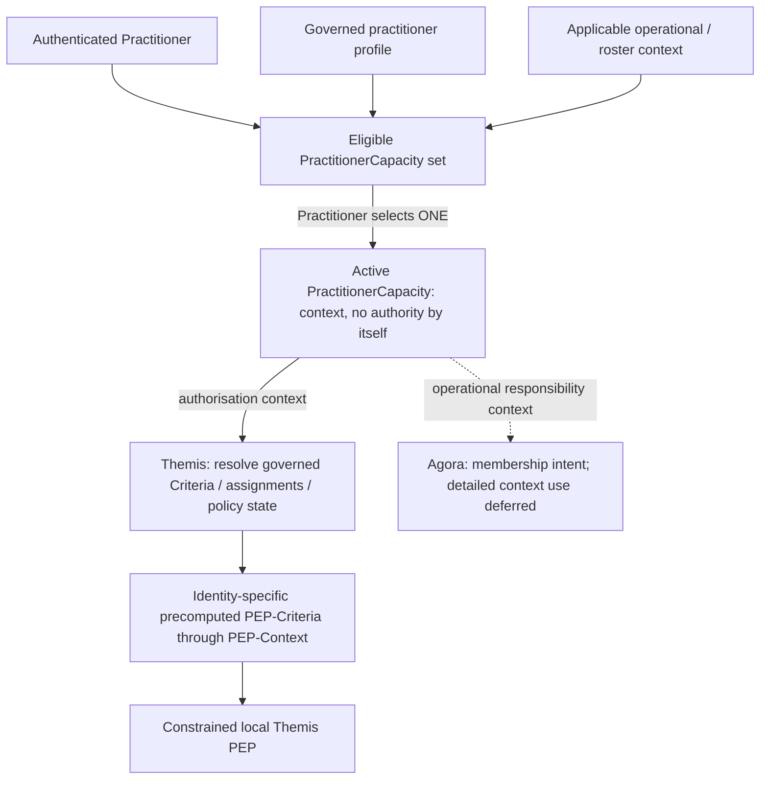

---
{
  "schemaVersion": 1,
  "canonicalId": "899d34ec491948b68aad09e507dea6d1",
  "archimateType": "ApplicationComponent",
  "specialization": null,
  "displayName": "Themis",
  "friendlyName": "Themis",
  "canonicalName": null,
  "standing": {
    "semantic": "Candidate — accepted Step-B baseline; final Solution Architecture unapproved",
    "currentness": "current",
    "qualification": "Exact source standing retained; migration/identity allocation does not approve architectural assertions."
  },
  "identity": {
    "allocation": "UUIDv4 allocated once under the explicit RAD-1.1.5 migration Task",
    "authority": "enterprise-architecture/design/evidence/1.1.5/002/before/ai-agent-tasks/20261021T092725Z-establish-and-apply-element-continuum.md",
    "sourceAbsenceCheck": "No existing governed canonical source binding for this bounded definition; no name-based correspondence adopted."
  },
  "naming": {
    "authority": "docs/markdown/governance/canonical-identity-and-naming.md",
    "mode": "Local lexical component; no root or containment completeness inferred",
    "expected": {
      "friendlyName": "Themis",
      "canonicalName": null
    }
  },
  "provenance": [
    {
      "source": "docs/markdown/05-information-systems-architecture/component-register.md",
      "selector": "### C02 — Themis",
      "role": "ingested architectural definition or explicit source contribution",
      "revision": "aadcd55252fa7965be8a4321832ecc6d5b97c6e0",
      "sha256": "7f493dae1db3e77fe0342f7c21501763a4af2b4de9c59871a109626eaaad5aa0",
      "standing": "Candidate — accepted Step-B baseline; final Solution Architecture unapproved"
    },
    {
      "source": "docs/markdown/05-information-systems-architecture/candidate-feature-map.md",
      "selector": "table assertion: | F03 | Identity authentication integration; Authorisation Model administration, resolution and distributed enforcement | [Authentication SEP](component-register.md#identity-authentication), external OIDC/OAuth IdP; [Themis C02](component-register.md#c02) owns PAP/PRP/PDP/PEP, governed management/approval through Ergo/Praxis, human interaction through Iris | Conjunctive Criterion; additive collections/AuthorisationRoles/direct grants; PractitionerCapacity context; Identity-specific precomputed PEP-Criteria through PEP-Context | U08/U12, AX-04/07/14/17/18. Keycloak + PostgreSQL default development/test/POC IdP, no product-specific dependency. Deterministic local PEP; no matching effective Criterion means DENY; no negative Criteria. Valid-context PDP-loss behaviour retained; forwarding subject to FORWARD with originating/acting provenance. Themis deferrals CDG-42; U15 resolves Kleio mandatory capture under governed intrinsic platform authority. |",
      "role": "ingested architectural definition or explicit source contribution",
      "revision": "aadcd55252fa7965be8a4321832ecc6d5b97c6e0",
      "sha256": "0585ca8887145ca21832bf1fcbf0f1829d1201251c7d7f68055b116bdf4afaab",
      "standing": "Candidate — adjudicated Domain05 Step-B baseline; final Solution Architecture unapproved"
    },
    {
      "source": "docs/markdown/05-information-systems-architecture/data-and-persistence.md",
      "selector": "table assertion: | D03 | Themis Authorisation Model: Criterion, nested collections, AuthorisationRole, direct/role assignments, temporal validity and distinct revocation; authenticated Identity, PractitionerCapacity, PEP-Criteria / PEP-Context and decisions | External IdP authenticates; Calliope governs nomenclature. Themis PAP/PRP/PDP owns model, resolution/compilation and derivation provenance; Themis local PEP enforces. Ergo/Praxis governs administration, Iris presents | PRP persisted through Mneme → Mnemosyne C&G; model ownership remains Themis. PEP-Criteria is precomputed and Identity-specific; operational context is not automatically persisted resource content. Significant occurrences use Kleio under policy | U08/U12, AX-04/05/07/14/17. Criterion dimensions AND; grants UNION; no explicit negative Criteria. No historical carrier or final schema inferred. Temporal validity/revocation distinct; forwarding preserves originating/acting Identity. Themis deferrals [CDG-42](gaps.md#themis-detailed-contracts). |",
      "role": "ingested architectural definition or explicit source contribution",
      "revision": "aadcd55252fa7965be8a4321832ecc6d5b97c6e0",
      "sha256": "8f1b4222a8e1303001235366a17de7555e56141711d5599c6851a7d865cb2dcd",
      "standing": "Candidate — adjudicated Domain05 Step-B baseline; final Solution Architecture unapproved"
    },
    {
      "source": "docs/markdown/05-information-systems-architecture/middleware.md",
      "selector": "table assertion: | M07 | **Themis constrained distributed enforcement and Kleio Audit Capture** | External OIDC/OAuth authentication establishes trusted Identity (SEP). Themis resolves authoritative Criteria/collections/direct and AuthorisationRole assignments, temporal constraints and applicable PractitionerCapacity into precomputed Identity-specific PEP-Criteria through PEP-Context; local Themis PEP enforces at action-controlling host. Kleio constructs immutable AuditEvent from significant client occurrences | U07/U08/U12, AX-04/07–09/14. Conjunctive Criterion, additive UNION grants, no negative Criteria or general-purpose interpreter. Valid sufficient context may continue during PDP loss; required new context waits, unavailability is not DENY. Untagged information governed/fail-closed. Required durable audit capture and Dokimasia terminal rules retained; CDG-42/43. |",
      "role": "ingested architectural definition or explicit source contribution",
      "revision": "aadcd55252fa7965be8a4321832ecc6d5b97c6e0",
      "sha256": "7ee1a4ab1c24abcb052daa5f0392270a8dc4997dd4083db8fea19736bc363213",
      "standing": "Candidate — adjudicated Domain05 Step-B baseline; final Solution Architecture unapproved"
    }
  ],
  "sourceBindings": [
    {
      "source": "docs/markdown/05-information-systems-architecture/component-register.md",
      "selector": "### C02 — Themis"
    },
    {
      "source": "docs/markdown/05-information-systems-architecture/candidate-feature-map.md",
      "selector": "table assertion: | F03 | Identity authentication integration; Authorisation Model administration, resolution and distributed enforcement | [Authentication SEP](component-register.md#identity-authentication), external OIDC/OAuth IdP; [Themis C02](component-register.md#c02) owns PAP/PRP/PDP/PEP, governed management/approval through Ergo/Praxis, human interaction through Iris | Conjunctive Criterion; additive collections/AuthorisationRoles/direct grants; PractitionerCapacity context; Identity-specific precomputed PEP-Criteria through PEP-Context | U08/U12, AX-04/07/14/17/18. Keycloak + PostgreSQL default development/test/POC IdP, no product-specific dependency. Deterministic local PEP; no matching effective Criterion means DENY; no negative Criteria. Valid-context PDP-loss behaviour retained; forwarding subject to FORWARD with originating/acting provenance. Themis deferrals CDG-42; U15 resolves Kleio mandatory capture under governed intrinsic platform authority. |"
    },
    {
      "source": "docs/markdown/05-information-systems-architecture/data-and-persistence.md",
      "selector": "table assertion: | D03 | Themis Authorisation Model: Criterion, nested collections, AuthorisationRole, direct/role assignments, temporal validity and distinct revocation; authenticated Identity, PractitionerCapacity, PEP-Criteria / PEP-Context and decisions | External IdP authenticates; Calliope governs nomenclature. Themis PAP/PRP/PDP owns model, resolution/compilation and derivation provenance; Themis local PEP enforces. Ergo/Praxis governs administration, Iris presents | PRP persisted through Mneme → Mnemosyne C&G; model ownership remains Themis. PEP-Criteria is precomputed and Identity-specific; operational context is not automatically persisted resource content. Significant occurrences use Kleio under policy | U08/U12, AX-04/05/07/14/17. Criterion dimensions AND; grants UNION; no explicit negative Criteria. No historical carrier or final schema inferred. Temporal validity/revocation distinct; forwarding preserves originating/acting Identity. Themis deferrals [CDG-42](gaps.md#themis-detailed-contracts). |"
    },
    {
      "source": "docs/markdown/05-information-systems-architecture/middleware.md",
      "selector": "table assertion: | M07 | **Themis constrained distributed enforcement and Kleio Audit Capture** | External OIDC/OAuth authentication establishes trusted Identity (SEP). Themis resolves authoritative Criteria/collections/direct and AuthorisationRole assignments, temporal constraints and applicable PractitionerCapacity into precomputed Identity-specific PEP-Criteria through PEP-Context; local Themis PEP enforces at action-controlling host. Kleio constructs immutable AuditEvent from significant client occurrences | U07/U08/U12, AX-04/07–09/14. Conjunctive Criterion, additive UNION grants, no negative Criteria or general-purpose interpreter. Valid sufficient context may continue during PDP loss; required new context waits, unavailability is not DENY. Untagged information governed/fail-closed. Required durable audit capture and Dokimasia terminal rules retained; CDG-42/43. |"
    }
  ],
  "exchange": {
    "identifier": "id-3e045743cb6f5764a05a74a9870c8425",
    "properties": []
  },
  "relationships": [],
  "unresolvedProperties": {
    "canonicalName": "Formal qualifier for native ApplicationComponent is not established in the current naming contract; HCRL 1.1.5-002 DR-5. Identity and source content are independently determinate."
  },
  "representation": {
    "sourceLinksRebased": true,
    "authority": "HCRL 1.1.5-002 DR-3; source meaning unchanged"
  }
}
---

# Themis

## Architectural content

- **Role/responsibility:** **Themis owns and manages Harmonia's Authorisation
  Model**, including PAP, PRP, PDP, Criteria/collections, AuthorisationRoles,
  Identity assignments, role/group resolution, Criteria compilation and the
  distributed PEP framework. Themis consumes trusted authenticated Identity;
  it does not authenticate that Identity. [U12](../../../../docs/markdown/05-information-systems-architecture/sources.md#u12) refines
  [U08](../../../../docs/markdown/05-information-systems-architecture/sources.md#u08) within [AX-07](../../motivation/principle/5de2ae2c3b794c2d9f3a14efd51d564f.md).
- **PAP — Policy Administration Point:** administration and lifecycle management
  of the Themis-owned model. Management/review/approval activity uses
  [Ergo/Praxis and Iris](../../../../docs/markdown/05-information-systems-architecture/component-register.md#authorisation-administration); detailed Praxes/Erga,
  UI and versioning mechanisms remain deferred. No general-purpose policy
  language is implied by policy administration.
- **PRP — Policy Repository Point:** authoritative repository semantics for the
  Authorisation Model. Durable persistence may be delegated through **Themis PRP
  → Mneme → Mnemosyne Harmonia Configuration & Governance**. This requires no
  dedicated Themis physical database and transfers no model ownership to persistence.
- **PDP — Policy Decision Point:** resolves authoritative policy, authenticated
  Identity and applicable context into precomputed Identity-specific
  **PEP-Criteria**, supplied through **PEP-Context** for local enforcement.
  An immediate decision remains possible; it uses the same governed semantics.
- **Governed actions:** **Can I ACCESS XYZ? Can I CHANGE ABC? Can I FORWARD DEF?**
  ACCESS, CHANGE and FORWARD are distinct; they SHALL NOT collapse into CRUD.
  FORWARD may depend on destination/context independently of ACCESS.
  Unauthenticated or unauthorised operations default to **DENY**; unavailable
  authoritative policy determination remains distinct from that decision.

<a id="identity-authentication"></a>

#### Identity.Authentication — separately provided trusted Identity

**Identity.Authentication establishes WHO an Individual or System is. It is a
Separately Provided Capability (SEP).** The primary pattern is standards-based
OIDC/OAuth integration with an externally managed Identity Provider (IdP).
Harmonia does not own or provide an identity-management, credential-management,
password-management or MFA framework.

> **Keycloak + PostgreSQL SHALL provide the default FOSS Identity Provider for
> development, test and POC environments.**

Keycloak remains an external, replaceable implementation component. Harmonia's
Identity.Authentication architecture SHALL NOT acquire Keycloak-specific
dependencies. This target does not prescribe a production IdP or an internal
Harmonia credential store. Authentication establishes trusted Identity only;
it SHALL NOT determine Harmonia Function permissions, Function.Scope or PEP-Criteria.

**Identity.Authorisation** establishes what that authenticated Identity may do
within Harmonia and is Themis-owned. The same authorisation model applies to
human and system Identities; differing allowable assignments do not establish
separate architectures.

<a id="identity-terminology"></a>

#### Identity and role terminology

| Term | Candidate meaning and boundary |
| :--- | :--- |
| **Identity** | The authenticated Individual or System consumed by Themis. This use does not redefine Information Unit Identity or the Domain04 professional identifier assertions. |
| **Practitioner** | The individual practitioner, retaining the [Domain04 workforce-entity meaning](../../../../docs/markdown/04-information-architecture/information-families/practitioner.md#31-practitioner); registration status is a separate assertion. |
| **FHIR PractitionerRole** | The formal practitioner role/service relationship represented through FHIR. |
| **PractitionerCapacity** | The selected operational capacity in which a Practitioner is currently acting within Harmonia; it does not itself confer authority. |
| **AuthorisationRole** | A named, governed, assignable collection of additive Themis Criteria and/or Criteria collections. It is distinct from PractitionerCapacity, FHIR PractitionerRole and a Domain03 Business Role. |
| **Criterion / Criteria** | One governed permitted combination / multiple such combinations in the Themis Authorisation Model. |
| **PEP-Criteria** | The precomputed, Identity-specific set of permitted combinations derived by Themis for constrained local enforcement. |
| **PEP-Context** | The Themis-derived operational enforcement context for an authenticated Identity, through which applicable PEP-Criteria is supplied. It is distinct from the general Mneme working Context. |

The [Domain04 Practitioner Role Binding](../../../../docs/markdown/04-information-architecture/information-families/practitioner.md#36-practitioner-role-binding)
and [Domain03 Business Roles](../../../../docs/markdown/03-business-architecture/actors-roles/roles.md)
retain their meanings. Neither lexical similarity nor FHIR convention establishes
their mapping to PractitionerCapacity or AuthorisationRole.

<a id="authorisation-criteria"></a>

#### Criterion conjunction and additive grants

A Criterion represents a **governed permitted combination** across applicable
dimensions, using [Calliope-controlled nomenclature](../../../../docs/markdown/05-information-systems-architecture/component-register.md#authorisation-nomenclature):

```text
Criterion =
    Information.Compartment
    AND Information.Classification
    AND Function.Name
    AND Function.Scope
    AND applicable Temporal constraints
```

The four principal dimensions describe **what** is authorised; applicable
temporal constraints describe **when**. Within an individual Criterion,
applicable dimensions are **conjunctive**. Between Criteria, grants are
**additive / UNION**: each Criterion independently contributes its permitted
combination. Only explicitly governed combinations have authorisation meaning.
Absence of a matching effective Criterion results in **DENY**.

**Explicit negative/DENY Criteria are not part of this Candidate Architecture.**
Neither arbitrary Boolean policy expressions, deny-overrides semantics nor a
general-purpose policy language is introduced by this model.

<a id="criteria-collections-and-authorisationroles"></a>

#### Criteria containment, AuthorisationRoles and Identity assignments

Criteria support containment, collection and nesting for management and reuse:

```text
CriteriaCollection                 (conceptual label; final name unresolved)
  ├── Criterion
  ├── Criterion
  └── CriteriaCollection
       ├── Criterion
       └── Criterion
```

Flattening nested collections produces the same additive set of effective
Criteria. Nesting creates no arbitrary Boolean semantics and requires no Role
hierarchy. The exact implementation name/class hierarchy and representation
remain deferred; this diagram establishes no lifecycle/ownership semantics
beyond the stated management/reuse requirement.

An **AuthorisationRole** is named, governed and assignable and contains Criteria
and/or Criteria collections. Its contents are additive:

```text
EffectiveCriteria(AuthorisationRole)
    = UNION(all contained Criteria)

IdentityEffectiveCriteria =
    DirectCriteria
    UNION AuthorisationRole1.Criteria
    UNION AuthorisationRole2.Criteria
    UNION ...
```

An Identity may have directly assigned Criteria, one or more AuthorisationRoles,
or both. This applies to human and system Identities. The UNION is of applicable
grants, subject to governed assignments, temporal validity, revocation and
applicable operational context; it does not remove a Criterion's conjunctions
or require every contained Criterion to match simultaneously.

<a id="temporal-validity-and-revocation"></a>

#### Predetermined temporal validity and explicit revocation

**Temporal validity** establishes predetermined applicability/validity bounds.
Temporal constraints may apply to a Criterion, a direct Criterion assignment,
an AuthorisationRole assignment and applicable operational context such as
PractitionerCapacity. The exact temporal expression model remains deferred.

**Revocation** withdraws an otherwise valid authorisation. It SHALL NOT be
modelled merely as temporal expiry. Both concepts are required. Propagation of
revocation and invalidation of already-issued PEP-Criteria/PEP-Context remain
unresolved; no mechanism or continued validity after revocation is inferred.

<a id="practitioner-capacity"></a>

#### PractitionerCapacity and operational responsibility

For a Practitioner, the available PractitionerCapacity set is constrained by
the practitioner's governed profile and applicable operational context. The
Practitioner selects **one active PractitionerCapacity** for the applicable
session/operational or roster context. It supplies operational context used by
Themis when deriving effective authorisation; **it does not itself confer authority**.
Selection UI and the exact PractitionerCapacity ↔ FHIR PractitionerRole mapping
remain deferred.

> **Authentication establishes who the Individual is. PractitionerCapacity
> establishes the capacity in which a Practitioner is currently acting. Themis
> establishes what that Identity, acting in that capacity, may do.**



Themis answers **“May this Identity perform this action on this information?”**
Future Agora collaboration detail concerns **“Is this Practitioner currently
responsible for receiving/responding to this operational activity?”** These are
separate responsibilities even where they consume the same PractitionerCapacity.
Receipt of an escalation or approval notification grants no information access.
Following it into Iris or another application surface requires normal Themis PEP
enforcement using current valid PEP-Criteria. U16 establishes
[Agora control and Omilia operations](d1c4053e68384080b8eb79d2008632ba.md);
detailed membership, escalation and approval-routing mechanics remain deferred.

<a id="pep-context"></a>

#### PEP-Context and distributed enforcement

> **PEP-Context is the Themis-derived policy enforcement context established for
> an authenticated Identity. It supplies the precomputed PEP-Criteria applicable
> to that Identity that a Themis Policy Enforcement Point requires for local
> enforcement decisions.**

**PEP-Criteria is a precomputed, Identity-specific set of permitted combinations**,
not a general-purpose executable policy language distributed to PEPs. Themis
resolves direct Criteria, AuthorisationRole-derived Criteria, nested collections,
applicable temporal constraints, PractitionerCapacity context where applicable
and authoritative policy state. PEPs SHALL NOT receive the complete model merely
because they need enforcement information.

```text
Policy                Authorisation Model managed by Themis
Criteria              governed permitted combinations in the Authorisation Model
PEP-Criteria          precomputed Identity-specific permitted combinations
PEP-Context           operational context supplying applicable PEP-Criteria
Enforcement Decision  local PEP determination for a particular proposed action
```

Enforcement occurs at the component capable of preventing the action. A PEP may
be a Themis-provided library/framework element embedded within a host module.
**The distributed PEP capability, implementation and enforcement semantics are
Themis-owned/derived/built.** The host controls the actual operation; Themis
supplies enforcement mechanism and semantics. Hosts SHALL NOT independently
reinterpret the Authorisation Model in place of the Themis PEP. No separate
central Policy Enforcement Software Component is created.

A local PEP SHALL perform deliberately **constrained, deterministic enforcement**
against authenticated Identity context, effective Information.Compartment and
Information.Classification, Function.Name, Function.Scope, applicable temporal
state and the Identity's valid PEP-Criteria. It SHALL NOT become a general-purpose
policy interpreter.

Themis SHALL retain sufficient provenance to explain effective PEP-Criteria
derivation: authoritative Criteria, collections, direct/AuthorisationRole
assignments and applicable policy state. Runtime PEP-Criteria need not carry
the full derivation history; stable references may support it. No final wire/data
structure, cache, refresh or distribution mechanism is prescribed.

PEP-Context and existing security-context contracts are operational context;
they do not automatically become persisted resource content. Their detailed
relationship, schema and distribution mechanisms remain unresolved;
PEP-Context is not silently equated with a historical class or transport carrier.

<a id="effective-information-security-attributes"></a>

#### Untagged information and effective security attributes

> **Absence of explicit information security metadata does not imply absence
> of security control. Untagged information is not unrestricted information.**

Where required Information.Compartment and/or Information.Classification
attributes are absent, effective values SHALL be established through governed,
deterministic rules. If required effective attributes cannot be established,
enforcement SHALL fail closed.

Deriving effective attributes for an authorisation decision is distinct from
persistently assigning/changing security metadata on an Information Unit.
Themis enforces the resulting attributes; it is not assumed to own all semantic
derivation rules. Exact derivation ownership and precedence, including possible
context/containment relationships, remain [deferred](../../../../docs/markdown/05-information-systems-architecture/gaps.md#identity-deferred-design).
Mnemosyne's established compartment validation/reapplication responsibility does
not settle those semantic rules.

<a id="themis-availability-and-delegation"></a>

#### Availability and delegation

An in-flight activity with a **valid PEP-Context sufficient for its required
enforcement decisions** may continue during temporary PDP unavailability.
PDP availability is required for a **new, renewed or replacement PEP-Context**.
If the PDP cannot establish that required context, the activity SHALL NOT proceed
beyond the point requiring it and must wait. **PDP unavailability is not policy
denial**: policy permits, policy denies, and authoritative policy determination
cannot presently be established remain distinct. This grants no unauthenticated
or unauthorised action permission and weakens no required audit-capture boundary.
Detailed validity, timeout/retry, revocation and renewal mechanisms are unresolved.

At this stage delegation is **Identity / PEP-Criteria pass-off (forwarding)**,
subject to applicable **FORWARD** authority. Provenance SHALL preserve both the
originating Identity and receiving/acting Identity; the receiver does not become
the originator. No separate general-purpose delegation subsystem is introduced.
Detailed forwarding lifecycle/representation, PDP interaction and governance
mechanisms remain deferred; forwarding establishes no unrestricted impersonation
or authority-broadening rule.

<a id="authorisation-administration"></a>

#### Governed authorisation administration and target allocation

Authorisation administration is governed Harmonia work. Criteria creation/change,
collection management, AuthorisationRole management, direct Identity Criteria
assignment, AuthorisationRole assignment, temporal changes and revocation SHALL
be subject to appropriate governed management/review/approval processes through
**Ergo/Praxis**, with **Iris** providing human interaction. Detailed PAP management
Praxes/Erga and approval rules remain deferred; this does not make every change
require an identical approval sequence.

| Responsibility | Candidate target |
| :--- | :--- |
| Identity authentication | Keycloak / external OIDC IdP; SEP, Keycloak + PostgreSQL default for development/test/POC |
| Controlled authorisation nomenclature | Calliope |
| Authorisation model, Criteria/collections, AuthorisationRoles and Identity assignments | Themis-owned |
| Role/group resolution | Themis-owned; no separate human/system authorisation architecture |
| Criteria compilation | Themis-owned |
| Policy repository | Themis PRP, persisted through Harmonia via Mneme / Mnemosyne C&G |
| Policy administration | Themis PAP |
| Governed management / review / approval workflows | Ergo/Praxis |
| Administration UI | Iris; no authorisation-model ownership or detailed reusable-form design |
| Runtime enforcement | Themis PEP library at action-controlling hosts |
| Untagged information handling | Governed effective-attribute resolution; exact ownership/precedence deferred |

Harmonia owns its authorisation semantics. **jCasbin, OPA, Cedar or another
general-purpose policy framework is not an architectural dependency.** FOSS
implementations may later supply implementation references where appropriate;
their conceptual models SHALL NOT redefine Harmonia semantics.

- **Collaboration/exclusions:** governed access, activity, publication and
  collaboration hosts use Themis-owned PEP capability. Petasos hosts governed
  FORWARD enforcement because it controls the queue operation. Praxis may supply
  relevant context but is not the Authorisation Model; authorisation does not
  establish Praxis conformance. Themis is neither Audit nor Assurance. Significant
  policy/enforcement occurrences are reported through Kleio Audit Capture under
  applicable policy; clients need not construct FHIR AuditEvent.
  **Calliope defines security/assurance nomenclature; Themis decides/enforces;
  Dokimasia assures; Kleio audits.** Governance, Authorisation, Assurance and Audit
  remain distinct responsibilities; Praxis conformance and assurance findings
  are not authorisation grants. Dokimasia terminal constraints remain unchanged.
- **Standing:** U12 consolidates the adjudicated Identity Candidate Architecture
  and refines U08's Criteria, policy-language deferral and delegation wording.
  It does not accept all Domain05 candidate material or begin Step B.
  [CDG-42](../../../../docs/markdown/05-information-systems-architecture/gaps.md#themis-detailed-contracts) retains detailed design.
  U15 resolves the former U08 §15 conflict through Kleio-specific
  [mandatory capture authority](../../../../docs/markdown/05-information-systems-architecture/component-register.md#kleio-capture-authority), governed under AX-07.
  Historical fixed gate counts and automatic context persistence remain
  CDG-15/30 provenance, without reopening established security boundaries.

## Source-qualified contribution

Source: `docs/markdown/05-information-systems-architecture/candidate-feature-map.md` — ``table assertion: | F03 | Identity authentication integration; Authorisation Model administration, resolution and distributed enforcement | [Authentication SEP](component-register.md#identity-authentication), external OIDC/OAuth IdP; [Themis C02](component-register.md#c02) owns PAP/PRP/PDP/PEP, governed management/approval through Ergo/Praxis, human interaction through Iris | Conjunctive Criterion; additive collections/AuthorisationRoles/direct grants; PractitionerCapacity context; Identity-specific precomputed PEP-Criteria through PEP-Context | U08/U12, AX-04/07/14/17/18. Keycloak + PostgreSQL default development/test/POC IdP, no product-specific dependency. Deterministic local PEP; no matching effective Criterion means DENY; no negative Criteria. Valid-context PDP-loss behaviour retained; forwarding subject to FORWARD with originating/acting provenance. Themis deferrals CDG-42; U15 resolves Kleio mandatory capture under governed intrinsic platform authority. |``. Standing: Candidate — adjudicated Domain05 Step-B baseline; final Solution Architecture unapproved.

| F03 | Identity authentication integration; Authorisation Model administration, resolution and distributed enforcement | [Authentication SEP](../../../../docs/markdown/05-information-systems-architecture/component-register.md#identity-authentication), external OIDC/OAuth IdP; [Themis C02](899d34ec491948b68aad09e507dea6d1.md) owns PAP/PRP/PDP/PEP, governed management/approval through Ergo/Praxis, human interaction through Iris | Conjunctive Criterion; additive collections/AuthorisationRoles/direct grants; PractitionerCapacity context; Identity-specific precomputed PEP-Criteria through PEP-Context | U08/U12, AX-04/07/14/17/18. Keycloak + PostgreSQL default development/test/POC IdP, no product-specific dependency. Deterministic local PEP; no matching effective Criterion means DENY; no negative Criteria. Valid-context PDP-loss behaviour retained; forwarding subject to FORWARD with originating/acting provenance. Themis deferrals CDG-42; U15 resolves Kleio mandatory capture under governed intrinsic platform authority. |

## Source-qualified contribution

Source: `docs/markdown/05-information-systems-architecture/data-and-persistence.md` — ``table assertion: | D03 | Themis Authorisation Model: Criterion, nested collections, AuthorisationRole, direct/role assignments, temporal validity and distinct revocation; authenticated Identity, PractitionerCapacity, PEP-Criteria / PEP-Context and decisions | External IdP authenticates; Calliope governs nomenclature. Themis PAP/PRP/PDP owns model, resolution/compilation and derivation provenance; Themis local PEP enforces. Ergo/Praxis governs administration, Iris presents | PRP persisted through Mneme → Mnemosyne C&G; model ownership remains Themis. PEP-Criteria is precomputed and Identity-specific; operational context is not automatically persisted resource content. Significant occurrences use Kleio under policy | U08/U12, AX-04/05/07/14/17. Criterion dimensions AND; grants UNION; no explicit negative Criteria. No historical carrier or final schema inferred. Temporal validity/revocation distinct; forwarding preserves originating/acting Identity. Themis deferrals [CDG-42](gaps.md#themis-detailed-contracts). |``. Standing: Candidate — adjudicated Domain05 Step-B baseline; final Solution Architecture unapproved.

| D03 | Themis Authorisation Model: Criterion, nested collections, AuthorisationRole, direct/role assignments, temporal validity and distinct revocation; authenticated Identity, PractitionerCapacity, PEP-Criteria / PEP-Context and decisions | External IdP authenticates; Calliope governs nomenclature. Themis PAP/PRP/PDP owns model, resolution/compilation and derivation provenance; Themis local PEP enforces. Ergo/Praxis governs administration, Iris presents | PRP persisted through Mneme → Mnemosyne C&G; model ownership remains Themis. PEP-Criteria is precomputed and Identity-specific; operational context is not automatically persisted resource content. Significant occurrences use Kleio under policy | U08/U12, AX-04/05/07/14/17. Criterion dimensions AND; grants UNION; no explicit negative Criteria. No historical carrier or final schema inferred. Temporal validity/revocation distinct; forwarding preserves originating/acting Identity. Themis deferrals [CDG-42](../../../../docs/markdown/05-information-systems-architecture/gaps.md#themis-detailed-contracts). |

## Source-qualified contribution

Source: `docs/markdown/05-information-systems-architecture/middleware.md` — ``table assertion: | M07 | **Themis constrained distributed enforcement and Kleio Audit Capture** | External OIDC/OAuth authentication establishes trusted Identity (SEP). Themis resolves authoritative Criteria/collections/direct and AuthorisationRole assignments, temporal constraints and applicable PractitionerCapacity into precomputed Identity-specific PEP-Criteria through PEP-Context; local Themis PEP enforces at action-controlling host. Kleio constructs immutable AuditEvent from significant client occurrences | U07/U08/U12, AX-04/07–09/14. Conjunctive Criterion, additive UNION grants, no negative Criteria or general-purpose interpreter. Valid sufficient context may continue during PDP loss; required new context waits, unavailability is not DENY. Untagged information governed/fail-closed. Required durable audit capture and Dokimasia terminal rules retained; CDG-42/43. |``. Standing: Candidate — adjudicated Domain05 Step-B baseline; final Solution Architecture unapproved.

| M07 | **Themis constrained distributed enforcement and Kleio Audit Capture** | External OIDC/OAuth authentication establishes trusted Identity (SEP). Themis resolves authoritative Criteria/collections/direct and AuthorisationRole assignments, temporal constraints and applicable PractitionerCapacity into precomputed Identity-specific PEP-Criteria through PEP-Context; local Themis PEP enforces at action-controlling host. Kleio constructs immutable AuditEvent from significant client occurrences | U07/U08/U12, AX-04/07–09/14. Conjunctive Criterion, additive UNION grants, no negative Criteria or general-purpose interpreter. Valid sufficient context may continue during PDP loss; required new context waits, unavailability is not DENY. Untagged information governed/fail-closed. Required durable audit capture and Dokimasia terminal rules retained; CDG-42/43. |
