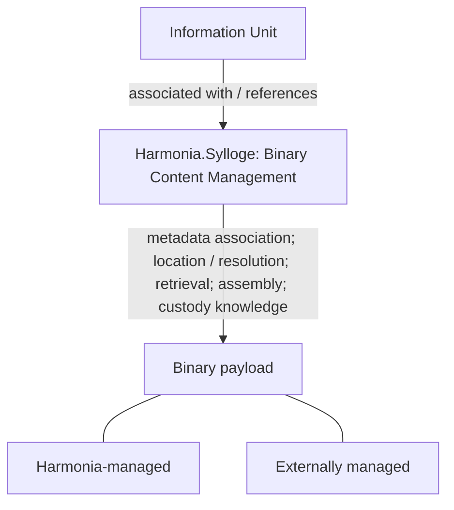

---
{
  "schemaVersion": 1,
  "canonicalId": "feea742463b84021b66853d287d8916f",
  "archimateType": "ApplicationComponent",
  "specialization": null,
  "displayName": "Harmonia.Sylloge",
  "friendlyName": "HarmoniaSylloge",
  "canonicalName": null,
  "standing": {
    "semantic": "Candidate — accepted Step-B baseline; final Solution Architecture unapproved",
    "currentness": "current",
    "qualification": "Exact source standing retained; migration/identity allocation does not approve architectural assertions."
  },
  "identity": {
    "allocation": "UUIDv4 allocated once under the explicit RAD-1.1.5 migration Task",
    "authority": "enterprise-architecture/design/evidence/1.1.5/002/before/ai-agent-tasks/20261021T092725Z-establish-and-apply-element-continuum.md",
    "sourceAbsenceCheck": "No existing governed canonical source binding for this bounded definition; no name-based correspondence adopted."
  },
  "naming": {
    "authority": "docs/markdown/governance/canonical-identity-and-naming.md",
    "mode": "Local lexical component; no root or containment completeness inferred",
    "expected": {
      "friendlyName": "HarmoniaSylloge",
      "canonicalName": null
    }
  },
  "provenance": [
    {
      "source": "docs/markdown/05-information-systems-architecture/component-register.md",
      "selector": "### C49 — Harmonia.Sylloge",
      "role": "ingested architectural definition or explicit source contribution",
      "revision": "aadcd55252fa7965be8a4321832ecc6d5b97c6e0",
      "sha256": "7f493dae1db3e77fe0342f7c21501763a4af2b4de9c59871a109626eaaad5aa0",
      "standing": "Candidate — accepted Step-B baseline; final Solution Architecture unapproved"
    },
    {
      "source": "docs/markdown/05-information-systems-architecture/sylloge-binary-content-management.md",
      "selector": "## Application responsibility",
      "role": "ingested architectural definition or explicit source contribution",
      "revision": "aadcd55252fa7965be8a4321832ecc6d5b97c6e0",
      "sha256": "1716f02c2fc2545e9735e5e300de0d279958361030f6991e6183a82513d2244f",
      "standing": "Candidate — adjudicated Domain05 Step-B baseline; final Solution Architecture unapproved"
    },
    {
      "source": "docs/markdown/05-information-systems-architecture/sylloge-binary-content-management.md",
      "selector": "## Management and physical custody",
      "role": "ingested architectural definition or explicit source contribution",
      "revision": "aadcd55252fa7965be8a4321832ecc6d5b97c6e0",
      "sha256": "1716f02c2fc2545e9735e5e300de0d279958361030f6991e6183a82513d2244f",
      "standing": "Candidate — adjudicated Domain05 Step-B baseline; final Solution Architecture unapproved"
    },
    {
      "source": "docs/markdown/05-information-systems-architecture/sylloge-binary-content-management.md",
      "selector": "## Mneme and Mnemosyne",
      "role": "ingested architectural definition or explicit source contribution",
      "revision": "aadcd55252fa7965be8a4321832ecc6d5b97c6e0",
      "sha256": "1716f02c2fc2545e9735e5e300de0d279958361030f6991e6183a82513d2244f",
      "standing": "Candidate — adjudicated Domain05 Step-B baseline; final Solution Architecture unapproved"
    },
    {
      "source": "docs/markdown/05-information-systems-architecture/sylloge-binary-content-management.md",
      "selector": "## Agora and Omilia",
      "role": "ingested architectural definition or explicit source contribution",
      "revision": "aadcd55252fa7965be8a4321832ecc6d5b97c6e0",
      "sha256": "1716f02c2fc2545e9735e5e300de0d279958361030f6991e6183a82513d2244f",
      "standing": "Candidate — adjudicated Domain05 Step-B baseline; final Solution Architecture unapproved"
    },
    {
      "source": "docs/markdown/05-information-systems-architecture/sylloge-binary-content-management.md",
      "selector": "## Deliberate deferred design",
      "role": "ingested architectural definition or explicit source contribution",
      "revision": "aadcd55252fa7965be8a4321832ecc6d5b97c6e0",
      "sha256": "1716f02c2fc2545e9735e5e300de0d279958361030f6991e6183a82513d2244f",
      "standing": "Candidate — adjudicated Domain05 Step-B baseline; final Solution Architecture unapproved"
    },
    {
      "source": "docs/markdown/05-information-systems-architecture/candidate-feature-map.md",
      "selector": "table assertion: | F31 | **Binary Content Management** for formally managed clinical/operational binary content | [Harmonia.Sylloge C49](component-register.md#c49) owns governed metadata association, resolution, retrieval and assembly; Mnemosyne may supply applicable persistence services. Agora retains native collaboration media and references/activity; Omilia retains collaboration operations | Binary-content metadata; Information Unit associations; location/resolution and custody knowledge; retrieval and on-demand assembly from one or more payloads. Logical information differs from binary payload | U17 resolves [CDG-25 responsibility](gaps.md#binary-custody-question). Physical custody may remain external; no mandatory copying into Harmonia. Storage, representations (including historical DocumentReference examples), APIs, algorithms and lifecycle mechanisms remain deferred. L19/L10/L17 are supporting evidence, not selected design. |",
      "role": "ingested architectural definition or explicit source contribution",
      "revision": "aadcd55252fa7965be8a4321832ecc6d5b97c6e0",
      "sha256": "0585ca8887145ca21832bf1fcbf0f1829d1201251c7d7f68055b116bdf4afaab",
      "standing": "Candidate — adjudicated Domain05 Step-B baseline; final Solution Architecture unapproved"
    },
    {
      "source": "docs/markdown/05-information-systems-architecture/data-and-persistence.md",
      "selector": "table assertion: | D15 | Formally managed clinical/operational binary content; binary-content metadata, Information Unit associations and location/resolution/custody knowledge; distinct from D14 native collaboration media | **Harmonia.Sylloge C49** owns Binary Content Management: governed association, resolution, retrieval and on-demand assembly from one or more payloads. Originating logical information authority remains distinct | Physical custody may remain external; Sylloge management does not require copying every payload into Harmonia. Where Harmonia persistence is required, Mnemosyne may provide applicable services under AX-05; application ownership remains Sylloge | U17 closes [CDG-25 responsibility](gaps.md#binary-custody-question). Historical L10/L17/L19/L23 carrier/DocumentReference examples are supporting evidence, not representation choices. Storage, APIs, assembly algorithms, lifecycle/versioning and FHIR/DICOM representations remain deferred. |",
      "role": "ingested architectural definition or explicit source contribution",
      "revision": "aadcd55252fa7965be8a4321832ecc6d5b97c6e0",
      "sha256": "8f1b4222a8e1303001235366a17de7555e56141711d5599c6851a7d865cb2dcd",
      "standing": "Candidate — adjudicated Domain05 Step-B baseline; final Solution Architecture unapproved"
    }
  ],
  "sourceBindings": [
    {
      "source": "docs/markdown/05-information-systems-architecture/component-register.md",
      "selector": "### C49 — Harmonia.Sylloge"
    },
    {
      "source": "docs/markdown/05-information-systems-architecture/sylloge-binary-content-management.md",
      "selector": "## Application responsibility"
    },
    {
      "source": "docs/markdown/05-information-systems-architecture/sylloge-binary-content-management.md",
      "selector": "## Management and physical custody"
    },
    {
      "source": "docs/markdown/05-information-systems-architecture/sylloge-binary-content-management.md",
      "selector": "## Mneme and Mnemosyne"
    },
    {
      "source": "docs/markdown/05-information-systems-architecture/sylloge-binary-content-management.md",
      "selector": "## Agora and Omilia"
    },
    {
      "source": "docs/markdown/05-information-systems-architecture/sylloge-binary-content-management.md",
      "selector": "## Deliberate deferred design"
    },
    {
      "source": "docs/markdown/05-information-systems-architecture/candidate-feature-map.md",
      "selector": "table assertion: | F31 | **Binary Content Management** for formally managed clinical/operational binary content | [Harmonia.Sylloge C49](component-register.md#c49) owns governed metadata association, resolution, retrieval and assembly; Mnemosyne may supply applicable persistence services. Agora retains native collaboration media and references/activity; Omilia retains collaboration operations | Binary-content metadata; Information Unit associations; location/resolution and custody knowledge; retrieval and on-demand assembly from one or more payloads. Logical information differs from binary payload | U17 resolves [CDG-25 responsibility](gaps.md#binary-custody-question). Physical custody may remain external; no mandatory copying into Harmonia. Storage, representations (including historical DocumentReference examples), APIs, algorithms and lifecycle mechanisms remain deferred. L19/L10/L17 are supporting evidence, not selected design. |"
    },
    {
      "source": "docs/markdown/05-information-systems-architecture/data-and-persistence.md",
      "selector": "table assertion: | D15 | Formally managed clinical/operational binary content; binary-content metadata, Information Unit associations and location/resolution/custody knowledge; distinct from D14 native collaboration media | **Harmonia.Sylloge C49** owns Binary Content Management: governed association, resolution, retrieval and on-demand assembly from one or more payloads. Originating logical information authority remains distinct | Physical custody may remain external; Sylloge management does not require copying every payload into Harmonia. Where Harmonia persistence is required, Mnemosyne may provide applicable services under AX-05; application ownership remains Sylloge | U17 closes [CDG-25 responsibility](gaps.md#binary-custody-question). Historical L10/L17/L19/L23 carrier/DocumentReference examples are supporting evidence, not representation choices. Storage, APIs, assembly algorithms, lifecycle/versioning and FHIR/DICOM representations remain deferred. |"
    }
  ],
  "exchange": {
    "identifier": "id-bdb6ee0c45fc5ad2a026523292f9c0d4",
    "properties": []
  },
  "relationships": [],
  "unresolvedProperties": {
    "canonicalName": "Formal qualifier for native ApplicationComponent is not established in the current naming contract; HCRL 1.1.5-002 DR-5. Identity and source content are independently determinate."
  },
  "representation": {
    "sourceLinksRebased": true,
    "authority": "HCRL 1.1.5-002 DR-3; source meaning unchanged"
  }
}
---

# Harmonia.Sylloge

## Architectural content

- **Role/responsibility:** **Binary Content Management subsystem** responsible
  for governed association, resolution, retrieval and assembly of binary content
  associated with Harmonia-managed information. [U17 canonical view](feea742463b84021b66853d287d8916f.md).
- **Feature/information:** F31/D15; binary-content metadata, Information Unit
  associations, location/resolution knowledge, retrieval, on-demand assembly from
  one or more payloads and knowledge of Harmonia-managed versus externally
  managed content. Logical information and binary payload remain distinct.
- **Custody/persistence:** physical custody may remain external; management does
  not require copying every payload into Harmonia. Where applicable, Mnemosyne
  provides Harmonia persistence services without acquiring Binary Content
  Management. Sylloge is not a generic persistence manager.
- **Collaborations/exclusions:** Mneme remains Context and Pragma Manager with its
  established service boundary; applicable processing components may obtain/resolve
  content through Sylloge. Agora retains native collaboration media and the
  record/reference/activity concerning formal binary content; Sylloge retains
  that content's Binary Content Management. Omilia acquires no such responsibility.
  Source information/domain authority and external physical custody are preserved.
- **Standing:** U17 adjudicated Candidate Architecture; former A2 responsibility
  question CDG-25 closed. [Storage, representations, APIs, algorithms and lifecycle
  mechanisms](feea742463b84021b66853d287d8916f.md) remain
  non-blocking later design. No module, dependency or deployment allocation.

## Source-qualified contribution

Source: `docs/markdown/05-information-systems-architecture/sylloge-binary-content-management.md` — ## Application responsibility. Standing: Candidate — adjudicated Domain05 Step-B baseline; final Solution Architecture unapproved.

> **Harmonia.Sylloge — Binary Content Management subsystem responsible for the
> governed association, resolution, retrieval and assembly of binary content
> associated with Harmonia-managed information.**

Sylloge is an Information Systems Layer application subsystem/component. Its
Candidate Architecture responsibility includes:

- Management of binary-content metadata.
- Management of associations between Harmonia Information Units and associated
  binary content.
- Knowledge sufficient to locate and resolve binary content.
- Retrieval of binary content.
- Assembly on demand where required logical content is represented by, or
  constructed from, one or more binary payloads.
- Knowledge of whether applicable binary content is Harmonia-managed or
  externally managed.

This establishes **Binary Content Management** as an application information
responsibility. F31 allocates the behaviour and D15 records the associated
information responsibility; neither a storage product nor an upstream Information
Concept is introduced by that allocation.

## Source-qualified contribution

Source: `docs/markdown/05-information-systems-architecture/sylloge-binary-content-management.md` — ## Management and physical custody. Standing: Candidate — adjudicated Domain05 Step-B baseline; final Solution Architecture unapproved.



**Sylloge's responsibility for binary content does not imply that Harmonia must
physically persist every binary payload.** Physical custody may remain with an
external authoritative/source system. Knowledge of and governed access to that
content do not require copying it into Harmonia. External management and
originating information/domain authority remain explicit.

Where Harmonia takes physical custody, Sylloge retains Binary Content Management
responsibility without becoming a generic persistence manager. Logical clinical
information and its binary payload remain distinct; an Information Unit reference
does not itself establish physical custody or make the payload an Information Unit.

## Source-qualified contribution

Source: `docs/markdown/05-information-systems-architecture/sylloge-binary-content-management.md` — ## Mneme and Mnemosyne. Standing: Candidate — adjudicated Domain05 Step-B baseline; final Solution Architecture unapproved.

**Application information responsibility is distinct from persistence
responsibility.** Mnemosyne remains Harmonia's Persistence Manager. Where
Sylloge-managed content or metadata requires Harmonia persistence, Mnemosyne may
provide the applicable persistence services under the established
[Mneme/Mnemosyne boundary](7985e647bf9e4ca3ba70faf9e3e4ae02.md).
That service relationship does not transfer Binary Content Management to
Mnemosyne or confer durable-state establishment on Sylloge.

Mneme remains the **Context and Pragma Manager**, with its four principal exposed
services and established managed-information access boundary. Sylloge is not
absorbed into Mneme and creates no alternative raw cache/database access path.
Where processing needs binary content, Mneme, Ponos, Ergo or another applicable
component may interact with Sylloge to obtain or resolve it. This is a minimal
responsibility relationship; detailed calls, routing and contracts are deferred.
No Mneme service, Mnemosyne responsibility or persistence domain is redesigned.

## Source-qualified contribution

Source: `docs/markdown/05-information-systems-architecture/sylloge-binary-content-management.md` — ## Agora and Omilia. Standing: Candidate — adjudicated Domain05 Step-B baseline; final Solution Architecture unapproved.

Agora-native collaboration media may remain **Agora-managed collaboration
information**. Omilia performs collaboration operations under the established
[Agora/Omilia architecture](d1c4053e68384080b8eb79d2008632ba.md).

```text
Formally managed clinical/operational binary content
                       |
                       v
                    Sylloge
                       ^
                       |
                    reference
                       |
               Agora-managed Room
```

When a Room presents, links to, discusses, notifies about or captures activity
concerning formally managed binary content, Agora retains the collaboration
record/reference/activity. Sylloge retains Binary Content Management for that
content; Agora does not thereby become its custodian. Omilia acquires no Binary
Content Management responsibility. The originating logical information owner and
any external physical custodian retain their respective responsibilities.

## Source-qualified contribution

Source: `docs/markdown/05-information-systems-architecture/sylloge-binary-content-management.md` — ## Deliberate deferred design. Standing: Candidate — adjudicated Domain05 Step-B baseline; final Solution Architecture unapproved.

The application responsibility is established, rather than deferred out of the
Candidate Architecture. The following remain later design matters under
[CDG-25](../../../../docs/markdown/05-information-systems-architecture/gaps.md#binary-custody-question):

- Object storage, filesystem, database BLOB, PACS/VNA and content-addressable
  storage technology or architecture.
- Streaming, caching, replication, binary sharding, compression, encryption
  mechanisms and physical storage topology.
- FHIR Binary, DocumentReference, Media and DICOM representations.
- Detailed retrieval APIs, assembly algorithms and external repository adapters.
- Lifecycle, retention and binary versioning mechanisms.

No assumption that all content is copied into Harmonia accompanies these
deferrals. The Logical Data ↔ Application Features ↔ Application Components triad
and the distinction between Logical Data, Application Data Objects, Persistence
Data Structures and Technology Platforms remain. Themis governance, Kleio audit,
originating authority and AX-05/06/07/13/14/15/17/18 constraints apply without a new
security, audit or persistence mechanism. No build, process or deployment boundary
is selected.

## Source-qualified contribution

Source: `docs/markdown/05-information-systems-architecture/candidate-feature-map.md` — ``table assertion: | F31 | **Binary Content Management** for formally managed clinical/operational binary content | [Harmonia.Sylloge C49](component-register.md#c49) owns governed metadata association, resolution, retrieval and assembly; Mnemosyne may supply applicable persistence services. Agora retains native collaboration media and references/activity; Omilia retains collaboration operations | Binary-content metadata; Information Unit associations; location/resolution and custody knowledge; retrieval and on-demand assembly from one or more payloads. Logical information differs from binary payload | U17 resolves [CDG-25 responsibility](gaps.md#binary-custody-question). Physical custody may remain external; no mandatory copying into Harmonia. Storage, representations (including historical DocumentReference examples), APIs, algorithms and lifecycle mechanisms remain deferred. L19/L10/L17 are supporting evidence, not selected design. |``. Standing: Candidate — adjudicated Domain05 Step-B baseline; final Solution Architecture unapproved.

| F31 | **Binary Content Management** for formally managed clinical/operational binary content | [Harmonia.Sylloge C49](feea742463b84021b66853d287d8916f.md) owns governed metadata association, resolution, retrieval and assembly; Mnemosyne may supply applicable persistence services. Agora retains native collaboration media and references/activity; Omilia retains collaboration operations | Binary-content metadata; Information Unit associations; location/resolution and custody knowledge; retrieval and on-demand assembly from one or more payloads. Logical information differs from binary payload | U17 resolves [CDG-25 responsibility](../../../../docs/markdown/05-information-systems-architecture/gaps.md#binary-custody-question). Physical custody may remain external; no mandatory copying into Harmonia. Storage, representations (including historical DocumentReference examples), APIs, algorithms and lifecycle mechanisms remain deferred. L19/L10/L17 are supporting evidence, not selected design. |

## Source-qualified contribution

Source: `docs/markdown/05-information-systems-architecture/data-and-persistence.md` — ``table assertion: | D15 | Formally managed clinical/operational binary content; binary-content metadata, Information Unit associations and location/resolution/custody knowledge; distinct from D14 native collaboration media | **Harmonia.Sylloge C49** owns Binary Content Management: governed association, resolution, retrieval and on-demand assembly from one or more payloads. Originating logical information authority remains distinct | Physical custody may remain external; Sylloge management does not require copying every payload into Harmonia. Where Harmonia persistence is required, Mnemosyne may provide applicable services under AX-05; application ownership remains Sylloge | U17 closes [CDG-25 responsibility](gaps.md#binary-custody-question). Historical L10/L17/L19/L23 carrier/DocumentReference examples are supporting evidence, not representation choices. Storage, APIs, assembly algorithms, lifecycle/versioning and FHIR/DICOM representations remain deferred. |``. Standing: Candidate — adjudicated Domain05 Step-B baseline; final Solution Architecture unapproved.

| D15 | Formally managed clinical/operational binary content; binary-content metadata, Information Unit associations and location/resolution/custody knowledge; distinct from D14 native collaboration media | **Harmonia.Sylloge C49** owns Binary Content Management: governed association, resolution, retrieval and on-demand assembly from one or more payloads. Originating logical information authority remains distinct | Physical custody may remain external; Sylloge management does not require copying every payload into Harmonia. Where Harmonia persistence is required, Mnemosyne may provide applicable services under AX-05; application ownership remains Sylloge | U17 closes [CDG-25 responsibility](../../../../docs/markdown/05-information-systems-architecture/gaps.md#binary-custody-question). Historical L10/L17/L19/L23 carrier/DocumentReference examples are supporting evidence, not representation choices. Storage, APIs, assembly algorithms, lifecycle/versioning and FHIR/DICOM representations remain deferred. |
