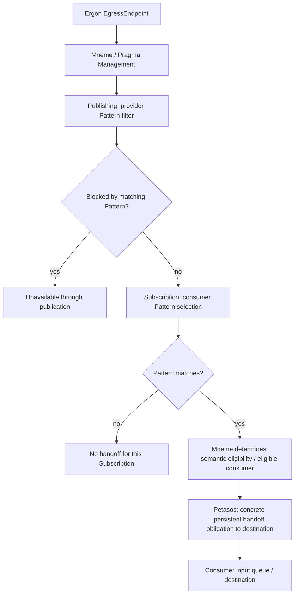

---
{
  "schemaVersion": 1,
  "canonicalId": "ab0cdaa7ed4149ee856216efa5a265c4",
  "archimateType": "ApplicationFunction",
  "specialization": null,
  "displayName": "Pragma Management",
  "friendlyName": "PragmaManagement",
  "canonicalName": null,
  "standing": {
    "semantic": "Candidate — accepted Step-B baseline; final Solution Architecture unapproved",
    "currentness": "current",
    "qualification": "Exact source standing retained; migration/identity allocation does not approve architectural assertions."
  },
  "identity": {
    "allocation": "UUIDv4 allocated once under the explicit RAD-1.1.5 migration Task",
    "authority": "enterprise-architecture/design/evidence/1.1.5/002/before/ai-agent-tasks/20261021T092725Z-establish-and-apply-element-continuum.md",
    "sourceAbsenceCheck": "No existing governed canonical source binding for this bounded definition; no name-based correspondence adopted."
  },
  "naming": {
    "authority": "docs/markdown/governance/canonical-identity-and-naming.md",
    "mode": "Local lexical component; no root or containment completeness inferred",
    "expected": {
      "friendlyName": "PragmaManagement",
      "canonicalName": null
    }
  },
  "provenance": [
    {
      "source": "docs/markdown/05-information-systems-architecture/component-register.md",
      "selector": "### C28 — Pragma Management",
      "role": "ingested architectural definition or explicit source contribution",
      "revision": "aadcd55252fa7965be8a4321832ecc6d5b97c6e0",
      "sha256": "7f493dae1db3e77fe0342f7c21501763a4af2b4de9c59871a109626eaaad5aa0",
      "standing": "Candidate — accepted Step-B baseline; final Solution Architecture unapproved"
    },
    {
      "source": "docs/markdown/05-information-systems-architecture/pathways-journeys-and-handoff.md",
      "selector": "## Dynamic information selection through Mneme",
      "role": "ingested architectural definition or explicit source contribution",
      "revision": "aadcd55252fa7965be8a4321832ecc6d5b97c6e0",
      "sha256": "a397dee9209f308b7a6a9615ce0a46780faa6acc4724c0e537cf9e08894ab69c",
      "standing": "Candidate — adjudicated Domain05 Step-B baseline; final Solution Architecture unapproved"
    },
    {
      "source": "docs/markdown/05-information-systems-architecture/data-and-persistence.md",
      "selector": "table assertion: | D05 | Pragma task/activity information envelope: inputs/outputs, checkpoint, parent/correlation, payload/reference | Mneme Pragma Management C28 manages; factory initialises; Ergon produces **new Content as Pragma Output**, distinct from changed Context values. Resulting Pragma may play the continuation role or remain independently available for governed use | Mneme management distinct from Mnemosyne durable establishment; work/undertaking information remains O&A classification candidate; no automatic persistence of every field or continuation of every output | U10/U18 extend U01/U02/U06. No continuation subtype; construction/designation/representation CDG-53. Output/mapping contracts CDG-45; existing Task/representation CDG-02/03/10/12/13 preserved. |",
      "role": "ingested architectural definition or explicit source contribution",
      "revision": "aadcd55252fa7965be8a4321832ecc6d5b97c6e0",
      "sha256": "8f1b4222a8e1303001235366a17de7555e56141711d5599c6851a7d865cb2dcd",
      "standing": "Candidate — adjudicated Domain05 Step-B baseline; final Solution Architecture unapproved"
    },
    {
      "source": "docs/markdown/05-information-systems-architecture/candidate-feature-map.md",
      "selector": "table assertion: | F34 | Archetype embodiment, Pragma management and distinct work/undertaking representations | [Mneme Pragma Management C28](component-register.md#c28) logically aggregates [PragmaFactory C08](component-register.md#c08) and manages [Pragma C07](component-register.md#c07) | Factory creates/initialises representations associated with ActionableTaskArchetype meta-concept; distinct ActionableTask/FulfillmentTask forms; candidate Stimulus/Effector specialisations | U01/U02/A03. Meta-concept is not an instantiated Information Asset. Common Pragma management/process/assurance/reporting reused; factory/form details CDG-03/04/09. No TaskOutcome/ReportedTask adjudication. |",
      "role": "ingested architectural definition or explicit source contribution",
      "revision": "aadcd55252fa7965be8a4321832ecc6d5b97c6e0",
      "sha256": "0585ca8887145ca21832bf1fcbf0f1829d1201251c7d7f68055b116bdf4afaab",
      "standing": "Candidate — adjudicated Domain05 Step-B baseline; final Solution Architecture unapproved"
    },
    {
      "source": "docs/markdown/05-information-systems-architecture/candidate-feature-map.md",
      "selector": "table assertion: | F37 | Provider publication filtering and consumer subscription selection | Mneme / Pragma Management provides Publishing, Subscription and Pattern semantics; Petasos establishes concrete persistent handoff obligation to destination | Governed Pragma/Unit metadata, Topic/source, semantic eligibility and eligible recipient/consumer relationships; independent output-derived Pragma may participate without continuing the originating Pathway | U05/U06/U18 preserve asymmetric meanings and independent governed use. Mneme does not own queue binding/destination mechanics; Ponos executes. Pattern/lifecycle CDG-36 and detailed fan-out CDG-37 retained. |",
      "role": "ingested architectural definition or explicit source contribution",
      "revision": "aadcd55252fa7965be8a4321832ecc6d5b97c6e0",
      "sha256": "0585ca8887145ca21832bf1fcbf0f1829d1201251c7d7f68055b116bdf4afaab",
      "standing": "Candidate — adjudicated Domain05 Step-B baseline; final Solution Architecture unapproved"
    },
    {
      "source": "docs/markdown/05-information-systems-architecture/data-and-persistence.md",
      "selector": "table assertion: | D22 | Publishing definition | Mneme / Pragma Management governs provider-side Pattern filtering/eligibility | C&G semantic classification candidate; detailed lifecycle/governance/representation unresolved | U05/U06; C36/F37/CDG-36. Matching filter may block egress availability; not generic producer mechanics. |",
      "role": "ingested architectural definition or explicit source contribution",
      "revision": "aadcd55252fa7965be8a4321832ecc6d5b97c6e0",
      "sha256": "8f1b4222a8e1303001235366a17de7555e56141711d5599c6851a7d865cb2dcd",
      "standing": "Candidate — adjudicated Domain05 Step-B baseline; final Solution Architecture unapproved"
    },
    {
      "source": "docs/markdown/05-information-systems-architecture/data-and-persistence.md",
      "selector": "table assertion: | D23 | Subscription definition | Mneme / Pragma Management governs consumer Pattern selection and eligible recipient/consumer relationships; Petasos owns concrete destination handoff | C&G semantic classification candidate; detailed registration/lifecycle/representation unresolved; concrete handoff obligation separately Petasos | U05; C37/F37/CDG-36/37. Selection does not itself establish an undertaking or mandate payload copies. |",
      "role": "ingested architectural definition or explicit source contribution",
      "revision": "aadcd55252fa7965be8a4321832ecc6d5b97c6e0",
      "sha256": "8f1b4222a8e1303001235366a17de7555e56141711d5599c6851a7d865cb2dcd",
      "standing": "Candidate — adjudicated Domain05 Step-B baseline; final Solution Architecture unapproved"
    },
    {
      "source": "docs/markdown/05-information-systems-architecture/data-and-persistence.md",
      "selector": "table assertion: | D24 | Pattern and evaluation observations | Mneme owns semantics/evaluation against established metadata, including Topic/source at appropriate Pragma/Container/Content levels | Definition is a C&G classification candidate; governed evaluation observations are O&A candidates where durability is required. Representation/precedence/operators unresolved | U05; C38/F37/CDG-36. No final language, query/index mechanism or technology selection. |",
      "role": "ingested architectural definition or explicit source contribution",
      "revision": "aadcd55252fa7965be8a4321832ecc6d5b97c6e0",
      "sha256": "8f1b4222a8e1303001235366a17de7555e56141711d5599c6851a7d865cb2dcd",
      "standing": "Candidate — adjudicated Domain05 Step-B baseline; final Solution Architecture unapproved"
    },
    {
      "source": "docs/markdown/05-information-systems-architecture/middleware.md",
      "selector": "table assertion: | M10 | **Mneme Pragma Management and new Content collaboration** | Factory initialises; Pragma expresses inputs/outputs; Ergon changes Context values and produces new Content as Pragma Output; Mneme manages resulting consequences and retained Pub/Sub semantics | U10 extends U02/U03/U05. Outputs and changed Context values distinct; Ponos executes, Petasos hands off; recording observations does not own handoff obligations. Output detail CDG-45, existing state/fan-out CDG-03/18/37. |",
      "role": "ingested architectural definition or explicit source contribution",
      "revision": "aadcd55252fa7965be8a4321832ecc6d5b97c6e0",
      "sha256": "7ee1a4ab1c24abcb052daa5f0392270a8dc4997dd4083db8fea19736bc363213",
      "standing": "Candidate — adjudicated Domain05 Step-B baseline; final Solution Architecture unapproved"
    },
    {
      "source": "docs/markdown/05-information-systems-architecture/middleware.md",
      "selector": "table assertion: | M13 | **Mneme Publishing / Subscription / Pattern selection** | Provider Pattern filtering governs semantic eligibility; consumer Pattern matching selects available Pragma and eligible recipient/consumer relationships; Petasos establishes/manages concrete persistent handoff to destination | U05/U06. Mneme manages Context/Pragma availability/selection; Petasos owns queue/destination mechanics/state; Ponos executes. Topic remains classification; Pattern/lifecycle CDG-36, fan-out detail CDG-37. |",
      "role": "ingested architectural definition or explicit source contribution",
      "revision": "aadcd55252fa7965be8a4321832ecc6d5b97c6e0",
      "sha256": "7ee1a4ab1c24abcb052daa5f0392270a8dc4997dd4083db8fea19736bc363213",
      "standing": "Candidate — adjudicated Domain05 Step-B baseline; final Solution Architecture unapproved"
    }
  ],
  "sourceBindings": [
    {
      "source": "docs/markdown/05-information-systems-architecture/component-register.md",
      "selector": "### C28 — Pragma Management"
    },
    {
      "source": "docs/markdown/05-information-systems-architecture/pathways-journeys-and-handoff.md",
      "selector": "## Dynamic information selection through Mneme"
    },
    {
      "source": "docs/markdown/05-information-systems-architecture/data-and-persistence.md",
      "selector": "table assertion: | D05 | Pragma task/activity information envelope: inputs/outputs, checkpoint, parent/correlation, payload/reference | Mneme Pragma Management C28 manages; factory initialises; Ergon produces **new Content as Pragma Output**, distinct from changed Context values. Resulting Pragma may play the continuation role or remain independently available for governed use | Mneme management distinct from Mnemosyne durable establishment; work/undertaking information remains O&A classification candidate; no automatic persistence of every field or continuation of every output | U10/U18 extend U01/U02/U06. No continuation subtype; construction/designation/representation CDG-53. Output/mapping contracts CDG-45; existing Task/representation CDG-02/03/10/12/13 preserved. |"
    },
    {
      "source": "docs/markdown/05-information-systems-architecture/candidate-feature-map.md",
      "selector": "table assertion: | F34 | Archetype embodiment, Pragma management and distinct work/undertaking representations | [Mneme Pragma Management C28](component-register.md#c28) logically aggregates [PragmaFactory C08](component-register.md#c08) and manages [Pragma C07](component-register.md#c07) | Factory creates/initialises representations associated with ActionableTaskArchetype meta-concept; distinct ActionableTask/FulfillmentTask forms; candidate Stimulus/Effector specialisations | U01/U02/A03. Meta-concept is not an instantiated Information Asset. Common Pragma management/process/assurance/reporting reused; factory/form details CDG-03/04/09. No TaskOutcome/ReportedTask adjudication. |"
    },
    {
      "source": "docs/markdown/05-information-systems-architecture/candidate-feature-map.md",
      "selector": "table assertion: | F37 | Provider publication filtering and consumer subscription selection | Mneme / Pragma Management provides Publishing, Subscription and Pattern semantics; Petasos establishes concrete persistent handoff obligation to destination | Governed Pragma/Unit metadata, Topic/source, semantic eligibility and eligible recipient/consumer relationships; independent output-derived Pragma may participate without continuing the originating Pathway | U05/U06/U18 preserve asymmetric meanings and independent governed use. Mneme does not own queue binding/destination mechanics; Ponos executes. Pattern/lifecycle CDG-36 and detailed fan-out CDG-37 retained. |"
    },
    {
      "source": "docs/markdown/05-information-systems-architecture/data-and-persistence.md",
      "selector": "table assertion: | D22 | Publishing definition | Mneme / Pragma Management governs provider-side Pattern filtering/eligibility | C&G semantic classification candidate; detailed lifecycle/governance/representation unresolved | U05/U06; C36/F37/CDG-36. Matching filter may block egress availability; not generic producer mechanics. |"
    },
    {
      "source": "docs/markdown/05-information-systems-architecture/data-and-persistence.md",
      "selector": "table assertion: | D23 | Subscription definition | Mneme / Pragma Management governs consumer Pattern selection and eligible recipient/consumer relationships; Petasos owns concrete destination handoff | C&G semantic classification candidate; detailed registration/lifecycle/representation unresolved; concrete handoff obligation separately Petasos | U05; C37/F37/CDG-36/37. Selection does not itself establish an undertaking or mandate payload copies. |"
    },
    {
      "source": "docs/markdown/05-information-systems-architecture/data-and-persistence.md",
      "selector": "table assertion: | D24 | Pattern and evaluation observations | Mneme owns semantics/evaluation against established metadata, including Topic/source at appropriate Pragma/Container/Content levels | Definition is a C&G classification candidate; governed evaluation observations are O&A candidates where durability is required. Representation/precedence/operators unresolved | U05; C38/F37/CDG-36. No final language, query/index mechanism or technology selection. |"
    },
    {
      "source": "docs/markdown/05-information-systems-architecture/middleware.md",
      "selector": "table assertion: | M10 | **Mneme Pragma Management and new Content collaboration** | Factory initialises; Pragma expresses inputs/outputs; Ergon changes Context values and produces new Content as Pragma Output; Mneme manages resulting consequences and retained Pub/Sub semantics | U10 extends U02/U03/U05. Outputs and changed Context values distinct; Ponos executes, Petasos hands off; recording observations does not own handoff obligations. Output detail CDG-45, existing state/fan-out CDG-03/18/37. |"
    },
    {
      "source": "docs/markdown/05-information-systems-architecture/middleware.md",
      "selector": "table assertion: | M13 | **Mneme Publishing / Subscription / Pattern selection** | Provider Pattern filtering governs semantic eligibility; consumer Pattern matching selects available Pragma and eligible recipient/consumer relationships; Petasos establishes/manages concrete persistent handoff to destination | U05/U06. Mneme manages Context/Pragma availability/selection; Petasos owns queue/destination mechanics/state; Ponos executes. Topic remains classification; Pattern/lifecycle CDG-36, fan-out detail CDG-37. |"
    }
  ],
  "exchange": {
    "identifier": "id-7a64c184291950da98b561d22c0228f9",
    "properties": []
  },
  "relationships": [],
  "unresolvedProperties": {
    "canonicalName": "Formal qualifier for native ApplicationFunction is not established in the current naming contract; HCRL 1.1.5-002 DR-5. Identity and source content are independently determinate."
  },
  "representation": {
    "sourceLinksRebased": true,
    "authority": "HCRL 1.1.5-002 DR-3; source meaning unchanged"
  }
}
---

# Pragma Management

## Architectural content

- **Role/responsibility:** Mneme-associated information-management responsibility
  area with logical Aggregation of PragmaFactory C08 and Publishing C36,
  Subscription C37, Pattern C38 responsibilities, managing Pragma C07.
  [U02/U03/U05](../../../../docs/markdown/05-information-systems-architecture/sources.md#u05). Aggregation/management identifies responsibility,
  not Composition or a required process/service.
- **Features/information:** creation/initialisation through PragmaFactory and
  governed management of Pragma representations and common process-management,
  assurance, reporting and platform integration associated with that information.
  Publishing/Subscription definitions, Pattern semantics/evaluation, matching,
  selection, semantic eligibility and eligible recipient/consumer relationships
  belong here; concrete persistent destination/handoff mechanics remain Petasos.
  Pragma expresses activity inputs/outputs; new Content is **Pragma Output**, distinct
  from changed Context working values. Mneme manages its subsequent consequences
  under [U10](../data-object/27ad143e7c784e378556af8a57c438f7.md).
  U18 distinguishes independently resulting Pragma from the Pathway-continuation
  role without transferring Praxis semantics or execution/routing to Mneme.
  Stimulus/Effector and candidate Dokimasia Pragma semantic roles
  reuse these facilities instead of requiring specialist equivalents.
- **Persistence/collaboration:** active use/coordination through Mneme; authoritative
  durable establishment through Mnemosyne. Ponos executes, Petasos provides
  messaging/recoverable handoff and Ergon supplies bounded activity behaviour.
- **Standing/exclusions:** candidate responsibility allocations established by
  U02/U03/U05;
  detailed management contracts and persistence structures remain unresolved.
  Execution of, behaviour upon, or handoff of managed information does not
  confer information-management responsibility for that information.

## Source-qualified contribution

Source: `docs/markdown/05-information-systems-architecture/pathways-journeys-and-handoff.md` — ## Dynamic information selection through Mneme. Standing: Candidate — adjudicated Domain05 Step-B baseline; final Solution Architecture unapproved.

Defined Pathways and Publish/Subscribe are two distinct information-progression
mechanisms. Pub/Sub does not require a predefined end-to-end Route or Pathway.
Independent output-derived Pragma may enter this governed selection independently
of the originating Praxis's [Pathway continuation](../data-object/27ad143e7c784e378556af8a57c438f7.md).
Mneme / Pragma Management owns the logically aggregated responsibilities for
**Publishing C36**, **Subscription C37** and **Pattern C38**. No separate
deployment boundary is implied by these names.

| Construct / responsibility | Adjudicated meaning |
| :--- | :--- |
| **Publishing** | Governed provider-side eligibility/filtering: a provider may prevent egress Pragma from being made available through publication when its Pattern matches. It answers “What may leave / be made available by this provider?” |
| **Subscription** | Governed consumer-side selection: a consumer requests that available Pragma matching a Pattern be made available/forwarded to its input queue or equivalent destination. It answers “What does this consumer want to receive?” |
| **Pattern** | Common governed evaluation of characteristics associated with Pragma metadata, Information Unit Container and Content metadata, Topic, source and other established metadata. Final language, supported attributes/operators, precedence, query syntax, indexing and algorithms remain unresolved. |
| **Mneme** | Manages definitions, Pattern semantics/evaluation, matching, selection and semantic eligibility; establishes eligible recipient/consumer relationships. |
| **Petasos** | Establishes and manages the concrete persistent handoff obligation to the destination and reliably effects it; destination mechanics/state do not confer semantic selection responsibility. |
| **Ponos** | Manages resulting execution and progression; subsequent execution does not confer Subscription matching responsibility. |

Publishing and Subscription are deliberately asymmetric. Provider permission
to publish does not require a consumer to be selected, and consumer interest
does not override provider filtering or governed authorization. The diagram
expresses those meanings, not an evaluation algorithm or transaction order.
Themis governs applicable operations under established security context.

This Publishing mechanism concerns availability within Harmonia. An Ergon's
EgressEndpoint does not itself end Harmonia management of the governed payload.
Pylai's standards-facing external publication remains the separate AX-13
boundary, with non-destructive fail-closed projection of an emitted representation.

> **Mneme manages activity Context and Pragma, including governed semantic
> selection, publication, subscription and availability. Execution of consuming
> activities remains with Ponos.**

Internal Resource Harmonisation Manager may cause **new governed work** through
the established work/execution contract and common Ponos execution; it does not
execute harmonisation or embed a second framework. This refines the information/
execution seam without transferring handoff obligations from Petasos.

## Source-qualified contribution

Source: `docs/markdown/05-information-systems-architecture/data-and-persistence.md` — ``table assertion: | D05 | Pragma task/activity information envelope: inputs/outputs, checkpoint, parent/correlation, payload/reference | Mneme Pragma Management C28 manages; factory initialises; Ergon produces **new Content as Pragma Output**, distinct from changed Context values. Resulting Pragma may play the continuation role or remain independently available for governed use | Mneme management distinct from Mnemosyne durable establishment; work/undertaking information remains O&A classification candidate; no automatic persistence of every field or continuation of every output | U10/U18 extend U01/U02/U06. No continuation subtype; construction/designation/representation CDG-53. Output/mapping contracts CDG-45; existing Task/representation CDG-02/03/10/12/13 preserved. |``. Standing: Candidate — adjudicated Domain05 Step-B baseline; final Solution Architecture unapproved.

| D05 | Pragma task/activity information envelope: inputs/outputs, checkpoint, parent/correlation, payload/reference | Mneme Pragma Management C28 manages; factory initialises; Ergon produces **new Content as Pragma Output**, distinct from changed Context values. Resulting Pragma may play the continuation role or remain independently available for governed use | Mneme management distinct from Mnemosyne durable establishment; work/undertaking information remains O&A classification candidate; no automatic persistence of every field or continuation of every output | U10/U18 extend U01/U02/U06. No continuation subtype; construction/designation/representation CDG-53. Output/mapping contracts CDG-45; existing Task/representation CDG-02/03/10/12/13 preserved. |

## Source-qualified contribution

Source: `docs/markdown/05-information-systems-architecture/candidate-feature-map.md` — ``table assertion: | F34 | Archetype embodiment, Pragma management and distinct work/undertaking representations | [Mneme Pragma Management C28](component-register.md#c28) logically aggregates [PragmaFactory C08](component-register.md#c08) and manages [Pragma C07](component-register.md#c07) | Factory creates/initialises representations associated with ActionableTaskArchetype meta-concept; distinct ActionableTask/FulfillmentTask forms; candidate Stimulus/Effector specialisations | U01/U02/A03. Meta-concept is not an instantiated Information Asset. Common Pragma management/process/assurance/reporting reused; factory/form details CDG-03/04/09. No TaskOutcome/ReportedTask adjudication. |``. Standing: Candidate — adjudicated Domain05 Step-B baseline; final Solution Architecture unapproved.

| F34 | Archetype embodiment, Pragma management and distinct work/undertaking representations | [Mneme Pragma Management C28](ab0cdaa7ed4149ee856216efa5a265c4.md) logically aggregates [PragmaFactory C08](../application-component/75e77d8dfd1d4870aa6151485d28d1dd.md) and manages [Pragma C07](../../../../docs/markdown/05-information-systems-architecture/component-register.md#c07) | Factory creates/initialises representations associated with ActionableTaskArchetype meta-concept; distinct ActionableTask/FulfillmentTask forms; candidate Stimulus/Effector specialisations | U01/U02/A03. Meta-concept is not an instantiated Information Asset. Common Pragma management/process/assurance/reporting reused; factory/form details CDG-03/04/09. No TaskOutcome/ReportedTask adjudication. |

## Source-qualified contribution

Source: `docs/markdown/05-information-systems-architecture/candidate-feature-map.md` — ``table assertion: | F37 | Provider publication filtering and consumer subscription selection | Mneme / Pragma Management provides Publishing, Subscription and Pattern semantics; Petasos establishes concrete persistent handoff obligation to destination | Governed Pragma/Unit metadata, Topic/source, semantic eligibility and eligible recipient/consumer relationships; independent output-derived Pragma may participate without continuing the originating Pathway | U05/U06/U18 preserve asymmetric meanings and independent governed use. Mneme does not own queue binding/destination mechanics; Ponos executes. Pattern/lifecycle CDG-36 and detailed fan-out CDG-37 retained. |``. Standing: Candidate — adjudicated Domain05 Step-B baseline; final Solution Architecture unapproved.

| F37 | Provider publication filtering and consumer subscription selection | Mneme / Pragma Management provides Publishing, Subscription and Pattern semantics; Petasos establishes concrete persistent handoff obligation to destination | Governed Pragma/Unit metadata, Topic/source, semantic eligibility and eligible recipient/consumer relationships; independent output-derived Pragma may participate without continuing the originating Pathway | U05/U06/U18 preserve asymmetric meanings and independent governed use. Mneme does not own queue binding/destination mechanics; Ponos executes. Pattern/lifecycle CDG-36 and detailed fan-out CDG-37 retained. |

## Source-qualified contribution

Source: `docs/markdown/05-information-systems-architecture/data-and-persistence.md` — ``table assertion: | D22 | Publishing definition | Mneme / Pragma Management governs provider-side Pattern filtering/eligibility | C&G semantic classification candidate; detailed lifecycle/governance/representation unresolved | U05/U06; C36/F37/CDG-36. Matching filter may block egress availability; not generic producer mechanics. |``. Standing: Candidate — adjudicated Domain05 Step-B baseline; final Solution Architecture unapproved.

| D22 | Publishing definition | Mneme / Pragma Management governs provider-side Pattern filtering/eligibility | C&G semantic classification candidate; detailed lifecycle/governance/representation unresolved | U05/U06; C36/F37/CDG-36. Matching filter may block egress availability; not generic producer mechanics. |

## Source-qualified contribution

Source: `docs/markdown/05-information-systems-architecture/data-and-persistence.md` — ``table assertion: | D23 | Subscription definition | Mneme / Pragma Management governs consumer Pattern selection and eligible recipient/consumer relationships; Petasos owns concrete destination handoff | C&G semantic classification candidate; detailed registration/lifecycle/representation unresolved; concrete handoff obligation separately Petasos | U05; C37/F37/CDG-36/37. Selection does not itself establish an undertaking or mandate payload copies. |``. Standing: Candidate — adjudicated Domain05 Step-B baseline; final Solution Architecture unapproved.

| D23 | Subscription definition | Mneme / Pragma Management governs consumer Pattern selection and eligible recipient/consumer relationships; Petasos owns concrete destination handoff | C&G semantic classification candidate; detailed registration/lifecycle/representation unresolved; concrete handoff obligation separately Petasos | U05; C37/F37/CDG-36/37. Selection does not itself establish an undertaking or mandate payload copies. |

## Source-qualified contribution

Source: `docs/markdown/05-information-systems-architecture/data-and-persistence.md` — ``table assertion: | D24 | Pattern and evaluation observations | Mneme owns semantics/evaluation against established metadata, including Topic/source at appropriate Pragma/Container/Content levels | Definition is a C&G classification candidate; governed evaluation observations are O&A candidates where durability is required. Representation/precedence/operators unresolved | U05; C38/F37/CDG-36. No final language, query/index mechanism or technology selection. |``. Standing: Candidate — adjudicated Domain05 Step-B baseline; final Solution Architecture unapproved.

| D24 | Pattern and evaluation observations | Mneme owns semantics/evaluation against established metadata, including Topic/source at appropriate Pragma/Container/Content levels | Definition is a C&G classification candidate; governed evaluation observations are O&A candidates where durability is required. Representation/precedence/operators unresolved | U05; C38/F37/CDG-36. No final language, query/index mechanism or technology selection. |

## Source-qualified contribution

Source: `docs/markdown/05-information-systems-architecture/middleware.md` — ``table assertion: | M10 | **Mneme Pragma Management and new Content collaboration** | Factory initialises; Pragma expresses inputs/outputs; Ergon changes Context values and produces new Content as Pragma Output; Mneme manages resulting consequences and retained Pub/Sub semantics | U10 extends U02/U03/U05. Outputs and changed Context values distinct; Ponos executes, Petasos hands off; recording observations does not own handoff obligations. Output detail CDG-45, existing state/fan-out CDG-03/18/37. |``. Standing: Candidate — adjudicated Domain05 Step-B baseline; final Solution Architecture unapproved.

| M10 | **Mneme Pragma Management and new Content collaboration** | Factory initialises; Pragma expresses inputs/outputs; Ergon changes Context values and produces new Content as Pragma Output; Mneme manages resulting consequences and retained Pub/Sub semantics | U10 extends U02/U03/U05. Outputs and changed Context values distinct; Ponos executes, Petasos hands off; recording observations does not own handoff obligations. Output detail CDG-45, existing state/fan-out CDG-03/18/37. |

## Source-qualified contribution

Source: `docs/markdown/05-information-systems-architecture/middleware.md` — ``table assertion: | M13 | **Mneme Publishing / Subscription / Pattern selection** | Provider Pattern filtering governs semantic eligibility; consumer Pattern matching selects available Pragma and eligible recipient/consumer relationships; Petasos establishes/manages concrete persistent handoff to destination | U05/U06. Mneme manages Context/Pragma availability/selection; Petasos owns queue/destination mechanics/state; Ponos executes. Topic remains classification; Pattern/lifecycle CDG-36, fan-out detail CDG-37. |``. Standing: Candidate — adjudicated Domain05 Step-B baseline; final Solution Architecture unapproved.

| M13 | **Mneme Publishing / Subscription / Pattern selection** | Provider Pattern filtering governs semantic eligibility; consumer Pattern matching selects available Pragma and eligible recipient/consumer relationships; Petasos establishes/manages concrete persistent handoff to destination | U05/U06. Mneme manages Context/Pragma availability/selection; Petasos owns queue/destination mechanics/state; Ponos executes. Topic remains classification; Pattern/lifecycle CDG-36, fan-out detail CDG-37. |
