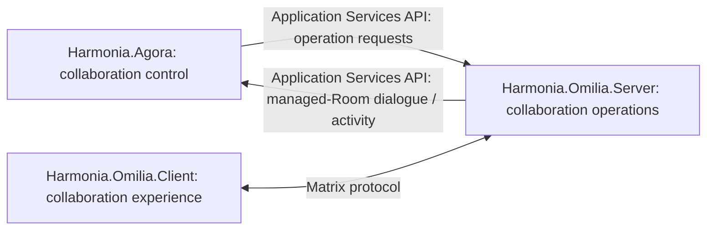

---
{
  "schemaVersion": 1,
  "canonicalId": "49c52c0466bc4760a11e0ca6fe8142c0",
  "archimateType": "ApplicationInterface",
  "specialization": null,
  "displayName": "Omilia Application Services API",
  "friendlyName": "OmiliaApplicationServicesApi",
  "canonicalName": null,
  "standing": {
    "semantic": "Candidate — adjudicated Domain05 Step-B baseline; final Solution Architecture unapproved",
    "currentness": "current",
    "qualification": "Exact source standing retained; migration/identity allocation does not approve architectural assertions."
  },
  "identity": {
    "allocation": "UUIDv4 allocated once under the explicit RAD-1.1.5 migration Task",
    "authority": "enterprise-architecture/design/evidence/1.1.5/002/before/ai-agent-tasks/20261021T092725Z-establish-and-apply-element-continuum.md",
    "sourceAbsenceCheck": "No existing governed canonical source binding for this bounded definition; no name-based correspondence adopted."
  },
  "naming": {
    "authority": "docs/markdown/governance/canonical-identity-and-naming.md",
    "mode": "Local lexical component; no root or containment completeness inferred",
    "expected": {
      "friendlyName": "OmiliaApplicationServicesApi",
      "canonicalName": null
    }
  },
  "provenance": [
    {
      "source": "docs/markdown/05-information-systems-architecture/agora-omilia-collaboration.md",
      "selector": "## Application Services API / explicitly exposed interface",
      "role": "ingested architectural definition or explicit source contribution",
      "revision": "aadcd55252fa7965be8a4321832ecc6d5b97c6e0",
      "sha256": "49ee8d088dc0a75dd3dc7f85051f438d8cfe147ccaeaba20f24db38d9819348b",
      "standing": "Candidate — adjudicated Domain05 Step-B baseline; final Solution Architecture unapproved"
    }
  ],
  "sourceBindings": [
    {
      "source": "docs/markdown/05-information-systems-architecture/agora-omilia-collaboration.md",
      "selector": "## Application Services API / explicitly exposed interface"
    }
  ],
  "exchange": {
    "identifier": "id-7cc42c566a3950ca8d6e5903e7e3d0cd",
    "properties": []
  },
  "relationships": [],
  "unresolvedProperties": {
    "canonicalName": "Formal qualifier for native ApplicationInterface is not established in the current naming contract; HCRL 1.1.5-002 DR-5. Identity and source content are independently determinate."
  },
  "representation": {
    "sourceLinksRebased": true,
    "authority": "HCRL 1.1.5-002 DR-3; source meaning unchanged"
  }
}
---

# Omilia Application Services API

## Architectural content

Omilia.Server exposes an **Application Services API** used by Agora both to
request collaboration operations and to receive managed-Room dialogue/activity.

Agora decides to create/change a managed Room/Space, add/remove a participant or
publish information; Omilia.Server performs the operation. Room activity returns
through the same architectural boundary. The exact API contract, technology and
mapping to upstream Matrix interfaces remain deferred. Historical Admin,
Client-Server and AS-transaction endpoints do not define this new contract.

Workflow/execution collaboration continues through Petasos with **no direct
Agora-to-Ponos dependency**. Matrix DTO encapsulation, Themis default-deny
governance and zero-PHI Room aliases/names/topics remain repository constraints.
Membership or receipt of a notification does not confer information-access rights.

[U19](../../../../docs/markdown/05-information-systems-architecture/sources.md#u19) establishes the administrative interaction boundary:
Administrator → Omilia → Agora → Administrative Function → specialised
Administrative Ergon → governed subsystem operation. Stopped-Twin resumption
uses this pattern, with normal authorisation, Context, execution and Kleio audit
controls; Agora and Omilia do not directly resume or manipulate the Twin.
The arrows describe semantic progression and retain Petasos execution handoff
and Agora's no-direct-Ponos-dependency rule. Iris provides a separate path through
Iris-BackEnd and does **not** directly interact with Agora or Omilia. Broader
Administrative Function reconciliation is [deferred](../../../../docs/markdown/05-information-systems-architecture/gaps.md#administrative-function-finding).

Identity mapping/provisioning is collaboration integration, not authentication
authority. Existing isolation constraints are not relaxed; detailed security,
privacy and external/federated interactions remain deferred.
