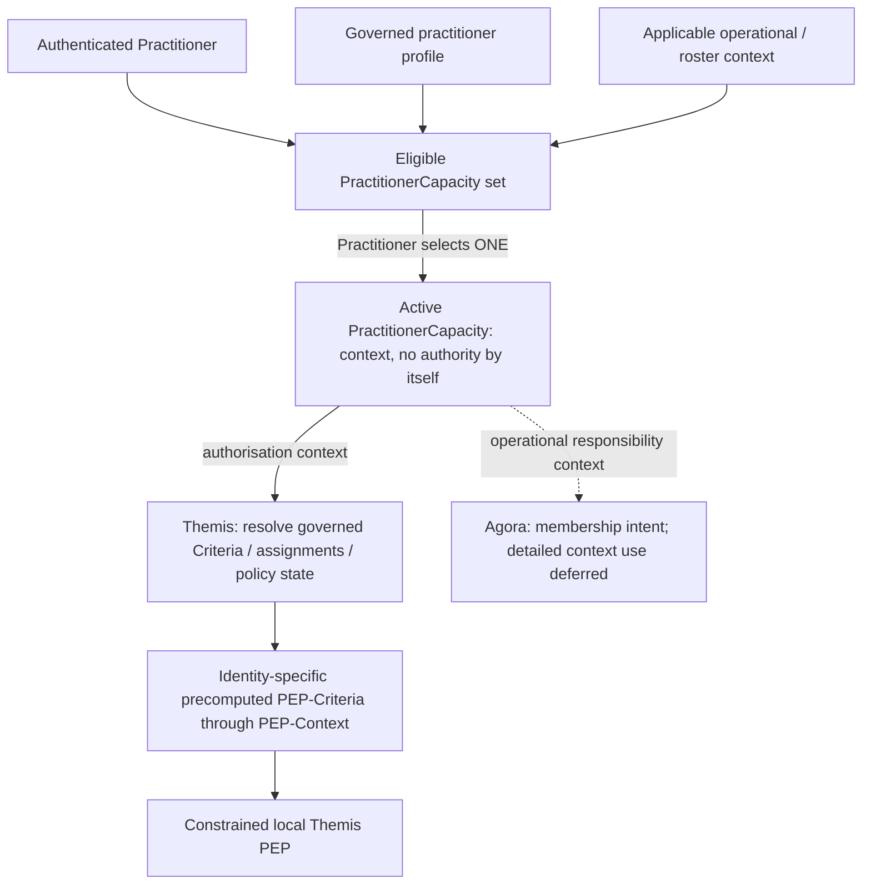

---
{
  "schemaVersion": 1,
  "canonicalId": "008f622bf9ce4d40b8a85024748bd485",
  "archimateType": "DataObject",
  "specialization": null,
  "displayName": "PractitionerCapacity",
  "friendlyName": "PractitionerCapacity",
  "canonicalName": null,
  "standing": {
    "semantic": "Candidate — adjudicated Domain05 Step-B baseline; final Solution Architecture unapproved",
    "currentness": "current",
    "qualification": "Exact source standing retained; migration/identity allocation does not approve architectural assertions."
  },
  "identity": {
    "allocation": "UUIDv4 allocated once under the explicit RAD-1.1.5 migration Task",
    "authority": "enterprise-architecture/design/evidence/1.1.5/002/before/ai-agent-tasks/20261021T092725Z-establish-and-apply-element-continuum.md",
    "sourceAbsenceCheck": "No existing governed canonical source binding for this bounded definition; no name-based correspondence adopted."
  },
  "naming": {
    "authority": "docs/markdown/governance/canonical-identity-and-naming.md",
    "mode": "Local lexical component; no root or containment completeness inferred",
    "expected": {
      "friendlyName": "PractitionerCapacity",
      "canonicalName": null
    }
  },
  "provenance": [
    {
      "source": "docs/markdown/05-information-systems-architecture/component-register.md",
      "selector": "#### PractitionerCapacity and operational responsibility",
      "role": "ingested architectural definition or explicit source contribution",
      "revision": "aadcd55252fa7965be8a4321832ecc6d5b97c6e0",
      "sha256": "7f493dae1db3e77fe0342f7c21501763a4af2b4de9c59871a109626eaaad5aa0",
      "standing": "Candidate — adjudicated Domain05 Step-B baseline; final Solution Architecture unapproved"
    }
  ],
  "sourceBindings": [
    {
      "source": "docs/markdown/05-information-systems-architecture/component-register.md",
      "selector": "#### PractitionerCapacity and operational responsibility"
    }
  ],
  "exchange": {
    "identifier": "id-cb319b29099f5670b9c21ce21d7e17f5",
    "properties": []
  },
  "relationships": [],
  "unresolvedProperties": {
    "canonicalName": "Formal qualifier for native DataObject is not established in the current naming contract; HCRL 1.1.5-002 DR-5. Identity and source content are independently determinate."
  },
  "representation": {
    "sourceLinksRebased": true,
    "authority": "HCRL 1.1.5-002 DR-3; source meaning unchanged"
  }
}
---

# PractitionerCapacity

## Architectural content

For a Practitioner, the available PractitionerCapacity set is constrained by
the practitioner's governed profile and applicable operational context. The
Practitioner selects **one active PractitionerCapacity** for the applicable
session/operational or roster context. It supplies operational context used by
Themis when deriving effective authorisation; **it does not itself confer authority**.
Selection UI and the exact PractitionerCapacity ↔ FHIR PractitionerRole mapping
remain deferred.

> **Authentication establishes who the Individual is. PractitionerCapacity
> establishes the capacity in which a Practitioner is currently acting. Themis
> establishes what that Identity, acting in that capacity, may do.**

Themis answers **“May this Identity perform this action on this information?”**
Future Agora collaboration detail concerns **“Is this Practitioner currently
responsible for receiving/responding to this operational activity?”** These are
separate responsibilities even where they consume the same PractitionerCapacity.
Receipt of an escalation or approval notification grants no information access.
Following it into Iris or another application surface requires normal Themis PEP
enforcement using current valid PEP-Criteria. U16 establishes
[Agora control and Omilia operations](../application-component/d1c4053e68384080b8eb79d2008632ba.md);
detailed membership, escalation and approval-routing mechanics remain deferred.
