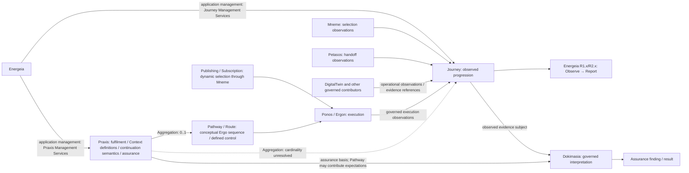

---
{
  "schemaVersion": 1,
  "canonicalId": "359b901df27f4b43b5a2ff14a8484e34",
  "archimateType": "DataObject",
  "specialization": null,
  "displayName": "Journey",
  "friendlyName": "Journey",
  "canonicalName": null,
  "standing": {
    "semantic": "Candidate — accepted Step-B baseline; final Solution Architecture unapproved",
    "currentness": "current",
    "qualification": "Exact source standing retained; migration/identity allocation does not approve architectural assertions."
  },
  "identity": {
    "allocation": "UUIDv4 allocated once under the explicit RAD-1.1.5 migration Task",
    "authority": "enterprise-architecture/design/evidence/1.1.5/002/before/ai-agent-tasks/20261021T092725Z-establish-and-apply-element-continuum.md",
    "sourceAbsenceCheck": "No existing governed canonical source binding for this bounded definition; no name-based correspondence adopted."
  },
  "naming": {
    "authority": "docs/markdown/governance/canonical-identity-and-naming.md",
    "mode": "Local lexical component; no root or containment completeness inferred",
    "expected": {
      "friendlyName": "Journey",
      "canonicalName": null
    }
  },
  "provenance": [
    {
      "source": "docs/markdown/05-information-systems-architecture/component-register.md",
      "selector": "### C35 — Journey",
      "role": "ingested architectural definition or explicit source contribution",
      "revision": "aadcd55252fa7965be8a4321832ecc6d5b97c6e0",
      "sha256": "7f493dae1db3e77fe0342f7c21501763a4af2b4de9c59871a109626eaaad5aa0",
      "standing": "Candidate — accepted Step-B baseline; final Solution Architecture unapproved"
    },
    {
      "source": "docs/markdown/05-information-systems-architecture/pathways-journeys-and-handoff.md",
      "selector": "## Journey: common observation and assurance subject",
      "role": "ingested architectural definition or explicit source contribution",
      "revision": "aadcd55252fa7965be8a4321832ecc6d5b97c6e0",
      "sha256": "a397dee9209f308b7a6a9615ce0a46780faa6acc4724c0e537cf9e08894ab69c",
      "standing": "Candidate — adjudicated Domain05 Step-B baseline; final Solution Architecture unapproved"
    },
    {
      "source": "docs/markdown/05-information-systems-architecture/pathways-journeys-and-handoff.md",
      "selector": "## Journey and authoritative Audit Capture",
      "role": "ingested architectural definition or explicit source contribution",
      "revision": "aadcd55252fa7965be8a4321832ecc6d5b97c6e0",
      "sha256": "a397dee9209f308b7a6a9615ce0a46780faa6acc4724c0e537cf9e08894ab69c",
      "standing": "Candidate — adjudicated Domain05 Step-B baseline; final Solution Architecture unapproved"
    },
    {
      "source": "docs/markdown/05-information-systems-architecture/data-and-persistence.md",
      "selector": "table assertion: | D21 | Journey — meaningful observed Praxis progression | **Energeia owns Journey / Journey Management Services**; Mneme provides governed Context/Pragma access; contributors retain ownership; Dokimasia consumes Journey as evidence subject against Praxis | **Mnemosyne O&A** provides durability; small discrete representation references relevant activity/evidence. Continuation lineage supports Pathway progression without becoming complete Pragma provenance; Mneme may manage richer relationships | U04/U05/U06/U18; C35/F38/CDG-38. Construction/reference/correlation/retention/inference contracts unresolved. Pub/Sub-only Journeys remain valid; independent outputs may establish other Journeys. No Journey shard key. |",
      "role": "ingested architectural definition or explicit source contribution",
      "revision": "aadcd55252fa7965be8a4321832ecc6d5b97c6e0",
      "sha256": "8f1b4222a8e1303001235366a17de7555e56141711d5599c6851a7d865cb2dcd",
      "standing": "Candidate — adjudicated Domain05 Step-B baseline; final Solution Architecture unapproved"
    },
    {
      "source": "docs/markdown/05-information-systems-architecture/design-notes/DesignNote-Pragma-Outputs-and-Pathway-Continuation.md",
      "selector": "## 5. Journey consequence",
      "role": "ingested architectural definition or explicit source contribution",
      "revision": "aadcd55252fa7965be8a4321832ecc6d5b97c6e0",
      "sha256": "34aeaecd40a3e76469096d07ac67976e255e206a190c410b033b95369c95cfb3",
      "standing": "Architecturally adjudicated U18; candidate scope and representation deferrals retained"
    },
    {
      "source": "docs/markdown/05-information-systems-architecture/candidate-feature-map.md",
      "selector": "table assertion: | F38 | **Journey Management Services** — candidate responsibility/service set | **Energeia C39 owns Journey C35**; Mneme governed Context/Pragma access; Mnemosyne O&A durability; established contributors retain observations/references | Meaningful observed Praxis progression; continuation lineage is an important thread, not complete Pragma provenance. Small discrete representation references relevant activity/evidence for reporting/assurance | U06/U18 preserve U04/U05 factual observation and Pub/Sub-only Journeys. Independent outputs may establish other Journeys; Mneme may manage richer provenance. Construction/reference/correlation/retention CDG-38, decomposition CDG-39; no indiscriminate duplication or Journey shard key. |",
      "role": "ingested architectural definition or explicit source contribution",
      "revision": "aadcd55252fa7965be8a4321832ecc6d5b97c6e0",
      "sha256": "0585ca8887145ca21832bf1fcbf0f1829d1201251c7d7f68055b116bdf4afaab",
      "standing": "Candidate — adjudicated Domain05 Step-B baseline; final Solution Architecture unapproved"
    },
    {
      "source": "docs/markdown/05-information-systems-architecture/middleware.md",
      "selector": "table assertion: | M15 | **Journey management, evidence contribution and assurance use** | Energeia Journey Management Services aggregate/reference observations/information from Mneme, Petasos, Ponos/Ergon, DigitalTwin and other governed contributors; Mneme Context/Pragma management; Mnemosyne O&A durable responsibility | U06 resolves owner without owning all contributors or duplicating payloads. Journey evidence subject differs from Praxis assurance basis and Dokimasia inference/findings. Construction/reference/causal/correlation/retention contracts CDG-38; no schema/shard key or universal AuditEvents. |",
      "role": "ingested architectural definition or explicit source contribution",
      "revision": "aadcd55252fa7965be8a4321832ecc6d5b97c6e0",
      "sha256": "7ee1a4ab1c24abcb052daa5f0392270a8dc4997dd4083db8fea19736bc363213",
      "standing": "Candidate — adjudicated Domain05 Step-B baseline; final Solution Architecture unapproved"
    },
    {
      "source": "docs/markdown/05-information-systems-architecture/design-notes/DesignNote-Kleio-Audit-Information-Management-and-Resilient-Capture.md",
      "selector": "original lines 116-116",
      "revision": "aadcd55252fa7965be8a4321832ecc6d5b97c6e0",
      "role": "Exact DesignNote assertion contribution; source qualification retained",
      "authority": "enterprise-architecture/design/review/1.1.5/hcrl-1.1.5-002.pending.md#arb-semantic-reconciliation",
      "adjudication": "U07/U15"
    },
    {
      "source": "docs/markdown/05-information-systems-architecture/design-notes/DesignNote-Kleio-Audit-Information-Management-and-Resilient-Capture.md",
      "selector": "original lines 128-128",
      "revision": "aadcd55252fa7965be8a4321832ecc6d5b97c6e0",
      "role": "Exact DesignNote assertion contribution; source qualification retained",
      "authority": "enterprise-architecture/design/review/1.1.5/hcrl-1.1.5-002.pending.md#arb-semantic-reconciliation",
      "adjudication": "U07/U15"
    },
    {
      "source": "docs/markdown/05-information-systems-architecture/design-notes/DesignNote-Kleio-Audit-Information-Management-and-Resilient-Capture.md",
      "selector": "original lines 130-130",
      "revision": "aadcd55252fa7965be8a4321832ecc6d5b97c6e0",
      "role": "Exact DesignNote assertion contribution; source qualification retained",
      "authority": "enterprise-architecture/design/review/1.1.5/hcrl-1.1.5-002.pending.md#arb-semantic-reconciliation",
      "adjudication": "U07/U15"
    },
    {
      "source": "docs/markdown/05-information-systems-architecture/design-notes/DesignNote-Kleio-Audit-Information-Management-and-Resilient-Capture.md",
      "selector": "original lines 132-132",
      "revision": "aadcd55252fa7965be8a4321832ecc6d5b97c6e0",
      "role": "Exact DesignNote assertion contribution; source qualification retained",
      "authority": "enterprise-architecture/design/review/1.1.5/hcrl-1.1.5-002.pending.md#arb-semantic-reconciliation",
      "adjudication": "U07/U15"
    },
    {
      "source": "docs/markdown/05-information-systems-architecture/design-notes/DesignNote-Kleio-Audit-Information-Management.md",
      "selector": "original lines 92-92",
      "revision": "aadcd55252fa7965be8a4321832ecc6d5b97c6e0",
      "role": "Exact DesignNote assertion contribution; source qualification retained",
      "authority": "enterprise-architecture/design/review/1.1.5/hcrl-1.1.5-002.pending.md#arb-semantic-reconciliation",
      "adjudication": "U07/U15; earlier capture evolved by resilient-capture note"
    },
    {
      "source": "docs/markdown/05-information-systems-architecture/design-notes/DesignNote-Kleio-Audit-Information-Management.md",
      "selector": "original lines 94-94",
      "revision": "aadcd55252fa7965be8a4321832ecc6d5b97c6e0",
      "role": "Exact DesignNote assertion contribution; source qualification retained",
      "authority": "enterprise-architecture/design/review/1.1.5/hcrl-1.1.5-002.pending.md#arb-semantic-reconciliation",
      "adjudication": "U07/U15; earlier capture evolved by resilient-capture note"
    },
    {
      "source": "docs/markdown/05-information-systems-architecture/design-notes/DesignNote-Kleio-Audit-Information-Management.md",
      "selector": "original lines 107-107",
      "revision": "aadcd55252fa7965be8a4321832ecc6d5b97c6e0",
      "role": "Exact DesignNote assertion contribution; source qualification retained",
      "authority": "enterprise-architecture/design/review/1.1.5/hcrl-1.1.5-002.pending.md#arb-semantic-reconciliation",
      "adjudication": "U07/U15; earlier capture evolved by resilient-capture note"
    },
    {
      "source": "docs/markdown/05-information-systems-architecture/design-notes/DesignNote-Kleio-Audit-Information-Management.md",
      "selector": "original lines 109-109",
      "revision": "aadcd55252fa7965be8a4321832ecc6d5b97c6e0",
      "role": "Exact DesignNote assertion contribution; source qualification retained",
      "authority": "enterprise-architecture/design/review/1.1.5/hcrl-1.1.5-002.pending.md#arb-semantic-reconciliation",
      "adjudication": "U07/U15; earlier capture evolved by resilient-capture note"
    },
    {
      "source": "docs/markdown/05-information-systems-architecture/design-notes/DesignNote-Mneme-Publication-Subscription-and-Petasos-Handoff-Architecture.md",
      "selector": "original lines 631-631",
      "revision": "aadcd55252fa7965be8a4321832ecc6d5b97c6e0",
      "role": "Exact DesignNote assertion contribution; source qualification retained",
      "authority": "enterprise-architecture/design/review/1.1.5/hcrl-1.1.5-002.pending.md#arb-semantic-reconciliation",
      "adjudication": "U05/U09/U18"
    },
    {
      "source": "docs/markdown/05-information-systems-architecture/design-notes/DesignNote-Mneme-Publication-Subscription-and-Petasos-Handoff-Architecture.md",
      "selector": "original lines 633-633",
      "revision": "aadcd55252fa7965be8a4321832ecc6d5b97c6e0",
      "role": "Exact DesignNote assertion contribution; source qualification retained",
      "authority": "enterprise-architecture/design/review/1.1.5/hcrl-1.1.5-002.pending.md#arb-semantic-reconciliation",
      "adjudication": "U05/U09/U18"
    },
    {
      "source": "docs/markdown/05-information-systems-architecture/design-notes/DesignNote-Mneme-Publication-Subscription-and-Petasos-Handoff-Architecture.md",
      "selector": "original lines 663-663",
      "revision": "aadcd55252fa7965be8a4321832ecc6d5b97c6e0",
      "role": "Exact DesignNote assertion contribution; source qualification retained",
      "authority": "enterprise-architecture/design/review/1.1.5/hcrl-1.1.5-002.pending.md#arb-semantic-reconciliation",
      "adjudication": "U05/U09/U18"
    },
    {
      "source": "docs/markdown/05-information-systems-architecture/design-notes/DesignNote-Mneme-Publication-Subscription-and-Petasos-Handoff-Architecture.md",
      "selector": "original lines 665-665",
      "revision": "aadcd55252fa7965be8a4321832ecc6d5b97c6e0",
      "role": "Exact DesignNote assertion contribution; source qualification retained",
      "authority": "enterprise-architecture/design/review/1.1.5/hcrl-1.1.5-002.pending.md#arb-semantic-reconciliation",
      "adjudication": "U05/U09/U18"
    },
    {
      "source": "docs/markdown/05-information-systems-architecture/design-notes/DesignNote-Mneme-Publication-Subscription-and-Petasos-Handoff-Architecture.md",
      "selector": "original lines 666-666",
      "revision": "aadcd55252fa7965be8a4321832ecc6d5b97c6e0",
      "role": "Exact DesignNote assertion contribution; source qualification retained",
      "authority": "enterprise-architecture/design/review/1.1.5/hcrl-1.1.5-002.pending.md#arb-semantic-reconciliation",
      "adjudication": "U05/U09/U18"
    },
    {
      "source": "docs/markdown/05-information-systems-architecture/design-notes/DesignNote-Mneme-Publication-Subscription-and-Petasos-Handoff-Architecture.md",
      "selector": "original lines 667-667",
      "revision": "aadcd55252fa7965be8a4321832ecc6d5b97c6e0",
      "role": "Exact DesignNote assertion contribution; source qualification retained",
      "authority": "enterprise-architecture/design/review/1.1.5/hcrl-1.1.5-002.pending.md#arb-semantic-reconciliation",
      "adjudication": "U05/U09/U18"
    },
    {
      "source": "docs/markdown/05-information-systems-architecture/design-notes/DesignNote-Mneme-Publication-Subscription-and-Petasos-Handoff-Architecture.md",
      "selector": "original lines 668-668",
      "revision": "aadcd55252fa7965be8a4321832ecc6d5b97c6e0",
      "role": "Exact DesignNote assertion contribution; source qualification retained",
      "authority": "enterprise-architecture/design/review/1.1.5/hcrl-1.1.5-002.pending.md#arb-semantic-reconciliation",
      "adjudication": "U05/U09/U18"
    },
    {
      "source": "docs/markdown/05-information-systems-architecture/design-notes/DesignNote-Mneme-Publication-Subscription-and-Petasos-Handoff-Architecture.md",
      "selector": "original lines 669-669",
      "revision": "aadcd55252fa7965be8a4321832ecc6d5b97c6e0",
      "role": "Exact DesignNote assertion contribution; source qualification retained",
      "authority": "enterprise-architecture/design/review/1.1.5/hcrl-1.1.5-002.pending.md#arb-semantic-reconciliation",
      "adjudication": "U05/U09/U18"
    },
    {
      "source": "docs/markdown/05-information-systems-architecture/design-notes/DesignNote-Mneme-Publication-Subscription-and-Petasos-Handoff-Architecture.md",
      "selector": "original lines 671-671",
      "revision": "aadcd55252fa7965be8a4321832ecc6d5b97c6e0",
      "role": "Exact DesignNote assertion contribution; source qualification retained",
      "authority": "enterprise-architecture/design/review/1.1.5/hcrl-1.1.5-002.pending.md#arb-semantic-reconciliation",
      "adjudication": "U05/U09/U18"
    },
    {
      "source": "docs/markdown/05-information-systems-architecture/design-notes/DesignNote-Pathways-Journeys-and-Assurance-Representation.md",
      "selector": "original lines 246-246",
      "revision": "aadcd55252fa7965be8a4321832ecc6d5b97c6e0",
      "role": "Exact DesignNote assertion contribution; source qualification retained",
      "authority": "enterprise-architecture/design/review/1.1.5/hcrl-1.1.5-002.pending.md#arb-semantic-reconciliation",
      "adjudication": "U04/U06/U14/U18"
    },
    {
      "source": "docs/markdown/05-information-systems-architecture/design-notes/DesignNote-Pathways-Journeys-and-Assurance-Representation.md",
      "selector": "original lines 248-248",
      "revision": "aadcd55252fa7965be8a4321832ecc6d5b97c6e0",
      "role": "Exact DesignNote assertion contribution; source qualification retained",
      "authority": "enterprise-architecture/design/review/1.1.5/hcrl-1.1.5-002.pending.md#arb-semantic-reconciliation",
      "adjudication": "U04/U06/U14/U18"
    },
    {
      "source": "docs/markdown/05-information-systems-architecture/design-notes/DesignNote-Pathways-Journeys-and-Assurance-Representation.md",
      "selector": "original lines 250-250",
      "revision": "aadcd55252fa7965be8a4321832ecc6d5b97c6e0",
      "role": "Exact DesignNote assertion contribution; source qualification retained",
      "authority": "enterprise-architecture/design/review/1.1.5/hcrl-1.1.5-002.pending.md#arb-semantic-reconciliation",
      "adjudication": "U04/U06/U14/U18"
    },
    {
      "source": "docs/markdown/05-information-systems-architecture/design-notes/DesignNote-Pathways-Journeys-and-Assurance-Representation.md",
      "selector": "original lines 252-252",
      "revision": "aadcd55252fa7965be8a4321832ecc6d5b97c6e0",
      "role": "Exact DesignNote assertion contribution; source qualification retained",
      "authority": "enterprise-architecture/design/review/1.1.5/hcrl-1.1.5-002.pending.md#arb-semantic-reconciliation",
      "adjudication": "U04/U06/U14/U18"
    },
    {
      "source": "docs/markdown/05-information-systems-architecture/design-notes/DesignNote-Pathways-Journeys-and-Assurance-Representation.md",
      "selector": "original lines 254-254",
      "revision": "aadcd55252fa7965be8a4321832ecc6d5b97c6e0",
      "role": "Exact DesignNote assertion contribution; source qualification retained",
      "authority": "enterprise-architecture/design/review/1.1.5/hcrl-1.1.5-002.pending.md#arb-semantic-reconciliation",
      "adjudication": "U04/U06/U14/U18"
    },
    {
      "source": "docs/markdown/05-information-systems-architecture/design-notes/DesignNote-Pathways-Journeys-and-Assurance-Representation.md",
      "selector": "original lines 278-278",
      "revision": "aadcd55252fa7965be8a4321832ecc6d5b97c6e0",
      "role": "Exact DesignNote assertion contribution; source qualification retained",
      "authority": "enterprise-architecture/design/review/1.1.5/hcrl-1.1.5-002.pending.md#arb-semantic-reconciliation",
      "adjudication": "U04/U06/U14/U18"
    },
    {
      "source": "docs/markdown/05-information-systems-architecture/design-notes/DesignNote-Pathways-Journeys-and-Assurance-Representation.md",
      "selector": "original lines 280-280",
      "revision": "aadcd55252fa7965be8a4321832ecc6d5b97c6e0",
      "role": "Exact DesignNote assertion contribution; source qualification retained",
      "authority": "enterprise-architecture/design/review/1.1.5/hcrl-1.1.5-002.pending.md#arb-semantic-reconciliation",
      "adjudication": "U04/U06/U14/U18"
    },
    {
      "source": "docs/markdown/05-information-systems-architecture/design-notes/DesignNote-Pathways-Journeys-and-Assurance-Representation.md",
      "selector": "original lines 282-282",
      "revision": "aadcd55252fa7965be8a4321832ecc6d5b97c6e0",
      "role": "Exact DesignNote assertion contribution; source qualification retained",
      "authority": "enterprise-architecture/design/review/1.1.5/hcrl-1.1.5-002.pending.md#arb-semantic-reconciliation",
      "adjudication": "U04/U06/U14/U18"
    },
    {
      "source": "docs/markdown/05-information-systems-architecture/design-notes/DesignNote-Pathways-Journeys-and-Assurance-Representation.md",
      "selector": "original lines 284-284",
      "revision": "aadcd55252fa7965be8a4321832ecc6d5b97c6e0",
      "role": "Exact DesignNote assertion contribution; source qualification retained",
      "authority": "enterprise-architecture/design/review/1.1.5/hcrl-1.1.5-002.pending.md#arb-semantic-reconciliation",
      "adjudication": "U04/U06/U14/U18"
    },
    {
      "source": "docs/markdown/05-information-systems-architecture/design-notes/DesignNote-Pathways-Journeys-and-Assurance-Representation.md",
      "selector": "original lines 296-296",
      "revision": "aadcd55252fa7965be8a4321832ecc6d5b97c6e0",
      "role": "Exact DesignNote assertion contribution; source qualification retained",
      "authority": "enterprise-architecture/design/review/1.1.5/hcrl-1.1.5-002.pending.md#arb-semantic-reconciliation",
      "adjudication": "U04/U06/U14/U18"
    },
    {
      "source": "docs/markdown/05-information-systems-architecture/design-notes/DesignNote-Pathways-Journeys-and-Assurance-Representation.md",
      "selector": "original lines 298-298",
      "revision": "aadcd55252fa7965be8a4321832ecc6d5b97c6e0",
      "role": "Exact DesignNote assertion contribution; source qualification retained",
      "authority": "enterprise-architecture/design/review/1.1.5/hcrl-1.1.5-002.pending.md#arb-semantic-reconciliation",
      "adjudication": "U04/U06/U14/U18"
    },
    {
      "source": "docs/markdown/05-information-systems-architecture/design-notes/DesignNote-Pathways-Journeys-and-Assurance-Representation.md",
      "selector": "original lines 310-310",
      "revision": "aadcd55252fa7965be8a4321832ecc6d5b97c6e0",
      "role": "Exact DesignNote assertion contribution; source qualification retained",
      "authority": "enterprise-architecture/design/review/1.1.5/hcrl-1.1.5-002.pending.md#arb-semantic-reconciliation",
      "adjudication": "U04/U06/U14/U18"
    },
    {
      "source": "docs/markdown/05-information-systems-architecture/design-notes/DesignNote-Pathways-Journeys-and-Assurance-Representation.md",
      "selector": "original lines 312-312",
      "revision": "aadcd55252fa7965be8a4321832ecc6d5b97c6e0",
      "role": "Exact DesignNote assertion contribution; source qualification retained",
      "authority": "enterprise-architecture/design/review/1.1.5/hcrl-1.1.5-002.pending.md#arb-semantic-reconciliation",
      "adjudication": "U04/U06/U14/U18"
    },
    {
      "source": "docs/markdown/05-information-systems-architecture/design-notes/DesignNote-Pathways-Journeys-and-Assurance-Representation.md",
      "selector": "original lines 318-318",
      "revision": "aadcd55252fa7965be8a4321832ecc6d5b97c6e0",
      "role": "Exact DesignNote assertion contribution; source qualification retained",
      "authority": "enterprise-architecture/design/review/1.1.5/hcrl-1.1.5-002.pending.md#arb-semantic-reconciliation",
      "adjudication": "U04/U06/U14/U18"
    },
    {
      "source": "docs/markdown/05-information-systems-architecture/design-notes/DesignNote-Pathways-Journeys-and-Assurance-Representation.md",
      "selector": "original lines 320-320",
      "revision": "aadcd55252fa7965be8a4321832ecc6d5b97c6e0",
      "role": "Exact DesignNote assertion contribution; source qualification retained",
      "authority": "enterprise-architecture/design/review/1.1.5/hcrl-1.1.5-002.pending.md#arb-semantic-reconciliation",
      "adjudication": "U04/U06/U14/U18"
    },
    {
      "source": "docs/markdown/05-information-systems-architecture/design-notes/DesignNote-Pathways-Journeys-and-Assurance-Representation.md",
      "selector": "original lines 322-322",
      "revision": "aadcd55252fa7965be8a4321832ecc6d5b97c6e0",
      "role": "Exact DesignNote assertion contribution; source qualification retained",
      "authority": "enterprise-architecture/design/review/1.1.5/hcrl-1.1.5-002.pending.md#arb-semantic-reconciliation",
      "adjudication": "U04/U06/U14/U18"
    },
    {
      "source": "docs/markdown/05-information-systems-architecture/design-notes/DesignNote-Pathways-Journeys-and-Assurance-Representation.md",
      "selector": "original lines 324-324",
      "revision": "aadcd55252fa7965be8a4321832ecc6d5b97c6e0",
      "role": "Exact DesignNote assertion contribution; source qualification retained",
      "authority": "enterprise-architecture/design/review/1.1.5/hcrl-1.1.5-002.pending.md#arb-semantic-reconciliation",
      "adjudication": "U04/U06/U14/U18"
    },
    {
      "source": "docs/markdown/05-information-systems-architecture/design-notes/DesignNote-Pathways-Journeys-and-Assurance-Representation.md",
      "selector": "original lines 338-338",
      "revision": "aadcd55252fa7965be8a4321832ecc6d5b97c6e0",
      "role": "Exact DesignNote assertion contribution; source qualification retained",
      "authority": "enterprise-architecture/design/review/1.1.5/hcrl-1.1.5-002.pending.md#arb-semantic-reconciliation",
      "adjudication": "U04/U06/U14/U18"
    },
    {
      "source": "docs/markdown/05-information-systems-architecture/design-notes/DesignNote-Pathways-Journeys-and-Assurance-Representation.md",
      "selector": "original lines 340-340",
      "revision": "aadcd55252fa7965be8a4321832ecc6d5b97c6e0",
      "role": "Exact DesignNote assertion contribution; source qualification retained",
      "authority": "enterprise-architecture/design/review/1.1.5/hcrl-1.1.5-002.pending.md#arb-semantic-reconciliation",
      "adjudication": "U04/U06/U14/U18"
    },
    {
      "source": "docs/markdown/05-information-systems-architecture/design-notes/DesignNote-Pathways-Journeys-and-Assurance-Representation.md",
      "selector": "original lines 342-342",
      "revision": "aadcd55252fa7965be8a4321832ecc6d5b97c6e0",
      "role": "Exact DesignNote assertion contribution; source qualification retained",
      "authority": "enterprise-architecture/design/review/1.1.5/hcrl-1.1.5-002.pending.md#arb-semantic-reconciliation",
      "adjudication": "U04/U06/U14/U18"
    },
    {
      "source": "docs/markdown/05-information-systems-architecture/design-notes/DesignNote-Pathways-Journeys-and-Assurance-Representation.md",
      "selector": "original lines 343-343",
      "revision": "aadcd55252fa7965be8a4321832ecc6d5b97c6e0",
      "role": "Exact DesignNote assertion contribution; source qualification retained",
      "authority": "enterprise-architecture/design/review/1.1.5/hcrl-1.1.5-002.pending.md#arb-semantic-reconciliation",
      "adjudication": "U04/U06/U14/U18"
    },
    {
      "source": "docs/markdown/05-information-systems-architecture/design-notes/DesignNote-Pathways-Journeys-and-Assurance-Representation.md",
      "selector": "original lines 344-344",
      "revision": "aadcd55252fa7965be8a4321832ecc6d5b97c6e0",
      "role": "Exact DesignNote assertion contribution; source qualification retained",
      "authority": "enterprise-architecture/design/review/1.1.5/hcrl-1.1.5-002.pending.md#arb-semantic-reconciliation",
      "adjudication": "U04/U06/U14/U18"
    },
    {
      "source": "docs/markdown/05-information-systems-architecture/design-notes/DesignNote-Pathways-Journeys-and-Assurance-Representation.md",
      "selector": "original lines 345-345",
      "revision": "aadcd55252fa7965be8a4321832ecc6d5b97c6e0",
      "role": "Exact DesignNote assertion contribution; source qualification retained",
      "authority": "enterprise-architecture/design/review/1.1.5/hcrl-1.1.5-002.pending.md#arb-semantic-reconciliation",
      "adjudication": "U04/U06/U14/U18"
    },
    {
      "source": "docs/markdown/05-information-systems-architecture/design-notes/DesignNote-Pathways-Journeys-and-Assurance-Representation.md",
      "selector": "original lines 346-346",
      "revision": "aadcd55252fa7965be8a4321832ecc6d5b97c6e0",
      "role": "Exact DesignNote assertion contribution; source qualification retained",
      "authority": "enterprise-architecture/design/review/1.1.5/hcrl-1.1.5-002.pending.md#arb-semantic-reconciliation",
      "adjudication": "U04/U06/U14/U18"
    },
    {
      "source": "docs/markdown/05-information-systems-architecture/design-notes/DesignNote-Pathways-Journeys-and-Assurance-Representation.md",
      "selector": "original lines 347-347",
      "revision": "aadcd55252fa7965be8a4321832ecc6d5b97c6e0",
      "role": "Exact DesignNote assertion contribution; source qualification retained",
      "authority": "enterprise-architecture/design/review/1.1.5/hcrl-1.1.5-002.pending.md#arb-semantic-reconciliation",
      "adjudication": "U04/U06/U14/U18"
    },
    {
      "source": "docs/markdown/05-information-systems-architecture/design-notes/DesignNote-Pathways-Journeys-and-Assurance-Representation.md",
      "selector": "original lines 353-353",
      "revision": "aadcd55252fa7965be8a4321832ecc6d5b97c6e0",
      "role": "Exact DesignNote assertion contribution; source qualification retained",
      "authority": "enterprise-architecture/design/review/1.1.5/hcrl-1.1.5-002.pending.md#arb-semantic-reconciliation",
      "adjudication": "U04/U06/U14/U18"
    },
    {
      "source": "docs/markdown/05-information-systems-architecture/design-notes/DesignNote-Pathways-Journeys-and-Assurance-Representation.md",
      "selector": "original lines 355-355",
      "revision": "aadcd55252fa7965be8a4321832ecc6d5b97c6e0",
      "role": "Exact DesignNote assertion contribution; source qualification retained",
      "authority": "enterprise-architecture/design/review/1.1.5/hcrl-1.1.5-002.pending.md#arb-semantic-reconciliation",
      "adjudication": "U04/U06/U14/U18"
    },
    {
      "source": "docs/markdown/05-information-systems-architecture/design-notes/DesignNote-Pathways-Journeys-and-Assurance-Representation.md",
      "selector": "original lines 357-357",
      "revision": "aadcd55252fa7965be8a4321832ecc6d5b97c6e0",
      "role": "Exact DesignNote assertion contribution; source qualification retained",
      "authority": "enterprise-architecture/design/review/1.1.5/hcrl-1.1.5-002.pending.md#arb-semantic-reconciliation",
      "adjudication": "U04/U06/U14/U18"
    },
    {
      "source": "docs/markdown/05-information-systems-architecture/design-notes/DesignNote-Pathways-Journeys-and-Assurance-Representation.md",
      "selector": "original lines 358-358",
      "revision": "aadcd55252fa7965be8a4321832ecc6d5b97c6e0",
      "role": "Exact DesignNote assertion contribution; source qualification retained",
      "authority": "enterprise-architecture/design/review/1.1.5/hcrl-1.1.5-002.pending.md#arb-semantic-reconciliation",
      "adjudication": "U04/U06/U14/U18"
    },
    {
      "source": "docs/markdown/05-information-systems-architecture/design-notes/DesignNote-Pathways-Journeys-and-Assurance-Representation.md",
      "selector": "original lines 359-359",
      "revision": "aadcd55252fa7965be8a4321832ecc6d5b97c6e0",
      "role": "Exact DesignNote assertion contribution; source qualification retained",
      "authority": "enterprise-architecture/design/review/1.1.5/hcrl-1.1.5-002.pending.md#arb-semantic-reconciliation",
      "adjudication": "U04/U06/U14/U18"
    },
    {
      "source": "docs/markdown/05-information-systems-architecture/design-notes/DesignNote-Pathways-Journeys-and-Assurance-Representation.md",
      "selector": "original lines 360-360",
      "revision": "aadcd55252fa7965be8a4321832ecc6d5b97c6e0",
      "role": "Exact DesignNote assertion contribution; source qualification retained",
      "authority": "enterprise-architecture/design/review/1.1.5/hcrl-1.1.5-002.pending.md#arb-semantic-reconciliation",
      "adjudication": "U04/U06/U14/U18"
    },
    {
      "source": "docs/markdown/05-information-systems-architecture/design-notes/DesignNote-Pathways-Journeys-and-Assurance-Representation.md",
      "selector": "original lines 361-361",
      "revision": "aadcd55252fa7965be8a4321832ecc6d5b97c6e0",
      "role": "Exact DesignNote assertion contribution; source qualification retained",
      "authority": "enterprise-architecture/design/review/1.1.5/hcrl-1.1.5-002.pending.md#arb-semantic-reconciliation",
      "adjudication": "U04/U06/U14/U18"
    },
    {
      "source": "docs/markdown/05-information-systems-architecture/design-notes/DesignNote-Pathways-Journeys-and-Assurance-Representation.md",
      "selector": "original lines 362-362",
      "revision": "aadcd55252fa7965be8a4321832ecc6d5b97c6e0",
      "role": "Exact DesignNote assertion contribution; source qualification retained",
      "authority": "enterprise-architecture/design/review/1.1.5/hcrl-1.1.5-002.pending.md#arb-semantic-reconciliation",
      "adjudication": "U04/U06/U14/U18"
    },
    {
      "source": "docs/markdown/05-information-systems-architecture/design-notes/DesignNote-Pathways-Journeys-and-Assurance-Representation.md",
      "selector": "original lines 363-363",
      "revision": "aadcd55252fa7965be8a4321832ecc6d5b97c6e0",
      "role": "Exact DesignNote assertion contribution; source qualification retained",
      "authority": "enterprise-architecture/design/review/1.1.5/hcrl-1.1.5-002.pending.md#arb-semantic-reconciliation",
      "adjudication": "U04/U06/U14/U18"
    },
    {
      "source": "docs/markdown/05-information-systems-architecture/design-notes/DesignNote-Pathways-Journeys-and-Assurance-Representation.md",
      "selector": "original lines 364-364",
      "revision": "aadcd55252fa7965be8a4321832ecc6d5b97c6e0",
      "role": "Exact DesignNote assertion contribution; source qualification retained",
      "authority": "enterprise-architecture/design/review/1.1.5/hcrl-1.1.5-002.pending.md#arb-semantic-reconciliation",
      "adjudication": "U04/U06/U14/U18"
    },
    {
      "source": "docs/markdown/05-information-systems-architecture/design-notes/DesignNote-Pathways-Journeys-and-Assurance-Representation.md",
      "selector": "original lines 365-365",
      "revision": "aadcd55252fa7965be8a4321832ecc6d5b97c6e0",
      "role": "Exact DesignNote assertion contribution; source qualification retained",
      "authority": "enterprise-architecture/design/review/1.1.5/hcrl-1.1.5-002.pending.md#arb-semantic-reconciliation",
      "adjudication": "U04/U06/U14/U18"
    },
    {
      "source": "docs/markdown/05-information-systems-architecture/design-notes/DesignNote-Pathways-Journeys-and-Assurance-Representation.md",
      "selector": "original lines 366-366",
      "revision": "aadcd55252fa7965be8a4321832ecc6d5b97c6e0",
      "role": "Exact DesignNote assertion contribution; source qualification retained",
      "authority": "enterprise-architecture/design/review/1.1.5/hcrl-1.1.5-002.pending.md#arb-semantic-reconciliation",
      "adjudication": "U04/U06/U14/U18"
    },
    {
      "source": "docs/markdown/05-information-systems-architecture/design-notes/DesignNote-Pathways-Journeys-and-Assurance-Representation.md",
      "selector": "original lines 386-386",
      "revision": "aadcd55252fa7965be8a4321832ecc6d5b97c6e0",
      "role": "Exact DesignNote assertion contribution; source qualification retained",
      "authority": "enterprise-architecture/design/review/1.1.5/hcrl-1.1.5-002.pending.md#arb-semantic-reconciliation",
      "adjudication": "U04/U06/U14/U18"
    },
    {
      "source": "docs/markdown/05-information-systems-architecture/design-notes/DesignNote-Pathways-Journeys-and-Assurance-Representation.md",
      "selector": "original lines 388-388",
      "revision": "aadcd55252fa7965be8a4321832ecc6d5b97c6e0",
      "role": "Exact DesignNote assertion contribution; source qualification retained",
      "authority": "enterprise-architecture/design/review/1.1.5/hcrl-1.1.5-002.pending.md#arb-semantic-reconciliation",
      "adjudication": "U04/U06/U14/U18"
    },
    {
      "source": "docs/markdown/05-information-systems-architecture/design-notes/DesignNote-Pathways-Journeys-and-Assurance-Representation.md",
      "selector": "original lines 428-428",
      "revision": "aadcd55252fa7965be8a4321832ecc6d5b97c6e0",
      "role": "Exact DesignNote assertion contribution; source qualification retained",
      "authority": "enterprise-architecture/design/review/1.1.5/hcrl-1.1.5-002.pending.md#arb-semantic-reconciliation",
      "adjudication": "U04/U06/U14/U18"
    },
    {
      "source": "docs/markdown/05-information-systems-architecture/design-notes/DesignNote-Pathways-Journeys-and-Assurance-Representation.md",
      "selector": "original lines 430-430",
      "revision": "aadcd55252fa7965be8a4321832ecc6d5b97c6e0",
      "role": "Exact DesignNote assertion contribution; source qualification retained",
      "authority": "enterprise-architecture/design/review/1.1.5/hcrl-1.1.5-002.pending.md#arb-semantic-reconciliation",
      "adjudication": "U04/U06/U14/U18"
    },
    {
      "source": "docs/markdown/05-information-systems-architecture/design-notes/DesignNote-Pathways-Journeys-and-Assurance-Representation.md",
      "selector": "original lines 445-445",
      "revision": "aadcd55252fa7965be8a4321832ecc6d5b97c6e0",
      "role": "Exact DesignNote assertion contribution; source qualification retained",
      "authority": "enterprise-architecture/design/review/1.1.5/hcrl-1.1.5-002.pending.md#arb-semantic-reconciliation",
      "adjudication": "U04/U06/U14/U18"
    },
    {
      "source": "docs/markdown/05-information-systems-architecture/design-notes/DesignNote-Pathways-Journeys-and-Assurance-Representation.md",
      "selector": "original lines 447-447",
      "revision": "aadcd55252fa7965be8a4321832ecc6d5b97c6e0",
      "role": "Exact DesignNote assertion contribution; source qualification retained",
      "authority": "enterprise-architecture/design/review/1.1.5/hcrl-1.1.5-002.pending.md#arb-semantic-reconciliation",
      "adjudication": "U04/U06/U14/U18"
    },
    {
      "source": "docs/markdown/05-information-systems-architecture/design-notes/DesignNote-Pragma-Outputs-and-Pathway-Continuation.md",
      "selector": "original lines 112-114",
      "revision": "aadcd55252fa7965be8a4321832ecc6d5b97c6e0",
      "role": "Exact DesignNote assertion contribution; source qualification retained",
      "authority": "enterprise-architecture/design/review/1.1.5/hcrl-1.1.5-002.pending.md#arb-semantic-reconciliation",
      "adjudication": "U18"
    },
    {
      "source": "docs/markdown/05-information-systems-architecture/design-notes/DesignNote-Pragma-Outputs-and-Pathway-Continuation.md",
      "selector": "original lines 116-119",
      "revision": "aadcd55252fa7965be8a4321832ecc6d5b97c6e0",
      "role": "Exact DesignNote assertion contribution; source qualification retained",
      "authority": "enterprise-architecture/design/review/1.1.5/hcrl-1.1.5-002.pending.md#arb-semantic-reconciliation",
      "adjudication": "U18"
    },
    {
      "source": "docs/markdown/05-information-systems-architecture/design-notes/DesignNote-Pragma-Outputs-and-Pathway-Continuation.md",
      "selector": "original lines 121-128",
      "revision": "aadcd55252fa7965be8a4321832ecc6d5b97c6e0",
      "role": "Exact DesignNote assertion contribution; source qualification retained",
      "authority": "enterprise-architecture/design/review/1.1.5/hcrl-1.1.5-002.pending.md#arb-semantic-reconciliation",
      "adjudication": "U18"
    },
    {
      "source": "docs/markdown/05-information-systems-architecture/design-notes/DesignNote-Pylai-External-Interoperability-Architecture.md",
      "selector": "original lines 262-262",
      "revision": "aadcd55252fa7965be8a4321832ecc6d5b97c6e0",
      "role": "Exact DesignNote assertion contribution; source qualification retained",
      "authority": "enterprise-architecture/design/review/1.1.5/hcrl-1.1.5-002.pending.md#arb-semantic-reconciliation",
      "adjudication": "U14/U15"
    },
    {
      "source": "docs/markdown/05-information-systems-architecture/design-notes/DesignNote-Pylai-External-Interoperability-Architecture.md",
      "selector": "original lines 264-264",
      "revision": "aadcd55252fa7965be8a4321832ecc6d5b97c6e0",
      "role": "Exact DesignNote assertion contribution; source qualification retained",
      "authority": "enterprise-architecture/design/review/1.1.5/hcrl-1.1.5-002.pending.md#arb-semantic-reconciliation",
      "adjudication": "U14/U15"
    },
    {
      "source": "docs/markdown/05-information-systems-architecture/design-notes/DesignNote-Pylai-External-Interoperability-Architecture.md",
      "selector": "original lines 266-266",
      "revision": "aadcd55252fa7965be8a4321832ecc6d5b97c6e0",
      "role": "Exact DesignNote assertion contribution; source qualification retained",
      "authority": "enterprise-architecture/design/review/1.1.5/hcrl-1.1.5-002.pending.md#arb-semantic-reconciliation",
      "adjudication": "U14/U15"
    }
  ],
  "sourceBindings": [
    {
      "source": "docs/markdown/05-information-systems-architecture/component-register.md",
      "selector": "### C35 — Journey"
    },
    {
      "source": "docs/markdown/05-information-systems-architecture/pathways-journeys-and-handoff.md",
      "selector": "## Journey: common observation and assurance subject"
    },
    {
      "source": "docs/markdown/05-information-systems-architecture/pathways-journeys-and-handoff.md",
      "selector": "## Journey and authoritative Audit Capture"
    },
    {
      "source": "docs/markdown/05-information-systems-architecture/data-and-persistence.md",
      "selector": "table assertion: | D21 | Journey — meaningful observed Praxis progression | **Energeia owns Journey / Journey Management Services**; Mneme provides governed Context/Pragma access; contributors retain ownership; Dokimasia consumes Journey as evidence subject against Praxis | **Mnemosyne O&A** provides durability; small discrete representation references relevant activity/evidence. Continuation lineage supports Pathway progression without becoming complete Pragma provenance; Mneme may manage richer relationships | U04/U05/U06/U18; C35/F38/CDG-38. Construction/reference/correlation/retention/inference contracts unresolved. Pub/Sub-only Journeys remain valid; independent outputs may establish other Journeys. No Journey shard key. |"
    },
    {
      "source": "docs/markdown/05-information-systems-architecture/design-notes/DesignNote-Pragma-Outputs-and-Pathway-Continuation.md",
      "selector": "## 5. Journey consequence"
    },
    {
      "source": "docs/markdown/05-information-systems-architecture/candidate-feature-map.md",
      "selector": "table assertion: | F38 | **Journey Management Services** — candidate responsibility/service set | **Energeia C39 owns Journey C35**; Mneme governed Context/Pragma access; Mnemosyne O&A durability; established contributors retain observations/references | Meaningful observed Praxis progression; continuation lineage is an important thread, not complete Pragma provenance. Small discrete representation references relevant activity/evidence for reporting/assurance | U06/U18 preserve U04/U05 factual observation and Pub/Sub-only Journeys. Independent outputs may establish other Journeys; Mneme may manage richer provenance. Construction/reference/correlation/retention CDG-38, decomposition CDG-39; no indiscriminate duplication or Journey shard key. |"
    },
    {
      "source": "docs/markdown/05-information-systems-architecture/middleware.md",
      "selector": "table assertion: | M15 | **Journey management, evidence contribution and assurance use** | Energeia Journey Management Services aggregate/reference observations/information from Mneme, Petasos, Ponos/Ergon, DigitalTwin and other governed contributors; Mneme Context/Pragma management; Mnemosyne O&A durable responsibility | U06 resolves owner without owning all contributors or duplicating payloads. Journey evidence subject differs from Praxis assurance basis and Dokimasia inference/findings. Construction/reference/causal/correlation/retention contracts CDG-38; no schema/shard key or universal AuditEvents. |"
    },
    {
      "source": "docs/markdown/05-information-systems-architecture/design-notes/DesignNote-Kleio-Audit-Information-Management-and-Resilient-Capture.md",
      "selector": "original lines 116-116"
    },
    {
      "source": "docs/markdown/05-information-systems-architecture/design-notes/DesignNote-Kleio-Audit-Information-Management-and-Resilient-Capture.md",
      "selector": "original lines 128-128"
    },
    {
      "source": "docs/markdown/05-information-systems-architecture/design-notes/DesignNote-Kleio-Audit-Information-Management-and-Resilient-Capture.md",
      "selector": "original lines 130-130"
    },
    {
      "source": "docs/markdown/05-information-systems-architecture/design-notes/DesignNote-Kleio-Audit-Information-Management-and-Resilient-Capture.md",
      "selector": "original lines 132-132"
    },
    {
      "source": "docs/markdown/05-information-systems-architecture/design-notes/DesignNote-Kleio-Audit-Information-Management.md",
      "selector": "original lines 92-92"
    },
    {
      "source": "docs/markdown/05-information-systems-architecture/design-notes/DesignNote-Kleio-Audit-Information-Management.md",
      "selector": "original lines 94-94"
    },
    {
      "source": "docs/markdown/05-information-systems-architecture/design-notes/DesignNote-Kleio-Audit-Information-Management.md",
      "selector": "original lines 107-107"
    },
    {
      "source": "docs/markdown/05-information-systems-architecture/design-notes/DesignNote-Kleio-Audit-Information-Management.md",
      "selector": "original lines 109-109"
    },
    {
      "source": "docs/markdown/05-information-systems-architecture/design-notes/DesignNote-Mneme-Publication-Subscription-and-Petasos-Handoff-Architecture.md",
      "selector": "original lines 631-631"
    },
    {
      "source": "docs/markdown/05-information-systems-architecture/design-notes/DesignNote-Mneme-Publication-Subscription-and-Petasos-Handoff-Architecture.md",
      "selector": "original lines 633-633"
    },
    {
      "source": "docs/markdown/05-information-systems-architecture/design-notes/DesignNote-Mneme-Publication-Subscription-and-Petasos-Handoff-Architecture.md",
      "selector": "original lines 663-663"
    },
    {
      "source": "docs/markdown/05-information-systems-architecture/design-notes/DesignNote-Mneme-Publication-Subscription-and-Petasos-Handoff-Architecture.md",
      "selector": "original lines 665-665"
    },
    {
      "source": "docs/markdown/05-information-systems-architecture/design-notes/DesignNote-Mneme-Publication-Subscription-and-Petasos-Handoff-Architecture.md",
      "selector": "original lines 666-666"
    },
    {
      "source": "docs/markdown/05-information-systems-architecture/design-notes/DesignNote-Mneme-Publication-Subscription-and-Petasos-Handoff-Architecture.md",
      "selector": "original lines 667-667"
    },
    {
      "source": "docs/markdown/05-information-systems-architecture/design-notes/DesignNote-Mneme-Publication-Subscription-and-Petasos-Handoff-Architecture.md",
      "selector": "original lines 668-668"
    },
    {
      "source": "docs/markdown/05-information-systems-architecture/design-notes/DesignNote-Mneme-Publication-Subscription-and-Petasos-Handoff-Architecture.md",
      "selector": "original lines 669-669"
    },
    {
      "source": "docs/markdown/05-information-systems-architecture/design-notes/DesignNote-Mneme-Publication-Subscription-and-Petasos-Handoff-Architecture.md",
      "selector": "original lines 671-671"
    },
    {
      "source": "docs/markdown/05-information-systems-architecture/design-notes/DesignNote-Pathways-Journeys-and-Assurance-Representation.md",
      "selector": "original lines 246-246"
    },
    {
      "source": "docs/markdown/05-information-systems-architecture/design-notes/DesignNote-Pathways-Journeys-and-Assurance-Representation.md",
      "selector": "original lines 248-248"
    },
    {
      "source": "docs/markdown/05-information-systems-architecture/design-notes/DesignNote-Pathways-Journeys-and-Assurance-Representation.md",
      "selector": "original lines 250-250"
    },
    {
      "source": "docs/markdown/05-information-systems-architecture/design-notes/DesignNote-Pathways-Journeys-and-Assurance-Representation.md",
      "selector": "original lines 252-252"
    },
    {
      "source": "docs/markdown/05-information-systems-architecture/design-notes/DesignNote-Pathways-Journeys-and-Assurance-Representation.md",
      "selector": "original lines 254-254"
    },
    {
      "source": "docs/markdown/05-information-systems-architecture/design-notes/DesignNote-Pathways-Journeys-and-Assurance-Representation.md",
      "selector": "original lines 278-278"
    },
    {
      "source": "docs/markdown/05-information-systems-architecture/design-notes/DesignNote-Pathways-Journeys-and-Assurance-Representation.md",
      "selector": "original lines 280-280"
    },
    {
      "source": "docs/markdown/05-information-systems-architecture/design-notes/DesignNote-Pathways-Journeys-and-Assurance-Representation.md",
      "selector": "original lines 282-282"
    },
    {
      "source": "docs/markdown/05-information-systems-architecture/design-notes/DesignNote-Pathways-Journeys-and-Assurance-Representation.md",
      "selector": "original lines 284-284"
    },
    {
      "source": "docs/markdown/05-information-systems-architecture/design-notes/DesignNote-Pathways-Journeys-and-Assurance-Representation.md",
      "selector": "original lines 296-296"
    },
    {
      "source": "docs/markdown/05-information-systems-architecture/design-notes/DesignNote-Pathways-Journeys-and-Assurance-Representation.md",
      "selector": "original lines 298-298"
    },
    {
      "source": "docs/markdown/05-information-systems-architecture/design-notes/DesignNote-Pathways-Journeys-and-Assurance-Representation.md",
      "selector": "original lines 310-310"
    },
    {
      "source": "docs/markdown/05-information-systems-architecture/design-notes/DesignNote-Pathways-Journeys-and-Assurance-Representation.md",
      "selector": "original lines 312-312"
    },
    {
      "source": "docs/markdown/05-information-systems-architecture/design-notes/DesignNote-Pathways-Journeys-and-Assurance-Representation.md",
      "selector": "original lines 318-318"
    },
    {
      "source": "docs/markdown/05-information-systems-architecture/design-notes/DesignNote-Pathways-Journeys-and-Assurance-Representation.md",
      "selector": "original lines 320-320"
    },
    {
      "source": "docs/markdown/05-information-systems-architecture/design-notes/DesignNote-Pathways-Journeys-and-Assurance-Representation.md",
      "selector": "original lines 322-322"
    },
    {
      "source": "docs/markdown/05-information-systems-architecture/design-notes/DesignNote-Pathways-Journeys-and-Assurance-Representation.md",
      "selector": "original lines 324-324"
    },
    {
      "source": "docs/markdown/05-information-systems-architecture/design-notes/DesignNote-Pathways-Journeys-and-Assurance-Representation.md",
      "selector": "original lines 338-338"
    },
    {
      "source": "docs/markdown/05-information-systems-architecture/design-notes/DesignNote-Pathways-Journeys-and-Assurance-Representation.md",
      "selector": "original lines 340-340"
    },
    {
      "source": "docs/markdown/05-information-systems-architecture/design-notes/DesignNote-Pathways-Journeys-and-Assurance-Representation.md",
      "selector": "original lines 342-342"
    },
    {
      "source": "docs/markdown/05-information-systems-architecture/design-notes/DesignNote-Pathways-Journeys-and-Assurance-Representation.md",
      "selector": "original lines 343-343"
    },
    {
      "source": "docs/markdown/05-information-systems-architecture/design-notes/DesignNote-Pathways-Journeys-and-Assurance-Representation.md",
      "selector": "original lines 344-344"
    },
    {
      "source": "docs/markdown/05-information-systems-architecture/design-notes/DesignNote-Pathways-Journeys-and-Assurance-Representation.md",
      "selector": "original lines 345-345"
    },
    {
      "source": "docs/markdown/05-information-systems-architecture/design-notes/DesignNote-Pathways-Journeys-and-Assurance-Representation.md",
      "selector": "original lines 346-346"
    },
    {
      "source": "docs/markdown/05-information-systems-architecture/design-notes/DesignNote-Pathways-Journeys-and-Assurance-Representation.md",
      "selector": "original lines 347-347"
    },
    {
      "source": "docs/markdown/05-information-systems-architecture/design-notes/DesignNote-Pathways-Journeys-and-Assurance-Representation.md",
      "selector": "original lines 353-353"
    },
    {
      "source": "docs/markdown/05-information-systems-architecture/design-notes/DesignNote-Pathways-Journeys-and-Assurance-Representation.md",
      "selector": "original lines 355-355"
    },
    {
      "source": "docs/markdown/05-information-systems-architecture/design-notes/DesignNote-Pathways-Journeys-and-Assurance-Representation.md",
      "selector": "original lines 357-357"
    },
    {
      "source": "docs/markdown/05-information-systems-architecture/design-notes/DesignNote-Pathways-Journeys-and-Assurance-Representation.md",
      "selector": "original lines 358-358"
    },
    {
      "source": "docs/markdown/05-information-systems-architecture/design-notes/DesignNote-Pathways-Journeys-and-Assurance-Representation.md",
      "selector": "original lines 359-359"
    },
    {
      "source": "docs/markdown/05-information-systems-architecture/design-notes/DesignNote-Pathways-Journeys-and-Assurance-Representation.md",
      "selector": "original lines 360-360"
    },
    {
      "source": "docs/markdown/05-information-systems-architecture/design-notes/DesignNote-Pathways-Journeys-and-Assurance-Representation.md",
      "selector": "original lines 361-361"
    },
    {
      "source": "docs/markdown/05-information-systems-architecture/design-notes/DesignNote-Pathways-Journeys-and-Assurance-Representation.md",
      "selector": "original lines 362-362"
    },
    {
      "source": "docs/markdown/05-information-systems-architecture/design-notes/DesignNote-Pathways-Journeys-and-Assurance-Representation.md",
      "selector": "original lines 363-363"
    },
    {
      "source": "docs/markdown/05-information-systems-architecture/design-notes/DesignNote-Pathways-Journeys-and-Assurance-Representation.md",
      "selector": "original lines 364-364"
    },
    {
      "source": "docs/markdown/05-information-systems-architecture/design-notes/DesignNote-Pathways-Journeys-and-Assurance-Representation.md",
      "selector": "original lines 365-365"
    },
    {
      "source": "docs/markdown/05-information-systems-architecture/design-notes/DesignNote-Pathways-Journeys-and-Assurance-Representation.md",
      "selector": "original lines 366-366"
    },
    {
      "source": "docs/markdown/05-information-systems-architecture/design-notes/DesignNote-Pathways-Journeys-and-Assurance-Representation.md",
      "selector": "original lines 386-386"
    },
    {
      "source": "docs/markdown/05-information-systems-architecture/design-notes/DesignNote-Pathways-Journeys-and-Assurance-Representation.md",
      "selector": "original lines 388-388"
    },
    {
      "source": "docs/markdown/05-information-systems-architecture/design-notes/DesignNote-Pathways-Journeys-and-Assurance-Representation.md",
      "selector": "original lines 428-428"
    },
    {
      "source": "docs/markdown/05-information-systems-architecture/design-notes/DesignNote-Pathways-Journeys-and-Assurance-Representation.md",
      "selector": "original lines 430-430"
    },
    {
      "source": "docs/markdown/05-information-systems-architecture/design-notes/DesignNote-Pathways-Journeys-and-Assurance-Representation.md",
      "selector": "original lines 445-445"
    },
    {
      "source": "docs/markdown/05-information-systems-architecture/design-notes/DesignNote-Pathways-Journeys-and-Assurance-Representation.md",
      "selector": "original lines 447-447"
    },
    {
      "source": "docs/markdown/05-information-systems-architecture/design-notes/DesignNote-Pragma-Outputs-and-Pathway-Continuation.md",
      "selector": "original lines 112-114"
    },
    {
      "source": "docs/markdown/05-information-systems-architecture/design-notes/DesignNote-Pragma-Outputs-and-Pathway-Continuation.md",
      "selector": "original lines 116-119"
    },
    {
      "source": "docs/markdown/05-information-systems-architecture/design-notes/DesignNote-Pragma-Outputs-and-Pathway-Continuation.md",
      "selector": "original lines 121-128"
    },
    {
      "source": "docs/markdown/05-information-systems-architecture/design-notes/DesignNote-Pylai-External-Interoperability-Architecture.md",
      "selector": "original lines 262-262"
    },
    {
      "source": "docs/markdown/05-information-systems-architecture/design-notes/DesignNote-Pylai-External-Interoperability-Architecture.md",
      "selector": "original lines 264-264"
    },
    {
      "source": "docs/markdown/05-information-systems-architecture/design-notes/DesignNote-Pylai-External-Interoperability-Architecture.md",
      "selector": "original lines 266-266"
    }
  ],
  "exchange": {
    "identifier": "id-d6c6c905b3a550559d9af94626aff245",
    "properties": []
  },
  "relationships": [],
  "unresolvedProperties": {
    "canonicalName": "Formal qualifier for native DataObject is not established in the current naming contract; HCRL 1.1.5-002 DR-5. Identity and source content are independently determinate."
  },
  "representation": {
    "sourceLinksRebased": true,
    "authority": "HCRL 1.1.5-002 DR-3; source meaning unchanged"
  }
}
---

# Journey

## Architectural content

First-class observational construct / candidate Application Data Object: governed
observed progression reconstructed from available execution evidence, whether
Pathway-controlled, Pub/Sub or mixed. It may be graph-shaped and have no Pathway.
Primary reporting, analysis and assurance subject; Dokimasia may
interpret it under applicable basis without replacing observations with inference.
**Energeia owns Journey and Journey Management Services F38** under U06. Mneme
manages governed information; Mnemosyne **O&A** provides durable persistence
responsibility. Journey aggregates/references observations/information from Mneme,
Petasos, Ponos, Ergon, DigitalTwin and other components/evidence mechanisms where
appropriate, retaining their ownership. Comparatively small discrete Journey
information may describe substantial activity/evidence: aggregate semantically,
without indiscriminate duplication. Detailed representation/construction, lifecycle,
retention, graph/evidence/causal/correlation/reference schema and inference contracts
remain unresolved ([CDG-38](../../../../docs/markdown/05-information-systems-architecture/gaps.md#journey-contracts)); Journey is not a shard key.
Journey is neither an engine, AI narrative nor automatic permanent AuditEvent.
For Pathway-based Praxis fulfilment, continuation-Pragma lineage provides an
important observable progression thread. **Journey lineage is not complete
Pragma provenance**: independent outputs may establish their own activity,
Pub/Sub interactions, Praxes and Journeys. Mneme may manage richer relationships.
Journey is not a complete provenance graph, execution log, audit trail or Petasos
queue history. [U18 reconciliation](359b901df27f4b43b5a2ff14a8484e34.md).

## Source-qualified contribution

Source: `docs/markdown/05-information-systems-architecture/pathways-journeys-and-handoff.md` — ## Journey: common observation and assurance subject. Standing: Candidate — adjudicated Domain05 Step-B baseline; final Solution Architecture unapproved.

> **Journey is the governed representation of meaningful observed progression
> of information and activity in fulfilment of a Praxis, reconstructed from
> available execution evidence and forming the primary subject of reporting, analysis and
> assurance, irrespective of whether that progression arose through
> Pathway-controlled routing, Publish/Subscribe processing, or a combination
> of both.**

Journey C35 is a first-class observational construct / candidate Application
Data Object, not an execution engine or merely a telemetry report. A Journey
may exist without a corresponding Pathway and may be graph-shaped because
observed progression can branch, fan out, converge or combine mechanisms.
Pathway controls permitted progression; Journey represents observed progression.

For a Praxis with a Pathway, Journey observes meaningful fulfilment against that
Pathway. **Pathway-continuation Pragma lineage is an important observable thread;
Journey lineage is not complete Pragma provenance.** Independently resulting
Pragma may establish their own activity, Pub/Sub interactions, Praxes and Journeys.
Common origin does not automatically include all that subsequent processing in
the originating Journey. Mneme may manage richer Pragma relationships/provenance
than that Journey represents. Journey remains neither a complete graph of information
provenance, execution log, audit trail nor Petasos queue history. Detailed
correlation remains open; graph-shaped observation does not imply complete provenance.

**Energeia owns Journey as an application responsibility** and SHALL provide
candidate **Journey Management Services**. These manage the governed representation
of observed progression and its semantic aggregation/references, supporting
operational reporting and assurance consumption. The detailed service
and construction contracts remain unresolved. Mneme remains the **Context and Pragma Manager**; Mnemosyne **Harmonia Operations & Assurance**
provides durable persistence responsibility. Application ownership does not
make Energeia a persistence owner or owner of all referenced information.

Journey is expected to hold comparatively little discrete information while
aggregating/referencing potentially substantial distributed activity/evidence.
**Aggregate semantically; do not duplicate governed information indiscriminately.**
Efficient Journey reconstruction/use is an architectural objective, not a graph
schema, correlation/causal algorithm, retention period or shard-key decision.



Labelled arrows distinguish application management, Aggregation and evidence
contribution/use. Detailed Journey representation/construction, reference/evidence
schema, causal/correlation/reconstruction algorithms and lifecycle/retention remain
[CDG-38](../../../../docs/markdown/05-information-systems-architecture/gaps.md#journey-contracts); Energeia ownership is resolved by U06.

| Contributing responsibility | Examples of available governed observations |
| :--- | :--- |
| **Mneme** | Publishing permitted/blocked; Subscription matched; Pattern condition matched; eligible consumer selected. |
| **Petasos** | Handoff established; destination identified; delivery attempted; delivery succeeded/failed or uncertain; redelivery/recovery observations. |
| **Consumer / Ponos / Ergon** | Undertaking established; execution attempted/occurred; activity result; checkpoint and progression observations. |
| **Pylai** | Applicable successful logical business interaction or technology/interoperability failure within the governed Journey; no universal Journey, fabricated Praxis or per-network-event AuditEvent requirement. |
| **DigitalTwin / other components / assurance-evidence mechanisms** | Governed operational observations or references where appropriate, preserving originating responsibility and Dokimasia terminal rules. |

These contributions can distinguish selection without handoff, handoff without
observed execution, and execution with failure or unexpected results. An absent
observation does not prove non-occurrence. Available evidence bounds the Journey;
missing or uncertain evidence remains distinguishable from established fact.

Reporting, analysis and Dokimasia assurance SHALL be capable of
operating against Journey. **Praxis is the assurance basis; Journey is the
evidence subject.** A Pathway/Route may contribute normative expectations as part
of the applicable Praxis; Pathway alone is not the general assurance basis.
Possible interpretation includes progression, branching and
convergence, conformance to applicable Praxis expectations, missing
or unexpected activity, failure/incomplete progression, information exposure,
policy/security anomalies, relationships between apparently separate activities
and significance in context. These are possible uses, not mandatory algorithms.
Praxis provides the operational and assurance envelope even where activity uses
Publish/Subscribe without a Pathway.

```text
Praxis: expected / permitted context       Journey: observed progression
         assurance rules                           evidence
                    \                               /
                     +------------+----------------+
                                  v
                              Dokimasia
                                  v
                        Assurance Finding / Result
```

```text
What Harmonia observed --> Journey
  --> what Harmonia can reason from those observations
  --> Dokimasia / governed AI Assurance activity
  --> what Harmonia concludes: Assurance Finding / Result
```

Journey is factual with respect to available governed observations/evidence.
Inferred relationships SHALL remain distinguishable from directly observed
relationships. Deterministic or AI interpretation cannot replace underlying
observations with inferred fact or turn Journey into an AI-generated narrative.
The inference/evidence representation and detailed Journey model are unresolved.
Evidence contribution, operational observation, AuditEvent and assurance finding
remain distinct; not every Journey observation becomes a permanent AuditEvent
(AX-08/09). Dokimasia's [terminal constraints](../../../../docs/markdown/05-information-systems-architecture/component-register.md#dokimasia-terminal-boundaries)
and operational independence remain intact.

## Source-qualified contribution

Source: `docs/markdown/05-information-systems-architecture/pathways-journeys-and-handoff.md` — ## Journey and authoritative Audit Capture. Standing: Candidate — adjudicated Domain05 Step-B baseline; final Solution Architecture unapproved.

Journey represents governed observed activity/progression; AuditEvent represents
an authoritative significant auditable occurrence. Journey is an important audit
source, **not the audit boundary**. A Journey may relate to many AuditEvents and
an AuditEvent may exist without Journey participation. **Journey participation
SHALL NOT be a prerequisite for Audit Capture.**

Kleio may consume Journey and Dokimasia outputs and provide historical audit
context back to Dokimasia. Audit is neither Governance nor Assurance; derived/
correlated/prepared historical views remain distinguishable from authoritative
evidence. Dokimasia's terminal rules continue to prohibit a separate own-execution
AuditEvent and recursive assurance; output consumption does not introduce either.

Client components report significant occurrences through Kleio's contract;
Kleio constructs immutable FHIR AuditEvent. Required authoritative durable audit
capture is a precondition of Harmonia operation, independent of Journey availability
or later reconstruction. [Kleio's history/availability rules](../../../../docs/markdown/05-information-systems-architecture/component-register.md#auditability-and-availability)
and O&A independent-target/harmonisation-SEP release boundary apply.

U15 establishes [Kleio-specific mandatory capture authority](../../../../docs/markdown/05-information-systems-architecture/component-register.md#kleio-capture-authority)
under Harmonia security policy. The audited Identity remains evidence, not the
authority persisting its mandatory AuditEvent; its PEP-Criteria is not borrowed.
Insufficient capture authority fails the governed operation closed. This supplies
no equivalent intrinsic authority to Journey, Energeia or other components.

## Source-qualified contribution

Source: `docs/markdown/05-information-systems-architecture/data-and-persistence.md` — ``table assertion: | D21 | Journey — meaningful observed Praxis progression | **Energeia owns Journey / Journey Management Services**; Mneme provides governed Context/Pragma access; contributors retain ownership; Dokimasia consumes Journey as evidence subject against Praxis | **Mnemosyne O&A** provides durability; small discrete representation references relevant activity/evidence. Continuation lineage supports Pathway progression without becoming complete Pragma provenance; Mneme may manage richer relationships | U04/U05/U06/U18; C35/F38/CDG-38. Construction/reference/correlation/retention/inference contracts unresolved. Pub/Sub-only Journeys remain valid; independent outputs may establish other Journeys. No Journey shard key. |``. Standing: Candidate — adjudicated Domain05 Step-B baseline; final Solution Architecture unapproved.

| D21 | Journey — meaningful observed Praxis progression | **Energeia owns Journey / Journey Management Services**; Mneme provides governed Context/Pragma access; contributors retain ownership; Dokimasia consumes Journey as evidence subject against Praxis | **Mnemosyne O&A** provides durability; small discrete representation references relevant activity/evidence. Continuation lineage supports Pathway progression without becoming complete Pragma provenance; Mneme may manage richer relationships | U04/U05/U06/U18; C35/F38/CDG-38. Construction/reference/correlation/retention/inference contracts unresolved. Pub/Sub-only Journeys remain valid; independent outputs may establish other Journeys. No Journey shard key. |

## Source-qualified contribution

Source: `docs/markdown/05-information-systems-architecture/design-notes/DesignNote-Pragma-Outputs-and-Pathway-Continuation.md` — ## 5. Journey consequence. Standing: Architecturally adjudicated U18; candidate scope and representation deferrals retained.

Journey represents meaningful observed progression in fulfilment of a Praxis
against its Pathway. The lineage of Pathway-continuation Pragma therefore
provides an important observable thread for Journey progression.

**Journey lineage is not equivalent to complete Pragma provenance.** Independent
Pragma created from the same Ergon outputs may establish their own subsequent
activity, Pub/Sub interactions, Praxes and Journeys. Their common origin alone
does not make all subsequent activity progression of the originating Praxis.

Mneme may manage richer Pragma relationships and provenance than the Journey
associated with the originating Praxis represents. This does not transfer
Journey management from Energeia or authoritative audit responsibility from Kleio.
Journey may reference relevant governed observations without becoming a complete
information-provenance graph, execution log, audit trail or Petasos queue history.
Existing Pub/Sub-only and mixed, potentially graph-shaped Journeys remain valid;
this note does not require every Journey to have a Pathway or prescribe correlation
or reconstruction algorithms.

## Source-qualified contribution

Source: `docs/markdown/05-information-systems-architecture/candidate-feature-map.md` — ``table assertion: | F38 | **Journey Management Services** — candidate responsibility/service set | **Energeia C39 owns Journey C35**; Mneme governed Context/Pragma access; Mnemosyne O&A durability; established contributors retain observations/references | Meaningful observed Praxis progression; continuation lineage is an important thread, not complete Pragma provenance. Small discrete representation references relevant activity/evidence for reporting/assurance | U06/U18 preserve U04/U05 factual observation and Pub/Sub-only Journeys. Independent outputs may establish other Journeys; Mneme may manage richer provenance. Construction/reference/correlation/retention CDG-38, decomposition CDG-39; no indiscriminate duplication or Journey shard key. |``. Standing: Candidate — adjudicated Domain05 Step-B baseline; final Solution Architecture unapproved.

| F38 | **Journey Management Services** — candidate responsibility/service set | **Energeia C39 owns Journey C35**; Mneme governed Context/Pragma access; Mnemosyne O&A durability; established contributors retain observations/references | Meaningful observed Praxis progression; continuation lineage is an important thread, not complete Pragma provenance. Small discrete representation references relevant activity/evidence for reporting/assurance | U06/U18 preserve U04/U05 factual observation and Pub/Sub-only Journeys. Independent outputs may establish other Journeys; Mneme may manage richer provenance. Construction/reference/correlation/retention CDG-38, decomposition CDG-39; no indiscriminate duplication or Journey shard key. |

## Source-qualified contribution

Source: `docs/markdown/05-information-systems-architecture/middleware.md` — ``table assertion: | M15 | **Journey management, evidence contribution and assurance use** | Energeia Journey Management Services aggregate/reference observations/information from Mneme, Petasos, Ponos/Ergon, DigitalTwin and other governed contributors; Mneme Context/Pragma management; Mnemosyne O&A durable responsibility | U06 resolves owner without owning all contributors or duplicating payloads. Journey evidence subject differs from Praxis assurance basis and Dokimasia inference/findings. Construction/reference/causal/correlation/retention contracts CDG-38; no schema/shard key or universal AuditEvents. |``. Standing: Candidate — adjudicated Domain05 Step-B baseline; final Solution Architecture unapproved.

| M15 | **Journey management, evidence contribution and assurance use** | Energeia Journey Management Services aggregate/reference observations/information from Mneme, Petasos, Ponos/Ergon, DigitalTwin and other governed contributors; Mneme Context/Pragma management; Mnemosyne O&A durable responsibility | U06 resolves owner without owning all contributors or duplicating payloads. Journey evidence subject differs from Praxis assurance basis and Dokimasia inference/findings. Construction/reference/causal/correlation/retention contracts CDG-38; no schema/shard key or universal AuditEvents. |

## ARB DesignNote assertion contributions

These bounded source assertions are reconciled under the cited U-decisions and ARB release Praxis. They retain the source's candidate, scope and detailed-design qualifications. They do not accept the whole Domain05 candidate or create a new element per paragraph. Later-corrected assertions are retained in the disposition evidence instead of being restored here.

### DesignNote-Kleio-Audit-Information-Management-and-Resilient-Capture — original lines 116-116

Source: `docs/markdown/05-information-systems-architecture/design-notes/DesignNote-Kleio-Audit-Information-Management-and-Resilient-Capture.md`; U07/U15; source-qualified assertion, current subject standing unchanged.

Journey and AuditEvent are not equivalent constructs.

### DesignNote-Kleio-Audit-Information-Management-and-Resilient-Capture — original lines 128-128

Source: `docs/markdown/05-information-systems-architecture/design-notes/DesignNote-Kleio-Audit-Information-Management-and-Resilient-Capture.md`; U07/U15; source-qualified assertion, current subject standing unchanged.

A Journey may be associated with many AuditEvents. AuditEvents may refer to activity represented by a Journey. Some auditable occurrences, particularly user-interface access or denied activity, may occur without meaningful Journey participation.

### DesignNote-Kleio-Audit-Information-Management-and-Resilient-Capture — original lines 130-130

Source: `docs/markdown/05-information-systems-architecture/design-notes/DesignNote-Kleio-Audit-Information-Management-and-Resilient-Capture.md`; U07/U15; source-qualified assertion, current subject standing unchanged.

> **Journey participation SHALL NOT be a prerequisite for Audit Capture.**

### DesignNote-Kleio-Audit-Information-Management-and-Resilient-Capture — original lines 132-132

Source: `docs/markdown/05-information-systems-architecture/design-notes/DesignNote-Kleio-Audit-Information-Management-and-Resilient-Capture.md`; U07/U15; source-qualified assertion, current subject standing unchanged.

Journey is an important source of audit-relevant information; it is not the audit boundary.

### DesignNote-Kleio-Audit-Information-Management — original lines 92-92

Source: `docs/markdown/05-information-systems-architecture/design-notes/DesignNote-Kleio-Audit-Information-Management.md`; U07/U15; earlier capture evolved by resilient-capture note; source-qualified assertion, current subject standing unchanged.

Kleio may consume Journey and information produced by Dokimasia as sources of audit information and historical evidence.

### DesignNote-Kleio-Audit-Information-Management — original lines 94-94

Source: `docs/markdown/05-information-systems-architecture/design-notes/DesignNote-Kleio-Audit-Information-Management.md`; U07/U15; earlier capture evolved by resilient-capture note; source-qualified assertion, current subject standing unchanged.

Kleio also provides historical audit context back to Dokimasia for subsequent assurance activity.

### DesignNote-Kleio-Audit-Information-Management — original lines 107-107

Source: `docs/markdown/05-information-systems-architecture/design-notes/DesignNote-Kleio-Audit-Information-Management.md`; U07/U15; earlier capture evolved by resilient-capture note; source-qualified assertion, current subject standing unchanged.

This relationship does not make Kleio an assurance engine.

### DesignNote-Kleio-Audit-Information-Management — original lines 109-109

Source: `docs/markdown/05-information-systems-architecture/design-notes/DesignNote-Kleio-Audit-Information-Management.md`; U07/U15; earlier capture evolved by resilient-capture note; source-qualified assertion, current subject standing unchanged.

Kleio may perform substantial processing required to manage and prepare historical audit information. The detailed boundary of those future processing capabilities is deliberately left for subsequent design and implementation.

### DesignNote-Mneme-Publication-Subscription-and-Petasos-Handoff-Architecture — original lines 631-631

Source: `docs/markdown/05-information-systems-architecture/design-notes/DesignNote-Mneme-Publication-Subscription-and-Petasos-Handoff-Architecture.md`; U05/U09/U18; source-qualified assertion, current subject standing unchanged.

The publication/subscription and handoff architecture provides rich evidence from which Journey can represent what occurred.

### DesignNote-Mneme-Publication-Subscription-and-Petasos-Handoff-Architecture — original lines 633-633

Source: `docs/markdown/05-information-systems-architecture/design-notes/DesignNote-Mneme-Publication-Subscription-and-Petasos-Handoff-Architecture.md`; U05/U09/U18; source-qualified assertion, current subject standing unchanged.

Different architectural components contribute different evidence.

### DesignNote-Mneme-Publication-Subscription-and-Petasos-Handoff-Architecture — original lines 663-663

Source: `docs/markdown/05-information-systems-architecture/design-notes/DesignNote-Mneme-Publication-Subscription-and-Petasos-Handoff-Architecture.md`; U05/U09/U18; source-qualified assertion, current subject standing unchanged.

This permits Journey and Dokimasia to distinguish, for example:

### DesignNote-Mneme-Publication-Subscription-and-Petasos-Handoff-Architecture — original lines 665-665

Source: `docs/markdown/05-information-systems-architecture/design-notes/DesignNote-Mneme-Publication-Subscription-and-Petasos-Handoff-Architecture.md`; U05/U09/U18; source-qualified assertion, current subject standing unchanged.

- a consumer was never selected by Mneme;

### DesignNote-Mneme-Publication-Subscription-and-Petasos-Handoff-Architecture — original lines 666-666

Source: `docs/markdown/05-information-systems-architecture/design-notes/DesignNote-Mneme-Publication-Subscription-and-Petasos-Handoff-Architecture.md`; U05/U09/U18; source-qualified assertion, current subject standing unchanged.

- a consumer was selected but Petasos failed to effect the handoff;

### DesignNote-Mneme-Publication-Subscription-and-Petasos-Handoff-Architecture — original lines 667-667

Source: `docs/markdown/05-information-systems-architecture/design-notes/DesignNote-Mneme-Publication-Subscription-and-Petasos-Handoff-Architecture.md`; U05/U09/U18; source-qualified assertion, current subject standing unchanged.

- Petasos effected the handoff but execution did not occur;

### DesignNote-Mneme-Publication-Subscription-and-Petasos-Handoff-Architecture — original lines 668-668

Source: `docs/markdown/05-information-systems-architecture/design-notes/DesignNote-Mneme-Publication-Subscription-and-Petasos-Handoff-Architecture.md`; U05/U09/U18; source-qualified assertion, current subject standing unchanged.

- execution occurred but the Ergon failed;

### DesignNote-Mneme-Publication-Subscription-and-Petasos-Handoff-Architecture — original lines 669-669

Source: `docs/markdown/05-information-systems-architecture/design-notes/DesignNote-Mneme-Publication-Subscription-and-Petasos-Handoff-Architecture.md`; U05/U09/U18; source-qualified assertion, current subject standing unchanged.

- execution completed but produced an unexpected result.

### DesignNote-Mneme-Publication-Subscription-and-Petasos-Handoff-Architecture — original lines 671-671

Source: `docs/markdown/05-information-systems-architecture/design-notes/DesignNote-Mneme-Publication-Subscription-and-Petasos-Handoff-Architecture.md`; U05/U09/U18; source-qualified assertion, current subject standing unchanged.

Journey remains the canonical observational representation of the activity, whether the activity arose through Pub/Sub or Pathway-controlled processing.

### DesignNote-Pathways-Journeys-and-Assurance-Representation — original lines 246-246

Source: `docs/markdown/05-information-systems-architecture/design-notes/DesignNote-Pathways-Journeys-and-Assurance-Representation.md`; U04/U06/U14/U18; source-qualified assertion, current subject standing unchanged.

**Journey** is the governed representation of Harmonia's observed progression of information and activity.

### DesignNote-Pathways-Journeys-and-Assurance-Representation — original lines 248-248

Source: `docs/markdown/05-information-systems-architecture/design-notes/DesignNote-Pathways-Journeys-and-Assurance-Representation.md`; U04/U06/U14/U18; source-qualified assertion, current subject standing unchanged.

Working definition:

### DesignNote-Pathways-Journeys-and-Assurance-Representation — original lines 250-250

Source: `docs/markdown/05-information-systems-architecture/design-notes/DesignNote-Pathways-Journeys-and-Assurance-Representation.md`; U04/U06/U14/U18; source-qualified assertion, current subject standing unchanged.

> **Journey is the governed representation of Harmonia's observed progression of information and activity, reconstructed from available execution evidence and forming the primary subject of reporting, monitoring, analysis and assurance, irrespective of whether that progression arose through Pathway-controlled routing, Publish/Subscribe processing, or a combination of both.**

### DesignNote-Pathways-Journeys-and-Assurance-Representation — original lines 252-252

Source: `docs/markdown/05-information-systems-architecture/design-notes/DesignNote-Pathways-Journeys-and-Assurance-Representation.md`; U04/U06/U14/U18; source-qualified assertion, current subject standing unchanged.

Journey is therefore not merely a Pub/Sub convenience.

### DesignNote-Pathways-Journeys-and-Assurance-Representation — original lines 254-254

Source: `docs/markdown/05-information-systems-architecture/design-notes/DesignNote-Pathways-Journeys-and-Assurance-Representation.md`; U04/U06/U14/U18; source-qualified assertion, current subject standing unchanged.

The reporting and assurance representation of activity within Harmonia is a Journey **even when that Journey resulted from a Pathway-controlled sequence**.

### DesignNote-Pathways-Journeys-and-Assurance-Representation — original lines 278-278

Source: `docs/markdown/05-information-systems-architecture/design-notes/DesignNote-Pathways-Journeys-and-Assurance-Representation.md`; U04/U06/U14/U18; source-qualified assertion, current subject standing unchanged.

A Pathway describes defined/permitted information passage.

### DesignNote-Pathways-Journeys-and-Assurance-Representation — original lines 280-280

Source: `docs/markdown/05-information-systems-architecture/design-notes/DesignNote-Pathways-Journeys-and-Assurance-Representation.md`; U04/U06/U14/U18; source-qualified assertion, current subject standing unchanged.

A Journey represents observed information/activity progression.

### DesignNote-Pathways-Journeys-and-Assurance-Representation — original lines 282-282

Source: `docs/markdown/05-information-systems-architecture/design-notes/DesignNote-Pathways-Journeys-and-Assurance-Representation.md`; U04/U06/U14/U18; source-qualified assertion, current subject standing unchanged.

A Journey does not imply that a Pathway or Route existed beforehand.

### DesignNote-Pathways-Journeys-and-Assurance-Representation — original lines 284-284

Source: `docs/markdown/05-information-systems-architecture/design-notes/DesignNote-Pathways-Journeys-and-Assurance-Representation.md`; U04/U06/U14/U18; source-qualified assertion, current subject standing unchanged.

For Pathway-controlled execution:

### DesignNote-Pathways-Journeys-and-Assurance-Representation — original lines 296-296

Source: `docs/markdown/05-information-systems-architecture/design-notes/DesignNote-Pathways-Journeys-and-Assurance-Representation.md`; U04/U06/U14/U18; source-qualified assertion, current subject standing unchanged.

The Journey can subsequently be assessed against the Pathway and Route that controlled or constrained execution.

### DesignNote-Pathways-Journeys-and-Assurance-Representation — original lines 298-298

Source: `docs/markdown/05-information-systems-architecture/design-notes/DesignNote-Pathways-Journeys-and-Assurance-Representation.md`; U04/U06/U14/U18; source-qualified assertion, current subject standing unchanged.

For Pub/Sub processing:

### DesignNote-Pathways-Journeys-and-Assurance-Representation — original lines 310-310

Source: `docs/markdown/05-information-systems-architecture/design-notes/DesignNote-Pathways-Journeys-and-Assurance-Representation.md`; U04/U06/U14/U18; source-qualified assertion, current subject standing unchanged.

There may be no corresponding predefined Pathway.

### DesignNote-Pathways-Journeys-and-Assurance-Representation — original lines 312-312

Source: `docs/markdown/05-information-systems-architecture/design-notes/DesignNote-Pathways-Journeys-and-Assurance-Representation.md`; U04/U06/U14/U18; source-qualified assertion, current subject standing unchanged.

The Journey remains the primary human-consumable and assurance-consumable representation.

### DesignNote-Pathways-Journeys-and-Assurance-Representation — original lines 318-318

Source: `docs/markdown/05-information-systems-architecture/design-notes/DesignNote-Pathways-Journeys-and-Assurance-Representation.md`; U04/U06/U14/U18; source-qualified assertion, current subject standing unchanged.

Journey is intended to be the fundamental building block for Harmonia assurance activity.

### DesignNote-Pathways-Journeys-and-Assurance-Representation — original lines 320-320

Source: `docs/markdown/05-information-systems-architecture/design-notes/DesignNote-Pathways-Journeys-and-Assurance-Representation.md`; U04/U06/U14/U18; source-qualified assertion, current subject standing unchanged.

Rather than requiring assurance logic to independently understand every execution mechanism, assurance can principally ask:

### DesignNote-Pathways-Journeys-and-Assurance-Representation — original lines 322-322

Source: `docs/markdown/05-information-systems-architecture/design-notes/DesignNote-Pathways-Journeys-and-Assurance-Representation.md`; U04/U06/U14/U18; source-qualified assertion, current subject standing unchanged.

> **What Journey occurred?**

### DesignNote-Pathways-Journeys-and-Assurance-Representation — original lines 324-324

Source: `docs/markdown/05-information-systems-architecture/design-notes/DesignNote-Pathways-Journeys-and-Assurance-Representation.md`; U04/U06/U14/U18; source-qualified assertion, current subject standing unchanged.

Where a Pathway exists, it provides normative context against which the Journey can be assessed.

### DesignNote-Pathways-Journeys-and-Assurance-Representation — original lines 338-338

Source: `docs/markdown/05-information-systems-architecture/design-notes/DesignNote-Pathways-Journeys-and-Assurance-Representation.md`; U04/U06/U14/U18; source-qualified assertion, current subject standing unchanged.

Where no Pathway exists, the Journey may instead be assessed against other expected behaviours, policies, constraints, architecture, information rules or assurance criteria.

### DesignNote-Pathways-Journeys-and-Assurance-Representation — original lines 340-340

Source: `docs/markdown/05-information-systems-architecture/design-notes/DesignNote-Pathways-Journeys-and-Assurance-Representation.md`; U04/U06/U14/U18; source-qualified assertion, current subject standing unchanged.

This permits a common assurance model across:

### DesignNote-Pathways-Journeys-and-Assurance-Representation — original lines 342-342

Source: `docs/markdown/05-information-systems-architecture/design-notes/DesignNote-Pathways-Journeys-and-Assurance-Representation.md`; U04/U06/U14/U18; source-qualified assertion, current subject standing unchanged.

- Pathway-controlled activity;

### DesignNote-Pathways-Journeys-and-Assurance-Representation — original lines 343-343

Source: `docs/markdown/05-information-systems-architecture/design-notes/DesignNote-Pathways-Journeys-and-Assurance-Representation.md`; U04/U06/U14/U18; source-qualified assertion, current subject standing unchanged.

- Publish/Subscribe activity;

### DesignNote-Pathways-Journeys-and-Assurance-Representation — original lines 344-344

Source: `docs/markdown/05-information-systems-architecture/design-notes/DesignNote-Pathways-Journeys-and-Assurance-Representation.md`; U04/U06/U14/U18; source-qualified assertion, current subject standing unchanged.

- mixed Pathway and Pub/Sub activity;

### DesignNote-Pathways-Journeys-and-Assurance-Representation — original lines 345-345

Source: `docs/markdown/05-information-systems-architecture/design-notes/DesignNote-Pathways-Journeys-and-Assurance-Representation.md`; U04/U06/U14/U18; source-qualified assertion, current subject standing unchanged.

- ordinary Ergon activity;

### DesignNote-Pathways-Journeys-and-Assurance-Representation — original lines 346-346

Source: `docs/markdown/05-information-systems-architecture/design-notes/DesignNote-Pathways-Journeys-and-Assurance-Representation.md`; U04/U06/U14/U18; source-qualified assertion, current subject standing unchanged.

- Digital Twin activity;

### DesignNote-Pathways-Journeys-and-Assurance-Representation — original lines 347-347

Source: `docs/markdown/05-information-systems-architecture/design-notes/DesignNote-Pathways-Journeys-and-Assurance-Representation.md`; U04/U06/U14/U18; source-qualified assertion, current subject standing unchanged.

- other Harmonia execution patterns capable of producing observable Journey evidence.

### DesignNote-Pathways-Journeys-and-Assurance-Representation — original lines 353-353

Source: `docs/markdown/05-information-systems-architecture/design-notes/DesignNote-Pathways-Journeys-and-Assurance-Representation.md`; U04/U06/U14/U18; source-qualified assertion, current subject standing unchanged.

Journey is expected to be a principal subject of AI-assisted interpretation within Dokimasia assurance activity.

### DesignNote-Pathways-Journeys-and-Assurance-Representation — original lines 355-355

Source: `docs/markdown/05-information-systems-architecture/design-notes/DesignNote-Pathways-Journeys-and-Assurance-Representation.md`; U04/U06/U14/U18; source-qualified assertion, current subject standing unchanged.

AI may assist in interpreting:

### DesignNote-Pathways-Journeys-and-Assurance-Representation — original lines 357-357

Source: `docs/markdown/05-information-systems-architecture/design-notes/DesignNote-Pathways-Journeys-and-Assurance-Representation.md`; U04/U06/U14/U18; source-qualified assertion, current subject standing unchanged.

- observed progression;

### DesignNote-Pathways-Journeys-and-Assurance-Representation — original lines 358-358

Source: `docs/markdown/05-information-systems-architecture/design-notes/DesignNote-Pathways-Journeys-and-Assurance-Representation.md`; U04/U06/U14/U18; source-qualified assertion, current subject standing unchanged.

- branching and convergence;

### DesignNote-Pathways-Journeys-and-Assurance-Representation — original lines 359-359

Source: `docs/markdown/05-information-systems-architecture/design-notes/DesignNote-Pathways-Journeys-and-Assurance-Representation.md`; U04/U06/U14/U18; source-qualified assertion, current subject standing unchanged.

- likely causal relationships;

### DesignNote-Pathways-Journeys-and-Assurance-Representation — original lines 360-360

Source: `docs/markdown/05-information-systems-architecture/design-notes/DesignNote-Pathways-Journeys-and-Assurance-Representation.md`; U04/U06/U14/U18; source-qualified assertion, current subject standing unchanged.

- conformance to expected Pathways or Routes;

### DesignNote-Pathways-Journeys-and-Assurance-Representation — original lines 361-361

Source: `docs/markdown/05-information-systems-architecture/design-notes/DesignNote-Pathways-Journeys-and-Assurance-Representation.md`; U04/U06/U14/U18; source-qualified assertion, current subject standing unchanged.

- unexpected or anomalous activity;

### DesignNote-Pathways-Journeys-and-Assurance-Representation — original lines 362-362

Source: `docs/markdown/05-information-systems-architecture/design-notes/DesignNote-Pathways-Journeys-and-Assurance-Representation.md`; U04/U06/U14/U18; source-qualified assertion, current subject standing unchanged.

- missing or failed expected activity;

### DesignNote-Pathways-Journeys-and-Assurance-Representation — original lines 363-363

Source: `docs/markdown/05-information-systems-architecture/design-notes/DesignNote-Pathways-Journeys-and-Assurance-Representation.md`; U04/U06/U14/U18; source-qualified assertion, current subject standing unchanged.

- information exposure;

### DesignNote-Pathways-Journeys-and-Assurance-Representation — original lines 364-364

Source: `docs/markdown/05-information-systems-architecture/design-notes/DesignNote-Pathways-Journeys-and-Assurance-Representation.md`; U04/U06/U14/U18; source-qualified assertion, current subject standing unchanged.

- security or policy anomalies;

### DesignNote-Pathways-Journeys-and-Assurance-Representation — original lines 365-365

Source: `docs/markdown/05-information-systems-architecture/design-notes/DesignNote-Pathways-Journeys-and-Assurance-Representation.md`; U04/U06/U14/U18; source-qualified assertion, current subject standing unchanged.

- relationships between apparently separate activities;

### DesignNote-Pathways-Journeys-and-Assurance-Representation — original lines 366-366

Source: `docs/markdown/05-information-systems-architecture/design-notes/DesignNote-Pathways-Journeys-and-Assurance-Representation.md`; U04/U06/U14/U18; source-qualified assertion, current subject standing unchanged.

- significance of observed activity within the relevant assurance context.

### DesignNote-Pathways-Journeys-and-Assurance-Representation — original lines 386-386

Source: `docs/markdown/05-information-systems-architecture/design-notes/DesignNote-Pathways-Journeys-and-Assurance-Representation.md`; U04/U06/U14/U18; source-qualified assertion, current subject standing unchanged.

AI-based assurance activity is expected to occur as an explicit governed activity within Dokimasia workflows where appropriate, rather than merely as an opaque internal service call from an unrelated Ergon.

### DesignNote-Pathways-Journeys-and-Assurance-Representation — original lines 388-388

Source: `docs/markdown/05-information-systems-architecture/design-notes/DesignNote-Pathways-Journeys-and-Assurance-Representation.md`; U04/U06/U14/U18; source-qualified assertion, current subject standing unchanged.

Detailed AI architecture remains subject to separate Information Systems Layer Architecture discovery and adjudication.

### DesignNote-Pathways-Journeys-and-Assurance-Representation — original lines 428-428

Source: `docs/markdown/05-information-systems-architecture/design-notes/DesignNote-Pathways-Journeys-and-Assurance-Representation.md`; U04/U06/U14/U18; source-qualified assertion, current subject standing unchanged.

Journey SHALL NOT be assumed to be linear.

### DesignNote-Pathways-Journeys-and-Assurance-Representation — original lines 430-430

Source: `docs/markdown/05-information-systems-architecture/design-notes/DesignNote-Pathways-Journeys-and-Assurance-Representation.md`; U04/U06/U14/U18; source-qualified assertion, current subject standing unchanged.

Pub/Sub processing can naturally fan out, converge or produce further activity:

### DesignNote-Pathways-Journeys-and-Assurance-Representation — original lines 445-445

Source: `docs/markdown/05-information-systems-architecture/design-notes/DesignNote-Pathways-Journeys-and-Assurance-Representation.md`; U04/U06/U14/U18; source-qualified assertion, current subject standing unchanged.

Where observable evidence establishes these activities as part of the same progression, the Journey may represent that branching structure.

### DesignNote-Pathways-Journeys-and-Assurance-Representation — original lines 447-447

Source: `docs/markdown/05-information-systems-architecture/design-notes/DesignNote-Pathways-Journeys-and-Assurance-Representation.md`; U04/U06/U14/U18; source-qualified assertion, current subject standing unchanged.

The detailed Journey information model, including its constituent elements, relationships, evidence references, causal semantics and cardinalities, remains to be designed.

### DesignNote-Pragma-Outputs-and-Pathway-Continuation — original lines 112-114

Source: `docs/markdown/05-information-systems-architecture/design-notes/DesignNote-Pragma-Outputs-and-Pathway-Continuation.md`; U18; source-qualified assertion, current subject standing unchanged.

Journey represents meaningful observed progression in fulfilment of a Praxis
against its Pathway. The lineage of Pathway-continuation Pragma therefore
provides an important observable thread for Journey progression.

### DesignNote-Pragma-Outputs-and-Pathway-Continuation — original lines 116-119

Source: `docs/markdown/05-information-systems-architecture/design-notes/DesignNote-Pragma-Outputs-and-Pathway-Continuation.md`; U18; source-qualified assertion, current subject standing unchanged.

**Journey lineage is not equivalent to complete Pragma provenance.** Independent
Pragma created from the same Ergon outputs may establish their own subsequent
activity, Pub/Sub interactions, Praxes and Journeys. Their common origin alone
does not make all subsequent activity progression of the originating Praxis.

### DesignNote-Pragma-Outputs-and-Pathway-Continuation — original lines 121-128

Source: `docs/markdown/05-information-systems-architecture/design-notes/DesignNote-Pragma-Outputs-and-Pathway-Continuation.md`; U18; source-qualified assertion, current subject standing unchanged.

Mneme may manage richer Pragma relationships and provenance than the Journey
associated with the originating Praxis represents. This does not transfer
Journey management from Energeia or authoritative audit responsibility from Kleio.
Journey may reference relevant governed observations without becoming a complete
information-provenance graph, execution log, audit trail or Petasos queue history.
Existing Pub/Sub-only and mixed, potentially graph-shaped Journeys remain valid;
this note does not require every Journey to have a Pathway or prescribe correlation
or reconstruction algorithms.

### DesignNote-Pylai-External-Interoperability-Architecture — original lines 262-262

Source: `docs/markdown/05-information-systems-architecture/design-notes/DesignNote-Pylai-External-Interoperability-Architecture.md`; U14/U15; source-qualified assertion, current subject standing unchanged.

**Journey:** records architecturally meaningful observed progression. At the Pylai boundary it may report successful business transaction progression at the applicable logical boundary, or a technology failure that prevented progression. Journey is factual observation, not AI interpretation.

### DesignNote-Pylai-External-Interoperability-Architecture — original lines 264-264

Source: `docs/markdown/05-information-systems-architecture/design-notes/DesignNote-Pylai-External-Interoperability-Architecture.md`; U14/U15; source-qualified assertion, current subject standing unchanged.

**Audit:** every architecturally meaningful interoperability **transaction** is auditable. This does not mean every low-level network or Camel activity becomes an AuditEvent. Pylai identifies/reports the auditable transaction; Kleio constructs and manages the authoritative AuditEvent.

### DesignNote-Pylai-External-Interoperability-Architecture — original lines 266-266

Source: `docs/markdown/05-information-systems-architecture/design-notes/DesignNote-Pylai-External-Interoperability-Architecture.md`; U14/U15; source-qualified assertion, current subject standing unchanged.

**Technical failures:** detailed Pylai communication failures and diagnostics are principally IT/Operations concerns. They may nevertheless provide evidence relevant to Dokimasia assurance activity.
