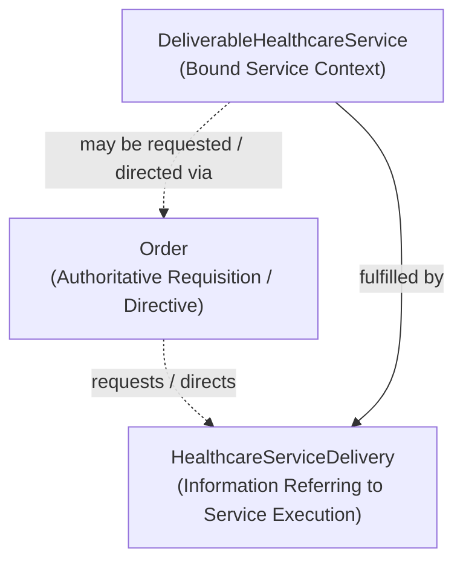

---
{
  "schemaVersion": 1,
  "canonicalId": "2a791e0e1f6b45c0a57fb8233f73faa5",
  "archimateType": "DataObject",
  "specialization": "Topic",
  "displayName": "[Topic] Order",
  "friendlyName": "Ordering.Order",
  "canonicalName": "TOPIC-Ordering.TOPIC-Order",
  "standing": {
    "semantic": "Established Package1 conceptual information meaning; residual qualifications in selected section remain unchanged.",
    "currentness": "current",
    "representationDecision": "Accepted RAD-1.1.0 CR CR-045"
  },
  "identity": {
    "allocation": "Preserved existing resource-owned UUID32; no allocation in migration",
    "authority": "docs/markdown/governance/baseline/release-1.1.0.json",
    "migrationAuthority": "enterprise-architecture/design/review/1.1.5/hcrl-1.1.5-002.pending.md#dr-2"
  },
  "naming": {
    "authority": "docs/markdown/governance/canonical-identity-and-naming.md",
    "mode": "Preserved governed names; source-qualified context and unresolved ancestry retained",
    "expected": {
      "displayName": "[Topic] Order",
      "friendlyName": "Ordering.Order",
      "canonicalName": "TOPIC-Ordering.TOPIC-Order"
    }
  },
  "provenance": [
    {
      "source": "docs/markdown/governance/baseline/information-architecture.json",
      "selector": "/elements/32",
      "role": "governed source resource",
      "revision": "aadcd55252fa7965be8a4321832ecc6d5b97c6e0",
      "sha256": "4881e06319c806a3e719d60f60ef86d7414cd6f801b6000a1004def794489cfe",
      "sourceKey": "Order"
    },
    {
      "source": "docs/markdown/governance/baseline/accepted-ingestion-1.0.10.json",
      "selector": "/elements/52",
      "role": "governed source resource",
      "revision": "aadcd55252fa7965be8a4321832ecc6d5b97c6e0",
      "sha256": "f87692bf30ea2fb7d5ea743920f68ea62c5c99ff3517f2b90bb37783d927cf16",
      "sourceKey": "2a791e0e1f6b45c0a57fb8233f73faa5"
    },
    {
      "source": "docs/archimate/exchange/publish/1.1.0/Harmonia-Architecture-1.1.0.xml",
      "selector": "element[@identifier=\"id-a025ad6103e24c79b90f39a16b8b15a2\"]",
      "role": "accepted representation binding and presentation; not an additional architecture source",
      "revision": "aadcd55252fa7965be8a4321832ecc6d5b97c6e0",
      "sha256": "4bd64067f4f62abdf58c348db6269ebc7c2edb31a85f069819ea717b982f01a1"
    },
    {
      "source": "docs/markdown/04-information-architecture/information-families/healthcare-service.md",
      "selector": "## 4. Associated Request Mechanism: Order",
      "role": "source-qualified original definition",
      "revision": "aadcd55252fa7965be8a4321832ecc6d5b97c6e0",
      "sha256": "ea164a82844b8589b11eef33e75957293239aea5362d1ffcb404e1031736cabd",
      "standing": "Established Package1 conceptual information meaning; residual qualifications in selected section remain unchanged."
    },
    {
      "source": "docs/markdown/04-information-architecture/information-families/order.md",
      "selector": "### 3.1 Order — A; existing Concept reused",
      "role": "ingested architectural definition or explicit source contribution",
      "revision": "aadcd55252fa7965be8a4321832ecc6d5b97c6e0",
      "sha256": "e4db4f5158972f55af48f12a1e9be048437c95600b343823bb4bc9530b258a81",
      "standing": "G2 candidate contribution with only the explicitly recorded decisions approved; semantic classifications and residual questions remain qualified"
    },
    {
      "source": "docs/markdown/04-information-architecture/information-families/order.md",
      "selector": "## 1. Purpose & Semantic Boundary",
      "role": "ingested architectural definition or explicit source contribution",
      "revision": "aadcd55252fa7965be8a4321832ecc6d5b97c6e0",
      "sha256": "e4db4f5158972f55af48f12a1e9be048437c95600b343823bb4bc9530b258a81",
      "standing": "G2 source-qualified boundary and unresolved questions; no whole-family approval"
    },
    {
      "source": "docs/markdown/04-information-architecture/information-families/order.md",
      "selector": "## 6. Temporal & Lifecycle Characteristics",
      "role": "ingested architectural definition or explicit source contribution",
      "revision": "aadcd55252fa7965be8a4321832ecc6d5b97c6e0",
      "sha256": "e4db4f5158972f55af48f12a1e9be048437c95600b343823bb4bc9530b258a81",
      "standing": "G2 source-qualified boundary and unresolved questions; no whole-family approval"
    },
    {
      "source": "docs/markdown/04-information-architecture/information-families/order.md",
      "selector": "## 8. Explicit Boundaries, Unresolved Semantics & Downstream Realisation",
      "role": "ingested architectural definition or explicit source contribution",
      "revision": "aadcd55252fa7965be8a4321832ecc6d5b97c6e0",
      "sha256": "e4db4f5158972f55af48f12a1e9be048437c95600b343823bb4bc9530b258a81",
      "standing": "G2 source-qualified boundary and unresolved questions; no whole-family approval"
    }
  ],
  "sourceBindings": [
    {
      "source": "docs/markdown/governance/baseline/information-architecture.json",
      "selector": "/elements/32"
    },
    {
      "source": "docs/markdown/governance/baseline/accepted-ingestion-1.0.10.json",
      "selector": "/elements/52"
    },
    {
      "source": "docs/markdown/04-information-architecture/information-families/order.md",
      "selector": "### 3.1 Order — A; existing Concept reused"
    },
    {
      "source": "docs/markdown/04-information-architecture/information-families/order.md",
      "selector": "## 1. Purpose & Semantic Boundary"
    },
    {
      "source": "docs/markdown/04-information-architecture/information-families/order.md",
      "selector": "## 6. Temporal & Lifecycle Characteristics"
    },
    {
      "source": "docs/markdown/04-information-architecture/information-families/order.md",
      "selector": "## 8. Explicit Boundaries, Unresolved Semantics & Downstream Realisation"
    }
  ],
  "exchange": {
    "identifier": "id-a025ad6103e24c79b90f39a16b8b15a2",
    "previousNativeName": "[Topic] Order",
    "properties": [
      {
        "ref": "propid-43",
        "values": [
          {
            "text": "docs/markdown/04-information-architecture/information-families/healthcare-service.md",
            "attributes": {
              "{http://www.w3.org/XML/1998/namespace}lang": "en"
            }
          }
        ]
      },
      {
        "ref": "propid-44",
        "values": [
          {
            "text": "## 4. Associated Request Mechanism: Order",
            "attributes": {
              "{http://www.w3.org/XML/1998/namespace}lang": "en"
            }
          }
        ]
      },
      {
        "ref": "propid-45",
        "values": [
          {
            "text": "ea164a82844b8589b11eef33e75957293239aea5362d1ffcb404e1031736cabd",
            "attributes": {
              "{http://www.w3.org/XML/1998/namespace}lang": "en"
            }
          }
        ]
      },
      {
        "ref": "specialization",
        "values": [
          {
            "text": "Topic",
            "attributes": {
              "{http://www.w3.org/XML/1998/namespace}lang": "en"
            }
          }
        ]
      },
      {
        "ref": "propid-18",
        "values": [
          {
            "text": "2a791e0e1f6b45c0a57fb8233f73faa5",
            "attributes": {
              "{http://www.w3.org/XML/1998/namespace}lang": "en"
            }
          }
        ]
      },
      {
        "ref": "propid-22",
        "values": [
          {
            "text": "DataObject",
            "attributes": {
              "{http://www.w3.org/XML/1998/namespace}lang": "en"
            }
          }
        ]
      },
      {
        "ref": "propid-19",
        "values": [
          {
            "text": "[Topic] Order",
            "attributes": {
              "{http://www.w3.org/XML/1998/namespace}lang": "en"
            }
          }
        ]
      },
      {
        "ref": "propid-34",
        "values": [
          {
            "text": "Topic",
            "attributes": {
              "{http://www.w3.org/XML/1998/namespace}lang": "en"
            }
          }
        ]
      },
      {
        "ref": "propid-20",
        "values": [
          {
            "text": "Ordering.Order",
            "attributes": {
              "{http://www.w3.org/XML/1998/namespace}lang": "en"
            }
          }
        ]
      },
      {
        "ref": "propid-21",
        "values": [
          {
            "text": "TOPIC-Ordering.TOPIC-Order",
            "attributes": {
              "{http://www.w3.org/XML/1998/namespace}lang": "en"
            }
          }
        ]
      }
    ]
  },
  "relationships": [],
  "unresolvedProperties": {},
  "representation": {
    "sourceLinksRebased": true,
    "authority": "HCRL 1.1.5-002 DR-3; source meaning unchanged"
  }
}
---

# [Topic] Order

## Architectural content

**Description**
Information describing a formal request for a service, activity or other fulfilment to be performed, including its subject, requester, intent and requested outcome.

Harmonia enforces an essential architectural rule regarding clinical requisitions and service delivery:

$$\text{Order} \neq \text{Healthcare Service}$$



### Key Semantics & Invariants
1. **Associated Request Mechanism**: An `Order` is an authoritative clinical requisition, directive, or prescription requesting the delivery of a service. It is **NOT** a mandatory lifecycle stage of `Healthcare Service`.
2. **Delivery Without an Order**: Service delivery may legitimately occur without an `Order` where business or clinical semantics permit (e.g. *Emergency Resuscitation*, *Triage Assessment*, *Direct Routine Nursing Care*, *Scheduled Facility Maintenance*).
3. **Independent Lifecycles**: An `Order` possesses its own lifecycle states (*Requested*, *Accepted*, *In-Progress*, *Completed*, *Discontinued*), owned by `Order Administration`, distinct from the lifecycle of the service delivery itself.

Source standing: Established Package1 conceptual information meaning; residual qualifications in selected section remain unchanged.

## Source-qualified contribution

Source: `docs/markdown/04-information-architecture/information-families/order.md` — ### 3.1 Order — A; existing Concept reused. Standing: G2 candidate contribution with only the explicitly recorded decisions approved; semantic classifications and residual questions remain qualified.

- **Semantic Classification**: Assertion / Request / Direction.
- **Definition**: The independently identifiable clinical requisition, directive or prescription requesting bounded activity/service fulfilment for a stated subject and purpose.
- **Necessity**: OR-IR1 requires the requested work to be understood and OR-IR3 requires returned facts to correlate with the same originating Order. Package1 already establishes Order as an associated direction mechanism; this family elaborates its information responsibility rather than creates a duplicate request Concept.
- **Boundary**: The Order's directive standing is attributable to its originator/context; ingestion does not certify that every submitted Order is clinically valid. Order does not establish receipt, acceptance, execution or delivery. Requested clinical responsibility for bounded work does not by itself distinguish every assessment Order from Referral; G1 U1 remains.

## Source-qualified contribution

Source: `docs/markdown/04-information-architecture/information-families/order.md` — ## 1. Purpose & Semantic Boundary. Standing: G2 source-qualified boundary and unresolved questions; no whole-family approval.

Order Administration needs to understand an attributable request/direction for bounded clinical activity or service fulfilment, determine its destination, coordinate routing, track a closed loop, coordinate requested modification/cancellation and associate returned outcomes. Diagnostic, medication and procedural orders remain in scope; the local diagnostic Process does not delimit the entire family.

```text
Order ≠ Referral ≠ HealthcareServiceDelivery ≠ ServiceOutcome
Dispatch ≠ receipt ≠ acknowledgement ≠ acceptance
Modification/cancellation requested ≠ modification/cancellation effected
Order closure / requester acknowledgement ≠ diagnostic-content verification
```

Reuse the [Healthcare Service semantic chain](2a791e0e1f6b45c0a57fb8233f73faa5.md): DeliverableHealthcareService → optional Order → HealthcareServiceDelivery → ServiceOutcome. These arrows distinguish meanings and evidenced associations, not mandatory states of a single lifecycle. Delivery may occur without an Order; an Order may remain unfulfilled.

## Source-qualified contribution

Source: `docs/markdown/04-information-architecture/information-families/order.md` — ## 6. Temporal & Lifecycle Characteristics. Standing: G2 source-qualified boundary and unresolved questions; no whole-family approval.

Closed-loop progression requires requested/issued and received time where available, dispatch time, recipient-reported occurrence/disposition time, association time and Harmonia recorded time to be distinguished. Requested timing, imaging scheduled timing and actual execution timing apply only where supplied/evidenced. A cancellation/modification request's time is distinct from an established effect time; a response delay does not determine whether the effect occurred.

The local diagnostic/procedural Process preserves signed requisition, specimen/scheduling, preliminary/final result binding and requester acknowledgement/closure requirements. It does not establish a universal signature state, specimen stage or result lifecycle for medication or every Order. Its Order Dispatched compound checkpoint contains routing and recipient acceptance facts; Behaviour Received is not mapped to it without evidence (G1 U8).

Foundation's illustrative independent Order states remain guidance, not an exhaustive universal state machine. Order information progression, actual service execution, returned-information lifecycle and Process checkpoint progression remain distinct. Closed / Verified concerns requester acknowledgement and Order closure; it does not establish diagnostic-content verification, approval or incorporation. G1 U2's signing/finality/legal criteria and U5's business-acceptance criteria remain unresolved.

Foundation correction/provenance principles apply; the Closed-Loop Tracking Ledger label does not independently establish exhaustive retention policy. No cancellation race-resolution, retry protocol, order-entry workflow or universal completion rule is added.

## Source-qualified contribution

Source: `docs/markdown/04-information-architecture/information-families/order.md` — ## 8. Explicit Boundaries, Unresolved Semantics & Downstream Realisation. Standing: G2 source-qualified boundary and unresolved questions; no whole-family approval.

G2-Q07 retains who may request/authorise changes, the meaning of performing-system response and when modification/cancellation takes effect. Candidate assembly boundaries remain G2-Q06. Exact diagnostic authority/finality/legal criteria are consumed only within established local requirements, never resolved by Order Administration.

No Order subtype taxonomy, universal healthcare request superclass, order-entry system, clinical verification system or unsupported Service dependency is designed. Order Outcome association has no allocated Feature identity. The assessment Referral/bounded Order semantic boundary remains unresolved rather than merged.

No FHIR/resource/profile mapping, Java/application representation, schema, persistence/cache model, API, integration message, topic or implementation allocation is created. [AX-17](../../../motivation/principle/8882573df7ce43c6bc0f66da0a676139.md) governs all candidate and unestablished derivation links.
