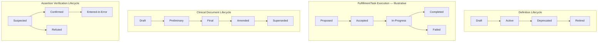
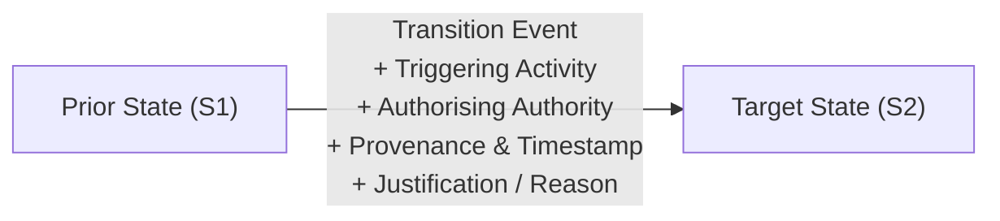

---
{
  "schemaVersion": 1,
  "canonicalId": "10284034c8534b639284386b064f2c54",
  "archimateType": "BusinessObject",
  "specialization": null,
  "displayName": "[BusinessObject] Information Unit",
  "friendlyName": "InformationUnit",
  "canonicalName": "BO-InformationUnit",
  "standing": {
    "semantic": "Established conceptual governed management boundary; no downstream schema or representation mapping.",
    "currentness": "current",
    "representationDecision": "Accepted RAD-1.1.0 CR CR-079"
  },
  "identity": {
    "allocation": "Preserved existing resource-owned UUID32; no allocation in migration",
    "authority": "docs/markdown/governance/baseline/release-1.1.0.json",
    "migrationAuthority": "enterprise-architecture/design/review/1.1.5/hcrl-1.1.5-002.pending.md#dr-2"
  },
  "naming": {
    "authority": "docs/markdown/governance/canonical-identity-and-naming.md",
    "mode": "Preserved governed names; source-qualified context and unresolved ancestry retained",
    "expected": {
      "displayName": "[BusinessObject] Information Unit",
      "friendlyName": "InformationUnit",
      "canonicalName": "BO-InformationUnit"
    }
  },
  "provenance": [
    {
      "source": "docs/markdown/governance/baseline/information-architecture.json",
      "selector": "/elements/26",
      "role": "governed source resource",
      "revision": "aadcd55252fa7965be8a4321832ecc6d5b97c6e0",
      "sha256": "4881e06319c806a3e719d60f60ef86d7414cd6f801b6000a1004def794489cfe",
      "sourceKey": "Information Unit"
    },
    {
      "source": "docs/markdown/governance/baseline/accepted-ingestion-1.0.10.json",
      "selector": "/elements/2",
      "role": "governed source resource",
      "revision": "aadcd55252fa7965be8a4321832ecc6d5b97c6e0",
      "sha256": "f87692bf30ea2fb7d5ea743920f68ea62c5c99ff3517f2b90bb37783d927cf16",
      "sourceKey": "10284034c8534b639284386b064f2c54"
    },
    {
      "source": "docs/archimate/exchange/publish/1.1.0/Harmonia-Architecture-1.1.0.xml",
      "selector": "element[@identifier=\"id-0525ac7ff42457dd9339e3ad95255296\"]",
      "role": "accepted representation binding and presentation; not an additional architecture source",
      "revision": "aadcd55252fa7965be8a4321832ecc6d5b97c6e0",
      "sha256": "4bd64067f4f62abdf58c348db6269ebc7c2edb31a85f069819ea717b982f01a1"
    },
    {
      "source": "docs/markdown/04-information-architecture/metamodel/information-architecture-metamodel.md",
      "selector": "## 6. Information Unit",
      "role": "source-qualified original definition",
      "revision": "aadcd55252fa7965be8a4321832ecc6d5b97c6e0",
      "sha256": "2eadaa3191cea51d9aade7acd99d8a8ee0a2cf114d847a3e87790476d531563f",
      "standing": "Established conceptual governed management boundary; no downstream schema or representation mapping."
    },
    {
      "source": "docs/markdown/04-information-architecture/metamodel/information-architecture-metamodel.md",
      "selector": "## 5. Harmonia-Managed Information",
      "role": "ingested architectural definition or explicit source contribution",
      "revision": "aadcd55252fa7965be8a4321832ecc6d5b97c6e0",
      "sha256": "2eadaa3191cea51d9aade7acd99d8a8ee0a2cf114d847a3e87790476d531563f",
      "standing": "Established Information Unit boundary; unresolved downstream realisation preserved"
    },
    {
      "source": "docs/markdown/04-information-architecture/metamodel/information-architecture-metamodel.md",
      "selector": "## 6. Information Unit",
      "role": "ingested architectural definition or explicit source contribution",
      "revision": "aadcd55252fa7965be8a4321832ecc6d5b97c6e0",
      "sha256": "2eadaa3191cea51d9aade7acd99d8a8ee0a2cf114d847a3e87790476d531563f",
      "standing": "Established Information Unit boundary; unresolved downstream realisation preserved"
    },
    {
      "source": "docs/markdown/04-information-architecture/metamodel/information-architecture-metamodel.md",
      "selector": "## 7. Release-Bound Information Unit Model",
      "role": "ingested architectural definition or explicit source contribution",
      "revision": "aadcd55252fa7965be8a4321832ecc6d5b97c6e0",
      "sha256": "2eadaa3191cea51d9aade7acd99d8a8ee0a2cf114d847a3e87790476d531563f",
      "standing": "Established Information Unit boundary; unresolved downstream realisation preserved"
    },
    {
      "source": "docs/markdown/04-information-architecture/metamodel/information-architecture-metamodel.md",
      "selector": "## 8. Relationship to Existing Information Architecture",
      "role": "ingested architectural definition or explicit source contribution",
      "revision": "aadcd55252fa7965be8a4321832ecc6d5b97c6e0",
      "sha256": "2eadaa3191cea51d9aade7acd99d8a8ee0a2cf114d847a3e87790476d531563f",
      "standing": "Established Information Unit boundary; unresolved downstream realisation preserved"
    },
    {
      "source": "docs/markdown/04-information-architecture/metamodel/information-architecture-metamodel.md",
      "selector": "## 9. Platform / Framework Obligations",
      "role": "ingested architectural definition or explicit source contribution",
      "revision": "aadcd55252fa7965be8a4321832ecc6d5b97c6e0",
      "sha256": "2eadaa3191cea51d9aade7acd99d8a8ee0a2cf114d847a3e87790476d531563f",
      "standing": "Established Information Unit boundary; unresolved downstream realisation preserved"
    },
    {
      "source": "docs/markdown/04-information-architecture/metamodel/information-architecture-metamodel.md",
      "selector": "## 10. Information Unit Guardrails",
      "role": "ingested architectural definition or explicit source contribution",
      "revision": "aadcd55252fa7965be8a4321832ecc6d5b97c6e0",
      "sha256": "2eadaa3191cea51d9aade7acd99d8a8ee0a2cf114d847a3e87790476d531563f",
      "standing": "Established Information Unit boundary; unresolved downstream realisation preserved"
    },
    {
      "source": "docs/markdown/04-information-architecture/metamodel/information-architecture-metamodel.md",
      "selector": "## 11. Downstream Derivation and Retained Questions",
      "role": "ingested architectural definition or explicit source contribution",
      "revision": "aadcd55252fa7965be8a4321832ecc6d5b97c6e0",
      "sha256": "2eadaa3191cea51d9aade7acd99d8a8ee0a2cf114d847a3e87790476d531563f",
      "standing": "Established Information Unit boundary; unresolved downstream realisation preserved"
    },
    {
      "source": "docs/markdown/04-information-architecture/governance/information-lifecycle.md",
      "selector": "## 1. Rejection of Universal Lifecycles",
      "role": "ingested architectural definition or explicit source contribution",
      "revision": "aadcd55252fa7965be8a4321832ecc6d5b97c6e0",
      "sha256": "b91f8be41247a11d833d0ccf9d6e0d53e72a7ceef02e20f01e54c4e0b3fbf29b",
      "standing": "Canonical information governance; concept-specific lifecycles retained"
    },
    {
      "source": "docs/markdown/04-information-architecture/governance/information-lifecycle.md",
      "selector": "## 2. Lifecycle Transition Governance",
      "role": "ingested architectural definition or explicit source contribution",
      "revision": "aadcd55252fa7965be8a4321832ecc6d5b97c6e0",
      "sha256": "b91f8be41247a11d833d0ccf9d6e0d53e72a7ceef02e20f01e54c4e0b3fbf29b",
      "standing": "Canonical information governance; concept-specific lifecycles retained"
    },
    {
      "source": "docs/markdown/04-information-architecture/governance/information-lifecycle.md",
      "selector": "## 3. Immutability of History & Non-Destructive Progression",
      "role": "ingested architectural definition or explicit source contribution",
      "revision": "aadcd55252fa7965be8a4321832ecc6d5b97c6e0",
      "sha256": "b91f8be41247a11d833d0ccf9d6e0d53e72a7ceef02e20f01e54c4e0b3fbf29b",
      "standing": "Canonical information governance; concept-specific lifecycles retained"
    },
    {
      "source": "docs/markdown/04-information-architecture/governance/information-lifecycle.md",
      "selector": "## 4. Information Unit Context and Managed-State Boundary",
      "role": "ingested architectural definition or explicit source contribution",
      "revision": "aadcd55252fa7965be8a4321832ecc6d5b97c6e0",
      "sha256": "b91f8be41247a11d833d0ccf9d6e0d53e72a7ceef02e20f01e54c4e0b3fbf29b",
      "standing": "Canonical information governance; concept-specific lifecycles retained"
    },
    {
      "source": "docs/markdown/04-information-architecture/governance/authority-custody-provenance.md",
      "selector": "## 6. Information Unit Management Boundary",
      "role": "ingested architectural definition or explicit source contribution",
      "revision": "aadcd55252fa7965be8a4321832ecc6d5b97c6e0",
      "sha256": "38e35b499cf60bb20698bb722febcc8e0d42a96fc39382a5243b4e21da010556",
      "standing": "Canonical information governance; originating authority preserved"
    },
    {
      "source": "docs/markdown/04-information-architecture/guardrails/observable-information-and-domain-meaning.md",
      "selector": "## 1. Authority and Architectural Boundary",
      "role": "ingested architectural definition or explicit source contribution",
      "revision": "aadcd55252fa7965be8a4321832ecc6d5b97c6e0",
      "sha256": "13f18cb20d24592ce2394b4d0d26ed51479e55af4bd04383deb2adb639a5cae7",
      "standing": "Adjudicated observable-information boundary; runtime AI optional"
    },
    {
      "source": "docs/markdown/04-information-architecture/guardrails/observable-information-and-domain-meaning.md",
      "selector": "## 2. Observability and Encapsulated Domain Meaning",
      "role": "ingested architectural definition or explicit source contribution",
      "revision": "aadcd55252fa7965be8a4321832ecc6d5b97c6e0",
      "sha256": "13f18cb20d24592ce2394b4d0d26ed51479e55af4bd04383deb2adb639a5cae7",
      "standing": "Adjudicated observable-information boundary; runtime AI optional"
    },
    {
      "source": "docs/markdown/05-information-systems-architecture/data-and-persistence.md",
      "selector": "table assertion: | D25 | Information Unit payload: Unit-level Container and Content metadata | Managed through Mneme; Pragma contains or references payload; Pattern may evaluate governed characteristics | Domain04 Identity/Metadata/Content/Context and durable-version/active-generation distinctions preserved; exact application partition representation unresolved | U05/A06; semantic shape is not a schema or revival of retired Information Container. Container Topic need not equal Content Topic; source need not equal origin. |",
      "role": "ingested architectural definition or explicit source contribution",
      "revision": "aadcd55252fa7965be8a4321832ecc6d5b97c6e0",
      "sha256": "8f1b4222a8e1303001235366a17de7555e56141711d5599c6851a7d865cb2dcd",
      "standing": "Candidate — adjudicated Domain05 Step-B baseline; final Solution Architecture unapproved"
    }
  ],
  "sourceBindings": [
    {
      "source": "docs/markdown/governance/baseline/information-architecture.json",
      "selector": "/elements/26"
    },
    {
      "source": "docs/markdown/governance/baseline/accepted-ingestion-1.0.10.json",
      "selector": "/elements/2"
    },
    {
      "source": "docs/markdown/04-information-architecture/metamodel/information-architecture-metamodel.md",
      "selector": "## 5. Harmonia-Managed Information"
    },
    {
      "source": "docs/markdown/04-information-architecture/metamodel/information-architecture-metamodel.md",
      "selector": "## 6. Information Unit"
    },
    {
      "source": "docs/markdown/04-information-architecture/metamodel/information-architecture-metamodel.md",
      "selector": "## 7. Release-Bound Information Unit Model"
    },
    {
      "source": "docs/markdown/04-information-architecture/metamodel/information-architecture-metamodel.md",
      "selector": "## 8. Relationship to Existing Information Architecture"
    },
    {
      "source": "docs/markdown/04-information-architecture/metamodel/information-architecture-metamodel.md",
      "selector": "## 9. Platform / Framework Obligations"
    },
    {
      "source": "docs/markdown/04-information-architecture/metamodel/information-architecture-metamodel.md",
      "selector": "## 10. Information Unit Guardrails"
    },
    {
      "source": "docs/markdown/04-information-architecture/metamodel/information-architecture-metamodel.md",
      "selector": "## 11. Downstream Derivation and Retained Questions"
    },
    {
      "source": "docs/markdown/04-information-architecture/governance/information-lifecycle.md",
      "selector": "## 1. Rejection of Universal Lifecycles"
    },
    {
      "source": "docs/markdown/04-information-architecture/governance/information-lifecycle.md",
      "selector": "## 2. Lifecycle Transition Governance"
    },
    {
      "source": "docs/markdown/04-information-architecture/governance/information-lifecycle.md",
      "selector": "## 3. Immutability of History & Non-Destructive Progression"
    },
    {
      "source": "docs/markdown/04-information-architecture/governance/information-lifecycle.md",
      "selector": "## 4. Information Unit Context and Managed-State Boundary"
    },
    {
      "source": "docs/markdown/04-information-architecture/governance/authority-custody-provenance.md",
      "selector": "## 6. Information Unit Management Boundary"
    },
    {
      "source": "docs/markdown/04-information-architecture/guardrails/observable-information-and-domain-meaning.md",
      "selector": "## 1. Authority and Architectural Boundary"
    },
    {
      "source": "docs/markdown/04-information-architecture/guardrails/observable-information-and-domain-meaning.md",
      "selector": "## 2. Observability and Encapsulated Domain Meaning"
    },
    {
      "source": "docs/markdown/05-information-systems-architecture/data-and-persistence.md",
      "selector": "table assertion: | D25 | Information Unit payload: Unit-level Container and Content metadata | Managed through Mneme; Pragma contains or references payload; Pattern may evaluate governed characteristics | Domain04 Identity/Metadata/Content/Context and durable-version/active-generation distinctions preserved; exact application partition representation unresolved | U05/A06; semantic shape is not a schema or revival of retired Information Container. Container Topic need not equal Content Topic; source need not equal origin. |"
    }
  ],
  "exchange": {
    "identifier": "id-0525ac7ff42457dd9339e3ad95255296",
    "previousNativeName": "[BusinessObject] Information Unit",
    "properties": [
      {
        "ref": "propid-43",
        "values": [
          {
            "text": "docs/markdown/04-information-architecture/metamodel/information-architecture-metamodel.md",
            "attributes": {
              "{http://www.w3.org/XML/1998/namespace}lang": "en"
            }
          }
        ]
      },
      {
        "ref": "propid-44",
        "values": [
          {
            "text": "## 6. Information Unit",
            "attributes": {
              "{http://www.w3.org/XML/1998/namespace}lang": "en"
            }
          }
        ]
      },
      {
        "ref": "propid-45",
        "values": [
          {
            "text": "2eadaa3191cea51d9aade7acd99d8a8ee0a2cf114d847a3e87790476d531563f",
            "attributes": {
              "{http://www.w3.org/XML/1998/namespace}lang": "en"
            }
          }
        ]
      },
      {
        "ref": "propid-18",
        "values": [
          {
            "text": "10284034c8534b639284386b064f2c54",
            "attributes": {
              "{http://www.w3.org/XML/1998/namespace}lang": "en"
            }
          }
        ]
      },
      {
        "ref": "propid-22",
        "values": [
          {
            "text": "BusinessObject",
            "attributes": {
              "{http://www.w3.org/XML/1998/namespace}lang": "en"
            }
          }
        ]
      },
      {
        "ref": "propid-19",
        "values": [
          {
            "text": "[BusinessObject] Information Unit",
            "attributes": {
              "{http://www.w3.org/XML/1998/namespace}lang": "en"
            }
          }
        ]
      },
      {
        "ref": "propid-20",
        "values": [
          {
            "text": "InformationUnit",
            "attributes": {
              "{http://www.w3.org/XML/1998/namespace}lang": "en"
            }
          }
        ]
      },
      {
        "ref": "propid-21",
        "values": [
          {
            "text": "BO-InformationUnit",
            "attributes": {
              "{http://www.w3.org/XML/1998/namespace}lang": "en"
            }
          }
        ]
      }
    ]
  },
  "relationships": [],
  "unresolvedProperties": {},
  "representation": {
    "sourceLinksRebased": true,
    "authority": "HCRL 1.1.5-002 DR-3; source meaning unchanged"
  }
}
---

# [BusinessObject] Information Unit

## Architectural content

> **An Information Unit is the governed boundary within which Harmonia associates a Governed Representation with its Management Context.**

An Information Unit is bounded, governed and a unit of Harmonia-managed
information. It is **not necessarily atomic**: boundedness does not imply
indivisibility. An Information Unit MAY contain structured, composite or related
information according to its defined Information Unit structure.

**Information Unit** is the canonical term for this concept. **Information
Container** is retired as its proposed name; legitimate technology or application
uses of container and the existing containment pattern retain their meaning.
No architectural mapping to `PetasosParcel` is established. Any future
implementation mapping must be derived downstream.

### 6.1 Conceptual Partition

```text
Information Unit
│
├── Identity
│
├── Metadata
│
├── Content
│
└── Context
```

| Conceptual partition | Meaning |
| :--- | :--- |
| **Identity** | Identifies the Information Unit. |
| **Metadata** | Describes how Harmonia recognises and manages the Information Unit. |
| **Content** | Contains the represented information and its representation characteristics. |
| **Context** | Contains the management context governing the information over time. |

These are conceptual partitions, **not a final schema**. They SHALL NOT be
interpreted as requiring four implementation objects, database structures,
Java classes or serialised elements. The partition does not prescribe a physical
separation or a complete allocation of management concerns to implementation
representations.

All dotted notation below is illustrative conceptual notation only. It SHALL
NOT establish final attribute names, datatypes, identifier schemes, cardinalities
or implementation representations, and does not enumerate complete structures.

### 6.2 Identity

> **Identity identifies the Information Unit itself.**

Illustrative notation: `InformationUnit.Identity.InstanceId`.

Information Unit identity, the identity of the represented information, and the
identity of a real-world entity represented by that information are potentially
distinct architectural concerns. None SHALL be inferred to be another merely
because an implementation or external representation uses a common identifier.
The Information Concept's [Identity & Reference characteristics](../../../../docs/markdown/04-information-architecture/metamodel/information-architecture-metamodel.md#31-identity--reference)
remain distinct from this Information Unit identity. The complete Identity
structure is not established here.

### 6.3 Metadata

> **Metadata describes the Information Unit and the characteristics required for Harmonia to recognise and manage that Information Unit.**

Illustrative notation: `InformationUnit.Metadata.StructureId`. This MAY
conceptually identify the defined Information Unit structure/type to which the
Information Unit conforms. It concerns the **Unit structure**, not the semantic
structure/model of the information represented within it. The complete Metadata
attribute set, naming, cardinality and representation are not established here.

### 6.4 Content

> **Content contains the information represented by the Information Unit together with the representation characteristics necessary to interpret that content.**

Illustrative notation:

```text
InformationUnit.Content.Data
InformationUnit.Content.StructureId
InformationUnit.Content.Format
```

**Content Structure** conceptually identifies the semantic/structural definition
to which the represented content conforms. **Content Format** conceptually
identifies the concrete representation or encoding of that content.

Downstream architecture might, for example, distinguish a semantic structure,
profile or model from JSON, XML, a binary representation or a media type. These
examples are non-normative: no supported model, format, mapping or mandatory
attribute is established by them. Concrete encoding/format SHALL NOT be treated
as equivalent to semantic information structure.

| Illustrative notation | Distinct architectural concern |
| :--- | :--- |
| `InformationUnit.Metadata.StructureId` | The structure/type of the Information Unit. |
| `InformationUnit.Content.StructureId` | The semantic structure/model of the represented information within Content. |
| `InformationUnit.Content.Format` | The concrete representation or encoding of that Content. |

Unit Structure, Content Structure and Content Format SHALL remain distinct.
Sharing a notation suffix or a downstream representation does not collapse
these concerns.

### 6.5 Context

> **Context contains the management context through which Harmonia governs, understands and safely manages the represented information over time.**

The complementary [Metabolē pattern](../../../../docs/markdown/04-information-architecture/patterns/metabole.md) defines bounded
progression of one or more Information Units, with applicable Context,
provenance/derivation and accumulated outputs. Its conceptual
[ActivityContext](c34b4929f71946708d37dbe6c1da920a.md)
classifies the broad activity; it neither replaces this Unit Management Context
nor equates it with Mneme's loaded-value Context or Themis PEP-Context.

The following are currently identified **conceptual management concerns**. They
are not a final attribute list or schema, nor a mandatory populated field bundle.

| Concern | Conceptual meaning and boundary |
| :--- | :--- |
| **Provenance** | Where/how information arose or was established. |
| **Authority** | Whose assertion, relationship or determination is authoritative within the applicable context. |
| **Version** | Identifies a governed progression of an Information Unit's representation. |
| **Lifecycle** | The applicable information lifecycle and its governance; no universal lifecycle or new state set is defined. |
| **Temporal Context** | The temporal context needed to understand and manage the represented information; no new temporal model is defined. |
| **Relationships** | Applicable relationships relevant to management and interpretation; no new relationship taxonomy is defined. |
| **Active Generation** | Identifies a particular valid manifestation of an Information Unit established for active management or use. |

**Provenance and Authority SHALL NOT be collapsed.** The source supplying
information is not necessarily the originating authority for every assertion or
relationship represented by it. The existing granular assertion/relationship
authority and provenance distinctions remain applicable; this model does not
complete the wider authority/credibility vocabulary or evidence/retention model.

**Version and Active Generation SHALL NOT be collapsed.** Under
[AX-05](../../motivation/principle/0412a2084f0145babc4f022c71fea65f.md), authoritative durable
progression and valid active managed-state generation remain distinct concurrency
domains. Mnemosyne establishes authoritative durable state/version; Mneme manages
active representation and coordination. Failed or degraded convergence SHALL NOT
establish or advance a valid active-state generation; untrusted active
coordination requires reconciliation with authoritative state. Neither domain
may substitute for the other or promote cached/process-local state to durable
authority. This preserves the established boundary without completing the
managed-state model or prescribing concurrency mechanisms.

Management Context does not imply that every management concern is durable
resource content. [AX-07](../../motivation/principle/5de2ae2c3b794c2d9f3a14efd51d564f.md) preserves
security context as operational context without automatic persistence as
information content; [AX-08](../../motivation/principle/21d6864657964ba5b03e3f6b5eb29cd5.md) and
[AX-09](../../motivation/principle/9a5cb9e8876844e58e660f909f7df9fc.md) distinguish meaningful
durable evidence from transient operational state. No retention or security
representation mechanism is inferred here.

#### 6.5.1 Version and Active Generation

> **Version identifies a governed progression of an Information Unit's representation.**

> **Active Generation identifies a particular valid manifestation of an Information Unit established for active management or use.**

These definitions are complementary and identify different semantic dimensions:
**Version concerns governed information progression. Active Generation concerns
active manifestation.**

**Multiple Active Generations MAY derive from the same Version. A change of
Active Generation does not, by itself, indicate a change of Version.**

```text
Information Unit
      │
      ├── Version V7
      │      ├── Active Generation G21
      │      ├── Active Generation G22
      │      └── Active Generation G23
      │
      └── Version V8
             └── Active Generation G24
```

The labels are illustrative only; they establish no identifier syntax, sequence
mechanism or numbering scheme. The model also permits a Version with no current
Active Generation. It establishes no maximum number of Generations.

Version and Active Generation remain conceptual concerns within Information Unit
Context. Their inclusion in Context does not require simple scalar fields and
defines no canonical Version or Generation attributes. The architecture
establishes semantics, not schema.

#### 6.5.2 Observability and Manifestation

Independent processes/functions may act upon manifestations of the same
Information Unit Version established at different observable points. For
example, Process A may act upon G21, Process B upon G22 and Process C upon G23,
with all three manifestations derived from V7:

```text
                Information Unit
                   Version V7
                       │
          ┌────────────┼────────────┐
          │            │            │
          ▼            ▼            ▼
      Process A    Process B    Process C
          │            │            │
          ▼            ▼            ▼
         G21          G22          G23
```

The arrows illustrate which manifestations the processes act upon; they do not
define Generation creation, assignment or ownership. The processes can therefore
share governed information progression while acting against different active
manifestations. Version alone cannot express that distinction.

**Active Generation identifies the manifestation, not the process acting upon
it.** Multiple processes/functions MAY legitimately act upon the same Active
Generation. The example requires neither a separate Generation for each process
nor any process-to-Generation cardinality or affinity.

#### 6.5.3 Generation and Temporal Context

> **Active Generation is not a timestamp or measure of time.**

Temporal Context may help explain when a manifestation was established,
applicable or observed, but Temporal Context and Active Generation are distinct
Information Architecture concerns. A single Active Generation may remain valid
across an interval. Different Active Generations need not be distinguished by
wall-clock time. No timestamp, clock, sequence counter or temporal implementation
mechanism is established.

```text
Version change           = governed information progression
Active Generation change = different valid active manifestation
                         ≠ necessarily information progression
```

Active Generation SHALL NOT be treated as another form of Version. A difference
in active manifestation does not, by itself, establish authoritative information
progression.

#### 6.5.4 Durable Authority and Unresolved Realisation

> **An Active Generation SHALL NOT be treated as an authoritative durable Version merely because Harmonia has manifested or acted upon it.**

Active manifestation does not manufacture durable authoritative progression.
The [AX-05 boundary](../../motivation/principle/0412a2084f0145babc4f022c71fea65f.md) preserved above
continues to govern: authoritative durable Version and valid Active Generation
remain distinct, and failed or degraded convergence following authoritative state
progression SHALL NOT establish or advance a valid active-state generation.
Active use does not establish durable authoritative progression.

This distinction does not imply that every Active Generation must be persisted,
becomes or produces a Version, is durable, constitutes historical truth or
constitutes evidence. Applicable existing evidence and lifecycle obligations
retain their scope; those relationships are not established by manifestation
alone.

These information semantics may later inform Mneme active managed information,
cache-instance management, concurrent active manifestations, Mnemosyne
authoritative durable representation, convergence, conflict handling and
reconstruction of active state. **Domain04 SHALL establish the information
semantics before downstream architecture determines their realisation.** This
distinction prescribes no cache, persistence, concurrency or coordination
mechanism and SHALL NOT be retrofitted to existing implementation behaviour.

The remaining managed-state questions are deliberately unresolved here; the
[establishment and failure boundary](../../../../docs/markdown/04-information-architecture/metamodel/information-architecture-metamodel.md#656-establishment-and-semantic-indivisibility)
below does not determine their realisation:

- how manifestation begins or is realised, a Generation's lifetime or retirement,
  and when it ceases to be active;
- its ownership, visibility, or process, cache, node or cluster affinity;
- how concurrent Generations reconcile, how active state converges, or what
  follows uncertain effect;
- persistence or retention, association with historical truth or evidence,
  and relationships to snapshots, lifecycle state, Praxis progression or
  entity state.

The distinction does not determine whether retrieval manifests a Generation
or how returned Units or result sets are manifested. The separately adjudicated
[search semantics](../../../../docs/markdown/04-information-architecture/patterns/search-results.md) establish a managed metadata
Search Result Set referencing the Information Unit Versions comprising a
managed search result; search alone creates neither copies nor new Versions
of those returned Units. External search acquisition belongs to the governed
Ergo activity that intentionally performs it. These decisions do not change
Version / Active Generation semantics. The separately established
[bounded Task / Work model](../../../../docs/markdown/04-information-architecture/information-families/task-work.md) and its
retained questions also remain unchanged, as do Assurance and capacity
information questions.

#### 6.5.5 Version / Active Generation Guardrails

These VG-01–VG-08 identifiers are local to this semantic distinction.

| Guardrail | Required semantic boundary |
| :--- | :--- |
| **VG-01 — Different Dimensions** | Version and Active Generation identify different semantic dimensions. |
| **VG-02 — Version Progression** | Version identifies governed progression of an Information Unit's representation. |
| **VG-03 — Active Manifestation** | Active Generation identifies a particular valid manifestation established for active management or use. |
| **VG-04 — Multiple Generations per Version** | Multiple Active Generations MAY derive from the same Version. |
| **VG-05 — Generation Change != Version Change** | A change in Active Generation does not by itself establish information progression or a new Version. |
| **VG-06 — Manifestation, Not Process** | Active Generation identifies the manifestation, not the process/function using it. |
| **VG-07 — Generation != Time** | Active Generation is not a timestamp or measure of time. |
| **VG-08 — No Durable Authority by Manifestation** | An Active Generation SHALL NOT become an authoritative durable Version merely because Harmonia manifested or acted upon it. |

#### 6.5.6 Establishment and Semantic Indivisibility

> **Active Generation is a successful-state concept. An unsuccessful attempt to manifest an Information Unit does not create an invalid Active Generation; it fails to establish an Active Generation.**

> **Active Generation establishment is semantically indivisible. Partial, degraded or incomplete manifestation SHALL NOT constitute an Active Generation.**

The manifestation must be successfully established in full according to the
applicable governed architecture; otherwise no Active Generation is established
by that attempt.

```text
Manifestation Attempt
      │
      ├── successfully established in full
      │           └── Active Generation established
      │
      └── otherwise
                  └── No Active Generation established by this attempt
```

There is no partially valid, degraded, incomplete or half-established Active
Generation. Runtime work may pass through partial, intermediate, degraded or
failed conditions while attempting manifestation. Those belong to the
manifestation activity or its mechanics and SHALL NOT acquire the semantic
standing of an Active Generation. These examples define no implementation state
names, attributes or schema. This rule establishes no universal structural,
semantic, temporal, authority, security, provenance, relationship or cache
validation checklist.

**Semantic indivisibility is not transactional atomicity.** Either an Active
Generation has been successfully established or it has not. This semantic outcome
SHALL NOT imply database or distributed transactions, atomic cache operations,
distributed locks, mutexes, optimistic locking, MVCC, compare-and-swap,
synchronised execution, or single-thread, single-node execution. How downstream
architecture guarantees or implements the outcome remains to be derived.

#### 6.5.7 Operational Failure and Information State

> **Failure to establish an Active Generation is an operational failure within Harmonia. It describes the unsuccessful manifestation activity and SHALL NOT, by itself, alter the Version or state of the Information Unit from which manifestation was attempted.**

> **Operational knowledge that Harmonia failed to manifest information is not, by itself, a change to that information.**

The attempt and its outcome belong to Harmonia's operational activity. The
Information Unit and its Version remain governed by their own information
semantics. Manifestation failure does not, merely by occurring, establish that
the source Version is invalid or changed, that a new Version exists, that the
Information Unit lifecycle has changed, that the represented information is
defective or no longer authoritative, or that historical truth has changed.
Any such consequence requires separate established architecture.

Manifestation failure SHALL NOT be modelled as Information Unit state merely
because downstream realisation may need to record, audit, monitor or respond to
that failure. No failure-state attribute or lifecycle transition is defined here.
Active manifestation and its failure do not manufacture authoritative durable
progression; the existing AX-05 boundary remains applicable.

#### 6.5.8 Existing Active Generation Preservation

> **Failure to establish a subsequent Active Generation SHALL NOT, by itself, invalidate an already established Active Generation.**

For example, successful manifestation of Version V7 establishes G31. A later
manifestation attempt from V7 fails:

```text
Information Unit Version V7
      │
      ├── manifestation succeeds ──> G31 established
      │
      └── later manifestation fails ──> Operational Failure
                                       does not, by itself, invalidate G31
```

The later failure does not retroactively alter G31's successful establishment.
The labels are illustrative and define no identifier or sequence mechanism.
The rule establishes only that another manifestation attempt's failure is not,
by itself, an invalidating event. It defines no indefinite lifetime, expiry,
lease, freshness, automatic fallback, selection, replacement, invalidation
trigger, precedence or current-generation semantics. AX-05's existing
failed/degraded-convergence and untrusted-coordination requirements remain
applicable; this narrow preservation rule does not settle their realisation.

**Domain04 deliberately stops at these establishment and failure semantics.**
Manifestation initiation, component responsibility, data loading, Context
assembly, completeness/coherence checks, success commit, failure detection and
operational representation, logging, audit, alerts, retry and recovery remain
downstream architecture and engineering. Generation caching, distribution,
replication, expiry, replacement, invalidation and concurrent interaction are
also undetermined. No broader managed-state reconciliation follows from this
semantic boundary.

#### 6.5.9 Active Generation Establishment / Failure Guardrails

These AG-01–AG-07 identifiers are local to establishment and failure semantics
and supplement VG-01–VG-08 without replacing them.

| Guardrail | Required semantic boundary |
| :--- | :--- |
| **AG-01 — Successful-State Concept** | An Active Generation exists only when manifestation has been successfully established. |
| **AG-02 — Semantic Indivisibility** | Active Generation establishment is semantically indivisible. Partial, degraded or incomplete manifestation SHALL NOT constitute an Active Generation. |
| **AG-03 — Failure Establishes No Generation** | An unsuccessful manifestation attempt fails to establish an Active Generation; it does not establish an invalid or degraded Active Generation. |
| **AG-04 — Operational Failure Boundary** | Failure to establish an Active Generation is an operational failure within Harmonia and SHALL NOT, by itself, alter the Version or state of the Information Unit from which manifestation was attempted. |
| **AG-05 — Information / Operational Separation** | Operational knowledge of manifestation failure SHALL NOT, by itself, be treated as a change to the information being manifested. |
| **AG-06 — Existing Generation Preservation** | Failure to establish a subsequent Active Generation SHALL NOT, by itself, invalidate an already established Active Generation. |
| **AG-07 — No Transactional Inference** | Semantic indivisibility SHALL NOT imply any particular transactional, concurrency, persistence or cache mechanism. |

Source standing: Established conceptual governed management boundary; no downstream schema or representation mapping.

## Source-qualified contribution

Source: `docs/markdown/04-information-architecture/metamodel/information-architecture-metamodel.md` — ## 5. Harmonia-Managed Information. Standing: Established Information Unit boundary; unresolved downstream realisation preserved.

> **Harmonia-managed information is information for which Harmonia has accepted an explicit responsibility to maintain a governed representation and its management context over time.**

Accepting responsibility to manage information is distinct from originating
information authority, authority over the underlying domain activity, custody,
persistence, transport, presentation and consumption. Holding, storing,
transmitting, displaying or using information SHALL NOT by itself establish
that explicit management responsibility or transfer originating authority.
Externally originated information may be Harmonia-managed while its originating
authority remains external.

Harmonia managing information SHALL NOT by itself imply that Harmonia originated
the information or has authority over the underlying domain activity.
[AX-18](../../motivation/principle/b8cafe3cf5904d2bb9a9767260fddf78.md) requires domain authority
to remain with the responsible actor, system or governed capability unless the
architecture explicitly assigns it to Harmonia. Explicitly assigned Harmonia
operational responsibilities remain applicable.

The existing [responsibility, authority, custody and consumption distinctions](f3bd4181bb394db8a505705b03972cea.md)
continue to apply. Management responsibility does not redefine the meaning or
originating responsibility of an Information Concept, assertion or relationship.
[AX-06](../../motivation/principle/952c3b6148ce4fce94b69f99a0c2fec7.md) preserves information
authority independently of technical transport, persistence and concurrency.

## Source-qualified contribution

Source: `docs/markdown/04-information-architecture/metamodel/information-architecture-metamodel.md` — ## 6. Information Unit. Standing: Established Information Unit boundary; unresolved downstream realisation preserved.

> **An Information Unit is the governed boundary within which Harmonia associates a Governed Representation with its Management Context.**

An Information Unit is bounded, governed and a unit of Harmonia-managed
information. It is **not necessarily atomic**: boundedness does not imply
indivisibility. An Information Unit MAY contain structured, composite or related
information according to its defined Information Unit structure.

**Information Unit** is the canonical term for this concept. **Information
Container** is retired as its proposed name; legitimate technology or application
uses of container and the existing containment pattern retain their meaning.
No architectural mapping to `PetasosParcel` is established. Any future
implementation mapping must be derived downstream.

### 6.1 Conceptual Partition

```text
Information Unit
│
├── Identity
│
├── Metadata
│
├── Content
│
└── Context
```

| Conceptual partition | Meaning |
| :--- | :--- |
| **Identity** | Identifies the Information Unit. |
| **Metadata** | Describes how Harmonia recognises and manages the Information Unit. |
| **Content** | Contains the represented information and its representation characteristics. |
| **Context** | Contains the management context governing the information over time. |

These are conceptual partitions, **not a final schema**. They SHALL NOT be
interpreted as requiring four implementation objects, database structures,
Java classes or serialised elements. The partition does not prescribe a physical
separation or a complete allocation of management concerns to implementation
representations.

All dotted notation below is illustrative conceptual notation only. It SHALL
NOT establish final attribute names, datatypes, identifier schemes, cardinalities
or implementation representations, and does not enumerate complete structures.

### 6.2 Identity

> **Identity identifies the Information Unit itself.**

Illustrative notation: `InformationUnit.Identity.InstanceId`.

Information Unit identity, the identity of the represented information, and the
identity of a real-world entity represented by that information are potentially
distinct architectural concerns. None SHALL be inferred to be another merely
because an implementation or external representation uses a common identifier.
The Information Concept's [Identity & Reference characteristics](../../../../docs/markdown/04-information-architecture/metamodel/information-architecture-metamodel.md#31-identity--reference)
remain distinct from this Information Unit identity. The complete Identity
structure is not established here.

### 6.3 Metadata

> **Metadata describes the Information Unit and the characteristics required for Harmonia to recognise and manage that Information Unit.**

Illustrative notation: `InformationUnit.Metadata.StructureId`. This MAY
conceptually identify the defined Information Unit structure/type to which the
Information Unit conforms. It concerns the **Unit structure**, not the semantic
structure/model of the information represented within it. The complete Metadata
attribute set, naming, cardinality and representation are not established here.

### 6.4 Content

> **Content contains the information represented by the Information Unit together with the representation characteristics necessary to interpret that content.**

Illustrative notation:

```text
InformationUnit.Content.Data
InformationUnit.Content.StructureId
InformationUnit.Content.Format
```

**Content Structure** conceptually identifies the semantic/structural definition
to which the represented content conforms. **Content Format** conceptually
identifies the concrete representation or encoding of that content.

Downstream architecture might, for example, distinguish a semantic structure,
profile or model from JSON, XML, a binary representation or a media type. These
examples are non-normative: no supported model, format, mapping or mandatory
attribute is established by them. Concrete encoding/format SHALL NOT be treated
as equivalent to semantic information structure.

| Illustrative notation | Distinct architectural concern |
| :--- | :--- |
| `InformationUnit.Metadata.StructureId` | The structure/type of the Information Unit. |
| `InformationUnit.Content.StructureId` | The semantic structure/model of the represented information within Content. |
| `InformationUnit.Content.Format` | The concrete representation or encoding of that Content. |

Unit Structure, Content Structure and Content Format SHALL remain distinct.
Sharing a notation suffix or a downstream representation does not collapse
these concerns.

### 6.5 Context

> **Context contains the management context through which Harmonia governs, understands and safely manages the represented information over time.**

The complementary [Metabolē pattern](../../../../docs/markdown/04-information-architecture/patterns/metabole.md) defines bounded
progression of one or more Information Units, with applicable Context,
provenance/derivation and accumulated outputs. Its conceptual
[ActivityContext](c34b4929f71946708d37dbe6c1da920a.md)
classifies the broad activity; it neither replaces this Unit Management Context
nor equates it with Mneme's loaded-value Context or Themis PEP-Context.

The following are currently identified **conceptual management concerns**. They
are not a final attribute list or schema, nor a mandatory populated field bundle.

| Concern | Conceptual meaning and boundary |
| :--- | :--- |
| **Provenance** | Where/how information arose or was established. |
| **Authority** | Whose assertion, relationship or determination is authoritative within the applicable context. |
| **Version** | Identifies a governed progression of an Information Unit's representation. |
| **Lifecycle** | The applicable information lifecycle and its governance; no universal lifecycle or new state set is defined. |
| **Temporal Context** | The temporal context needed to understand and manage the represented information; no new temporal model is defined. |
| **Relationships** | Applicable relationships relevant to management and interpretation; no new relationship taxonomy is defined. |
| **Active Generation** | Identifies a particular valid manifestation of an Information Unit established for active management or use. |

**Provenance and Authority SHALL NOT be collapsed.** The source supplying
information is not necessarily the originating authority for every assertion or
relationship represented by it. The existing granular assertion/relationship
authority and provenance distinctions remain applicable; this model does not
complete the wider authority/credibility vocabulary or evidence/retention model.

**Version and Active Generation SHALL NOT be collapsed.** Under
[AX-05](../../motivation/principle/0412a2084f0145babc4f022c71fea65f.md), authoritative durable
progression and valid active managed-state generation remain distinct concurrency
domains. Mnemosyne establishes authoritative durable state/version; Mneme manages
active representation and coordination. Failed or degraded convergence SHALL NOT
establish or advance a valid active-state generation; untrusted active
coordination requires reconciliation with authoritative state. Neither domain
may substitute for the other or promote cached/process-local state to durable
authority. This preserves the established boundary without completing the
managed-state model or prescribing concurrency mechanisms.

Management Context does not imply that every management concern is durable
resource content. [AX-07](../../motivation/principle/5de2ae2c3b794c2d9f3a14efd51d564f.md) preserves
security context as operational context without automatic persistence as
information content; [AX-08](../../motivation/principle/21d6864657964ba5b03e3f6b5eb29cd5.md) and
[AX-09](../../motivation/principle/9a5cb9e8876844e58e660f909f7df9fc.md) distinguish meaningful
durable evidence from transient operational state. No retention or security
representation mechanism is inferred here.

#### 6.5.1 Version and Active Generation

> **Version identifies a governed progression of an Information Unit's representation.**

> **Active Generation identifies a particular valid manifestation of an Information Unit established for active management or use.**

These definitions are complementary and identify different semantic dimensions:
**Version concerns governed information progression. Active Generation concerns
active manifestation.**

**Multiple Active Generations MAY derive from the same Version. A change of
Active Generation does not, by itself, indicate a change of Version.**

```text
Information Unit
      │
      ├── Version V7
      │      ├── Active Generation G21
      │      ├── Active Generation G22
      │      └── Active Generation G23
      │
      └── Version V8
             └── Active Generation G24
```

The labels are illustrative only; they establish no identifier syntax, sequence
mechanism or numbering scheme. The model also permits a Version with no current
Active Generation. It establishes no maximum number of Generations.

Version and Active Generation remain conceptual concerns within Information Unit
Context. Their inclusion in Context does not require simple scalar fields and
defines no canonical Version or Generation attributes. The architecture
establishes semantics, not schema.

#### 6.5.2 Observability and Manifestation

Independent processes/functions may act upon manifestations of the same
Information Unit Version established at different observable points. For
example, Process A may act upon G21, Process B upon G22 and Process C upon G23,
with all three manifestations derived from V7:

```text
                Information Unit
                   Version V7
                       │
          ┌────────────┼────────────┐
          │            │            │
          ▼            ▼            ▼
      Process A    Process B    Process C
          │            │            │
          ▼            ▼            ▼
         G21          G22          G23
```

The arrows illustrate which manifestations the processes act upon; they do not
define Generation creation, assignment or ownership. The processes can therefore
share governed information progression while acting against different active
manifestations. Version alone cannot express that distinction.

**Active Generation identifies the manifestation, not the process acting upon
it.** Multiple processes/functions MAY legitimately act upon the same Active
Generation. The example requires neither a separate Generation for each process
nor any process-to-Generation cardinality or affinity.

#### 6.5.3 Generation and Temporal Context

> **Active Generation is not a timestamp or measure of time.**

Temporal Context may help explain when a manifestation was established,
applicable or observed, but Temporal Context and Active Generation are distinct
Information Architecture concerns. A single Active Generation may remain valid
across an interval. Different Active Generations need not be distinguished by
wall-clock time. No timestamp, clock, sequence counter or temporal implementation
mechanism is established.

```text
Version change           = governed information progression
Active Generation change = different valid active manifestation
                         ≠ necessarily information progression
```

Active Generation SHALL NOT be treated as another form of Version. A difference
in active manifestation does not, by itself, establish authoritative information
progression.

#### 6.5.4 Durable Authority and Unresolved Realisation

> **An Active Generation SHALL NOT be treated as an authoritative durable Version merely because Harmonia has manifested or acted upon it.**

Active manifestation does not manufacture durable authoritative progression.
The [AX-05 boundary](../../motivation/principle/0412a2084f0145babc4f022c71fea65f.md) preserved above
continues to govern: authoritative durable Version and valid Active Generation
remain distinct, and failed or degraded convergence following authoritative state
progression SHALL NOT establish or advance a valid active-state generation.
Active use does not establish durable authoritative progression.

This distinction does not imply that every Active Generation must be persisted,
becomes or produces a Version, is durable, constitutes historical truth or
constitutes evidence. Applicable existing evidence and lifecycle obligations
retain their scope; those relationships are not established by manifestation
alone.

These information semantics may later inform Mneme active managed information,
cache-instance management, concurrent active manifestations, Mnemosyne
authoritative durable representation, convergence, conflict handling and
reconstruction of active state. **Domain04 SHALL establish the information
semantics before downstream architecture determines their realisation.** This
distinction prescribes no cache, persistence, concurrency or coordination
mechanism and SHALL NOT be retrofitted to existing implementation behaviour.

The remaining managed-state questions are deliberately unresolved here; the
[establishment and failure boundary](../../../../docs/markdown/04-information-architecture/metamodel/information-architecture-metamodel.md#656-establishment-and-semantic-indivisibility)
below does not determine their realisation:

- how manifestation begins or is realised, a Generation's lifetime or retirement,
  and when it ceases to be active;
- its ownership, visibility, or process, cache, node or cluster affinity;
- how concurrent Generations reconcile, how active state converges, or what
  follows uncertain effect;
- persistence or retention, association with historical truth or evidence,
  and relationships to snapshots, lifecycle state, Praxis progression or
  entity state.

The distinction does not determine whether retrieval manifests a Generation
or how returned Units or result sets are manifested. The separately adjudicated
[search semantics](../../../../docs/markdown/04-information-architecture/patterns/search-results.md) establish a managed metadata
Search Result Set referencing the Information Unit Versions comprising a
managed search result; search alone creates neither copies nor new Versions
of those returned Units. External search acquisition belongs to the governed
Ergo activity that intentionally performs it. These decisions do not change
Version / Active Generation semantics. The separately established
[bounded Task / Work model](../../../../docs/markdown/04-information-architecture/information-families/task-work.md) and its
retained questions also remain unchanged, as do Assurance and capacity
information questions.

#### 6.5.5 Version / Active Generation Guardrails

These VG-01–VG-08 identifiers are local to this semantic distinction.

| Guardrail | Required semantic boundary |
| :--- | :--- |
| **VG-01 — Different Dimensions** | Version and Active Generation identify different semantic dimensions. |
| **VG-02 — Version Progression** | Version identifies governed progression of an Information Unit's representation. |
| **VG-03 — Active Manifestation** | Active Generation identifies a particular valid manifestation established for active management or use. |
| **VG-04 — Multiple Generations per Version** | Multiple Active Generations MAY derive from the same Version. |
| **VG-05 — Generation Change != Version Change** | A change in Active Generation does not by itself establish information progression or a new Version. |
| **VG-06 — Manifestation, Not Process** | Active Generation identifies the manifestation, not the process/function using it. |
| **VG-07 — Generation != Time** | Active Generation is not a timestamp or measure of time. |
| **VG-08 — No Durable Authority by Manifestation** | An Active Generation SHALL NOT become an authoritative durable Version merely because Harmonia manifested or acted upon it. |

#### 6.5.6 Establishment and Semantic Indivisibility

> **Active Generation is a successful-state concept. An unsuccessful attempt to manifest an Information Unit does not create an invalid Active Generation; it fails to establish an Active Generation.**

> **Active Generation establishment is semantically indivisible. Partial, degraded or incomplete manifestation SHALL NOT constitute an Active Generation.**

The manifestation must be successfully established in full according to the
applicable governed architecture; otherwise no Active Generation is established
by that attempt.

```text
Manifestation Attempt
      │
      ├── successfully established in full
      │           └── Active Generation established
      │
      └── otherwise
                  └── No Active Generation established by this attempt
```

There is no partially valid, degraded, incomplete or half-established Active
Generation. Runtime work may pass through partial, intermediate, degraded or
failed conditions while attempting manifestation. Those belong to the
manifestation activity or its mechanics and SHALL NOT acquire the semantic
standing of an Active Generation. These examples define no implementation state
names, attributes or schema. This rule establishes no universal structural,
semantic, temporal, authority, security, provenance, relationship or cache
validation checklist.

**Semantic indivisibility is not transactional atomicity.** Either an Active
Generation has been successfully established or it has not. This semantic outcome
SHALL NOT imply database or distributed transactions, atomic cache operations,
distributed locks, mutexes, optimistic locking, MVCC, compare-and-swap,
synchronised execution, or single-thread, single-node execution. How downstream
architecture guarantees or implements the outcome remains to be derived.

#### 6.5.7 Operational Failure and Information State

> **Failure to establish an Active Generation is an operational failure within Harmonia. It describes the unsuccessful manifestation activity and SHALL NOT, by itself, alter the Version or state of the Information Unit from which manifestation was attempted.**

> **Operational knowledge that Harmonia failed to manifest information is not, by itself, a change to that information.**

The attempt and its outcome belong to Harmonia's operational activity. The
Information Unit and its Version remain governed by their own information
semantics. Manifestation failure does not, merely by occurring, establish that
the source Version is invalid or changed, that a new Version exists, that the
Information Unit lifecycle has changed, that the represented information is
defective or no longer authoritative, or that historical truth has changed.
Any such consequence requires separate established architecture.

Manifestation failure SHALL NOT be modelled as Information Unit state merely
because downstream realisation may need to record, audit, monitor or respond to
that failure. No failure-state attribute or lifecycle transition is defined here.
Active manifestation and its failure do not manufacture authoritative durable
progression; the existing AX-05 boundary remains applicable.

#### 6.5.8 Existing Active Generation Preservation

> **Failure to establish a subsequent Active Generation SHALL NOT, by itself, invalidate an already established Active Generation.**

For example, successful manifestation of Version V7 establishes G31. A later
manifestation attempt from V7 fails:

```text
Information Unit Version V7
      │
      ├── manifestation succeeds ──> G31 established
      │
      └── later manifestation fails ──> Operational Failure
                                       does not, by itself, invalidate G31
```

The later failure does not retroactively alter G31's successful establishment.
The labels are illustrative and define no identifier or sequence mechanism.
The rule establishes only that another manifestation attempt's failure is not,
by itself, an invalidating event. It defines no indefinite lifetime, expiry,
lease, freshness, automatic fallback, selection, replacement, invalidation
trigger, precedence or current-generation semantics. AX-05's existing
failed/degraded-convergence and untrusted-coordination requirements remain
applicable; this narrow preservation rule does not settle their realisation.

**Domain04 deliberately stops at these establishment and failure semantics.**
Manifestation initiation, component responsibility, data loading, Context
assembly, completeness/coherence checks, success commit, failure detection and
operational representation, logging, audit, alerts, retry and recovery remain
downstream architecture and engineering. Generation caching, distribution,
replication, expiry, replacement, invalidation and concurrent interaction are
also undetermined. No broader managed-state reconciliation follows from this
semantic boundary.

#### 6.5.9 Active Generation Establishment / Failure Guardrails

These AG-01–AG-07 identifiers are local to establishment and failure semantics
and supplement VG-01–VG-08 without replacing them.

| Guardrail | Required semantic boundary |
| :--- | :--- |
| **AG-01 — Successful-State Concept** | An Active Generation exists only when manifestation has been successfully established. |
| **AG-02 — Semantic Indivisibility** | Active Generation establishment is semantically indivisible. Partial, degraded or incomplete manifestation SHALL NOT constitute an Active Generation. |
| **AG-03 — Failure Establishes No Generation** | An unsuccessful manifestation attempt fails to establish an Active Generation; it does not establish an invalid or degraded Active Generation. |
| **AG-04 — Operational Failure Boundary** | Failure to establish an Active Generation is an operational failure within Harmonia and SHALL NOT, by itself, alter the Version or state of the Information Unit from which manifestation was attempted. |
| **AG-05 — Information / Operational Separation** | Operational knowledge of manifestation failure SHALL NOT, by itself, be treated as a change to the information being manifested. |
| **AG-06 — Existing Generation Preservation** | Failure to establish a subsequent Active Generation SHALL NOT, by itself, invalidate an already established Active Generation. |
| **AG-07 — No Transactional Inference** | Semantic indivisibility SHALL NOT imply any particular transactional, concurrency, persistence or cache mechanism. |

## Source-qualified contribution

Source: `docs/markdown/04-information-architecture/metamodel/information-architecture-metamodel.md` — ## 7. Release-Bound Information Unit Model. Standing: Established Information Unit boundary; unresolved downstream realisation preserved.

> **Harmonia SHALL support a bound set of Information Unit structures for each architectural release. The composition and semantics of that set MAY evolve between releases, but SHALL be explicitly defined and governed within a release. Information Unit structures SHALL NOT arise implicitly through implementation convenience or runtime behaviour.**

**The semantic space supported by a release is explicitly governed and bounded.**
Bound does not mean that all Information Units have identical populated
attributes, that every conceptual element is mandatory, that the model can never
evolve, or that the supported set is permanently closed.

A release MAY define optionality, cardinality, permitted structures, supported
formats, extension mechanisms and other constraints. Those details remain
downstream of this conceptual model unless already established by applicable
architecture. This section defines the release-governance obligation; it does
not supply an actual R1.x or R2.x structure/attribute set or complete release
catalogue.

### 7.1 Explicit Evolution Across Releases

> **Evolution between release-bound Information Unit models is explicit architectural evolution, not uncontrolled schema drift.**

```text
Harmonia
   │
   ├── R1.x
   │    └── Bound Information Unit Model
   │
   ├── R2.x
   │    └── Bound Information Unit Model
   │
   └── R3.x
        └── Bound Information Unit Model
```

This is a conceptual illustration of release governance and evolution, not a
claim that these release models have been fully defined. An implementation
wrapper, envelope, DTO, cache object or transport object SHALL NOT invent a new
Information Unit structure or its semantics.

## Source-qualified contribution

Source: `docs/markdown/04-information-architecture/metamodel/information-architecture-metamodel.md` — ## 8. Relationship to Existing Information Architecture. Standing: Established Information Unit boundary; unresolved downstream realisation preserved.

Information Unit adds a governed management boundary without redefining the
existing Information Concept metamodel, semantic categories or family approvals.
No one-to-one mapping between these concepts and Information Units is established.

| Existing concept/concern | Relationship to Information Unit |
| :--- | :--- |
| **Information Concept** | Describes information meaning. Information Unit establishes the governed boundary through which Harmonia manages represented information; it is not an Information Concept synonym or a new semantic category. |
| **Information Relationship** | Retains its governed source/target/type, qualification and role distinctions. Relationships may be relevant to represented information and Management Context without being replaced by the Information Unit boundary. |
| **Information Assembly** | Retains its meaning as a governed semantic composition of independently meaningful Information Concepts. Composite Content is permitted, but Information Unit does not redefine Assembly or establish Assembly-to-Unit equivalence. |
| **Information View** | Retains its purpose/consumer-oriented projection meaning. Presentation or a contextual view does not by itself establish an Information Unit or acceptance of management responsibility. |
| **Authority, Custody and Provenance** | Retain their existing distinctions. Establishing a managed boundary does not originate represented facts, transfer their authority or equate custody with management acceptance. Provenance remains distinct from Authority. |
| **Lifecycle, Temporal Context and Managed State** | Remain governed concerns within applicable context. The conceptual partitions establish neither a universal lifecycle nor the complete managed-state/history model. Durable Version remains distinct from Active Generation. |
| **FHIR Resource / Standards Model** | A FHIR Resource MAY eventually be used as, or within, the representation of Content according to downstream architecture. Information Unit is not a FHIR Resource; no one-to-one equivalence or mapping is established. Native standards representations remain applicable under AX-03. |
| **Digital Twin** | Remains an active management construct associated with a real-world entity, coordinating information and operational activity. The Twin SHALL NOT be modelled as an Information Unit. Its information relationships/structures remain downstream questions, not a Unit mapping established here. |

See the [Assembly/View definitions](../../../../docs/markdown/04-information-architecture/assemblies-views/assemblies-and-views.md#1-information-assembly-vs-information-view),
[relationship pattern](../../../../docs/markdown/04-information-architecture/patterns/information-relationships.md),
[lifecycle principles](../../../../docs/markdown/04-information-architecture/governance/information-lifecycle.md) and
[Strategy Digital Twin definition](../../../../docs/markdown/02-strategy/strategic-views/logical-component-responsibilities.md#component-7-digital-twin-entity-centred-operational-coordination-construct)
for their established meanings. [AX-03](../../motivation/principle/e99a4e2bf99f476d876394300d6b9c3d.md)
and [AX-12](../../motivation/principle/ce85889bd9b34f79a53d4c907ceb19d4.md) preserve appropriate
native standards models and fluent access to information; the conceptual Unit
boundary does not require replacement models or an implementation wrapper.

## Source-qualified contribution

Source: `docs/markdown/04-information-architecture/metamodel/information-architecture-metamodel.md` — ## 9. Platform / Framework Obligations. Standing: Established Information Unit boundary; unresolved downstream realisation preserved.

> **Harmonia capabilities/services concerned with persistence, security, provenance or transport SHALL recognise and support both the Information Unit itself and the information represented within the Information Unit.**

An Information Unit is not an incidental implementation wrapper that
infrastructure services may ignore. Persistence, security, provenance and
transport SHALL be capable of respecting the Information Unit boundary and its
applicable management semantics, as well as those of the represented information.

This obligation defines required semantic support. It allocates no Application
Component and prescribes no encryption mechanism, database schema, ACL structure,
serialisation protocol, message header, cache layout or other implementation
mechanism. It is consistent with [AX-04](../../motivation/principle/54508cda80484a6caf95b901780eaf7d.md):
Harmonia owns semantics while engines provide suitable machinery.

Recognition by transport does not require external parties to understand private
Information Unit management semantics. [AX-02](../../motivation/principle/eee8c3783d964d18a7f9dcea85fcd4cf.md)
governs standards-facing contracts, and [AX-13](../../motivation/principle/b6a55decfeec4f1bb3d7f18534a2ffea.md)
terminates Harmonia management of the emitted representation at external egress.
Retained internal information and provenance do not extend operational control
beyond that boundary. No external Unit envelope or transport mapping is defined.

## Source-qualified contribution

Source: `docs/markdown/04-information-architecture/metamodel/information-architecture-metamodel.md` — ## 10. Information Unit Guardrails. Standing: Established Information Unit boundary; unresolved downstream realisation preserved.

These G1–G8 identifiers are local to the Information Unit model and supplement
the existing [sixteen core modelling guardrails](../../../../docs/markdown/04-information-architecture/guardrails/modelling-guardrails.md).

| Guardrail | Required boundary |
| :--- | :--- |
| **G1 — Managed Does Not Mean Originated** | Harmonia management responsibility does not establish originating information authority. |
| **G2 — Managed Does Not Mean Domain Authority** | Managing information concerning an activity does not confer authority to determine or manage the underlying domain activity; AX-18 applies. |
| **G3 — Information Unit Is Not Necessarily Atomic** | Boundedness does not imply indivisibility. |
| **G4 — Unit Structure and Content Structure Are Distinct** | The structure/type of an Information Unit and the semantic structure of its Content are different architectural concerns. |
| **G5 — Format and Semantic Structure Are Distinct** | Concrete encoding/format SHALL NOT be treated as equivalent to semantic information structure. |
| **G6 — Release Models Are Bound** | Within a release, supported Information Unit structures and semantics SHALL be explicitly governed. |
| **G7 — Evolution Is Explicit** | Change between release-bound Information Unit models is architectural evolution, not uncontrolled schema drift. |
| **G8 — Implementation Does Not Invent Information Unit Semantics** | New Information Unit structures SHALL NOT arise merely because an implementation component requires a convenient wrapper, envelope, DTO, cache object or transport object. |

## Source-qualified contribution

Source: `docs/markdown/04-information-architecture/metamodel/information-architecture-metamodel.md` — ## 11. Downstream Derivation and Retained Questions. Standing: Established Information Unit boundary; unresolved downstream realisation preserved.

This conceptual model does **not yet establish**:

- complete Information Unit types or detailed structures;
- complete Identity, Metadata or Context attributes;
- Data Objects, schemas or Java classes;
- persistence envelopes, cache structures or transport messages;
- API representations or FHIR mappings;
- Application Component allocations.

Detailed Information Unit structures are expected to become clearer through
downstream Data Object dissemination, Application Architecture decomposition,
Integration Architecture, Technology Architecture and implementation design.
Those derivations SHALL respect the semantic boundary and release governance
defined here rather than invent missing Information Architecture.

The complete managed-state model, Episode responsibility,
Observation/Finding derivation, assurance/evidence and capacity information
structures, Digital Twin information structures and residual candidate-family
approvals remain outside this model's established decisions.

### 11.1 Adjudicated Search Management Boundary

The 2026-10-10 [two-case search adjudication](../../../../docs/markdown/04-information-architecture/patterns/search-results.md)
resolves the former generic search-management question:

- **Harmonia-managed search** produces a managed metadata-based **Search Result
  Set**, governed within its own Information Unit boundary. Membership
  references the Information Unit Versions comprising that result, without
  copying their content, creating new Versions of them or another authority.
- **External search** is intentionally performed within an **Ergo activity**.
  Returned information is acquired and persisted within that activity's governed
  context and applicable Information Unit boundary; no additional generic
  management-acceptance transition is required because the origin is external.

Search metadata categories and `0..*` Version-reference membership establish
information meaning, not a complete schema. API/result representation,
reference encoding, storage/cache and manifestation mechanics remain downstream.
Snapshot/export and detailed Audit / Assurance remain separate concerns.
Result encoding, projection or cache treatment SHALL NOT redefine this boundary.
[AX-17](../../motivation/principle/8882573df7ce43c6bc0f66da0a676139.md) preserves genuinely
unestablished details without retaining the resolved generic acceptance question.

## Source-qualified contribution

Source: `docs/markdown/04-information-architecture/governance/information-lifecycle.md` — ## 1. Rejection of Universal Lifecycles. Standing: Canonical information governance; concept-specific lifecycles retained.

A foundational principle of the Harmonia Information Architecture is the explicit rejection of an artificial, universal lifecycle applied indiscriminately across all information assets:

> **Harmonia does NOT impose a single universal lifecycle across Information Concepts. Lifecycles are concept-specific and governed by the business meaning and responsibilities of the owning Capability.**

Different categories of healthcare and operational information progress through fundamentally different states:
- A **Catalogue Definition** progresses through publication and versioning lifecycles (*Draft* $\to$ *Active* $\to$ *Deprecated* $\to$ *Retired*).
- A **FulfillmentTask** represents a particular undertaking and carries applicable execution progression (illustratively, *Proposed* $\to$ *Accepted* $\to$ *In-Progress* $\to$ *Completed* / *Failed*). This is not a universal transition model; multiple/concurrent undertakings may exist for one ActionableTask where its work semantics allow them.
- A **Clinical Document** progresses through legal authoring states (*Draft* $\to$ *Preliminary* $\to$ *Final* $\to$ *Amended* $\to$ *Superseded*). This is a scoped lifecycle illustration: `Final ≠ automatically Final Signed`. Signing, finalisation, authorship, attestation, approval, authentication, verification, authority and legal qualification remain distinct; locally established signing requirements are preserved without making them universal. Amendment and supersession are not mandatory for every document, and consumer processing does not define originating validity or authority.
- A **Clinical Assertion / Finding** progresses through epistemic verification (*Suspected* $\to$ *Confirmed* $\to$ *Refuted* / *Entered-in-Error*).
- An **Encounter** progresses through admission, movement, and discharge stages (*Planned* $\to$ *Arrived* $\to$ *In-Care* $\to$ *Discharged*).



The [bounded Task / Work model](../../../../docs/markdown/04-information-architecture/information-families/task-work.md) separates
the archetype, work instance, undertaking and governed ActionableTask
resolution. An undertaking has its own execution state and may produce
output; it does not independently own TaskOutcome. Completion alone does not
inherently satisfy its parent: the ActionableTask's explicit outcome policy
governs participation and resulting outputs. ExecutionConcurrency,
OutcomeConcurrency.Mode and Outcome.OutputRules.Mode remain orthogonal and
SHALL NOT be collapsed into a single lifecycle, state or concurrency mechanism.
This lifecycle guidance does not adjudicate TaskOutcome lifecycle/identity or
the unresolved ReportedTask meaning.

## Source-qualified contribution

Source: `docs/markdown/04-information-architecture/governance/information-lifecycle.md` — ## 2. Lifecycle Transition Governance. Standing: Canonical information governance; concept-specific lifecycles retained.

Where an Information Concept is stateful, transitions between states are **governed semantic events**:



### 2.1 Transition Requirements
Every material lifecycle transition SHALL support:
1. **Triggering Context**: The business interaction, clinical activity, or workflow rule that initiated the transition.
2. **Authorising Authority**: The clinician, system, or administrative authority empowered to effect the change.
3. **Transition Provenance**: Timestamp, location, and non-repudiation audit capture.
4. **Justification / Reason**: Explicit rationale, especially for abnormal, exceptional, or erratum transitions (e.g. *Entered-in-Error*, *Emergency Cancellation*).

## Source-qualified contribution

Source: `docs/markdown/04-information-architecture/governance/information-lifecycle.md` — ## 3. Immutability of History & Non-Destructive Progression. Standing: Canonical information governance; concept-specific lifecycles retained.

In accordance with healthcare safety and legal compliance:
- **No Physical Destruction / Deletion**: Information Concepts, once asserted or recorded into durable truth, are never subjected to physical destructive deletion.
- **State Invalidation via Explicit Supersession / Error Status**: Corrections and retractions are represented as new, append-only assertion events (*Superseded*, *Entered-in-Error*, *Refuted*) that preserve the historical record alongside the rationale for correction.
- **Bi-Temporal Integrity**: Information architecture supports reconstructing what was known at any specific past historical point in time (*as-of query*), distinguishing when an event occurred from when it was recorded or amended.

## Source-qualified contribution

Source: `docs/markdown/04-information-architecture/governance/information-lifecycle.md` — ## 4. Information Unit Context and Managed-State Boundary. Standing: Canonical information governance; concept-specific lifecycles retained.

Lifecycle and Temporal Context are conceptual management concerns within an
[Information Unit's Context](../../../../docs/markdown/04-information-architecture/metamodel/information-architecture-metamodel.md#65-context).
The Unit boundary does not impose a universal lifecycle, new lifecycle states or
temporal model. Authoritative representation/Version progression remains
distinct from valid Active Generation under AX-05. Documenting these concerns
does not complete managed-state, history, snapshot or evidence/retention
reconciliation, or equate information lifecycle with real-world activity or
workflow progression.

## Source-qualified contribution

Source: `docs/markdown/04-information-architecture/governance/authority-custody-provenance.md` — ## 6. Information Unit Management Boundary. Standing: Canonical information governance; originating authority preserved.

The [canonical Harmonia-managed information definition](10284034c8534b639284386b064f2c54.md)
concerns explicit responsibility to maintain a governed representation and its
management context over time. This acceptance remains distinct from originating
information authority, domain authority, custody, persistence, transport,
presentation and consumption. Externally originated information may be managed
without transferring its originating authority to Harmonia; AX-18 applies.

The [Information Unit](10284034c8534b639284386b064f2c54.md)
associates the Governed Representation with Management Context within a governed
boundary. Its conceptual [Context concerns](../../../../docs/markdown/04-information-architecture/metamodel/information-architecture-metamodel.md#65-context)
preserve Provenance versus Authority and authoritative Version versus Active
Generation. A supplying source need not be the originating authority of every
represented assertion/relationship. Recognising the Unit and the information
within it is a [platform/framework obligation](10284034c8534b639284386b064f2c54.md),
not a provenance schema, universal durable-evidence requirement or transfer of
source responsibility. The wider evidence/retention and authority vocabulary
questions remain for separate reconciliation.

## Source-qualified contribution

Source: `docs/markdown/04-information-architecture/guardrails/observable-information-and-domain-meaning.md` — ## 1. Authority and Architectural Boundary. Standing: Adjudicated observable-information boundary; runtime AI optional.

The authorised 2026-10-10 Domain04 reconciliation establishes this
semantic-agnosticism boundary and incorporates the general runtime-AI adjunct
position previously held in legacy execution-model documentation. It defines
the relationship between governed information, developer-defined behaviour
and domain interpretation. It establishes no new Application Architecture,
execution engine, AI orchestration, governance mechanism or implementation.

[AX-01](../../motivation/principle/e9bd61acaaea4577bc4086a5639e52c3.md) retains Harmonia's
health-information purpose. [AX-04](../../motivation/principle/54508cda80484a6caf95b901780eaf7d.md)
retains its own architectural semantics;
[AX-12](../../motivation/principle/ce85889bd9b34f79a53d4c907ceb19d4.md) supports developer access
to governed information and models. [AX-06](../../motivation/principle/952c3b6148ce4fce94b69f99a0c2fec7.md),
[AX-07](../../motivation/principle/5de2ae2c3b794c2d9f3a14efd51d564f.md) and
[AX-08](../../motivation/principle/21d6864657964ba5b03e3f6b5eb29cd5.md) preserve authority,
security and meaningful evidence. [AX-14](../../motivation/principle/d3fc6025dc7646d1b2020b51f7a44bfa.md)
preserves the distinctions below; [AX-17](../../motivation/principle/8882573df7ce43c6bc0f66da0a676139.md)
prohibits inferred architecture, and
[AX-18](../../motivation/principle/b8cafe3cf5904d2bb9a9767260fddf78.md) prevents observation or
participation from conferring domain authority.

## Source-qualified contribution

Source: `docs/markdown/04-information-architecture/guardrails/observable-information-and-domain-meaning.md` — ## 2. Observability and Encapsulated Domain Meaning. Standing: Adjudicated observable-information boundary; runtime AI optional.

Harmonia's concept of reality is bounded by its observability of that reality
through the information available to it. Observation and management of
information do not imply semantic comprehension of all encapsulated domain
content. Missing observation supplies neither a domain fact nor a certain
operational outcome; [AX-15](../../motivation/principle/ef8abbaec37e4890ad78b9f263e67906.md)
continues to govern operational uncertainty.

Harmonia may observe, carry, associate, apply, append, transform, persist,
route, forward and respond to information according to explicitly established
models, rules, Behaviours, Praxis and developer-defined logic without
independently deriving the domain meaning of that information.

**Harmonia is not intrinsically an inferential agent.** Meaning acted upon is
supplied through established models, explicit rules/behaviour,
developer-defined processing or intentionally invoked services. The Harmonia
Platform does not independently infer that meaning, nor intrinsically require
comprehension of encapsulated business, clinical or other domain content.

This boundary does not remove Harmonia's own semantics. Harmonia necessarily
understands the governed architectural semantics required to manage its own
information and execution constructs, including authority, lifecycle,
security, provenance and work/undertaking distinctions. Established semantic
models, terminology rules and conformance responsibilities remain applicable;
their existence does not make the Platform intrinsically comprehend every
content item it carries.

For the [bounded Task model](../../../../docs/markdown/04-information-architecture/information-families/task-work.md), an
`ActionableTaskArchetype` can establish content expectations without specifying
the content's structural representation or requiring domain comprehension.
The domain content of `Task.Output(s)` contained / represented by `TaskOutcome`
may remain semantically opaque while the governed ActionableTask resolution
and its undertaking references remain explicit. The ActionableTask's
`Outcome.OutputRules.Mode = Derived` applies explicitly defined rules to
participating outputs without requiring Harmonia to infer their domain
meaning. This information semantic prescribes no derivation implementation
mechanism and does not make runtime AI intrinsic to Harmonia.

## Source-qualified contribution

Source: `docs/markdown/05-information-systems-architecture/data-and-persistence.md` — ``table assertion: | D25 | Information Unit payload: Unit-level Container and Content metadata | Managed through Mneme; Pragma contains or references payload; Pattern may evaluate governed characteristics | Domain04 Identity/Metadata/Content/Context and durable-version/active-generation distinctions preserved; exact application partition representation unresolved | U05/A06; semantic shape is not a schema or revival of retired Information Container. Container Topic need not equal Content Topic; source need not equal origin. |``. Standing: Candidate — adjudicated Domain05 Step-B baseline; final Solution Architecture unapproved.

| D25 | Information Unit payload: Unit-level Container and Content metadata | Managed through Mneme; Pragma contains or references payload; Pattern may evaluate governed characteristics | Domain04 Identity/Metadata/Content/Context and durable-version/active-generation distinctions preserved; exact application partition representation unresolved | U05/A06; semantic shape is not a schema or revival of retired Information Container. Container Topic need not equal Content Topic; source need not equal origin. |
