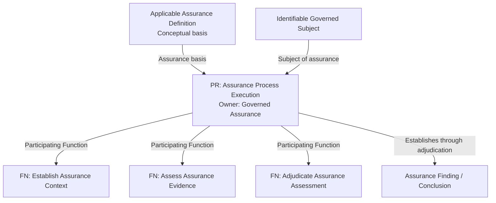

---
{
  "schemaVersion": 1,
  "canonicalId": "3c67e57403b041bb8ccdaf3980b6ff94",
  "archimateType": "BusinessProcess",
  "specialization": null,
  "displayName": "Assurance Process Execution",
  "friendlyName": "IndependentAssuranceEnablement.IndependentAssuranceEvaluationEnablement.GovernedAssurance.AssuranceProcessExecution",
  "canonicalName": "CT1-BEC-IndependentAssuranceEnablement.CT2-BEC-IndependentAssuranceEvaluationEnablement.CT3-BEC-GovernedAssurance.PR-AssuranceProcessExecution",
  "standing": {
    "semantic": "Canonical",
    "currentness": "pending_adjudication",
    "placement_status": "Established",
    "structural_id_status": "Proposed",
    "name_status": "Canonical",
    "ancestry_status": "proposed"
  },
  "identity": {
    "allocation": "Preserved existing resource-owned UUID32; no allocation in migration",
    "authority": "docs/markdown/governance/baseline/release-1.1.0.json",
    "migrationAuthority": "enterprise-architecture/design/review/1.1.5/hcrl-1.1.5-002.pending.md#dr-2"
  },
  "naming": {
    "authority": "docs/markdown/governance/canonical-identity-and-naming.md",
    "mode": "Preserved governed names; source-qualified context and unresolved ancestry retained",
    "expected": {
      "displayName": "Assurance Process Execution",
      "friendlyName": "IndependentAssuranceEnablement.IndependentAssuranceEvaluationEnablement.GovernedAssurance.AssuranceProcessExecution",
      "canonicalName": "CT1-BEC-IndependentAssuranceEnablement.CT2-BEC-IndependentAssuranceEvaluationEnablement.CT3-BEC-GovernedAssurance.PR-AssuranceProcessExecution"
    }
  },
  "provenance": [
    {
      "source": "docs/markdown/governance/baseline/architecture.json",
      "selector": "/elements/703",
      "role": "governed source resource",
      "revision": "aadcd55252fa7965be8a4321832ecc6d5b97c6e0",
      "sha256": "0f7dc7b43da74dddffcb41b169031f0bd771c51509002851bb07c1f1a7eeee0b",
      "sourceKey": "process:assurance-process-execution"
    },
    {
      "source": "docs/archimate/exchange/publish/1.1.0/Harmonia-Architecture-1.1.0.xml",
      "selector": "element[@identifier=\"id-63448f2658975592a4c956d874474037\"]",
      "role": "accepted representation binding and presentation; not an additional architecture source",
      "revision": "aadcd55252fa7965be8a4321832ecc6d5b97c6e0",
      "sha256": "4bd64067f4f62abdf58c348db6269ebc7c2edb31a85f069819ea717b982f01a1"
    },
    {
      "source": "docs/markdown/03-business-architecture/processes/business-processes.md",
      "selector": "62-assurance-process-execution",
      "role": "original source locator; recorded edition",
      "revision": "aadcd55252fa7965be8a4321832ecc6d5b97c6e0",
      "captureSource": "docs/markdown/governance/baseline/architecture.json",
      "recordedSourceSha256": "d7fd20fa50c3f41eb8a1d23b83ee6057eeb2f3225157f8677bdfdb3b478e23c2"
    },
    {
      "source": "docs/markdown/03-business-architecture/processes/business-processes.md",
      "selector": "62-assurance-process-execution",
      "role": "original source locator; recorded edition",
      "revision": "aadcd55252fa7965be8a4321832ecc6d5b97c6e0",
      "captureSource": "docs/markdown/governance/baseline/architecture.json",
      "recordedSourceSha256": "d7fd20fa50c3f41eb8a1d23b83ee6057eeb2f3225157f8677bdfdb3b478e23c2"
    },
    {
      "source": "docs/markdown/governance/baseline/architecture.json",
      "selector": "source-qualified relationship assertions whose from-key binds to canonicalId 3c67e57403b041bb8ccdaf3980b6ff94",
      "role": "Preserved non-native predicates, not new graph relationships",
      "revision": "aadcd55252fa7965be8a4321832ecc6d5b97c6e0"
    },
    {
      "source": "docs/markdown/03-business-architecture/processes/business-processes.md",
      "selector": "entry lines 367-385",
      "role": "Exact source-locator contribution; original qualifications retained",
      "revision": "aadcd55252fa7965be8a4321832ecc6d5b97c6e0"
    },
    {
      "source": "docs/markdown/03-business-architecture/processes/business-processes.md",
      "selector": "entry lines 370-370",
      "role": "Exact source-locator contribution; original qualifications retained",
      "revision": "aadcd55252fa7965be8a4321832ecc6d5b97c6e0"
    },
    {
      "source": "docs/markdown/03-business-architecture/processes/business-processes.md",
      "selector": "entry lines 373-373",
      "role": "Exact source-locator contribution; original qualifications retained",
      "revision": "aadcd55252fa7965be8a4321832ecc6d5b97c6e0"
    }
  ],
  "sourceBindings": [
    {
      "source": "docs/markdown/governance/baseline/architecture.json",
      "selector": "/elements/703"
    }
  ],
  "exchange": {
    "identifier": "id-63448f2658975592a4c956d874474037",
    "previousNativeName": "Assurance Process Execution",
    "properties": [
      {
        "ref": "propid-1",
        "values": [
          {
            "text": "process:assurance-process-execution",
            "attributes": {
              "{http://www.w3.org/XML/1998/namespace}lang": "en"
            }
          }
        ]
      },
      {
        "ref": "propid-2",
        "values": [
          {
            "text": "HCM-PR-assurance-process-execution",
            "attributes": {
              "{http://www.w3.org/XML/1998/namespace}lang": "en"
            }
          }
        ]
      },
      {
        "ref": "propid-3",
        "values": [
          {
            "text": "process:assurance-process-execution",
            "attributes": {
              "{http://www.w3.org/XML/1998/namespace}lang": "en"
            }
          }
        ]
      },
      {
        "ref": "propid-4",
        "values": [
          {
            "text": "process",
            "attributes": {
              "{http://www.w3.org/XML/1998/namespace}lang": "en"
            }
          }
        ]
      },
      {
        "ref": "propid-6",
        "values": [
          {
            "text": "Canonical",
            "attributes": {
              "{http://www.w3.org/XML/1998/namespace}lang": "en"
            }
          }
        ]
      },
      {
        "ref": "propid-7",
        "values": [
          {
            "text": "pending_adjudication",
            "attributes": {
              "{http://www.w3.org/XML/1998/namespace}lang": "en"
            }
          }
        ]
      },
      {
        "ref": "propid-8",
        "values": [
          {
            "text": "Established",
            "attributes": {
              "{http://www.w3.org/XML/1998/namespace}lang": "en"
            }
          }
        ]
      },
      {
        "ref": "propid-9",
        "values": [
          {
            "text": "Proposed",
            "attributes": {
              "{http://www.w3.org/XML/1998/namespace}lang": "en"
            }
          }
        ]
      },
      {
        "ref": "propid-10",
        "values": [
          {
            "text": "CT1-BEC-INDEPENDENT-SERVICE-ASSURANCE-ENABLEMENT.CT2-BEC-INDEPENDENT-ASSURANCE-EVALUATION-ENABLEMENT.CT3-BEC-GOVERNED-ASSURANCE.PR-ASSURANCE-PROCESS-EXECUTION",
            "attributes": {
              "{http://www.w3.org/XML/1998/namespace}lang": "en"
            }
          }
        ]
      },
      {
        "ref": "propid-11",
        "values": [
          {
            "text": "Canonical",
            "attributes": {
              "{http://www.w3.org/XML/1998/namespace}lang": "en"
            }
          }
        ]
      },
      {
        "ref": "propid-28",
        "values": [
          {
            "text": "Assurance Process Execution",
            "attributes": {
              "{http://www.w3.org/XML/1998/namespace}lang": "en"
            }
          }
        ]
      },
      {
        "ref": "propid-12",
        "values": [
          {
            "text": "Unresolved — representation ID only",
            "attributes": {
              "{http://www.w3.org/XML/1998/namespace}lang": "en"
            }
          }
        ]
      },
      {
        "ref": "propid-30",
        "values": [
          {
            "text": "[{\"anchor\":\"62-assurance-process-execution\",\"line\":367,\"source\":\"processes\",\"text\":\"### 6.2 Assurance Process Execution\"},{\"anchor\":\"62-assurance-process-execution\",\"line\":370,\"source\":\"processes\",\"text\":\"- **Owning Capability**: [Governed Assurance](../../02-strategy/capabilities/business-enabling-capabilities.md#governed-assurance).\"}]",
            "attributes": {
              "{http://www.w3.org/XML/1998/namespace}lang": "en"
            }
          }
        ]
      },
      {
        "ref": "propid-14",
        "values": [
          {
            "text": "{\"adjudication_note\":\"HUMAN ADJUDICATION REQUIRED: Canonical assurance against a governed subject is not independent review of the assurance service itself.\",\"ancestry_status\":\"proposed\",\"architectural_status\":\"Canonical\",\"baseline_description\":{\"Process Overview\":\"Assurance execution evaluates an identifiable subject under an applicable definition and establishes a finding through adjudication where sufficient evidence permits. Correct execution with insufficient evidence remains different from execution failure and from a positive or negative conclusion about the subject. Participating Functions describe responsibilities without supplying unapproved lifecycle states.\"},\"baseline_placement\":{\"canonical_id\":null,\"owner_key\":\"capability:governed-assurance\",\"parent_key\":null,\"tier\":null},\"baseline_unresolved\":[\"ancestry\",\"canonical_id\",\"code_allocation\",\"feature_association\",\"contextual_view\"],\"baseline_version\":\"0.1\",\"canonical_id\":\"CT1-BEC-INDEPENDENT-SERVICE-ASSURANCE-ENABLEMENT.CT2-BEC-INDEPENDENT-ASSURANCE-EVALUATION-ENABLEMENT.CT3-BEC-GOVERNED-ASSURANCE.PR-ASSURANCE-PROCESS-EXECUTION\",\"canonical_name\":\"Assurance Process Execution\",\"category\":null,\"governed_definition_latex\":\"\\n\\\\begin{itemize}\\n\\n\\\\item \\n\\\\textbf{Canonical Name}: \\\\texttt{\\\\seqsplit{Assurance Process Execution}}.\\n\\n\\n\\n\\\\item \\n\\\\textbf{Owning Capability}: \\\\href{https://github.com/fhirfactory/harmonia/blob/98410db60155198a75f74c79d98060070209faa1/docs/markdown/02-strategy/capabilities/business-enabling-capabilities.md\\\\#governed-assurance}{Governed Assurance}.\\n\\n\\n\\n\\\\item \\n\\\\textbf{Process Purpose}: Performs defined assurance for an identifiable governed subject in accordance with an applicable Assurance Definition and establishes an Assurance Finding /\\\\allowbreak{} Conclusion from applicable trustworthy evidence.\\n\\n\\n\\n\\\\item \\n\\\\textbf{Principal Performing Role}: \\\\href{https://github.com/fhirfactory/harmonia/blob/98410db60155198a75f74c79d98060070209faa1/docs/markdown/03-business-architecture/actors-roles/roles.md\\\\#service-guardian}{Service Guardian}.\\n\\n\\n\\n\\\\item \\n\\\\textbf{Participating Functions}: \\\\href{https://github.com/fhirfactory/harmonia/blob/98410db60155198a75f74c79d98060070209faa1/docs/markdown/03-business-architecture/behaviours/health-service-assurance.md\\\\#establish-assurance-context}{Establish Assurance Context}, \\\\href{https://github.com/fhirfactory/harmonia/blob/98410db60155198a75f74c79d98060070209faa1/docs/markdown/03-business-architecture/behaviours/health-service-assurance.md\\\\#assess-assurance-evidence}{Assess Assurance Evidence} and \\\\href{https://github.com/fhirfactory/harmonia/blob/98410db60155198a75f74c79d98060070209faa1/docs/markdown/03-business-architecture/behaviours/health-service-assurance.md\\\\#adjudicate-assurance-assessment}{Adjudicate Assurance Assessment}, all retaining Governed Assurance ownership.\\n\\n\\n\\n\\\\item \\n\\\\textbf{Conceptual Basis and Output}: Applicable Assurance Definition plus identifiable governed subject; Assurance Finding /\\\\allowbreak{} Conclusion established through adjudication where sufficient trustworthy evidence permits. Correct execution with insufficient evidence does not imply satisfaction or non-satisfaction or force a conclusion.\\n\\n\\n\\n\\\\item \\n\\\\textbf{Boundary}: Function completion does not define Process lifecycle states. No Context Established, Evidence Assessed, Adjudicated or Concluded states are inferred. Detailed lifecycle states, transitions and initiation mechanics remain unresolved. Requesting this Process does not grant control of evidence assessment, adjudication or the resulting finding/\\\\allowbreak{}conclusion.\\n\\n\\n\\n\\\\end{itemize}\\n\\n\\\\textit{RAD diagram: textual source notation.}\\n\\\\begin{Verbatim}[breaklines,fontsize=\\\\footnotesize]\\ngraph TD\\n DEF[\\\"Applicable Assurance Definition Conceptual basis\\\"] -->|Assurance basis| EXEC[\\\"PR: Assurance Process Execution Owner: Governed Assurance\\\"]\\n SUBJECT[\\\"Identifiable Governed Subject\\\"] -->|Subject of assurance| EXEC\\n EXEC -->|Participating Function| CONTEXT[\\\"FN: Establish Assurance Context\\\"]\\n EXEC -->|Participating Function| ASSESS[\\\"FN: Assess Assurance Evidence\\\"]\\n EXEC -->|Participating Function| ADJ[\\\"FN: Adjudicate Assurance Assessment\\\"]\\n EXEC -->|Establishes through adjudication| FINDING[\\\"Assurance Finding / Conclusion\\\"]\\n\\\\end{Verbatim}\\n\\n\\n\\n\",\"id_aliases\":[],\"key\":\"process:assurance-process-execution\",\"latex_label\":\"process:assurance-process-execution\",\"local_id\":\"ASSURANCE-PROCESS-EXECUTION\",\"name\":\"Assurance Process Execution\",\"name_aliases\":[],\"name_status\":\"Canonical\",\"owner_identifier\":\"HCM-BEC-governed-assurance\",\"owner_key\":\"capability:governed-assurance\",\"parent_identifier\":null,\"parent_key\":null,\"placement_status\":\"Established\",\"pre_review_record\":{\"ancestry_status\":\"proposed\",\"architectural_status\":\"Canonical\",\"baseline_description\":{\"Process Overview\":\"Assurance execution evaluates an identifiable subject under an applicable definition and establishes a finding through adjudication where sufficient evidence permits. Correct execution with insufficient evidence remains different from execution failure and from a positive or negative conclusion about the subject. Participating Functions describe responsibilities without supplying unapproved lifecycle states.\"},\"baseline_placement\":{\"canonical_id\":null,\"owner_key\":\"capability:governed-assurance\",\"parent_key\":null,\"tier\":null},\"baseline_unresolved\":[\"ancestry\",\"canonical_id\",\"code_allocation\",\"feature_association\",\"contextual_view\"],\"baseline_version\":\"0.1\",\"canonical_id\":\"CT1-BEC-INDEPENDENT-SERVICE-ASSURANCE-ENABLEMENT.CT2-BEC-INDEPENDENT-ASSURANCE-EVALUATION-ENABLEMENT.CT3-BEC-GOVERNED-ASSURANCE.PR-ASSURANCE-PROCESS-EXECUTION\",\"canonical_name\":\"Assurance Process Execution\",\"category\":null,\"governed_definition_latex\":\"\\n\\\\begin{itemize}\\n\\n\\\\item \\n\\\\textbf{Canonical Name}: \\\\texttt{\\\\seqsplit{Assurance Process Execution}}.\\n\\n\\n\\n\\\\item \\n\\\\textbf{Owning Capability}: \\\\href{https://github.com/fhirfactory/harmonia/blob/98410db60155198a75f74c79d98060070209faa1/docs/markdown/02-strategy/capabilities/business-enabling-capabilities.md\\\\#governed-assurance}{Governed Assurance}.\\n\\n\\n\\n\\\\item \\n\\\\textbf{Process Purpose}: Performs defined assurance for an identifiable governed subject in accordance with an applicable Assurance Definition and establishes an Assurance Finding /\\\\allowbreak{} Conclusion from applicable trustworthy evidence.\\n\\n\\n\\n\\\\item \\n\\\\textbf{Principal Performing Role}: \\\\href{https://github.com/fhirfactory/harmonia/blob/98410db60155198a75f74c79d98060070209faa1/docs/markdown/03-business-architecture/actors-roles/roles.md\\\\#service-guardian}{Service Guardian}.\\n\\n\\n\\n\\\\item \\n\\\\textbf{Participating Functions}: \\\\href{https://github.com/fhirfactory/harmonia/blob/98410db60155198a75f74c79d98060070209faa1/docs/markdown/03-business-architecture/behaviours/health-service-assurance.md\\\\#establish-assurance-context}{Establish Assurance Context}, \\\\href{https://github.com/fhirfactory/harmonia/blob/98410db60155198a75f74c79d98060070209faa1/docs/markdown/03-business-architecture/behaviours/health-service-assurance.md\\\\#assess-assurance-evidence}{Assess Assurance Evidence} and \\\\href{https://github.com/fhirfactory/harmonia/blob/98410db60155198a75f74c79d98060070209faa1/docs/markdown/03-business-architecture/behaviours/health-service-assurance.md\\\\#adjudicate-assurance-assessment}{Adjudicate Assurance Assessment}, all retaining Governed Assurance ownership.\\n\\n\\n\\n\\\\item \\n\\\\textbf{Conceptual Basis and Output}: Applicable Assurance Definition plus identifiable governed subject; Assurance Finding /\\\\allowbreak{} Conclusion established through adjudication where sufficient trustworthy evidence permits. Correct execution with insufficient evidence does not imply satisfaction or non-satisfaction or force a conclusion.\\n\\n\\n\\n\\\\item \\n\\\\textbf{Boundary}: Function completion does not define Process lifecycle states. No Context Established, Evidence Assessed, Adjudicated or Concluded states are inferred. Detailed lifecycle states, transitions and initiation mechanics remain unresolved. Requesting this Process does not grant control of evidence assessment, adjudication or the resulting finding/\\\\allowbreak{}conclusion.\\n\\n\\n\\n\\\\end{itemize}\\n\\n\\\\textit{RAD diagram: textual source notation.}\\n\\\\begin{Verbatim}[breaklines,fontsize=\\\\footnotesize]\\ngraph TD\\n DEF[\\\"Applicable Assurance Definition Conceptual basis\\\"] -->|Assurance basis| EXEC[\\\"PR: Assurance Process Execution Owner: Governed Assurance\\\"]\\n SUBJECT[\\\"Identifiable Governed Subject\\\"] -->|Subject of assurance| EXEC\\n EXEC -->|Participating Function| CONTEXT[\\\"FN: Establish Assurance Context\\\"]\\n EXEC -->|Participating Function| ASSESS[\\\"FN: Assess Assurance Evidence\\\"]\\n EXEC -->|Participating Function| ADJ[\\\"FN: Adjudicate Assurance Assessment\\\"]\\n EXEC -->|Establishes through adjudication| FINDING[\\\"Assurance Finding / Conclusion\\\"]\\n\\\\end{Verbatim}\\n\\n\\n\\n\",\"id_aliases\":[],\"key\":\"process:assurance-process-execution\",\"latex_label\":\"process:assurance-process-execution\",\"local_id\":\"ASSURANCE-PROCESS-EXECUTION\",\"name\":\"Assurance Process Execution\",\"name_aliases\":[],\"name_status\":\"Canonical\",\"owner_identifier\":\"HCM-BEC-governed-assurance\",\"owner_key\":\"capability:governed-assurance\",\"parent_identifier\":null,\"parent_key\":null,\"placement_status\":\"Established\",\"reference_id\":\"HCM-PR-assurance-process-execution\",\"responsibility_owner_key\":\"capability:governed-assurance\",\"source_rad_documents\":[\"docs/markdown/03-business-architecture/processes/business-processes.md\"],\"sources\":[{\"anchor\":\"62-assurance-process-execution\",\"line\":367,\"source\":\"processes\",\"text\":\"### 6.2 Assurance Process Execution\"},{\"anchor\":\"62-assurance-process-execution\",\"line\":370,\"source\":\"processes\",\"text\":\"- **Owning Capability**: [Governed Assurance](../../02-strategy/capabilities/business-enabling-capabilities.md#governed-assurance).\"}],\"structural_id_status\":\"Proposed\",\"tier\":null,\"type\":\"process\",\"unresolved\":[\"feature_association\",\"contextual_view\"],\"views\":[]},\"record_state\":\"pending_adjudication\",\"reference_id\":\"HCM-PR-assurance-process-execution\",\"responsibility_owner_key\":\"capability:governed-assurance\",\"source_rad_documents\":[\"docs/markdown/03-business-architecture/processes/business-processes.md\"],\"sources\":[{\"anchor\":\"62-assurance-process-execution\",\"line\":367,\"source\":\"processes\",\"text\":\"### 6.2 Assurance Process Execution\"},{\"anchor\":\"62-assurance-process-execution\",\"line\":370,\"source\":\"processes\",\"text\":\"- **Owning Capability**: [Governed Assurance](../../02-strategy/capabilities/business-enabling-capabilities.md#governed-assurance).\"}],\"structural_id_status\":\"Proposed\",\"tier\":null,\"type\":\"process\",\"unresolved\":[\"feature_association\",\"contextual_view\"],\"views\":[]}",
            "attributes": {
              "{http://www.w3.org/XML/1998/namespace}lang": "en"
            }
          }
        ]
      },
      {
        "ref": "propid-31",
        "values": [
          {
            "text": "[\"feature_association\",\"contextual_view\"]",
            "attributes": {
              "{http://www.w3.org/XML/1998/namespace}lang": "en"
            }
          }
        ]
      },
      {
        "ref": "propid-33",
        "values": [
          {
            "text": "HCM-BEC-governed-assurance",
            "attributes": {
              "{http://www.w3.org/XML/1998/namespace}lang": "en"
            }
          }
        ]
      },
      {
        "ref": "propid-32",
        "values": [
          {
            "text": "HUMAN ADJUDICATION REQUIRED: Canonical assurance against a governed subject is not independent review of the assurance service itself.",
            "attributes": {
              "{http://www.w3.org/XML/1998/namespace}lang": "en"
            }
          }
        ]
      },
      {
        "ref": "propid-16",
        "values": [
          {
            "text": "[{\"disposition\":\"metadata_and_finding\",\"reason\":\"Participation alone does not establish an ordered/whole-part process or realisation.\",\"record_state\":\"preserved historical assertion\",\"snapshot_pointer\":\"/relationships/232\",\"source_assertion\":{\"from\":\"process:assurance-process-execution\",\"sources\":[{\"anchor\":\"62-assurance-process-execution\",\"line\":373,\"source\":\"processes\",\"text\":\"- **Participating Functions**: [Establish Assurance Context](../behaviours/health-service-assurance.md#establish-assurance-context), [Assess Assurance Evidence](../behaviours/health-service-assurance.md#assess-assurance-evidence) and [Adjudicate Assurance Assessment](../behaviours/health-service-assurance.md#adjudicate-assurance-assessment), all retaining Governed Assurance ownership.\"}],\"status\":\"established\",\"to\":\"function:establish-assurance-context\",\"type\":\"participating_function\"},\"source_index\":232},{\"disposition\":\"metadata_and_finding\",\"reason\":\"Participation alone does not establish an ordered/whole-part process or realisation.\",\"record_state\":\"preserved historical assertion\",\"snapshot_pointer\":\"/relationships/233\",\"source_assertion\":{\"from\":\"process:assurance-process-execution\",\"sources\":[{\"anchor\":\"62-assurance-process-execution\",\"line\":373,\"source\":\"processes\",\"text\":\"- **Participating Functions**: [Establish Assurance Context](../behaviours/health-service-assurance.md#establish-assurance-context), [Assess Assurance Evidence](../behaviours/health-service-assurance.md#assess-assurance-evidence) and [Adjudicate Assurance Assessment](../behaviours/health-service-assurance.md#adjudicate-assurance-assessment), all retaining Governed Assurance ownership.\"}],\"status\":\"established\",\"to\":\"function:assess-assurance-evidence\",\"type\":\"participating_function\"},\"source_index\":233},{\"disposition\":\"metadata_and_finding\",\"reason\":\"Participation alone does not establish an ordered/whole-part process or realisation.\",\"record_state\":\"preserved historical assertion\",\"snapshot_pointer\":\"/relationships/234\",\"source_assertion\":{\"from\":\"process:assurance-process-execution\",\"sources\":[{\"anchor\":\"62-assurance-process-execution\",\"line\":373,\"source\":\"processes\",\"text\":\"- **Participating Functions**: [Establish Assurance Context](../behaviours/health-service-assurance.md#establish-assurance-context), [Assess Assurance Evidence](../behaviours/health-service-assurance.md#assess-assurance-evidence) and [Adjudicate Assurance Assessment](../behaviours/health-service-assurance.md#adjudicate-assurance-assessment), all retaining Governed Assurance ownership.\"}],\"status\":\"established\",\"to\":\"function:adjudicate-assurance-assessment\",\"type\":\"participating_function\"},\"source_index\":234},{\"disposition\":\"metadata_and_finding\",\"reason\":\"Use alone does not establish invocation, sequencing or native Serving.\",\"record_state\":\"preserved historical assertion\",\"snapshot_pointer\":\"/relationships/294\",\"source_assertion\":{\"from\":\"service:request-service-assurance\",\"sources\":[{\"anchor\":\"51-request-service-assurance\",\"line\":170,\"source\":\"assurance\",\"text\":\"- **Process Relationship**: Requests [Assurance Process Execution](../processes/business-processes.md#assurance-process-execution) under an applicable established Assurance Definition. It does not require a new Assurance Process Design instance for each request.\"}],\"status\":\"established\",\"to\":\"process:assurance-process-execution\",\"type\":\"uses_process\"},\"source_index\":294}]",
            "attributes": {
              "{http://www.w3.org/XML/1998/namespace}lang": "en"
            }
          }
        ]
      },
      {
        "ref": "propid-17",
        "values": [
          {
            "text": "docs/markdown/governance/baseline/processes.md#hcm-pr-assurance-process-execution",
            "attributes": {
              "{http://www.w3.org/XML/1998/namespace}lang": "en"
            }
          }
        ]
      },
      {
        "ref": "propid-18",
        "values": [
          {
            "text": "3c67e57403b041bb8ccdaf3980b6ff94",
            "attributes": {
              "{http://www.w3.org/XML/1998/namespace}lang": "en"
            }
          }
        ]
      },
      {
        "ref": "propid-19",
        "values": [
          {
            "text": "Assurance Process Execution",
            "attributes": {
              "{http://www.w3.org/XML/1998/namespace}lang": "en"
            }
          }
        ]
      },
      {
        "ref": "propid-20",
        "values": [
          {
            "text": "IndependentAssuranceEnablement.IndependentAssuranceEvaluationEnablement.GovernedAssurance.AssuranceProcessExecution",
            "attributes": {
              "{http://www.w3.org/XML/1998/namespace}lang": "en"
            }
          }
        ]
      },
      {
        "ref": "propid-21",
        "values": [
          {
            "text": "CT1-BEC-IndependentAssuranceEnablement.CT2-BEC-IndependentAssuranceEvaluationEnablement.CT3-BEC-GovernedAssurance.PR-AssuranceProcessExecution",
            "attributes": {
              "{http://www.w3.org/XML/1998/namespace}lang": "en"
            }
          }
        ]
      },
      {
        "ref": "propid-22",
        "values": [
          {
            "text": "BusinessProcess",
            "attributes": {
              "{http://www.w3.org/XML/1998/namespace}lang": "en"
            }
          }
        ]
      }
    ]
  },
  "relationships": [],
  "unresolvedProperties": {},
  "sourceUnresolved": {
    "dimensions": [
      "feature_association",
      "contextual_view"
    ],
    "adjudication": "HUMAN ADJUDICATION REQUIRED: Canonical assurance against a governed subject is not independent review of the assurance service itself."
  },
  "representation": {
    "sourceLinksRebased": true,
    "authority": "HCRL 1.1.5-002 DR-3; source meaning unchanged"
  },
  "qualifiedAssertions": [
    {
      "sourcePointer": "/relationships/232",
      "sourceCanonicalId": "3c67e57403b041bb8ccdaf3980b6ff94",
      "targetCanonicalId": "ffffe352e28c4e878d986b0e15ddff15",
      "disposition": "metadata_and_finding",
      "reason": "Participation alone does not establish an ordered/whole-part process or realisation.",
      "record_state": "preserved historical assertion",
      "snapshot_pointer": "/relationships/232",
      "source_assertion": {
        "from": "process:assurance-process-execution",
        "sources": [
          {
            "anchor": "62-assurance-process-execution",
            "line": 373,
            "source": "processes",
            "text": "- **Participating Functions**: [Establish Assurance Context](../behaviours/health-service-assurance.md#establish-assurance-context), [Assess Assurance Evidence](../behaviours/health-service-assurance.md#assess-assurance-evidence) and [Adjudicate Assurance Assessment](../behaviours/health-service-assurance.md#adjudicate-assurance-assessment), all retaining Governed Assurance ownership."
          }
        ],
        "status": "established",
        "to": "function:establish-assurance-context",
        "type": "participating_function"
      },
      "source_index": 232
    },
    {
      "sourcePointer": "/relationships/233",
      "sourceCanonicalId": "3c67e57403b041bb8ccdaf3980b6ff94",
      "targetCanonicalId": "e1f6402d47c0455b95b45a1a4d393484",
      "disposition": "metadata_and_finding",
      "reason": "Participation alone does not establish an ordered/whole-part process or realisation.",
      "record_state": "preserved historical assertion",
      "snapshot_pointer": "/relationships/233",
      "source_assertion": {
        "from": "process:assurance-process-execution",
        "sources": [
          {
            "anchor": "62-assurance-process-execution",
            "line": 373,
            "source": "processes",
            "text": "- **Participating Functions**: [Establish Assurance Context](../behaviours/health-service-assurance.md#establish-assurance-context), [Assess Assurance Evidence](../behaviours/health-service-assurance.md#assess-assurance-evidence) and [Adjudicate Assurance Assessment](../behaviours/health-service-assurance.md#adjudicate-assurance-assessment), all retaining Governed Assurance ownership."
          }
        ],
        "status": "established",
        "to": "function:assess-assurance-evidence",
        "type": "participating_function"
      },
      "source_index": 233
    },
    {
      "sourcePointer": "/relationships/234",
      "sourceCanonicalId": "3c67e57403b041bb8ccdaf3980b6ff94",
      "targetCanonicalId": "7d7cd216415d4b839ea3edfbf1538110",
      "disposition": "metadata_and_finding",
      "reason": "Participation alone does not establish an ordered/whole-part process or realisation.",
      "record_state": "preserved historical assertion",
      "snapshot_pointer": "/relationships/234",
      "source_assertion": {
        "from": "process:assurance-process-execution",
        "sources": [
          {
            "anchor": "62-assurance-process-execution",
            "line": 373,
            "source": "processes",
            "text": "- **Participating Functions**: [Establish Assurance Context](../behaviours/health-service-assurance.md#establish-assurance-context), [Assess Assurance Evidence](../behaviours/health-service-assurance.md#assess-assurance-evidence) and [Adjudicate Assurance Assessment](../behaviours/health-service-assurance.md#adjudicate-assurance-assessment), all retaining Governed Assurance ownership."
          }
        ],
        "status": "established",
        "to": "function:adjudicate-assurance-assessment",
        "type": "participating_function"
      },
      "source_index": 234
    }
  ]
}
---

# Assurance Process Execution

## Architectural content

•
Canonical Name: Assurance Process Execution.

•
Owning Capability: Governed Assurance (https://github.com/fhirfactory/harmonia/blob/98410db60155198a75f74c79d98060070209faa1/docs/markdown/02-strategy/capabilities/business-enabling-capabilities.md#governed-assurance).

•
Process Purpose: Performs defined assurance for an identifiable governed subject in accordance with an applicable Assurance Definition and establishes an Assurance Finding / Conclusion from applicable trustworthy evidence.

•
Principal Performing Role: Service Guardian (https://github.com/fhirfactory/harmonia/blob/98410db60155198a75f74c79d98060070209faa1/docs/markdown/03-business-architecture/actors-roles/roles.md#service-guardian).

•
Participating Functions: Establish Assurance Context (https://github.com/fhirfactory/harmonia/blob/98410db60155198a75f74c79d98060070209faa1/docs/markdown/03-business-architecture/behaviours/health-service-assurance.md#establish-assurance-context), Assess Assurance Evidence (https://github.com/fhirfactory/harmonia/blob/98410db60155198a75f74c79d98060070209faa1/docs/markdown/03-business-architecture/behaviours/health-service-assurance.md#assess-assurance-evidence) and Adjudicate Assurance Assessment (https://github.com/fhirfactory/harmonia/blob/98410db60155198a75f74c79d98060070209faa1/docs/markdown/03-business-architecture/behaviours/health-service-assurance.md#adjudicate-assurance-assessment), all retaining Governed Assurance ownership.

•
Conceptual Basis and Output: Applicable Assurance Definition plus identifiable governed subject; Assurance Finding / Conclusion established through adjudication where sufficient trustworthy evidence permits. Correct execution with insufficient evidence does not imply satisfaction or non-satisfaction or force a conclusion.

•
Boundary: Function completion does not define Process lifecycle states. No Context Established, Evidence Assessed, Adjudicated or Concluded states are inferred. Detailed lifecycle states, transitions and initiation mechanics remain unresolved. Requesting this Process does not grant control of evidence assessment, adjudication or the resulting finding/conclusion.

RAD diagram: textual source notation.
\begin{Verbatim}[breaklines,fontsize=
]
graph TD
    DEF["Applicable Assurance Definition Conceptual basis"] -->|Assurance basis| EXEC["PR: Assurance Process Execution Owner: Governed Assurance"]
    SUBJECT["Identifiable Governed Subject"] -->|Subject of assurance| EXEC
    EXEC -->|Participating Function| CONTEXT["FN: Establish Assurance Context"]
    EXEC -->|Participating Function| ASSESS["FN: Assess Assurance Evidence"]
    EXEC -->|Participating Function| ADJ["FN: Adjudicate Assurance Assessment"]
    EXEC -->|Establishes through adjudication| FINDING["Assurance Finding / Conclusion"]
\end{Verbatim}

---

## History

### Process Overview — predecessor explanation

Assurance execution evaluates an identifiable subject under an applicable definition and establishes a finding through adjudication where sufficient evidence permits. Correct execution with insufficient evidence remains different from execution failure and from a positive or negative conclusion about the subject. Participating Functions describe responsibilities without supplying unapproved lifecycle states.

## Qualified relationship assertions

These source predicates retain their recorded standing and currentness. Their native mapping remains unestablished; they are not inferred ArchiMate edges. The complete original assertions and qualifications are retained in this element’s metadata.

| Source predicate | Target element | Standing / currentness | Unresolved native meaning |
| --- | --- | --- | --- |
| participating_function | [Establish Assurance Context](../business-function/ffffe352e28c4e878d986b0e15ddff15.md) | established / preserved historical assertion | Participation alone does not establish an ordered/whole-part process or realisation. |
| participating_function | [Assess Assurance Evidence](../business-function/e1f6402d47c0455b95b45a1a4d393484.md) | established / preserved historical assertion | Participation alone does not establish an ordered/whole-part process or realisation. |
| participating_function | [Adjudicate Assurance Assessment](../business-function/7d7cd216415d4b839ea3edfbf1538110.md) | established / preserved historical assertion | Participation alone does not establish an ordered/whole-part process or realisation. |

## Source-qualified contribution

Source: `docs/markdown/03-business-architecture/processes/business-processes.md` — entry lines 367-385. Standing: exact originating assertion; current resource standing unchanged.

### 6.2 Assurance Process Execution

- **Canonical Name**: `Assurance Process Execution`.
- **Owning Capability**: [Governed Assurance](../../../../docs/markdown/02-strategy/capabilities/business-enabling-capabilities.md#governed-assurance).
- **Process Purpose**: Performs defined assurance for an identifiable governed subject in accordance with an applicable Assurance Definition and establishes an Assurance Finding / Conclusion from applicable trustworthy evidence.
- **Principal Performing Role**: [Service Guardian](../../../../docs/markdown/03-business-architecture/actors-roles/roles.md#service-guardian).
- **Participating Functions**: [Establish Assurance Context](../../../../docs/markdown/03-business-architecture/behaviours/health-service-assurance.md#establish-assurance-context), [Assess Assurance Evidence](../../../../docs/markdown/03-business-architecture/behaviours/health-service-assurance.md#assess-assurance-evidence) and [Adjudicate Assurance Assessment](../../../../docs/markdown/03-business-architecture/behaviours/health-service-assurance.md#adjudicate-assurance-assessment), all retaining Governed Assurance ownership.
- **Conceptual Basis and Output**: Applicable Assurance Definition plus identifiable governed subject; Assurance Finding / Conclusion established through adjudication where sufficient trustworthy evidence permits. Correct execution with insufficient evidence does not imply satisfaction or non-satisfaction or force a conclusion.
- **Boundary**: Function completion does not define Process lifecycle states. No Context Established, Evidence Assessed, Adjudicated or Concluded states are inferred. Detailed lifecycle states, transitions and initiation mechanics remain unresolved. Requesting this Process does not grant control of evidence assessment, adjudication or the resulting finding/conclusion.

## Source-qualified contribution

Source: `docs/markdown/03-business-architecture/processes/business-processes.md` — entry lines 370-370. Standing: exact originating assertion; current resource standing unchanged.

- **Owning Capability**: [Governed Assurance](../../../../docs/markdown/02-strategy/capabilities/business-enabling-capabilities.md#governed-assurance).

## Source-qualified contribution

Source: `docs/markdown/03-business-architecture/processes/business-processes.md` — entry lines 373-373. Standing: exact originating assertion; current resource standing unchanged.

- **Participating Functions**: [Establish Assurance Context](../../../../docs/markdown/03-business-architecture/behaviours/health-service-assurance.md#establish-assurance-context), [Assess Assurance Evidence](../../../../docs/markdown/03-business-architecture/behaviours/health-service-assurance.md#assess-assurance-evidence) and [Adjudicate Assurance Assessment](../../../../docs/markdown/03-business-architecture/behaviours/health-service-assurance.md#adjudicate-assurance-assessment), all retaining Governed Assurance ownership.
