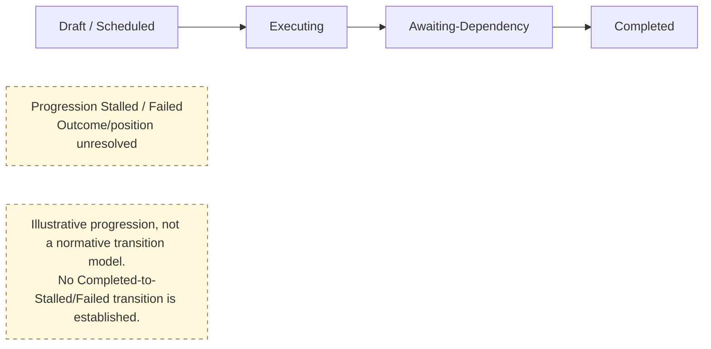

---
{
  "schemaVersion": 1,
  "canonicalId": "618acdb38fc74952ab360fdde4f7d865",
  "archimateType": "BusinessProcess",
  "specialization": null,
  "displayName": "Synthetic Task Progression Process",
  "friendlyName": "HumanCollaborationAndWorkEnablement.OperationalActivityAndTemporalEnablement.WorkflowAndActivityCoordination.SyntheticTaskProgressionProcess",
  "canonicalName": "CT1-BEC-HumanCollaborationAndWorkEnablement.CT2-BEC-OperationalActivityAndTemporalEnablement.CT3-BEC-WorkflowAndActivityCoordination.PR-SyntheticTaskProgressionProcess",
  "standing": {
    "semantic": "Canonical",
    "currentness": "pending_adjudication",
    "placement_status": "Established",
    "structural_id_status": "Proposed",
    "name_status": "Canonical",
    "ancestry_status": "proposed"
  },
  "identity": {
    "allocation": "Preserved existing resource-owned UUID32; no allocation in migration",
    "authority": "docs/markdown/governance/baseline/release-1.1.0.json",
    "migrationAuthority": "enterprise-architecture/design/review/1.1.5/hcrl-1.1.5-002.pending.md#dr-2"
  },
  "naming": {
    "authority": "docs/markdown/governance/canonical-identity-and-naming.md",
    "mode": "Preserved governed names; source-qualified context and unresolved ancestry retained",
    "expected": {
      "displayName": "Synthetic Task Progression Process",
      "friendlyName": "HumanCollaborationAndWorkEnablement.OperationalActivityAndTemporalEnablement.WorkflowAndActivityCoordination.SyntheticTaskProgressionProcess",
      "canonicalName": "CT1-BEC-HumanCollaborationAndWorkEnablement.CT2-BEC-OperationalActivityAndTemporalEnablement.CT3-BEC-WorkflowAndActivityCoordination.PR-SyntheticTaskProgressionProcess"
    }
  },
  "provenance": [
    {
      "source": "docs/markdown/governance/baseline/architecture.json",
      "selector": "/elements/701",
      "role": "governed source resource",
      "revision": "aadcd55252fa7965be8a4321832ecc6d5b97c6e0",
      "sha256": "0f7dc7b43da74dddffcb41b169031f0bd771c51509002851bb07c1f1a7eeee0b",
      "sourceKey": "process:synthetic-task-progression-process"
    },
    {
      "source": "docs/archimate/exchange/publish/1.1.0/Harmonia-Architecture-1.1.0.xml",
      "selector": "element[@identifier=\"id-f9fa8fe0918f535893a879de3285ea40\"]",
      "role": "accepted representation binding and presentation; not an additional architecture source",
      "revision": "aadcd55252fa7965be8a4321832ecc6d5b97c6e0",
      "sha256": "4bd64067f4f62abdf58c348db6269ebc7c2edb31a85f069819ea717b982f01a1"
    },
    {
      "source": "docs/markdown/03-business-architecture/processes/business-processes.md",
      "selector": "516-synthetic-task-progression-process",
      "role": "original source locator; recorded edition",
      "revision": "aadcd55252fa7965be8a4321832ecc6d5b97c6e0",
      "captureSource": "docs/markdown/governance/baseline/architecture.json",
      "recordedSourceSha256": "d7fd20fa50c3f41eb8a1d23b83ee6057eeb2f3225157f8677bdfdb3b478e23c2"
    },
    {
      "source": "docs/markdown/03-business-architecture/processes/business-processes.md",
      "selector": "516-synthetic-task-progression-process",
      "role": "original source locator; recorded edition",
      "revision": "aadcd55252fa7965be8a4321832ecc6d5b97c6e0",
      "captureSource": "docs/markdown/governance/baseline/architecture.json",
      "recordedSourceSha256": "d7fd20fa50c3f41eb8a1d23b83ee6057eeb2f3225157f8677bdfdb3b478e23c2"
    },
    {
      "source": "docs/markdown/03-business-architecture/processes/business-processes.md",
      "selector": "entry lines 322-345",
      "role": "Exact source-locator contribution; original qualifications retained",
      "revision": "aadcd55252fa7965be8a4321832ecc6d5b97c6e0"
    },
    {
      "source": "docs/markdown/03-business-architecture/processes/business-processes.md",
      "selector": "entry lines 323-323",
      "role": "Exact source-locator contribution; original qualifications retained",
      "revision": "aadcd55252fa7965be8a4321832ecc6d5b97c6e0"
    }
  ],
  "sourceBindings": [
    {
      "source": "docs/markdown/governance/baseline/architecture.json",
      "selector": "/elements/701"
    }
  ],
  "exchange": {
    "identifier": "id-f9fa8fe0918f535893a879de3285ea40",
    "previousNativeName": "Synthetic Task Progression Process",
    "properties": [
      {
        "ref": "propid-1",
        "values": [
          {
            "text": "process:synthetic-task-progression-process",
            "attributes": {
              "{http://www.w3.org/XML/1998/namespace}lang": "en"
            }
          }
        ]
      },
      {
        "ref": "propid-2",
        "values": [
          {
            "text": "HCM-PR-synthetic-task-progression-process",
            "attributes": {
              "{http://www.w3.org/XML/1998/namespace}lang": "en"
            }
          }
        ]
      },
      {
        "ref": "propid-3",
        "values": [
          {
            "text": "process:synthetic-task-progression-process",
            "attributes": {
              "{http://www.w3.org/XML/1998/namespace}lang": "en"
            }
          }
        ]
      },
      {
        "ref": "propid-4",
        "values": [
          {
            "text": "process",
            "attributes": {
              "{http://www.w3.org/XML/1998/namespace}lang": "en"
            }
          }
        ]
      },
      {
        "ref": "propid-6",
        "values": [
          {
            "text": "Canonical",
            "attributes": {
              "{http://www.w3.org/XML/1998/namespace}lang": "en"
            }
          }
        ]
      },
      {
        "ref": "propid-7",
        "values": [
          {
            "text": "pending_adjudication",
            "attributes": {
              "{http://www.w3.org/XML/1998/namespace}lang": "en"
            }
          }
        ]
      },
      {
        "ref": "propid-8",
        "values": [
          {
            "text": "Established",
            "attributes": {
              "{http://www.w3.org/XML/1998/namespace}lang": "en"
            }
          }
        ]
      },
      {
        "ref": "propid-9",
        "values": [
          {
            "text": "Proposed",
            "attributes": {
              "{http://www.w3.org/XML/1998/namespace}lang": "en"
            }
          }
        ]
      },
      {
        "ref": "propid-10",
        "values": [
          {
            "text": "CT1-BEC-HUMAN-COLLABORATION-WORK-ENABLEMENT.CT2-BEC-OPERATIONAL-ACTIVITY-TEMPORAL-ENABLEMENT.CT3-BEC-WORKFLOW-ACTIVITY-COORDINATION.PR-SYNTHETIC-TASK-PROGRESSION-PROCESS",
            "attributes": {
              "{http://www.w3.org/XML/1998/namespace}lang": "en"
            }
          }
        ]
      },
      {
        "ref": "propid-11",
        "values": [
          {
            "text": "Canonical",
            "attributes": {
              "{http://www.w3.org/XML/1998/namespace}lang": "en"
            }
          }
        ]
      },
      {
        "ref": "propid-28",
        "values": [
          {
            "text": "Synthetic Task Progression Process",
            "attributes": {
              "{http://www.w3.org/XML/1998/namespace}lang": "en"
            }
          }
        ]
      },
      {
        "ref": "propid-12",
        "values": [
          {
            "text": "Unresolved — representation ID only",
            "attributes": {
              "{http://www.w3.org/XML/1998/namespace}lang": "en"
            }
          }
        ]
      },
      {
        "ref": "propid-30",
        "values": [
          {
            "text": "[{\"anchor\":\"516-synthetic-task-progression-process\",\"line\":322,\"source\":\"processes\",\"text\":\"### 5.16 Synthetic Task Progression Process\"},{\"anchor\":\"516-synthetic-task-progression-process\",\"line\":323,\"source\":\"processes\",\"text\":\"- **Owning Capability**: `Workflow & Activity Coordination`\"}]",
            "attributes": {
              "{http://www.w3.org/XML/1998/namespace}lang": "en"
            }
          }
        ]
      },
      {
        "ref": "propid-14",
        "values": [
          {
            "text": "{\"adjudication_note\":\"HUMAN ADJUDICATION REQUIRED: Canonical internal Work Order, To Do and synthetic Task progression is broader than the reviewed external execution-boundary bridge.\",\"ancestry_status\":\"proposed\",\"architectural_status\":\"Canonical\",\"baseline_description\":{\"Process Overview\":\"Synthetic Task progression concerns automated non-human execution, including waiting for a dependency and producing an output. It must remain distinct from human work orders and external clinical task lists. The disconnected stalled/failed outcome in the illustration leaves its relation to the success path unresolved; no reopening or post-completion failure transition is inferred.\"},\"baseline_placement\":{\"canonical_id\":null,\"owner_key\":\"capability:workflow--activity-coordination\",\"parent_key\":null,\"tier\":null},\"baseline_unresolved\":[\"ancestry\",\"canonical_id\",\"code_allocation\",\"feature_association\"],\"baseline_version\":\"0.1\",\"canonical_id\":\"CT1-BEC-HUMAN-COLLABORATION-WORK-ENABLEMENT.CT2-BEC-OPERATIONAL-ACTIVITY-TEMPORAL-ENABLEMENT.CT3-BEC-WORKFLOW-ACTIVITY-COORDINATION.PR-SYNTHETIC-TASK-PROGRESSION-PROCESS\",\"canonical_name\":\"Synthetic Task Progression Process\",\"category\":null,\"governed_definition_latex\":\"\\n\\\\begin{itemize}\\n\\n\\\\item \\n\\\\textbf{Owning Capability}: \\\\texttt{\\\\seqsplit{Workflow \\\\& Activity Coordination}}\\n\\n\\n\\n\\\\item \\n\\\\textbf{Activity Archetype}: \\\\textbf{Non-Human Executable Work} — automated system workflows, batch syndications, or policy evaluation tasks.\\n\\n\\n\\n\\\\item \\n\\\\textbf{State Progression Lifecycle}:\\n\\n\\n\\n\\\\end{itemize}\\n\\n\\\\textit{RAD diagram: textual source notation.}\\n\\\\begin{Verbatim}[breaklines,fontsize=\\\\footnotesize]\\ngraph LR\\n D[\\\"Draft / Scheduled\\\"] --> E[\\\"Executing\\\"]\\n E --> W[\\\"Awaiting-Dependency\\\"]\\n W --> C[\\\"Completed\\\"]\\n F[\\\"Progression Stalled / Failed Outcome/position unresolved\\\"]\\n NOTE[\\\"Illustrative progression, not a normative transition model. No Completed-to-Stalled/Failed transition is established.\\\"]\\n classDef note fill:#fff8dc,stroke:#8a6d3b,stroke-dasharray:5 5;\\n class NOTE,F note;\\n\\\\end{Verbatim}\\n\\n\\\\begin{itemize}\\n\\n\\\\item \\n\\\\textbf{Key State Dispositions}:\\n\\n\\n\\\\begin{itemize}\\n\\n\\\\item \\n\\\\texttt{\\\\seqsplit{Draft / Scheduled}}: Automated task instantiated and scheduled for processing.\\n\\n\\n\\n\\\\item \\n\\\\texttt{\\\\seqsplit{Executing}}: System actively processing task.\\n\\n\\n\\n\\\\item \\n\\\\texttt{\\\\seqsplit{Awaiting-Dependency}}: Paused awaiting asynchronous external reply or event.\\n\\n\\n\\n\\\\item \\n\\\\texttt{\\\\seqsplit{Completed}}: Automated execution succeeded and output artifact produced.\\n\\n\\n\\n\\\\item \\n\\\\texttt{\\\\seqsplit{Progression Stalled / Failed}}: Transient fault triggers scheduled recovery attempt; permanent failure records failure evidence.\\n\\n\\n\\n\\\\end{itemize}\\n\\n\\n\\\\item \\n\\\\textbf{Preserved uncertainty}: Whether stalled/\\\\allowbreak{}failed is an alternative outcome, reopening/\\\\allowbreak{}post-completion behaviour or a presentation defect remains unresolved. Its disconnected diagram node does not make success and failure equivalent or establish post-completion transitions.\\n\\n\\n\\n\\\\end{itemize}\\n\\n\\\\par\\\\smallskip\\n\\n\\n\\n\",\"id_aliases\":[],\"key\":\"process:synthetic-task-progression-process\",\"latex_label\":\"process:synthetic-task-progression-process\",\"local_id\":\"SYNTHETIC-TASK-PROGRESSION-PROCESS\",\"name\":\"Synthetic Task Progression Process\",\"name_aliases\":[],\"name_status\":\"Canonical\",\"owner_identifier\":\"HCM-BEC-workflow-activity-coordination\",\"owner_key\":\"capability:workflow--activity-coordination\",\"parent_identifier\":null,\"parent_key\":null,\"placement_status\":\"Established\",\"pre_review_record\":{\"ancestry_status\":\"proposed\",\"architectural_status\":\"Canonical\",\"baseline_description\":{\"Process Overview\":\"Synthetic Task progression concerns automated non-human execution, including waiting for a dependency and producing an output. It must remain distinct from human work orders and external clinical task lists. The disconnected stalled/failed outcome in the illustration leaves its relation to the success path unresolved; no reopening or post-completion failure transition is inferred.\"},\"baseline_placement\":{\"canonical_id\":null,\"owner_key\":\"capability:workflow--activity-coordination\",\"parent_key\":null,\"tier\":null},\"baseline_unresolved\":[\"ancestry\",\"canonical_id\",\"code_allocation\",\"feature_association\"],\"baseline_version\":\"0.1\",\"canonical_id\":\"CT1-BEC-HUMAN-COLLABORATION-WORK-ENABLEMENT.CT2-BEC-OPERATIONAL-ACTIVITY-TEMPORAL-ENABLEMENT.CT3-BEC-WORKFLOW-ACTIVITY-COORDINATION.PR-SYNTHETIC-TASK-PROGRESSION-PROCESS\",\"canonical_name\":\"Synthetic Task Progression Process\",\"category\":null,\"governed_definition_latex\":\"\\n\\\\begin{itemize}\\n\\n\\\\item \\n\\\\textbf{Owning Capability}: \\\\texttt{\\\\seqsplit{Workflow \\\\& Activity Coordination}}\\n\\n\\n\\n\\\\item \\n\\\\textbf{Activity Archetype}: \\\\textbf{Non-Human Executable Work} — automated system workflows, batch syndications, or policy evaluation tasks.\\n\\n\\n\\n\\\\item \\n\\\\textbf{State Progression Lifecycle}:\\n\\n\\n\\n\\\\end{itemize}\\n\\n\\\\textit{RAD diagram: textual source notation.}\\n\\\\begin{Verbatim}[breaklines,fontsize=\\\\footnotesize]\\ngraph LR\\n D[\\\"Draft / Scheduled\\\"] --> E[\\\"Executing\\\"]\\n E --> W[\\\"Awaiting-Dependency\\\"]\\n W --> C[\\\"Completed\\\"]\\n F[\\\"Progression Stalled / Failed Outcome/position unresolved\\\"]\\n NOTE[\\\"Illustrative progression, not a normative transition model. No Completed-to-Stalled/Failed transition is established.\\\"]\\n classDef note fill:#fff8dc,stroke:#8a6d3b,stroke-dasharray:5 5;\\n class NOTE,F note;\\n\\\\end{Verbatim}\\n\\n\\\\begin{itemize}\\n\\n\\\\item \\n\\\\textbf{Key State Dispositions}:\\n\\n\\n\\\\begin{itemize}\\n\\n\\\\item \\n\\\\texttt{\\\\seqsplit{Draft / Scheduled}}: Automated task instantiated and scheduled for processing.\\n\\n\\n\\n\\\\item \\n\\\\texttt{\\\\seqsplit{Executing}}: System actively processing task.\\n\\n\\n\\n\\\\item \\n\\\\texttt{\\\\seqsplit{Awaiting-Dependency}}: Paused awaiting asynchronous external reply or event.\\n\\n\\n\\n\\\\item \\n\\\\texttt{\\\\seqsplit{Completed}}: Automated execution succeeded and output artifact produced.\\n\\n\\n\\n\\\\item \\n\\\\texttt{\\\\seqsplit{Progression Stalled / Failed}}: Transient fault triggers scheduled recovery attempt; permanent failure records failure evidence.\\n\\n\\n\\n\\\\end{itemize}\\n\\n\\n\\\\item \\n\\\\textbf{Preserved uncertainty}: Whether stalled/\\\\allowbreak{}failed is an alternative outcome, reopening/\\\\allowbreak{}post-completion behaviour or a presentation defect remains unresolved. Its disconnected diagram node does not make success and failure equivalent or establish post-completion transitions.\\n\\n\\n\\n\\\\end{itemize}\\n\\n\\\\par\\\\smallskip\\n\\n\\n\\n\",\"id_aliases\":[],\"key\":\"process:synthetic-task-progression-process\",\"latex_label\":\"process:synthetic-task-progression-process\",\"local_id\":\"SYNTHETIC-TASK-PROGRESSION-PROCESS\",\"name\":\"Synthetic Task Progression Process\",\"name_aliases\":[],\"name_status\":\"Canonical\",\"owner_identifier\":\"HCM-BEC-workflow-activity-coordination\",\"owner_key\":\"capability:workflow--activity-coordination\",\"parent_identifier\":null,\"parent_key\":null,\"placement_status\":\"Established\",\"reference_id\":\"HCM-PR-synthetic-task-progression-process\",\"responsibility_owner_key\":\"capability:workflow--activity-coordination\",\"source_rad_documents\":[\"docs/markdown/03-business-architecture/processes/business-processes.md\"],\"sources\":[{\"anchor\":\"516-synthetic-task-progression-process\",\"line\":322,\"source\":\"processes\",\"text\":\"### 5.16 Synthetic Task Progression Process\"},{\"anchor\":\"516-synthetic-task-progression-process\",\"line\":323,\"source\":\"processes\",\"text\":\"- **Owning Capability**: `Workflow & Activity Coordination`\"}],\"structural_id_status\":\"Proposed\",\"tier\":null,\"type\":\"process\",\"unresolved\":[\"feature_association\"],\"views\":[\"view:intrinsic--shared-enablement\"]},\"record_state\":\"pending_adjudication\",\"reference_id\":\"HCM-PR-synthetic-task-progression-process\",\"responsibility_owner_key\":\"capability:workflow--activity-coordination\",\"source_rad_documents\":[\"docs/markdown/03-business-architecture/processes/business-processes.md\"],\"sources\":[{\"anchor\":\"516-synthetic-task-progression-process\",\"line\":322,\"source\":\"processes\",\"text\":\"### 5.16 Synthetic Task Progression Process\"},{\"anchor\":\"516-synthetic-task-progression-process\",\"line\":323,\"source\":\"processes\",\"text\":\"- **Owning Capability**: `Workflow & Activity Coordination`\"}],\"structural_id_status\":\"Proposed\",\"tier\":null,\"type\":\"process\",\"unresolved\":[\"feature_association\"],\"views\":[\"view:intrinsic--shared-enablement\"]}",
            "attributes": {
              "{http://www.w3.org/XML/1998/namespace}lang": "en"
            }
          }
        ]
      },
      {
        "ref": "propid-31",
        "values": [
          {
            "text": "[\"feature_association\"]",
            "attributes": {
              "{http://www.w3.org/XML/1998/namespace}lang": "en"
            }
          }
        ]
      },
      {
        "ref": "propid-33",
        "values": [
          {
            "text": "HCM-BEC-workflow-activity-coordination",
            "attributes": {
              "{http://www.w3.org/XML/1998/namespace}lang": "en"
            }
          }
        ]
      },
      {
        "ref": "propid-32",
        "values": [
          {
            "text": "HUMAN ADJUDICATION REQUIRED: Canonical internal Work Order, To Do and synthetic Task progression is broader than the reviewed external execution-boundary bridge.",
            "attributes": {
              "{http://www.w3.org/XML/1998/namespace}lang": "en"
            }
          }
        ]
      },
      {
        "ref": "propid-16",
        "values": [
          {
            "text": "[{\"disposition\":\"metadata_and_finding\",\"reason\":\"Process responsibility/governance is not automatically Assignment or Composition.\",\"record_state\":\"preserved historical assertion\",\"snapshot_pointer\":\"/relationships/293\",\"source_assertion\":{\"from\":\"function:coordinate-synthetic-task\",\"sources\":[{\"anchor\":\"29-workflow--activity-coordination\",\"line\":191,\"source\":\"ise\",\"text\":\" - *Governed Process*: **Synthetic Task Progression Process**.\"}],\"status\":\"established\",\"to\":\"process:synthetic-task-progression-process\",\"type\":\"governed_process\"},\"source_index\":293}]",
            "attributes": {
              "{http://www.w3.org/XML/1998/namespace}lang": "en"
            }
          }
        ]
      },
      {
        "ref": "propid-17",
        "values": [
          {
            "text": "docs/markdown/governance/baseline/processes.md#hcm-pr-synthetic-task-progression-process",
            "attributes": {
              "{http://www.w3.org/XML/1998/namespace}lang": "en"
            }
          }
        ]
      },
      {
        "ref": "propid-18",
        "values": [
          {
            "text": "618acdb38fc74952ab360fdde4f7d865",
            "attributes": {
              "{http://www.w3.org/XML/1998/namespace}lang": "en"
            }
          }
        ]
      },
      {
        "ref": "propid-19",
        "values": [
          {
            "text": "Synthetic Task Progression Process",
            "attributes": {
              "{http://www.w3.org/XML/1998/namespace}lang": "en"
            }
          }
        ]
      },
      {
        "ref": "propid-20",
        "values": [
          {
            "text": "HumanCollaborationAndWorkEnablement.OperationalActivityAndTemporalEnablement.WorkflowAndActivityCoordination.SyntheticTaskProgressionProcess",
            "attributes": {
              "{http://www.w3.org/XML/1998/namespace}lang": "en"
            }
          }
        ]
      },
      {
        "ref": "propid-21",
        "values": [
          {
            "text": "CT1-BEC-HumanCollaborationAndWorkEnablement.CT2-BEC-OperationalActivityAndTemporalEnablement.CT3-BEC-WorkflowAndActivityCoordination.PR-SyntheticTaskProgressionProcess",
            "attributes": {
              "{http://www.w3.org/XML/1998/namespace}lang": "en"
            }
          }
        ]
      },
      {
        "ref": "propid-22",
        "values": [
          {
            "text": "BusinessProcess",
            "attributes": {
              "{http://www.w3.org/XML/1998/namespace}lang": "en"
            }
          }
        ]
      }
    ]
  },
  "relationships": [],
  "unresolvedProperties": {},
  "sourceUnresolved": {
    "dimensions": [
      "feature_association"
    ],
    "adjudication": "HUMAN ADJUDICATION REQUIRED: Canonical internal Work Order, To Do and synthetic Task progression is broader than the reviewed external execution-boundary bridge."
  },
  "representation": {
    "sourceLinksRebased": true,
    "authority": "HCRL 1.1.5-002 DR-3; source meaning unchanged"
  }
}
---

# Synthetic Task Progression Process

## Architectural content

•
Owning Capability: Workflow & Activity Coordination

•
Activity Archetype: Non-Human Executable Work — automated system workflows, batch syndications, or policy evaluation tasks.

•
State Progression Lifecycle:

RAD diagram: textual source notation.
\begin{Verbatim}[breaklines,fontsize=
]
graph LR
    D["Draft / Scheduled"] --> E["Executing"]
    E --> W["Awaiting-Dependency"]
    W --> C["Completed"]
    F["Progression Stalled / Failed Outcome/position unresolved"]
    NOTE["Illustrative progression, not a normative transition model. No Completed-to-Stalled/Failed transition is established."]
    classDef note fill:#fff8dc,stroke:#8a6d3b,stroke-dasharray:5 5;
    class NOTE,F note;
\end{Verbatim}

•
Key State Dispositions:

•
Draft / Scheduled: Automated task instantiated and scheduled for processing.

•
Executing: System actively processing task.

•
Awaiting-Dependency: Paused awaiting asynchronous external reply or event.

•
Completed: Automated execution succeeded and output artifact produced.

•
Progression Stalled / Failed: Transient fault triggers scheduled recovery attempt; permanent failure records failure evidence.

•
Preserved uncertainty: Whether stalled/failed is an alternative outcome, reopening/post-completion behaviour or a presentation defect remains unresolved. Its disconnected diagram node does not make success and failure equivalent or establish post-completion transitions.

---

## History

### Process Overview — predecessor explanation

Synthetic Task progression concerns automated non-human execution, including waiting for a dependency and producing an output. It must remain distinct from human work orders and external clinical task lists. The disconnected stalled/failed outcome in the illustration leaves its relation to the success path unresolved; no reopening or post-completion failure transition is inferred.

## Source-qualified contribution

Source: `docs/markdown/03-business-architecture/processes/business-processes.md` — entry lines 322-345. Standing: exact originating assertion; current resource standing unchanged.

### 5.16 Synthetic Task Progression Process
- **Owning Capability**: `Workflow & Activity Coordination`
- **Activity Archetype**: **Non-Human Executable Work** — automated system workflows, batch syndications, or policy evaluation tasks.
- **State Progression Lifecycle**:

- **Key State Dispositions**:
  - `Draft / Scheduled`: Automated task instantiated and scheduled for processing.
  - `Executing`: System actively processing task.
  - `Awaiting-Dependency`: Paused awaiting asynchronous external reply or event.
  - `Completed`: Automated execution succeeded and output artifact produced.
  - `Progression Stalled / Failed`: Transient fault triggers scheduled recovery attempt; permanent failure records failure evidence.
- **Preserved uncertainty**: Whether stalled/failed is an alternative outcome, reopening/post-completion behaviour or a presentation defect remains unresolved. Its disconnected diagram node does not make success and failure equivalent or establish post-completion transitions.

---

## Source-qualified contribution

Source: `docs/markdown/03-business-architecture/processes/business-processes.md` — entry lines 323-323. Standing: exact originating assertion; current resource standing unchanged.

- **Owning Capability**: `Workflow & Activity Coordination`
