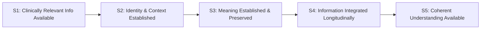

---
{
  "schemaVersion": 1,
  "canonicalId": "01f655eae3d8485699449c3dcf4f9b56",
  "archimateType": "ValueStream",
  "specialization": "Journey",
  "displayName": "Multi-Source Clinical Information → Coherent Clinical Picture",
  "friendlyName": "MultiSourceClinicalInformationCoherentClinicalPicture",
  "canonicalName": null,
  "standing": {
    "semantic": "Canonical",
    "currentness": "current",
    "qualification": "Exact source standing retained; migration/identity allocation does not approve architectural assertions.",
    "journeyClassification": "Explicitly authorised by the 1.1.21 Task; resulting additions pending incorporated-result review"
  },
  "identity": {
    "allocation": "UUIDv4 allocated once under the explicit RAD-1.1.5 migration Task",
    "authority": "enterprise-architecture/design/evidence/1.1.5/002/before/ai-agent-tasks/20261021T092725Z-establish-and-apply-element-continuum.md",
    "sourceAbsenceCheck": "No existing governed canonical source binding for this bounded definition; no name-based correspondence adopted.",
    "additionalClassificationAuthority": "enterprise-architecture/design/evidence/1.1.21/001/before/ai-agent-tasks/20261110T104352Z-stakeholder-journey-usecase-userstory-add.md"
  },
  "naming": {
    "authority": "docs/markdown/governance/canonical-identity-and-naming.md",
    "mode": "Local lexical component; no root or containment completeness inferred",
    "expected": {
      "friendlyName": "MultiSourceClinicalInformationCoherentClinicalPicture",
      "canonicalName": null
    }
  },
  "provenance": [
    {
      "source": "docs/markdown/02-strategy/strategic-views/strategic-value-streams.md",
      "selector": "### VS-01: Multi-Source Clinical Information → Coherent Clinical Picture",
      "role": "ingested architectural definition or explicit source contribution",
      "revision": "aadcd55252fa7965be8a4321832ecc6d5b97c6e0",
      "sha256": "e35fc8a438c8b236e269e9aa8b071be492691b0c6446855e16e09f28c058e14a",
      "standing": "Canonical"
    },
    {
      "source": "enterprise-architecture/design/evidence/1.1.21/001/before/ai-agent-tasks/20261110T104352Z-stakeholder-journey-usecase-userstory-add.md",
      "selector": "Journey semantics; Constraints 1 and 4",
      "role": "Identity-preserving Journey specialisation of the existing Value Stream",
      "retainedAt": "enterprise-architecture/design/evidence/1.1.21/001/before/ai-agent-tasks/20261110T104352Z-stakeholder-journey-usecase-userstory-add.md"
    }
  ],
  "sourceBindings": [
    {
      "source": "docs/markdown/02-strategy/strategic-views/strategic-value-streams.md",
      "selector": "### VS-01: Multi-Source Clinical Information → Coherent Clinical Picture"
    }
  ],
  "exchange": {
    "identifier": "id-d72c559c8ca551de969eb0f6a639a442",
    "properties": []
  },
  "relationships": [
    {
      "identifier": "id-6b504b92eb13420482b3bdc05468d161",
      "archimateType": "Aggregation",
      "source": "id-d72c559c8ca551de969eb0f6a639a442",
      "target": "id-414cfb0b227c5f7aaef63ce9d36d8543",
      "standing": {
        "semantic": "Authorised 1.1.21 incorporation candidate; exact assertions pending Solution Architect result review",
        "currentness": "current"
      },
      "provenance": {
        "source": "enterprise-architecture/design/evidence/1.1.21/001/before/ai-agent-tasks/20261110T104352Z-stakeholder-journey-usecase-userstory-add.md",
        "selector": "Accepted semantics; Authorised Activity / Scope",
        "contributions": [
          [
            [
              "/home/hunterm/Development/Code/harmonia/enterprise-architecture/continuum/strategy/value-stream/01f655eae3d8485699449c3dcf4f9b56.md",
              "## Architectural content"
            ]
          ]
        ]
      },
      "documentation": [
        {
          "text": "Constituent Journey retained with independent identity and reusable scope; this structural aggregation does not prescribe execution order.",
          "attributes": {
            "{http://www.w3.org/XML/1998/namespace}lang": "en"
          }
        }
      ]
    },
    {
      "identifier": "id-eb8d37384ec44a8691a43e281825fb81",
      "archimateType": "Aggregation",
      "source": "id-d72c559c8ca551de969eb0f6a639a442",
      "target": "id-204eabc8ec3950cabfeec68bc446a854",
      "standing": {
        "semantic": "Authorised 1.1.21 incorporation candidate; exact assertions pending Solution Architect result review",
        "currentness": "current"
      },
      "provenance": {
        "source": "enterprise-architecture/design/evidence/1.1.21/001/before/ai-agent-tasks/20261110T104352Z-stakeholder-journey-usecase-userstory-add.md",
        "selector": "Accepted semantics; Authorised Activity / Scope",
        "contributions": [
          [
            [
              "/home/hunterm/Development/Code/harmonia/enterprise-architecture/continuum/strategy/value-stream/01f655eae3d8485699449c3dcf4f9b56.md",
              "## Architectural content"
            ]
          ]
        ]
      },
      "documentation": [
        {
          "text": "Constituent Journey retained with independent identity and reusable scope; this structural aggregation does not prescribe execution order.",
          "attributes": {
            "{http://www.w3.org/XML/1998/namespace}lang": "en"
          }
        }
      ]
    },
    {
      "identifier": "id-84f00b33f2254f9aa730fb26eef27aec",
      "archimateType": "Aggregation",
      "source": "id-d72c559c8ca551de969eb0f6a639a442",
      "target": "id-2f29c7a906cc52c797f43a567bf22450",
      "standing": {
        "semantic": "Authorised 1.1.21 incorporation candidate; exact assertions pending Solution Architect result review",
        "currentness": "current"
      },
      "provenance": {
        "source": "enterprise-architecture/design/evidence/1.1.21/001/before/ai-agent-tasks/20261110T104352Z-stakeholder-journey-usecase-userstory-add.md",
        "selector": "Accepted semantics; Authorised Activity / Scope",
        "contributions": [
          [
            [
              "/home/hunterm/Development/Code/harmonia/enterprise-architecture/continuum/strategy/value-stream/01f655eae3d8485699449c3dcf4f9b56.md",
              "## Architectural content"
            ]
          ]
        ]
      },
      "documentation": [
        {
          "text": "Constituent Journey retained with independent identity and reusable scope; this structural aggregation does not prescribe execution order.",
          "attributes": {
            "{http://www.w3.org/XML/1998/namespace}lang": "en"
          }
        }
      ]
    },
    {
      "identifier": "id-b1c70675d03d4eefb6b7fff726c40aed",
      "archimateType": "Aggregation",
      "source": "id-d72c559c8ca551de969eb0f6a639a442",
      "target": "id-f7554b65aefd57c380868ce4bd301b37",
      "standing": {
        "semantic": "Authorised 1.1.21 incorporation candidate; exact assertions pending Solution Architect result review",
        "currentness": "current"
      },
      "provenance": {
        "source": "enterprise-architecture/design/evidence/1.1.21/001/before/ai-agent-tasks/20261110T104352Z-stakeholder-journey-usecase-userstory-add.md",
        "selector": "Accepted semantics; Authorised Activity / Scope",
        "contributions": [
          [
            [
              "/home/hunterm/Development/Code/harmonia/enterprise-architecture/continuum/strategy/value-stream/01f655eae3d8485699449c3dcf4f9b56.md",
              "## Architectural content"
            ]
          ]
        ]
      },
      "documentation": [
        {
          "text": "Constituent Journey retained with independent identity and reusable scope; this structural aggregation does not prescribe execution order.",
          "attributes": {
            "{http://www.w3.org/XML/1998/namespace}lang": "en"
          }
        }
      ]
    },
    {
      "identifier": "id-1290f53b943e4f038333ae963b215677",
      "archimateType": "Aggregation",
      "source": "id-d72c559c8ca551de969eb0f6a639a442",
      "target": "id-9829051608575715b07aa687eaf42d6d",
      "standing": {
        "semantic": "Authorised 1.1.21 incorporation candidate; exact assertions pending Solution Architect result review",
        "currentness": "current"
      },
      "provenance": {
        "source": "enterprise-architecture/design/evidence/1.1.21/001/before/ai-agent-tasks/20261110T104352Z-stakeholder-journey-usecase-userstory-add.md",
        "selector": "Accepted semantics; Authorised Activity / Scope",
        "contributions": [
          [
            [
              "/home/hunterm/Development/Code/harmonia/enterprise-architecture/continuum/strategy/value-stream/01f655eae3d8485699449c3dcf4f9b56.md",
              "## Architectural content"
            ]
          ]
        ]
      },
      "documentation": [
        {
          "text": "Constituent Journey retained with independent identity and reusable scope; this structural aggregation does not prescribe execution order.",
          "attributes": {
            "{http://www.w3.org/XML/1998/namespace}lang": "en"
          }
        }
      ]
    }
  ],
  "unresolvedProperties": {
    "canonicalName": "Formal qualifier for native ValueStream is not established in the current naming contract; HCRL 1.1.5-002 DR-5. Identity and source content are independently determinate."
  },
  "representation": {
    "sourceLinksRebased": true,
    "authority": "HCRL 1.1.5-002 DR-3; source meaning unchanged"
  },
  "journeyDefinition": {
    "intendedOutcome": "Clinically relevant multi-source information is available as a coherent longitudinal clinical picture.",
    "startCondition": "The initiating condition in the inherited Value Stream definition applies.",
    "alternativeOutcomes": [
      "Progress may remain unresolved where the inherited governance, identity or completion conditions are not established."
    ]
  }
}
---

# Multi-Source Clinical Information → Coherent Clinical Picture

## Architectural content

#### Strategic Purpose & Value Focus

Modern healthcare delivery is chronically fragmented across acute facilities, primary care practices, diagnostic laboratories, imaging centres, and community services. Clinical information arrives across disjointed standards (HL7 v2, CDA, FHIR), disparate identifier namespaces, and isolated episodes of care.

The strategic value created by **VS-01** is **not** merely the technical transit of electronic messages between systems. The authentic clinical and enterprise value is that **clinically relevant information from heterogeneous sources is unified into a coherent, longitudinal, patient-centred clinical picture**, enabling clinicians to make timely, well-informed, and safer care decisions.

#### Value Transformation Stages

1. **S1 — Clinically Relevant Information Available**:
   - *Stakeholder State*: Clinical observations, pathology reports, diagnostic imaging results, medication orders, discharge summaries, or encounter notes occur across distributed care settings and become accessible for integration.
   - *Value Generated*: Clinical events are no longer trapped within isolated source silos; they enter the integration sphere where their clinical significance can be recognized.
2. **S2 — Identity & Clinical Context Established**:
   - *Stakeholder State*: Subject-of-care identity is established to the level required for safe association of the information, preserving source identifiers, provenance, confidence, and ambiguity where applicable; relevant encounter, episode, service, and care-delivery context is associated.
   - *Value Generated*: Clinical facts are safely bound to the correct individual and operational care context without masking identity ambiguity or making premature, unsafe identity conflations.
3. **S3 — Meaning Established & Preserved**:
   - *Stakeholder State*: Clinical concepts, classifications, and terminologies are mapped to canonical standards (e.g., SNOMED CT-AU, AMT) while strictly preserving original source clinical intent, qualifiers, and provenance.
   - *Value Generated*: Clinical data is semantically unambiguous across organisational boundaries while ensuring that the originating practitioner's original meaning and expression remain unaltered.
4. **S4 — Information Integrated Longitudinally**:
   - *Stakeholder State*: Disparate episodic facts, temporal observations, diagnostic series, and encounter histories are synthesized into a cumulative, longitudinal patient-centred record.
   - *Value Generated*: Clinical interactions are connected across time and specialty, moving beyond episodic snapshots to reveal patient trajectories, trends, and clinical history.
5. **S5 — Coherent Patient-Centred Understanding Available**:
   - *Stakeholder State*: The longitudinal clinical picture is made accessible in a contextual, consumable representation, structured for clinical review, clinical decision support, or standards-compliant query.
   - *Value Generated*: Treating clinicians and multidisciplinary care teams gain holistic, trusted situational awareness, reducing diagnostic errors, preventing duplicate testing, and improving patient outcomes.

#### Clinical Authority Boundary Guardrail

Harmonia provides **governed, vendor-neutral longitudinal clinical representation and preservation**. Harmonia does **not** claim originating clinical authority for source clinical facts. The originating EMR, laboratory information system, or practitioner retains source clinical authority; Harmonia is authoritative for its governed longitudinal aggregation, contextual relationships, and verifiable provenance trail.

#### Representative Strategic Traceability

| Traceability level | Current architectural standing |
| :--- | :--- |
| Motivation | Unresolved: the retired block does not establish a replacement stream-specific axiom set or current named Driver/Goal relationship. |
| Current Business Capability contribution | **Unresolved / not presently established.** The superseded BC relationships are retired; no relationship to BC-01 through BC-18 is supplied by identifier position or similarity. |
| Current Business Enabling contribution and contextual view | **Unresolved / not presently established.** Old view ordinals and meanings are retired; no enabling-capability or Feature relationship is inferred. |
| Existing current Enterprise Capability contributions | **Established, partial:** [EC-02 — Context Management](../../../../docs/markdown/02-strategy/capabilities/enterprise-capabilities.md#ec-02-context-management); [EC-07 — Provenance & Traceability](../../../../docs/markdown/02-strategy/capabilities/enterprise-capabilities.md#ec-07-provenance--traceability). These previously documented contributions retain their canonical meanings. Other current contributions are unresolved; the retired EC labels do not establish replacements. |

- **Strategic Courses of Action**: `COA-01` (Boundary Membrane Sovereignty), `COA-02` (Distinct Management and Durable Preservation), `COA-03` (Meaning-Centric Provenance and Traceability).

### 1.1.21 Journey incorporation

This existing Value Stream is reused as a Journey with the same canonical and Exchange identities, names, original definition and standing. Its source-defined transformations are represented by independently identifiable constituent Journeys. The added Aggregation relationships express reusable structure; Triggering expresses meaningful progression with its stated conditions. Neither creates runtime orchestration. New, explicitly qualified capability contributions supplement the predecessor traceability account; the original unestablished relationships and qualifications above are not retrospectively rewritten or declared accepted.
