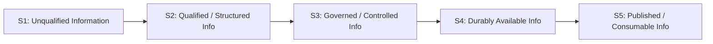

---
{
  "schemaVersion": 1,
  "canonicalId": "02e036f18bab400bac261007e39457ee",
  "archimateType": "ValueStream",
  "specialization": "Journey",
  "displayName": "Unqualified Information → Governed, Consumable Information",
  "friendlyName": "UnqualifiedInformationGovernedConsumableInformation",
  "canonicalName": null,
  "standing": {
    "semantic": "Canonical",
    "currentness": "current",
    "qualification": "Exact source standing retained; migration/identity allocation does not approve architectural assertions.",
    "journeyClassification": "Explicitly authorised by the 1.1.21 Task; resulting additions pending incorporated-result review"
  },
  "identity": {
    "allocation": "UUIDv4 allocated once under the explicit RAD-1.1.5 migration Task",
    "authority": "enterprise-architecture/design/evidence/1.1.5/002/before/ai-agent-tasks/20261021T092725Z-establish-and-apply-element-continuum.md",
    "sourceAbsenceCheck": "No existing governed canonical source binding for this bounded definition; no name-based correspondence adopted.",
    "additionalClassificationAuthority": "enterprise-architecture/design/evidence/1.1.21/001/before/ai-agent-tasks/20261110T104352Z-stakeholder-journey-usecase-userstory-add.md"
  },
  "naming": {
    "authority": "docs/markdown/governance/canonical-identity-and-naming.md",
    "mode": "Local lexical component; no root or containment completeness inferred",
    "expected": {
      "friendlyName": "UnqualifiedInformationGovernedConsumableInformation",
      "canonicalName": null
    }
  },
  "provenance": [
    {
      "source": "docs/markdown/02-strategy/strategic-views/strategic-value-streams.md",
      "selector": "### VS-02: Unqualified Information → Governed, Consumable Information",
      "role": "ingested architectural definition or explicit source contribution",
      "revision": "aadcd55252fa7965be8a4321832ecc6d5b97c6e0",
      "sha256": "e35fc8a438c8b236e269e9aa8b071be492691b0c6446855e16e09f28c058e14a",
      "standing": "Canonical"
    },
    {
      "source": "enterprise-architecture/design/evidence/1.1.21/001/before/ai-agent-tasks/20261110T104352Z-stakeholder-journey-usecase-userstory-add.md",
      "selector": "Journey semantics; Constraints 1 and 4",
      "role": "Identity-preserving Journey specialisation of the existing Value Stream",
      "retainedAt": "enterprise-architecture/design/evidence/1.1.21/001/before/ai-agent-tasks/20261110T104352Z-stakeholder-journey-usecase-userstory-add.md"
    }
  ],
  "sourceBindings": [
    {
      "source": "docs/markdown/02-strategy/strategic-views/strategic-value-streams.md",
      "selector": "### VS-02: Unqualified Information → Governed, Consumable Information"
    }
  ],
  "exchange": {
    "identifier": "id-c3d5bdd0946b5b7fb9200fae60e3ce82",
    "properties": []
  },
  "relationships": [
    {
      "identifier": "id-18e221e3ad624e98a778460d8f93a00e",
      "archimateType": "Aggregation",
      "source": "id-c3d5bdd0946b5b7fb9200fae60e3ce82",
      "target": "id-74beec50b4e1599caca966b7e93969f1",
      "standing": {
        "semantic": "Authorised 1.1.21 incorporation candidate; exact assertions pending Solution Architect result review",
        "currentness": "current"
      },
      "provenance": {
        "source": "enterprise-architecture/design/evidence/1.1.21/001/before/ai-agent-tasks/20261110T104352Z-stakeholder-journey-usecase-userstory-add.md",
        "selector": "Accepted semantics; Authorised Activity / Scope",
        "contributions": [
          [
            [
              "/home/hunterm/Development/Code/harmonia/enterprise-architecture/continuum/strategy/value-stream/02e036f18bab400bac261007e39457ee.md",
              "## Architectural content"
            ]
          ]
        ]
      },
      "documentation": [
        {
          "text": "Constituent Journey retained with independent identity and reusable scope; this structural aggregation does not prescribe execution order.",
          "attributes": {
            "{http://www.w3.org/XML/1998/namespace}lang": "en"
          }
        }
      ]
    },
    {
      "identifier": "id-34e7035e278b4588bba7888a9244c7d8",
      "archimateType": "Aggregation",
      "source": "id-c3d5bdd0946b5b7fb9200fae60e3ce82",
      "target": "id-e818f238ef865b83ac5e6885e0829517",
      "standing": {
        "semantic": "Authorised 1.1.21 incorporation candidate; exact assertions pending Solution Architect result review",
        "currentness": "current"
      },
      "provenance": {
        "source": "enterprise-architecture/design/evidence/1.1.21/001/before/ai-agent-tasks/20261110T104352Z-stakeholder-journey-usecase-userstory-add.md",
        "selector": "Accepted semantics; Authorised Activity / Scope",
        "contributions": [
          [
            [
              "/home/hunterm/Development/Code/harmonia/enterprise-architecture/continuum/strategy/value-stream/02e036f18bab400bac261007e39457ee.md",
              "## Architectural content"
            ]
          ]
        ]
      },
      "documentation": [
        {
          "text": "Constituent Journey retained with independent identity and reusable scope; this structural aggregation does not prescribe execution order.",
          "attributes": {
            "{http://www.w3.org/XML/1998/namespace}lang": "en"
          }
        }
      ]
    },
    {
      "identifier": "id-3f29c8b3b6f947819d86f9da9c03df2c",
      "archimateType": "Aggregation",
      "source": "id-c3d5bdd0946b5b7fb9200fae60e3ce82",
      "target": "id-2995cf0aea195047be4812ba3c495611",
      "standing": {
        "semantic": "Authorised 1.1.21 incorporation candidate; exact assertions pending Solution Architect result review",
        "currentness": "current"
      },
      "provenance": {
        "source": "enterprise-architecture/design/evidence/1.1.21/001/before/ai-agent-tasks/20261110T104352Z-stakeholder-journey-usecase-userstory-add.md",
        "selector": "Accepted semantics; Authorised Activity / Scope",
        "contributions": [
          [
            [
              "/home/hunterm/Development/Code/harmonia/enterprise-architecture/continuum/strategy/value-stream/02e036f18bab400bac261007e39457ee.md",
              "## Architectural content"
            ]
          ]
        ]
      },
      "documentation": [
        {
          "text": "Constituent Journey retained with independent identity and reusable scope; this structural aggregation does not prescribe execution order.",
          "attributes": {
            "{http://www.w3.org/XML/1998/namespace}lang": "en"
          }
        }
      ]
    },
    {
      "identifier": "id-eb7b510fb4814495aa64be6397e246ce",
      "archimateType": "Aggregation",
      "source": "id-c3d5bdd0946b5b7fb9200fae60e3ce82",
      "target": "id-52ec42a5a4235e2aaa070901805ff1be",
      "standing": {
        "semantic": "Authorised 1.1.21 incorporation candidate; exact assertions pending Solution Architect result review",
        "currentness": "current"
      },
      "provenance": {
        "source": "enterprise-architecture/design/evidence/1.1.21/001/before/ai-agent-tasks/20261110T104352Z-stakeholder-journey-usecase-userstory-add.md",
        "selector": "Accepted semantics; Authorised Activity / Scope",
        "contributions": [
          [
            [
              "/home/hunterm/Development/Code/harmonia/enterprise-architecture/continuum/strategy/value-stream/02e036f18bab400bac261007e39457ee.md",
              "## Architectural content"
            ]
          ]
        ]
      },
      "documentation": [
        {
          "text": "Constituent Journey retained with independent identity and reusable scope; this structural aggregation does not prescribe execution order.",
          "attributes": {
            "{http://www.w3.org/XML/1998/namespace}lang": "en"
          }
        }
      ]
    },
    {
      "identifier": "id-fd35baef4d2f4ba795a3a09aa787c4a8",
      "archimateType": "Aggregation",
      "source": "id-c3d5bdd0946b5b7fb9200fae60e3ce82",
      "target": "id-c6a2590c0b395eaf992ea491173dffa8",
      "standing": {
        "semantic": "Authorised 1.1.21 incorporation candidate; exact assertions pending Solution Architect result review",
        "currentness": "current"
      },
      "provenance": {
        "source": "enterprise-architecture/design/evidence/1.1.21/001/before/ai-agent-tasks/20261110T104352Z-stakeholder-journey-usecase-userstory-add.md",
        "selector": "Accepted semantics; Authorised Activity / Scope",
        "contributions": [
          [
            [
              "/home/hunterm/Development/Code/harmonia/enterprise-architecture/continuum/strategy/value-stream/02e036f18bab400bac261007e39457ee.md",
              "## Architectural content"
            ]
          ]
        ]
      },
      "documentation": [
        {
          "text": "Constituent Journey retained with independent identity and reusable scope; this structural aggregation does not prescribe execution order.",
          "attributes": {
            "{http://www.w3.org/XML/1998/namespace}lang": "en"
          }
        }
      ]
    }
  ],
  "unresolvedProperties": {
    "canonicalName": "Formal qualifier for native ValueStream is not established in the current naming contract; HCRL 1.1.5-002 DR-5. Identity and source content are independently determinate."
  },
  "representation": {
    "sourceLinksRebased": true,
    "authority": "HCRL 1.1.5-002 DR-3; source meaning unchanged"
  },
  "journeyDefinition": {
    "intendedOutcome": "Unqualified information becomes governed and consumable within its permitted scope.",
    "startCondition": "The initiating condition in the inherited Value Stream definition applies.",
    "alternativeOutcomes": [
      "Progress may remain unresolved where the inherited governance, identity or completion conditions are not established."
    ]
  }
}
---

# Unqualified Information → Governed, Consumable Information

## Architectural content

#### Strategic Purpose & Value Focus

Information arriving at the healthcare enterprise boundary is frequently incomplete, syntactically inconsistent, ambiguous in authority, or lacking explicit privacy controls. Consuming or publishing unverified information risks clinical misinterpretation, privacy violations, and regulatory breach.

The strategic value created by **VS-02** is the progressive **qualification, governance, policy attachment, and durable integrity assurance of information**, transforming raw external data into trusted, policy-governed assets that can be safely published across enterprise boundaries.

#### Value Transformation Stages

1. **S1 — Unqualified Information**:
   - *Stakeholder State*: Raw, unvalidated data streams, documents, or transactions arrive at the enterprise membrane with unverified structural conformance, incomplete provenance, and unverified authority.
   - *Value Generated*: Ingress boundaries accept external input safely without allowing malformed or unauthorized data to compromise internal environments.
2. **S2 — Qualified / Structured Information**:
   - *Stakeholder State*: Data structures are validated against canonical schemas, syntactically parsed, and reconciled into well-defined, verifiable information models.
   - *Value Generated*: Syntactic and structural ambiguity is eliminated; information adheres to predictable, conformant architectural structures.
3. **S3 — Governed / Controlled Information**:
   - *Stakeholder State*: Information is evaluated against security policies, organizational authority boundaries, consent directives, and confidentiality classifications under default-deny governance (`Themis`).
   - *Value Generated*: Information carries explicit, enforceable access policies and privacy guardrails, ensuring that sensitive healthcare data cannot be disclosed without legitimate authority.
4. **S4 — Durably Available Information**:
   - *Stakeholder State*: Information is preserved with verifiable integrity, non-destructive versioning, and comprehensive provenance, remaining resiliently queryable and recoverable.
   - *Value Generated*: Stakeholders are assured that information is protected against unauthorised alteration or loss, establishing an enduring, verifiable and auditable history of care information.
5. **S5 — Published / Consumable Information**:
   - *Stakeholder State*: Governed information is projected into standards-compliant external representations (such as FHIR R5 Core and Australian profiles) across explicit egress boundaries.
   - *Value Generated*: External consumers and presentation layers receive trusted, standards-conformant information tailored to their authorised scope without exposing internal platform mechanics.

#### Enabling Behavioural Pattern (Subordinate to Value Stream)

The progression through VS-02 is supported internally by an established architectural behavioural pattern:

$$\text{Aggregation} \longrightarrow \text{Processing} \longrightarrow \text{Persistence} \longrightarrow \text{Publishing}$$

**Crucial Distinction**: This behavioural pattern describes the internal activity contributing to the transformation. It must **not** be substituted for the value stream stage names. The value stream expresses the *evolving state and value of the information*; the behavioural pattern describes the underlying operational mechanics that support it.

#### Representative Strategic Traceability

| Traceability level | Current architectural standing |
| :--- | :--- |
| Motivation | Established existing constraints: [AX-05 — Active State and Authoritative Durable State Are Distinct](../../motivation/principle/0412a2084f0145babc4f022c71fea65f.md) and [AX-07 — Security Is Intrinsic to Managed Operations](../../motivation/principle/architectural-axiom/5de2ae2c3b794c2d9f3a14efd51d564f.md). Current named Driver/Goal relationships and a replacement for the retired axiom meanings remain unresolved. |
| Current Business Capability contribution | **Unresolved / not presently established.** The superseded BC relationships are retired; no relationship to BC-01 through BC-18 is supplied by identifier position or similarity. |
| Current Business Enabling contribution and contextual view | **Unresolved / not presently established.** Old view ordinals and meanings are retired; no enabling-capability or Feature relationship is inferred. |
| Existing current Enterprise Capability contributions | **Established, partial:** [EC-02 — Context Management](../../../../docs/markdown/02-strategy/capabilities/enterprise-capabilities.md#ec-02-context-management); [EC-06 — Policy & Control](../../../../docs/markdown/02-strategy/capabilities/enterprise-capabilities.md#ec-06-policy--control); [EC-07 — Provenance & Traceability](../../../../docs/markdown/02-strategy/capabilities/enterprise-capabilities.md#ec-07-provenance--traceability). These previously documented contributions retain their canonical meanings. Other current contributions are unresolved; the retired EC labels do not establish replacements. |

- **Strategic Courses of Action**: `COA-01` (Boundary Membrane Sovereignty), `COA-02` (Distinct Management and Durable Preservation), `COA-03` (Meaning-Centric Provenance and Traceability), `COA-06` (Collaborative Reusable Capability Realisation).

### 1.1.21 Journey incorporation

This existing Value Stream is reused as a Journey with the same canonical and Exchange identities, names, original definition and standing. Its source-defined transformations are represented by independently identifiable constituent Journeys. The added Aggregation relationships express reusable structure; Triggering expresses meaningful progression with its stated conditions. Neither creates runtime orchestration. New, explicitly qualified capability contributions supplement the predecessor traceability account; the original unestablished relationships and qualifications above are not retrospectively rewritten or declared accepted.
