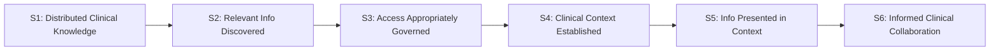

---
{
  "schemaVersion": 1,
  "canonicalId": "3ba98c0c1170458f8c02fa76694fee67",
  "archimateType": "ValueStream",
  "specialization": "Journey",
  "displayName": "Distributed Clinical Knowledge → Informed Clinical Collaboration",
  "friendlyName": "DistributedClinicalKnowledgeInformedClinicalCollaboration",
  "canonicalName": null,
  "standing": {
    "semantic": "Canonical",
    "currentness": "current",
    "qualification": "Exact source standing retained; migration/identity allocation does not approve architectural assertions.",
    "journeyClassification": "Explicitly authorised by the 1.1.21 Task; resulting additions pending incorporated-result review"
  },
  "identity": {
    "allocation": "UUIDv4 allocated once under the explicit RAD-1.1.5 migration Task",
    "authority": "enterprise-architecture/design/evidence/1.1.5/002/before/ai-agent-tasks/20261021T092725Z-establish-and-apply-element-continuum.md",
    "sourceAbsenceCheck": "No existing governed canonical source binding for this bounded definition; no name-based correspondence adopted.",
    "additionalClassificationAuthority": "enterprise-architecture/design/evidence/1.1.21/001/before/ai-agent-tasks/20261110T104352Z-stakeholder-journey-usecase-userstory-add.md"
  },
  "naming": {
    "authority": "docs/markdown/governance/canonical-identity-and-naming.md",
    "mode": "Local lexical component; no root or containment completeness inferred",
    "expected": {
      "friendlyName": "DistributedClinicalKnowledgeInformedClinicalCollaboration",
      "canonicalName": null
    }
  },
  "provenance": [
    {
      "source": "docs/markdown/02-strategy/strategic-views/strategic-value-streams.md",
      "selector": "### VS-04: Distributed Clinical Knowledge → Informed Clinical Collaboration",
      "role": "ingested architectural definition or explicit source contribution",
      "revision": "aadcd55252fa7965be8a4321832ecc6d5b97c6e0",
      "sha256": "e35fc8a438c8b236e269e9aa8b071be492691b0c6446855e16e09f28c058e14a",
      "standing": "Canonical"
    },
    {
      "source": "enterprise-architecture/design/evidence/1.1.21/001/before/ai-agent-tasks/20261110T104352Z-stakeholder-journey-usecase-userstory-add.md",
      "selector": "Journey semantics; Constraints 1 and 4",
      "role": "Identity-preserving Journey specialisation of the existing Value Stream",
      "retainedAt": "enterprise-architecture/design/evidence/1.1.21/001/before/ai-agent-tasks/20261110T104352Z-stakeholder-journey-usecase-userstory-add.md"
    }
  ],
  "sourceBindings": [
    {
      "source": "docs/markdown/02-strategy/strategic-views/strategic-value-streams.md",
      "selector": "### VS-04: Distributed Clinical Knowledge → Informed Clinical Collaboration"
    }
  ],
  "exchange": {
    "identifier": "id-35185168faa951fd92071753cc98bc93",
    "properties": []
  },
  "relationships": [
    {
      "identifier": "id-c6b4f3035a29426dab9c35748403d229",
      "archimateType": "Aggregation",
      "source": "id-35185168faa951fd92071753cc98bc93",
      "target": "id-a7dda87b60505780983c4db7992ec1e3",
      "standing": {
        "semantic": "Authorised 1.1.21 incorporation candidate; exact assertions pending Solution Architect result review",
        "currentness": "current"
      },
      "provenance": {
        "source": "enterprise-architecture/design/evidence/1.1.21/001/before/ai-agent-tasks/20261110T104352Z-stakeholder-journey-usecase-userstory-add.md",
        "selector": "Accepted semantics; Authorised Activity / Scope",
        "contributions": [
          [
            [
              "/home/hunterm/Development/Code/harmonia/enterprise-architecture/continuum/strategy/value-stream/3ba98c0c1170458f8c02fa76694fee67.md",
              "## Architectural content"
            ]
          ]
        ]
      },
      "documentation": [
        {
          "text": "Constituent Journey retained with independent identity and reusable scope; this structural aggregation does not prescribe execution order.",
          "attributes": {
            "{http://www.w3.org/XML/1998/namespace}lang": "en"
          }
        }
      ]
    },
    {
      "identifier": "id-c8d7111297ed40cfa0d0c2efb804bdf4",
      "archimateType": "Aggregation",
      "source": "id-35185168faa951fd92071753cc98bc93",
      "target": "id-d5d126e4607e5d36bd4ddb4e9e915067",
      "standing": {
        "semantic": "Authorised 1.1.21 incorporation candidate; exact assertions pending Solution Architect result review",
        "currentness": "current"
      },
      "provenance": {
        "source": "enterprise-architecture/design/evidence/1.1.21/001/before/ai-agent-tasks/20261110T104352Z-stakeholder-journey-usecase-userstory-add.md",
        "selector": "Accepted semantics; Authorised Activity / Scope",
        "contributions": [
          [
            [
              "/home/hunterm/Development/Code/harmonia/enterprise-architecture/continuum/strategy/value-stream/3ba98c0c1170458f8c02fa76694fee67.md",
              "## Architectural content"
            ]
          ]
        ]
      },
      "documentation": [
        {
          "text": "Constituent Journey retained with independent identity and reusable scope; this structural aggregation does not prescribe execution order.",
          "attributes": {
            "{http://www.w3.org/XML/1998/namespace}lang": "en"
          }
        }
      ]
    },
    {
      "identifier": "id-9d350b2a6d8a4ffd8313df9f7f9ba6d1",
      "archimateType": "Aggregation",
      "source": "id-35185168faa951fd92071753cc98bc93",
      "target": "id-bc06c7b297d755449da65d097e3270b7",
      "standing": {
        "semantic": "Authorised 1.1.21 incorporation candidate; exact assertions pending Solution Architect result review",
        "currentness": "current"
      },
      "provenance": {
        "source": "enterprise-architecture/design/evidence/1.1.21/001/before/ai-agent-tasks/20261110T104352Z-stakeholder-journey-usecase-userstory-add.md",
        "selector": "Accepted semantics; Authorised Activity / Scope",
        "contributions": [
          [
            [
              "/home/hunterm/Development/Code/harmonia/enterprise-architecture/continuum/strategy/value-stream/3ba98c0c1170458f8c02fa76694fee67.md",
              "## Architectural content"
            ]
          ]
        ]
      },
      "documentation": [
        {
          "text": "Constituent Journey retained with independent identity and reusable scope; this structural aggregation does not prescribe execution order.",
          "attributes": {
            "{http://www.w3.org/XML/1998/namespace}lang": "en"
          }
        }
      ]
    },
    {
      "identifier": "id-c0a072d689de4497bdf5d3aca9ff3124",
      "archimateType": "Aggregation",
      "source": "id-35185168faa951fd92071753cc98bc93",
      "target": "id-50d837d39e965ed9a48ff03c572c7f81",
      "standing": {
        "semantic": "Authorised 1.1.21 incorporation candidate; exact assertions pending Solution Architect result review",
        "currentness": "current"
      },
      "provenance": {
        "source": "enterprise-architecture/design/evidence/1.1.21/001/before/ai-agent-tasks/20261110T104352Z-stakeholder-journey-usecase-userstory-add.md",
        "selector": "Accepted semantics; Authorised Activity / Scope",
        "contributions": [
          [
            [
              "/home/hunterm/Development/Code/harmonia/enterprise-architecture/continuum/strategy/value-stream/3ba98c0c1170458f8c02fa76694fee67.md",
              "## Architectural content"
            ]
          ]
        ]
      },
      "documentation": [
        {
          "text": "Constituent Journey retained with independent identity and reusable scope; this structural aggregation does not prescribe execution order.",
          "attributes": {
            "{http://www.w3.org/XML/1998/namespace}lang": "en"
          }
        }
      ]
    },
    {
      "identifier": "id-69a67dd9a30e463490e15d5049171831",
      "archimateType": "Aggregation",
      "source": "id-35185168faa951fd92071753cc98bc93",
      "target": "id-7e14054026c55514a33d6be267345bc0",
      "standing": {
        "semantic": "Authorised 1.1.21 incorporation candidate; exact assertions pending Solution Architect result review",
        "currentness": "current"
      },
      "provenance": {
        "source": "enterprise-architecture/design/evidence/1.1.21/001/before/ai-agent-tasks/20261110T104352Z-stakeholder-journey-usecase-userstory-add.md",
        "selector": "Accepted semantics; Authorised Activity / Scope",
        "contributions": [
          [
            [
              "/home/hunterm/Development/Code/harmonia/enterprise-architecture/continuum/strategy/value-stream/3ba98c0c1170458f8c02fa76694fee67.md",
              "## Architectural content"
            ]
          ]
        ]
      },
      "documentation": [
        {
          "text": "Constituent Journey retained with independent identity and reusable scope; this structural aggregation does not prescribe execution order.",
          "attributes": {
            "{http://www.w3.org/XML/1998/namespace}lang": "en"
          }
        }
      ]
    },
    {
      "identifier": "id-eb43bcb222374fb09eafcf097f99d1c5",
      "archimateType": "Aggregation",
      "source": "id-35185168faa951fd92071753cc98bc93",
      "target": "id-813eebfa843555b286c45bcbadccbb65",
      "standing": {
        "semantic": "Authorised 1.1.21 incorporation candidate; exact assertions pending Solution Architect result review",
        "currentness": "current"
      },
      "provenance": {
        "source": "enterprise-architecture/design/evidence/1.1.21/001/before/ai-agent-tasks/20261110T104352Z-stakeholder-journey-usecase-userstory-add.md",
        "selector": "Accepted semantics; Authorised Activity / Scope",
        "contributions": [
          [
            [
              "/home/hunterm/Development/Code/harmonia/enterprise-architecture/continuum/strategy/value-stream/3ba98c0c1170458f8c02fa76694fee67.md",
              "## Architectural content"
            ]
          ]
        ]
      },
      "documentation": [
        {
          "text": "Constituent Journey retained with independent identity and reusable scope; this structural aggregation does not prescribe execution order.",
          "attributes": {
            "{http://www.w3.org/XML/1998/namespace}lang": "en"
          }
        }
      ]
    },
    {
      "identifier": "id-ca7f13e8d5524a28b2f3ccefff153929",
      "archimateType": "Association",
      "source": "id-35185168faa951fd92071753cc98bc93",
      "target": "id-31785df621f65838b5e683018945597f",
      "standing": {
        "semantic": "Authorised 1.1.21 incorporation candidate; exact assertions pending Solution Architect result review",
        "currentness": "current"
      },
      "provenance": {
        "source": "enterprise-architecture/design/evidence/1.1.21/001/before/ai-agent-tasks/20261110T104352Z-stakeholder-journey-usecase-userstory-add.md",
        "selector": "Accepted semantics; Authorised Activity / Scope",
        "contributions": [
          {
            "sourceCanonicalId": "d1c4053e68384080b8eb79d2008632ba",
            "basis": "Existing canonical responsibility and reconciled Journey boundary"
          }
        ]
      },
      "documentation": [
        {
          "text": "Agora retains collaboration semantics and control; collaboration does not automatically establish source clinical truth.",
          "attributes": {
            "{http://www.w3.org/XML/1998/namespace}lang": "en"
          }
        }
      ],
      "attributes": {
        "isDirected": "true"
      }
    }
  ],
  "unresolvedProperties": {
    "canonicalName": "Formal qualifier for native ValueStream is not established in the current naming contract; HCRL 1.1.5-002 DR-5. Identity and source content are independently determinate."
  },
  "representation": {
    "sourceLinksRebased": true,
    "authority": "HCRL 1.1.5-002 DR-3; source meaning unchanged"
  },
  "journeyDefinition": {
    "intendedOutcome": "Multidisciplinary collaboration proceeds with relevant, governed clinical information while source clinical authority remains distinct.",
    "startCondition": "The initiating condition in the inherited Value Stream definition applies.",
    "alternativeOutcomes": [
      "Progress may remain unresolved where the inherited governance, identity or completion conditions are not established."
    ]
  }
}
---

# Distributed Clinical Knowledge → Informed Clinical Collaboration

## Architectural content

#### Strategic Purpose & Value Focus

Healthcare is inherently collaborative. Complex patient care requires continuous multidisciplinary interaction among medical specialists, nursing staff, allied health professionals, pharmacists, and community care providers. However, clinical communication is frequently disconnected from the longitudinal patient record, leading to ungrounded decisions, fragmented care plans, and clinical risk.

The strategic value created by **VS-04** is the **synthesis of distributed clinical knowledge into contextually relevant information supporting informed multidisciplinary collaboration**. It enables care teams to communicate, consult, and coordinate in the direct presence of verified longitudinal clinical facts without altering source clinical truth.

#### Value Transformation Stages

1. **S1 — Distributed Clinical Knowledge**:
   - *Stakeholder State*: Clinically relevant information, historical observations, diagnostic findings, care history, and other governed clinical knowledge exist across the healthcare ecosystem.
   - *Value Generated*: Ecosystem knowledge is recognized as an active collective resource rather than isolated data fragments.
2. **S2 — Relevant Information Discovered**:
   - *Stakeholder State*: Authorized queries, alerts, and subscriptions discover clinical facts pertinent to an active patient problem, clinical event, or multidisciplinary consultation.
   - *Value Generated*: Practitioners are spared manual cross-system searching; relevant clinical facts are brought forward based on active clinical need.
3. **S3 — Access Appropriately Governed**:
   - *Stakeholder State*: Participant identities, clinical roles, care team relationships, consent policies, and default-deny governance rules are evaluated prior to disclosing clinical information.
   - *Value Generated*: Patient privacy and sensitive clinical data are rigorously safeguarded; collaboration proceeds within legitimate clinical relationships.
4. **S4 — Clinical Context Established**:
   - *Stakeholder State*: Longitudinal patient timeline context, active problems, current medication regimens, allergies, and relevant diagnostic findings are bound to the collaborative space.
   - *Value Generated*: Clinical discussions are anchored directly in objective patient history rather than fragmented recollection or unverified hearsay.
5. **S5 — Information Presented in Context**:
   - *Stakeholder State*: Verified clinical summaries, trends, and diagnostic reports are rendered seamlessly alongside collaborative communication channels without exposing internal platform mechanics.
   - *Value Generated*: Care team members share an identical, high-fidelity clinical picture, eliminating misunderstandings and information asymmetry.
6. **S6 — Informed Clinical Collaboration**:
   - *Stakeholder State*: Treating clinicians and multidisciplinary care team members engage in timely, context-rich deliberation, arriving at informed, coordinated clinical care decisions.
   - *Value Generated*: Care plans are coordinated rapidly, multidisciplinary consultation is streamlined, and patient safety is significantly enhanced.

#### Boundary Guardrail: Clinical Authority & Expertise in Collaboration

Harmonia establishes the governed information context in which clinical collaboration occurs. Harmonia explicitly maintains the following boundaries:
1. **Harmonia is not an Electronic Medical Record (EMR)**: It does not replace source departmental or enterprise EMRs.
2. **Harmonia is not the clinical decision-maker**: Clinical responsibility and decision-making authority rest entirely with the attending clinicians and care teams.
3. **Harmonia does not originate clinical assertions during collaboration**: Collaborative dialogue (e.g., in Matrix/Agora channels) does not automatically become an authoritative clinical record. Clinical practitioners bring their expertise to the collaboration; Harmonia provides the governed clinical context in which that expertise is exercised.
4. **Clinical statements require source attribution**: Any clinical order or diagnostic finding resulting from collaboration must be explicitly committed through governed clinical workflows with source practitioner attribution.

#### Representative Strategic Traceability

| Traceability level | Current architectural standing |
| :--- | :--- |
| Motivation | Established existing constraint: [AX-07 — Security Is Intrinsic to Managed Operations](../../motivation/principle/architectural-axiom/5de2ae2c3b794c2d9f3a14efd51d564f.md). Current named Driver/Goal relationships and a replacement for the retired axiom meanings remain unresolved. |
| Current Business Capability contribution | **Unresolved / not presently established.** The superseded BC relationships are retired; no relationship to BC-01 through BC-18 is supplied by identifier position or similarity. |
| Current Business Enabling contribution and contextual view | **Unresolved / not presently established.** Old view ordinals and meanings are retired; no enabling-capability or Feature relationship is inferred. |
| Existing current Enterprise Capability contributions | **Established, partial:** [EC-02 — Context Management](../../../../docs/markdown/02-strategy/capabilities/enterprise-capabilities.md#ec-02-context-management); [EC-06 — Policy & Control](../../../../docs/markdown/02-strategy/capabilities/enterprise-capabilities.md#ec-06-policy--control). These previously documented contributions retain their canonical meanings. Other current contributions are unresolved; the retired EC labels do not establish replacements. |

- **Strategic Courses of Action**: `COA-01` (Boundary Membrane Sovereignty), `COA-03` (Meaning-Centric Provenance and Traceability), `COA-06` (Collaborative Reusable Capability Realisation).

### 1.1.21 Journey incorporation

This existing Value Stream is reused as a Journey with the same canonical and Exchange identities, names, original definition and standing. Its source-defined transformations are represented by independently identifiable constituent Journeys. The added Aggregation relationships express reusable structure; Triggering expresses meaningful progression with its stated conditions. Neither creates runtime orchestration. New, explicitly qualified capability contributions supplement the predecessor traceability account; the original unestablished relationships and qualifications above are not retrospectively rewritten or declared accepted.
