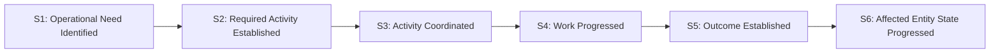

---
{
  "schemaVersion": 1,
  "canonicalId": "beea615ca7b34bbcbd0ad3a2a6ab2cff",
  "archimateType": "ValueStream",
  "specialization": null,
  "displayName": "Operational Need → Coordinated Activity → Resolved Outcome",
  "friendlyName": "OperationalNeedCoordinatedActivityResolvedOutcome",
  "canonicalName": null,
  "standing": {
    "semantic": "Canonical",
    "currentness": "current",
    "qualification": "Exact source standing retained; migration/identity allocation does not approve architectural assertions."
  },
  "identity": {
    "allocation": "UUIDv4 allocated once under the explicit RAD-1.1.5 migration Task",
    "authority": "enterprise-architecture/design/evidence/1.1.5/002/before/ai-agent-tasks/20261021T092725Z-establish-and-apply-element-continuum.md",
    "sourceAbsenceCheck": "No existing governed canonical source binding for this bounded definition; no name-based correspondence adopted."
  },
  "naming": {
    "authority": "docs/markdown/governance/canonical-identity-and-naming.md",
    "mode": "Local lexical component; no root or containment completeness inferred",
    "expected": {
      "friendlyName": "OperationalNeedCoordinatedActivityResolvedOutcome",
      "canonicalName": null
    }
  },
  "provenance": [
    {
      "source": "docs/markdown/02-strategy/strategic-views/strategic-value-streams.md",
      "selector": "### VS-03: Operational Need → Coordinated Activity → Resolved Outcome",
      "role": "ingested architectural definition or explicit source contribution",
      "revision": "aadcd55252fa7965be8a4321832ecc6d5b97c6e0",
      "sha256": "e35fc8a438c8b236e269e9aa8b071be492691b0c6446855e16e09f28c058e14a",
      "standing": "Canonical"
    }
  ],
  "sourceBindings": [
    {
      "source": "docs/markdown/02-strategy/strategic-views/strategic-value-streams.md",
      "selector": "### VS-03: Operational Need → Coordinated Activity → Resolved Outcome"
    }
  ],
  "exchange": {
    "identifier": "id-fc4621beb95b5af1a1398f683115a449",
    "properties": []
  },
  "relationships": [],
  "unresolvedProperties": {
    "canonicalName": "Formal qualifier for native ValueStream is not established in the current naming contract; HCRL 1.1.5-002 DR-5. Identity and source content are independently determinate."
  },
  "representation": {
    "sourceLinksRebased": true,
    "authority": "HCRL 1.1.5-002 DR-3; source meaning unchanged"
  }
}
---

# Operational Need → Coordinated Activity → Resolved Outcome

## Architectural content

#### Strategic Purpose & Value Focus

Healthcare delivery involves dynamic, distributed operational coordination—from processing an urgent laboratory order, to coordinating an inpatient bed transfer, managing clinical task escalation, or fulfilling an outpatient referral. When operational activity is disconnected from the current state of affected patients, beds, and practitioners, clinical delays and administrative failures occur.

The strategic value created by **VS-03** is the **governed, coordinated progression of operational activity together with the corresponding state of affected real-world healthcare entities** (`AX-16`). It bridges operational demand and clinical execution without premature coupling to software execution threads or queueing systems.

#### Value Transformation Stages

1. **S1 — Operational Need Identified**:
   - *Stakeholder State*: A healthcare operational trigger occurs (e.g., patient admission, clinical order placed, diagnostic test requested, bed turnover required, specialist referral initiated).
   - *Value Generated*: Healthcare demands are captured systematically rather than relying on informal or uncoordinated communication.
2. **S2 — Required Activity Established**:
   - *Stakeholder State*: The activity required to address the operational need is established together with its relevant context, expected outcome, and completion conditions.
   - *Value Generated*: Vague operational requirements are translated into clear, governed, and accountable objectives with explicit success criteria.
3. **S3 — Activity Coordinated**:
   - *Stakeholder State*: Required activity is coordinated with the appropriate people, services, resources, and affected real-world entities.
   - *Value Generated*: Work is matched to capable, authorized actors and resources in harmony with real-time operational availability and clinical priorities.
4. **S4 — Work Progressed**:
   - *Stakeholder State*: Execution of the activity advances through observable, auditable lifecycle states with active oversight, milestone tracking, and escalation management.
   - *Value Generated*: Healthcare operations gain end-to-end transparency; bottlenecks, delays, and stalled activities are immediately visible and actionable.
5. **S5 — Outcome Established**:
   - *Stakeholder State*: Clinical or operational results are achieved, verified, and recorded with full attribution and provenance.
   - *Value Generated*: Activity resolution is verified against the original intent, establishing reliable evidence of care delivery.
6. **S6 — Affected Entity State Progressed**:
   - *Stakeholder State*: The state of affected real-world entities (e.g., patient clinical journey, bed occupancy status, practitioner assignment, care team schedule) advances to its next governed operational state in alignment with the activity outcome (`AX-16`).
   - *Value Generated*: The physical and organizational reality of the healthcare facility stays synchronized with system records, eliminating state drift and coordination failures.

#### Decoupling Note: Execution Constructs Below the Value Stream

Digital Twin activity is demand-driven and coordinated through the established activity-execution architecture; Digital Twin identity does not imply a dedicated or permanently active execution thread, process or runtime engine. The Twin remains the [entity-centred coordination construct](../../../../docs/markdown/02-strategy/strategic-views/logical-component-responsibilities.md#component-7-digital-twin-entity-centred-operational-coordination-construct).

Activity execution constructs and downstream mechanisms (illustratively, worker pools, messaging queues and FHIR Tasks) remain **below** the Value Stream. Their names are not stage names or technology choices made by this Strategy view.

#### Representative Strategic Traceability

| Traceability level | Current architectural standing |
| :--- | :--- |
| Motivation | Established: [AX-15 — Uncertainty Is Preserved Until Resolved](../../motivation/principle/ef8abbaec37e4890ad78b9f263e67906.md) and [AX-16 — Operational Activity & Entity State Progress Together](../../motivation/principle/de7e90f46127455a9ec9ad3b9b48ba54.md). AX-16 is explicitly applied by this stream’s purpose and entity-state progression stage. Current named Driver/Goal relationships and replacement grounding for the other retired axiom meanings remain unresolved. |
| Current Business Capability contribution | **Unresolved / not presently established.** The superseded BC relationships are retired; no relationship to BC-01 through BC-18 is supplied by identifier position or similarity. |
| Current Business Enabling contribution and contextual view | **Unresolved / not presently established.** Old view ordinals and meanings are retired; no enabling-capability or Feature relationship is inferred. |
| Existing current Enterprise Capability contributions | **Established, partial:** [EC-02 — Context Management](../../../../docs/markdown/02-strategy/capabilities/enterprise-capabilities.md#ec-02-context-management); [EC-12 — Operational Assurance](../../../../docs/markdown/02-strategy/capabilities/enterprise-capabilities.md#ec-12-operational-assurance). These previously documented contributions retain their canonical meanings. Other current contributions are unresolved; the retired EC labels do not establish replacements. |

- **Strategic Courses of Action**: `COA-04` (Governed Asynchronous Activity Progression), `COA-05` (Entity-Centred Operational Coordination), `COA-06` (Collaborative Reusable Capability Realisation).
