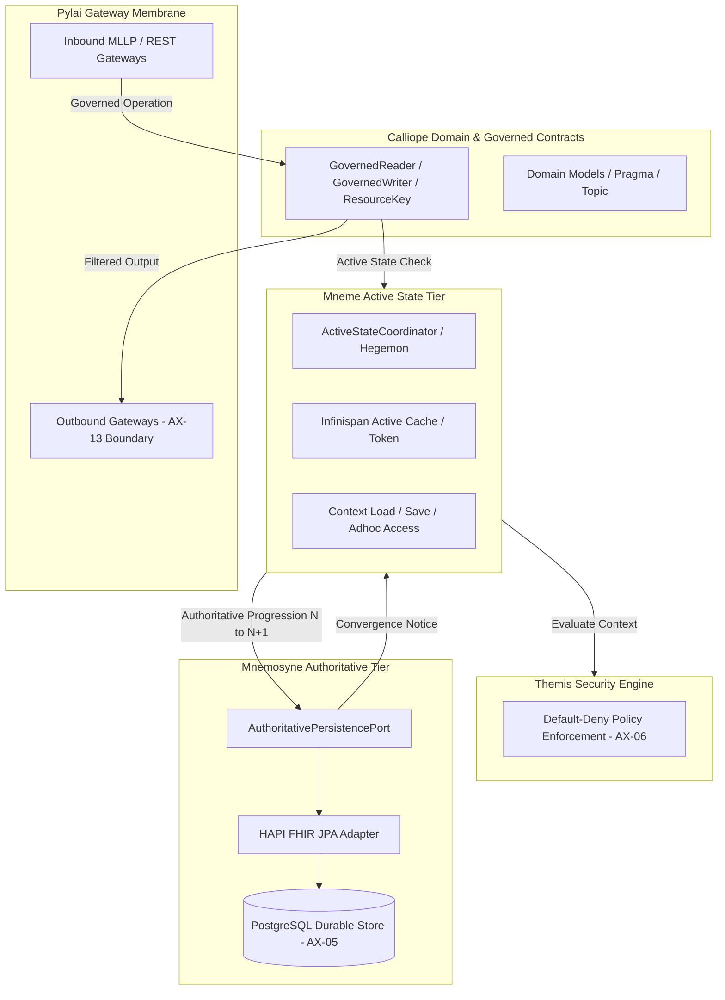

<!-- Copyright (c) 2026 Mark Hunter. SPDX-License-Identifier: GPL-3.0-or-later -->
# Data Governance Services architecture / code reconciliation — operative Task

Task-Issued-At: 2026-10-23T08:16:53.959Z

Attributable Issuer: Solution Architect (Mark Hunter)
Interaction Session: `session-261023-191640-1n0i` (Prompts: `prompt-261023-191653-co07`, `prompt-261023-192138-1n3k`)
Boundary: RAD-1.1.14, HCRL iteration 001. Baseline: RAD-1.1.13, branch `Data-Governence-Services`.
Corresponding Report: [`enterprise-architecture/design/evidence/1.1.14/001/after/ai-agent-reports/20261023T094001Z-data-governance-reconciliation.md`](../../after/ai-agent-reports/20261023T094001Z-data-governance-reconciliation.md)

## Interaction Context & Prompt Derivation

The reconciliation task was initiated in Junie session `session-261023-191640-1n0i`.
- **Prompt 1 (`prompt-261023-191653-co07`)**: Issued at system timestamp `2026-10-23T08:16:53.959Z` (`startedAtMs: 1792743413940`).
  - Attached Context: `enterprise-architecture/design/review/1.1.5/hcrl-1.1.5-002.pending.md`
  - Launch Configuration: `PlanAgentAttachment`, `ModelForLaunchAttachment` (`gemini-3.7-flash`), `EffortForLaunchAttachment` (`medium`), `TaskRequestMcpServersAttachment` (`idea`), `TaskRequestParametersAttachment`
- **Prompt 2 (`prompt-261023-192138-1n3k`)**: Issued at system timestamp `2026-10-23T08:21:38.365Z` (`startedAtMs: 1792743698363`).
  - Nature: Identical re-issue of Prompt 1 (byte-identical 7,376-character prompt text; SHA-256 `5361b410681b8460c133d6581faa955348cf5a1a7974bc2c94f377d3fffd8995`).
  - Attached Context: `PlanAttachment` containing agent-generated plan `.junie/plans/data-governance-services-reconciliation.md`, `OrchestratedAttachment` (`maxSessionCostUsd: 50.0`).
- **Attributable Issuer**: Mark Hunter (Solution Architect).

---

## Operative Instruction (Verbatim)

### Prompt 1 (`prompt-261023-191653-co07`, UserPromptEvent `2026-10-23T08:16:53.959Z`)
**Source**: `events.jsonl` `UserPromptEvent.prompt` (7,376 characters; SHA-256 `5361b410681b8460c133d6581faa955348cf5a1a7974bc2c94f377d3fffd8995`)
**Attachment**: `enterprise-architecture/design/review/1.1.5/hcrl-1.1.5-002.pending.md`

```markdown
# Goal

Begin implementation-oriented development of Harmonia Data Governance Services by establishing the governed relationship between the current Enterprise Architecture and the substantial existing implementation.

This is the first real development use of the established Harmonia architecture/code governance lifecycle.

Do not begin by redesigning Data Governance Services or rewriting existing code.

# Expected Outcome

Establish a reliable starting point for development by:

1. confirming the repository and branch state;
2. locating and following the existing Harmonia `architecture code-roundtrip` governance process;
3. identifying the current architectural authority relevant to Data Governance Services;
4. examining the existing implementation relevant to Mneme, Calliope, Mnemosyne, Pylai and associated governed information/data concepts;
5. reconciling architectural responsibilities against persistent implementation concepts;
6. identifying genuine architectural ambiguities or conflicts requiring Solution Architect disposition; and
7. producing a report sufficient for the Solution Architect to determine the first `solution build` increment.

This activity is primarily investigation and reconciliation.

Do not implement or materially restructure the solution unless the existing governed process explicitly requires a safe mechanical action as part of Code Round-Trip.

# Context

Repository:

`fhirfactory/harmonia`

Working branch:

`Data-Governence-Services`

The recently accepted Enterprise Architecture baseline is:

`1.1.13`

Its Archi workbench projection is:

`enterprise-architecture/design/archimate/published/1.1.13/Harmonia-Architecture.xml`

The governed Architecture Continuum is the architectural authority.

The Archi/Open Exchange model is a derived workbench projection.

Published documentation is derived.

Existing Java source is implementation evidence and current solution state. It is valuable, but is not automatically architectural authority.

There is substantial existing implementation resulting from years of Harmonia design and development. This work does not start from scratch.

The initial development area concerns Data Governance Services, particularly the interaction between:

- Mneme;
- Calliope;
- Mnemosyne;
- Pylai;
- Managed Information concepts;
- information state;
- persistence;
- concurrency/conflict management;
- associated information/data services and components established by the current architecture.

Historical names and implementation structures may differ from the current architecture.

Persistent concepts and responsibilities are more important than exact class-to-class correspondence.

# Constraints

The human participant is the **Solution Architect**.

Do not silently make material architectural decisions.

Where architecture and implementation differ:

- identify the difference;
- establish the available evidence;
- explain the implementation consequence;
- identify bounded alternatives where appropriate;
- refer material architectural ambiguity to the Solution Architect.

Do not assume historical implementation is authoritative.

Do not assume historical documentation is authoritative.

Do not change current architecture merely because existing code differs from it.

Do not discard useful existing implementation merely because its names or structures differ from the current architecture.

Do not require one architecture element to correspond to one Java class.

Look for durable concepts, responsibilities and boundaries that have survived implementation/design iterations.

FHIR resources are information representations and are not automatically Harmonia's operational or governance model.

Do not assume:

`Harmonia concept == FHIR Resource`

`Digital Twin == FHIR Resource`

or:

`managed information == database record`

A Digital Twin is not a FHIR resource and does not map 1:1 to one.

Do not redesign Digital Twin or execution architecture during this activity unless a concrete Data Governance Services conflict makes disposition necessary.

Do not create new governance processes, factories, generic automation, Praxes or documentation machinery merely because they might be useful.

Use the existing Harmonia governance machinery.

If existing machinery creates concrete friction, record that friction rather than redesigning the machinery during this task.

# Authorised Activity / Scope

Before substantive analysis:

- inspect the current Git branch;
- inspect repository status;
- confirm the committed baseline;
- do not discard, overwrite or silently incorporate uncommitted work;
- establish the current EA release and relevant implementation state.

Locate the existing governance/process material under `enterprise-architecture`.

Determine the authoritative procedure for:

`architecture code-roundtrip`

Follow that process rather than inventing a replacement workflow.

Inspect the Architecture Continuum sufficiently to establish the governed Data Governance responsibilities relevant to this activity.

Inspect existing Java implementation broadly enough to discover persistent concepts and responsibilities, including historical naming where relevant.

Pay particular attention to implementation evidence around:

- Mneme;
- Calliope;
- Mnemosyne;
- Pylai;
- managed information;
- managed information state;
- resource/information state;
- persistence;
- concurrency;
- conflict handling;
- information retrieval/access;
- information lifecycle;
- FHIR persistence and standards-facing services.

Search beyond classes whose names exactly match architectural concepts.

Follow dependencies, interfaces, packages and responsibilities where they provide evidence of persistent design concepts.

Distinguish:

- clear architecture/implementation alignment;
- semantic alignment under different names;
- useful implementation concepts absent from current architecture;
- architectural concepts absent from implementation;
- obsolete/superseded implementation;
- genuine architecture/implementation conflicts;
- matters that cannot be determined without Solution Architect disposition.

Do not modify architecture or materially change implementation during this initial reconciliation unless explicitly required by the existing Code Round-Trip process and clearly non-semantic.

# Report

Write the resulting report beneath:

`.junie/reports`

The report should provide enough evidence for the Solution Architect to understand the current architecture ↔ implementation relationship without reproducing large quantities of source code or architecture material.

Include:

- repository/branch/baseline confirmation;
- governance process used;
- architecture sources consulted;
- implementation areas examined;
- persistent concepts discovered;
- architecture ↔ implementation mappings where reasonably supported;
- significant naming evolution;
- apparent obsolete implementation;
- architecture concepts apparently missing from implementation;
- implementation concepts apparently absent from architecture;
- genuine conflicts or ambiguities;
- matters requiring Solution Architect disposition;
- recommended candidates for the **first bounded `solution build` increment**.

Recommendations are advisory only.

Do not commence that build increment without Solution Architect authorisation.

Stop when the reconciliation and report are complete.
```

### Prompt 2 (`prompt-261023-192138-1n3k`, UserPromptEvent `2026-10-23T08:21:38.365Z`)
**Source**: `events.jsonl` `UserPromptEvent.prompt` (identical re-issue; 7,376 characters; SHA-256 `5361b410681b8460c133d6581faa955348cf5a1a7974bc2c94f377d3fffd8995`)
**Attachments**: `PlanAttachment` (`.junie/plans/data-governance-services-reconciliation.md`), `OrchestratedAttachment`

```markdown
# Goal

Begin implementation-oriented development of Harmonia Data Governance Services by establishing the governed relationship between the current Enterprise Architecture and the substantial existing implementation.

This is the first real development use of the established Harmonia architecture/code governance lifecycle.

Do not begin by redesigning Data Governance Services or rewriting existing code.

# Expected Outcome

Establish a reliable starting point for development by:

1. confirming the repository and branch state;
2. locating and following the existing Harmonia `architecture code-roundtrip` governance process;
3. identifying the current architectural authority relevant to Data Governance Services;
4. examining the existing implementation relevant to Mneme, Calliope, Mnemosyne, Pylai and associated governed information/data concepts;
5. reconciling architectural responsibilities against persistent implementation concepts;
6. identifying genuine architectural ambiguities or conflicts requiring Solution Architect disposition; and
7. producing a report sufficient for the Solution Architect to determine the first `solution build` increment.

This activity is primarily investigation and reconciliation.

Do not implement or materially restructure the solution unless the existing governed process explicitly requires a safe mechanical action as part of Code Round-Trip.

# Context

Repository:

`fhirfactory/harmonia`

Working branch:

`Data-Governence-Services`

The recently accepted Enterprise Architecture baseline is:

`1.1.13`

Its Archi workbench projection is:

`enterprise-architecture/design/archimate/published/1.1.13/Harmonia-Architecture.xml`

The governed Architecture Continuum is the architectural authority.

The Archi/Open Exchange model is a derived workbench projection.

Published documentation is derived.

Existing Java source is implementation evidence and current solution state. It is valuable, but is not automatically architectural authority.

There is substantial existing implementation resulting from years of Harmonia design and development. This work does not start from scratch.

The initial development area concerns Data Governance Services, particularly the interaction between:

- Mneme;
- Calliope;
- Mnemosyne;
- Pylai;
- Managed Information concepts;
- information state;
- persistence;
- concurrency/conflict management;
- associated information/data services and components established by the current architecture.

Historical names and implementation structures may differ from the current architecture.

Persistent concepts and responsibilities are more important than exact class-to-class correspondence.

# Constraints

The human participant is the **Solution Architect**.

Do not silently make material architectural decisions.

Where architecture and implementation differ:

- identify the difference;
- establish the available evidence;
- explain the implementation consequence;
- identify bounded alternatives where appropriate;
- refer material architectural ambiguity to the Solution Architect.

Do not assume historical implementation is authoritative.

Do not assume historical documentation is authoritative.

Do not change current architecture merely because existing code differs from it.

Do not discard useful existing implementation merely because its names or structures differ from the current architecture.

Do not require one architecture element to correspond to one Java class.

Look for durable concepts, responsibilities and boundaries that have survived implementation/design iterations.

FHIR resources are information representations and are not automatically Harmonia's operational or governance model.

Do not assume:

`Harmonia concept == FHIR Resource`

`Digital Twin == FHIR Resource`

or:

`managed information == database record`

A Digital Twin is not a FHIR resource and does not map 1:1 to one.

Do not redesign Digital Twin or execution architecture during this activity unless a concrete Data Governance Services conflict makes disposition necessary.

Do not create new governance processes, factories, generic automation, Praxes or documentation machinery merely because they might be useful.

Use the existing Harmonia governance machinery.

If existing machinery creates concrete friction, record that friction rather than redesigning the machinery during this task.

# Authorised Activity / Scope

Before substantive analysis:

- inspect the current Git branch;
- inspect repository status;
- confirm the committed baseline;
- do not discard, overwrite or silently incorporate uncommitted work;
- establish the current EA release and relevant implementation state.

Locate the existing governance/process material under `enterprise-architecture`.

Determine the authoritative procedure for:

`architecture code-roundtrip`

Follow that process rather than inventing a replacement workflow.

Inspect the Architecture Continuum sufficiently to establish the governed Data Governance responsibilities relevant to this activity.

Inspect existing Java implementation broadly enough to discover persistent concepts and responsibilities, including historical naming where relevant.

Pay particular attention to implementation evidence around:

- Mneme;
- Calliope;
- Mnemosyne;
- Pylai;
- managed information;
- managed information state;
- resource/information state;
- persistence;
- concurrency;
- conflict handling;
- information retrieval/access;
- information lifecycle;
- FHIR persistence and standards-facing services.

Search beyond classes whose names exactly match architectural concepts.

Follow dependencies, interfaces, packages and responsibilities where they provide evidence of persistent design concepts.

Distinguish:

- clear architecture/implementation alignment;
- semantic alignment under different names;
- useful implementation concepts absent from current architecture;
- architectural concepts absent from implementation;
- obsolete/superseded implementation;
- genuine architecture/implementation conflicts;
- matters that cannot be determined without Solution Architect disposition.

Do not modify architecture or materially change implementation during this initial reconciliation unless explicitly required by the existing Code Round-Trip process and clearly non-semantic.

# Report

Write the resulting report beneath:

`.junie/reports`

The report should provide enough evidence for the Solution Architect to understand the current architecture ↔ implementation relationship without reproducing large quantities of source code or architecture material.

Include:

- repository/branch/baseline confirmation;
- governance process used;
- architecture sources consulted;
- implementation areas examined;
- persistent concepts discovered;
- architecture ↔ implementation mappings where reasonably supported;
- significant naming evolution;
- apparent obsolete implementation;
- architecture concepts apparently missing from implementation;
- implementation concepts apparently absent from architecture;
- genuine conflicts or ambiguities;
- matters requiring Solution Architect disposition;
- recommended candidates for the **first bounded `solution build` increment**.

Recommendations are advisory only.

Do not commence that build increment without Solution Architect authorisation.

Stop when the reconciliation and report are complete.
```

---

## Supporting Planning Material (Agent-Generated)

> **Governance Notice**: The following plan reflects the working state of `.junie/plans/data-governance-services-reconciliation.md` at post-completion (~`2026-10-23T09:40:55Z`, SHA-256 `c38690b74a10af3d8663373aa391c64779dde40d0d4bbf6e3749db682951debe`), where all delivery steps are recorded as completed (`### ✓ Step N`). In contrast, the originating `PlanAttachment` attached to `prompt-261023-192138-1n3k` at task issuance (`2026-10-23T08:21:38.365Z`) recorded all four delivery steps with status `PENDING` (section text is otherwise identical). Per AGENTS.md §1.1 and §6, agent-generated plans are working material and navigation aids; they do not constitute human architectural instructions or canonical architectural authority.

```markdown
---
sessionId: session-261023-191640-1n0i
---

# Requirements

### Overview & Goals
The goal of this initiative is to initiate implementation-oriented development for Harmonia Data Governance Services by executing the first real-world cycle of the established Harmonia Architecture / Code Governance Lifecycle (Code Round-Trip). The primary utility of this effort is to maximize overall system reliability, eliminate architectural drift, and ensure that health information operations adhere strictly to canonical governance principles without wasting engineering effort on premature redesigns or speculative code rewrites.

By rigorously reconciling the current Enterprise Architecture baseline (RAD-1.1.13) against the substantial existing Java implementation across Mneme, Calliope, Mnemosyne, and Pylai, this work produces an authoritative starting point and decision report for the Solution Architect to commission the first bounded `solution build` increment.

### Scope
- **In Scope**:
  - Baseline confirmation of Git branch `Data-Governence-Services` and EA release 1.1.13.
  - Identification and traversal of authoritative governance contracts (`enterprise-architecture/governance/`).
  - Deep inspection and structural mapping of Data Governance Continuum elements (Mneme, Mnemosyne, Calliope, Pylai, Managed Information, State, Concurrency, Persistence).
  - Deep inspection of existing Java implementation across `hestia/`, `calliope/`, `pylai/`, and related modules.
  - Semantic reconciliation of durable implementation concepts against architectural responsibilities.
  - Identification of naming evolutions, unrepresented implementation concepts, missing architectural implementations, and genuine conflicts.
  - Formulation of formal questions requiring Solution Architect disposition.
  - Production of the formal Data Governance Reconciliation Report under `.junie/reports/` proposing candidates for the first bounded solution build increment.
- **Out of Scope**:
  - Direct modification or refactoring of existing Java production code.
  - Direct mutation of canonical Continuum element files or ArchiMate workbench models.
  - Redesign of Digital Twin or Ponos execution semantics.
  - Implementation of the first solution build increment prior to explicit Solution Architect authorization.
  - Creation of new governance praxes, documentation engines, or automation tooling.

### User Stories
- **As the Solution Architect**, I want an objective, evidence-based reconciliation between the RAD-1.1.13 Enterprise Architecture and the existing Java codebase, so that I can make authoritative design dispositions and authorize a safe, high-utility first build increment.
- **As a Harmonia Core Developer**, I want clear mappings between architectural concepts (such as Context Management, Active State Hegemony, and Authoritative Progression) and concrete Java interfaces, so that subsequent implementation strictly conforms to platform invariants.
- **As a System Integrator**, I want explicit boundaries between transient active cache state and durable authoritative persistence, so that clinical data integrity and provenance are safeguarded across distributed workflows.

### Functional Requirements
- **FR-1 Baseline & Governance Verification**: Establish and record the verified branch state, clean working tree status, and architecture release baseline (1.1.13).
- **FR-2 Architectural Authority Extraction**: Extract and synthesize all Data Governance responsibilities and constraints from `enterprise-architecture/continuum/` and governing axioms (AX-01 through AX-17).
- **FR-3 Implementation Mapping**: Survey and classify Java interfaces, classes, and packages across `calliope`, `hestia/mneme-*`, `hestia/mnemosyne-*`, and `pylai` against continuum responsibilities.
- **FR-4 Taxonomy & Evolution Documentation**: Document the naming evolution and structural transitions (e.g. from historical facades to current `GovernedReader`/`GovernedWriter`/`ActiveStateCoordinator` patterns).
- **FR-5 Conflict & Ambiguity Cataloguing**: Highlight genuine architectural gaps, conceptual discrepancies, and invariant tensions requiring Solution Architect review.
- **FR-6 First Build Increment Recommendations**: Propose prioritized, bounded candidate increments aligned with the master convergence roadmap (`docs/implementation/harmonia-convergence-runtime-integration-plan.md`).
- **FR-7 Formal Report Delivery**: Author and deliver a comprehensive Markdown report under `.junie/reports/`.

### Non-Functional Requirements
- **NFR-1 Non-Destructive Operation**: No production source code, configuration, or architectural continuum files may be modified or deleted during reconciliation.
- **NFR-2 Provenance & Auditability**: All findings must cite exact file paths, line ranges, canonical IDs, and commit revisions in accordance with Architecture Change Provenance.
- **NFR-3 Utilitarian Soundness**: Analysis must prioritize durable architectural invariants and high-consequence patient safety boundaries (e.g. Invariant 8: Mneme/Mnemosyne separation, Invariant 6: default-deny security, Invariant 7: zero-PHI diagnostic logging).

# Technical Design

### Current Implementation
Harmonia contains a rich existing implementation foundation spanning multiple years of evolution:
- **Calliope (`calliope/`)**: Contains pure domain models and governed access contracts (`net.fhirfactory.harmonia.model.governedwrite.*`), including `GovernedAccess`, `GovernedReader`, `GovernedWriter`, `ResourceKey`, `ActiveStateToken`, `AuthoritativeVersion`, `WriteResult`, and `ActiveStateConflict`.
- **Hestia / Mneme (`hestia/mneme-cluster`, `hestia/mneme-persistence`)**: Implements active distributed state management, HotRod/Infinispan coordination (`HotRodActiveStateCoordinator`, `HotRodMnemeConvergence`), active hegemon tracking, and REST-based cache stores (`FhirRestCacheStore`).
- **Hestia / Mnemosyne (`hestia/mnemosyne-api`, `hestia/mnemosyne-clinical`, `hestia/mnemosyne-operations`)**: Implements authoritative persistence ports (`AuthoritativePersistencePort`), JPA adapters over HAPI FHIR JPA (`HapiJpaAuthoritativePersistenceAdapter`), and entity persistence services (`FhirStorageService`).
- **Pylai (`pylai/`)**: Establishes standards-compliant ingress and egress gateways (FHIR REST, MLLP) enforcing the external publication boundary.
- **Enterprise Architecture (`enterprise-architecture/continuum/`)**: Baseline 1.1.13 defines canonical element files for Mneme (`1af8a56358f7429fabfb57be66542a99`), Mnemosyne (`7985e647bf9e4ca3ba70faf9e3e4ae02`), Calliope-Models (`307b3440a507403f8bc214d290bffb6a`), and Calliope-DataSets (`53bf6815c7a54ed0abde9b1aad311843`).

### Key Decisions
- **Decision 1: Follow Architecture Review Praxis / Code Round-Trip as Established**: Rather than inventing new governance machinery, the reconciliation strictly applies `enterprise-architecture/governance/architecture-review-praxis.md` and `architecture-governance.md`.
  - *Rationale*: Reusing validated governance paths maximizes efficiency, minimizes process overhead, and preserves continuous traceability.
- **Decision 2: Principle of Semantic Continuity Over Lexical Equality**: Classes and continuum elements are evaluated based on durable operational responsibilities rather than exact 1:1 name matches.
  - *Rationale*: Subsystems have evolved lexically (e.g. Context Load/Save vs `GovernedReader`/`GovernedWriter`), but the core responsibility boundaries remain constant.
- **Decision 3: Zero-Mutation Investigation Phase**: Absolutely no modifications to production Java code or Continuum element files will be performed during this planning and reconciliation step.
  - *Rationale*: Prevents accidental regressions or preemptive architectural commitments before the Solution Architect reviews the findings and authorizes the first build increment.
- **Decision 4: Strict Separation of Version Domains**: Adhere to AX-05 and the Convergence Plan by treating active tokens (Infinispan), HTTP ETags, FHIR `meta.versionId`, and Mnemosyne `AuthoritativeVersion` as distinct version spaces.
  - *Rationale*: Eliminates race conditions and prevents cache state from being falsely treated as durable truth.

### Architecture Diagram


### Data Models / Contracts
The primary contracts governing the Data Governance Services interaction are:
1. **Governed Read & Write Contract (`calliope`)**:
   - `GovernedReader.read(ResourceKey key, ThemisSecurityContext ctx): GovernedRead<T>`
   - `GovernedWriter.write(ResourceKey key, T resource, ExpectedAuthoritativeVersion expected, ActiveStateToken token): WriteResult<T>`
2. **Active State Coordination Contract (`calliope` / `hestia`)**:
   - `ActiveStateCoordinator.acquireHegemony(ResourceKey key): ActiveStateCoordinationResult`
   - `ActiveStateToken`: Ephemeral lock and coordination token held during in-flight mutations.
3. **Authoritative Persistence Contract (`mnemosyne-api`)**:
   - `AuthoritativePersistencePort.createIfAbsent(ResourceKey key, IBaseResource resource): AuthoritativePersistenceResult`
   - `AuthoritativePersistencePort.updateIfExpectedPredecessor(ResourceKey key, IBaseResource resource, AuthoritativeVersion expected): AuthoritativePersistenceResult`
   - Version progression: Enforces strictly monotonically increasing version integers $N \rightarrow N+1$.
4. **Convergence Port (`calliope` / `hestia`)**:
   - `ActiveStateConvergencePort.converge(ResourceKey key, AuthoritativeVersion committedVersion, IBaseResource resource): ConvergenceStatus`

### Risks & Mitigations
- **Risk**: Lexical discrepancy between Continuum "Four-Service Surface" (Context Load, Context Save, Adhoc Resource Access, Adhoc Search) and Java `GovernedReader`/`GovernedWriter`.
  - *Mitigation*: Explicitly document the mapping in the reconciliation report and present it for Solution Architect disposition.
- **Risk**: Misinterpreting HAPI FHIR JPA storage mechanisms as direct application-facing APIs (violating Invariant 8 / AX-05).
  - *Mitigation*: Re-assert that all application access must route through Mneme governed facades, isolating JPA internals to Mnemosyne.
- **Risk**: Inadvertently introducing physical DELETE semantics into FHIR data governance.
  - *Mitigation*: Strictly enforce the invariant that lifecycle transitions are recorded as authoritative status progressions, never database purges.

# Testing

### Validation Approach
Because this activity is strictly an architectural investigation and reconciliation task, validation consists of:
1. **Repository & Governance Conformance Verification**: Ensuring that Git baseline, branch state, and architecture release JSON match official baselines without uncommitted residue.
2. **ArchUnit & Architectural Test Verification**: Executing existing architecture test suites to verify that baseline invariants (e.g. `ParadeigmaIsolationArchitectureTest`, `PetasosApiIsolationArchitectureTest`, `IrisDecouplingArchitectureTest`) remain 100% green.
3. **Traceability & Provenance Audit**: Cross-verifying all citations, canonical element UUIDs, and class references between the report and the actual codebase.
4. **Boundary & Invariant Conformance Checks**: Confirming that all analysis adheres to Architectural Axioms AX-01 through AX-17 and Invariants 1 through 10.

### Key Scenarios
- **Scenario 1: Full Architecture Suite Execution**:
  - Run `mvn test -pl paradeigma/paradeigma-test -am -Dtest="*ArchitectureTest"` to establish that existing production code obeys structural boundaries prior to any build increment.
- **Scenario 2: Continuum Responsibility Coverage Audit**:
  - Verify that every core Data Governance capability in the Continuum has an identified implementation counterpart, an identified evolutionary path, or is flagged as pending disposition.
- **Scenario 3: Master Convergence Plan Alignment**:
  - Verify that proposed candidates for the first `solution build` increment correspond directly to Milestone M2 (Distributed Authoritative Path) or Milestone M3 (Governed Access) in `docs/implementation/harmonia-convergence-runtime-integration-plan.md`.

### Edge Cases
- **Unmapped Active-State Edge Cases**: Concurrency conflict scenarios where active hegemon acquisition fails or times out while PostgreSQL transactions are pending.
- **Version Skew Scenarios**: Divergence between Infinispan cache generation numbers and Mnemosyne PostgreSQL sequential version IDs.
- **Failure-Closed Ingress**: Behavior when downstream Petasos or Mnemosyne is unavailable during inbound gateway ingestion (asserting AE NACK over MLLP per REC-001).

# Delivery Steps

### ✓ Step 1: Establish Repository Baseline and Continuum Authority Scope
The baseline repository status, branch configuration, and Architecture Continuum authority are confirmed and recorded.

- Inspect and verify Git branch `Data-Governence-Services` and confirm a clean working tree against `architecture-release.json` (version 1.1.13).
- Review `enterprise-architecture/governance/architecture-review-praxis.md`, `architecture-governance.md`, `architecture-change-provenance.md`, and `architectural-axioms.md` to establish the authoritative Code Round-Trip procedure.
- Extract the canonical Data Governance continuum elements for Mneme (`1af8a56358f7429fabfb57be66542a99`), Mnemosyne (`7985e647bf9e4ca3ba70faf9e3e4ae02`), Calliope (`466ad8f75a954c0581b5bba090443849`, `307b3440a507403f8bc214d290bffb6a`, `53bf6815c7a54ed0abde9b1aad311843`), and Pylai (`e3e4147fea3640198dc251ed41ee854d`).
- Record baseline governance constraints and formal task issuance metadata under the governance provenance model.

### ✓ Step 2: Audit Existing Implementation and Reconcile Responsibilities
The persistent Java classes, interfaces, and module structures across Calliope, Mneme, Mnemosyne, and Pylai are systematically audited against Continuum responsibilities.

- Examine `calliope/src/main/java/net/fhirfactory/harmonia/model/governedwrite/` (`GovernedAccess`, `GovernedReader`, `GovernedWriter`, `ActiveStateToken`, `AuthoritativeVersion`, `ResourceKey`, `WriteResult`, `ActiveStateConflict`).
- Examine `hestia/mneme-cluster/` and `hestia/mneme-persistence/` (`DefaultGovernedReader`, `DefaultGovernedWriter`, `HotRodActiveStateCoordinator`, `HotRodMnemeConvergence`, `FhirRestCacheStore`).
- Examine `hestia/mnemosyne-api/` and `hestia/mnemosyne-clinical/` (`AuthoritativePersistencePort`, `AuthoritativePersistenceService`, `HapiJpaAuthoritativePersistenceAdapter`, `FhirStorageService`).
- Examine `pylai/` (`pylai-fhir-registry`, `pylai-mllp-in`, `pylai-mllp-out`) for standards-facing ingress/egress boundaries and publication filtering.
- Classify discovered implementations into direct alignment, semantic alignment under evolved naming, unrepresented implementation concepts, and unmapped architectural concepts.

### ✓ Step 3: Identify Discrepancies and Formulate Solution Architect Dispositions
Genuine architectural discrepancies, naming evolutions, and deferred questions are formulated as structured decision items for the Solution Architect.

- Identify semantic mismatches between continuum definitions (e.g. Mneme's 4-service surface: Context Load, Context Save, Adhoc Resource Access, Adhoc Search) and current Java interfaces (`GovernedReader`/`GovernedWriter`/`ActiveStateCoordinator`).
- Analyse lifecycle distinctions between active tokens, HTTP ETags, FHIR `meta.versionId`, and Mnemosyne `AuthoritativeVersion`.
- Evaluate the persistence boundary invariants (absence of physical DELETE, fail-closed security context, strictly non-authoritative cache state).
- Formulate specific, bounded decision points for the Solution Architect with concrete architectural evidence and trade-off analysis.

### ✓ Step 4: Author Data Governance Reconciliation Report and First Build Increment Proposal
A comprehensive reconciliation report and candidate first solution build increment are authored and placed under `.junie/reports/`.

- Compile the structured report containing baseline confirmation, governance process references, architectural sources, examined Java components, persistent concept maps, naming evolutions, identified conflicts, and SA disposition requests.
- Formulate advisory recommendations for the first bounded `solution build` increment aligned with Milestone M2/M3 of `docs/implementation/harmonia-convergence-runtime-integration-plan.md`.
- Validate the report against Architecture Change Provenance standards and ensure zero unrequested modifications were made to production source code or Continuum elements.
```
