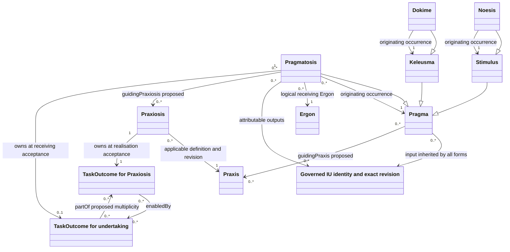
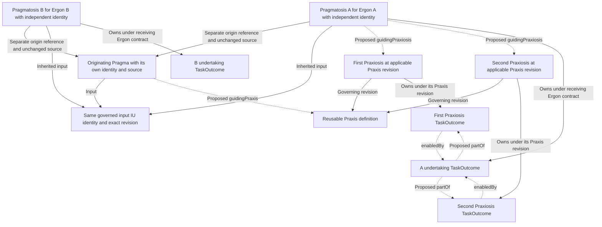

<!-- Copyright (c) 2026 Mark Hunter. SPDX-License-Identifier: GPL-3.0-or-later -->

# Design Review Proposal — Calliope Pragma Information Model

| Review field | Value |
| --- | --- |
| Revision | Draft.000.001 |
| Standing | Pending Solution Architect review. Design preparation only. |
| Prepared by | Codex |
| Solution Architect | Mark Hunter |
| Repository and branch | `fhirfactory/harmonia` · `feature/BL-0006-Calliope-Pragma` |
| Architecture baseline | `1.1.26` |
| Software development identity | `0.1.0-SNAPSHOT` |
| Primary source | [Undertaking and Execution Framework Draft.000.009][framework] |

## 1. Proposal and authority

Define the work information that Calliope must be able to represent and validate for a Pragma and its realised Pragmatosis. Record the common semantics and the specialised variations so the general contract can be reviewed before Java work. BL-0006 begins with the general pair. The Undertaking and Execution Framework supplies the design decisions for this review and retains its pending standing. The accepted BL-0005 InformationUnit increment and Topic/TopicMask Final.003 supply the supporting information and naming contracts. Their acceptance and their Continuum incorporation have separate standing. [Draft.000.009 §§4 and 10][framework] · [BL-0005 acceptance][bl5] · [Accepted naming design][topic] · [Architecture-target naming review][topic-review]

The model supports **RecoveryPreservesTaskLineage**, CORE-004 and PROV-001 by preserving occurrence identity, immutable input correspondence and attributable realisation. Those model facts support reconstruction and correlation at the responsible boundaries. [RecoveryPreservesTaskLineage][lineage] · [CORE-004][core004] · [PROV-001][prov001]

| Applicable axioms | Consequence for this contract |
| --- | --- |
| AX-05, AX-06 | Calliope represents an IU identity and applicable revision. Mneme governs access and coordination, and Mnemosyne establishes authoritative durable state. A structurally valid reference or snapshot carries only its established authority. |
| AX-07, AX-08 | Themis evaluates authorisation at governed operations. Preserve the source, origin and evidence basis so protected decisions and actions remain attributable. |
| AX-14, AX-15 | Preserve distinct work identities, classifications, revisions, outcomes and runtime effects. Governed validation and recovery distinguish an invalid reference, an unavailable determination and an established effect. |
| AX-17 | Guiding associations, unresolved cardinality and reference ownership, and changes to canonical Task terminology remain subject to governed disposition. |

The referenced Continuum Principles define the axioms. [Architectural Axioms][axioms]

## 2. Conceptual work forms

The conceptual inheritance is **Pragma → Pragmatosis**, **Pragma → Stimulus → Noesis**, and **Pragma → Keleusma → Dokime**. Here each arrow points from the general concept to its specialisation. Stimulus and Keleusma are originating roles. Their realised forms inherit the common work semantics and the input semantics of their own family. Role determines which properties and operations apply. All six Topic paths are siblings independently of this hierarchy. Java inheritance, interfaces or composition are choices for detailed design under the reviewed contract. [Framework §4.1][framework-forms] · [Framework §4.2][framework-topics]

| Form | Role and specialised meaning | Counterpart and runtime associations |
| --- | --- | --- |
| **Pragma** | Originating general work occurrence, for example work created at Ergon egress for eligible downstream processing. A reusable work definition and its applicable revision are separately referencable. | May yield zero or more Pragmatoses. Each selected origin and receiver pair has one Pragmatosis under the governed identity rule. |
| **Pragmatosis** | Realised general undertaking addressed to exactly one logical receiving Ergon. It preserves the originating Pragma's input and source and has its own identity and lineage. | Origin is one Pragma occurrence of the general family. Governed operational IU is JobCard. ExecutionAttempt is an independent activity record. |
| **Stimulus** | Originating Digital Twin work. Preserve Twin-relative input meaning under the applicable Behaviour contract. | Corresponding realised form is Noesis. The applicable fan-out and exact Behaviour-specific construction contract remain open. |
| **Noesis** | Realised Digital Twin undertaking with lineage to its originating Stimulus and the same Twin-relative input and source. Preserve accountable Behaviour attribution under the specialised admission contract. | Governed operational IU is ThoughtProcess. Each Skepsis remains an independent consideration. Resolve correspondence to BehaviourStimulus and treatment of Effector separately. |
| **Keleusma** | Originating assurance request. Its one governed input retains its assurance meaning. The applicable subject and criteria and their revisions must remain attributable under the assurance contract. | Corresponding realised form is Dokime. Evidence used for evaluation is acquired separately through governed access. |
| **Dokime** | Realised assurance undertaking with lineage to Keleusma. Preserve accountable assurance Ergon attribution. A governed finding may be an output IU and has its own meaning alongside the undertaking outcome. | Governed operational IU is Tekmerion. Each Dossier remains an independent assurance activity. Composite criteria, evidence access and independent assurance retain their owning contracts. |

The three operational IUs and the independent activity records identify the external information these work forms relate to. Their definitions, admission, audit, retention and recovery remain with the existing framework and governance contracts. Digital Twin constraints include serial Behaviour processing within a Twin and fresh context after the applicable predecessor save. Dokimasia retains independent and finite assurance. These constraints supply specialised applicability conditions for subsequent work. [Framework §§4.3–4.5][framework-operational] · [Digital Twin][twin] · [Behaviour][behaviour] · [Independent Assurance disposition][assurance]

## 3. Shared properties and identity invariants

| Property | Originating role | Realised role |
| --- | --- | --- |
| Occurrence identity | Exactly one immutable identity for the originating work occurrence. The reusable definition, an IU UUID and a Topic identify different subjects. | Exactly one independent immutable undertaking identity, distinct from its origin and from other undertakings. Reuse it on redelivery, retry, recovery and any authorised further attempt of that undertaking. |
| Classification | Exactly one corresponding originating form's Topic from §5. | Exactly one corresponding realised form's Topic. The family relationship leaves it a sibling of the origin's Topic. |
| `input()` | Exactly one reference to a governed InformationUnit at its specific identity and revision. | Inherit the same reference semantics, preserving both the IU identity and that exact revision. Additional working context is acquired separately. |
| `whereFrom()` | Carries the applicable source information for the originating work. | Preserve the originating source value unchanged, including the versions of any entries carried by that value. The source representation and its requiredness await review. |
| Provenance | Identify issuance or production and the basis for creating this work occurrence. | Identify exactly one originating occurrence of the corresponding family through a separate provenance relationship. Retain the applicable establishment and selection basis. The source value and the origin relationship represent separate facts. |
| Receiving identity | An origin may be considered for several receiving functions. | Pragmatosis references exactly one logical receiving Ergon. A queue, subscription, particular running Ergon instance and selection reason retain their own identities. Noesis and Dokime preserve their specialised recipient attribution without imposing the general Ergon representation on them. |
| `output()` | The originating role has no realised output operation. | The realised role can represent zero or more governed output IUs attributable to the undertaking. Keep each represented IU's identity, applicable revision and the basis for attribution to the contributing activity. |
| `outcome()` | The originating role has no undertaking outcome operation or consolidated TaskOutcome. | The realised role exposes its own separately governed TaskOutcome once established. There is no established undertaking outcome before receiving acceptance. Once accepted, the undertaking has exactly one stable outcome even if the determination remains unresolved. |

For an authoritative input IU, the input revision is the Mnemosyne-established Managed Revision in the applicable contract. Its identity is the IU's UUID. Preserve the exact revision through construction, projection and reconstitution. A later version of the same IU does not replace the reference, and equivalent content supplies no identity equivalence. TopicEntry version, the work occurrence's identity, a Managed Revision, Mneme's operational revision and active generation, Content Structure Version and any native data version keep their respective meanings. The content locator inside an IU and a content-free summary can support their own use cases. The work input requires the identity and revision of the governed IU itself. The reference binding and the admissible revision evidence for each supported input projection require review. [Framework §4.1][framework-forms] · [Accepted IU revisions][iu-revisions] · [BL-0005 model lineage][iu-development] · [Lifecycle §3][lifecycle]

For general work, **(originating Pragma identity, receiving Ergon identity) → one Pragmatosis** describes authoritative establishment or recovery for a selected pair. Petasos keeps one routing obligation per pair and attributes every applicable selection reason. Calliope represents the pair and its separate undertaking identity. Authoritative uniqueness, reconciliation after lost replies and stable handoff across independent selectors require the existing governed operations. Two distinct originating identities can address the same Ergon even when they carry equivalent IU content. Specialised uniqueness remains subject to the applicable family contracts. [Framework §4.7][framework-routing] · [Framework §4.13][framework-pubsub] · [Mneme–Mnemosyne authority][persist]

A valid realised snapshot may represent an empty output collection. Candidate processing outputs and changes to existing working information follow their own governance. An accepted output association carries attribution under the undertaking's contract and supplies no publication or forwarding decision. Outcome references and approved outcome revisions preserve the established outcome identity. Accepted-but-unresolved, adjudicated, and no established outcome are distinct. An omitted reference in a partial, denied or unavailable view supplies no conclusion about acceptance or outcome existence. [Framework §§4.1 and 4.3][framework-forms] · [Framework lifecycle][framework-operational] · [Operational state and revision design][lifecycle]

## 4. Guiding relationships and outcomes

### 4.1 Proposed guiding associations

The accessor names below express conceptual navigation.

```text
Pragma.guidingPraxis()          // Set<Praxis>
Pragmatosis.guidingPraxiosis()  // Set<Praxiosis>
```

| Association | Meaning, proposed cardinality and provenance |
| --- | --- |
| `Pragma.guidingPraxis()` | `0..*` reusable Praxis definitions per Pragma and `0..*` originating Pragmas per definition. An origin offered only for subscription can have an empty set. Identify the relevant definition and preserve applicable revision correspondence in the governing evidence. Actual traversal, eligibility and authorisation remain separately established. Extending the association to a specialised form requires applicable family correspondence. |
| `Pragmatosis.guidingPraxiosis()` | `0..*` realised Praxioses per undertaking and `0..*` participating undertakings per Praxiosis. Attribute each association to the specific traversal, applicable Praxis revision, origin and receiving Ergon pair, and applicable selection reason. Preserve established historical participation when a traversal terminates, suspends or diverges. The current progression decision remains with that Praxiosis. |
| Praxiosis → Praxis | Exactly `1` governing definition at the applicable revision per Praxiosis and `0..*` independent realisations of that definition. Each realisation has its own lifecycle, operational IU and pathway TaskOutcome. |

Several Praxioses can participate in one Pragmatosis and independently interpret the same undertaking outcome. The association count determines neither the number of undertakings for the pair nor the number of execution attempts. Actual shared execution depends on the applicable processing inputs, revisions, conditions, side effects and authorisations. Differences confined to Praxis progression or pathway adjudication by themselves do not establish processing incompatibility. Compatibility authority and conflict treatment remain for review under the existing identity rule. [Framework §4.10][framework-relationships] · [Framework §4.14][framework-compatibility]

| Representation boundary | Proposed allocation for BL-0006 review |
| --- | --- |
| Direct work information | Represent occurrence identity, classification, the exact input reference and `whereFrom()` in the work contract. A realised form directly represents its separate origin reference. Pragmatosis directly represents its logical receiver reference. The realised output and outcome members express their associations with separately governed information. Direct representation of a reference defines its place in the information contract and leaves the target's storage and resolution with its owner. |
| Guiding associations | Include both relationships in the conceptual Calliope model. A reviewed contract may expose governed references in the work snapshot or derive the association view from independently governed evidence. BL-0006 needs a disposition on direct representation, authority, revision and optionality before binding either association to a field or accessor. Preserve proposed zero cardinality in the applicable complete view. |
| Outcome and participation records | The work contract represents the undertaking's association to its own outcome. The JobCard, TaskOutcome determinations, Praxiosis progression and authoritative participation evidence remain individually governed at their existing boundaries. Keep authoritative `partOf` and `enabledBy` assertion, update, persistence and reconciliation with the separately reviewed outcome and participation contracts. |

The owning authority for each guiding assertion, whether and how a reference may change, and its establishment timing remain open. In particular, an independent selection can resolve to an already-established undertaking. The evidence required to add or correct a participation reference, and its relation to outcome references and governed revisions, require explicit disposition. Calliope's reference representation supplies no authority to assert or remove participation. [Framework §§4.8 and 4.10][framework-praxis] · [Framework §9][framework-open]

### 4.2 Outcome semantics

| Information | Governing meaning |
| --- | --- |
| Execution result | Attributable to one activity, such as an ExecutionAttempt. It can provide evidence for adjudication and retains its own identity and semantics. |
| Undertaking TaskOutcome | Owned by the realised undertaking. For Pragmatosis the processing framework applies the receiving Ergon's processing contract when adjudicating the one established outcome. The outcome describes the actual undertaking. Each specialised family's adjudication retains its applicable contract. |
| Praxiosis TaskOutcome | Owned by one Praxiosis and initially unresolved when that traversal is accepted. The Coordinator interprets the undertaking outcome independently for each Praxiosis, applying its governing Praxis revision to progression, forwarding and pathway adjudication. A progression decision and the pathway disposition remain distinct. The undertaking outcome retains its determination when guiding Praxioses choose different paths. |

The reference pair `partOf` and `enabledBy` expresses participation without recursive containment. In the proposed shared-processing model an undertaking TaskOutcome has `0..*` `partOf` targets, each a separately owned Praxiosis TaskOutcome. Each Praxiosis TaskOutcome has `0..*` `enabledBy` references to contributing undertaking outcomes. The proposed inverse permits one undertaking outcome to contribute to several separately adjudicated traversal outcomes. Preserve the contributing outcome identity and applicable revision in the governed evidence. A Praxiosis can be accepted with zero participants. Each participation retains attribution when the traversal later terminates. The widened `partOf` multiplicity and corresponding inverse remain proposals. [Framework §§4.8 and 4.10][framework-relationships] · [Canonical TaskOutcome Topic][task-outcome]

At the model boundary, BL-0006 specifies the realised role's outcome association, cardinality and pre- and post-acceptance meaning. An eventual implementation can express that association using the reviewed reference shape. Create or recover the unresolved outcome and its operational IU atomically at the respective acceptance boundary under separate runtime work. Keep adjudication, accepted-output effects, outcome revisions, reference maintenance across traversals and recovery outside the BL-0006 implementation scope. [Framework §§4.3 and 4.6][framework-operational] · [Framework §10][framework-scope]

## 5. Topic paths and version semantics

The six proposed qualified paths from Draft.000.009 use the approved ordered, typed Topic entries. Each line below is one path. `<version>` is a placeholder for the future reviewed version value, with the applicable canonical escaping when rendered. [Framework §4.2][framework-topics] · [Topic identity and structure][topic] · [Canonical parsing][topic-parsing]

```text
Domain=ICT.Owner=FHIRFactory.Standard=Harmonia.Concept=DataObject.Concern=Workflow.Scope:<version>=Tasks.Entity=Pragma
Domain=ICT.Owner=FHIRFactory.Standard=Harmonia.Concept=DataObject.Concern=Workflow.Scope:<version>=Tasks.Entity=Pragmatosis
Domain=ICT.Owner=FHIRFactory.Standard=Harmonia.Concept=DataObject.Concern=Workflow.Scope:<version>=Tasks.Entity=Stimulus
Domain=ICT.Owner=FHIRFactory.Standard=Harmonia.Concept=DataObject.Concern=Workflow.Scope:<version>=Tasks.Entity=Noesis
Domain=ICT.Owner=FHIRFactory.Standard=Harmonia.Concept=DataObject.Concern=Workflow.Scope:<version>=Tasks.Entity=Keleusma
Domain=ICT.Owner=FHIRFactory.Standard=Harmonia.Concept=DataObject.Concern=Workflow.Scope:<version>=Tasks.Entity=Dokime
```

All paths have the same ordered six-entry prefix ending at `Scope=Tasks`. The seventh entry supplies the sibling Entity. The family version is on Scope alone across the six paths. Use immutable Topic values and the existing Naming construction and strict canonical parsing. The version-capable projection preserves the raw, opaque Scope entry version. The unversioned identity projection omits the version segment, and Topic equality, ordering and hashing use the case-sensitive ordered qualifier/value path. Version-sensitive validation compares the entry's version explicitly. Navigation preserves versions on retained entries. Work occurrence identity, input IU identity and revision, and the Topic classification remain independent. [Topic identity and structure][topic] · [Canonical parsing][topic-parsing]

An ordinary TopicMask can match one sibling through its full literal path with exact containment. An ordinary inclusive mask on the common prefix can select its containment scope, including the prefix itself. Callers requiring exactly the six work forms must check their Entity vocabulary and expected depth. Apply any version constraint to Scope, using the accepted distinction between omitted constraints, exact text and explicitly selected numeric comparisons. An omitted constraint allows both absent and present versions. Matching supplies classification evidence. Themis supplies authorisation for governed operations. [TopicMask matching and version matching][mask] · [Consumer boundaries][mask-consumers]

Existing TaskDefinition, Task, TaskFulfillment and TaskOutcome classifications retain their recorded standing. Establish their correspondence, any coexistence or migration of governed selectors and references, and the treatment of persisted or interchange representations before using the new family. The Tasks proposal spells `Owner=FHIRFactory.Standard=Harmonia`. The accepted BL-0005 RAW IU vocabulary uses `Owner=fhirfactory.Standard=harmonia` in its own qualified paths. Naming is case-sensitive. Verify the applicable governing vocabulary, without automatically converting the draft paths or treating their prefixes as equal. The accepted pre-1.0.0 coherence rule applies to superseded and unaccepted implementation representations under its own scope. Treatment of governed architectural identities, selectors and retained evidence requires separate disposition. [BL-0005 vocabulary][iu-development] · [Topic consumer boundaries][mask-consumers] · [Task correspondence][framework-reconciliation]

## 6. Design diagrams

**Conceptual class and relationship model.** Inheritance arrows express architectural specialisation. Origin references are separate associations between occurrences. Only labelled ends specify cardinalities in this diagram. Specialised fan-out remains open. A confirmed receiving acceptance establishes the undertaking TaskOutcome, yielding `0..1` over the lifetime and exactly `1` after acceptance. Praxiosis owns one pathway outcome from establishment.



**Identity and information lineage.** One originating Pragma yields separate Pragmatoses for logical Ergons A and B. Both are shown after receiving acceptance. Both preserve the same exact input and source. In the illustrative participation proposal, two traversals of one Praxis guide the Pragmatosis for A, and the Pragmatosis for B is subscription-only. Each traversal can use A's outcome under its own governing basis.



## 7. Construction and validation contract

### 7.1 Constructible information

Construction means producing a structurally valid work value using supplied, validated information. A governed establishment additionally proves the referenced facts, authority and durable effect under the applicable contracts.

| Operation | Required checks on information supplied to Calliope |
| --- | --- |
| Construct an originating work value | Require a valid immutable occurrence identifier, the exact Topic for the originating role, and one complete input identity-and-revision reference. Check source information against its reviewed representation and preserve the applicable production or issuance provenance. Apply the originating role's property set. |
| Construct a realised work value | Require its own occurrence identity, the exact realised Topic, one complete origin reference of the corresponding family and the exact input reference. If the originating value is supplied, verify that the identities are distinct, that the input identity and revision match exactly, and that the source information is unchanged. Require one logical receiving Ergon reference for the general pair. Reject an inconsistent or unsupported origin/realised pairing. |
| Represent realised output and outcome information | Accept zero or more structurally valid governed output IU associations with their applicable revision and attribution data as defined by the reviewed reference contract. A recognised accepted work view has one established undertaking TaskOutcome and its complete reference for governed resolution. An unaccepted work view has no established TaskOutcome. Validate the structure of any represented outcome reference and use the governing contract for evidence of acceptance. |
| Reconstitute work or project it for interchange | Preserve occurrence and origin identities, input identity and revision, source, receiver and applicable classification data exactly. Enforce the same invariants on the available complete values. Apply the reviewed representation and authorised projection contract for omitted or inaccessible members. |

For local validation, compare complete reference values supplied in the same operation. For example, equal IU UUIDs at different revisions fail the inherited-input check. Where a reference carries a versioned Topic, source preservation compares its versioned data. Reference presence, well-formedness and supplied consistency can be established locally. Authority, existence, semantic correspondence, exact durable revision and acceptance require governed evidence. The contract preserves the actual distinction between an invalid shape, a known referent failure, a denial and an indeterminate determination. Neither a caller-supplied field nor a cache snapshot establishes successful access or persistence. [Framework §§4.1 and 4.3][framework-operational] · [Mneme–Mnemosyne interaction][persist] · [AX-15][ax15]

### 7.2 Responsibility for governed validation and effects

| Boundary | Evidence or effect it establishes |
| --- | --- |
| **Calliope** | Shape, mandatory members and cardinalities, role and Topic correspondence, immutability and comparison of supplied origin and realised values. Reuse the accepted IU and Naming value contracts. The representation of associations carries reviewable facts and the model need only inspect locally supplied data. |
| **Mneme and Mnemosyne** | Resolve and validate applicable work, input IU and related references under authorised access. Confirm exact referent identity and revision, lineage and receiver correspondence through owning evidence. Establish or recover the authoritative undertaking identity for the selected pair through the governed path. Mnemosyne establishes durable managed information and authoritative revision progression. Apply the separately reviewed participation and outcome-reference contracts when those references are supplied. |
| **Themis** | Evaluate and enforce applicable policy for access, creation, disclosure, forwarding and execution at the responsible framework and component boundaries. Enforce policy in a trusted security context. A work reference, a matching TopicMask or a guiding association confers no authorisation. |
| **Petasos** | Own independent destination selection, consolidation of reasons for one origin and receiver pair, and durable obligation and handoff evidence. Preserve the originating-work and routing acceptance guarantees at H10/H11 and reconcile delivery at its owning boundary. |
| **Receiving processing framework and Coordinator** | Coordinate undertaking acceptance through the governed information path, including atomic establishment of the operational IU and TaskOutcome. Apply the receiving Ergon processing contract and preserve attempt and outcome attribution. The Coordinator applies the applicable Praxis to its Praxiosis's progression, forwarding and pathway adjudication. Keep execution eligibility, scheduling and retry at their existing boundaries. |

The existing checkpoint and Kleio contracts govern required audit and durable handoff of auditable facts. A model value carries the facts needed for correlation. Publication, authorisation, scheduling, authoritative state and evidence of execution remain distinct. [Qualified routing disposition][routing] · [Framework checkpoints][processing] · [Kleio capture][kleio] · [Themis authority][themis]

### 7.3 Conformance expectations for later implementation

- Construct valid general originating and realised examples. Reject any missing identity, input, input revision, origin or receiving Ergon where required by the role. Distinguish malformed local data from a well-formed reference awaiting governed validation.
- For one origin and two receivers, verify independent undertaking identities and explicit origin provenance, identical inherited source, and the exact same IU identity and revision across the three work values. Reject a substituted revision or an equivalent-content IU with a different identity. Preserve the same work identities on reconstruction of already established values.
- Verify that only realised values expose outputs and an undertaking outcome association. Exercise empty and multiple outputs, acceptance without a prior outcome, and stable outcome identity in valid accepted representations with unresolved and adjudicated outcomes.
- Verify all six classification shapes and the seven ordered entries. Exercise case, reordering, an incorrect Entity and a version on the wrong entry. Round-trip the common Scope version using approved Naming fixtures, verify that unversioned equality does not establish version equality, and check exact and inclusive selectors independently. Release-specific expectations require the approved Tasks vocabulary and version.
- If the guiding reference representation is approved for BL-0006, exercise empty sets and several independently identifiable Praxioses sharing one Pragmatosis. Preserve the exact origin and receiver identity and distinguish historical association from current progression. A subsequent integrated assignment must establish authoritative lookup, access, recovery, routing uniqueness and outcome effects with the owning components.

## 8. Proposed BL-0006 implementation sequence

The sequence becomes actionable only under a separately authorised software assignment. It keeps the Calliope model independent of runtime services and reuses the accepted BL-0005 IU model and Naming values. [Framework §10][framework-scope] · [BL-0005 acceptance][bl5] · [Software Development Praxis §3][software-praxis]

| Order | Proposed work and dependency |
| --- | --- |
| 1. General work contract | Begin with Pragma and Pragmatosis. Agree the reviewed occurrence identifier, input/revision binding, source value, separate origin reference and logical Ergon reference. Implement the approved model and local construction constraints using the existing IU and Naming contracts. Verify valid construction, immutable values and inheritance of exact input and source through reconstruction. |
| 2. Classification | Reuse Topic construction and strict canonical interchange. Apply the reviewed general Topics when their Tasks vocabulary and Scope version are dispositioned. Verify the family shape and selector correspondence under §5. Establish the four specialised classifications as design cases without adding specialised execution or admission. |
| 3. Realised associations | Add the reviewed general output and outcome association representations and validate the general role boundary. Bind any guiding association in Calliope after disposition of its authority, lifecycle and reference contract. Exercise accepted local projections without requiring provider lookup, a live framework or an outcome to be manufactured by a fixture for genuinely unaccepted work. |

| Dependency or deferred work | Owning scope |
| --- | --- |
| Stimulus/Noesis and Keleusma/Dokime | Separate follow-on work after the general contract and family-specific input, recipient and reference rules are reviewed. Digital Twin and Dokimasia keep their existing contracts and constraints. |
| TaskOutcome runtime management | Separate model and runtime disposition for outcome contents, acceptance-time atomic creation, adjudication, revisions, persistence, recovery, and `partOf` / `enabledBy` maintenance. BL-0006 represents only the approved work-to-outcome association. |
| Mneme and Mnemosyne | Governed establishment, reference resolution, authoritative uniqueness and durable recovery under the accepted contracts. |
| Petasos | Destination selection, reason consolidation, complete-list routing acceptance, obligations and delivery. |
| Processing frameworks, Themis and Kleio | Work admission, policy evaluation and enforcement, context acquisition, execution and retry, accepted-output and outcome effects, and audit capture. |
| Praxiosis and Coordinator | Traversal establishment, governing revision, progression and forwarding decisions, participation assertion, pathway adjudication, and compatibility determinations. |

## 9. Reconciliation and open decisions

| Source and standing | Required correspondence for this proposal |
| --- | --- |
| [Undertaking and Execution Framework Draft.000.009][framework], pending | §§4.1–4.2 supply work roles and the Tasks Topic paths. §§4.3 and 4.6 supply acceptance and responsibility boundaries. §§4.7–4.10 and 4.14 supply origin/receiver uniqueness, Praxiosis and outcome relationships, and the unresolved compatibility and provenance requirements. §10 bounds BL-0006. Resolve the model questions below while preserving the framework decisions and candidate standing of guiding associations. |
| [Accepted BL-0005 design and increment][bl5] and [IU revisions and representation][iu-revisions] | Reuse the governed IU identity and exact revision meanings. Establish the work-reference binding with explicit precedence over illustrative legacy reference shapes. Keep the work classification distinct from its input IU's classification, content schema and authority. Accepted BL-0005 design supersessions apply in their recorded scope. |
| [Topic/TopicMask Final.003][topic] and [naming incorporation DR-8][topic-review] | Apply the accepted naming semantics. Review the proposed Tasks vocabulary, version and selector correspondence. Final.003's accepted design and the pending incorporation remain distinct. |
| [Canonical TaskDefinition][task-definition], [Task][task-topic], [TaskFulfillment][task-fulfillment] and [TaskOutcome][task-outcome] | **Outcome ownership conflict.** The accepted TaskOutcome Topic assigns resolution and outcome policy to the ActionableTask and excludes independent FulfillmentTask ownership. The framework proposes separate undertaking and Praxiosis outcomes and an Ergon-governed basis for the Pragmatosis outcome. Review these amendments and the `partOf` and `enabledBy` correspondence. Preserve the existing exclusions on recursive containment. Review OutcomeConcurrency and OutputRules in their own scope. |
| [Mneme Pragma Model Draft.000.004][pragma-model], [Petasos–Mneme Draft.000.004][petasos-mneme] and the [G03 review][g03-review], pending | Reconcile originating `output()`, per-subscription construction and Ergon-instance use of `TaskOutcome` with the realised-role result surface, one selected origin/receiver pair and separate outcome ownership. Reconcile source representation and origin provenance. Preserve the authorised IU, work, acknowledgement and recovery boundaries. |
| [Routing Final.001][routing] and [Processing Framework Final.001][processing], accepted with qualifications | The qualified routing design has per-subscription obligations and a direct originating-Pragma referent on the Praxis path. H07 identifies the Ergon-instance result as TaskOutcome in G03 terms. The framework reconciliation records the required amendments. This model carries work, receiver and outcome identities while H10/H11, delivery and admission retain independent proofs. |

1. **Occurrence identifier and references.** Decide the governed work identifier namespace and binding, the canonical wire or snapshot form of an exact input reference, which revision evidence is admissible for each projection, and the receiver identity binding across Ergon registrations. Specify how origin, input, source and receiver consistency can be proved when values are conveyed by reference.
2. **Source and provenance.** Specify the source value's shape, requiredness and correspondence to accepted IU origin metadata and the producing or issuing occurrence. Preserve source and separate realised-to-origin lineage. Decide the minimum evidence for establishment and accepted output attribution.
3. **Guiding references.** Decide direct representation or derived governed projection, claim authority, multiplicity, optionality, effective revision, permissible changes and the point at which either association is established. Resolve late selection evidence, historical participation and recovery of the corresponding outcome references. Determine the applicability of these associations to the specialised forms.
4. **Outcome authority and references.** Disposition the canonical ownership amendments and the receiving Ergon processing contract evidence. Define the reference shape and the available pre- and post-acceptance views, including scoped or unavailable projections. Resolve the candidate many-to-many multiplicities, source and target integrity and interrupted establishment of `partOf` and `enabledBy`, outside BL-0006 runtime scope.
5. **Tasks vocabulary and consumers.** Approve the exact Owner, Standard and Entity vocabulary and the common Scope version. Establish governed correspondence to existing Task-family classifications and identify affected selectors, references and representations requiring compatibility treatment or refactoring.
6. **Specialised contracts and sharing.** Resolve the BehaviourStimulus/Noesis and Effector correspondences, the assurance input and subject and criteria bindings, and the respective receiver and admission rules. Disposition authority and evidence for incompatible or unestablished execution requirements under the existing general pair identity. Retain those runtime questions in their owning framework review.

## 10. Review and provenance

**Pending Solution Architect review.** Decide the model and scope, unresolved representation and authority matters, and required canonical correspondence before application or implementation. The source is [Draft.000.009][framework], SHA-256 `e0ff5b37b4e6635916e2c9fa8f32d4502877eababf0532c2b4e65e4035f2607b`, as supplied in the working tree based on `3c6bce892da0f79bc52b8f380bf4bd92af28d81e`. The operative instruction is **Codex Assignment — BL-0006 Calliope Pragma Information Model**. Formal Task and Report placement awaits identification of the governing HCRL target and iteration. [Architecture Review Praxis][review-praxis] · [Architecture Change Provenance][change-provenance]

[framework]: DRP-Harmonia-Undertaking-and-Execution-Framework.Draft.000.009.md
[framework-forms]: DRP-Harmonia-Undertaking-and-Execution-Framework.Draft.000.009.md#41-undertaking-hierarchy-and-information-contract
[framework-topics]: DRP-Harmonia-Undertaking-and-Execution-Framework.Draft.000.009.md#42-concept-topics
[framework-operational]: DRP-Harmonia-Undertaking-and-Execution-Framework.Draft.000.009.md#43-operational-records-and-common-taskoutcome-lifecycle
[framework-routing]: DRP-Harmonia-Undertaking-and-Execution-Framework.Draft.000.009.md#47-destination-selection-common-realisation-and-routing-recovery
[framework-praxis]: DRP-Harmonia-Undertaking-and-Execution-Framework.Draft.000.009.md#48-praxis-praxiosis-and-pathway-coordination
[framework-relationships]: DRP-Harmonia-Undertaking-and-Execution-Framework.Draft.000.009.md#410-conceptual-responsibilities-and-information-relationships
[framework-pubsub]: DRP-Harmonia-Undertaking-and-Execution-Framework.Draft.000.009.md#413-pubsub-alongside-the-three-pathways
[framework-compatibility]: DRP-Harmonia-Undertaking-and-Execution-Framework.Draft.000.009.md#414-identity-recovery-and-unresolved-execution-sharing-conditions
[framework-reconciliation]: DRP-Harmonia-Undertaking-and-Execution-Framework.Draft.000.009.md#71-existing-task-architecture-correspondence
[framework-open]: DRP-Harmonia-Undertaking-and-Execution-Framework.Draft.000.009.md#9-open-questions-for-solution-architect-review
[framework-scope]: DRP-Harmonia-Undertaking-and-Execution-Framework.Draft.000.009.md#10-proposed-implementation-backlog-decomposition
[bl5]: ../register/software-0.1.0/hcrl-software-0.1.0-011.complete.md#design-decisions
[iu-development]: DRP-Information-Unit-Framework.Draft.002.007.md#1-draft-002007--informationunit-model-for-calliope
[iu-revisions]: ../register/1.1.25/hcrl-1.1.25-001.complete.md#dr-4
[lifecycle]: DRP-Calliope-Lifecycle-Revision-and-Operational-State.Final.001.000.md#3-a15--data-version-and-managed-revision
[persist]: ../register/1.1.24/hcrl-1.1.24-001.complete.md#dr-1
[topic]: DRP-Topic-and-TopicMask.Final.003.md#1-topic-identity-and-structure
[topic-parsing]: DRP-Topic-and-TopicMask.Final.003.md#3-topic-names-and-strict-canonical-parsing
[mask]: DRP-Topic-and-TopicMask.Final.003.md#4-topicmask-kinds-and-matching
[mask-consumers]: DRP-Topic-and-TopicMask.Final.003.md#7-consumer-boundaries
[topic-review]: ../review/1.1.28/hcrl-1.1.28-001.pending.md#dr-8
[task-definition]: ../../continuum/application/data-object/topic/1d6d4c3a2df440be94262855fa6564eb.md#architectural-content
[task-topic]: ../../continuum/application/data-object/topic/c43139289cb649b4836521a96a51604c.md#architectural-content
[task-fulfillment]: ../../continuum/application/data-object/topic/30f4deffcd694f07bf54b2b192695d4f.md#architectural-content
[task-outcome]: ../../continuum/application/data-object/topic/08d8ee19a30f418f9d5bc497ced0d1ef.md#architectural-content
[pragma-model]: DRP-Mneme-Pragma-Model.draft.000.004.md#41-work-identity-and-realisation
[petasos-mneme]: DRP-Interaction-Petasos-to-Mneme.draft.000.004.md#42-work-identity-and-reference-handoff
[g03-review]: ../review/software-0.1.0/hcrl-software-0.1.0-004.pending.md#dr-12
[routing]: DRP-Petasos-Routing-and-Reconciliation.Final.001.md#1-common-strategy
[processing]: DRP-Harmonia-Processing-Framework-and-Checkpoints.Final.001.md#42-stage-and-checkpoint-correspondence
[twin]: ../../continuum/application/application-component/3f64d339648246e99e8866c8089f8960.md#architectural-content
[behaviour]: ../../continuum/application/application-component/a26f06d66bec4981b266e202c46a9afb.md#architectural-content
[assurance]: ../register/1.1.20/hcrl-1.1.20-001.complete.md#dr-18
[axioms]: ../../governance/architectural-axioms.md
[ax15]: ../../continuum/motivation/principle/ef8abbaec37e4890ad78b9f263e67906.md#architectural-content
[themis]: ../../continuum/motivation/principle/architectural-axiom/5de2ae2c3b794c2d9f3a14efd51d564f.md#architectural-content
[kleio]: ../../continuum/motivation/principle/architectural-axiom/5de2ae2c3b794c2d9f3a14efd51d564f.md#kleio-mandatory-capture-authority
[lineage]: ../../continuum/strategy/capability/feature/157b20d5c544429a8ada854c45ec244f.md
[core004]: ../../continuum/motivation/requirement/assurance-requirement/f2e504e7d6374e41a81303265adda6de.md
[prov001]: ../../continuum/motivation/requirement/assurance-requirement/3e45e60affb44bf384d54de26d3add6a.md
[software-praxis]: ../../governance/software-development-praxis.md#3-backlog-items-assignments-and-traceability
[review-praxis]: ../../governance/architecture-review-praxis.md
[change-provenance]: ../../governance/architecture-change-provenance.md#ai-agent-activity-provenance
