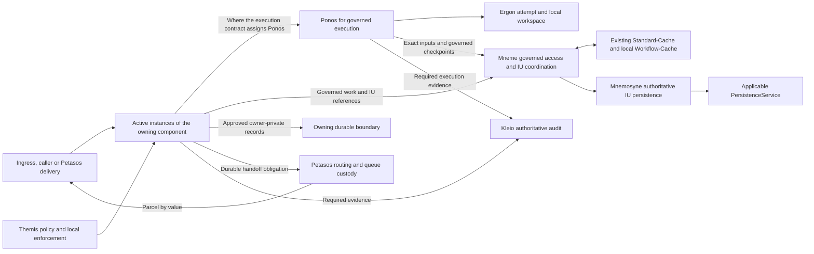
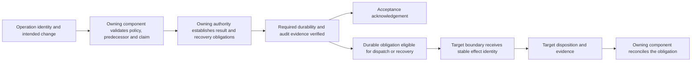
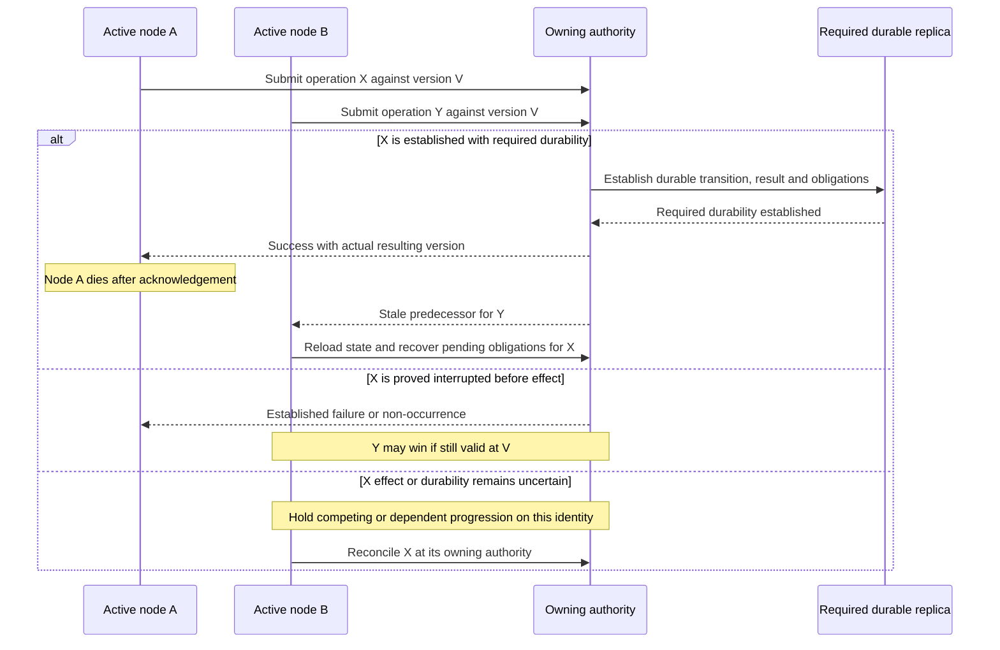
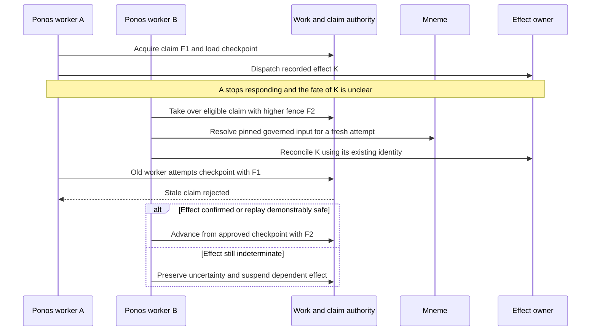
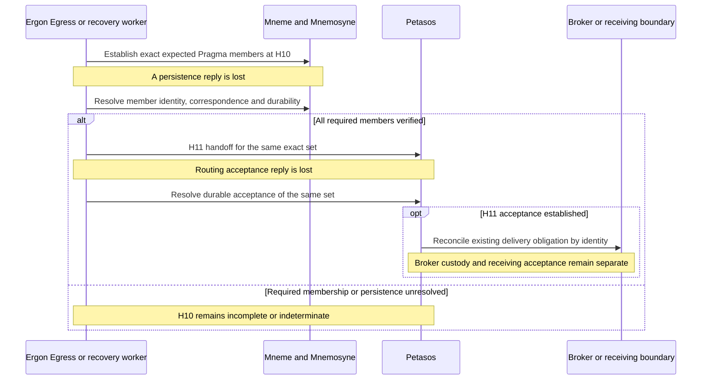
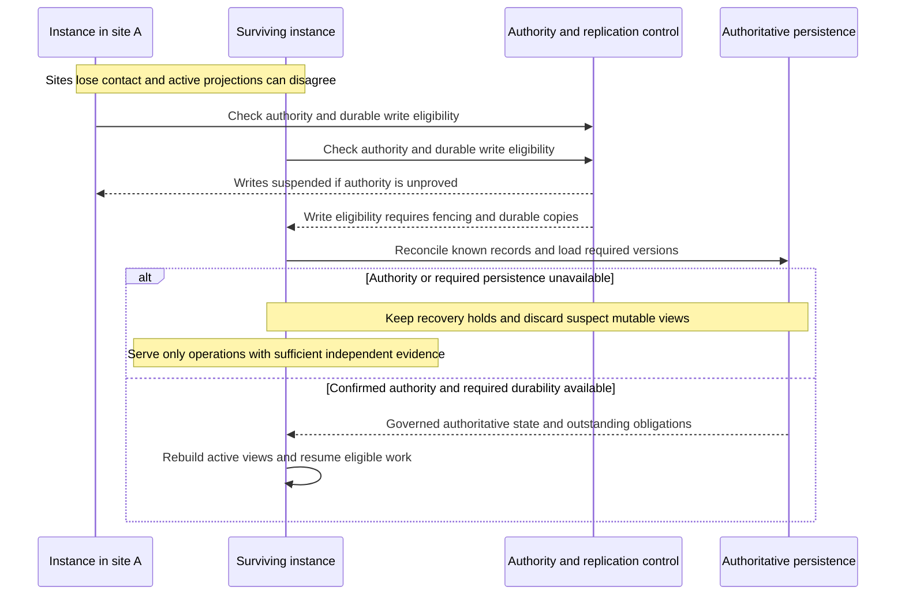

<!-- Copyright (c) 2026 Mark Hunter. SPDX-License-Identifier: GPL-3.0-or-later -->

# Harmonia Core Object State Management

**Revision** Exploration.001  
**Standing** Independent architecture exploration for Solution Architect review  
**Architecture baseline** 1.1.26  
**Software development identity** `0.1.0-SNAPSHOT`  
**Prepared by** Codex

## 1. Recommendation

Keep active component instances replaceable. Give each recovery-critical change one logical durable authority behind the component that owns the change. Persist the smallest record sufficient to establish the transition and recover its obligations. Reconstruct active objects, execution context and any useful cache entries from that record and the applicable governed information.

Use the existing **Mneme → Mnemosyne → PersistenceService** path whenever the state is represented as a governed InformationUnit (IU). Use the established owner and durability boundary for other state, such as Petasos queue custody and Kleio audit. For new private operational records whose persistence allocation is open, evaluate the existing Harmonia-managed PostgreSQL capability behind an approved owning boundary. PostgreSQL is a good first candidate for transactional conditional updates, durable work claims and failover. A generic CoreObject Framework and a dedicated distributed Core Object cache provide no necessary mechanism in this design.

## 2. Requirements, authority and assumptions

| Concern | Required property | Proposed mechanism |
| --- | --- | --- |
| Active/active service availability | Multiple instances serve concurrently. Healthy survivors absorb traffic and pending work after a node failure with automatic routing and recovery where the dependencies still meet their contracts. | Redundant instances, dependency-aware readiness, replaceable workers and reconstructable state. Use stable client or handoff identity to survive connection loss. |
| Authoritative consistency | For a given object and eligible predecessor, one competing transition can be accepted. Acknowledged recovery-critical work survives the failure class covered by the acknowledgement. | One logical write authority for the relevant consistency boundary, authoritative conditional transition, durable result and purpose-bound retention of outstanding obligations. |
| Execution ownership | Deliveries, retries and failovers cannot create duplicate accepted decisions or unauthorised effects. Preserve applicable ordering and per-destination progress. | Ponos or the designated owner makes claims scoped to the work or its actual ordering key. Durable checkpoint, fenced takeover, stable effect identity and endpoint-specific reconciliation govern retries. |
| Disaster recovery | Restore a known, operationally consistent point across work, dependencies and evidence. Maintain site-level durability where required. | Fenced promotion of sufficiently current data-bearing replicas for failover. Independent backups, restore testing and cross-component reconciliation for catastrophic loss or corruption. |

**Accepted information contracts.** IU remains the governed information aggregate with its own identity, representation, authoritative history and access rules. An object can hold a governed IU reference or have an approved operational IU representation. Its typed runtime identity remains distinct from the IU UUID, IU Managed Revision, Mneme operational revision and active generation. Mneme coordinates per-IU changes. Mnemosyne supplies authoritative persistence and retains all five accepted interactions. Synchronous multi-site durable completion is required for authoritative IU mutation Success. Explicit version reads remain exact, and search stays Summary-only. The accepted Standard-Cache and Workflow-Cache serve their existing purposes. [IU incorporation][iu-baseline] · [IU refinements][iu-refinement] · [Mnemosyne MP-08][mnemosyne] · [Interaction contract][iu-interaction] · [Cache and resilience disposition][iu-cache]

**Accepted work and recovery.** Recovery-critical work must be durably recorded before acceptance acknowledgement and retained until its obligations have been discharged. Apply controlled retry, explicit partition disposition, recoverable checkpoints, lineage preservation and coherent scheduling. These requirements apply at the owning acceptance boundary. An ingress receipt, H10 completion, H11 routing acceptance, broker acknowledgement, receiving execution acceptance and final result attest different facts. The processing and routing designs have bounded offline acceptance with detailed obligations still open. [NFR-029][accepted-work] · [NFR-067][durable-before-ack] · [NFR-030][controlled-recovery] · [Checkpoints][checkpoint-feature] · [Lineage][lineage] · [Scheduling][scheduling] · [Node continuity][node-continuity] · [Partition outcome][partition-feature] · [Processing and routing dispositions][processing-standing]

**Assumptions to test.** Work on independent identities or ordering scopes can proceed in parallel. Some execution can safely restart at a defined checkpoint. Some effects may only resume after an owner or external counterparty resolves their disposition. The deployment provides independent failure domains and a way to prevent superseded authorities from publishing writes. Each owner can identify which records are essential to resuming, reconciling or demonstrating accepted work. Where a required claim, effect, lookup, audit or durability proof cannot be established, the affected work is suspended with an explicit disposition.

**Axiom fit.** AX-04 assigns semantics to Harmonia and transaction, replication and clustering machinery to the platform. AX-05/06 keep active projections separate from explicitly assigned authority. AX-07/08 govern access and meaningful audit and provenance. AX-09 supports discarding working context after its purpose ends. AX-10/11 require designed failure handling and responsive governed access. AX-13 protects the egress boundary. AX-14/15 preserve the difference between a committed transition, a receipt and an uncertain effect. AX-16 requires observable coordination between activity and entity state, including destination progress. AX-17/18 preserve unresolved allocations and domain authority. [Canonical Axioms][axioms]

## 3. Core Object classification

This classification proposes what to recover. It applies established owners where they are known. The six work-form names and Praxiosis use the assignment's vocabulary. Two adjacent working-tree drafts supply candidate role and outcome mappings and help identify matters that require adjudication in §9. [Canonical Pragma][pragma] · [Praxis][praxis] · [Ponos][ponos] · [Undertaking draft][undertaking] · [Calliope Pragma model draft][pragma-draft]

| Object or category | Authoritative state and recovery | Active state, concurrency and IU dependency |
| --- | --- | --- |
| **Pragma** | Recover the originating occurrence identity, source and exact input references, acceptance and lineage, and evidence needed to recreate routing obligations. Keep authoritative per-destination dispositions with their owner. | The constructed value and routing view are reconstructable. Mneme governs access and construction under the applicable contract. Pin required input IU versions. Petasos owns routing and Ponos grants governed execution claims independently of routing receipt. |
| **Pragmatosis** | Recover the realised undertaking identity, origin and receiver, applicable definition or contract revision, disposition, current recoverable checkpoint, attempt and outstanding effects. Resolve the owner and representation of any consolidated TaskOutcome under §9. | Ponos or its applicable execution specialisation governs the claim and checkpoint. The active Ergon workspace is local. Resolve the same governed work context and exact input IU revisions after takeover. Preserve separate identifiers for an undertaking and each execution attempt. |
| **Stimulus / Noesis** | For accepted Digital Twin work, recover the Stimulus origin, relevant Twin and Behaviour identities, the realised occurrence, required ordering and the checkpoint or effect disposition needed to continue. Retain the source and policy basis of any coalescing or repeat disposition that affects accepted work. | Live observations and evaluation context can be rebuilt or dropped when their governing purpose permits. Use the existing Twin-relative serialisation where required. Load governed entity data through Mneme, with the required IU revision for the retry. Twin observations and coordination retain their existing domain-authority limits. |
| **Keleusma / Dokime** | For accepted assurance work, recover request and occurrence identity, criteria revision, evidence references, recoverable stage and attributable findings or outstanding obligations. Preserve the independence and provenance of the assurance decision. | Working evaluations can be rebuilt from governed evidence where admissible. Claim the assurance unit under its owning execution contract. Load governed evidence IUs by admissible reference and revision. Revision authority stays with the source owner. [Independent assurance][assurance] |
| **Praxis / Praxiosis** | Energeia owns the reusable Praxis definition. Recover the applicable definition revision for in-flight work. For a Praxiosis, preserve the separate realisation identity, progression, participants and their references, applicable revision, pending obligations and governing decisions. The proposed operational IU and outcome establishment are review matters. | Cache immutable definition revisions where justified. Where concurrent progression could conflict, the coordinating owner conditionally advances a realisation under its governing Praxis. Reference governed context, participating work and outcome evidence through their owners. A single-Ergon pathway still has distinct definition, realisation and attempt semantics. |
| **Ergon** | Retain stable definition identity and version or release, with the work record pointing to the execution contract used. Accepted outputs and recoverable checkpoints belong to the corresponding work and evidence owners. | Instantiate Ergon and its workspace per attempt. Ponos manages execution and the applicable sequencing policy. Reload governed IU context at the agreed boundary through Mneme. Local variables, threads and materialised workspace are disposable. [Ergon][ergon] · [Accepted offline checkpoint design][processing-final] |
| **PetasosParcel / PetasosEvent** | Preserve Parcel value, custody, delivery attempts and any ordering or deduplication evidence required by the queue contract. Retain a PetasosEvent and its identity when it creates a delivery, replay or evidence obligation or has an authoritative producer. Advisory signals can be regenerated or dropped under their contract. | Petasos owns queue state, routing obligations and delivery. Carry the Parcel by value and governed referents predominantly by reference. Rebuild active routing views from retained decisions and obligations. A consumer separately obtains its own work claim. The exact PetasosEvent-to-Parcel representation is open. [Petasos][petasos] · [By-value mandate][parcel-by-value] · [Routing design][routing-final] |
| **Passport / PolicyDescriptor** | Themis owns policy decisions, authoritative inputs, effective Passport construction, currency and revocation. Preserve the policy version, identity binding and evidence needed to verify or rebuild a Passport. Persist the issued representation when its contract requires evidence or reconstruction unavailable from retained inputs. | Use validated local enforcement copies only within Themis's freshness, integrity and expiry rules. Fail closed when currency or entitlement cannot be established. Retrieve any governed identity or policy inputs at their authorised boundary. Policy concurrency and revocation belong to Themis. [Themis][themis] · [Passport propagation][passport] · [Authoritative policy definition][policy] |
| **AuditEvent / LogEvent** | Kleio owns immutable authoritative audit capture and retention under applicable policy. Protect the event identity, actor, action, governed subject reference and factual disposition. LogEvent is diagnostic unless a separate, explicit governed retention obligation applies. | Deduplicate capture by the relevant occurrence and preserve distinct attempts. Use a controlled read projection for reporting. Diagnostic streams may be buffered or rotated under policy. They carry no unmasked PHI. Governed subject references retain their access restrictions. [AX-07 mandatory capture][mandatory-audit] · [Immutable AuditEvent][audit-records] |
| **SoftwareComponent** | Restore stable component identity, deployment or definition version and governed configuration from the designated registry or configuration source. Retain readiness or operational history where it is a governed OA&M record. | Live membership, endpoints and heartbeats expire and rediscover. Keep component identity separate from process instance and incarnation. Establish claims using current authoritative evidence. Use governed access for OA&M information that is an IU. [Governed OA&M][oam] · [Dependency monitoring][dependency-health] |
| **AgoraCommand / AgoraResponse** | For accepted commands, preserve command and correlation identity, target, authorised intent, outstanding work and confirmed or indeterminate operation disposition. A response may be regenerated from its recorded disposition where the contract permits. Keep separate collaboration and native operation identifiers. | Agora controls collaboration semantics. Omilia performs collaboration operations. Claim and deduplicate by command and apply target ordering only where needed. On uncertain Omilia effect, query or reconcile using the permitted operation evidence before retry. Use governed information references where needed. Keep PHI out of room metadata. [Agora/Omilia][agora] · [Themis][themis] |

## 4. Component and data flow

### 4.1 Component responsibilities

Each path applies to the owning component's assigned responsibility. Owning components decide allowed transitions, acceptance criteria, effects, retries, retention and access.

- **Governed state uses existing access.** An operational IU, or authoritative work or routing record already allocated to the IU path, goes through Mneme and Mnemosyne. Keep all five interactions, including the absence of Summary UPDATE. Use the actual returned version for Success and the existing read-back rules for lost replies. Keep operational metadata in its accepted peer role. Durable work facts require an approved representation with established retention and recovery semantics. [GovernedWriter][iu-writer] · [GovernedReader][iu-reader] · [OperationalMetadata disposition][iu-refinement] · [Routing ownership and persistence mapping][routing-final]
- **Existing owner-specific records use their owning boundary.** Petasos queue custody, Kleio audit capture and Themis policy remain governed by their respective owners. For additional, genuinely private recovery metadata such as an execution claim, approve its allocation before selecting a store. Reuse existing managed persistence infrastructure where supported. Application components consume governed interfaces. Storage adapters contain provider-specific access. Every record needed to demonstrate an acknowledgement has a named recovery owner and compatible durability policy.
- **Reuse a transition pattern before sharing code.** The smallest common abstraction for mutable durable state is a conditional transition with a stable operation identity, known predecessor or eligibility predicate and an outcome that can be resolved from the owning authority. Reuse correlation, deduplication and recovery plumbing where two owners prove the same semantics. The shared contract carries no generic lifecycle, claim policy, security model, recovery scheduler, cross-store transaction, cache fleet or common object repository. Immutable definitions, transport envelopes, audit records and diagnostics can use their own simpler or specialised mechanisms.

### 4.2 Data flow for accepted work

Acceptance and dispatch can advance independently once their shared prerequisites are established. A lost acceptance reply can be reconciled while a separate delivery or execution remains pending.

## 5. Authoritative transition and recovery contracts

### 5.1 Establishing and acknowledging one transition

1. **Identify the accepted unit.** Use stable object and operation identities, supplied or recoverable on first attempt, with a defined owner and scope. Recover a creation by its established occurrence or uniqueness key. Preserve the distinction between a retransmission of the same operation and new work with equivalent content. Bind the operation identity to its intent, governed referents and caller or delegated authority. Authorise result lookup and disclosure even on a repeat.
2. **Validate at the owning boundary.** Check Themis, the current authorised state, the expected predecessor and any required claim. Decide the transition under the owning component's rules. Within one logical consistency boundary, protect the decision and its preconditions against concurrent changes. For an IU, keep individual-IU coordination at Mneme and preserve the Mnemosyne contract. For an approved private transactional record, a conditional write against an expected revision and a uniqueness constraint on the operation identity are a candidate implementation. A lock may be useful for a short multi-record invariant inside one authority.
3. **Establish recoverable acceptance.** Commit the transition and the minimum recovery facts together at the owning boundary, including its stable result or correlation, required relationships, checkpoint and any outgoing obligation that acceptance creates. Where mandatory authoritative audit capture gates acceptance, establish the evidence at the required boundary before claiming success. Establish required durable copies before returning an acceptance acknowledgement. A provider-local commit whose required durability is unproved remains ineligible as a basis for dependent acceptance or effects. Across separate authorities, use recoverable stages, each with durable evidence and truthful acknowledgement semantics. If a proposed all-or-nothing invariant crosses those boundaries, its owner must establish logical atomicity or hold its acceptance until a separately reviewed contract can provide it.
4. **Reconcile before advancing.** Report factual Success, Failure or Indeterminate at the applicable boundary. Repetition of a known operation with corresponding intent returns its established disposition within the approved retention horizon. An identity used with different intent is a conflict. For a stale predecessor, reload and re-evaluate the proposed change under current policy. A legitimate different change starts with a distinct operation identity. For an uncertain IU write, use authoritative `GovernedReader(version=*)` with sufficient correspondence and required durability evidence. Require evidence that ties the observed version to the operation. Keep work correlation in the owning contract and preserve the IU persistence seam and version semantics. [IU Writer and uncertain outcomes][iu-writer] · [Explicit uncertainty][uncertainty]

### 5.2 Work claims, recovery and effects

- **Claim only the smallest scope that preserves the invariant.** Ponos retains one coherent logical scheduling authority and may run on multiple active instances. Claim an undertaking, Twin, or other actual ordering scope according to its contract. Acquire and renew a recoverable claim under the authority with a bounded lease and monotonically advancing fencing token for that scope. The authority decides lease expiry and issues claims only where currency can be proven. Every checkpoint, completion and internal effect publication guarded by that claim must atomically verify the current claim at the boundary where the effect is accepted. Keep claim validation with the guarded write where the approved mapping permits. Where a separate authority must enforce the fence, demonstrate conditional acceptance there or suspend effects that cannot be safely resumed. A paused worker can wake up after its lease expires. Claim fences and attempt identities remain distinct from IU and object revisions. [SingleSchedulingAuthority][scheduling] · [Repeated execution safety][repeat-safety]
- **Reconstruct execution from a checkpoint.** Discover pending obligations through their owning durable index, custody record or governed lookup. Preserve a reconstructable link from an accepted item to the recovery discovery path even if the wake-up message is lost. Use only the established IU read/search scopes. Keep stable identities for the work, checkpoint, related records and effects. Reload the exact applicable input IU, definition and policy context, re-authorise the recovery action, and instantiate a fresh attempt. Resume at the approved boundary. Separate an observed loss of a worker from a conclusion about its effects. A necessary referent that is unavailable or disallowed suspends that item while unrelated work continues. [IU workflow cache and common Ergon recovery][iu-cache] · [Processing checkpoint disposition][processing-standing]
- **Persist the obligation before sending.** For each cross-boundary effect, establish its stable effect identity with the causative transition at the owning acceptance boundary. An outbox is one implementation of this rule within a transactional store. A dispatch signal can be replayed from the durable obligation. A receiver can deduplicate against a durable receipt and business effect recorded atomically where it owns both. A relay crash can duplicate delivery because a send and the later sender-side confirmation are separate. Require positive evidence of completion from the applicable handoff boundary. In the accepted offline H10/H11 flow, H10 proves every expected Pragma established. H11 proves Petasos accepted the entire complete list durably. Preserve subsequent router, broker and receiver evidence independently and reconcile each unresolved obligation without repeating confirmed siblings. [H10/H11 disposition][routing-standing] · [Routing reconciliation][routing-final]
- **Bound the external-effect guarantee.** Keep the same effect identity across attempts. Automatically reissue a potentially effective request only when the target contract proves repeat safety, for example through a durable idempotency key covering the full recovery window. Where an authoritative lookup proves the outcome, reconcile against that result. Otherwise suspend the effect under the owning reconciliation procedure, with operator disposition where needed. An internal fence cannot revoke an external request already sent. The design permits duplicate deliveries and repeated computation where safe. It guarantees at most one accepted internal transition for a given predecessor and one accepted application of an operation within its deduplication contract. [Governed external retry][external-retry] · [AX-13][egress-boundary]

### 5.3 Cache consistency and security

Keep active Core Object state local by default. Immutable definitions, pinned versions and permitted read projections may use bounded local caches when measured demand warrants it. Tag entries with identity, version and the freshness context required by their contract. Mutations and claims revalidate at the authority. The owning authority grants claims. Publish useful invalidations only after durable confirmation, fence stale fills by the version where needed, and evict mutable projections after a gap or role change. After reload or restore use the confirmed authority before treating a cached value as current. An older immutable version may remain usable by an attempt pinned to it where policy and custody permit. Preserve the distinct semantics of Mneme's Standard-Cache and local Workflow-Cache throughout. [Accepted cache architecture][iu-cache]

Themis supplies policy and operation-bound enforcement. Trusted identity, delegation and purpose are established at the applicable boundary and reassessed for recovery and new effects. A Passport cache must satisfy the owning rules for integrity, currency, revocation and expiry. Persist the attribution and policy evidence required for the work, with credentials and current security context supplied through their governed channels. Protect cached data, recovery records and backups under equivalent classification, including identifiers and metadata. Kleio captures required evidence under its intrinsic audit authority. If mandatory authoritative capture cannot be established, fail closed at the governed boundary and preserve any known partial or indeterminate effect for reconciliation. Diagnostics and ordinary dispatch obligations supply no substitute for that evidence. Retain recovery identities and evidence through the applicable pending, replay and audit windows, then apply the owning disposition rules. [AX-07 mandatory capture][mandatory-audit] · [Themis][themis] · [Audit record protection][audit-protection]

## 6. Multi-site continuity and disaster recovery

**Authoritative failover.** Each consistency scope has one logical writer at a time. Application instances can be active in several sites and process independent work concurrently. A surviving site can accept a recovery-critical mutation only when it holds provable write authority, the prior writer is fenced, and the required replication and dependent services can provide the acknowledgement guarantee. Promote a replica only with evidence it contains all acknowledged work within the claimed failure envelope. A witness can help determine which side may act. It contributes no recoverable data. Service readiness must establish both that the current authority can be reached and that it can satisfy the contract. In a two-site deployment, continuity of new durable writes through loss of any single host requires eligible data replicas, failover control and essential dependencies to survive that host loss in both sites. Test the primary and standby host failure cases separately.

**Loss of one of two data-bearing sites.** The accepted IU qualification MC-05 applies. An authoritative side may continue permitted reads and independent activities. New multi-site durable IU Success suspends until an eligible second data-bearing site is available. Apply an equivalent acknowledgement guarantee to proposed essential operational records where their claimed recovery envelope includes total loss of an acknowledged site. Where the requirement is to keep accepting such work through loss of any one site, plan for at least three appropriately placed data-bearing sites, or establish a service with equivalent proof. Presence of three sites alone is insufficient. The surviving writer and at least one independent eligible copy must satisfy the applicable replication rule, with a safe promotion and acknowledgement policy under actual network partitions. An asynchronous replica is useful for recovery but cannot substantiate zero loss of acknowledged work when it can trail that work. [MC-05][iu-cache] · [Backup and replication][replication] · [Degraded Mode Continuity][degraded]

**Catastrophic recovery.** OA&M/DR coordinates recovery across Mnemosyne, Petasos, Themis, Kleio and affected work owners. Keep independent protected backups and supporting log archives as appropriate, with verified restore identity, key material and access. A replication stream alone also carries mistakes and corruption. Fence old writers and effect dispatch before restoring. Restore to an identified consistent recovery point or reconcile stores to one operationally consistent boundary using their correlation evidence. Verify acknowledged-work offsets or records, IU versions and relationships, policy and audit continuity, accepted handoffs and externally visible effects. Rebuild queues or redrive only proven pending obligations from retained authoritative evidence where the owning contract permits. Start a new authority incarnation and invalidate old claims, retries and mutable caches before reopening acceptance. Where restoration cannot account for acknowledged work, record the gap and hold dependent replay for reconciliation. Recovery objectives must say what loss is tolerable per disaster class. The design cannot promise survival after all durable copies and usable evidence are lost. [Disaster Recovery Consistency][dr-mandate] · [DisasterRecoveryPointKnown][dr-feature] · [Mnemosyne scope][mnemosyne]

## 7. Failure sequences

### 7.1 Competing updates, interrupted transition and loss after acknowledgement

### 7.2 Pragmatosis takeover during execution

### 7.3 Lost persistence or routing acknowledgement

### 7.4 Site partition, stale cache and unavailable persistence

| Scenario | What continues | What suspends and how it recovers |
| --- | --- | --- |
| Failure during a transition | Unrelated work and authorised reads of established state. Proved non-occurrence permits a scoped retry. | Hold dependent progression on uncertain effect. Query the owning record and durability evidence. Recover its result or retry only under a safe repeat contract. |
| Two active nodes compete | The winning transition and independent objects proceed. | The losing proposal re-evaluates against the actual established predecessor and current policy. Both cannot accept from the same predecessor. |
| Node lost just after acknowledgement | Traffic shifts to healthy instances. Acknowledged state and obligations remain recoverable within the claimed failure envelope. | The failed instance's local work is rebuilt. The surviving owner reclaims eligible work and replays outstanding obligations using their original identities. |
| Worker lost during Pragmatosis execution | Other eligible work continues. The surviving worker may reload the pinned checkpoint after fenced takeover. | Intermediate process state is discarded. Hold an unresolved external effect until receipt, authoritative lookup or governed repeat safety establishes how to proceed. |
| Routing or persistence acknowledgement lost | Confirmed sibling handoffs, records and independent obligations continue. | Hold the dependent assertion of success. Reconcile the original operation, exact work set or custody obligation with its owner. Recover missing signals from durable obligations. A missing reply or empty queue proves no outcome. |
| Cache disagreement after recovery | Permitted reads of verified immutable revisions and authoritative reads continue. | Invalidate suspect mutable views, refresh from the confirmed history and rebuild under current access rules. Cache values supply no basis for write reconciliation or ownership. |
| Cross-site communication loss | Operations with verified authority and necessary dependencies continue. Unaffected service remains available where practical. | A side without a provable current write grant suspends writes. An authoritative side lacking required copies withholds durable Success. On restoration verify history and rejoin stale replicas as followers before increasing write eligibility. |
| Authoritative persistence temporarily unavailable | Policy-permitted pinned reads, independent capabilities and reversible computation may continue. Petasos retains existing durable custody under its own contract and capacity limits. | Suspend new authoritative transitions, dependent execution claims, uncertain-effect retries and acceptance that requires the unavailable authority. Use backpressure or an explicit unavailable/indeterminate disposition as appropriate. Resume through authoritative reconciliation and checkpoint reload when dependencies are ready. |

## 8. Technology fit, cost and verification

| Technology or deployment | Useful capability and limits |
| --- | --- |
| **PostgreSQL for Harmonia-managed persistence** | Short transactions, uniqueness, conditional changes, WAL, synchronous standby acknowledgement and point-in-time recovery are suitable mechanisms behind the approved adapter. Select a replication acknowledgement that proves the required durable state. Test promotion, fencing, visibility to readers, replica placement and actual failover data loss. An asynchronously replaying reader is unsuitable for a decision that requires current authoritative state. Establish cross-store consistency with the participating authorities and obtain broker and external-effect evidence at their respective boundaries. [Managed persistence design input][managed-persistence] |
| **WildFly / Jakarta EE, JGroups and Infinispan** | Managed concurrency, transaction demarcation, service/session clustering, membership and cache transport can support deployment and access needs. Cluster membership and JGroups views are insufficient to authorise a recovered writer. JDBC/JTA transaction success needs the configured storage proof for its claim. Any XA transaction has defined participants and recovery bounds. Reuse the accepted distributed Infinispan Standard-Cache and JVM-local Workflow-Cache with their existing qualifications. [Jakarta EE preference][jakarta] · [Cache disposition][iu-cache] |
| **Petasos and Artemis** | Durable messaging, broker failover and bounded duplicate detection support transport. Verify actual journal, confirmation, redelivery and HA settings. Apply consumer idempotency and durable custody reconciliation at the relevant boundaries. Finite broker duplicate history cannot cover arbitrary replay or disaster restoration. [Routing design §5][routing-final] |
| **R1.x VMs/containers** | Place service and worker instances across independently failed hosts. Run the approved authority and replicas across the necessary storage and site domains, with role-aware routing. Prove loss of an application host, data host and site separately, including the case where a single host failure removes the only eligible remote copy. [Deployment inventory][deployment] · [Managed persistence deployment input][managed-persistence] |
| **R2.x OpenShift** | Spread pods across failure domains, apply disruption budgets, graceful draining and dependency-aware readiness. A PostgreSQL operator or external managed cluster can be evaluated against the same semantics. Prove independent storage and control-plane failure behaviour, safe promotion and site-level recovery. A replacement pod cannot re-establish a work claim or lossless data failover by itself. [Managed persistence deployment input][managed-persistence] |

**Performance and trade-offs.** The accepted R1.x joint workload is 100,000 incoming messages/PUTs/POSTs over eight hours, fully processed by hour 24, with 100 concurrent practitioner and 10 concurrent OA&M users. The mean ingress rate of about 3.47/s is a workload baseline. Sizing must account for bursts, fan-out, checkpoints, outstanding obligations, audit and recovery traffic. Conditional mutations serialize conflicting updates and permit parallel independent work. Keep transactions short, checkpoint at meaningful boundaries, use bounded dispatch and retry, and apply backpressure where admission could outrun durable completion. Synchronous cross-site acknowledgement costs WAN latency and may reduce write availability during site loss. Recovery without a second distributed cache costs authoritative reloads and can produce a cold-start burst. Measure that cost before adding local read projections, coordination machinery or physical partitioning. The most complex work is establishing effect safety and consistent recovery across existing owners, followed by topology and failover proof. A second cache would add coherence and recovery operations without reducing these obligations. [NFR-063][nfr-ingest] · [NFR-066][nfr-complete] · [NFR-068][nfr-users] · [NFR-069][nfr-oam] · [Controlled admission][admission]

**Evidence needed for a later candidate.** Measure end-to-end acceptance latency and tail behaviour, completion by hour 24, replica lag and durability coverage, fence rejection, claim takeover, cache reconstruction, backlog drain and service recovery time under the joint workload and representative failure placement. Exercise failures on both sides of commit, acknowledgement and effect publication. Verify exact-version reload, identity and relationship recovery, H10/H11 membership, old worker rejection, lost replies after broker consumption, and preservation of mandatory audit. Prove a restore with deliberately staggered IU, queue, policy and audit recovery points. Exercise supported adjacent-release coexistence and ensure both generations use compatible identity, transition, fence and checkpoint semantics during rollout. This exploration supplies design reasoning and failure traces. Quantitative and deployment conformance require that later evidence. [Operational Availability][nfr-availability] · [Three-Generation Release Compatibility][release-compat] · [Disaster Recovery Consistency Proof][dr-proof]

## 9. Matters for Solution Architect review

| Matter | Disposition needed |
| --- | --- |
| **TaskOutcome and work-family correspondence** | The canonical Topic assigns TaskOutcome to ActionableTask and excludes independent FulfillmentTask ownership. The current undertaking draft proposes distinct realised-undertaking and Praxiosis outcomes. Decide the mapping, ownership and lifecycle, the roles of the six work forms, and the compatibility and relationship rules for shared participation. The proposed storage and recovery approach can preserve whichever identities and relationships are approved. [Canonical TaskOutcome][task-outcome] · [Draft reconciliation][undertaking] |
| **Durable record boundaries** | Confirm which work, routing, claim and checkpoint facts belong to an operational IU, peer operational metadata or an established owner-specific record, and what belongs in governed audit and provenance. Define placement that supports rediscovery, correlation and retention through the existing read/search contracts. Any need for conditional or multi-record all-or-nothing behaviour beyond the approved boundary goes to the respective owning contract for review. [IU refinements][iu-refinement] · [Routing persistence mapping][routing-final] |
| **Competing selection allocations** | The canonical Petasos contribution places publishing and subscription semantic selection in Mneme. The qualified G03 offline routing design allocates matching and routing decisions to Petasos and pathway evaluation to Ponos. Reconcile the exact division and work referent through the owning reviews. Durable decision capture works at the adjudicated boundary. [Petasos][petasos] · [G03 routing disposition][routing-standing] |
| **Availability and recovery commitments** | Resolve the MC-05 tension if R1.x or R2.x must continue multi-site durable writes after either of two data sites is lost. Decide failure envelope, approved topology, numeric RTO/RPO and service availability per capability, and the proof required for promotion. Confirm which private operational and messaging records share the IU loss envelope at acceptance. NFR-105 requires a defined target. Numeric Core Object recovery targets remain unresolved in the sources examined. [MC-05][iu-cache] · [Operational Availability][nfr-availability] · [Disaster Recovery Consistency][dr-mandate] |
| **Retry, security and evidence contracts** | Set effect-specific idempotency horizons, ordering, permitted replay, proof of non-occurrence and mandatory audit gates. Confirm Themis freshness, revocation and credential handling during reduced connectivity. Resolve the PetasosEvent, PolicyDescriptor, SoftwareComponent and Agora command/response representation details in their owning contracts before adopting durable mappings. [AX-07][mandatory-audit] · [Routing outstanding contracts][routing-final] · [Agora][agora] |

Review the approach first against one representative recovery-critical H10/H11-to-Pragmatosis flow, including a lost acknowledgement and a stale worker returning after takeover. That flow exercises governed work, routing, an execution claim, checkpoint recovery and observable effects. Use it to establish which transition and reconciliation mechanics are genuinely reusable. Any incorporation or implementation would require its own authorised review scope.

[axioms]: ../../governance/architectural-axioms.md
[iu-baseline]: ../register/1.1.22/hcrl-1.1.22-001.complete.md#dr-1
[mnemosyne]: ../register/1.1.23/hcrl-1.1.23-001.complete.md#dr-1
[iu-interaction]: ../register/1.1.24/hcrl-1.1.24-001.complete.md#dr-1
[iu-cache]: ../register/1.1.24/hcrl-1.1.24-001.complete.md#dr-3
[iu-refinement]: ../register/1.1.25/hcrl-1.1.25-001.complete.md#dr-2
[iu-reader]: ../../continuum/application/application-service/410a938f42964474b7cf5655815dc830.md#architectural-content
[iu-writer]: ../../continuum/application/application-service/105f6ebe61f74bc6b51938ba550bc1a7.md#architectural-content
[accepted-work]: ../../continuum/motivation/constraint/mandate/eabd38371b6940289d9a4bf8e9773942.md#architectural-content
[durable-before-ack]: ../../continuum/motivation/principle/architectural-axiom/6ee491b8c08d41868c3a7652fb794756.md#architectural-content
[controlled-recovery]: ../../continuum/motivation/constraint/mandate/014a4549398d49ee81eadb7108598f48.md#architectural-content
[repeat-safety]: ../../continuum/strategy/course-of-action/implementation-guideline/be3bd95296c2427a870980a0e12adb41.md#architectural-content
[node-continuity]: ../../continuum/strategy/capability/feature/fce96b674624480d808110ec8f9ec335.md#architectural-content
[partition-feature]: ../../continuum/strategy/capability/feature/fc75827ec7ed4bd097e154ac389e65cc.md#architectural-content
[lineage]: ../../continuum/strategy/capability/feature/157b20d5c544429a8ada854c45ec244f.md#architectural-content
[checkpoint-feature]: ../../continuum/strategy/capability/feature/5cce4e7eabbb4b63919ae43d591f1279.md#architectural-content
[scheduling]: ../../continuum/strategy/capability/feature/48977be5d3b24f82ba676a0b8a26e0d6.md#architectural-content
[processing-standing]: ../review/software-0.1.0/hcrl-software-0.1.0-004.pending.md#g03-processing-framework-final-001
[routing-standing]: ../review/software-0.1.0/hcrl-software-0.1.0-004.pending.md#g03-petasos-routing-final-001
[processing-final]: DRP-Harmonia-Processing-Framework-and-Checkpoints.Final.001.md
[routing-final]: DRP-Petasos-Routing-and-Reconciliation.Final.001.md
[undertaking]: DRP-Harmonia-Undertaking-and-Execution-Framework.Draft.000.009.md
[pragma-draft]: DRP-Calliope-Pragma-Information-Model.Draft.000.001.md
[pragma]: ../../continuum/application/data-object/27ad143e7c784e378556af8a57c438f7.md#architectural-content
[task-outcome]: ../../continuum/application/data-object/topic/08d8ee19a30f418f9d5bc497ced0d1ef.md#architectural-content
[praxis]: ../../continuum/application/data-object/0f961462340348b290fd844357d54d67.md#architectural-content
[ponos]: ../../continuum/application/application-component/b521762c1ea444b48cd5f66be3752d30.md#architectural-content
[ergon]: ../../continuum/application/application-component/49c9eb2bef0c47b8b5328621d5fc5479.md#architectural-content
[assurance]: ../register/1.1.20/hcrl-1.1.20-001.complete.md#dr-18
[petasos]: ../../continuum/application/application-component/195e5f10db8e419391354197b5d7a8cc.md#petasos-parcel
[parcel-by-value]: ../../continuum/motivation/constraint/b599ebffaf2f4e9e8deaec2ed98f2cd7.md#architectural-content
[themis]: ../../continuum/application/application-component/899d34ec491948b68aad09e507dea6d1.md#architectural-content
[passport]: ../../continuum/motivation/principle/architectural-axiom/284b53f4a3c54acdba9e707124e997b8.md#architectural-content
[policy]: ../../continuum/strategy/capability/ab6d2c99cc344488ad1eadb57f4cc475.md#architectural-content
[mandatory-audit]: ../../continuum/motivation/principle/architectural-axiom/5de2ae2c3b794c2d9f3a14efd51d564f.md#kleio-mandatory-authoritative-audit-capture
[audit-records]: ../../continuum/strategy/capability/70e9f760ebd34045b8dd92f31fb8a00b.md#architectural-content
[audit-protection]: ../../continuum/motivation/constraint/mandate/de15359269cf45adb646a435c18306f8.md#architectural-content
[oam]: ../../continuum/motivation/principle/architectural-axiom/43593f7a9566410ebc1aa30dbe935848.md#architectural-content
[dependency-health]: ../../continuum/motivation/constraint/mandate/c5c8a76fbcbb466bb94f27b4863fb84c.md#architectural-content
[agora]: ../../continuum/application/application-component/d1c4053e68384080b8eb79d2008632ba.md#architectural-content
[uncertainty]: ../../continuum/motivation/principle/ef8abbaec37e4890ad78b9f263e67906.md#architectural-content
[external-retry]: ../../continuum/motivation/principle/architectural-axiom/49c13eb367b44565a011a77b90108cb8.md#architectural-content
[egress-boundary]: ../../continuum/motivation/principle/b6a55decfeec4f1bb3d7f18534a2ffea.md#architectural-content
[replication]: ../../continuum/motivation/constraint/mandate/8731f88e202a4f5dacb408e5a1d474a8.md#architectural-content
[degraded]: ../../continuum/motivation/principle/51191ca802f54efb8554d20423199cd0.md#architectural-content
[dr-mandate]: ../../continuum/motivation/constraint/mandate/81fdb5611a0f4338ae85478781032dd7.md#architectural-content
[dr-feature]: ../../continuum/strategy/capability/feature/4a734e95c1b24122af9faed89de0ab27.md#architectural-content
[dr-proof]: ../../continuum/strategy/capability/ca557680ddae47539365ba65992127ac.md#architectural-content
[managed-persistence]: DRP-Harmonia-Managed-Persistence-Service.draft.001.md
[jakarta]: ../../continuum/strategy/course-of-action/implementation-guideline/17ae70b671b5451a812df11d59ff6e1c.md#architectural-content
[deployment]: ../../../deployment/README.md
[nfr-ingest]: ../../continuum/motivation/requirement/non-functional-requirement/75420022c1a7463e91ca48f229a78194.md#architectural-content
[nfr-complete]: ../../continuum/motivation/requirement/non-functional-requirement/d1380eec700a492b810354e0798c8146.md#architectural-content
[nfr-users]: ../../continuum/motivation/requirement/non-functional-requirement/e77f2e780a974dde99815ff63158941c.md#architectural-content
[nfr-oam]: ../../continuum/motivation/requirement/non-functional-requirement/5220295ae5d144468066ae70683e0f19.md#architectural-content
[admission]: ../../continuum/motivation/constraint/mandate/fb30eb9b8a3c41eda3a8b5edfee95ac1.md#architectural-content
[nfr-availability]: ../../continuum/motivation/requirement/non-functional-requirement/65ac0367b7f241149ad1839032004039.md#architectural-content
[release-compat]: ../../continuum/motivation/principle/architectural-axiom/33d348c2936b401aa567d8fa531147ea.md#architectural-content
