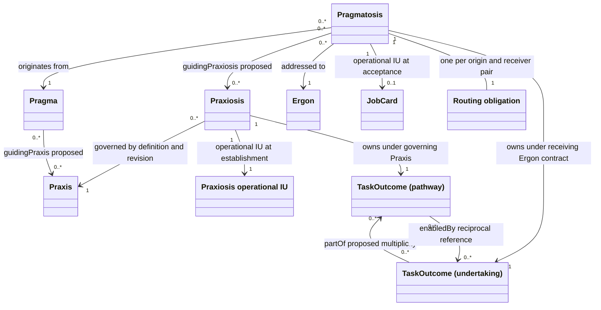
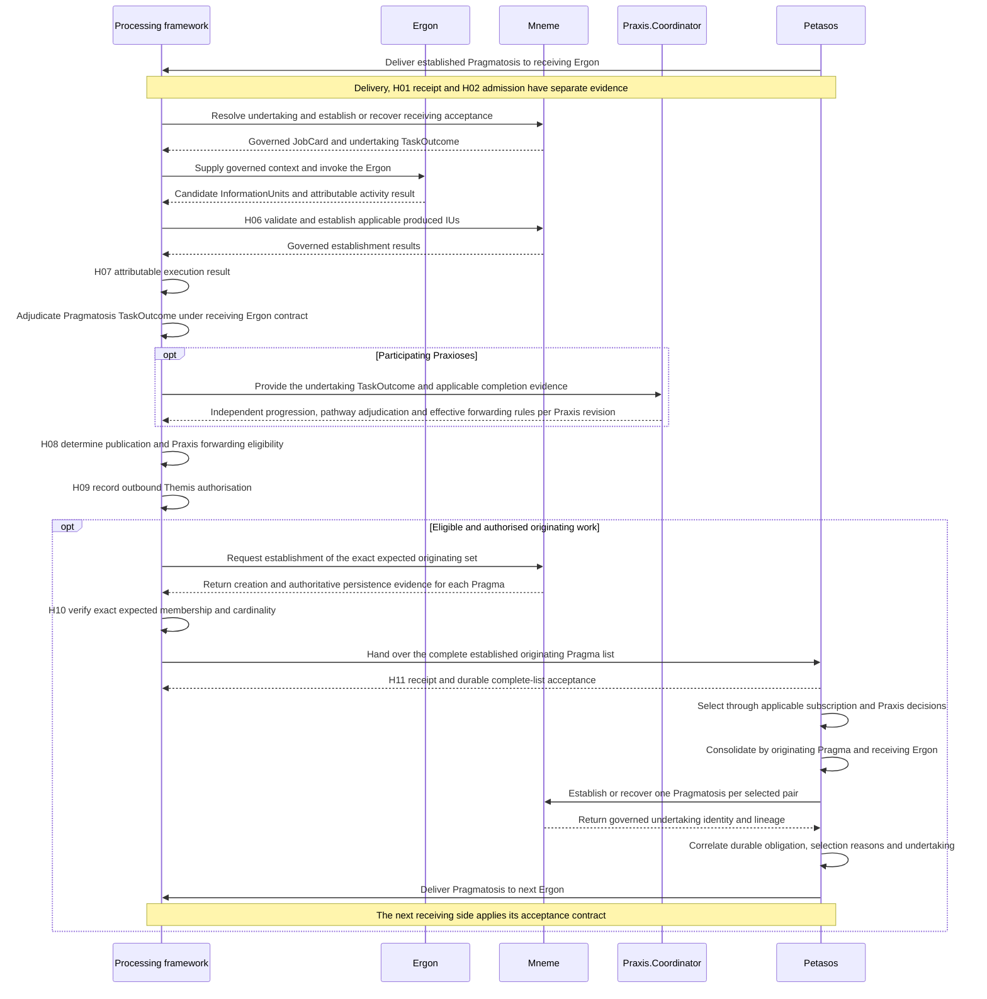
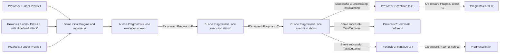
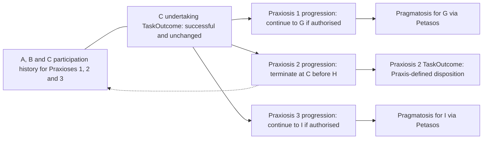
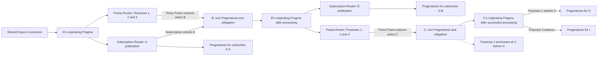
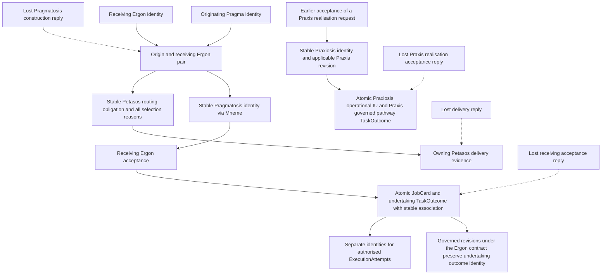

<!-- Copyright (c) 2026 Mark Hunter. SPDX-License-Identifier: GPL-3.0-or-later -->

# Design Review Proposal — Harmonia Undertaking and Execution Framework

| Review field | Value |
| --- | --- |
| Revision | Draft.000.009 |
| Standing | Pending Solution Architect review |
| Prepared by | Codex |
| Solution Architect | Mark Hunter |
| Architecture baseline | 1.1.26 |
| Software development identity | `0.1.0-SNAPSHOT` |
| Source | [Draft.000.008][predecessor] in the `feature/BL-0006-Calliope-Pragma` working tree based on `3c6bce892da0f79bc52b8f380bf4bd92af28d81e` |

## 1. Feature realisation

The framework gives general, Digital Twin and assurance processing common semantics for originating work, realising a particular undertaking, obtaining governed context and recording attributable results. It reuses the accepted **EligibleTaskPublication**, **SubscriptionMatchCorrect**, **RecoveryPreservesTaskLineage**, **SingleSchedulingAuthority** and **Assurance Evidence Correlation** Features. Those Features support the work across publication, routing, execution, recovery and independent assurance. Placement of a shared execution-coordination Feature, if needed after mapping existing Features, is a review matter. [Publication][publication-feature] · [Subscription matching][matching-feature] · [Recovery lineage][lineage] · [Scheduling][scheduler] · [Assurance evidence][assurance-feature]

CORE-004 and PROV-001 support correlation and causation through origin, undertaking, execution and handoff. REQ-FND-005 governs independent assurance. The design preserves immutable input and origin lineage, attributes activity to the applicable operational record, and provides recovery of the one routing obligation per originating Pragma and receiving Ergon across both selection mechanisms. Section 8 gives observable conformance checks. [CORE-004][core004] · [PROV-001][prov001] · [REQ-FND-005][assurance-req]

| Applicable axioms | Consequence for this proposal |
| --- | --- |
| AX-04, AX-18 | The processing framework applies the receiving Ergon's processing contract to the Pragmatosis outcome. The Coordinator applies the governing Praxis to each Praxiosis, which owns its pathway outcome. Petasos owns matching and routing, and Mneme governs access to work information through existing persistence boundaries. |
| AX-05, AX-06, AX-09 | Mneme provides active access and coordination. Mnemosyne establishes durable authority. Recover the Praxiosis operational IU and outcome through the governed information path. Governed IU revisions preserve outcome determinations. Retain independent activity information for its operational purpose and preserve facts needed for recovery and evidence. |
| AX-07, AX-08 | Apply Themis and mandatory IU governance to each applicable eligibility, selection, handoff and execution boundary. Preserve each selection reason and participation basis when several refer to the same obligation. Checkpoints retain applicable Kleio capture and durable handoff, with the existing Dokimasia boundary. |
| AX-10, AX-15, AX-16 | Confirm Praxiosis establishment authoritatively before creating participating undertakings. Resolve common routing obligations by the origin and receiving Ergon pair. Reconcile lost replies against the owning evidence and preserve uncertainty. Retain the basis for intervening pathway decisions. |
| AX-14, AX-17 | Distinguish the Praxis definition, Praxiosis, its operational IU and the Coordinator. Preserve distinct execution results, undertaking outcomes, progression decisions and pathway outcomes. A common routing identity alone establishes no execution compatibility. Submit proposed relationship cardinalities and unresolved sharing conditions for explicit disposition. |

The canonical Principles define each axiom. [Architectural Axioms][axioms]

## 2. Proposal and standing

| Standing in this draft | Content |
| --- | --- |
| Solution Architect clarification for this revision | The processing framework applies the receiving Ergon's processing contract to the one Pragmatosis TaskOutcome. Each guiding Praxiosis independently interprets that outcome under its own Praxis and applicable revision. Differences confined to pathway progression or adjudication do not establish processing incompatibility. [Decision provenance][decisions] |
| Design direction carried forward | Each accepted Praxis realisation establishes a Praxiosis before participant creation, with its own operational IU and TaskOutcome. Undertaking families, acceptance, independent activity records and outcome ownership carry forward. Eligibility precedes creation. Independent subscription and Praxis decisions share one Pragmatosis and routing obligation per originating Pragma and receiving Ergon, with all applicable reasons attributable. The guiding relationships and many-to-many outcome references retain their proposed standing. [Draft.000.008][predecessor] |
| Open | The contract amendments, candidate relationships and unresolved execution-sharing conditions in §§7 and 9 require governed disposition. |

## 3. Design context

The G03 Pragma-family drafts distinguish originating work, undertaking and working information. They leave canonical Task-family correspondence open and use `TaskOutcome` for an actual Ergon execution. The Processing Framework and Checkpoints, accepted with qualifications, places execution, output validation, outcome decision and handoff at distinct stages. This proposal gives each realised undertaking a governed outcome, preserves individual activity attribution and relates participating outcomes to the separate outcome owned by the Praxiosis. Section 7 identifies the accepted and pending provisions that require reconciliation. [Mneme Pragma model][pragma-model] · [Pragmaton model][pragmaton-model] · [Processing Framework §§4.2–4.6][processing] · [G03 decisions][g03]

## 4. Architectural definition

### 4.1 Undertaking hierarchy and information contract

```text
Pragma
├── Pragmatosis
├── Stimulus
│   └── Noesis
└── Keleusma
    └── Dokime
```

The tree expresses conceptual inheritance and the table identifies the architectural relationships across work, operational records and individual activities. A realised undertaking inherits the common work semantics and its domain-specific input semantics. Detailed design owns Java inheritance, interfaces, composition and storage, including any choice to use a shared operational-record superclass. Each operational record has its own domain semantics within the common architectural contract.

| Originating form | Realised undertaking | Governed operational InformationUnit | Independent individual activity |
| --- | --- | --- | --- |
| Pragma | Pragmatosis | JobCard | ExecutionAttempt |
| Stimulus | Noesis | ThoughtProcess | Skepsis |
| Keleusma | Dokime | Tekmerion | Dossier |

| Information | Originating form | Realised undertaking |
| --- | --- | --- |
| Identity | Identifies one occurrence of work. The reusable definition and its applicable revision remain separately referenceable. | Has its own stable identity, lifecycle and lineage. Retry, redelivery and a new attempt preserve that identity. |
| `input()` | References one immutable governed InformationUnit, with its identity and revision. | Inherits `input()` unchanged. It refers to the same immutable InformationUnit at the same revision. Additional governed context, including assurance evidence, is acquired separately. |
| `whereFrom()` | Carries the source information of the originating work. | Inherits `whereFrom()` unchanged from the originating form. |
| Provenance | Identifies issuance or production and the basis for creating the work. | A separate provenance relationship identifies the originating `Pragma`, `Stimulus` or `Keleusma`. Realisation provenance also records the basis for establishing the undertaking. |
| Receiving Ergon identity | The origin may be selected for several receiving Ergons through subscription or Praxis forwarding. | Identify the logical receiving Ergon for a Pragmatosis under §4.7. A particular Ergon execution instance, subscription definition and queue each have separate identity. Specialised paths retain equivalent accountable Behaviour or assurance Ergon attribution under their reviewed admission contracts. |
| `output()` and `outcome()` | Neither operation is present. An origin can give rise to several realised undertakings, each with its own TaskOutcome. Any collective evaluation requires an explicit Praxis or workflow definition. | `output()` contains zero or more governed InformationUnits attributable to the undertaking. `outcome()` exposes the one separately governed `TaskOutcome` owned by the undertaking and created at receiving Ergon acceptance. Its initial disposition is unresolved. |

An observer must be able to distinguish an unaccepted undertaking, an accepted undertaking with an unresolved TaskOutcome, and an undertaking with an adjudicated TaskOutcome. Output attribution preserves the contributing attempt or activity and the applicable IU identity and revision. Governed references and content-free, non-authoritative summaries support access through Mneme under the applicable Themis controls. [Pragma model §§4.1–4.2, 4.6–4.8][pragma-model] · [Governed information and authority][iu-design]

**Execution state** records operational progress. An **execution result** is attributable to the individual activity and remains provisional for undertaking adjudication. The undertaking's **TaskOutcome** records its unresolved or adjudicated disposition. For a Pragmatosis the receiving Ergon's processing contract governs that disposition. The specialised families retain their own applicable contracts. A pathway progression decision controls what happens next, and the Praxiosis owns the overall pathway TaskOutcome described in §4.8. Originating Pragma, Stimulus and Keleusma have no consolidated TaskOutcome. Assurance findings, originating-work disposition, routing or persistence acknowledgements and IU lifecycle state keep their own meanings. Zero subscribers is a valid subscription disposition. Praxis selection retains its own disposition, and undertakings result from the receiving Ergons selected under §4.7. [Existing TaskOutcome Topic][task-outcome] · [G03 PF-03][g03] · [Processing Framework §4.5][processing-status]

### 4.2 Concept Topics

```text
Domain=ICT
.Owner=FHIRFactory
.Standard=Harmonia
.Concept=DataObject
.Concern=Workflow
.Scope:<version>=Tasks
.Entity=<entity>
```

The lines form one ordered Topic path. `Entity` takes exactly one of `Pragma`, `Pragmatosis`, `Stimulus`, `Noesis`, `Keleusma` or `Dokime`. All six Topics are siblings beneath `Tasks`. The conceptual inheritance in §4.1 does not alter Topic ancestry. Version governance applies at the `Tasks` Scope entry and covers the whole family. The Entity entries carry no independent version. `<version>` reserves the position for a reviewed version and allocates no value. Concept classification, the identity of an individual work occurrence, and the revision of its governed information each have their own semantics. Version-sensitive checks use the applicable Topic entry version under the Topic contract. [Topic and TopicMask Final.003 §§1–3][topic-design] · [Architecture-target Topic review][topic-review]

### 4.3 Operational records and common TaskOutcome lifecycle

**JobCard**, **ThoughtProcess** and **Tekmerion** are governed operational InformationUnits accessed through Mneme. Each records operational history, including attributable observations, details and associations appropriate to the family, and retains a stable `TaskOutcomeReference` to the separately governed outcome owned by its realised undertaking. Other governed outcome references follow the applicable domain contract. The applicable processing framework or engine coordinates the work under Praxis. [Processing Framework §§4.4–4.6][processing-workspace] · [Accepted Mneme–Mnemosyne interaction][persist]

**ExecutionAttempt**, **Skepsis** and **Dossier** are independent operational objects associated with their respective operational IUs. Their association has no containment semantics. Their operational information may be transient and retains identity and association sufficient for attribution, correlation and recovery. At processing checkpoints, the governing Praxis and execution framework determine retention, persistence, archival or disposal after applicable AuditEvents have been generated and their required durable handoff has been established. Kleio retains its authoritative AuditEvent responsibility. Activity identity and association remain sufficient for the recovery and evidence obligations that survive the checkpoint. [AX-09][ax09] · [Checkpoint contract][checkpoints] · [Kleio capture authority][kleio-capture]

#### Acceptance, recovery and adjudication

A Pragmatosis is one undertaking addressed to a receiving Ergon. It retains one TaskOutcome regardless of how many Praxioses participate. The processing framework applies the receiving Ergon's processing contract when adjudicating that outcome. The determination records the disposition of the actual undertaking independently of subsequent pathway decisions. Each guiding Praxiosis uses that determination under §4.8. The specialised undertaking contracts in §§4.4–4.5 retain their own scope.

| Event | Governed effect across all three families |
| --- | --- |
| Receiving Ergon accepts the undertaking from Petasos | Atomically establish the operational IU, the realised undertaking's one separately governed `TaskOutcome` in an unresolved state and the IU's stable `TaskOutcomeReference`. Successful acceptance exposes the complete pair and reference as one governed effect. The realised undertaking retains the same pair throughout its lifetime once established. |
| Redelivery, retry or concurrent execution | Resolve the existing operational IU and TaskOutcome by governed identity. Associate each newly recorded activity with the same IU under the applicable family rules. The pair and reference keep their identities. |
| Context loading or processing fails | Record the operational failure in the operational record with the relevant activity attribution. Apply the undertaking's adjudication contract to the existing TaskOutcome. |
| An activity result becomes available | Retain the attributable provisional result and any provisional outputs in their respective contracts. The applicable undertaking contract governs which results contribute and how they are qualified. |
| Framework adjudicates the undertaking | Apply the receiving Ergon's processing contract for a Pragmatosis and the applicable specialised contract for other undertakings. Establish the adjudicated disposition, accepted outputs and attribution atomically at the undertaking boundary. Record authorised changes to determinations through governed InformationUnit revisions under the same TaskOutcome identity, with previous adjudications traceable. Exhaustion of permitted execution attempts requires explicit adjudication, including an unsuccessful outcome where applicable. |

The routing path in §4.7 can establish the undertaking's identity before handoff. The exact correspondence of receiving Ergon acceptance to H01 receipt, H02 admission, Petasos acknowledgements and the specialised ingress boundaries requires review. Contextual loading after acceptance operates with the existing TaskOutcome. If context-loading failures exhaust the permitted attempts, the framework explicitly adjudicates that outcome under the applicable undertaking contract. [Processing Framework §§4.1–4.2][processing] · [Routing Final.001][routing-subscription]

Mneme provides governed access and recovery through Mnemosyne, which establishes authoritative durability, including the pair and its reference. Preserve provenance of the acceptance, participating activities and adjudication through the governed information path. When the effect of acceptance or adjudication is indeterminate, reconcile it through authoritative evidence before retrying or treating the effect as confirmed. The acceptance invariant defines the required visible effect. The persistence mechanism and proof of atomicity remain for review under the existing Mneme–Mnemosyne contract. [Accepted Mneme–Mnemosyne interaction][persist] · [AX-15][ax15]

#### General processing

JobCard remains a Harmonia-governed operational InformationUnit accessed through Mneme. Ponos coordinates general execution and applies the relevant Praxis, including admission and any `DoNotBefore` constraint under the applicable Themis controls. The following JobCard details apply to the general family. The Twin and assurance families define their own activity and concurrency contracts. [Processing Framework §§4.4–4.6][processing-workspace]

| JobCard information | Meaning |
| --- | --- |
| Association to `ExecutionAttempt` | An independent ExecutionAttempt identifies one execution and records framework observations such as Ergon instance identity, execution state, metrics and failures, with attributable execution results. A retry or concurrent execution associates a distinct attempt with the same JobCard. Recovering an observation of existing execution preserves its attempt identity. |
| `JobCard.WorkspaceMinutiae` | Records developer-reported framework information from `Ergon.process()`. Each observation retains attribution to its originating attempt. Competing attempts cannot overwrite one another's observations. Detailed correspondence to `Workspace.Processor.Status`, including its audit lifecycle, remains for review. |

Pragmaton remains the candidate Mneme-managed working-information environment accessed through `Ergon.WorkSpace`. The framework supplies the context for preparation, validation, recovery and close-out. [Pragmaton §§3.7–3.12][pragmaton-workspace] · [Processing Framework §§4.4–4.6][processing-workspace]

### 4.4 Digital Twin processing

`Stimulus` is originating Twin work. `Noesis` is its realised undertaking and carries the Twin-relative input lineage. **ThoughtProcess** holds its governed operational history. Each independent **Skepsis** records an individual consideration associated with ThoughtProcess. The Digital Twin processing framework coordinates considerations and applies the relevant Praxis within the existing Behaviour boundary. The contribution, adjudication and activity contracts remain open. Completion order supplies no default selection rule.

The adjudicated Domain05 Step-B constraints govern this proposal. Each Twin has one input queue for Stimulus and Effector and processes at most one input at a time. Interested Behaviours run sequentially. On the normal path, each loads fresh Twin-relative context after the applicable predecessor's governed save. Preserve the one-Ergo Praxis, same-Twin output queuing and the existing failure and authorised resumption semantics. Whether and how Skepsis may overlap within an admitted Behaviour remains open within these constraints. Adjudicate Twin fan-out, Noesis correspondence to `BehaviourStimulus`, Behaviour interest and input identity, and the separate treatment of `Effector` and `BehaviourEffector`. [DigitalTwin][twin] · [Behaviour][behaviour] · [A4.7 source and deferred details][twin-note] · [G03 PF-01][g03]

### 4.5 Assurance processing

`Keleusma` is the originating assurance request. `Dokime` is its realised undertaking. **Tekmerion** holds its governed operational history. Each independent **Dossier** records an individual assurance activity associated with Tekmerion. The Dokimasia processing framework coordinates assurance work under the applicable Praxis. Dokimasia loads authorised evidence through the governed access boundary, evaluates the applicable criteria and generates attributable outcomes. Criteria may be composite. The applicable basis must identify the subject and relevant criteria and revisions, the evidence used, and how the resulting findings relate to that basis. Detailed coordination and activity semantics remain open. The assurance Ergon chooses its internal evaluation algorithm subject to the approved criteria, evidence and reporting contract.

The Dokime TaskOutcome records the adjudicated disposition of the assurance undertaking. A governed assurance finding produced by that work retains its own meaning and can be carried as an output InformationUnit under its owning contract. A successfully performed evaluation can yield an insufficient-evidence finding. The subject activity owns its own work and outcome and cannot determine its independent assurance. Preserve the finite assurance boundary and the existing self-audit rule for a Dokimasia execution, together with applicable security and evidence obligations. [Independent Assurance acceptance][assurance-acceptance] · [Dokimasia][dokimasia] · [Finite boundary][finite] · [Self-audit boundary][self-audit]

### 4.6 Execution and persistence boundaries

| Concern | Architectural responsibility |
| --- | --- |
| Governed undertaking information | Mneme constructs and manages the six work forms and their version-aware information references. Mnemosyne establishes required durable state via the governed interaction. |
| Governed Praxiosis information | The execution framework accepts the Praxis realisation request. Mneme provides governed access to the Praxiosis operational IU. Mnemosyne establishes authoritative durable state for the operational IU and its corresponding pathway TaskOutcome under §4.8. |
| Execution coordination | Ponos and the applicable specialised processing frameworks or engines coordinate execution. The Coordinator applies Praxis-defined progression, forwarding and pathway adjudication rules to each Praxiosis. |
| InformationUnit outputs | Ergon processing may produce candidate IUs. Governed validation and establishment, applicable release rules and accepted-result attribution determine what can appear in a realised undertaking's output. Returning changes to existing governed information follows the applicable Mneme save contract. |
| Framework-observed execution information | The applicable framework observes execution and records attributable facts in the operational IU and the associated independent activity objects according to their contracts. The general family uses ExecutionAttempt for execution state, metrics and failures. |
| Developer-reported framework details | The processing boundary conveys developer-reported details alongside produced IUs, with attribution to the activity. The general family records these in `JobCard.WorkspaceMinutiae`. Context unloading, checkpointing, recovery and applicable audit use their owning contracts. |
| Undertaking TaskOutcome adjudication | The framework adjudicates the stable Pragmatosis outcome under the receiving Ergon's processing contract. Specialised undertakings retain their applicable adjudication contracts. The operational IU retains the reference, and governed revisions preserve prior determinations and associated attribution under §4.3. |
| Pathway progression and TaskOutcome | Each guiding Praxiosis interprets the undertaking outcome under its governing Praxis and applicable revision. The Coordinator determines progression and applies pathway adjudication under §4.8. The Praxiosis owns the traversal outcome. |
| Praxis-defined policies | Energeia manages the Praxis definition and applicable criteria. Ponos governs interpretation for execution and progression under the existing responsibilities. Specialised policies retain their own Twin and independent assurance constraints. |
| Ergon-specific processing | `Ergon.process()` and its specialised equivalents determine internal business or evaluation logic. The framework governs the exchanged outputs, relevant details and their attribution. |

Mneme/Mnemosyne provide governed access, persistence, recovery and provenance for the undertaking, operational IU and stable TaskOutcome. Their acceptance-time identities and reference require authoritative establishment under §4.3. Apply §4.3 to activity information at processing checkpoints. Local workspace values and incidental diagnostics follow AX-09's ephemeral default. Promote meaningful decision and evidence facts into the applicable governed representations. Access and save preserve Mneme/Mnemosyne authority, revision and acknowledgment semantics. [AX-09][ax09] · [Two-cache decision][cache] · [Lifecycle and operational state][lifecycle] · [Accepted IU development correspondence][bl5]

### 4.7 Destination selection, common realisation and routing recovery

#### Independent destination selection

For an Ergon Egress handover, both Petasos routers select from the applicable originating Pragmas after H10/H11 as described in §4.9. Each retains its own decision authority, selection evidence and applicable Themis controls.

- **Subscription-Router.** Petasos evaluates the applicable subscriptions for publication-eligible originating work. It evaluates subscriptions for each Ergon until the first successful match, then skips the remaining subscriptions for that Ergon. The result identifies distinct subscribing Ergons. Record the successful subscription definition and revision, matching basis and intended destination for each selected Ergon. The ordering, destination equivalence and treatment of denied or indeterminate evaluations remain for review. [Publication and subscription §4.2][publication-selection] · [Routing Final.001 §3][routing-subscription]
- **Praxis-Router.** Petasos uses the routing requirements established by the governing Praxis and its Coordinator under Ponos's existing Praxis evaluation responsibility. It selects receiving Ergons for forwarding-eligible originating work independently of subscription matching. Selection is confined to the applicable Praxiosis and its defined pathway. Record the Praxiosis identity, applicable Praxis revision, triggering progression decision and rule basis for each selected Ergon. [Routing Final.001 §4][routing-praxis] · [Praxis and Praxiosis][praxiosis-model]

#### Common undertaking establishment and delivery

For each selected **(Originating Pragma identity, Receiving Ergon identity)** pair, Petasos requests establishment through Mneme. Exactly one `Pragmatosis` is established or recovered with provenance to the originating Pragma, and Petasos establishes or recovers exactly one routing obligation for that pair. The uniqueness scope applies across subscription and Praxis forwarding. If both mechanisms select the same pair, Petasos consolidates their selections into that one undertaking and obligation, with both reasons independently attributable. An originating Pragma may produce several Pragmatoses for distinct receiving Ergons, regardless of selection mechanism. A confirmed empty selection is recorded for the applicable mechanism. If all applicable selections are confirmed empty, the originating Pragma has zero resulting undertakings and routing obligations.

Petasos delivers the established Pragmatosis through the common delivery mechanism. The receiving Ergon resolves the undertaking through Mneme and the receiving-side operational IU and TaskOutcome are created under the existing acceptance contract in §4.3. The durable routing obligation, delivery attempts and evidence of receiving Ergon acceptance retain their distinct meanings. [Routing Final.001 common strategy][routing] · [Petasos–Mneme handoff][petasos-mneme-identity]

#### Durable decisions and recovery

Preserve each complete selection decision and its correspondence to the durable routing obligations before fulfilling them under the applicable routing contract. The shared obligation carries the origin and receiving Ergon pair, the established undertaking reference when available, the intended destination and correspondence to every applicable selection reason. Recover the original decision basis and known outcomes, including when another reason resolves to an existing obligation. Reconcile a lost or indeterminate construction reply through authoritative Mneme/Mnemosyne state. Reconcile a lost or indeterminate delivery reply through the owning Petasos evidence. Preserve separately attributable construction, routing and delivery acknowledgements and evidence of Ergon admission, and retain confirmed progress for unrelated obligations. The sequencing and evidence for concurrent or later selection decisions remain for review under §9. [Routing Final.001 §§5–6][routing-recovery] · [Minimum routing evidence][routing-evidence] · [PF-08 disposition][routing-pf08]

**Example for review.** For one originating Pragma, the Subscription-Router selects Ergons X and Y and skips X's remaining subscriptions after the first successful match. The Praxis-Router independently selects X and Z for the applicable Praxiosis. Petasos establishes three undertakings and three obligations. X's obligation retains its successful subscription and its Praxis selection as two distinct reasons. If delivery to X is indeterminate, recovery reconciles X's existing obligation and preserves any confirmed delivery to Y or Z.

### 4.8 Praxis, Praxiosis and pathway coordination

#### Definition and realisation

**Praxis** is the reusable definition of a pathway. It defines its participating intermediaries, progression rules, forwarding rules and pathway outcome adjudication. **Praxiosis** is one individual realisation or traversal of a defined Praxis. It has its own stable identity and lifecycle, references its governing Praxis definition and applicable revision, and is associated with its participating realised undertakings and their TaskOutcomes. Each Praxiosis owns one TaskOutcome representing the overall pathway outcome as defined by its governing Praxis.

Every accepted request to realise a Praxis establishes a Praxiosis, including a Praxis involving a single Ergon. The same establishment, participation and adjudication rules apply regardless of participant count. The Praxiosis operational IU and TaskOutcome are distinct from those of each participating undertaking established under §4.3. In a single-Ergon Praxis, both TaskOutcomes exist and retain their respective ownership and adjudication semantics. Collective evaluation requires an explicit Praxis or workflow definition.

#### Governed operational information and recovery

Each Praxiosis has exactly one governed operational InformationUnit accessed through Mneme. It records pathway progression, participating undertakings, coordination decisions and operational history. Its architectural name is deliberately unresolved.

The Praxiosis is established when the execution framework accepts the request to realise the governing Praxis, before the first participating undertaking is created. At acceptance, assign the stable Praxiosis identity and record the governing Praxis definition and applicable revision. Atomically establish the governed operational IU, the Praxiosis TaskOutcome in its unresolved state and the stable relationship between them. Confirm establishment only when the complete pair and its relationship are authoritatively established. No participating TaskOutcomes are required at acceptance. A Praxiosis with zero participating undertakings remains an established realisation, and the governing Praxis determines its eventual disposition.

Apply the common lifecycle and recovery principles in §4.3. After interruption or an uncertain reply, reconcile the effect through authoritative evidence before retrying. Recover an established Praxiosis through Mneme and Mnemosyne with the same Praxiosis identity, pair identities and relationship. Governed IU revisions preserve these identities and their relationship and keep earlier determinations traceable. Section 9 records the open mapping of this acceptance boundary to existing contracts. [Accepted Mneme–Mnemosyne interaction][persist] · [Governed IU revisions][iu-design] · [AX-15][ax15]

#### Participation and TaskOutcome relationships

| Source | Relationship | Referent |
| --- | --- | --- |
| Participating undertaking's TaskOutcome | `partOf` | Praxiosis TaskOutcome |
| Praxiosis TaskOutcome | `enabledBy` | Participating undertakings' TaskOutcomes |

Establish these governed references as subsequently created undertakings acquire their TaskOutcomes. They may be added incrementally as the Praxiosis progresses. Authoritative recovery preserves the identities of existing outcomes and references and prevents their duplication. The persistence and recovery contract for interrupted reference establishment requires review under §9.

The table describes the pair of references for one participation. Section 4.10 proposes multiplicity across separate Praxioses when they share an undertaking. Section 9 retains the cardinality and association authority for review.

#### Coordination and adjudication

`Praxis.Coordinator` independently interprets the Pragmatosis TaskOutcome for each guiding Praxiosis under that traversal's governing Praxis definition and applicable revision. At the completion checkpoint of each participating Ergon, the Coordinator applies the applicable progression, forwarding and pathway adjudication rules. It may continue, redirect, suspend or prematurely terminate the traversal. Different Praxioses may reach different decisions from the same undertaking outcome. The disposition of the undertaking remains governed by the receiving Ergon's processing contract.

Each Praxiosis owns its own pathway TaskOutcome, and its operational IU records the traversal under the governed information responsibilities in §4.6. Early termination can satisfy the governing Praxis and constitute a successful pathway outcome. Praxis can permit intermediate adjudications and authorised changes to the Praxiosis determination, with no required single final adjudication event. Preserve separate attribution of the individual execution result, the undertaking TaskOutcome, each progression decision and each pathway TaskOutcome.

Energeia retains management of the Praxis definition. The Coordinator denotes a responsibility of the execution framework applying that definition. Reconcile its general placement with Ponos's Praxis processing responsibility and the existing Praxis.Agent and Praxis.Server provisions. The exact allocation, including its specialised framework correspondence, requires review. [Praxis][canonical-praxis] · [Ponos][canonical-ponos] · [Processing Framework §4.6][processing-coordination]

### 4.9 Publishing and Praxis forwarding

| Rule set | Owner | Purpose |
| --- | --- | --- |
| `PublishingRules` | Ergon developer | Primary criteria for publishing eligible Ergon outputs |
| `PraxisForwardingRules` | Praxis developer | Criteria for forwarding eligible information within the defined Praxis pathway. `Praxis.Coordinator` manages the effective rules during execution. |

Determine publishing and Praxis forwarding eligibility before originating Pragma creation. Either rule set can establish eligibility for the applicable action (`Eligible = PublishingRules OR PraxisForwardingRules`). A rejection by either rule set leaves an action authorised by the other rule set eligible. The resulting actions remain subject to Themis authorisation and mandatory InformationUnit governance. Record the action and applicable rule basis. Subscriber publication uses its publication eligibility and subscription selection. Praxis forwarding uses its applicable eligibility and the governing Praxis routing requirements under §4.7.

A Praxis pathway runs between defined points through known intermediaries. `PraxisForwardingRules` apply only to information belonging to that pathway. WorkSpace accessibility alone establishes no pathway membership. While coordinating a Praxiosis, `Praxis.Coordinator` may establish or dynamically adjust its effective `PraxisForwardingRules` under the governing Praxis, including in response to preceding TaskOutcomes. The Ergon developer and Praxis developer retain their respective rule ownership.

For Ergon Egress, reconcile H08 with the independently attributable rule decisions. Preserve applicable dead-task blocking and H09 outbound Themis enforcement. At H10 Ergon Egress determines the expected set from the eligible and authorised work and requests originating Pragma creation through Mneme's PragmaFactory. H10 success requires authoritative establishment of every expected member and proof of exact membership and cardinality. At H11 Petasos durably accepts routing responsibility for the entire established list on an all-or-nothing basis. Incomplete or indeterminate establishment or list acceptance withholds confirmed success at the affected boundary. Keep H10 creation and persistence, H11 receipt and durable acceptance, the two downstream selections, undertaking establishment, queue acceptance, delivery and execution admission separately attributable. The H08–H11 representation, including how each originating Pragma retains its applicable action basis for the downstream routers, requires the amendments in §§7.2 and 9. [Egress stages][processing] · [H10 originating work][routing-egress] · [H11 complete-list acceptance][routing-intake] · [Pragma output and continuation][canonical-pragma]

Checkpoint evidence identifies the action, each applicable rule basis and any Coordinator-directed change. For Praxis forwarding, correlate the eligibility and subsequent selection to the applicable Praxiosis, governing Praxis revision and progression decision. Keep eligibility, the Themis determination, IU governance and routing or handoff evidence independently attributable. Preserve the distinction between a known rejection and an indeterminate evaluation or forwarding effect under the applicable recovery contract. [Checkpoint evidence][checkpoints] · [AX-15][ax15]

### 4.10 Conceptual responsibilities and information relationships

| Concept | Role in the lifecycle |
| --- | --- |
| Praxis | Reusable processing pathway definition, including progression, forwarding and pathway adjudication rules. Energeia manages the definition. |
| Praxiosis | One realisation of a Praxis at an applicable revision, with independent progression, a governed operational IU and its own overall TaskOutcome. |
| Ergon | Reusable processing function. The logical receiving Ergon identifies the function for an undertaking and its processing contract governs the Pragmatosis TaskOutcome. An executing instance performs the activity and supplies its attributable result. |
| Pragma | Originating work. In the egress lifecycle, Ergon Egress requests its establishment through Mneme for eligible and authorised downstream processing. Its input references a governed IU at the applicable revision. |
| Pragmatosis | One realised undertaking directed to one receiving Ergon, with provenance to its originating Pragma. It can participate in several Praxioses and owns one undertaking TaskOutcome at receiving acceptance. |
| Petasos | Makes independent subscription and Praxis destination selections under §4.7 and consolidates their obligations for the same origin and receiver. Manages routing, delivery and transport evidence. |
| Praxis.Coordinator | Interprets the undertaking TaskOutcome for each Praxiosis under its governing definition and revision. Applies the traversal's progression, forwarding and adjudication rules. |
| Mneme | Provides governed work establishment, access, identity reconciliation and recovery. Mnemosyne establishes authoritative durable state through the governed interaction. |
| TaskOutcome | A separately governed outcome owned by a realised undertaking or a Praxiosis at its respective acceptance boundary. The receiving Ergon's contract governs the Pragmatosis outcome. The applicable Praxis governs the Praxiosis outcome. |

The proposed guiding relationships use the following conceptual notation.

```text
Pragma.guidingPraxis()          // Set<Praxis>
Pragmatosis.guidingPraxiosis()  // Set<Praxiosis>
```

| Relationship | Cardinality and provenance |
| --- | --- |
| Pragma → guiding Praxis | Proposed `0..*` definitions per Pragma and `0..*` originating Pragmas per definition. A reference identifies a relevant definition for the originating work, with applicable revision correspondence in the governing evidence. A subscription-only origin can have an empty set. These references provide definition context. Selection evidence separately establishes actual traversal, eligibility and authority. |
| Pragmatosis → guiding Praxiosis | Proposed `0..*` Praxioses per undertaking and `0..*` participating undertakings per Praxiosis. Each association identifies the specific traversal and is attributable to its governing revision, originating work, receiving Ergon and applicable Praxis selection reason. Retain the association as participation history, including after termination or divergence. Current progression and forwarding decisions belong to the applicable Praxiosis. Execution permission and attempt count follow their own governing contracts. |
| Pragmatosis → originating Pragma and receiving Ergon | `1` origin and `1` logical receiving Ergon per Pragmatosis. An origin and an Ergon can each relate to `0..*` undertakings. For each selected pair, §4.7 establishes or recovers exactly one Pragmatosis and one obligation. The origin relationship is distinct from inherited `whereFrom()`. |
| Praxiosis → governing Praxis | `1` definition at its applicable revision per Praxiosis, with `0..*` independent Praxioses per definition. Retain the revision used to establish the traversal and attribute subsequent decisions to their applicable basis. |
| Praxiosis → participating undertaking TaskOutcomes | Proposed `0..*` outcome references through its participation associations and its own TaskOutcome's `enabledBy` references. An established Praxiosis can have zero participants. Retain the identity and applicable revision of each contributing outcome in the governed evidence. |
| Undertaking TaskOutcome → Praxiosis TaskOutcomes | Proposed `0..*` `partOf` references. Each target is a separate outcome owned by an associated Praxiosis. The proposal extends the single-target wording of the existing relationship to allow one undertaking outcome to be considered in several traversals. |
| Praxiosis TaskOutcome → undertaking TaskOutcomes | `0..*` `enabledBy` references, established as outcomes take part under §4.8. The proposed inverse permits one undertaking outcome to contribute to several traversal outcomes. Each governing Praxis interprets that contribution for its own progression and adjudication. The receiving Ergon's contract remains the basis for the referenced Pragmatosis outcome. |

**Diagram 1. Conceptual relationships.** Both TaskOutcome roles use the same architectural concept. The routing pair shows confirmed establishment. The `0..1` endpoints on a Pragmatosis's JobCard and TaskOutcome show the state before and after receiving acceptance. Both become established together and each has cardinality **1** after acceptance. The Praxiosis pair has cardinality **1** each from establishment. The diagram labels the proposed associations and outcome multiplicities.



The guiding names label conceptual references for review. Define their authority, version correspondence, assertion timing and reconciliation with `partOf` and `enabledBy` under §9 before selecting a Java representation. [Praxis][canonical-praxis] · [Pragma][canonical-pragma] · [TaskOutcome Topic][task-outcome]

### 4.11 Processing lifecycle

The lifecycle below follows one general Pragma-family undertaking from delivery to onward work. If the undertaking participates in a Praxiosis, the applicable Praxiosis already exists under §4.8. The receiving side uses the same undertaking lifecycle for both Petasos selection mechanisms. Each repetition still requires its own governed receiving acceptance.

| Stage | Contract and evidence boundary |
| --- | --- |
| 1. Delivery and receiving acceptance | Petasos delivers the established Pragmatosis for the receiving Ergon. The framework resolves that identity through Mneme. H01 records receipt and H02 records Themis-governed admission. Receiving acceptance has the separate governed effect in §4.3. Its exact correspondence to H01, H02 and acknowledgements awaits review. |
| 2. Operational IU and outcome | Receiving acceptance atomically establishes the JobCard and the undertaking's unresolved TaskOutcome with their stable relationship. A recovered acceptance resolves the same pair. It preserves established determinations and the evidence of permitted attempts. |
| 3. Processing and output validation | The framework loads governed context and invokes the receiving Ergon. Processing produces candidate IUs and attributable activity observations. H05 carries the Egress Pragma and context into egress. H06 records validation and authoritative establishment of applicable produced IUs. The Egress Pragma supplied at H05 and the new originating Pragmas at H10 retain separate roles and identities. |
| 4. Execution result, undertaking adjudication and progression | H07 records the attributable Ergon execution result under the processing framework. The framework applies the receiving Ergon's contract to the Pragmatosis TaskOutcome under §4.3. At the applicable completion checkpoint the Coordinator interprets that outcome separately for each participating Praxiosis under its governing Praxis and revision. Each progression decision can supply a forwarding basis for that traversal. |
| 5. Eligibility and security | H08 records the applicable decisions from `PublishingRules` and `PraxisForwardingRules` before creating originating work, preserving independent rule authority and applicable dead-task blocking. H09 records outbound Themis authorisation. Applicable IU governance remains binding. |
| 6. Originating-work establishment | Ergon Egress requests governed originating Pragma creation through Mneme. H10 confirms authoritative establishment of each member of the exact expected set and its cardinality. |
| 7. Routing acceptance and selection | At H11 Petasos accepts durable responsibility for the complete established list on an all-or-nothing basis. Receipt and durable acceptance are distinct. The Subscription-Router and Praxis-Router then make their applicable destination decisions independently. |
| 8. Consolidation and undertaking establishment | Petasos consolidates results for each originating Pragma and receiving Ergon pair, including selection reasons from different Praxioses and from Pub/Sub. Petasos requests establishment or recovery of that pair's Pragmatosis through Mneme and retains the durable obligation and its selection evidence under §4.7. |
| 9. Fulfilment and repetition | Petasos fulfils the obligation by delivering the established undertaking. Queue acceptance, delivery and downstream execution admission each retain separate evidence. The lifecycle repeats at the next receiving Ergon. |

**Diagram 2. Processing lifecycle.** The Ergon and framework lifelines denote roles reused at the next receiving boundary. The diagram shows successful progression for an eligible and authorised originating set. It leaves the detailed checkpoint binding of receiving acceptance open. [Processing checkpoints][processing] · [H10][routing-egress] · [H11][routing-intake]



### 4.12 Shared processing, progression and termination

```text
Praxis 1: A → B → C → G
Praxis 2: A → B → C → H
Praxis 3: A → B → C → I
```

Assume three requests have been accepted, producing Praxioses 1, 2 and 3 under their respective Praxis definitions. For this example, the three paths start with the same originating Pragma for Ergon A, and the inputs, Ergon processing conditions and authorisations allow a common execution at each of A, B and C. This is an example premise. Section 9 records the unresolved criteria for establishing it in operation.

At A the three Praxis selection reasons refer to one origin and receiving Ergon pair. Petasos establishes or recovers one Pragmatosis for A and retains all three reasons on its obligation. A processes that undertaking and produces one onward originating Pragma in this example. The independently made selections of B for that origin again resolve to one undertaking for B. B's onward Pragma similarly resolves to one undertaking for C. At each of A, B and C a single execution is shown. Its undertaking has one JobCard and one undertaking TaskOutcome, irrespective of how many Praxioses reference it. Permitted attempts remain governed by §4.3.

At C, one execution succeeds. The processing framework adjudicates the C Pragmatosis TaskOutcome as successful under C's processing contract. The Coordinator interprets that same outcome separately for each Praxiosis under its governing Praxis and applicable revision. Praxiosis 1 continues to G, Praxiosis 2 terminates at C under its own Praxis, and Praxiosis 3 continues to I. H remains the defined next Ergon in Praxis 2 if progression were to continue. Petasos establishes one Pragmatosis each for G and I when the onward originating work is eligible and authorised under §§4.7 and 4.9. The single-pair rule still consolidates any overlapping selection for the same origin and receiver, preserving each applicable reason.

**Diagram 3. Shared pathway.** Each incoming participation arrow represents a reason for one initial origin and A pair. Each of A, B and C shows the common undertaking and one compatible execution. The per-traversal decisions at C use one successful C undertaking outcome.



An execution result describes the activity observed in one attempt. C's undertaking TaskOutcome records C's disposition under its processing contract. The Coordinator's progression decision determines what a particular traversal does next. The separately owned Praxiosis TaskOutcome records the traversal disposition. Under the proposed multiplicity in §4.10, each traversal's `enabledBy` can reference the same C undertaking TaskOutcome, which in turn can reference their separate TaskOutcomes through `partOf`. Each governing Praxis determines how that contribution affects its pathway outcome. C's TaskOutcome and successful determination remain unchanged by the three progression decisions.

Praxiosis 2's governing Praxis determines the disposition recorded in its TaskOutcome, including success if its criteria are met. Its forwarding ends at C and supplies no selection for H under that traversal. Praxioses 1 and 3 continue to G and I subject to their own criteria and authorisations. The established A, B and C undertakings and their outcome identities remain stable. Their historical participation in Praxiosis 2 and the associated outcome references remain attributable after termination.

**Diagram 4. Termination and divergence.** The same C undertaking contributes evidence to each traversal. The continuing paths still pass through pre-creation eligibility and governed selection and routing.



### 4.13 Pub/Sub alongside the three pathways

In the same example, assume A and B each produce an output that qualifies for both actions under §4.9, and the eligible and authorised egress set contains one originating Pragma from A and one from B. Subscriber Ergon S-A is independently interested in A's output. Subscriber Ergon S-B is independently interested in B's output. Also assume B matches an independent subscription for A's originating Pragma, so B is selected through both mechanisms.

- **A's originating Pragma.** The Praxis-Router selects B for Praxioses 1, 2 and 3. The Subscription-Router selects B and S-A, applying the first successful match per Ergon. Petasos establishes one Pragmatosis and one obligation for B, keeping the successful subscription reason and all three Praxis reasons. S-A has its own undertaking and obligation.
- **B's originating Pragma.** The Praxis-Router selects C for the three continuing Praxioses. The Subscription-Router selects S-B independently. C and S-B each receive their own undertaking. The continuation from C follows §4.12.

The Ergon's `PublishingRules` determine publication eligibility. The Praxis developer's `PraxisForwardingRules`, managed during execution by the Coordinator, determine applicable pathway forwarding eligibility. A rejection on either basis leaves the other eligible action intact, subject to Themis and IU governance. The Praxiosis associations preserve traversal evidence. They leave publication tied to actual producing activity, eligible originating work and the subscription decision. The number of associated Praxioses by itself does not multiply publication or delivery obligations.

The uniqueness rule is `(Originating Pragma identity, Receiving Ergon identity) → one Pragmatosis`. It is a work-identity rule across router and Praxis selection reasons. Different origins keep their own identities even when they reference equivalent content and reach the same Ergon. Equivalent content provides no authority for automatic deduplication or shared execution.

**Diagram 5. Pub/Sub coexistence.** The paths show authoritatively established originating work and the applicable downstream reasons. The converging arrows into B refer to the same pair. The subscription and Praxis decisions remain independently attributable.



### 4.14 Identity, recovery and unresolved execution-sharing conditions

Recovery starts with the owning evidence for the affected operation. For a lost originating-work reply, recover authoritative establishment through Mneme/Mnemosyne and reconcile the exact H10 set. For a lost list acceptance or delivery reply, establish the corresponding H11 or Petasos delivery effect separately. For a lost Pragmatosis construction reply, resolve the same origin and receiver pair through Mneme. Petasos recovers the existing obligation and the original selection reasons and reconciles the delivery evidence independently. A repeated delivery supplies neither execution authorisation nor a result of an earlier execution. Once the Ergon acceptance is established, recover the associated JobCard and undertaking TaskOutcome as a pair. Any separately authorised attempt has its own identity and remains associated with that JobCard. Governed outcome revisions preserve the outcome's identity and earlier determinations. [Mneme–Mnemosyne interaction][persist] · [Routing recovery][routing-recovery] · [AX-15][ax15]

**Diagram 6. Stable identities and owning recovery evidence.** The acceptance effects at the Praxiosis and Pragmatosis boundaries remain distinct. The dotted paths indicate reconciliation or authorised reuse of the existing identity.



The accepted identity rule identifies the undertaking and routing obligation for a selected pair. Sharing one execution still requires evidence that the requirements of the actual Ergon undertaking are compatible. Each guiding Praxiosis can apply different rules for progression or pathway adjudication to the same undertaking outcome. Such differences by themselves do not establish processing incompatibility. A difference matters for execution compatibility when it changes the input, context, authority, required effect or another requirement of the actual undertaking. The illustration in §4.12 assumes compatibility. The following conditions require Solution Architect disposition.

| Condition | Unresolved architectural treatment |
| --- | --- |
| Inputs and context | Establish which governed input identity, immutable revision and additional Context requirements must agree, and how to handle differences in permitted or required context. |
| Execution conditions | Establish compatibility of admission conditions, timing constraints such as `DoNotBefore`, permitted retries and other requirements imposed on the actual Ergon processing. Determine the responsible authority and the boundary at which it assesses compatibility. |
| Security and accountability | Determine whether Themis permits one execution and subsequent disclosure for every applicable purpose, identity and policy basis. Preserve independent authorisation and evidence for each reason and each protected boundary. |
| Definitions and revisions | Determine how to establish the applicable receiving Ergon processing contract and revision and how to compare governed input and context revisions. Assess requirements from a Praxis revision or Coordinator change that affect this undertaking. Each Praxiosis retains its applicable revision for its own progression and adjudication. |
| Side effects | Establish when a single attributable effect can satisfy several pathways, including the relevant durability, retry and evidence conditions. Preserve uncertainty about effects and attribution where proof is incomplete. |
| Result and effect evidence | Establish what evidence identifies the receiving Ergon contract applied, the accepted result and the effects attributable to each participation. Each Praxiosis uses that evidence for interpretation under its own criteria. |

Incompatible requirements for the actual undertaking constitute a material design conflict when several selection reasons address the same origin and receiver. The identity rule still gives one undertaking and obligation for that pair. The disposition of incompatible or unestablished execution conditions remains open. Establish compatibility and permission to execute through their applicable governed evidence. Section 9 records this conflict and the proposed cardinality and relationship authority for review. [AX-15][ax15] · [Architecture Governance][governance]

## 5. Detailed design delegated to the implementing team

Detailed design selects Java inheritance, interfaces, composition, persistence implementation and coordination mechanisms within the reviewed contracts. It also specifies provisional output staging, contention handling, attempt observation, composite criteria evaluation and internal processing algorithms. The architectural review establishes the observable semantics and owning boundaries first.

## 6. Evidence and rationale

The originating Pragma and receiving Ergon pair ties both selection reasons to the same undertaking and obligation during handoff recovery. The Praxiosis identity and governing Praxis revision tie acceptance, progression and adjudication evidence to one traversal, including one that has no participants. Stable operational IU, activity and TaskOutcome identities preserve attribution through recovery. Governed revisions preserve previous determinations, and Praxiosis associations and outcome references identify the undertakings that participated. Rule and checkpoint evidence preserves the separate conclusions for eligibility, Themis authorisation, IU governance and delivery. Mneme/Mnemosyne, the execution frameworks, Kleio and Petasos retain their respective evidence boundaries. [Task Topic][task-topic] · [Routing reconciliation][routing-recovery] · [Processing Framework][processing]

The matrix below distinguishes recorded Solution Architect dispositions and canonical element standing from candidate correspondence and historical discovery. The repository's source succession governs use of wrapped legacy sections. [Architecture Governance][governance] · [A4.7 source succession][twin-note]

## 7. Reconciliation matrix

### 7.1 Existing Task architecture correspondence

The Solution Architect established the left-to-right review correspondence in Draft.000.002. Draft.000.005 identified Praxiosis as the pathway TaskOutcome owner. Draft.000.006 established that outcome at accepted Praxis realisation, including for single-Ergon Praxis. Draft.000.008 proposed references from one undertaking outcome to the outcomes of several participating Praxioses. Draft.000.009 clarifies the respective adjudication bases. [Earlier decision provenance][prior-task-correspondence] · [Draft.000.008 decisions][predecessor-decisions]

| Existing | Earlier design correspondence | Required amendment or disposition |
| --- | --- | --- |
| ActionableTask | Pragma | Review the originating-work role. Pragma, Stimulus and Keleusma own no consolidated TaskOutcome. Review the representation of any separate originating-work disposition. |
| FulfillmentTask | Pragmatosis | The accepted TaskFulfillment provision denies independent TaskOutcome ownership. Review amendment for the realised role, which owns exactly one outcome in each family. |
| TaskOutcome | Accepted Undertaking Outcome | The accepted Topic assigns the outcome and its governing policy to the ActionableTask and describes references to FulfillmentTasks. G03 also uses the name for an Ergon-instance execution result. Amend the Topic through governed review to represent the Pragmatosis-owned outcome governed by the receiving Ergon's processing contract and the separate Praxiosis-owned outcome governed by its Praxis revision, including both outcomes for a single-Ergon Praxis. The Praxiosis outcome exists from acceptance, initially unresolved and with no participating outcome required. Review the proposed `0..*` `partOf` targets per undertaking outcome, the corresponding inverse for `enabledBy` and each association's historical evidence. Preserve the existing exclusion of recursive containment. |
| OutcomeConcurrency | Distinct Execution and Outcome Capture Rule | `FirstToFinish`, `AssignedToFinish` and `Aggregate` govern FulfillmentTask participation in resolving the ActionableTask outcome. Review which existing semantics, if any, carry into explicit Praxis or workflow participation and qualification. Keep execution concurrency, actual activity capture and outcome participation distinct. |
| OutputRules | Distinct Outcome Adjudication and Qualification Rules | `Direct`, `Collection` and `Derived` govern composition of ActionableTask output. Review their applicability to undertaking or explicit collective evaluation. Preserve their orthogonality to participation, and distinguish output composition and qualification from publishing and Praxis forwarding eligibility. |

The accepted Topic meanings and pending G03 usage retain their recorded standing until adjudicated. The existing reservation of TaskOutcome runtime identity and lifecycle leaves the detailed mechanism open and supplies no authority to change the adjudicated ownership or policy modes. [TaskDefinition][task-definition] · [Task and its controls][task-topic] · [TaskFulfillment][task-fulfillment] · [TaskOutcome][task-outcome] · [OutcomeConcurrency Topic][outcome-concurrency] · [OutputRules Topic][output-rules] · [G03 PF-03][g03]

### 7.2 Affected provisions and required follow-up

| Source and exact provision | Recorded standing | Reconciliation for Solution Architect review |
| --- | --- | --- |
| **Undertaking and Execution Framework Draft.000.002** §§4.3, 4.4 and 4.6, **Draft.000.003** §§4.1, 4.3–4.6, **Draft.000.004** §§4.3, 4.8–4.9, **Draft.000.005** §4.8 and **Draft.000.006** §§4.7–4.9. [Earlier JobCard and lifecycle][predecessor-jobcard] · [Earlier ThoughtProcess][predecessor-twin] · [Earlier execution boundary][predecessor-boundary] · [Draft.000.006][draft-000-006] | Prior proposals preserved as review history. | Carry forward the undertaking acceptance and independent activity boundaries and the accepted Praxiosis establishment order. Extend Draft.000.006's origin and subscriber pair to the origin and receiving Ergon pair shared by both selection mechanisms. Apply both eligibility rule sets before originating-work creation. |
| **Undertaking and Execution Framework Draft.000.008** §§4.3, 4.8 and 4.10–4.14, the **Ergon, Praxis and Ponos** canonical elements and the **TaskOutcome** Topic. [Immediate predecessor][predecessor] · [Ergon][canonical-ergon] · [Praxis][canonical-praxis] · [Ponos][canonical-ponos] · [TaskOutcome][task-outcome] | Draft.000.008 is a design proposal. The referenced canonical elements and accepted Topic provisions retain their recorded standing. | **Undertaking outcome authority and execution compatibility.** Record the receiving Ergon's processing contract as the basis for the one Pragmatosis TaskOutcome and the governing Praxis revision as the basis for each traversal's interpretation, progression and adjudication. Map the processing contract and its attribution to the existing Ergon and Ponos responsibilities. Disposition incompatible or unestablished requirements for the actual undertaking under the existing identity rule. Review the guiding associations, proposed many-to-many outcome references and historical participation separately. |
| **Petasos Routing and Reconciliation Final.001** §§1 and 1.3, §3 `SubscriberSet` and `SubscriptionIdEvent`, §§5–6 and 7.1–8. [§1][routing] · [§3][routing-subscription] · [§5][routing-recovery] · [§6][routing-evidence] · [§7.1][routing-pf08] · [§8][routing-tests] | Offline design accepted with qualifications under G03 / DR-12. [Disposition][routing-disposition] | **Obligation identity conflict.** Section 3 creates an obligation per matching subscription. Section 1.3 retains separate subscription and Praxis obligations. Amend these provisions for first successful subscription match per Ergon and one cross-router obligation per originating Pragma and receiving Ergon. Preserve independent selection decisions, both reasons when they coincide, and PF-08 durable decision, coordination and recovery guarantees. Reconcile correspondence to the current routing sets and work, destination and handoff evidence under §§5–6. |
| **Pragma Publication and Subscription Draft.000.003** §2, PS-02–PS-07 and PS-08–PS-12, §§5–7. [Output and publication][publication-output] · [PS-08–PS-12][publication-selection] · [§5][publication-reliability] | Pending G03 candidate carrying issued allocations. [DR-12][g03-review] | Map the PublishingMask, its `ALLOW_ALL` default and Ponos/Mneme evaluation allocation to the independently owned pre-creation rules. Revise the PS-04 consequence to distinguish loss of publication eligibility from eligibility for Praxis forwarding. Apply first-match selection and the shared pair identity rather than the per-match realisation and replay rule. Retain successful-match provenance, valid zero matches, and separate handoff and execution confirmation. Amend the Ergon-instance TaskOutcome terminology in §5. |
| **Interaction Petasos–Mneme Draft.000.004** §§1.2, 4.1–4.4 and 8, especially step 2 in §4.2 and the multiple matching subscriptions row in §4.4. [§1.2][petasos-mneme-req] · [§4.2][petasos-mneme-identity] · [§4.4][petasos-mneme-retry] · [§8][petasos-mneme-tests] | Pending G03 companion. | Amend per-subscription creation and recovery for authoritative establishment or lookup by the origin and receiving Ergon pair from either router. Carry lineage and every applicable selection reason, including multiple Praxiosis reasons, through common reference handoff. Specify proof of uniqueness and recovery after a lost construction reply, separately from Petasos delivery evidence and the receiving Ergon's acceptance outcome. |
| **Mneme Pragma Model Draft.000.004** §§1.2, 4.1–4.2, 4.4–4.5, 4.8 and 8–9. [§4.1][pragma-model] · [§4.4][pragma-progression] · [§4.8][pragma-outcomes] | Pending G03 candidate. | Move `output()` and `outcome()` to the realised role. Align per-match construction and conformance with common realisation by origin and receiving Ergon. Reconcile inherited input and `whereFrom()`, separate origin provenance, activity results and the realised TaskOutcome lifecycle, Topic scope and specialised names. |
| **Mneme Pragmaton Model Draft.000.004** §§3.1, 3.7 and 3.9–3.13, and **Ergon–Mneme Pragmaton Interaction Draft.000.004** §§4.1–4.7. [Pragmaton][pragmaton-model] · [Ergon–Mneme][ergon-mneme] | Pending G03 candidates. The underlying two-cache allocation is accepted with qualifications. [Cache decision][cache] | Map Pragmaton/WorkSpace, attempt-specific context and governed IU references across all three realised forms. Reconcile `WorkspaceMinutiae` and save/unload with the accepted processor-status and generated-output boundaries. Determine the formal association, lifetime and recovery needs. |
| **Harmonia Processing Framework and Checkpoints Final.001** §§4.2–4.6 and 5, H01–H11. [Stages and checkpoints][processing] · [WorkSpace transfer and status][processing-workspace] · [Checkpoint contract][checkpoints] | Offline design accepted with qualifications. [Disposition][processing-disposition] | **Eligibility gate and outcome correspondence.** Amend H08's mask-only gate to record the independently applicable publication and Praxiosis forwarding decisions before H10. Preserve dead-task blocking, H09 Themis enforcement and H05/H06 output boundaries. Align H10/H11 evidence with the eligible and authorised set and §§2.1–2.2 of the routing contract. Map Praxis realisation acceptance and receiving Ergon acceptance at their respective boundaries. Reconcile H07's `TaskOutcome` label and Praxis-defined Ergon-instance result with the separate Ergon-contract adjudication of the undertaking and Praxis-governed progression and pathway outcomes. Preserve H03 context loading, H07 execution-result attribution and separate status and Kleio capture obligations. Reconcile activity disposition with the §4.5 `Workspace.Processor.Status` closure AuditEvent. |
| **Praxis** canonical element, including Pathway `[0..1]`, Context, fulfilment and the qualified Journey relationship. [Praxis][canonical-praxis] | Canonical element with source qualifications and retained definition-to-instance reservations. | Record the Praxis → Praxiosis relationship for every accepted realisation request, including single-Ergon Praxis. Reconcile the distinct Pathway construct and the governing definition for Pub/Sub Praxis without a predefined Pathway. Preserve Energeia's definition management and applicable Context and assurance responsibilities. |
| **Ponos** canonical element and **Processing Framework Final.001** §§4.5–4.6. [Ponos][canonical-ponos] · [Status domains][processing-status] · [Coordination][processing-coordination] | Ponos retains its source qualifications. The offline processing design is accepted with qualifications. [Disposition][processing-disposition] | Map framework acceptance of a Praxis realisation request to the existing execution responsibilities. Map `Praxis.Coordinator` to Ponos-owned Praxis.Agent/Server functions, including functional concurrency, intermediate adjudication and effective forwarding rule changes. Reconcile the Praxiosis operational IU with Ponos-owned `Pathway.Processing.Status` and progression observations contributing to Journey while preserving their existing responsibilities. Praxiosis outcome ownership and governed information responsibilities remain distinct from coordination. |
| **Petasos Routing and Reconciliation Final.001** §§2.1–2.2, 3–4 and 7.2. [H10][routing-egress] · [H11][routing-intake] · [Subscription-Router][routing-subscription] · [Praxis-Router][routing-praxis] · [PF-07][routing-pf07] | Offline design accepted with qualifications under G03 / DR-12. [Disposition][routing-disposition] | **Work referent conflict.** Section 4 routes the existing originating Pragma to the receiver while §3 establishes a subscriber undertaking. Amend §4 to select under the governing Praxis and Coordinator requirements, then establish or recover the receiving Pragmatosis through the common path. Preserve Ponos evaluation and Petasos fulfilment, and record the triggering occurrence, applicable Praxis revision, Praxiosis identity and rule basis through selection and recovery. Amend H10/H11 list correspondence so a work item eligible for Praxis forwarding can reach that router even when publication is rejected. Preserve authoritative proof of every expected member, all-or-nothing durable list acceptance, and independent downstream routing and delivery evidence. |
| **TaskDefinition, Task, TaskFulfillment, TaskOutcome, OutcomeConcurrency and OutputRules** Topics. [TaskDefinition][task-definition] · [Task][task-topic] · [TaskFulfillment][task-fulfillment] · [TaskOutcome][task-outcome] · [OutcomeConcurrency][outcome-concurrency] · [OutputRules][output-rules] | Bounded adjudicated conceptual meanings, with runtime and mapping reservations. | **Outcome ownership conflict.** Apply §7.1 as review correspondence, amend ownership and pathway relationships by governed decision, and adjudicate the existing participation and output-composition modes separately. |
| **Pragma Management and Topic, Petasos and PetasosParcel**, plus **PetasosParcel and PetasosParcelMask Final.001** §§4 and 6, specifically Mneme subscription selection, same-context mask composition and delivery/retry/recovery allocation. [Management][pragma-management] · [Pragma][canonical-pragma] · [Petasos][canonical-petasos] · [Parcel Topic][canonical-parcel] · [Parcel design §4][parcel-final] · [Parcel design §6][parcel-register] | Qualified Domain05 canonical descriptions and agreed bounded offline Parcel/Mask concepts. | Reconcile earlier Mneme subscription selection with Petasos matching, and Pragma-stage filtering with the pre-creation eligibility rules. Map the originating-work parcel referent and receiving-side establishment to common delivery of the already established or recovered Pragmatosis to the receiving Ergon. Keep applicable evaluation criteria, same-context mask composition, by-value conveyance, other parcel purposes and PF-06 / DR-10 selector qualifications. |
| **DigitalTwin, Behaviour** and **Digital Twin Behaviour and Execution Semantics** §§2, 4–11 and 13. [DigitalTwin][twin] · [Behaviour][behaviour] · [A4.7 DesignNote][twin-note] | Adjudicated Domain05 Step-B candidate with final architecture unapproved. Incorporated excerpts use the canonical elements and remaining legacy material retains its recorded standing. | Map Stimulus/Noesis and the ThoughtProcess/Skepsis records to governed interest, Behaviour-specific work, Twin-relative identity and fresh context. Reconcile specialised ingress and the common acceptance invariant with the per-Twin queue and sequential Behaviours. Preserve Effector and failure/recovery qualifications. Determine Twin-specific activity scope and contribution rules under its framework. |
| **Dokimasia**, **Provenance and Assurance** DR-18/19, and **Energeia, DigitalTwin and Dokimasia Specialisation** §§8–10. [Component][dokimasia] · [Accepted DR-18/19][assurance-acceptance] · [Candidate specialisation note][dokimasia-note] | Accepted independent assurance and provenance responsibilities with detailed obligations. The Domain05 component and historical specialisation descriptions retain their qualifications. | Map Keleusma/Dokime and the Tekmerion/Dossier records to the assurance execution and evidence contracts. Decide specialised ingress, `Dokimasia.Praxis`, composite criteria and finding/output linkage while preserving evidence, independence and finite self-audit boundaries. |
| **Mneme–Mnemosyne Interaction and two-cache acceptance**, **InformationUnit acceptance**, **Calliope Lifecycle, Revision and Operational State Final.001.000** §§1, 3–4, and the **BL-0005** accepted increment. [Interaction][persist] · [IU revisions][iu-design] · [Lifecycle][lifecycle] · [BL-0005][bl5] | Accepted Architecture contracts and qualified offline lifecycle design. BL-0005 is an accepted development increment with specified IU design supersessions and separate incorporation obligations. | Map atomic establishment at undertaking acceptance and at the earlier Praxis realisation acceptance to the governed persistence and revision contracts. Identify the evidence for recovering a Praxiosis pair with zero participants and for recovering incrementally established outcome references after interrupted updates. Preserve identity, prior determinations and the stable pair relationship. Determine durable activity facts, association and checkpoint retention after required AuditEvent handoff while preserving separate IU, activity and transport states. |
| **Topic and TopicMask Final.003** §§1–3 and pending Architecture-target correspondence. [Topic design][topic-design] · [Architecture review][topic-review] | Accepted offline Topic design with separately governed incorporation. | Map and version the Tasks concept scope in one decision. Determine coexistence or migration for affected selectors and references to the existing Task-family concepts. |

## 8. Conformance expectations

- Verify independent work identities, unchanged inherited `whereFrom()` and immutable input identity and revision, and a separate origin provenance relationship for all three pairs. Verify realised outputs and outcome access, and the absence of result operations on each originating form. Exercise several realised undertakings from one originating item and verify independent TaskOutcomes, with collective evaluation only where the Praxis or workflow explicitly defines it.
- Verify the six ordered Topic paths share the `Tasks` prefix with version only on Scope once reviewed. Check version-aware round trips and selector behaviour using established Topic semantics.
- For each family, exercise acceptance, interruption during creation and a lost acceptance reply. Verify that confirmed acceptance establishes exactly one operational record with one stable reference to the unresolved TaskOutcome, that partial state cannot appear as accepted, and that retries, redelivery and any permitted concurrent execution recover the same pair.
- Verify context-load and processing failures appear in the operational history and preserve the outcome's identity. Exercise framework adjudication under the receiving Ergon's processing contract for a Pragmatosis, including exhaustion where every permitted attempt fails in loading. Verify atomic disposition, accepted output and attribution under recovery. Apply each specialised undertaking's existing contract to its corresponding cases.
- For each family, verify Mneme access to the operational IU and the identity and association of each independent activity object without embedding it in that IU. Exercise concurrent and retried general executions. Preserve distinct attempt identities, failure and framework observations and each developer-reported `WorkspaceMinutiae` observation against competing writes. Verify attribution and correlation after recovery and exercise checkpoint-directed activity retention, persistence, archival and disposal as applicable. Where AuditEvents are required, verify their generation and durable handoff before disposition. Exercise failed and indeterminate handoffs under the mandatory capture contract.
- Exercise two traversals of one reusable Praxis. Verify distinct Praxiosis identities and lifecycles and the reference to the governing definition and applicable revision for each. Verify one operational IU per Praxiosis, with governed Mneme access to pathway progression, participating undertakings, coordination decisions and operational history.
- Exercise accepted realisation requests for a single-Ergon Praxis and a multi-Ergon Praxis under the same lifecycle rules. Verify that framework acceptance establishes the stable Praxiosis identity, records the governing definition and applicable revision, and exposes its complete operational IU, unresolved TaskOutcome and stable relationship before the first participating undertaking is created. Exercise a Praxiosis that never acquires a participant and verify that it remains established and its eventual disposition follows the governing Praxis.
- Interrupt atomic establishment and exercise a lost acceptance reply. Verify that a partial or indeterminate effect supplies no confirmed establishment or basis for creating the first participant. Recover the same Praxiosis identity, pair identities and relationship from authoritative state after retry or active-state loss. Verify that authorised redetermination creates a governed IU revision of the same outcome and keeps the pair's association and earlier adjudications traceable.
- Verify that the Praxiosis and each participating undertaking have distinct operational IUs and separately owned and adjudicated TaskOutcomes, including both outcomes in the single-Ergon traversal. Verify each `partOf` and corresponding `enabledBy` as participant outcomes are established. Exercise incremental additions and recovery of interrupted reference establishment while preserving existing reference identities and avoiding duplicates or attribution to the wrong traversal.
- Verify the Coordinator interprets the same undertaking TaskOutcome independently for each Praxiosis under its applicable Praxis and revision. Exercise continue, redirect, suspend and early termination, including early termination that satisfies a Praxis, intermediate adjudications and an authorised pathway change. Verify separate evidence for the individual execution result, the undertaking TaskOutcome, each Coordinator progression decision and the overall determination owned by each Praxiosis.
- Exercise `PublishingRules` alone, `PraxisForwardingRules` alone, both rules and neither. Verify that the eligibility decisions precede originating-work creation, that rejection on one rule basis leaves an eligible action on the other basis intact, and that Themis and mandatory IU governance still govern the result. Exercise a known non-match, denial and an indeterminate rule evaluation as distinct outcomes. Verify that Praxis-only eligibility can proceed to Praxis selection and leaves subscriber publication ineligible. Exercise a Coordinator adjustment based on a preceding TaskOutcome and verify attribution of the rule basis and change to the applicable Praxiosis. Verify that a WorkSpace IU outside the defined pathway gains no eligibility from `PraxisForwardingRules`.
- Exercise H10/H11 with a complete eligible and authorised set, including mixed action bases and a proved empty set where applicable. Verify that H10 detects an equal-count set with a duplicate or missing required member and withholds success after failed or indeterminate establishment. Verify H11 durably accepts only the entire established set and recovers a lost reply using the same set. Distinguish H11 receipt and durable acceptance from router decisions, construction, broker acceptance, delivery and Ergon admission.
- Exercise earlier subscription non-matches, first success per Ergon, skipped later definitions and a confirmed empty subscription result. Verify that the Praxis-Router independently selects from the governing requirements, including a Praxis destination with no matching subscription. Exercise another Praxiosis or out-of-pathway Ergon and verify the selection stays within the applicable pathway and preserves its own decision and security evidence.
- For a single originating Pragma, exercise distinct receiving Ergons and an Ergon selected by both routers, including concurrent or interrupted processing. Verify exactly one Pragmatosis and one durable obligation per pair, common delivery of the Pragmatosis, both independently attributable reasons for the overlapping pair, and provenance to the originating Pragma. Verify receiving Ergon acceptance still establishes the operational IU and TaskOutcome under §4.3. Exercise lost or indeterminate construction and delivery replies and verify reconciliation of the same pair and obligation using Mneme and Petasos evidence respectively, with confirmed sibling progress retained and acknowledgement and delivery evidence independently attributable.
- Under the reviewed sharing conditions, exercise the three traversals in §4.12. Verify one selected pair, Pragmatosis, routing obligation, JobCard and undertaking TaskOutcome at each shared stage. Verify that C's single successful execution produces one successful undertaking determination under C's contract. Independently interpret that outcome so Praxiosis 1 continues to G, Praxiosis 2 terminates at C before H, and Praxiosis 3 continues to I. Verify C's undertaking outcome and its determination remain unchanged by all three decisions.
- Exercise legitimate differences in progression or pathway adjudication while the Ergon undertaking requirements are compatible. Separately exercise incompatible input revisions, context, authorisation, required side effects or other conditions of processing. Verify that differing pathway interpretations alone do not establish incompatibility and that matching origin and receiver identities alone supply no authority to share. Test conflict dispositions once reviewed.
- Subject to disposition of the proposed relationships, verify that the same governed C outcome and its applicable revision can be referenced from each separate Praxiosis TaskOutcome. Verify corresponding `partOf` and `enabledBy` references, correct origin and receiver lineage, and recovery of existing references without duplication. Exercise late selection evidence and termination at C. Verify historical participation and outcome references remain attributable, Praxiosis 2 acquires its Praxis-defined disposition and ends forwarding, and Praxioses 1 and 3 continue independently.
- Exercise the A and B subscribers in §4.13. Verify that publication is attributable to the producing activity and eligible origin and its multiplicity is independent of the number of guiding Praxioses. Verify that the common obligation for B preserves its subscription reason and all three Praxis reasons. Exercise equivalent content from distinct originating Pragma identities and verify each reaches identity reconciliation under its own pair.
- Verify Twin sequencing and fresh context. Derive Skepsis and Dossier activity checks from their own reviewed domain contracts. For assurance, verify composite criteria under the reviewed rules, insufficient evidence, independent outcomes and the finite evidence boundary.
- Verify authorised governed access and audit/evidence for meaningful effects. Verify that cache loss cannot supply authoritative version or accepted-result proof and that the history required for recovery remains available under the applicable durability contract.

## 9. Open questions for Solution Architect review

1. **Selection and common routing correspondence.** Review the amendments identified in §7.2. Define subscription evaluation order and treatment of denied or indeterminate evaluations. Establish stable Ergon and obligation identity across registration changes and authorised replay, including when two selections name different destinations for the same Ergon. Define readiness and recovery of the shared obligation when selection results arrive concurrently, arrive later or remain indeterminate. Preserve each confirmed reason, including a reason added to an existing obligation, and preserve PF-07/PF-08 and DR-7/DR-10 evidence and security obligations.
2. **Task architecture and adjudication.** Disposition the canonical amendments in §7.1 for separate undertaking and Praxiosis TaskOutcome ownership and references. Specify how to identify the applicable receiving Ergon processing contract and revision in adjudication evidence. Resolve originating-work disposition, applicability of prior OutcomeConcurrency and OutputRules modes to explicit collective evaluation, qualification and exhaustion criteria by domain, and treatment of provisional outputs and effects.
3. **Undertaking acceptance and recovery.** Locate receiving Ergon acceptance relative to H01 receipt, H02 admission, transport acknowledgement and the specialised ingress contracts. Define authoritative establishment and recovery of the undertaking's atomic pair and its stable reference through the existing Mneme–Mnemosyne path, including evidence after an uncertain result.
4. **Classification and provenance.** Establish the Tasks version and selector compatibility, and the representation and evidence required for the inherited source and separate origin relationship.
5. **Framework handovers.** Reconcile H05, H07's Ergon-instance result and Praxis-defined terminology, `Workspace.Processor.Status` and Kleio closure capture. Establish the checkpoint correspondence for the Ergon-contract undertaking adjudication and separately attributable pathway decisions. Confirm the boundary and evidence for accepted outputs. Specify the minimum durable activity identity and association, applicable AuditEvents and authoritative durable-handoff evidence before checkpoint-directed disposition.
6. **Twin processing.** Resolve Noesis/BehaviourStimulus correspondence, Effector treatment, ThoughtProcess/Skepsis record semantics and contribution, coordination and recovery within existing Twin serialisation.
7. **Assurance processing.** Resolve Tekmerion/Dossier record and activity semantics, Dokimasia coordination and Praxis derivation, composite criteria, evidence access and the finding's relationship to Dokime and TaskOutcome.
8. **Governed review placement.** Establish the HCRL target and iteration for the draft and decision correspondence. Existing G03 / DR-12 provides related review history. [Review Praxis][review-praxis] · [Change Provenance][change-provenance]
9. **Praxis scope and coordination.** Reconcile the universal realisation rule with the canonical distinction between Praxis and Pathway, including the representation of the governing definition when a Pub/Sub Praxis without a predefined Pathway is realised. Map `Praxis.Coordinator` to Praxis.Agent, Praxis.Server and the specialised frameworks. Establish the correspondence of the Praxiosis operational IU to `Pathway.Processing.Status` and Journey observations. Establish the required evidence for intermediate determinations and progression, including suspension and early successful termination.
10. **Pre-creation eligibility and handover.** Disposition how PublishingMask, including its `ALLOW_ALL` default and Ponos/Mneme evaluation roles, corresponds to `PublishingRules` and `PraxisForwardingRules` before H10. Establish how action eligibility and its basis are represented at H08–H11, including Praxis-only and dual eligibility, proof of the exact expected originating set, and correspondence to the receiving Pragmatosis. Establish how the applicable Praxiosis, governing revision, progression decision and effective Coordinator changes are correlated across eligibility, routing and recovery. Reconcile participation evidence with §4.8 when an independent Praxis selection resolves to an already-established undertaking.
11. **Praxiosis operational IU and acceptance evidence.** The IU's name remains unresolved for Solution Architect disposition. Map execution-framework acceptance of the realisation request to the applicable Ponos and processing-framework contracts. Establish how the acceptance evidence identifies the governing Praxis revision and proves atomic establishment before participant creation. Identify the authoritative recovery evidence for the pair and the incrementally established `partOf` and `enabledBy` references after interrupted creation or adjudication. The proposal settles the establishment order and single-Ergon correspondence in §4.8.
12. **Execution-sharing compatibility and authority.** Disposition the conditions in §4.14, the responsible authority and the point at which compatibility must be established. Decide how to handle conflicting or unproved processing requirements under the existing identity rule, including effects that can satisfy one traversal but require different attributable evidence or execution for another. Different interpretations of one established TaskOutcome remain a matter for each Praxiosis under its governing Praxis.
13. **Guiding associations and outcome cardinality.** Disposition the proposed `guidingPraxis` and `guidingPraxiosis` semantics, the `0..*` `partOf` targets and the corresponding `enabledBy` references. Establish the authority, evidence and applicable revision for each reference, including when a later selection reason resolves to an existing undertaking or outcome. Determine how historical links and progression evidence remain recoverable through termination, authorised corrections and interrupted updates.

## 10. Proposed implementation backlog decomposition

Each row is a proposed work package with an independent verification boundary. Later item IDs and revisions belong to separately prepared Backlog Items. The dependencies below refer to reviewed contracts or prior deliverables. Implementation requires a separate assignment. [Software Development Praxis][software-praxis] · [Backlog Item template][backlog-template]

BL-0006 remains bounded to Calliope information-model development. The lifecycle and sharing examples in this draft specify architecture for review. Execution compatibility, progression, routing and persistence require their own governed work.

| Proposed item | Bounded outcome and dependency | Acceptance evidence |
| --- | --- | --- |
| **BL-0006 Calliope Pragma** | Establish the pure Calliope originating/realised information contract, starting with Pragma and Pragmatosis, and the shared result and Tasks classification rules. Reuse BL-0005's IU model and apply the reviewed representation and Topic version contracts. | Model-level fixtures verify independent identity, immutable input and unchanged `whereFrom()`, separate origin provenance, origin/result separation, zero or multiple outputs, and Topic scope semantics. |
| Mneme undertaking establishment and access | Depend on BL-0006 and the reviewed identity/persistence contract. Establish or recover one authoritative general undertaking per origin and receiving Ergon pair from either selection mechanism and provide governed access to it. | Concurrent callers and a lost creation reply resolve the same authorised identity. Cache loss and denial exercise authoritative recovery and access boundaries. |
| Petasos selection and routing reconciliation | Depend on Mneme establishment and the reviewed routing amendment. Keep independent subscription and Praxis selection and establish or recover a common routing obligation per selected pair with durable decision capture and bounded retry. | First successful subscription match per Ergon and direct Praxis selection remain independently attributable. Overlap creates one obligation with both reasons, and recovery preserves independent progress across distinct Ergons. |
| General execution coordination and acceptance | Depend on governed undertaking access and reviewed acceptance, checkpoint and receiving Ergon processing contracts. Establish JobCard and its unresolved TaskOutcome atomically at receiving Ergon acceptance. Associate independent ExecutionAttempts, attribute developer reports and adjudicate the undertaking outcome under the receiving Ergon's processing contract. | Lost acceptance replies and permitted retries recover the same pair, competing attempts preserve attribution, and exhausted permitted executions result in explicit adjudication. Governed revisions preserve outcome identity and earlier determinations. |
| Ergon processing and result handover | Depend on the reviewed processing correspondence and acceptance contract. Establish the processing-detail and output boundary through Context Unloader, validation, outcome decision and egress. | Exercise working-value save, provisional and accepted generated outputs, activity disposition after required audit handoff, and preservation of H05/H07 and H10/H11 evidence boundaries. |
| Digital Twin undertaking and consideration coordination | Depend on the common model and reviewed Twin contracts. Establish ThoughtProcess and TaskOutcome with the common acceptance guarantee and record Skepsis under the Twin processing framework. | Verify Twin-relative lineage, stable sequencing, fresh context, same-Twin queuing, governed consideration contribution and authorised recovery with stable record and outcome identities. |
| Dokimasia undertaking and evidence evaluation | Depend on the common model and reviewed assurance contracts. Establish Tekmerion and TaskOutcome with the common acceptance guarantee and record Dossier activities under the Dokimasia processing framework. | Verify stable record and outcome identities, attribution to criteria and evidence revisions, independent finding and execution outcomes, insufficient evidence and the finite assurance boundary. |

## 11. Review decision

**Pending Solution Architect review.** This proposal incorporates the directions issued for Draft.000.009. The contract amendments in §7, candidate cardinalities and open decisions in §9 await Solution Architect disposition before any Continuum incorporation. [Architecture Review Praxis][review-praxis]

## 12. Post-decision actions

After disposition, preserve the exact reviewed draft and decision provenance in the applicable HCRL and reconcile only the authorised provisions. Establish canonical identity, meaning and relationship correspondence before any Continuum update. Governed application and implementation follow their respective assignments. [Change Provenance][change-provenance] · [Software Development Praxis][software-praxis]

## Appendix A — Design provenance

The source is [Draft.000.008][predecessor] (SHA-256 `df8b1af6cc2636e790e34d2e86c1271257d504f0eca9d0a938b398191a990b81`). The operative Solution Architect instruction is **Codex Assignment — Undertaking and Execution Framework, Draft.000.009**, issued in the review interaction for `feature/BL-0006-Calliope-Pragma`. The lifecycle, shared-processing model, routing identity and candidate relationships carry forward from Draft.000.008. The review uses Architecture 1.1.26 and the development line following the accepted BL-0005 increment. The cumulative G03 review records the standing of the candidate family and the qualified acceptance of the offline Routing and Processing DRPs. Formal Task/Report placement for this assignment awaits identification of the governing HCRL target and iteration. [Prior decision provenance][predecessor-decisions] · [Architecture baseline][architecture-baseline] · [BL-0005 acceptance][bl5] · [G03 review][g03-review]

<a id="changes-from-draft-000-008"></a>

### Changes from Draft.000.008

| Solution Architect instruction | Incorporated change |
| --- | --- |
| §§2–3 Undertaking and pathway governance | §§4.3, 4.6, 4.8 and 4.10–4.11 distinguish adjudication of the Pragmatosis outcome under the receiving Ergon's processing contract from each Praxiosis's interpretation, progression and adjudication under its governing Praxis revision. |
| §§4–6 Shared processing, compatibility and forwarding | §§4.12–4.14 use one successful C outcome for independent decisions to continue to G, terminate before H and continue to I. Historical references, independent rule authority and the common routing identity carry forward. Execution compatibility concerns requirements affecting the actual undertaking. |
| §7 Reconciliation and diagrams | §§7–9 identify required accepted-contract amendments, conformance and open compatibility and evidence questions. The six Mermaid diagrams reflect the clarified authorities and example. |

[predecessor]: DRP-Harmonia-Undertaking-and-Execution-Framework.Draft.000.008.md
[predecessor-decisions]: DRP-Harmonia-Undertaking-and-Execution-Framework.Draft.000.008.md#changes-from-draft-000-007
[draft-000-006]: DRP-Harmonia-Undertaking-and-Execution-Framework.Draft.000.006.md
[prior-task-correspondence]: DRP-Harmonia-Undertaking-and-Execution-Framework.Draft.000.002.md#71-existing-task-architecture-correspondence
[predecessor-jobcard]: DRP-Harmonia-Undertaking-and-Execution-Framework.Draft.000.002.md#43-jobcard-and-execution-coordination
[predecessor-twin]: DRP-Harmonia-Undertaking-and-Execution-Framework.Draft.000.002.md#44-digital-twin-processing
[predecessor-boundary]: DRP-Harmonia-Undertaking-and-Execution-Framework.Draft.000.002.md#46-execution-and-persistence-boundaries
[decisions]: #changes-from-draft-000-008
[praxiosis-model]: #48-praxis-praxiosis-and-pathway-coordination

[architecture-baseline]: ../register/1.1.26/hcrl-1.1.26-001.complete.md
[axioms]: ../../governance/architectural-axioms.md
[ax09]: ../../continuum/motivation/principle/9a5cb9e8876844e58e660f909f7df9fc.md#architectural-content
[ax15]: ../../continuum/motivation/principle/ef8abbaec37e4890ad78b9f263e67906.md#architectural-content
[kleio-capture]: ../../continuum/motivation/principle/architectural-axiom/5de2ae2c3b794c2d9f3a14efd51d564f.md#kleio-mandatory-capture-authority
[governance]: ../../governance/architecture-governance.md#governance-enforcement-and-fail-closed-authority
[review-praxis]: ../../governance/architecture-review-praxis.md
[change-provenance]: ../../governance/architecture-change-provenance.md#ai-agent-activity-provenance
[software-praxis]: ../../governance/software-development-praxis.md#3-backlog-items-assignments-and-traceability
[backlog-template]: ../../../docs/backlog/backlog-item-template.md
[bl5]: ../register/software-0.1.0/hcrl-software-0.1.0-011.complete.md
[publication-feature]: ../../continuum/strategy/capability/feature/c637e91e3d5e402386ff352d0326c1c5.md
[matching-feature]: ../../continuum/strategy/capability/feature/8b9531db49334913a1d8f0a460227fc7.md
[lineage]: ../../continuum/strategy/capability/feature/157b20d5c544429a8ada854c45ec244f.md
[scheduler]: ../../continuum/strategy/capability/feature/48977be5d3b24f82ba676a0b8a26e0d6.md
[assurance-feature]: ../../continuum/strategy/capability/feature/aa69f4ff110044da918213b0c49008e5.md
[assurance-req]: ../../continuum/motivation/requirement/bbb7438e78604308abba93afc14f4e2e.md
[core004]: ../../continuum/motivation/requirement/assurance-requirement/f2e504e7d6374e41a81303265adda6de.md
[prov001]: ../../continuum/motivation/requirement/assurance-requirement/3e45e60affb44bf384d54de26d3add6a.md
[g03]: ../evidence/software-0.1.0/005/after/G03-Pragma-Family-Adjudications-005.md#pf-01pf-12-disposition
[g03-review]: ../review/software-0.1.0/hcrl-software-0.1.0-004.pending.md#dr-12
[routing-disposition]: ../review/software-0.1.0/hcrl-software-0.1.0-004.pending.md#g03-petasos-routing-final-001
[processing-disposition]: ../review/software-0.1.0/hcrl-software-0.1.0-004.pending.md#g03-processing-framework-final-001
[routing]: DRP-Petasos-Routing-and-Reconciliation.Final.001.md#1-common-strategy
[routing-egress]: DRP-Petasos-Routing-and-Reconciliation.Final.001.md#21-h10--originating-pragma-creation
[routing-intake]: DRP-Petasos-Routing-and-Reconciliation.Final.001.md#22-h11--petasos-route-in-and-complete-list-acceptance
[routing-subscription]: DRP-Petasos-Routing-and-Reconciliation.Final.001.md#3-petasossubscription-router
[routing-praxis]: DRP-Petasos-Routing-and-Reconciliation.Final.001.md#4-petasospraxis-router
[routing-recovery]: DRP-Petasos-Routing-and-Reconciliation.Final.001.md#5-failure-and-recovery-analysis
[routing-evidence]: DRP-Petasos-Routing-and-Reconciliation.Final.001.md#6-minimum-identity-and-evidence-for-reconciliation
[routing-pf08]: DRP-Petasos-Routing-and-Reconciliation.Final.001.md#71-pf-08-qualified-disposition
[routing-pf07]: DRP-Petasos-Routing-and-Reconciliation.Final.001.md#72-pf-07-disposition-and-companion-follow-up
[routing-tests]: DRP-Petasos-Routing-and-Reconciliation.Final.001.md#8-conformance-expectations
[publication-output]: DRP-Pragma-Publication-and-Subscription.draft.000.003.md#41-output-and-publication
[publication-selection]: DRP-Pragma-Publication-and-Subscription.draft.000.003.md#42-selection-realisation-and-handoff
[publication-reliability]: DRP-Pragma-Publication-and-Subscription.draft.000.003.md#5-reliability-and-consistency-requirements
[petasos-mneme-req]: DRP-Interaction-Petasos-to-Mneme.draft.000.004.md#12-associated-requirements
[petasos-mneme-identity]: DRP-Interaction-Petasos-to-Mneme.draft.000.004.md#42-work-identity-and-reference-handoff
[petasos-mneme-retry]: DRP-Interaction-Petasos-to-Mneme.draft.000.004.md#44-duplicate-delivery-retry-and-recovery
[petasos-mneme-tests]: DRP-Interaction-Petasos-to-Mneme.draft.000.004.md#8-conformance-expectations
[pragma-model]: DRP-Mneme-Pragma-Model.draft.000.004.md#41-work-identity-and-realisation
[pragma-progression]: DRP-Mneme-Pragma-Model.draft.000.004.md#44-progression-and-scheduling
[pragma-outcomes]: DRP-Mneme-Pragma-Model.draft.000.004.md#48-execution-outcomes-and-work-disposition
[pragmaton-model]: DRP-Mneme-Pragmaton-Model.draft.000.004.md#31-identity
[pragmaton-workspace]: DRP-Mneme-Pragmaton-Model.draft.000.004.md#37-pragmaton-and-ergonworkspace
[ergon-mneme]: DRP-Interaction-Ergon-to-Mneme-Pragmaton.draft.000.004.md#4-architectural-definition
[processing]: DRP-Harmonia-Processing-Framework-and-Checkpoints.Final.001.md#42-stage-and-checkpoint-correspondence
[processing-workspace]: DRP-Harmonia-Processing-Framework-and-Checkpoints.Final.001.md#44-workspace-information-and-context-unloader
[processing-status]: DRP-Harmonia-Processing-Framework-and-Checkpoints.Final.001.md#45-status-domains-and-processing-instance-closure
[processing-coordination]: DRP-Harmonia-Processing-Framework-and-Checkpoints.Final.001.md#46-ponos-praxis-processing-coordination
[checkpoints]: DRP-Harmonia-Processing-Framework-and-Checkpoints.Final.001.md#5-checkpoint-architecture
[task-definition]: ../../continuum/application/data-object/topic/1d6d4c3a2df440be94262855fa6564eb.md#architectural-content
[task-topic]: ../../continuum/application/data-object/topic/c43139289cb649b4836521a96a51604c.md#architectural-content
[task-fulfillment]: ../../continuum/application/data-object/topic/30f4deffcd694f07bf54b2b192695d4f.md#architectural-content
[task-outcome]: ../../continuum/application/data-object/topic/08d8ee19a30f418f9d5bc497ced0d1ef.md#architectural-content
[outcome-concurrency]: ../../continuum/application/data-object/topic/72c505782347448d8f89d74ef76359af.md#architectural-content
[output-rules]: ../../continuum/application/data-object/topic/a035fe1913db4d2589a2e4edde8db737.md#architectural-content
[canonical-praxis]: ../../continuum/application/data-object/0f961462340348b290fd844357d54d67.md#architectural-content
[canonical-ergon]: ../../continuum/application/application-component/49c9eb2bef0c47b8b5328621d5fc5479.md#architectural-content
[canonical-ponos]: ../../continuum/application/application-component/b521762c1ea444b48cd5f66be3752d30.md#architectural-content
[pragma-management]: ../../continuum/application/application-function/ab0cdaa7ed4149ee856216efa5a265c4.md#architectural-content
[canonical-pragma]: ../../continuum/application/data-object/27ad143e7c784e378556af8a57c438f7.md#architectural-content
[canonical-petasos]: ../../continuum/application/application-component/195e5f10db8e419391354197b5d7a8cc.md#architectural-content
[canonical-parcel]: ../../continuum/application/data-object/f0a88f05a0cb438cb42572ec07fb8513.md#architectural-content
[parcel-final]: DRP-PetasosParcel-and-PetasosParcelMask.Final.001.md#4-subscription-and-publication-relationship
[parcel-register]: DRP-PetasosParcel-and-PetasosParcelMask.Final.001.md#6-reconciliation-register
[twin]: ../../continuum/application/application-component/3f64d339648246e99e8866c8089f8960.md#architectural-content
[behaviour]: ../../continuum/application/application-component/a26f06d66bec4981b266e202c46a9afb.md#architectural-content
[twin-note]: ../../../docs/markdown/05-information-systems-architecture/design-notes/DesignNote-Digital-Twin-Behaviour-and-Execution-Semantics.md#status
[dokimasia]: ../../continuum/application/application-component/d739c75dffe2453081735710b285f03b.md#architectural-content
[assurance-acceptance]: ../register/1.1.20/hcrl-1.1.20-001.complete.md#dr-18
[dokimasia-note]: ../../../docs/markdown/05-information-systems-architecture/design-notes/DesignNote-Energeia-DigitalTwin-Dokimasia-Specialisation.md#8-dokimasia-specialisation
[finite]: ../../continuum/motivation/constraint/3ba73277abf146728ca8c1f5846227d7.md#architectural-content
[self-audit]: ../../continuum/motivation/constraint/e1ce978457e543d5894de24e9be9ac2c.md#architectural-content
[persist]: ../register/1.1.24/hcrl-1.1.24-001.complete.md#dr-1
[cache]: ../register/1.1.24/hcrl-1.1.24-001.complete.md#dr-3
[iu-design]: ../register/1.1.25/hcrl-1.1.25-001.complete.md#dr-4
[lifecycle]: DRP-Calliope-Lifecycle-Revision-and-Operational-State.Final.001.000.md
[topic-design]: DRP-Topic-and-TopicMask.Final.003.md#1-topic-identity-and-structure
[topic-review]: ../review/1.1.28/hcrl-1.1.28-001.pending.md#dr-8
