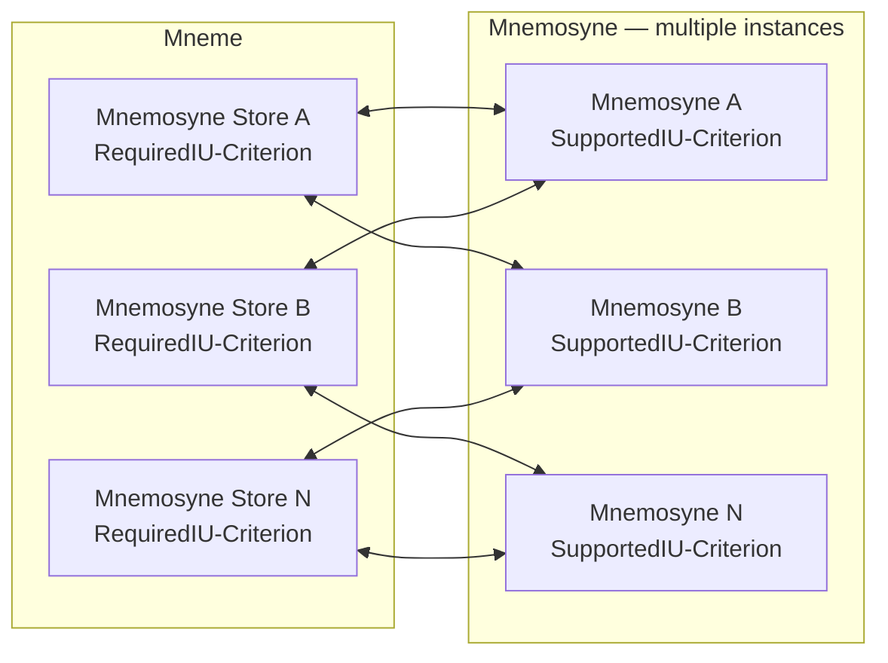

<!-- Copyright (c) 2026 Mark Hunter. SPDX-License-Identifier: GPL-3.0-or-later -->

# Design Review Proposal — Mneme-to-Mnemosyne Governed Interaction

**Subject:** `Interaction::Mneme-to-Mnemosyne`  
**Document:** `DRP-Interaction-Mneme-to-Mnemosyne.Final.001.md`  
**DRP lineage:** `DRP-Interaction-Mneme-to-Mnemosyne-001-002` (short draft) and `DRP-Interaction-Mneme-to-Mnemosyne-001-001` (detailed draft); final register identity to be reconciled, not silently reassigned.  
**Title:** Interaction::Mneme-to-Mnemosyne — Governed Summary Reader/Writer/Search, Full Reader/Writer and Store Integration  
**Standing:** **Consolidated 1.1.24 review candidate incorporating Solution Architect-accepted AV-01–AV-05, FC-01–FC-05, MI-05 (capability coverage), MI-06 (uncertain-write reconciliation) and the accepted summary SearchResult refinement. The five-contract interaction has been accepted in discussion; the complete DRP remains PENDING formal acceptance and has NOT been incorporated into the Continuum under 1.1.24.**  
**Architectural baseline:** accepted Harmonia Architecture Continuum **1.1.23**, incorporating accepted Information Unit architecture from **1.1.22**.  
**Repository/branch examined:** `fhirfactory/harmonia`, `Mneme-and-Mnemosyne-Build`, commit `f9cc16c83dc41e831d1c2823d5a6477d75301c9c`.  
**Source lineage:** `DRP-Interaction-Mneme-to-Mnemosyne.draft.002.md`; `DRP-Mneme-to-Mnemosyne-Interaction.draft.002.md`; accepted `DRP-Information-Unit-Framework.Final.001.md` (IU-01–IU-13); accepted `DRP-Mnemosyne-Authoritative-Persistence-Service-Model.Final.001.md` (MP-01–MP-08); canonical Continuum and completed HCRLs for 1.1.22 and 1.1.23.  
**Solution Architect:** Mark Hunter.  
**Preparation:** Architectural reconciliation for 1.1.24, 12 November 2026; AV-01–AV-05, five-contract design, FC-01–FC-05 and subsequent MI-05/MI-06/SearchResult adjudications, 13 November 2026.

## 0. Authority, scope and source succession

This is a **consolidation and reconciliation** of the existing Mneme-to-Mnemosyne interaction DRPs against **already accepted** architectural decisions. It does not reopen the 1.1.22 Information Unit (IU) or 1.1.23 Mnemosyne decisions, create new provider-selection architecture, approve the neighbouring `Interaction::Mnemosyne-to-PersistenceService` draft, or authorise implementation. It preserves the original interaction semantics while resolving outdated or ambiguous wording where the accepted predecessor architecture supplies the answer.

The two October source documents have overlapping subject matter and different internal identifiers. The shorter `DRP-Interaction-Mneme-to-Mnemosyne.draft.002.md` is the named DRP in the present review programme. The richer `DRP-Mneme-to-Mnemosyne-Interaction.draft.002.md` supplies the historical service-contract, security and Topic/logical-model detail. Both remain traceable; neither draft's unadjudicated proposals override the 1.1.22/1.1.23 Continuum. Final DRP register identifier and source-succession annotation are **review matters**, not permission to duplicate an architectural identity.

The **1.1.22** and **1.1.23** HCRLs are completed and the resulting architectural semantics accepted. Their retained qualifications, including 1.1.23's qualified strict Archi transport failure and unresolved formal naming details, remain as recorded; they are neither repaired nor transferred automatically into a new interaction decision. Some canonical element files still contain pre-closure standing language; the completed HCRL records subsequent final acceptance. The current interaction DRP itself remains unaccepted.

The semantic authority hierarchy is: current explicit Solution Architect decision; accepted canonical Continuum and completed HCRLs; accepted predecessor DRPs as incorporated; these interaction drafts as design evidence; Legacy RAD and as-built code as informative historical evidence. Exact element, Feature, relationship and property reconciliation is a governed incorporation activity after acceptance, not a separate rediscovery of settled design.

**1.1.24 review incorporation.** The complete DRP now records the five architect-accepted availability/version decisions **AV-01 through AV-05**, the associated consumer-facing `Wait-For` discussion, the agreed **five-contract, two-cache-facing interaction direction**, and **FC-01 through FC-05** governing IU Summary/Content separation, reads, writes, search and external-content registration. The three existing Reader/Writer/Search ApplicationService *elements* are predecessor architecture; the **only R1/R2 search capability exposed across the Mneme–Mnemosyne interaction is `GovernedSummarySearch`**. `GovernedSearch` names a historical Continuum element, **not an additionally exposed interaction method**. The five-contract decomposition requires governed 1.1.24 model reconciliation (including treatment of that element's identity), not a claim that five services have already been published. Acceptance here is of the *specific reviewed decisions*, **not** implicit acceptance/publication of this entire DRP. Mneme cache architecture and Ergon/Pragma scheduling retain their own design ownership.

## 1. Feature realisation

### 1.1 Architectural need and Feature context

The Interaction supports the boundary between **Mneme's active, governed Information Unit management** and **Mnemosyne's authoritative persistence and acquisition**. Mneme must obtain durable information capabilities without owning a provider's persistence technology, while Mnemosyne must not appropriate the consumer's business/domain interpretation, active cache management or consumer disposition.

Historical candidate labels include `DataManagement.InformationUnits.DataAccessibility`, `DataManagement.InformationUnits.DataSteadfastness.Recovery` and an Authoritative Persistence Feature. They are **historical mapping inputs**, not authority to create those Features as new identifiers. The actual accepted `CT1 → CT2 → CT3 → Feature` catalogue (1.1.20 onward) and existing partial/one-to-many Feature associations govern mapping. Use accepted capabilities and Features where they express this seam; identify a demonstrable uncovered semantic contribution before proposing another.

### 1.2 Requirements carried forward

The `Interaction::Mneme-to-Mnemosyne` SHALL:

1. Preserve the governed identity, applicable version/state and information integrity of any IU exchanged across the boundary, in accordance with the accepted Information Unit Framework.
2. Support the **five proposed distinct governed contracts**: `GovernedSummaryReader`, `GovernedSummaryWriter` (`CREATE`/`RETIRE`), `GovernedSummarySearch`, `GovernedReader` and `GovernedWriter`. Preserve operation intent, security/disclosure obligations, outcomes and audit/provenance correlation, and preserve the three-services predecessor history until governed reconciliation.
3. Distinguish authoritative durable completion from cache or active-state success, accepted-work capture, transport acknowledgement and end-to-end completion.
4. Preserve the meaningful distinction between established absence, denial/non-disclosure, known failure and outcomes that are currently indeterminate.
5. Retain Mneme's authority over individual-IU concurrency and consumer-level interpretation of Mnemosyne's factual Outcome.
6. Support communication between multiple Mneme Store modules and multiple eligible Mnemosyne instances, without imposing a one-to-one pairing or a fixed physical topology.
7. **For any given IU instance, preserve a coherent authoritative logical view of its identity, version and state irrespective of which eligible Mnemosyne instance serves an interaction, changes in instance availability or the underlying persistence integration.** If the authoritative state cannot be established, the Interaction SHALL convey the applicable factual uncertainty rather than represent unverified state as authoritative. This is an **interaction guarantee**; the internal same-logical-persistence-engine invariant remains governed by the accepted Mnemosyne DRP.
8. Expose **only `GovernedSummarySearch`** as the search method across this Interaction, restricted to IU Summary fields and Summary results in R1/R2. No separate `GovernedSearch` or Content-search method is exposed; unsupported/unavailable Summary search remains distinguishable from an authoritative empty result, and Mneme's active cache is not presumed exhaustive.
9. Support IU-type capability discovery/selection using **`RequiredIU-Criterion`** (Mneme: a collection of TopicMasks describing required IU types) and **`SupportedIU-Criterion`** (Mnemosyne: a collection of TopicMasks describing supported IU types). Their compatibility is evaluated using the existing Harmonia Topic/TopicMask semantics; these **information-service criteria are independent of Themis authorisation criteria**.
10. Preserve protocol/provider independence: native persistence representations and mechanisms do not become part of the governed Mneme–Mnemosyne data contract.
11. Preserve synchronous request/response semantics for the **five proposed governed operations**; distinguish transport/session delivery uncertainty from the factual governed operation Outcome.
12. On a successful governed WRITE, establish applicable **multi-site durability**, not merely local acceptance, local commit or replication queued for later execution; the owning PersistenceService fulfils the deployment's durability obligation.
13. Honour explicit requested IU versions without silent substitution; allow Mnemosyne to report a **higher version actually established** by `GovernedWriter` where authoritative version integrity requires it, and return that version to Mneme.
14. Treat deployment topology and expected Mnemosyne capabilities as **configuration-defined and deterministic**; discovery/registration validates what is available against expectations, with operational alarms where required capabilities or expected instances are missing.
15. Treat `GovernedSummarySearch` continuation as **originating-Mnemosyne-instance-bound**, not transferable between Mnemosyne instances; do not turn a failed continuation into an apparently complete result.
16. Use existing IU identity/version for governed write/read-back correlation at this seam without introducing a mandatory additional Mneme–Mnemosyne transaction identifier.
17. Define the IU **Summary** as the projection containing **all applicable fields of the accepted IU except `InformationRepresentation.Content`**, including `Identity`, `Metadata`, `InformationRepresentation.ContainerMetadata`, and `InformationRepresentation.ContentMetadata`. Summary acquisition/search SHALL NOT materialise Content or create another IU/independent summary version.
18. Permit `GovernedSummaryWriter(CREATE)` to **register an IU referring to Content already present elsewhere**, without writing that Content; permit `GovernedSummaryWriter(RETIRE)` to perform governed IU retirement without destroying the referenced Content. Do not introduce a `GovernedSummaryWriter(UPDATE)` operation absent an explicit approved use case. Full IU updates remain under `GovernedWriter`.
19. Keep the summary visible to Mneme's Standard Cache and full/dereferenced information suitable for local Workflow Cache, while keeping **cache population, eviction and materialisation outside the Mnemosyne service contracts**.

The exact compatibility rule for two *collections* of TopicMasks remains a bounded Interaction design matter; no new mask language or matching algorithm is accepted implicitly. As already accepted in review, a configured IU-type registration covers the applicable logical governed service family; no new operation-by-operation service discovery is introduced. Native provider support for a particular search expression remains an execution capability concern.

**FC-01–FC-05 additional accepted requirements (13 November 2026).** (a) A full `GovernedWriter` SHALL persist/manage actual Content through its applicable PersistenceService, obtain the resulting opaque reference, establish/update that reference within `InformationRepresentation.ContentMetadata`, and durably establish the corresponding IU Summary as a **single coherent governed IU state** before reporting `Success`. (b) `GovernedReader` SHALL attempt to resolve and materialise Content using the Summary and its reference, subject to the established large-binary pass-by-reference exception. (c) For **R1/R2**, `GovernedSummarySearch` queries, filtering and matching SHALL use **only IU Summary information**; neither Content nor Content-derived search indexes are in scope. (d) The reference is opaque to Mneme and is interpreted by Mnemosyne and the applicable PersistenceService together with `InformationCoordinates`; no universal reference encoding is imposed. (e) For external Content, `GovernedSummaryWriter(CREATE)` SHALL persist the Summary/reference **without retrieving or validating the external Content**; external custody, availability, integrity and lifecycle are SEP under the applicable external service obligations. `RETIRE` does not retire or delete the external Content.

### 1.3 Strategy, Motivation and adjoining architecture

Applicable established motivation includes AX-05; the other relevant accepted axioms (notably engine/content separation, local Themis enforcement, information ownership, audit/provenance, distributed availability, persistence stage and temporal distinctions); Information Unit management; authoritative persistence and acquisition; information accessibility; durable work acceptance; and security and privacy. Reuse established Motivation elements rather than classifying these terms anew. Kleio manages AuditEvent information; Dokimasia is the assurance framework, with provenance obligations allocated according to the accepted Provenance/Provenance Client architecture. Calliope owns shared models by default.

## 2. Proposal

Retain **`Interaction::Mneme-to-Mnemosyne`** as the Harmonia-owned semantic boundary through which Mneme invokes authoritative services furnished by Mnemosyne. The 13 November 2026 Solution Architect review now defines **five** materially distinct logical governed service contracts:

| Proposed contract | Concern | Ordinary Mneme cache path |
| --- | --- | --- |
| **`GovernedSummaryReader`** | Authoritative retrieval of the **IU Summary (all IU fields except `InformationRepresentation.Content`)**, without Content materialisation | Reference-oriented `Mneme-Standard-Cache` |
| **`GovernedSummaryWriter`** | `CREATE` registration of an IU referencing Content already held elsewhere; governed `RETIRE`. **No `UPDATE`** in the agreed initial contract | Reference-oriented `Mneme-Standard-Cache` |
| **`GovernedSummarySearch`** | **R1/R2 Summary-only** authoritative discovery and paged `SearchResult`; no Content inspection, materialisation or Content-derived matching | Reference-oriented `Mneme-Standard-Cache` |
| **`GovernedReader`** | Authoritative retrieval of Summary plus actual Content, **attempting materialisation** except the established large-binary pass-by-reference case | Materialisation into local `Mneme-Workflow-Cache` when processing requires it |
| **`GovernedWriter`** | Persist Content, establish its opaque reference in `ContentMetadata`, and durably establish the corresponding Summary and actual resulting version as one coherent IU | Full IU persistence from governed Mneme changes/Ergon output |

**Canonical succession qualification.** Architecture Continuum 1.1.23 already contains the three ApplicationServices `GovernedReader`, `GovernedWriter` and `GovernedSearch`. The five-contract design is **the accepted 1.1.24 review direction, not a claim that five service identities have already been incorporated**. `GovernedReader` and `GovernedWriter` are reused and semantically refined; the historical `GovernedSearch` service must be explicitly reconciled with the proposed `GovernedSummarySearch` (rename/refinement/supersession under governed ADD, without duplicating the canonical identity). The proposed `GovernedSummaryReader` and `GovernedSummaryWriter` require justified new service realisations where not already canonically represented. No unapproved deletion or recreation of the previously published services is implied.

The accepted **Mneme-side `Mnemosyne Adapter (Store)`** discovers eligible Mnemosyne instances and selects one for an invocation; the **Mnemosyne-side `Mneme Adapter / Façade`** registers the capabilities of its own instance and participates in the service contracts. The Store and Façade are **existing ApplicationFunctions**, not competing governed data-service contracts and not an extra Mnemosyne tier.

The **IU Summary is the accepted IU projected without `InformationRepresentation.Content`**, not an IU with a placeholder/reference inserted into the `Content` field. The already permitted Content reference resides in `InformationRepresentation.ContentMetadata` (the exact attribute name `ContentReference` is illustrative), while `Metadata.InformationCoordinates` identifies the logical persistence capability/location used for resolution. The Summary is **not** a second IU kind, second governed `InformationRepresentation`, independently authoritative metadata record or separately incrementing version lineage. The Summary and the complete/materialised IU refer to the **same IU identity and governing version**; the Summary is an intentionally incomplete retrieval/persistence projection, not another fully populated IU.

Registration/discovery answers **which instance can be considered for a requested IU type**. The five contracts answer **what governed operation and result mean**. Selection does not itself perform an information operation, confer authority, identify the IU's authoritative destination or prove the selected instance is currently available.

Mnemosyne's internal design belongs to the accepted **[Mnemosyne Authoritative Persistence Service Model](DRP-Mnemosyne-Authoritative-Persistence-Service-Model.Final.001.md)**, not this Interaction DRP. The lower Mnemosyne-to-PersistenceService interaction is also a **separate DRP**; this proposal only states the upper-boundary obligations relevant to it.

## 3. Conceptual interaction context

The diagram illustrates **multiple Mneme Store modules** communicating with **multiple Mnemosyne instances** under one logical Mneme–Mnemosyne Interaction. Connections are illustrative eligibility/interaction possibilities, not mandatory permanent links, full-mesh deployment, or a prescribed routing protocol. **It does not depict dynamic creation, relocation or autonomous topology assembly:** expected instances, site associations and capabilities are configured for the deployment and then checked by registration/discovery.



**Principal governed data crossing the boundary:** a governed `InformationUnit` (`IU`) in either **summary/reference-oriented** or **complete/materialised** representation, or a `Collection<IU>` (including summary-form search findings), in either applicable direction. **Other contract information may also cross**, including discovery/capability declarations, search requests and result references, security/correlation context and factual Outcomes. The diagram is conceptual; `Collection<IU>` denotes cardinality, not a prescribed Java collection type.

Each Store determines which configured/registered Mnemosyne instance is eligible to provide the requested IU-type capability; the selected instance participates in one of the five governed contracts as required. Internal Mnemosyne construction, persistence resolution and execution are **outside this diagram and this DRP**.

## 4. Architectural definition

### 4.1 Interaction and declarative contract structure

The Interaction may be expressed as `Interaction → Service/Contract → Information Unit → Topic`, consistent with the existing Interaction scaffolding. The hierarchy is **a semantic organisation**, not a request for one new ArchiMate element per textual node, Java DTO or database record. Reuse native relationships and specialisations according to their actual meanings.

Each Service/Contract must identify, where applicable: consumer and provider; requested operation; produced/consumed/referenced IU or model; Topic/TopicMask classification; governed identity and state/version; security/authorisation requirements and disclosure boundaries; outcome and stage; audit, logging and provenance correlation; and the specific allowed effects of any supporting capability registration/selection. An exchanged item is **not automatically a separately governed Topic or IU** merely because it appears in a contract.

No contract introduces a generic provider object, raw database query, native engine record, adapter class or newly invented Interaction metamodel across the upper boundary.

### 4.2 Registration, discovery, selection and Store integration

**RequiredIU-Criterion — Mneme.** A collection of the shared Harmonia TopicMasks identifying the IU types for which a Mneme Store seeks authoritative service. The name describes an **information-capability requirement**, not an authorisation requirement.

**SupportedIU-Criterion — Mnemosyne.** A collection of the shared Harmonia TopicMasks declaring the IU types supported by a particular Mnemosyne instance. Each instance participates in capability registration through its **Mneme Adapter / Façade**. Registrations may overlap, be identical or be disjoint.

**Configured discovery and selection (AV-02 accepted).** A Mneme **Mnemosyne Adapter (Store)** uses the registered capabilities and its `RequiredIU-Criterion` to identify eligible instances and select one for the requested operation. The expected deployment is established by configuration at startup: known Mnemosyne instance identities, their site associations, and the capabilities Mneme expects to find. Registration/discovery determines which of those expectations can currently be met; it does **not** discover or assemble an otherwise undefined architecture. Multiple Store modules may interact with multiple eligible Mnemosyne instances; a fixed Store-to-instance pairing is not required.

An expected Mnemosyne instance has a stable identity and site association. If its process fails, its normal recovery is a restart in its configured deployment context; loss of that site does **not** create or relocate a replacement `Mnemosyne-A′` under the same identity at a different site. Other existing, eligible Mnemosyne instances may continue to serve requests. This is a **flexibly configurable but deterministically established** topology, with dynamic *subsystem execution* and request selection, not dynamic invention of the deployed solution.

**Expectation shortfall and alarms.** If Mneme expects an instance or IU-type capability that it cannot find, the discrepancy is observable and raises an appropriate operational alarm. A configured requirement missing at startup or later becoming unavailable is not silently normalised into a newly inferred deployment. Additional capabilities advertised by an instance do not, by themselves, imply an error or require an exact-match configuration policy. The detection, alarm transport and supervision implementation are outside this interaction's prescribed mechanism.

**MI-05 — accepted capability coverage.** Under the existing element-wise TopicMask matching semantics, **every IU type within Mneme's configured `RequiredIU-Criterion` must be supported by at least one eligible, available Mnemosyne instance**. Complete required coverage may be provided by the union of `SupportedIU-Criterion` declarations of multiple eligible instances; no single instance must cover the entire requirement. Mere intersection/overlap between required and supported TopicMasks **does not prove complete coverage**. Expected coverage is checked at startup and during operation; a shortfall raises the established operational alarm. An open-ended TopicMask may match future Topics, so checking only currently enumerated Topics does not prove full mask coverage. The implementation's proof/validation mechanism is not prescribed here; uncertain or demonstrably insufficient coverage must not be reported as a confirmed full match.

**Per-request selection.** The concrete IU Topic requested must match the applicable required criterion **and** the selected available instance's supported criterion. The supported-capability match selects eligibility; Themis separately determines authorisation. Additional advertised support is permitted without requiring a symmetric exact match. No new TopicMask language, operation-specific capability registry or nondeterministic deployment scheme is introduced.

**IU-type eligibility and the five logical contracts.** Under the 1.1.24 review decision, a Mnemosyne instance registering support for an IU type participates in **all five** proposed logical contracts (`GovernedSummaryReader`, `GovernedSummaryWriter`, `GovernedSummarySearch`, `GovernedReader`, `GovernedWriter`) for that type; operation-specific service discovery is **not** introduced. This does not imply that every underlying PersistenceService offers native, exhaustive or arbitrarily expressive search. Where an actual requested operation cannot be supported or completed, the governed service reports the applicable factual Outcome or capability limitation rather than fabricating a successful answer. MI-05's accepted **complete required coverage** rule applies; only the concrete validation/selection algorithm remains to solution design.

**Capability matching is not authorisation.** `RequiredIU-Criterion` and `SupportedIU-Criterion` are wholly distinct from Themis criteria, the IU's `SecurityContext` and the requester's effective permissions. The applicable governed operation and its returned information are still subject to their own security/disclosure contract.

**Observable state and failure (AV-02).** A capability declaration, the current availability of a configured instance, successful execution of an operation and the coherent authoritative state of an IU are different facts. If selection or changeover occurs, the interaction must maintain the §1.2(7) logical-state guarantee or report the actual indeterminacy. Neither the disappearance of an instance nor its reappearance decides the Outcome of an in-flight governed operation. How Mnemosyne ensures common logical persistence authority, how availability is detected, and how native engines are accessed are governed by the accepted Mnemosyne architecture and implementation design, not specified again here.

### 4.3 Information Unit contract — reference to the accepted IU Framework

The complete conceptual and logical definition of an `InformationUnit` is **not restated or independently specified in this Interaction DRP**. The authoritative reference is:

**[DRP-Information-Unit-Framework.Final.001.md](DRP-Information-Unit-Framework.Final.001.md)** (`enterprise-architecture/design/offline-design/`), accepted as part of **Architecture Continuum 1.1.22** (IU-01–IU-13), together with its canonical incorporated elements.

That DRP governs IU identity, Topic and TopicMask meanings, `Metadata` and its four contexts, the exactly-one-`InformationRepresentation` invariant, Content and native-version preservation, lifecycle context, security context, InformationCoordinates, IU relationships, and Search Result Set reference semantics. **The new summary contracts retain these IU semantics and do not add a separately governed summary entity.**

**This Interaction's obligation** is to convey the **IU Summary projection**, a complete IU or an applicable governed collection carrying such projections, with the accepted IU identity and semantics intact, or to exchange other specifically defined contract information (for example a search request, summary findings, an Outcome or correlation context), as required by the **five** governed contracts. It must not require Mneme to interpret native persistence objects as governed IUs, treat a provider's physical representation as a new governed IU, or silently change authoritative identity/state/version.

The exact shape and cardinality of information passed for a particular operation are specified by that operation's interaction contract. `Collection<IU>` here is **logical cardinality**, not an implementation-type prescription.

#### 4.3.1 Accepted IU definition applied to the Summary (FC-01–FC-05)

The IU's **governed** structure remains that of the accepted Information Unit Framework; it is not redefined here. Its **Summary projection** excludes **exactly the `Content` field** while retaining all the other applicable IU information:

```text
InformationUnit Summary — projection of the same IU
├── Identity
│   ├── UUID
│   └── Topic
├── Metadata
│   ├── ManagementContext
│   ├── InformationCoordinates
│   ├── SecurityContext
│   ├── LifecycleContext
│   └── Relationships [0..*]
└── InformationRepresentation [same single governed representation]
    ├── ContainerMetadata
    └── ContentMetadata
        ├── ContentStructureTopic
        ├── ContentStructureVersion
        └── ContentReference (where required; illustrative attribute name)

InformationRepresentation.Content — OMITTED from Summary
```

The omission is an **operation projection**, not removal of the `Content` constituent from the IU definition, nor creation of a second IU or alternate governed representation. Some `ManagementContext` properties remain operational/transient under the IU Framework; projecting Metadata does **not** promote transient state into a mandatory durable persistence field.

Where Content is managed separately from the Summary, its **resolvable reference SHALL be maintained within `ContentMetadata`**. `InformationCoordinates` supplies the logical gateway, endpoint, location and owner context for resolution. Do not confuse the Content reference with optional IU `Relationships` to other IUs/external resources. Mneme treats the reference as **opaque**; Mnemosyne and the selected PersistenceService interpret it. The design imposes **logical separate addressability**, not a compulsory pair of databases, separate physical transaction or universal reference string format. Provider-internal storage freedom remains intact.

### 4.4 Summary read — `GovernedSummaryReader`

**Proposed 1.1.24 service.** Authoritative acquisition of the **IU Summary projection specified in §4.3.1**: everything in the applicable IU **except `InformationRepresentation.Content`**. This includes identity/Topic (names), four Metadata contexts and optional Relationships, `ContainerMetadata`, and `ContentMetadata` (including its Content reference where applicable). This is **not permission to invent a second metadata schema or turn a projected Summary into a second independently governed IU**.

The operation **does not dereference or transfer the actual Content**. The Content reference appears in **`ContentMetadata`**, not in a pseudo-Content payload manufactured for the Summary. The projected information retains the same IU identity/version, security/authority and provenance semantics as the full IU. It must not claim that Content was materialised or that transient `ManagementContext` state was durably stored. Large binary and external Content retain their existing custody boundaries.

An explicit requested version must be returned **exactly** or the read reports the appropriate absence/failure/uncertainty; `version=*` permits selection under its own semantics. Authentication, `ACCESS + READ`, Themis evaluation, metadata non-disclosure, allowed IU absence and Calliope factual Outcome obligations are the same strength as the full Reader. A summary is useful for populating/refreshing `Mneme-Standard-Cache`, **not** a reason for Mnemosyne to manage that cache.

**Cache boundary:** an available Standard-Cache entry may satisfy a *Mneme consumer request* subject to `cacheBehaviour` and `persistenceBehaviour`; invoking `GovernedSummaryReader` itself is an **authoritative Mnemosyne read**, not a cache peek. `GovernedSummaryReader` must not silently substitute the contents of a separate IU version or materialise the Content to satisfy a summary request.

### 4.5 Summary write — `GovernedSummaryWriter` (`CREATE`, `RETIRE`)

**Proposed 1.1.24 service.** Authoritative management of an **IU Summary for externally managed Content** (the IU projection without `InformationRepresentation.Content`). It supports precisely the agreed initial operations:

| Operation | Meaning |
| --- | --- |
| **`CREATE`** | Durably register the **IU Summary (every applicable IU field except `Content`)** with the externally supplied opaque Content reference in `ContentMetadata`; **do not retrieve, verify, copy, persist or rewrite** the external Content. |
| **`RETIRE`** | Apply the governed **IU retirement lifecycle**, preserving historical identity, required versions, retention, audit/provenance and relevant evidence; **do not** treat retirement as physical `DELETE` of either the IU's history or the referenced external Content. |
| **`UPDATE`** | **Not supported by the agreed initial `GovernedSummaryWriter` contract**; no use case has been identified. Updates to an IU and its authoritative summary arising from full information management belong to `GovernedWriter`, not a separately mutable summary. |

The summary is not a separate IU or independently editable summary record. On `CREATE`, the supplied reference describes **externally managed Content represented as already existing**, under that external system's own custody and service obligations. **Mnemosyne shall not retrieve or validate the external Content merely to register its Summary** (FC-05). Local IU metadata/reference structural checks, Themis and other Harmonia-side governance still apply. A successful registration establishes the **durably governed IU Summary and its supplied reference**, not the existence, reachability, integrity, currency, availability or durability of the external Content. External Content management is **SEP**; any non-Harmonia-managed PersistenceService remains subject to its separately determined deployment/service criteria. `RETIRE` governs the Harmonia IU lifecycle and **does not automatically retire, delete or modify the external referent**.

The operation is synchronous, with factual Calliope `Outcome` and applicable `CHANGE` action/permission checks (including the requested information operation). A successful **authoritative summary mutation** must have its applicable multi-site durability established by the responsible PersistenceService, rather than merely appearing in the Standard Cache. **Where version integrity requires a higher IU version, return the actual version established**, applying the same Mneme-owned concurrency and immutable-history constraints as a full governed write. Mnemosyne does not own a competing IU-level concurrency manager.

Any IU summary state maintained as part of a successful full `GovernedWriter` operation is a derived authoritative view of that **same IU**, **not** an implicit call to `GovernedSummaryWriter(UPDATE)`. No physical Content deletion, distributed summary-version counter, cross-IU cascade or independent lifecycle is introduced.

### 4.6 Summary search — `GovernedSummarySearch`

**Accepted 1.1.24 interaction contract:** `GovernedSummarySearch` is the **sole search method exposed** by Mnemosyne to Mneme. The 1.1.23 Continuum has an ApplicationService element displayed as `GovernedSearch` (friendly name `Mnemosyne.GovernedSearch`; no established formal `canonicalName`). That element is **historical architecture to reconcile**, not a sixth exposed contract and not permission to retain a `GovernedSearch()` method alongside `GovernedSummarySearch()`. Governed ADD should refine/reuse its stable identity when semantically appropriate, preserving provenance and identifying any genuine mismatch; it must not duplicate the search capability.

Summary search is a distinct governed operation, **not a CRUD verb** or a synonym for a point read. Its result items carry the **IU Summary projection** (every applicable IU field except `InformationRepresentation.Content`), without retrieval of Content. Mneme interprets the Harmonia-facing semantic `Search Request` and manages the governed **Search Result Set** presented to consumers. Mnemosyne executes/coordinates authoritative persistence-search **where supported by applicable capabilities**; provider-native index/query/search logic, native hits and any physical mappings remain beneath its boundary.

**Conceptual information roles:**

- **Consumer Data — Search Request:** the requested semantic search, relevant scope/constraints, identity/authority and operational correlation; Topic classification/representation remains to be reconciled with existing information architecture.
- **Provider Data — authoritative summary findings/search evidence:** sufficient governed candidate **summary IUs** and reference/result information, authoritative execution outcome and applicable result metadata to allow Mneme to deliver the governed result; the precise exchanged representation remains a contract detail. The older draft's `provider.Data = SearchResultSet [Topic?]` is a *conceptual service declaration*, **not** reassignment of Search Result Set ownership to Mnemosyne or approval of a new Topic.
- **Mneme-managed Search Result Set:** a governed metadata collection of **IU Version references** (not unrestricted matched Content), whose management and consumer-facing result semantics belong to Mneme. A result set may be persisted in an Ergon context under the accepted architecture; this does not convert the underlying IU identities or give Ergon search-authorisation ownership.
- **Referenced IU/Content:** any actual IU disclosure or content retrieval requires the applicable `READ` authority and compartment/other criteria independently of permission to invoke Search.

Search invocation requires authentication and applicable `ACCESS + SEARCH` permission. Candidate/result visibility separately requires `ACCESS + READ` where actual IU-level disclosure occurs. Counts, total hits, facets, ordering, pagination, cursor semantics, identifiers and other metadata may leak protected existence; disclosure rules apply to **metadata as well as Content**. No `authorise(search)` then unrestricted-result shortcut is conformant.

**R1/R2 permitted search domain (FC-03 accepted).** `GovernedSummarySearch` criteria, filtering, candidate evaluation, ordering and matching SHALL be evaluated **only from information contained in the IU Summary**. Actual `Content` SHALL NOT be read, examined, dereferenced or materialised in order to perform the search. Nor may a Content-derived full-text/semantic/native index expand the searchable information beyond Summary fields in R1/R2. An implementation may index **Summary fields** for efficiency. This is a search-input restriction **as well as** the established summary-only result restriction; a broader Content-aware search is not authorised for R1/R2.

**SearchResult exchange semantics.** The 1.1.24 review accepted the following logical Mnemosyne result information, now specifically for `GovernedSummarySearch`: `Outcome.payload()` contains a `SearchResult` with `itemList : List<IU>`, `size` (the independent count **equal to** the number of items in `itemList`), `paginationSize`, `timestamp` (time of extraction from persistence) and `nextSetReference`. The returned `itemList` entries are **summary-form IUs**, with the same identity/version, Themis and disclosure semantics as `GovernedSummaryReader`; the referenced actual Content is **not retrieved or materialised** merely because an IU appears in the search response. This `SearchResult` must **not** be conflated with Mneme's separate governed **Search Result Set**, which is a metadata collection of IU Version references. **Accepted SearchResult refinement (review-dialogue label MI-07):** `itemList : List<IU>` means **IU Summary projections**, not fully materialised IUs; `size == itemList.size()`, and `paginationSize`, persistence-extraction `timestamp` and instance-bound `nextSetReference` retain their established semantics. This is an existing-contract refinement, **not a new SearchResult model, IU type or independent search service**. The field names are logical API vocabulary, not mandates for duplicate canonical elements. *Identifier crosswalk:* the previous DRP register already uses `MI-07` for RETIRE/provider-DELETE disposition. Preserve that historical `MI-07` unchanged; incorporate the **dialogue's MI-07 SearchResult decision under existing search-contract review item `MI-03`**, without introducing a second MI-07 register identity.

**Instance-bound continuation (AV-05 accepted).** A `nextSetReference` belongs to the **Mnemosyne instance that generated it**. Mneme maintains that originating-instance association for as long as the continuation is in use and routes subsequent requests only to that instance. It is **not portable** to another Mnemosyne instance; following failure or loss of the originating instance/session, continuation fails and the consumer may initiate a **new search**. Neither Mneme nor Mnemosyne is required to transfer database cursors, restart the old search invisibly, duplicate an incomplete page, or manufacture a full result set. `nextSetReference` denotes continuation of a practical paged query (with RESTful continuation intent), **not** a guarantee of one immutable point-in-time snapshot across all pages. Precise reference encoding, lifetime and transport are API/implementation details.

**Focused-search usage constraint.** Harmonia is an operational healthcare information-management system, **not a general-purpose big-data analytics platform**. Governed-search clients are expected to use meaningful, targeted scopes/filters and practical result sizes. The API specification SHALL warn that broad, unrestricted population scans, bulk extraction and analytical exploration should use appropriate separately designed capabilities, and that pagination/continuation does not promise unlimited extraction or failover continuity. This is an intended-use constraint and API warning, not a newly invented numeric result limit or blanket rejection policy.

Mnemosyne may use additive native search, traversal or indexing offered by the selected PersistenceService(s), or report a capability limitation when authoritative search cannot be performed. Every IU-type-capable Mnemosyne instance participates in the logical `GovernedSummarySearch` contract, but that does **not** manufacture native support for every search expression. It is not required to fabricate a universal native-search engine, infer exhaustive results from Mneme cache, or conceal an unsupported operation as a successful empty result. The required semantic/physical mapping, query plan, search aggregation, paged evidence, capability mismatch and completion/proof semantics remain detailed contract/solution-design matters, subject to the accepted ownership allocation.

**Required evidence context:** requested search semantics, scope/correlation, selected capability and authoritative execution result, permitted candidate/result exposure and relevant disclosure metadata, audit/provenance where applicable. `Search Request`, `Search Result Set`, outcomes and IU references must be classified against **existing** Topic/IU modelling; exchanged DTOs do not automatically become Topics.

### 4.7 Full read — `GovernedReader`

**Existing service:** `Mnemosyne.GovernedReader` / `Interaction::Mneme-to-Mnemosyne.Read`.

**Consumer intention:** obtain the **full authoritative governed IU**, including the actual Content needed for the requested processing (except Content governed to remain referenced, such as large binary/media), according to a governed lookup/request; the requested identity and, where relevant, required version and operation/security context are supplied through the governed seam. **Provider information:** the qualifying IU/state and factual retrieval Outcome, preserving authorised identity, authoritative state/version, IU security and provenance where applicable. Provider-internal keys, records and query objects are not this contract.

**Information action:** `READ`; relevant Themis authorisation action: `ACCESS`. Authentication is required. The request and any returned IU must be evaluated against the applicable authorisation profile, compartments/classification/function and temporal constraints. The governing profile may allow a wildcard compartment expression (`*` in illustrative source text), but a wildcard is **not a bypass** of compartment enforcement.

**Outcome distinctions:**

- an authoritative IU/state was found and can be disclosed under the applicable contract;
- authoritative lookup completed and established legitimate absence;
- a requested disclosure/action is denied or must not reveal protected existence/characteristics;
- the attempted retrieval failed;
- the actual retrieval/disclosure result cannot presently be established (`Indeterminate`) where relevant.

A completed lookup establishing absence may count as successful execution of **that lookup operation**, with an appropriate governed Reason; this does not turn `NotFound` into an accepted enum member, collapse denial into absence or dictate a protocol status. A protected IU's existence or characteristics must not be disclosed merely because a native provider returned a candidate. The consumer-facing decision on the specific disclosure/result remains Mneme's under its governed contract.

**Version-specific authoritative retrieval (AV-01 accepted).** A request for a **specific IU identity and version** (illustratively `/thing/223`) is satisfied only by that version. A `GovernedReader` result MUST NOT silently substitute version 222, version 224 or whichever version happens to be locally accessible. A version-selection expression such as `version=*` is different: the requested selection semantics may resolve an eligible version. The semantic distinction is independent of physical instance/site and of the representation of any native payload version.

**Mneme client access/Wait-For semantics — boundary context, not a second Mnemosyne API.** Mneme's client-facing information access uses two separate decisions, with names preserved as conceptual vocabulary pending detailed API specification:

| Mneme client request option | Agreed purpose |
| --- | --- |
| `cacheBehaviour = USE_AVAILABLE` | Permit acceptable currently available active/cache information, including an older version if the consumer's requested version constraints allow it. |
| `cacheBehaviour = RELOAD_FOR_AUTHORITATIVE` | Require authoritative acquisition rather than treating an available active copy as authoritative merely because it is present. |
| `persistenceBehaviour = NO_WAIT` | Best-effort immediate result: return information acceptable under the cache/version request, or `Failure`; do not wait for an absent version to become available. Ordinary synchronous request/transport processing is not thereby redefined as zero elapsed time. |
| `persistenceBehaviour = WAIT_FOR_ACTIVE` | Wait for the requested information to meet Mneme's active-availability condition. |
| `persistenceBehaviour = WAIT_FOR_AUTHORITATIVE` | Wait for the requested authoritative information/condition, subject to applicable completion, timeout and Outcome semantics. |

These two option families are **orthogonal**: the cache behaviour and requested IU version determine acceptable information; the persistence/wait behaviour determines which availability/completion condition the client is willing to await. Mneme enforces the specified access semantics; the client (including an Ergon developer) selects a suitable currency/wait policy for its processing, subject to non-optional Themis and governance constraints. `NO_WAIT` may legitimately fail, leaving the Ergon to decide whether it should defer/re-attempt processing later. Precise parameter types, defaults and API signatures belong to Mneme's own contract, not this inter-component seam.

**Full versus summary acquisition (FC-02 accepted).** `GovernedReader` is **obliged to attempt Content materialisation**. It first obtains the authoritative IU Summary, uses the opaque reference in its `ContentMetadata` together with `InformationCoordinates` to select/resolve the appropriate PersistenceService, acquires actual Content and **assembles the complete IU**. The accepted large-binary/media pass-by-reference exception remains applicable. It is the appropriate authoritative path when Ergon context loading needs resolved information for its local `Mneme-Workflow-Cache`; neither this service nor Mnemosyne owns the local cache. For externally held Content, retrieval is an **attempt through the applicable provider**, not a guarantee that the external reference can currently be resolved. Unavailability/denial/failure is reported through the appropriate governed read Outcome and **does not retrospectively invalidate** a previously successful `GovernedSummaryWriter(CREATE)` registration. A full read is still a read of the **same IU/version** identified by a summary; it does not create a second governed representation or authoritative version.

**Required evidence context:** IU identity/version and qualifying source; request/security/correlation context as appropriate; factual acquisition result; applicable access/disclosure, audit/provenance obligations. An absent read is not a persistence WRITE failure. No blanket audit event catalogue or transport format is invented here.

### 4.8 Full write — `GovernedWriter`

**Existing service:** `Mnemosyne.GovernedWriter` / `Interaction::Mneme-to-Mnemosyne.Write`.

**Consumer intention:** request authoritative **CREATE**, **UPDATE** or governed **RETIRE**/lifecycle mutation of the **full IU**, establishing the relevant durable result (including actual Content where applicable). The historical `DELETE` term is retained as a predecessor CRUD label but not adopted as permission for physical deletion of IU history or Content. The action must be authorised using `CHANGE` and the appropriate information operation; method names/HTTP verbs do not substitute for that decision.

**Consumer information:** governed IU identity and proposed information/state; applicable prior/current version and concurrency/state expectations; creator-supplied relationships and security/authority context as required; lifecycle handshaking/correlation. **Provider information:** factual persistence Outcome and, when established, the resulting authoritative identity, version/state and evidence needed for Mneme's disposition.

Mneme owns concurrency for one IU instance and active working/version-generation management. Mnemosyne must preserve its authoritative durable state/version and engine constraints, including the relevant conditions presented with the request; this is not assignment of all semantic Content state to Mnemosyne. **A request from Mneme directs authoritative persistence; it is not a request for Mnemosyne instances to negotiate IU ownership or perform a second independent business-level concurrency adjudication.** Mneme cache mutation success, accepted work capture, adapter dispatch, provider ACK and authoritative durable effect are not synonyms.

**Forced persistence and resulting version (AV-04 accepted).** `GovernedWriter` is a directed persistence operation, but *forced* does **not** authorise destructive rewriting of a previously preserved immutable IU version. If the requested version is not present, it may be established as requested. If the same version already represents the same governed information, it may already satisfy the request without creating a second logical version. If the requested version conflicts with already preserved information, or authoritative version integrity otherwise requires it, **Mnemosyne MAY establish a higher version** (an increment, or a greater increment when circumstances require) instead of overwriting the preserved version. On `Success`, it **SHALL return the actual authoritative IU version established**, not merely echo the requested number. Mneme reconciles its active management state using that result.

This does not invent a new independent version axis. The accepted IU Framework distinguishes Mneme's *operational Version* in `Metadata.ManagementContext`, Content Structure Version in `InformationRepresentation.ContentMetadata`, and any native payload instance version within `Content`. The write result concerns the authoritative IU version/state established for the governed operation. **Mneme retains operational version/concurrency ownership; Mnemosyne's ability to report a greater persisted version is an explicit return contract, not permission to alter a Content Structure Version or native payload version opportunistically.** The exact version-assignment algorithm, including sparse increments, is not prescribed by this DRP.

**Synchronous multi-site completion (AV-03/04).** `GovernedWriter` is synchronous request/response. Its `Success` represents the specified governed write completed with the required **multi-site durable authoritative persistence**, not merely local durable storage, receipt, or replication in progress. The required redundancy is delivered by the applicable **PersistenceService**, including Harmonia-managed PostgreSQL-based services or separately governed non-Harmonia services under their deployment criteria. Mnemosyne reports the factual outcome; the underlying engine/adapter confirmation mechanisms remain below this boundary. A write whose multi-site completion cannot be established is not reported as `Success` solely because its local effects are visible.

Mnemosyne supplies its factual persistence Outcome through the governed boundary, without that fact being replaced by Mneme's interpretation. **`Indeterminate` is presently unknown fact, not failure**; instance failover must not manufacture a factual failed/successful write merely from a lost response. **No new inter-component transaction identifier is mandated.** The governed IU identity, its requested version and the actually established version (when known) are the correlation basis for this seam.

**Timeout and read-back verification (AV-03 accepted).** Distinguish (a) a governed `Failure` returned in a completed synchronous interaction, (b) a governed `Success` returned after the required durable completion, and (c) timeout or loss of transport/session-level response (conceptually layers 4/5), which is **not** itself a layer-6 governed Outcome. A governed service may also report `Indeterminate` when its persistence result is not yet known. Mneme can invoke `GovernedReader` to inspect the authoritative IU/version after any case where it wants verification, especially an uncertain write. If a specific version was requested, that read must not return a different version under its name. **A read establishing absence is not automatically proof that an earlier timed-out write definitively failed.**

**MI-06 — accepted uncertain-write reconciliation.** Where `GovernedWriter` may have established a higher IU version before its response was lost or the governed result is `Indeterminate`, Mneme's normal investigation mechanism is **an authoritative latest-version read using `GovernedReader(version=*)`**, rather than restricting examination to the originally requested version. Mneme checks whether the actual authoritative version and the information/evidence returned **correspond to the submitted write**. The mere presence of a newer version is **not proof** of that write's success; failure to establish correspondence or sufficient durability evidence leaves the original result **`Indeterminate`**. An explicit exact-version read, when otherwise requested, still cannot substitute another version. No additional Mneme–Mnemosyne transaction identifier, new interaction method or cross-instance IU arbitration is introduced. Precise correspondence/evidence checks are an implementation/contract detail, **not an unresolved choice of reconciliation mechanism**. Reading a locally visible record does not by itself certify multi-site durability; the accepted `Success` condition remains unchanged.

`RETIRE` is a governed IU lifecycle operation, **not** physical destruction; provider-native DELETE is not automatic authorisation to expunge historical governed information. Applicable retention holds, immutable versions, audit and provenance must be preserved. The exact mapping between a requested DELETE and logical retire/disposition/physical provider action is a contract-specific decision, not silently assumed here.

**Summary–Content persistence and ContentReference establishment (FC-01/04 accepted).** A full `GovernedWriter` MUST cause the applicable PersistenceService to persist/manage the supplied actual **Content**, obtain the resulting provider-meaningful **Content reference**, **establish/update that reference in `InformationRepresentation.ContentMetadata`**, and establish the matching IU **Summary** as authoritative. The reference is opaque to Mneme, and Mnemosyne interprets it with `InformationCoordinates` through the PersistenceService. The actual persisted IU version returned on `Success` applies coherently to the Summary and Content association. This contract requires **logically separate Content management** even when one PersistenceService chooses a shared physical store or one native transaction; it does not dictate SQL tables, object stores, provider reference formats or the exact operation sequence.

**Atomic governed outcome, not compulsory native atomic transaction.** `GovernedWriter.Success` requires the Summary, its resulting `ContentMetadata` reference, and corresponding Content to constitute **one consistent, authoritative, multi-site durable IU**. A Content write that succeeds while Summary persistence fails (or vice versa) does **not** establish a successful complete IU; partial/orphaned native effects are handled by the responsible persistence workflow/adapter under the existing architecture and their applicable recovery/governance rules. No separate Summary Writer UPDATE is required to make the Summary reflect the full write.

**Effect on authoritative summary and both caches.** A full `GovernedWriter` operation establishes the governed IU, including Content, its opaque reference and the corresponding Summary as the **same version/state**. Mneme can then refresh/adjust its Standard-Cache Summary without a separate `GovernedSummaryWriter(UPDATE)` interaction. Mneme may then refresh or invalidate affected **Standard-Cache** references and appropriately govern locally materialised **Workflow-Cache** copies. Neither cache's successful update proves `GovernedWriter.Success`, and a particular Ergon's immutable, version-specific local input need not be retrospectively changed merely because a newer authoritative version exists.

**Required evidence context:** attempted change, authority/action/criteria, IU identity and requested **and actual resulting** authoritative versions where known, applicable preceding state, factual outcome and authoritative progression, sufficient audit/provenance association. No particular optimistic locking mechanism, work queue, idempotency token, retry delay, supplementary transaction ID or status-code mapping is prescribed.

### 4.9 Outcomes, stages and consumer disposition — MP-04/MP-06 accepted

The common **Calliope-owned** logical `Outcome` model is conceptually:

```text
Outcome
├── status : Status = Success | Failure | Indeterminate  [closed]
└── reason : Reason [common closed vocabulary + governed closed domain extensions]
```

The spellings and closed nature of **`Success` / `Failure` / `Indeterminate`** are accepted. `Reason` has an accepted **closed common vocabulary plus closed domain-specific extensions**, but **the exact members have not been adjudicated**. Prior illustrative values, e.g. `NotFound`, `VersionConflict`, `UnsupportedOperation`, `Timeout` and `ConfirmationUnavailable`, are examples, **not approved identifiers**. Avoid unrestricted free-text reasons as a substitute for the agreed model.

Status denotes what a reporting component knows **about the operation/stage actually reported**:

| Status | Meaning |
| --- | --- |
| `Success` | The specified operation succeeded according to its defined completion contract. |
| `Failure` | The specified operation is known to have failed according to that contract. |
| `Indeterminate` | The factual result is **not known at this point** from the available evidence. |

The following **interaction-observable claims** must not be treated as equivalent (they are not mandated exact enum names):

```text
request received
  ≠ governed work accepted and durably preserved
  ≠ authoritative persisted effect established
  ≠ remote propagation or end-to-end business completion
```

The internal evidence by which Mnemosyne establishes a persistence result belongs to its accepted design; this Interaction consumes the resulting factual Outcome. **For `GovernedWriter` and any authoritative `GovernedSummaryWriter` mutation, the specified completed operation has the accepted additional threshold of multi-site durable authoritative persistence**; it is not a weaker stage such as transport receipt or local-only write. Its `Success` result also identifies the authoritative IU version actually established, which may be greater than requested.

A successful request acceptance never by itself proves authoritative durable completion. The interaction must identify the stage reported and preserve any relevant IU identity, version, operation correlation and evidence. **How Mnemosyne establishes its factual Outcome is defined by the accepted Mnemosyne DRP**, not by this upper interaction.

**Mnemosyne reports the factual persistence Outcome; Mneme determines the consumer-level disposition**. Mneme may treat an `Indeterminate` outcome as an unsuccessful client operation, await clarification or handle it otherwise under its own contract, but it may not rewrite the underlying factual persistence result to `Failure` merely to simplify its API. The suitability and verification obligations of providers remain governed by the accepted Mnemosyne design.

Exact closed Reason members, stage codes, contractual completion evidence, correlation details and transport/Java types remain for their owning design contracts. The absence of a fully specified wire signature is not a reason to reopen accepted Outcome ownership/status or invent another outcome framework.

### 4.10 Security, logging, audit and provenance at this seam

Security and audit obligations apply to the **relevant Service/Contract, operation, IU and disclosure event**; generic Interaction-wide prose does not satisfy an actual requested-authority/disclosure decision. The requester/Identity Passport represents effective permissions; IU SecurityContext expresses subject-side requirements. Themis owns the authorisation mechanisms and policy, with enforcement as established by the accepted Themis and Mnemosyne architecture. Passport/session/snapshot material is not automatically persisted as IU Content or Metadata.

For both Readers and Summary Search, **information not allowed to be disclosed** must not be exposed indirectly through returned IU records, outcome details, search counts, pagination/facets or diagnostic metadata. The exact circumstances in which denial is indistinguishable from legitimate absence belong to the governing disclosure contract; the architecture does not silently impose one universal external error mapping.

For both Writers, the requested information action, the IU's requirements and the requester's effective authority govern mutation, with retention/disposition constraints as applicable. Provider-side credentials, InformationCoordinates or success of Store TopicMask matching do **not** grant the requester information rights.

**Kleio** manages AuditEvent information; operational logging is distinct from governed audit. **Dokimasia** is assurance, and existing Provenance/Provenance Client allocations remain in force. The operation participants provide sufficient context/evidence to satisfy applicable source-near audit and provenance obligations; the transport, event schema and mandatory per-outcome event catalogue are not predetermined here.

Original candidate audit subjects retained for reconciliation: request/invocation; authorisation determination/enforcement; information retrieval or mutation attempt; permitted disclosure or non-disclosure; durable progression; and service/operation outcome. Which are **mandatory**, and which participating component emits each, must be reconciled with the established audit/provenance architecture. This is **not** authority to create a second audit taxonomy or to assume all attempted/denied operations produce identical event sets.

The Interaction must not expose restricted provider information or inferable protected IU characteristics through its data, outcomes or diagnostic metadata. Internal security enforcement is governed by the owning Themis and Mnemosyne architecture.

### 4.11 Availability, failure, concurrency and recovery — interaction obligations (AV-01–AV-05 accepted)

- Multiple Mneme Store modules may interact with multiple **configured, validated and available** Mnemosyne instances, including instances with identical, overlapping or disjoint supported IU-type criteria. Registration is checked against deterministic deployment expectations, and missing required instances/capabilities cause an appropriate alarm (AV-02).
- An interaction remains semantically the same when a different eligible Mnemosyne instance is selected. For a given IU, the requested authoritative logical state must be coherent across that change, or its uncertainty must be communicated. An instance cannot independently reinstate an obsolete authoritative history on recovery (AV-02/04).
- Mneme retains concurrency management for an individual IU; concurrent operations concerning *different* IUs of the same type may proceed through different eligible Mnemosyne instances. No Mnemosyne-to-Mnemosyne IU ownership arbitration is introduced (AV-04).
- A requested **specific IU version** is never silently substituted by another. Mneme's client-level cache/wait policies govern how the consumer responds to temporarily unavailable information, not which version an authoritative exact-version read may claim to return (AV-01).
- Configured IU-type requirements must be **completely covered** by the union of available eligible Mnemosyne supported criteria, not merely overlapping TopicMasks; concrete requests must match both their required criterion and the chosen provider's supported criterion (MI-05).
- Instance unavailability, disconnection or transport-level timeout does not prove that an in-flight mutation failed. After `Indeterminate` or a lost write response, Mneme may perform **authoritative `GovernedReader(version=*)` read-back**, examine a potentially higher actual version, and establish correspondence with its submitted IU. A higher version alone cannot prove success; insufficient evidence preserves `Indeterminate`. No additional seam-level transaction ID is imposed (AV-03/04, MI-06).
- A successful governed write returns its **actual persisted version** and satisfies multi-site durability through the applicable PersistenceService; local-only or unconfirmed writes do not constitute `GovernedWriter.Success` (AV-03/04).
- `GovernedSummarySearch` continuation is **sticky to the originating Mnemosyne instance**; it cannot be transferred during instance changeover. If continuation becomes unavailable, return a factual failure/uncertainty as appropriate and require a new search for renewed retrieval (AV-05).
- Search limitations, unavailable service, legitimate absence and indeterminate operation results must remain distinguishable under the applicable contract.

**Two-cache/contract relationship.** `GovernedSummaryReader`, `GovernedSummaryWriter` and `GovernedSummarySearch` support the reference-oriented authoritative IU management normally represented in `Mneme-Standard-Cache`. `GovernedReader` and `GovernedWriter` support full IU acquisition/persistence and, for processing, materialisation in the local `Mneme-Workflow-Cache`. This is a use-path mapping, not cache affinity enforced by Mnemosyne. Summary mutation never becomes an independent IU content/version history. The originating-instance search continuation constraint applies to **`GovernedSummarySearch`**.

**Interaction-to-execution boundary.** A consumer Ergon may request `NO_WAIT` and, if acceptable information is unavailable, complete and cause subsequent work under a **new Pragma with the same immutable input**, with prior inability/correlation retained by the execution framework. `schedule(time)`, `waitBefore(time)` and `blockWaitBefore(time)` are conceptual Ergon/Pragma scheduling facilities: scheduling new work, deferring through new Pragma, or **actually blocking the current Ergon thread and retaining that execution** until time eligibility respectively. Ponos/DigitalTwin/Dokimasia may continue processing other Ergons subject to their existing ordering/concurrency rules; a blocked thread is not a blocked engine. **These are neighbouring execution-contract decisions**, not extra `GovernedReader`/`GovernedWriter` options, and the Ergon developer chooses the suitable approach. Their full specification belongs in the Ergon/Pragma scheduling design.

**Excluded from this upper Interaction:** the internal logical-engine consistency mechanism, GPF supervision, Persistence Adapter verification, provider retry/recovery mechanisms, engine-level concurrency and catastrophic recovery architecture. Those are specified by the Mnemosyne and other owning architecture.

### 4.12 Contract and relationship invariants

A conformant Mneme–Mnemosyne Interaction preserves:

1. The separate responsibilities of Mneme and Mnemosyne, without exposing persistence-provider internals through the interaction.
2. The **five proposed** governed contracts: SummaryReader, SummaryWriter, SummarySearch, full Reader and full Writer; preserve existing canonical Reader/Writer and reconcile the pre-existing canonical `GovernedSearch` service identity under governed ADD rather than silently inventing duplicates. Preserve the distinct Store/Façade participant responsibilities.
3. Named `RequiredIU-Criterion` and `SupportedIU-Criterion` collections using the **shared** TopicMask semantics, independently of all Themis authorisation criteria.
4. Capability registration, current instance availability, operation support, information disclosure permission and operation outcome as **distinct facts**.
5. A coherent authoritative logical IU identity/version/state across eligible Mnemosyne instance changes, or a factual `Indeterminate` result where coherence cannot be established.
6. Mneme's per-IU concurrency responsibility and its independent consumer-level disposition.
7. IU/`Collection<IU>` exchange consistent with the accepted IU Framework, with other contract data exchanged as needed; never assume all interaction information is itself an IU.
8. Distinct authoritative absence, prohibited/non-disclosed existence, known failure and indeterminate result.
9. `Success` tied to the **stated operation and completion stage**, not inferred from acceptance or dispatch alone.
10. The factual Outcome from Mnemosyne preserved distinctly from Mneme's consumer-facing interpretation.
11. Security/disclosure constraints applied to actual IU Content **and** summary identity/names/references/metadata exposed through either Reader or SummarySearch.
12. Governed **summary search** only to the extent supported; absence of native search must not become an apparently authoritative empty result.
13. Relevant evidence/correlation for audit, provenance and authoritative lifecycle handshaking without dictating internal enforcement or persistence execution machinery.
14. The interaction remains independent of in-process/remote transport and deployment configuration **mechanics**, but respects deterministic deployment configuration expectations and observed capability shortfalls.
15. Explicit IU-version reads preserve exact-version semantics, while Mneme consumer access/wait behaviour is orthogonal to the Mnemosyne read contract.
16. Synchronous `GovernedWriter.Success` means verified multi-site durable effect and returns the **actual authoritative IU version**, preserving immutable history when a higher version must be allocated.
17. Transport/session-level failure is not transmuted into a factual governed Outcome; **Mneme may reconcile an uncertain write by authoritative `GovernedReader(version=*)` and establishing correspondence with the submitted IU, including a higher resulting version**. Mere version elevation does not prove success; `Indeterminate` remains when evidence is insufficient. No additional transaction identifier is required (MI-06).
18. `GovernedSummarySearch` `nextSetReference` is bound to its originating Mnemosyne instance, with no cross-instance continuation; focus/scale and continuation limitations are explicit in the API contract.
19. Configuration establishes expected instances/capabilities; discovery verifies presence and enables eligible selection within that architecture, with alarms for missing expected coverage. **Required IU-type coverage must be complete across eligible instances, not merely overlapping, and each selected instance must support the concrete IU Topic (MI-05).**

20. `GovernedSummaryReader`/`GovernedSummarySearch` return **IU Summary projections (every applicable IU field except `InformationRepresentation.Content`)**; they do not materialise Content, and identity, version, authority and the single-governed-`InformationRepresentation` invariant remain those of the original IU.
21. `GovernedSummaryWriter` supports authoritative **CREATE registration of referenced existing Content** and governed **RETIRE**, but no `UPDATE` in its agreed initial contract; neither action independently mutates or deletes the external referent.
22. Full `GovernedReader` attempts to materialise actual Content using the opaque reference in `ContentMetadata` and the IU's `InformationCoordinates`; the established large-binary/media pass-by-reference exception remains. `GovernedWriter` persists Content and establishes the corresponding opaque reference and authoritative IU Summary, without a separate SummaryWriter UPDATE. External Content retrieval failures are read Outcomes, not retroactive Summary-registration failures.
23. All authoritative summary/full mutation Success reports respect the operation's actual durable completion obligation, while Standard/Workflow cache state remains non-authoritative.
24. The agreed five-contract model requires governed **Continuum identity reconciliation**, retaining the historical `GovernedSearch` ApplicationService identity as a predecessor to evaluate, but **not exposing any `GovernedSearch()` method**; `GovernedSummarySearch` is the **sole interaction search capability**.
25. `GovernedSummarySearch` returns the *existing* `SearchResult` with `itemList` containing IU Summary projections (not Content-bearing IUs), a matching `size`, the existing pagination/extraction timestamp and instance-bound continuation; Mneme's separate Search Result Set still carries IU Version references (session MI-07 / DRP MI-03).

Mnemosyne's internal five-tier allocation, local security execution, GPF/adapter behaviour, logical authoritative engine selection and provider-native capability management remain governed by its accepted DRP and **are not obligations re-specified by this document**.

### 4.13 FC-01–FC-05 — accepted Summary/Content consistency decisions

| Ref | Accepted decision | Interaction consequence |
| --- | --- | --- |
| **FC-01 — Full write establishes coherent Summary and Content** | `GovernedWriter` persists/manages actual Content, receives its reference, updates `ContentMetadata` and establishes the corresponding authoritative IU Summary as one coherent result. `Success` requires applicable multi-site durability for that governed IU. | No `GovernedSummaryWriter(UPDATE)` call, no separately versioned Summary; native partial effects are not a successful full IU write. |
| **FC-02 — Full read materialises Content** | `GovernedReader` obtains Summary, resolves the reference through `InformationCoordinates` and the PersistenceService, and **attempts to materialise Content** into the complete IU. | Existing large-binary/media pass-by-reference exception; failed external retrieval yields its own Outcome. |
| **FC-03 — R1/R2 Summary-only search** | `GovernedSummarySearch` predicates, matching and result information are restricted to **fields of the IU Summary**. | Do not inspect Content or Content-derived search indexes; optional Summary-field indexes are permissible. |
| **FC-04 — Opaque Content reference and separate management** | The Content reference belongs in `InformationRepresentation.ContentMetadata`, interpreted with `Metadata.InformationCoordinates` by Mnemosyne/PersistenceService. It is **opaque to Mneme**. | No universal encoding or second IU; logical separate addressability does not mandate separate physical systems. |
| **FC-05 — Externally managed Content is SEP** | `GovernedSummaryWriter(CREATE)` registers/persists the Summary and supplied reference **without fetching or validating external Content**; `RETIRE` affects the governed Harmonia IU, not external Content. | Summary `Success` attests only its governed authoritative persistence; the external service governs custody, availability/integrity and content lifecycle under its own arrangements. |

These five decisions are **explicitly accepted in the current design review**, while the complete DRP's acceptance, canonical modelling and incorporation remain separate governed steps.

## 5. Explicitly not prescribed

This DRP establishes no Java interfaces, class hierarchy, records/DTOs/exceptions or method signatures; no implementation named `AuthoritativeSearchPort`; no JDBC/JPA, HAPI FHIR, Hibernate, Spring, FHIR JPA, provider/native schema or database product; no HTTP endpoint/status mapping; no required transport, process, JVM, container, Kubernetes or network topology; no new universal search engine; no mandatory standalone capability registry; no Store/registration wire protocol or health-check algorithm; no mandatory load-balancing, leader-election, fencing, idempotency, supplementary transaction-ID or IU-cache-coherence algorithm; and no mandatory five-module/tier call stack. It **does** fix deterministic configured deployment expectations, synchronous governed service semantics, explicit-version read integrity, multi-site write Success and originating-instance-bound search continuation as behavioural contracts.

This document does not specify native provider capability parity, storage products or persistence topology; those matters are governed by the Mnemosyne and provider-side architecture.

It does not make every exchanged value an IU or Topic, introduce a parallel Themis authorisation model, or define provider-native deletion or retention execution.

## 6. Evidence and rationale

The historical Legacy RAD and Data Governance Services Code Round-Trip exposed substantial governed read/write concepts, multiple native persistence implementations, authoritative read-absence semantics and incomplete/uncertain authoritative search. They are **informative design evidence**, not independently current architectural authority. The earlier detailed DRP's service/contract, disclosure and audit/provenance obligations are carried forward at the interaction seam. Its proposed Themis Topic tree, logical security classes and internal enforcement design remain traceable in the source but are **not reproduced as interaction design**; they belong to the relevant security and Mnemosyne design authority.

The accepted **1.1.22 IU Framework** is authoritative for the IU and Topic/TopicMask models, including search-result reference semantics. The accepted **1.1.23 Mnemosyne DRP** governs Mnemosyne's internal architecture and supplies the established Store/Façade participants, multi-instance eligibility and factual Outcome contract on which this Interaction relies.

The 1.1.23 incorporation created existing canonical identities for the named services/functions, and final HCRL 1.1.23/001 accepted the actual result. Where a source draft says these structures should be established *later*, that statement is superseded by the accepted predecessor for the same semantic material. The pending work in this DRP is **contract-specific interaction detail**, not repetition or replacement of Mnemosyne's own design.

The 13 November 2026 Solution Architect discussion accepted **AV-01–AV-05** and reconciled the earlier interaction-focused candidate with synchronous writes, a configured-versus-discovered topology, client-driven currency/wait behaviour, write-version return semantics and instance-bound search continuation. Those review decisions are recorded in §9.2 and incorporated at their owning contract sections, without representing the whole DRP as formally accepted or modifying the repository.

## 7. Relationship to current Architecture Continuum

**Preserve and reuse:** existing Mneme, Mnemosyne, Calliope, Themis, Kleio, Dokimasia and provenance identities; IU/Topic/TopicMask data models; Store/Façade functions; the three **pre-existing canonical** `Governed*` ApplicationServices (to be reconciled with the five-contract design); Outcome; established 1.1.20+ capabilities and applicable native relationships. Internal Mnemosyne functions are external references, not interaction elements to redefine.

**Reconcile, do not recreate:** existing Interaction structures and the inherited Reader/Writer/Search semantics, now refined into the five-contract summary/full design; associated Feature/Motivation links; IU information classifications and Topic statuses; and Store/Façade registration/discovery relationships. Historical `Interaction::Mneme-to-Mnemosyne.Read/Write/Search` labels express the **predecessor semantic service decomposition**; they are not instructions to create additional ApplicationServices beside the canonical `Mnemosyne.GovernedReader/Writer/Search`. The accepted five-contract successor requires the governed service-identity migration stated in §2.

**Potential connected delta only where genuinely absent:** explicit contract-level information roles, operation/outcome semantics, per-information disclosure and correlation obligations, and native relationships tying Store→Façade→existing service participation to the established features and governing data. Where the existing Continuum interaction scaffolding cannot express a material contract semantic, report an actual modelling limitation rather than hiding it as a comment or inventing a parallel metamodel.

**Neighbouring DRPs:** `DRP-Interaction-Mnemosyne-to-PersistenceService.draft.002.md` requires separate review, especially lower-boundary correlation, capability asymmetry and GPF/Adapter division. This upper DRP is not its automatic acceptance or execution instruction. The **Mneme Cache Architecture** (distributed reference-oriented standard cache and per-engine local working-value caches), Mneme client access API, and **Ergon/Pragma timing and rescheduling** decisions have separate design ownership. Only their boundary implications appear here. Existing Themis, Audit, IU, Ergon, Petasos and other interaction DRPs may inform contract obligations but are not automatically reopened by this reconciliation.

## 8. Conformance expectations

Conformance is behavioural and semantic, **not** determined by technology choice or the existence of particular Java classes. Evidence should be able to show:

- A Store can compare configured expectations with registrations through shared TopicMask semantics, alarm on missing expected coverage, select a configured eligible Mnemosyne instance and exercise the existing governed services without creating an independent data-operation mechanism.
- Capability support, configured expectations, instance/site availability, logical IU destination and actual authorisation are distinguishable in behaviour and outcomes; failed instance restart or site loss does not create an automatically relocated replacement identity.
- Multiple instances can process different IUs of the same type concurrently; selection change preserves Mneme's one-IU concurrency responsibility and same-engine authority.
- A found/absent/denied/failed/unknown read is distinguished as the governing contract requires, with protected existence and metadata not improperly disclosed; explicit-version reads never substitute a different version and Mneme honours its orthogonal `USE_AVAILABLE`/`RELOAD_FOR_AUTHORITATIVE` and `NO_WAIT`/`WAIT_FOR_*` consumer selection.
- A write's reported outcome reflects authoritative evidence at the reported stage; `GovernedWriter.Success` requires multi-site durable effect, returns its **actual resulting version**, preserves immutable history and does not confuse a transport timeout with a factual governed `Failure` or `Success`. Read-back reconciliation remains possible without new seam-level transaction IDs but does not assume that the original requested version must be the final version.
- A search uses appropriate authoritative capabilities, preserves invocation-versus-READ disclosure checks, returns the agreed `SearchResult` fields and invariants distinct from a Mneme `Search Result Set`, and does not fabricate support or leak protected hits through counts/pagination. Continuation uses only the originating Mnemosyne instance; if unavailable, it fails rather than migrating its cursor. API documentation warns against unfocused, analytics-scale scanning.
- `GovernedSummaryReader` returns the **IU Summary projection comprising all applicable IU fields except `InformationRepresentation.Content`**; for R1/R2, `GovernedSummarySearch` searches/matches only Summary information and returns that same Summary projection, never inspecting Content or Content-derived indexes. The Summary retains IU identity/version and has no separate governed `InformationRepresentation`.
- `GovernedSummaryWriter(CREATE)` durably establishes the IU Summary referencing **externally managed Content without retrieving or verifying that external Content** (SEP); `RETIRE` preserves IU history and does not affect the external Content. `GovernedSummaryWriter(UPDATE)` is not part of the agreed contract.
- Full `GovernedReader` **attempts Content materialisation** from the IU Summary for local Ergon context loading (except the agreed large-binary case); full `GovernedWriter` **persists Content, establishes/updates the opaque reference in `ContentMetadata`, and durably establishes the corresponding Summary as one coherent IU**, without an independent SummaryWriter UPDATE.
- Canonical `GovernedSearch` succession to the proposed `GovernedSummarySearch` is explicitly addressed in the governed service design rather than implemented as two accidentally parallel search services.
- An IU or `Collection<IU>` exchanged through the boundary preserves the accepted IU contractual meaning, independently of the internal provider representation.
- Applicable Themis local enforcement, Kleio audit, provenance/assurance, retention and other obligations can be associated with each relevant contract.
- No Mnemosyne internal implementation responsibility is silently transferred to the Mneme–Mnemosyne Interaction.

**Examples of non-conformance:** sending native repository/query objects to Mneme as authoritative contract values; conflating cache success or a locally visible commit with verified multi-site durable write Success; interpreting Store registration as IU permission or using random registration to construct deployment topology; failing to alarm on missing configured capabilities; selecting different independent authoritative stores for one IU; treating instance failure as proven write failure; silently substituting an earlier version in an exact-version read; pretending the requested write version was necessarily the persisted version; destructively overwriting preserved immutable version history; migrating a `nextSetReference` to another Mnemosyne instance; claiming a provider lacking requested search support returned an authoritative empty set; disclosing protected search-result counts; building a second Themis policy authority; or duplicating already canonical `GovernedReader/Writer/Search` services under fresh identities.

These examples are architectural acceptance criteria in principle, not a prescribed test framework or request to execute Junie's implementation work at this stage.

## 9. Review register — reconciled matters and residual decisions

### 9.1 Settled by accepted 1.1.22 / 1.1.23 architecture

| Subject | Reconciliation disposition |
| --- | --- |
| Predecessor Read/Write/Search service boundaries | **SETTLED predecessor:** three existing governed ApplicationServices; do not recreate. **New agreed 1.1.24 direction:** five logical contracts need explicit canonical incorporation and succession of `GovernedSearch`. |
| Names | **SETTLED predecessor at display/friendly level:** `GovernedReader`, `GovernedWriter`, `GovernedSearch`; new five-contract names are agreed for the candidate design but not yet canonical; formal canonical naming qualifications remain recorded, not invented away. |
| Store discovery/registration split | **SETTLED (MP-08), with accepted 1.1.24 terminology:** Mnemosyne `SupportedIU-Criterion` and Mneme `RequiredIU-Criterion` are IU-capability TopicMask collections, separate from Themis. |
| Availability/concurrency/coherent state | **SETTLED predecessor plus interaction guarantee:** multi-instance eligibility and Mneme per-IU concurrency are inherited; this Interaction guarantees coherent authoritative logical IU state, or factual indeterminacy when it cannot be established. |
| IU structure and search-result reference semantics | **SETTLED (IU-01–IU-13):** one IU/one representation, four contexts, four coordinate Topics, TopicMasks, version distinctions and Search Result Set of IU Version references. |
| Mnemosyne internal design | **SETTLED by the separate Mnemosyne DRP:** not re-specified in this Interaction. |
| Outcome ownership and status | **SETTLED (MP-04/06):** Calliope-owned closed `Success/Failure/Indeterminate`; Mnemosyne factual outcome vs Mneme disposition, stage distinctions. |
| Domain and security ownership | **SETTLED:** native Content preservation, Themis policy provision/distributed execution, distinct InformationCoordinates and IU SecurityContext, Kleio/Dokimasia/provenance allocation. |

### 9.2 1.1.24 Solution Architect decisions — AV-01 through AV-05 **ACCEPTED**

| Review | Accepted disposition | Primary location |
| --- | --- | --- |
| **AV-01 — Authoritative version access** | Exact-version reads must not substitute another version. Mneme's **consumer** selects `USE_AVAILABLE` or `RELOAD_FOR_AUTHORITATIVE` and the `NO_WAIT` / `WAIT_FOR_ACTIVE` / `WAIT_FOR_AUTHORITATIVE` behaviour appropriate for its work. `version=*` permits version selection; an explicit `/thing/223` does not. | §§4.4, 4.7, 4.11 |
| **AV-02 — Instance availability versus Outcome** | Stable configured Mnemosyne identities/site placement and expected capabilities. Registration/discovery checks configured expectations; missing required support raises alarms. Mneme selects among existing eligible instances. Instance unavailability neither determines nor rewrites an operation Outcome. Flexible configuration, **deterministic deployment**, dynamic subsystem execution. | §§4.2, 4.11 |
| **AV-03 — Synchronous write, timeout and reconciliation** | Distinguish reported governed `Success`/`Failure`/`Indeterminate` from transport/session timeout. Mneme can use `GovernedReader` to investigate a write against IU identity/version without additional transaction ID at this seam. Success requires **multi-site durability**, and uncertain effects are not falsely asserted. | §§4.8, 4.9, 4.11 |
| **AV-04 — Instance changeover and version progression** | Mneme retains individual-IU concurrency; Mnemosyne instances share one authoritative logical history. A directed `GovernedWriter` may establish a higher actual version where required, **must return the resulting version on Success**, and must preserve immutable historical versions. No Mnemosyne-to-Mnemosyne IU arbitration. | §§4.8, 4.11 |
| **AV-05 — Summary-search continuation** | `nextSetReference` is bound to its originating Mnemosyne instance, **not portable** across instances. If continuation is lost, fail that continuation and allow a fresh search. Search should be focused and operational, not used as an unrestricted big-data extraction service; warn clients in the API. | §§4.6, 4.11 |

**AV-03/04 clarified by accepted MI-06:** Following uncertain write completion, Mneme may use **authoritative `GovernedReader(version=*)`** to check the latest authoritative version, including any higher version allocated during the write. Determine correspondence with the submitted IU from sufficient evidence; a higher version by itself does not prove the write succeeded. Where correspondence or durability evidence is inadequate, maintain `Indeterminate`. Specific-version read semantics and the multi-site durability condition remain intact; no additional transaction ID is required.

**New 1.1.24 five-contract direction, accepted in discussion:** **only `GovernedSummarySearch` is exposed as a search operation**; summary-mode retrieval, CREATE/RETIRE registration and summary-search serve the lightweight reference path; full Reader/Writer serve content-bearing acquisition/persistence. This revises the prior three-service decomposition but is **not** a claim of completed canonical model incorporation. See §§2 and 4.4–4.8.

**Adjacent accepted discussion, separately owned:** Mneme's reference-oriented Standard Cache and local, by-value Workflow Cache are defined in the Mneme Cache Architecture DRP; Ergon/Pragma `schedule`, `waitBefore`, `blockWaitBefore` and new-Pragma deferral semantics belong in the execution/scheduling design. Their interaction consequences are retained in §§4.7 and 4.11; they are not additional Mnemosyne services.

### 9.2A Five-contract summary/full-IU model — **ACCEPTED IN REVIEW**

| Contract | Accepted direction | Canonical incorporation note |
| --- | --- | --- |
| `GovernedSummaryReader` | Authoritative **IU Summary = all applicable IU fields except `InformationRepresentation.Content`**; no Content dereference | Add/reconcile with canonical services during governed 1.1.24 ADD |
| `GovernedSummaryWriter` | **CREATE** externally referenced IU registration; **RETIRE** governed IU lifecycle. **No UPDATE** | New/reconciled contract; external Content remains under its own custody |
| `GovernedSummarySearch` | **R1/R2 search criteria/matching and `SearchResult` limited to IU Summary** (not Content), accepted fields, disclosure controls, focused usage and AV-05 instance-bound continuation | Explicitly reconcile the existing canonical `GovernedSearch` identity; do not double-model it |
| `GovernedReader` | Retrieve IU Summary, resolve `ContentMetadata` reference with `InformationCoordinates`, **attempt Content materialisation**; preserve agreed large-binary references | Refine existing canonical service |
| `GovernedWriter` | Authoritative full IU CREATE/UPDATE and governed lifecycle: persist Content, establish reference in `ContentMetadata`, persist coherent Summary, return resulting version and confirm multi-site durability | Refine existing canonical service; full write updates its own IU summary without SummaryWriter UPDATE |

The Standard Cache/Workflow Cache division explains the predominant use of these operations but **does not create new IU identity, summary storage authority, service discovery per operation or independently persisted summary versions**. The accepted IU Framework, Mneme per-IU concurrency, Themis and Mnemosyne persistence obligations continue to apply.

### 9.2B FC-01–FC-05 — **ACCEPTED IN REVIEW**

The accepted decisions in §4.13 form the architectural basis for Summary/Content interaction; they are **not** outstanding architecture questions. Their detailed provider implementation remains bounded by the accepted Mnemosyne/PersistenceService responsibilities.

### 9.2C MI-05, MI-06 and SearchResult refinement — **ACCEPTED IN REVIEW**

| Session decision | Accepted semantic result | Trace / limit |
| --- | --- | --- |
| **MI-05 — IU capability coverage** | All required IU types must be covered by the union of eligible, available instances' SupportedIU criteria; overlap alone is insufficient; concrete requested IU Topics must match the selected eligible instance's criterion; uncovered expectations alarm. | §4.2; use existing element-wise TopicMasks. Proof/selection algorithms are solution design. |
| **MI-06 — Indeterminate higher-version write** | Mneme may use authoritative `GovernedReader(version=*)` following a lost/indeterminate write response, inspect potentially elevated actual versions, and establish correspondence with the submitted IU; newer version alone is not proof, and unresolved cases remain `Indeterminate`. | §§4.8, 4.11; no new transaction identifier or weakening of durable write Success. |
| **Session MI-07 — `SearchResult` representation** | Refinement of the existing `SearchResult`: `itemList : List<IU>` entries are **IU Summary projections**; count, pagination, extraction timestamp and originating-instance continuation remain; Mneme's Search Result Set remains IU Version references. | §§4.6, 9.3 **MI-03**. The original DRP **MI-07** already denotes RETIRE/DELETE and retains that register identity; the session's MI-07 label is a review cross-reference, **not** a second/renumbered MI-07 register entry. |

These are settled architectural decisions. Remaining entries below are limited to provenance/identifier housekeeping, canonical reconciliation and design detail; do **not** reopen MI-05/MI-06 or the SearchResult semantics as unresolved questions.

### 9.3 Residual **interaction-specific** review decisions (not new predecessor discovery)

| Ref | Matter | Existing constraint / decision required |
| --- | --- | --- |
| **MI-01** | **DRP lineage and numbering:** the short and detailed drafts use `…-002` and `…-001` respectively. | Preserve both as sources; decide the stable reviewed DRP identifier and succession without manufacturing duplicate architectural elements. |
| **MI-02** | **Exact upper service information/outcome contract:** what per-operation request/result information must be expressible and at what granularity? | **Settled at semantic level by FC-01–FC-05:** Summary = IU less `Content`; full read materialises; full write persists Content and updates `ContentMetadata` reference; Summary CREATE/RETIRE only. Remaining: exact DTOs/signatures, encoding and operation-stage detail; no native leakage. |
| **MI-03** | **Search Request / SearchResult / Search Result Set classification and exchange.** | **Architectural semantics CLOSED**, including the review-dialogue's MI-07 refinement: `itemList` is **IU Summary projections**; `size == itemList.size()`; pagination/extraction `timestamp`/origin-instance `nextSetReference` unchanged; Mneme's Search Result Set remains IU Version references. **Remaining ADD reconciliation only:** reuse/classify existing canonical information and exchange structures; do not create a second search-result model. |
| **MI-04** | **Search permission/disclosure and audit specificity:** which existing Themis/Interaction constructs express invocation, candidate visibility, individual READ and metadata non-disclosure? | Preserve existing Themis hierarchy; do not manufacture masks, classes or compulsory audit events from historical candidates. Escalate only a concrete uncovered semantic. |
| **MI-05** | **IU criterion compatibility / sufficiency.** | **CLOSED by explicit acceptance:** **complete** coverage of all required IU types by the union of eligible/available supported criteria, not mere mask overlap. Each request requires matching required/supported concrete IU Topic; shortage alarms; five logical contracts and provider-native search qualifications preserved. **Remaining solution detail only:** how the existing TopicMask semantics and configured expectations are proved/validated, not which coverage rule applies. |
| **MI-06** | **Outcome evidence and handshaking; uncertain higher-version write.** | **Reconciliation mechanism CLOSED:** authoritative `GovernedReader(version=*)` may inspect actual latest version and correspondence to submitted IU following uncertainty. Higher version alone does not prove success; preserve `Indeterminate` without sufficient evidence. Synchronous operation, multi-site Success and no extra transaction ID stand. **Remaining implementation/evidence detail:** exact Reason members, provider-native proof/correspondence thresholds and stage vocabulary. |
| **MI-07** | **Governed RETIRE versus provider-native DELETE/disposition:** how does the already-agreed logical retirement operation map to provider-specific preservation and disposition constraints? | Historical `CREATE/UPDATE/DELETE` labels remain source evidence; the new summary-write contract supports **CREATE/RETIRE only** and full governed lifecycle uses **RETIRE**, never automatic physical deletion. Any provider-native DELETE mapping must respect retention and referent independence. |
| **MI-08** | **Native Continuum expression, five-service succession and Feature traceability:** which accepted elements and relationships already cover each required contract semantic, and how are the five proposed contracts reconciled against the three canonical ApplicationServices? | Reuse exact canonical IDs/Features. Surface genuine gaps; don't create parallel service and model identities or pre-authorise an ADD. |
| **MI-09** | **Mandatory audit/provenance event allocation:** successful, absent, denied and indeterminate operations including search result generation. | Maintain source-near evidence and existing Kleio/Provenance responsibilities. Identify mandatory requirements from accepted audit architecture rather than assuming the source's entire candidate event set is compulsory. |

**Explicitly NOT outstanding architectural reopening:** MP-01–MP-08, IU-01–IU-13, whether Store should exist, which side registers/discovers, whether a sixth tier exists, whether the status is `Indeterminate`, whether all native providers must support search, or whether Mnemosyne should own IU-instance concurrency. These are settled.

### 9.4 Implementation choices deferred appropriately

Availability detection/health probes; load-balancing/selection algorithm; instance binding **within the configured topology**; TopicMask **complete-coverage proof/validation method**; detailed retry/idempotency and timeout strategy; provider-specific correlation and multi-site completion verification; **evidence for matching an authoritative `version=*` read-back to a submitted uncertain write**; DTOs, Java API and exception hierarchy; native Summary-only query translation; originating-instance continuation reference encoding/lifetime; cache mechanics; persistence/index products; and per-provider support mappings belong to solution design **within the accepted behavioural constraints**. Deployment's physical details may vary, but the configured-deterministic topology principle, known instance identity/site association, required alarm behaviour, synchronous interaction and instance-bound continuation are **not optional implementation choices**. If an implementation choice would break an architectural invariant, it is not merely a discretionary technology detail.

## 10. Governed Continuum incorporation — connected delta after acceptance

This section describes the **architectural content to be reconciled**, not a command to Codex, a new mandatory phase, or authorisation to modify the repository before this DRP is accepted.

### 10.1 Motivation

Reuse accepted Requirements, Axioms, Mandates, Goals/Outcomes, constraints and principles that justify authoritative access, durable acceptance, private disclosure, temporal versioning, availability and traceability. Add/refine requirements only where a reviewed semantic obligation truly lacks a canonical expression. Retain inherited qualification and standing.

### 10.2 Strategy / Features

Trace the SummaryReader/SummaryWriter/SummarySearch and full Reader/Writer interaction contributions to **existing** CT1–CT3/Feature architecture, including actual partial and one-to-many correspondences. Historical Feature names are evidence; no duplication or reparenting without justified, reviewed architecture.

### 10.3 Business information architecture

Reuse IU, identity, Topic, TopicMask, metadata, security/ownership, search-reference and lifecycle concepts. No new Business activity merely mirrors application integration. Business/domain Content transformations and semantic ownership remain with the originating/consumer capability.

### 10.4 Application information architecture

Reuse the accepted IU/Topic/TopicMask and Calliope Outcome DataObjects. Reconcile SummarySearch Request, the agreed `SearchResult` fields (summary-form IUs) and the **separate** Search Result Set, service outcomes, result references and factual correlation into existing canonical data architecture and classify Topic status only where justified. Preserve exact-versus-wildcard version request semantics and `GovernedWriter`'s returned resulting authoritative version. Reconcile summary-form IU names, references, metadata and Content acquisition without creating a second IU kind, separate `InformationRepresentation`, or independent version number. Do not infer a separately governed IU, Topic, Class, Object, representation or security model from an implementation DTO.

For FC-01–FC-05, document the **Summary projection as IU minus `InformationRepresentation.Content`**; use the existing `ContentMetadata` Content reference and `InformationCoordinates` to establish logical Content association and provider resolution. Do not create a second IU, separate governed `InformationRepresentation`, mandatory physical dual-store or new ContentReference-format authority. Retain external-Content SEP and R1/R2 Summary-only search semantics.

### 10.5 Application service, function, component and Interaction architecture

Reuse Mneme, Mnemosyne, Store, Façade and the three **pre-existing canonical** `Governed*` ApplicationServices, **adding SummaryReader and SummaryWriter and explicitly reconciling the existing Search identity as SummarySearch**. Do not create a second search authority. The five-tier decomposition and `PersistenceService` remain **references to Mnemosyne's accepted design**, not content to restate or redefine here. Preserve their existing native `Serving`, `Access`, `Assignment`, `Realization`, `Association`/Home or other real relationship meanings. `Interaction::Mneme-to-Mnemosyne` and its SummaryRead/SummaryWrite/SummarySearch/FullRead/FullWrite service decomposition require **semantic contract reconciliation** against the established Interaction scaffolding, not fresh service identities or an unreviewed class hierarchy.

Keep configured expected capabilities, registration/discovery verification and missing-capability alarms, IU-type eligibility, the coherent-IU-state interaction guarantee and per-IU concurrency connected to accepted MP-08 identities. Represent AV-01–AV-05 and the five-contract summary/full-IU contractual behaviours through the existing governed services and their actual information/relationship semantics; do not add new services named after the AV decisions. Where a material service-contract obligation is not expressible in the existing metamodel, record the modelling gap explicitly; never hide it behind an arbitrary generic Association when a stronger native relationship exists.

### 10.6 Cross-layer and cross-Feature relations

Connect actual Application behaviour and information to the Features and Motivation it supports. Reflect legitimate dependency on Themis, Kleio, Dokimasia/Provenance, Calliope and the underlying persistence capability without duplicating responsibility or claiming full implementation satisfaction. Continue respecting separate authority over IU location, security, native Content and catastrophic recovery.

### 10.7 Unaffected architecture and release qualifications

No prescription of implementation classes/modules, transport, provider schemas or selection algorithms; no automatic change to the lower interaction DRP or accepted 1.1.23 services without governed revision; no re-opening of 1.1.22/1.1.23; no incidental repair of the 1.1.23 **Accepted—Qualified** transport result or existing formal-name qualifications. No new **whole-DRP** acceptance, release, commit or push is inferred from this draft. AV-01–AV-05 have separate explicit Solution Architect acceptance but not yet a governed Continuum incorporation.

## 11. Solution Architect review decision

**Decision:** **PENDING for the complete DRP** — the Solution Architect has explicitly accepted **AV-01 through AV-05**, the **five-contract interaction (including sole SummarySearch exposure)**, **FC-01 through FC-05**, **MI-05, MI-06 and the SearchResult refinement** in discussion, but has **not** thereby accepted this entire consolidated publication or authorised a 1.1.24 Continuum update.  
**Decision authority:** Solution Architect / existing Architecture Review Praxis.  
**Review record:** AV-01–AV-05, the five-contract direction, FC-01–FC-05, **MI-05, MI-06 and the session's MI-07 SearchResult refinement (mapped to DRP MI-03)** accepted in the 13 November 2026 design review. The original DRP MI-07 RETIRE register identity is preserved; remaining MI-01–MI-09 work is bounded to its explicitly recorded open reconciliation/design details.  
**Predecessor standing:** 1.1.22 and 1.1.23 accepted decisions remain effective; this document is not a reapproval request for them.

## 12. Post-decision disposition

Upon actual acceptance and authorisation, incorporate **only the necessary connected architectural delta** by reconciling existing canonical elements/relationships, contract semantics, classified information and Feature/Motivation references under established repository governance. Preserve the final reviewed input and actual execution evidence in the governed evidence structure. Reconcile DI-2, DI-3 and DI-4 with the accepted contracts where relevant. Any genuine unresolved contract decision is returned for architectural adjudication rather than supplied to Junie as an implicit licence to invent an incompatible architecture.

**Implementation boundary:** Junie implements only against subsequently accepted architecture and appropriately detailed contracts. This DRP's reconciliation does not commence implementation.

## Appendix A — Source succession and traceability (informative)

1. `enterprise-architecture/design/offline-design/DRP-Interaction-Mneme-to-Mnemosyne.draft.002.md`: named short draft, DRP ID `…-002`, 2026-10-24. Its Read/Write/Search, absence/disclosure, audit/provenance, native-provider-independence and Continuum sections are retained here.
2. `enterprise-architecture/design/offline-design/DRP-Mneme-to-Mnemosyne-Interaction.draft.002.md`: detailed draft, internal DRP ID `…-001`, 2026-10-24. Its `Interaction → Service/Contract → IU → Topic`, Themis Topic/logical-class proposal, CRUDS vocabulary, contract detail, provenance/audit, legacy design and DI-2/3/4 trace are retained or qualified here.
3. `enterprise-architecture/design/offline-design/DRP-Information-Unit-Framework.Final.001.md`: IU-01–IU-13, accepted and incorporated in 1.1.22; completed `enterprise-architecture/design/register/1.1.22/hcrl-1.1.22-001.complete.md` controls authority despite historical preacceptance prose in the retained DRP.
4. `enterprise-architecture/design/offline-design/DRP-Mnemosyne-Authoritative-Persistence-Service-Model.Final.001.md`: MP-01–MP-08, accepted and incorporated in 1.1.23; completed `enterprise-architecture/design/register/1.1.23/hcrl-1.1.23-001.complete.md` controls authority, including the qualified transport status.
5. Existing 1.1.23 canonical Store/Façade ApplicationFunctions, `GovernedReader`, `GovernedWriter`, `GovernedSearch` ApplicationServices and Outcome DataObject, plus the preserved 1.1.22 IU/Topic/TopicMask model. Their canonical identities are reused, not reallocated.
6. Legacy RAD and surviving code are informative historical/design evidence, not authority to override the accepted Continuum.
7. Solution Architect design-review dialogue of **13 November 2026**: accepted AV-01–AV-05, client cache/wait access semantics, forced `GovernedWriter` with possible higher resulting version, multi-site durability on `Success`, exact-version read-back context, configuration-driven instance expectations, originating-instance search continuation, focused-search API warning, five-contract summary/full-IU split, SummaryWriter CREATE registration of external Content plus RETIRE (no UPDATE), and separately owned Ergon/Pragma execution timing. **FC-01–FC-05:** Summary is the IU without `Content`; Content reference resides in `ContentMetadata` and is opaque to Mneme; full write persists Content then establishes its reference and coherent Summary; full read attempts Content materialisation; R1/R2 search only examines Summary fields; external Content registration performs no external fetch/verification and is SEP. This is explicit review evidence, not a new canonical source superseding the governed Incorporation process.

## Appendix B — Adjudication preservation summary (informative)

**Preserved from original interaction DRPs (as predecessor design evidence, superseded in part by the accepted 1.1.24 five-contract direction):** the three historical service families and the five proposed reviewed contracts; `CREATE`/`UPDATE`/`DELETE` under Write; read absence versus failure; search semantics distinct from CRUD, with result-set and per-result READ requirements; operation/identity/version/state/context boundaries; required authentication and governed disclosure; Themis Action versus CRUDS vocabulary as an external authority; privacy of search metadata; audit/provenance and operational logging distinctions; no provider-native leakage; protocol and technology freedom; existing Feature/Motivation and connected-delta expectations; and DI-2/3/4 follow-through. The historical proposed Themis Topic tree and logical classes remain preserved **in the source DRP**, rather than restated as interaction architecture; their appropriate owning design authority is Themis/Mnemosyne, not this Interaction.

**Superseded by accepted predecessors rather than discarded:** provisional names for services already canonically incorporated; the old implication that Store registration/selection did not yet exist; unqualified assignment to Mnemosyne of all authoritative state/version meanings; blanket assumptions about native search parity; an unspecialised `PersistenceService` treated as a separate sixth layer; suggestions to first create Themis Topic/Class structures without checking current canon; incomplete binary Success/Failure readings of uncertain persistence; and assertions that a Mnemosyne provider-owned Search Result Set replaces Mneme's governed result-set responsibility.

**Intentionally unresolved, never silently filled in:** exact governed **element-identity reconciliation** of historical `GovernedSearch` into the **sole exposed** `GovernedSummarySearch` and addition of `GovernedSummaryReader`/`GovernedSummaryWriter`; concrete Summary projection DTO/field encoding (but **not** its accepted IU-minus-Content semantics); historical DRP ID succession; exact common/domain Reason members; Java/wire envelopes and subordinate stage codes; persistence-engine multi-site completion proof, authoritative read-back **correspondence/evidence checks** and native correlation; concrete implementation of existing TopicMask **complete required-coverage** checks (but **not** the coverage rule itself); per-IU coordinate field population/resolution fallback; canonical Search Request/`SearchResult`/Search Result Set classification and exchange form (but **not** the already settled Summary-projection result semantics); mandatory operation-specific audit/provenance events; actual Interaction-scaffolding modelling gaps; and implementation choices in §9.4. The *session* MI-07 SearchResult decision is cross-referenced to the historical DRP's MI-03; its original MI-07 RETIRE/DELETE register identity remains. **Accepted MI-05/MI-06/SearchResult decisions and AV-01–AV-05 must not be reclassified as open merely because implementation details remain.**
